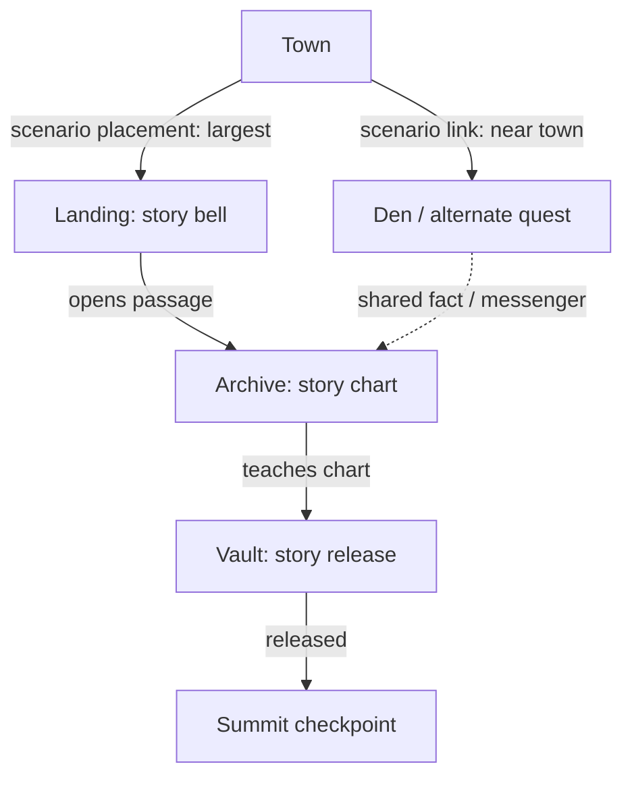

# Expressive capability: Gamma probes

**Question.** Not “can Kyr be made to run this?”, but “can an author state consequential fictional behavior in source that still means what it says?”

**Method.** Twenty-seven setting-independent fragments were played through `Tiny`, which uses the ordinary module compiler, campaign, actions, rules, inventory, and player choices. No TypeScript production semantics were added to make a probe pass. One negative probe is expected to fail compilation at a stated boundary; four mitigation probes show what a bounded author can do today; the larger scenarios test terrain, social approaches, reflection, sky laws, coordinated trials, Deem variation and missing dramatic forms. The executable sources are [test/small/gamma-expressive-capability.test.ts](../../test/small/gamma-expressive-capability.test.ts), [test/small/gamma-unusual-scenarios.test.ts](../../test/small/gamma-unusual-scenarios.test.ts), [test/small/gamma-sky-laws.test.ts](../../test/small/gamma-sky-laws.test.ts), and [test/small/gamma-dramaturgy.test.ts](../../test/small/gamma-dramaturgy.test.ts).

```sh
bun test test/small/gamma-expressive-capability.test.ts test/small/gamma-unusual-scenarios.test.ts test/small/gamma-sky-laws.test.ts test/small/gamma-dramaturgy.test.ts
```

Result: 27 passing probes, 137 assertions, about 7 seconds total. “Passing” includes negative probes proving that the compiler rejects unavailable dramatic declarations.

## Comparative result

| Behavior | Current verdict | What is real today | Exact limit |
| --- | --- | --- | --- |
| Compound with meaningful components | **Metadata-level** | An authored relation can bind parts to an item; part properties survive taking the whole; an action can query them. | Parts are independent entities, not structurally owned by the whole. Taking, dropping, using, or spending the item does not project through its components. |
| Existing item changed in place | **State-level** | `Item` supports states and `Change`; the same item instance keeps its ID and catalog kind. A changed state can gate another action. | State does not alter the item's combat definition, effects, modifiers, granted capability, or presentation. |
| Two materials mixed | **Executable for catalog results** | `making.kyr` binds a recipe, two distinct owned items, and a result item. Inputs are consumed and the result has the catalog item's actual use. | The shared actions are hard-coded for exactly two items and separate remedy/plain work paths. A genuinely new effect must already exist as a catalog item/ability. |
| Several observations unlock inquiry | **Executable by conjunction** | `Observe … teaches` establishes witnessed facts; an action can require all of them and becomes offered only then. | A `Rule` cannot assert `knows(...)`. Kyr has no derivation of a new discovery from several witnesses; there is no inferred-fact provenance. |
| Form/capabilities change, identity remains | **Emulated only** | A relation can mark a form and hand-authored actions can be gated by it. The character's ID is preserved. | The live creature body, ancestry/species projection, combat repertoire, stats, conditions, and portrait do not change. Polymorph is explicitly not executable in the catalog. |
| Several participants perform an act | **Executable for named roles** | Typed `member` parameters, `memberOf`, `distinct`, callings, and one `Action` express a two-role collective transaction. | There is no participant set, simultaneous contribution, role capacity, or variable N in the act's semantics. More roles mean repeated predicates and generated candidate combinations. |
| One object becomes several | **Executable, ancestry lost** | `Spend` removes the old item and `Give 2 dagger` creates two distinct runtime item IDs. | The action cannot name the generated IDs or attach lineage, shared properties, or history to them. |
| New evidence revises old knowledge | **Manual only** | An explicit action can retract stale knowledge and a fact can be marked `stale`. | A rule cannot derive or revoke canonical `knows(...)`; conclusions have no encoded witness set to revise automatically. |
| A temporary form grants capability | **Partly executable** | `granted` can project a timed group capability and it expires by upkeep. | The authored form and grant are independent facts; one can end while the other remains. There is no body or form overlay lifecycle. |
| Variable participation in one act | **Aggregate gate only** | `count(memberOf(?m, actor) and awake(?m))` can require at least N awake members. | The count does not identify contributors, allocate costs, roll each contribution, or bind one person to each necessary role. |

## Ripeness meter

A pass means only that a fragment executes. The meter asks whether the fragment remains consequential and intelligible when it is combined with ordinary play, saves, other modules and independent authors.

Each axis is scored `0`–`3`:

| Axis | 0 | 1 | 2 | 3 |
| --- | --- | --- | --- | --- |
| **D — Declaration** | only prose or generated names suggest the behavior | source runs but needs private facts and an expert explanation | one bounded form with a few repeated relations | independent author can state intent and get useful diagnostics |
| **S — Semantic fidelity** | the promised behavior does not happen | an isolated gate or text result happens | runtime behavior is consequential in the relevant subsystem | consequences compose across world, inventory/combat, presentation and rules |
| **I — Identity continuity** | same name only | stable ID but object/form/parts can silently drift | ownership, form or composition remains coherent in bounded transitions | provenance-bearing identity survives generation, transformation and reversal |
| **C — Causality and history** | no attributable cause/result | one explicit rule or action records a result | witnesses, costs and outputs are durable and inspectable | derivation, correction and lifecycle can be followed through ordinary tools |
| **G — Generality** | one-off TypeScript or setting special case | one fixed Kyr fixture | the same semantics lower into existing setting-independent runtime paths | installed domains and clients share it through typed, save/replay-safe contracts |

The total is orientation, not acceptance. The **bottleneck axis** is more important than the average.

- **0–5: represented.** Readable as fiction or runnable as a latch, not yet a dependable capability.
- **6–9: green/fragmentary.** Useful for bounded authored moments; composition gaps remain explicit.
- **10–12: near-ripe.** One or two remaining proof obligations, usually provenance, reversal, or cross-client projection.
- **13–15: ripe.** Native meaning, credible source, bounded lifecycle, durable history and a setting-independent proof path.

| Probe | D | S | I | C | G | Current ripeness | Bottleneck |
| --- | ---: | ---: | ---: | ---: | ---: | --- | --- |
| Component facts on a compound | 1 | 1 | 0 | 0 | 2 | **4, represented** | ownership/composition is not projected |
| Item state change | 2 | 1 | 2 | 1 | 2 | **8, green** | state does not alter instance mechanics |
| Two-input catalog recipe | 2 | 2 | 1 | 1 | 2 | **8, green** | no input lineage or authored result effect |
| Observations unlock inquiry | 2 | 2 | 2 | 1 | 2 | **9, green** | witnessed inference is not first-class |
| Named two-role collective | 2 | 2 | 2 | 1 | 2 | **9, green** | contributions and costs are not participants |
| One item becomes generated pieces | 1 | 2 | 1 | 0 | 2 | **6, green** | produced IDs have no ancestry |
| Evidence revises knowledge | 1 | 1 | 2 | 1 | 2 | **7, green only by explicit act** | support and correction are not maintained |
| Timed form and grant | 1 | 1 | 1 | 1 | 2 | **6, green with a custom rule** | overlay lifecycle is hand-synchronized |
| Polymorph-like body change | 0 | 0 | 1 | 0 | 1 | **2, represented** | there is no dynamic body/form projection |
| Aggregate participation | 1 | 1 | 1 | 0 | 2 | **5, represented** | count is not a contributor set |
| Eleven typed terrains to a floating city | 2 | 1 | 2 | 1 | 2 | **8, green** | terrain does not affect route, weather or material consequence |
| Three social approaches by fact and skill | 1 | 2 | 2 | 1 | 2 | **8, green** | speech terms and authority remain hand-authored |
| Gather thoughts to a same-command inference | 2 | 2 | 2 | 2 | 2 | **10, near-ripe** | reflection and support are a private relation/rule rather than a retained form |
| One-way waterfall and released cargo | 2 | 2 | 1 | 2 | 2 | **9, green** | gravity and destination are authored rules, not sky-law semantics |
| A state-gated updraft exception | 2 | 2 | 2 | 1 | 2 | **9, green** | the lift is one particular route, not a general force |
| Participatory sky-ferry engagement | 2 | 2 | 2 | 2 | 2 | **10, near-ripe** | progress, attribution and focus retention remain private or UI-dependent |
| Three independent trials lead through one road | 2 | 2 | 2 | 2 | 2 | **10, near-ripe** | no declared edge from one Situation to another |
| A Situation masquerades as a campaign | 1 | 1 | 2 | 1 | 2 | **7, green by convention** | no parent/child, story or epic identity |
| Deem varies a route and hazard | 2 | 2 | 2 | 1 | 1 | **8, green, assembly-level** | direct Kyr invocation and generated provenance are missing |
| Coordinate-free local and strategic topology | 2 | 2 | 2 | 2 | 2 | **10, near-ripe** | authored chart geometry still has no declarative qualitative layout vocabulary |

This is deliberately harsher than “works in one scenario.” A conventional stateful IF system can score well at declaration, inventory gating and bounded recipes. Kyrie's maturity test adds canonical knowledge, typed consequences, deterministic state, transactional commands, replay, multiple clients and setting separation. Its opportunity is not a parser trick; it is whether fiction becomes durable simulation semantics without becoming opaque.

### Ordinary IF floor and Kyr maturity threshold

| Concern | Reasonable IF floor | Kyr maturity threshold |
| --- | --- | --- |
| Objects and state | Rooms, inventory, properties, flags, containers and scripted transformations | Stable typed IDs; ownership and state projected across world, inventory, save and player view |
| Combining things | Parse inputs and replace one object or count | Two distinct instances, catalog/installed output semantics, conserved costs, and attributable lineage |
| Knowledge and clues | Set global flags; unlock verbs, topics or endings | Player-safe witnessed knowledge with source, correction, staleness and no arbitrary hidden-write rule |
| Character change | Swap descriptions, attributes or action lists | Enduring identity held apart from form/body/capacities through a reversible overlay and installed rules domain |
| Collective action | Resolve a scripted condition or a party aggregate | Bound participants, roles, distinctness, costs/contributions and one causal receipt |
| Time and consequence | Timers or scheduled events within one game | World clock, offscreen actors, interruption, duration, replay and save semantics using the same transition path |
| Authorability | A human can edit a readable script and tolerate local conventions | One declared semantic process lowers to ordinary Kyr, retains provenance and reduces duplicated private state across independent authors |
| Verification | A scripted walk reaches the desired state | Setting-independent contracts, seeded headless journeys, client parity, save/replay and an explicit lower-rung replacement for failures |

A probe that clears only the IF floor should be called **executable**, not mature. It earns a ripeness increase only where the `I`, `C`, or `G` axis becomes structural. Conversely, Kyr need not reproduce every IF surface: a bounded scenario that is honest, readable, causal and replay-safe may be more mature than a broader but latch-heavy imitation.

## Current mitigations and their limits

The four mitigation probes execute today, so the report does not assume every gap requires a new subsystem.

| Situation | Current mitigation | What it buys | When it stops being honest |
| --- | --- | --- | --- |
| A whole becomes several pieces | Predeclare each bounded descendant at `nowhere`, spend the parent, give the named pieces, and assert `splitFrom(piece, parent)` | Stable names, inventory identity, labels and authored lineage | Variable multiplicity, runtime-generated pieces, inherited mechanical properties, merging, or many possible divisions |
| Evidence corrects a conclusion | Mark the old fact stale and retract `knows(...)` in an explicit witnessed action; keep the prior witness facts | Durable revision, preserved testimony, legal player-facing correction | Automatic correction, multiple support sets, dependent inferences, or offscreen rule-driven learning |
| A form grants a temporary capability | Put form, grant, deadline and expiry in a small rule family, with one shared clock value where possible | Correct visible lifetime for one bounded form | Several overlapping forms, restrictions, body stats, equipment, interruption, or non-clock endings |
| Several people must contribute | Bind fixed `member` roles, require membership/capability/awake, and require `distinct` pairwise | Exact participant identity and one transactional outcome | Variable N, interchangeable pools, per-participant costs, failures or interruption |

No mitigation turns its private coordination into a language feature. A successful workaround should therefore reduce to a documented idiom, or remain a bounded authored case; it should not be reported as general support merely because its test passes.

## 1. A compound retains its parts' meanings

Intended behavior: a carried lantern still has a fragile glass globe and a combustible wick; an action may ask what the components are while the lantern remains one owned thing.

Minimal Kyr:

```kyr
Kind part. Relation componentOf(part, item).
Relation fragile(part). Relation combustiblePart(part).
Item lamp "a shuttered lantern" is lantern at yard.
Entity globe: part "the lantern's glass globe".
Entity wick: part "the lantern's wick".
Initially Assert componentOf(globe, lamp). Initially Assert fragile(globe).
Initially Assert componentOf(wick, lamp). Initially Assert combustiblePart(wick).
Action shade(actor: group) "Shade the lantern's glass" {
  Requires able(actor) and company(actor) and componentOf(globe, lamp)
    and fragile(globe) and componentOf(wick, lamp) and combustiblePart(wick).
  Result "The glass is shaded without touching the wick.".
}
```

Test: take the lantern, then assert that both part relations and part properties remain; assert that neither part acquired an ownership fact. The shaded-glass action executes from the component predicates.

- **Works:** stable part metadata and authored behavior can query it.
- **Awkward:** `Kind`, `Entity`, `componentOf`, and every part property must be invented and maintained by the author. The same lamp is one inventory item and several unrelated facts.
- **Cannot be faithful:** carrying, dropping, transferring, consuming, or destroying the whole does not change component availability. No component graph is projected into the runtime.
- **Architectural assumption:** item ownership is canonical creature inventory containing `{id, definition}`; world relations are a planning projection, not an object model.
- **Smallest improvement:** a narrowly typed `Part` declaration lowering to named component facts, with read-through queries from the whole. Do not add spatial or physics simulation; establish identity and availability propagation only.
- **Editorial:** the individual relation names are intelligible, but the declaration is bookkeeping-heavy and can drift from the item it purports to describe. This is an authorability warning, not a syntax failure.
- **Feature map:** capability `belongings`, **Belongings with a history**. Proposed pin: **Character: A compound keeps what its parts mean**.

## 2. An existing item is transformed in place

Intended behavior: a longsword receives an enchantment, remains that sword with its history, and gains a new consequential use.

Minimal Kyr:

```kyr
Item blade "a plain longsword" is longsword at yard {
  State plain "The blade is plain steel.".
  State bright "A blue word runs along the blade.".
  Change enchant "Lay the star-word on the longsword" from plain to bright.
}
Action cross_ward(actor: group) "Cross the silver ward with the star-worded blade" {
  Requires able(actor) and company(actor) and state(blade, bright).
  On success { Assert wardCrossed(actor). }
}
```

Test: perform the item's `Change`; assert that its state is `bright`, its item instance ID is unchanged, and its `itemKind` is unchanged. The new ward action appears only afterward.

- **Works:** mutable description/state on an existing item; identity and ownership survive; consequences can be authored as actions.
- **Awkward:** every mechanical meaning of “enchanted” must be repeated as a predicate or action requirement.
- **Cannot be faithful:** the enchantment cannot modify weapon damage, resistance, granted skill, consumable effect, or combat repertoire on this item instance. Replacing the item with an enchanted catalog kind would lose or manually copy identity/history.
- **Architectural assumption:** an inventory instance points to one static catalog definition. States live in the world projection but are not item-definition overlays.
- **Smallest improvement:** allow an item state to grant a bounded existing overlay (for example a modifier, ability, or capability), projected while that state holds, on the same instance ID. Reuse the catalog's typed item fields rather than inventing enchantment rules.
- **Editorial:** the `State`/`Change` block reads naturally and is one of Kyr's strongest current expressions. The gap appears in mechanics, not prose.
- **Feature map:** capability `belongings`, **Belongings with a history**. Proposed pin: **Character: A kept thing changes without becoming another thing**.

## 3. Two materials make a third with a new effect

Intended behavior: one flask of lamp oil and one strip of linen become an oil firebomb that has its own use.

The shared authoring is already in `data/rules/making.kyr`:

```kyr
Entity oil_and_rag: recipe "a rag stuffed in a flask of lamp oil".
Initially Assert takes(oil_and_rag, lamp_oil).
Initially Assert takesWith(oil_and_rag, bandages).
Initially Assert makes(oil_and_rag, oil_firebomb).
```

The fragment only places two concrete items:

```kyr
Item oil "a flask of lamp oil" is lamp_oil at yard.
Item rag "a strip of linen" is bandages at yard.
```

Test: take two different instances, select `make_plain`, execute it, and assert that both material kinds are gone and `oil_firebomb` is in the inventory.

- **Works:** distinct inputs, consumption, output instance, and the output's executable consumable effect all use current runtime behavior.
- **Awkward:** the relation is encoded by a recipe entity plus four-or-more `Initially Assert` lines; remedy and plain work are separate duplicated action declarations in the shared rules.
- **Cannot be faithful:** Kyr cannot declare an output effect from the inputs themselves. The result must be a pre-existing catalog kind. The shared machinery assumes two inputs and does not constitute a general transformation language.
- **Architectural assumption:** recipes are ordinary world facts feeding one shared action; item semantics belong to static catalog definitions.
- **Smallest improvement:** a `Recipe` declaration with named inputs, output, work/check, and consumption policy, lowered into the existing making actions. Keep the scope to two inputs and catalog results; this is authoring support, not a new crafting system.
- **Editorial:** the played act reads well (“make X of A and B”); the recipe declaration itself is more schema than fiction. It is understandable but unnecessarily encoded.
- **Feature map:** capability `guilds`, **Guilds and crafts**. Proposed pin: **World: Two materials become a third with a real effect**.

## 4. Two observations support a deduction and open inquiry

Intended behavior: fresh mud and paired drag marks separately become known; only together do they support asking who dragged something to the river.

Minimal Kyr:

```kyr
Observe mark at yard when true
  "A pale lip of fresh mud lies on the landing-stone." teaches mud.
Observe scrape at yard when state(reeds, open)
  "Below the reeds, paired scrapes run into the water." teaches scratch.
Action inquire(actor: group) "Ask who dragged the weight to the river" {
  Requires company(actor) and knows(actor, mud) and knows(actor, scratch).
  Result "Together, the mud and the scrapes are a question worth putting to the ferryman.".
}
```

Test: at start the action is absent; opening the reed screen exposes the second observation, both facts become known, and the action appears and executes.

- **Works:** witnessed discoveries, conjunction, and consequence gates are native and readable.
- **Awkward:** if the deduction itself should enter the journal or be passed on, the author needs a separate fact and act, or another `teaches` event. There is no direct “from A and B, conclude C”.
- **Cannot be faithful:** the natural `Rule … { Assert knows(actor, C). }` is rejected because rules cannot change canonical discovery knowledge. A private `deduced(...)` relation would not have the semantics, provenance, or presentation of knowledge.
- **Architectural assumption:** knowledge is not ordinary mutable logic; it is canonical and must be witnessed through seen/told words. This is a sound integrity constraint.
- **Smallest improvement:** an `Inference`/derived discovery declaration naming witnesses and a narrated conclusion. Lower it to the existing observation/action teaching path, preserving each source and the moment learned, rather than allowing arbitrary rules to write knowledge.
- **Editorial:** direct conjunctive gating is unusually clear. A generated latch or counter would be an authorability failure; the fixture deliberately avoids one.
- **Feature map:** capability `investigation`, **Troubles with more than one cause**. Proposed pin: **Choice & Consequence: Two observations open an inquiry**.

## 5. A character changes form and capabilities but keeps identity

Intended behavior: Mara becomes a wolf, gains wolf acts, then remains Mara when the form ends.

Smallest current Kyr that executes:

```kyr
Kind form. Entity wolf: form "wolf form". Relation shapedAs(group, form).
Action become_wolf(actor: group) "Take wolf form" {
  Requires able(actor) and company(actor) and not shapedAs(actor, wolf).
  On success { Assert shapedAs(actor, wolf). }
}
Action bite(actor: group) "Bite as a wolf" {
  Requires able(actor) and company(actor) and shapedAs(actor, wolf).
  Result "The wolf closes its teeth on the offered target.".
}
```

Test: perform the transformation and the bite action, then compare creature ID, name, and ancestry before and after. The identity comparison passes because the runtime body never changed.

- **Works:** authored form fact and additional custom acts; stable character ID and name.
- **Awkward:** every changed-form capability, restriction, and reversion is a private relation/action. The prose promises a body the runtime does not have.
- **Cannot be faithful:** no dynamic body/species overlay exists. The live `raceId`, stats, damage, natural weapons, armour, usable abilities, restrictions, and portrait remain human. The catalog records Polymorph Other as unsupported for `recalculateHp` and the `polymorphed` status.
- **Architectural assumption:** creature variants and stat-block overlays are selected when the creature is created, then stored; body identity and combat projection are not a reversible runtime layer.
- **Smallest improvement:** a temporary form overlay over an existing creature ID, selecting an existing species/variation body plus an explicit keep/replace policy for identity, equipment, learned abilities, and health. Prove one reversible form before broad polymorph coverage.
- **Editorial:** the transformation sentence is intelligible, but the source is semantically misleading: `shapedAs` does not make the character a wolf. This is an authorability failure despite successful execution.
- **Feature map:** capability `spellcasting`, **Spellcasting**. Proposed pin: **Conflict: One character, two bodies, one identity**.

## 6. Several participants perform a collective act

Intended behavior: a warrior raises one end of a beam while a cleric wedges the stone; both roles and the single outcome belong to one act.

Minimal Kyr:

```kyr
Action raise_beam(actor: group, lever: member, brace: member, site: place)
    "{lever} heaves while {brace} sets the stone under the beam" {
  Requires able(actor) and company(actor) and at(actor, yard)
    and memberOf(lever, actor) and hasCalling(lever, calling_warrior) and awake(lever)
    and memberOf(brace, actor) and hasCalling(brace, calling_cleric) and awake(brace)
    and distinct(lever, brace).
  On success { Assert beamRaised(actor). }
}
```

Test: a two-person company offers the fully bound act and executing it asserts the shared outcome.

- **Works:** Kyr can bind two existing members, check different capabilities, reject the same person in both roles, and execute one transactional outcome.
- **Awkward:** every participant role repeats membership, consciousness, and capability predicates. For N arbitrary members, the source must choose an exact maximum or only test a count without naming who contributes.
- **Cannot be faithful:** there is no first-class participant collection, no commitment/availability across time, and no per-role contribution to a check or result. One action can nevertheless represent many ordinary two-role moments honestly.
- **Architectural assumption:** action arguments are scalar typed candidates. The runtime binds individual variables; its actor remains one group and it has no list-of-participants value.
- **Smallest improvement:** reusable participant-role declarations on an action, lowering to the same scalar candidates while contributing names to one group resolution. Add no scheduler: begin with role, capability, minimum cardinality, and distinctness.
- **Editorial:** for this exact two-role act the source is clear and nearly natural. It degrades quickly into repeated latches and generated labels for larger ensembles.
- **Feature map:** capability `companions`, **Companions and hirelings**. Proposed pin: **Character: A company acts through several of its members**.

## Harder friction probes

### 7. One object becomes several with history

Intended behavior: break a particular blue-daubed sword into two knives; later play can identify both as pieces of that sword, and consequences such as an owner's curse or a smith's work follow them.

```kyr
Item sword "the blue-daubed sword" is longsword at yard.
Relation splitFrom(item, item).
Action break_sword(actor: group) "Break the blue-daubed sword into two knives" {
  Requires able(actor) and company(actor) and holding(actor, longsword).
  On success { Spend sword from actor. Give 2 dagger to actor. }
}
```

The test proves that the old concrete item disappears and two distinct IDs, `dagger_given1` and `dagger_given2`, are owned. It also proves that `splitFrom` contains no fact: the IDs do not exist in authored source and are made later by `Consequences.hand`.

- **Works:** runtime creation, multiplicity, ownership, and distinct instance IDs.
- **Awkward:** the action says “two knives” but the only available output meaning is the catalog kind `dagger`. The source cannot name or label the individual generated pieces.
- **Cannot be faithful:** lineage, division of properties, and later recombination cannot be declared over runtime-generated IDs.
- **Architectural assumption:** generated item IDs are an inventory consequence, downstream of module compilation and action candidate binding.
- **Smallest improvement:** allow a producing change to bind generated output handles for the remainder of one transaction, with an optional provenance edge to consumed inputs. Keep output kinds catalog-backed.
- **Editorial:** this reads naturally as an action but says more continuity than its effects actually preserve.
- **Feature-map pin:** `belongings`, **Belongings with a history**. Proposed pin: **Character: One kept thing survives as its descendants**.

### 8. New evidence revises a prior deduction

Intended behavior: a witness and ferry tally support a conclusion; contradicting evidence later withdraws that conclusion and its dependent action without pretending the witness never spoke.

```kyr
Rule revise when knows(party, contradiction) and knows(party, witness) {
  Retract knows(party, conclusion).
}
```

The test expects this fragment to fail at `ModuleCompiler`: `Rule revise cannot change canonical projections … or discovery knowledge`.

- **Works:** authors can explicitly mark facts `stale`, teach a correction in an action, or retract `knows(...)` from an explicit player action.
- **Awkward:** revision requires private conclusion, stale, and replacement-fact choreography, plus remembering every action gated by the old fact.
- **Cannot be faithful:** a conclusion has no first-class support set, confidence, or correction relation; a rule cannot maintain it from witnesses.
- **Architectural assumption:** canonical knowledge is deliberately not writable by arbitrary world rules, preserving the rule that learning must be seen or told.
- **Smallest improvement:** a witnessed `Inference` with supports and one narrated conclusion. When supports change, the inference can be stale/withdrawn through the same canonical teaching boundary, with history retained.
- **Editorial:** the rejected Kyr is concise and obvious. A manual replacement would be executable but authorability-heavy.
- **Feature-map pin:** `investigation`, **Troubles with more than one cause**. Proposed pin: **Choice & Consequence: A correction replaces a warranted belief**.

### 9. A temporary form owns a temporary capability

Intended behavior: cat form lasts two watches; while it lasts, the character can cross the ledge; when it ends, the form and capability end together.

```kyr
Assert shapedAs(actor, cat). Assert granted(actor, climbing).
Set grantedUntil(actor, climbing) to watch(clock) + 2.
```

The test proves that the timed `granted` capability appears and expires. It also proves that `shapedAs(actor, cat)` remains: there is no relation between the lifecycle of the form and that of the grant.

- **Works:** a group can receive a timed capability, and upkeep can revoke it.
- **Awkward:** the author must synchronize each of the form's effects, each deadline, and reversion as separate facts.
- **Cannot be faithful:** the form is not projected as a creature body, and there is no owning lifetime for its capabilities, restrictions, or equipment treatment.
- **Architectural assumption:** `granted` is a capability projection owned by a group deadline; creature form is only whatever authored relations say it is.
- **Smallest improvement:** put temporary body/capability changes inside one reversible overlay with the same stable creature ID and one expiry/retraction boundary.
- **Editorial:** two short lines compile into a misleading fiction: the cat grant can end while the source still says the character is a cat. This is a consequential authorability failure.
- **Feature-map pin:** `spellcasting`, **Spellcasting**. Proposed pin: **Conflict: A form and everything it grants end together**.

### 10. An aggregate collective has participants but no contributors

Intended behavior: at least three awake members raise a frame; each contributes, the result names their costs, and failure can identify what the group lacked.

```kyr
Action raise_framing(actor: group, site: place) "Raise the hall's framing together" {
  Requires able(actor) and company(actor) and at(actor, site)
    and count(memberOf(?m, actor) and awake(?m)) >= 3.
  On success { Assert framingRaised(actor). }
}
```

The test proves that the action is offered and executes without any member ID in its command.

- **Works:** aggregate membership and qualification by count; one atomic action and one outcome.
- **Awkward:** the prose must promise “three pairs of hands” without the action binding any three people.
- **Cannot be faithful:** the source cannot identify contributors, charge per-member fatigue/resources, distinguish roles within an aggregate, or say which missing contribution blocked the act.
- **Architectural assumption:** action parameters are scalar candidate values; `count(...)` is a predicate-only existential witness, not a reusable participant set.
- **Smallest improvement:** an action participant set with a cardinality, qualification predicate, distinctness, and optional ordered roles, still lowering to one action transaction.
- **Editorial:** the aggregate form is compact, but opaque about who acts. It should be treated as a group act, not as a jointly authored contribution, until participants exist.
- **Feature-map pin:** `companions`, **Companions and hirelings**. Proposed pin: **Character: Three named contributors raise one frame**.

## Pins affected by Kyr maturity

These are proposed feature-pin ideas, not register rows and not additions to beta's queue. Their value is that the same pin can measure the language/runtime lift rather than only the new construct's grammar.

| Maturity improvement | Feature-map capability | Proposed pin | What must change when the improvement lands |
| --- | --- | --- | --- |
| Semantic retention (MT-30): keep the authored process, participants, phases and source beside its lowering | `forms`, **Authoring forms and their lint** | **Language: A compound, recipe, correction or collective survives lowering** | A semantic inspection names the high-level process and the ordinary relations/actions it became; no test infers it from generated IDs |
| Symbol binding and source identity (OR-700, OR-1370, OR-1371) | `forms` | **Language: A private latch is diagnosed, traced and replaced without ambiguity** | Part, form, witness and participant names bind to the intended declaration; diagnostics retain exact authored origin, including generated references |
| Typed vocabulary (OR-744), module-owned verbs and lowerings (OR-1332) | `forms`, `guilds` | **World: Make, graft or transform keeps one typed meaning** | The action author calls a domain verb; execution, forecast and facets read its lowering, not its words or a setting-specific TypeScript branch |
| Outcome/causal summary and TB-09 workflow authority (OR-206, M22-beta) | `belongings`, `investigation`, `companions` | **A consequential transformation tells the same cause and effect before and after** | Preview, narration, Atlas facets and all clients agree about consumed parts, learned facts, changed form and named contributors |
| Atomic command proof (MT-24) | `belongings`, `guilds` | **A failed transformation changes none of its inputs, outputs or history** | Faults in any component of splitting, mixing or granting leave a single prior state, then commit one receipt |
| Form held apart from identity (OR-1205) | `spellcasting` | **Conflict: One character, two bodies, one identity** | Form/body, capacities, presentation and expiry change while identity, durable history and selected carried obligations remain |
| Statement result references (OR-1328) and one duration notion (OR-1331) | `spellcasting`, `companions` | **An effect's consequence and duration can feed its next clause and every contributor** | “for as long as”, “what this harmed”, or “who took part” are bound runtime results, not repeated private measures |
| Witnessed semantic knowledge and revision | `investigation` | **Choice & Consequence: Two witnesses establish a conclusion; a third revises it** | A fact keeps support/provenance, and supported actions update without arbitrary rule writes to `knows(...)` |

The pins most worth writing first are not necessarily the hardest. Four can track near-term maturity without inventing a transformation ontology:

1. **A two-role collective names and attributes the outcome to its members** (`companions`). It turns current scalar binding into a rigorous baseline for later participant sets.
2. **A mixed item has a provenance edge to its consumed inputs** (`guilds` plus `belongings`). It exercises produced identity without requiring general crafting.
3. **An item state predicts and performs exactly one real catalog consequence** (`belongings`). It distinguishes a label change from an instance overlay while reusing existing item semantics.
4. **A retained high-level form leaves fewer private control facts than its lowering** (`forms`). This is the editorial/authorability pin: source must become clearer, not merely shorter.

The [beta brief](mission-22-beta/BRIEF.md) asks for retained high-level fictional meaning, atomic history, one action/Outcome, setting independence and a visible authorial dividend. The [platform-separation direction](mission-22-beta/platform-separation.md) makes the same improvement measurable through one interpreter path, explicit ports and one client lifecycle. The [transformation direction](../design/direction-2026-11-26-transformations.md) names the later semantic target: stable identity apart from form, with installed domains supplying the forms. These pins are the bridge between the bounded experiment and that maturity work; they do not commit the whole direction.

## How the meter moves

The practical reading is not “which grammar shipped?” but “which axis ceased to be a private convention?”

| Improvement lands | Expected meter movement | Pins most affected |
| --- | --- | --- |
| Semantic record retains high-level process and origin | `D` +1, `C` +1 on first-class forms; execution score need not change | all `forms` pins, then recipe/collective/compound |
| Typed lowering and module-owned verbs | `D` +1 and `S` +1 for authorable domain operations; `G` +1 once the same path is setting-portable | craft, transformation, item-consequence |
| Stable item ancestry or output handles | `I` +1 and `C` +1 for split/mix; aggregate rises only if produced IDs remain addressable | belongings, recipe |
| Witnessed inference with revision | `C` +1 and `S` +1 for investigation; automatic rule writes stay forbidden | inquiry, correction, dependent action |
| Reversible form/body overlay | `S`, `I` and `C` +1 for polymorph; `D` rises only with a readable declaration | spellcasting and temporary-capability pins |
| Participant sets with costs and roles | `D`, `S`, `C` +1 for variable collectives; aggregate and named-role pins converge | companions and process pins |
| One outcome/receipt across clients | `S`, `C` and `G` +1 for any multi-effect behavior; catches prose/mechanics divergence | all consequential transformation pins |

A meter movement should be backed by a pin changing state or by a cheaper invariant/failure diagnostic. A grammar production, parser count, or line-count reduction alone is not a maturity gain.

## Unusual scenarios

### Eleven terrains, then a city in the sky

The terrain probe uses every `terrainkind` in the current shared rules: forest, marsh, mountain, frost, desert, hills, jungle, volcanic, salt flat, reef and archipelago. It authors one more `sky` terrain kind and a `Place Aeral … is settlement elsewhere`, reached through a `portal` passage. Eleven passages carry the company through the twelve places in the sequence. A final action requires the `terrain(place, kind)` fact and `been(party, place)` for every stop.

```kyr
Passage leg_11 "the ascent to Aeral" is portal
  between terrain_10 and floating_city taking 11 hours.

Action complete(actor: group) "Name the road's twelve terrains at Aeral" {
  Requires company(actor) and at(actor, floating_city)
    and been(actor, terrain_0) and terrain(terrain_0, forest)
    … and been(actor, floating_city) and terrain(floating_city, sky).
}
```

- **Works:** every stop is a typed terrain fact; travel time, passage identity, player location, `been` history and the final affordance execute through the ordinary route machinery. An authored floating settlement is not foreign to Kyr: it is a place, a shelter mode and a portal relation.
- **Awkward:** each route and terrain pairing is repeated. The loop says that terrain was visited, but the route does not read the terrain relation to choose cost, exposure or permissible means.
- **Cannot be faithful yet:** terrain is metadata, not a provider of travel resistance, weather, ecology, material opportunity or route law. The engine knows Aeral is elsewhere and reached by a portal; it does not know a floating city moves, sheds weather, or cannot support an overland connection.
- **Mitigation:** keep terrain effects at each `Passage`, `Action` or `Observation` while the terrain ontology remains data. Do not infer mechanics from the terrain name.
- **Pin:** `journeys`, **Journeys over known ways** / gamma `G3 Relational pins`: **World: One passage chain traverses and remembers materially different terrains**. First prove route/cost; do not make “weather and ecology differ because prose says so” part of acceptance until those systems read terrain.

### Persuade, intimidate, or reason with the same person

The social probe gives a keeper a gate question. The company has three members who bring persuasion, intimidation and lore between them. Each approach is offered only when its relevant fact is known and the company can bring its capability:

```kyr
Action persuade(actor: group, site: place) "Persuade the keeper to honour the old seal-oath" {
  Requires … knows(actor, seal_oath) and capable(actor, persuasion) and not gateAnswer(actor).
  Resolve check(actor, persuasion, dc_fair).
  On success { Assert gateAnswer(actor). Assert persuaded(actor). }
  On failure { Assert refused(actor). }
}
```

The intimidation branch requires the cargo ledger; the reasoning branch requires the tide marks and uses lore. The test proves that all three are offered to a three-skilled company, only the oath branch is offered when that is the only known fact, and a warrior-only company sees intimidation but not the other two.

- **Works:** knowledge eligibility, group capability provision, concrete skill checks, exclusive shared consequence, success/failure prose and stable command identity are native.
- **Awkward:** the same answer is repeated as three actions, the facts are bespoke predicates, and the source does not retain that these are alternatives within one social encounter.
- **Cannot be faithful yet:** Kyr does not declare an offer, authority, refusal condition or commitment as a typed social speech act. The check acts on a personal state chosen by the author; it does not know whether the keeper can open the gate or whether an intimidation is later recognised.
- **Useful bounded mitigation:** a small `Topic` or `Occasion` with three actions and one shared `gateAnswer` relation is coherent. Do not add a universal disposition meter; it would erase the particular terms and evidence that make the choice intelligible.
- **Pin:** `talk-checks`, **Checks put in conversation**: **Conversation: Knowledge and capability change the available ways to persuade, press or reason**. A second pin under `investigation` can prove that facts alter the available argument, not merely the check modifier.

### Gather thoughts and permit inference

The reflection probe starts with two known facts: clay from an orchard and that clay appearing at two low tides. No hidden information or new sight is added. The action creates a bounded `reflecting` relation:

```kyr
Action gather_thoughts(actor: group, site: place) "Gather your thoughts over the two accounts" {
  Requires … knows(actor, clay) and knows(actor, tide)
    and not knows(actor, route) and not reflecting(actor).
  Time 1.
  On success { Assert reflecting(actor). }
}
Rule thoughts_deduce when reflecting(party) and knows(party, clay) and knows(party, tide)
    and not knows(party, route)
    says "Green clay at the quay, twice at the low tide: the jars came through the old drain."
    teaches route { Assert deduced(party). }
```

`Outcome.taught` returns `route` before the action is taken. After the one action, the route is known, the deduction is durable, and a new inquiry is offered in that same command.

- **Works already:** one bounded act, a rule-driven inference, a truthful knowledge promise, same-command teaching, narration and a new legal action. This is not TypeScript emulation; it is the engine's ordinary teaching path.
- **Awkward:** `reflecting`, `deduced` and the rule's support list are private state. The system does not retain a general “these witnesses support this conclusion” object.
- **Cannot be faithful yet:** it cannot automatically revise the conclusion or show a reason graph if a witness becomes stale. A second deduction requires another rule and another marker unless the author accepts a plain observation-driven inference.
- **Smallest improvement:** retain `Inference` as a high-level semantic record lowering to the existing `Action` + `Rule says … teaches` pattern. Its first proof should not change execution; it should retain witnesses, conclusion, trigger and source trace.
- **Pin:** `investigation`, **Troubles with more than one cause**: **Choice & Consequence: Gathering one's thoughts makes a known inference, and the row tells it beforehand**.

## Incidental laws of a sky terrain

The waterfall scenario is an intensification of the earlier route-through-terrains probe. Mero and Nacre are both typed `sky` places. Their shared gravitational fact is not a global physics engine; it is a small set of honest authored laws whose consequences can be tested.

### Waterfall: the consequential asymmetry

```kyr
Passage fall "the waterfall between Mero and Nacre" is drift
  between upper and basin one way taking 10 minutes.

Action release_jar(actor: group, carrier: member, site: place)
    "Let the green-clay jar fall into the water" {
  Requires … ownedItem(jar, carrier).
  Resolve drop(jar, carrier).
  On success { Assert falling(jar). Assert at(jar, upper). }
}

Rule gravity when falling(?x) and at(?x, upper) {
  Retract at(?x, upper). Assert at(?x, basin). Retract falling(?x).
}
```

The one-way `Passage` is native topology: there is no reverse action to choose. The rule moves the concrete item identity after it is dropped, so the lower basin can receive and give exactly that jar, not a replacement by kind. A test proves that the item is unowned after release, appears at the lower basin, and is recovered into inventory there.

The friction is also concrete. Dropping the carried item removes its world location. To let gravity move it, the author must explicitly put it back at the source in the same success effects and mark it `falling`, then let a second rule move it. There is no compact `Drop x into passage p` change which means “release identity, immediately subject it to this way.” It is honest but more machinery than the fiction warrants.

### Updraft: an exception with a precondition

A `wind-kite` with `furled`/`caught` states gates a second one-way passage from the lower island to the upper one:

```kyr
Passage lift "the wind-kite's upward climb" is drift
  between basin and upper one way opening when state(kite, caught) taking 20 minutes.
```

At the lower basin the route is absent while the kite is furled. Raising the kite exposes exactly one upward command. This makes an important distinction: gravity is the default, while an authored machine or capability provides an exception. Kyr can express that naturally without granting the passage global reverse symmetry.

### Falling sound: an epistemic law

An upper-island bell sends `warningSent(party)`. No fact is taught at the upper island. On arriving at the lower basin, an observation that reads the downward warning becomes perceptible and teaches `falling_bell`:

```kyr
Observe bell_below at basin when warningSent(party)
  "Under the fall's noise comes one clear bell-note: the line above has parted."
  teaches falling_bell.
```

This is a small but useful sky rule: sound and water can carry information down a topology, and the knowledge boundary only admits it where the company can perceive it. It is not omniscience from a source relation. The same pattern supports falling rain, bells, messages, dropped maps and smoke, each with authored conditions.

### Other incidental sky laws worth testing

- **Cloud occlusion:** a lower settlement is present and routeable but not visible or nameable until a sky/wind state clears. This exercises knowledge integrity, not geography generation.
- **Ballast conservation:** lifting a basket raises only an explicitly bounded load; a heavy object must be put down, weakening movement and making the cause visible in inventory.
- **Tether and snap:** a one-way lift route is available only while a line-state and wind-state agree; the failure leaves the company at an intermediate aerial place rather than silently at its origin.
- **Falling water as work:** a mill wheel's state advances with the fall's flow; stopping the flow suppresses downstream craft without changing the waterfall passage itself.
- **Weather as a travel window:** a calm-state permits the delicate kite, a gust state prohibits it, and a squall can interrupt an already engaged crossing.
- **Separated clocks:** the floating islands move relative to a ground city while their own local passages remain stable. This is presently a private schedule/route problem and deserves its own pin before being called a terrain law.

These are bounded environment rules, not a call for a generalized celestial-physics subsystem. The near-term pressure point is composition: `terrain`, passage, item movement, observation, and time can all read a common authored condition without setting-specific TypeScript.

The repo's notes ground the comparison. **The Cleave** already models gusts, a one-way gliding passage, a brake, a hazardous silk route and a flitter that is legal only in calm weather; the sky probes add concrete cargo identity and downward knowledge, rather than claiming a new environmental system. The **Fun Friday** record asks for a specific world activity that responds, persists and can be enjoyable without compulsory reward; [focus-activity-engagement.md](../design/focus-activity-engagement.md) says current pins too often model that something happened rather than how it went. The ferry therefore spends its evidence on moves, a halfway state and withdrawal. Finally, **The Eel Bell's friction** records the lack of conditional effects and the resulting ladders of rules/measures; the ferry hits exactly that pressure in its `crossing` counter, while avoiding a claim that one counter is a reusable activity model.

## OR-173: an intermediate focused activity

The Fun Friday audit identified a distant behavioral pin: ordinary activities remember that something happened, but usually do not model participation, stakes, a move sequence, or a narrowed frame. The sky-ferry probe reaches an intermediate, not the completed pin.

It provides:

- an invitation/entry at the upper ledge, with a penny at risk;
- two participant entities, the raft and Keel, asserted through `engaged_in`;
- two meaningful moves, a safe trim and a chance-based updraft catch;
- a progress measure that can stop at one successful trim;
- one explicit withdrawal, which forfeits the stake;
- one resolution that retracts engagement, moves the company to the lower island, and returns two pennies;
- narrowed authoritative choices while the engagement holds, with waits removed.

```kyr
Action trim(actor: group, site: place) "Trim the sunward sail and hold" {
  Requires … engaged_ferry(actor) and engaged_in(actor, raft).
  On success { Increase crossing(actor) by 1. }
}

Rule ferry_arrives when engaged_ferry(party) and crossing(party) >= 2 {
  Assert ferryDone(party). … Retract at(party, upper). Assert at(party, lower).
  Increase quantity(party, gold) by 2.
}
```

The test proves an intermediate state: after one trim, the party is still on Mero, `crossing == 1`, the screen remains engaged, and the same moves are available. A second trim resolves it. Withdrawing ends the engagement at Mero and records the forfeiture.

What it does **not** prove:

- focus is set by the engine's act that began it; the `engaged_in` relation is still the author's coordination device;
- each action's participation is inferred by explicitly naming the raft in its predicate, as `Engaged` retains actions that name the subject;
- the scene is narrowed from generic UI state, but a general engine-owned participant/focus record does not exist;
- progress, stake and the ferry's form remain private measures/relations rather than a retained activity declaration;
- interruption, wind changes, leaving through a route, and a companion as a separately affected participant remain untested.

That is an honest intermediate state toward OR-173 rather than a decorative pass. It extends beyond “fictionalized activity”: choices affect the process, a withdrawal has consequences, and the world has a halfway state. It stops short of “focus, activity and engagement told apart by the engine.”

Proposed pin under `engagements` / `forms`: **A crossing is played through a halfway state, narrowed to its own moves, and may be withdrawn at stated cost**. The acceptance includes the middle state; checking only arrival would let a two-command chain masquerade as participation.

## Dramaturgy as causal economy

The design premise is useful as an engineering test: a narrative form is not a sequence label. It is an economy of causes, gates, consequences and later uses. A beat earns its place when it changes which situations, actions or understandings can follow.

### A: A coordinated chain of events

The storm-road fragment uses no `at x, y` coordinates. It has four topological places connected by gated passages. The chain is:

1. Answer the bell: this asserts the answered fact, teaches the bell fact, increases urgency, gives rope, and brings the watchers to the landing.
2. Enter the archive: the passage opens only from the answered fact.
3. Read the chart: this sets the next knowledge and a changed urgency.
4. Enter the lower vault: the passage opens only from the chart knowledge.
5. Spend the rope and release the cloud-gate.
6. Enter the summit: the final passage opens only from the release.

Kyr expresses this chain without private TypeScript. Each effect is an ordinary `Assert`, `Set`, `Increase`, `Give`, `Spend`, or `Bring`. The played sequence proves the state transitions and final urgency.

What it does **not** express is the chain as one object. `ring_bell`, `read_chart`, and `release_gate` do not retain a common causal thread. A reader reconstructs it by noticing that one declaration writes what a later predicate reads. The current `WhyProcess` report can list the affecting actions, but the analysis is scan-wide and often noisy: the campaign `Situation`'s at/released predicates matched many generic movement actions, not a concise parent-to-child chain.

### B: Nested, interlocking situations with independent gates

The same source declares four `Situation` records:

- **The storm call:** resolve the bell and be joined by the watchers;
- **The archive trial:** independently resolve the chart;
- **The release trial:** independently resolve the gate;
- **The three-story campaign:** observe all three as one larger resolution.

Each of the three local situations can advance to its turn or done phase independently. The larger `Situation` has its own phases and can finish only after the child facts and final place hold.

This is executable and semantically retained. `Situations.lint` proves that a turn, core and resolvability exist. `WhyProcess.phase` reconstructs the current phase after each act. The children do not need to know that the larger situation exists.

The missing point is structural: the larger situation says only that it reads the same facts. It cannot declare “contains these three situations,” “situation B follows A,” or “this gate is independent but required by the parent.” Its `participants` are empty and its `effects/writes` are empty because it lowers to a descriptive record, not a causal process.

This is the most credible current compromise: use ordinary predicates for interlocking causation and `Situation` for inspection, lints and phases. Do not claim a `Situation` is runtime nesting.

### C: Campaign, Epic and Story

There is no `Story`, `Epic`, or `Campaign` declaration in Kyr. A negative parser probe proves each is rejected as an unknown declaration.

A campaign can currently be assembled as:

- an installation manifest with multiple modules;
- exported/imported facts, entities and relations;
- `Situation`, `Objective`, `Chapter`, `Ending`, `Promise`, `Occasion` and `Route` records;
- a final campaign-level `Ending` or objective chosen by the author.

The long Sallowfield–Tallow thread is a real proof that different adventures can share one installation and consequences. Its friction also names the cost: each local ending needs explicit handling so it does not end the whole campaign; relation/event imports are hand-managed; cross-module state is mostly events and items; no module-level numeric continuation describes “how far the war has got”; and a bundle named `long-campaign.json` is not a campaign construct at all.

Smallest credible `Campaign` improvement, if earned by a second worked case:

```text
Campaign storm_road {
  Story bell of storm.
  Story archive of archive_trial after bell answered.
  Story gate of release_trial after knows(party, chart).
  Checkpoint weather ...
  Continues when ...
}
```

Do **not** implement that syntax yet. First establish a compiler record containing:

- stable IDs for member Stories/Situations;
- typed predecessor/gate/successor edges;
- an independent completion predicate per member;
- a campaign continuation predicate distinct from a local ending;
- shared facts/events that may travel between stories;
- provenance to the lower-level records and authored producers.

A compiler-only `Campaign` record can be valuable if it reduces orchestration. A new runtime scheduler or quest engine would duplicate Kyr's transition engine and violate the beta brief.

### D: A subterranean adventure topology

Today there are three different but adjacent structures:

1. **Local topology:** `Place` and `Passage`; coordinates are optional, and a wholly coordinate-free chain executes.
2. **Strategic placement:** scenario manifests such as `fellowship` use `largest` and `along:a -> along:b -> along:c`; `ScenarioTowns` consumes them. No x/y pair is authored.
3. **Cross-scenario links:** `drover.scenario.json` links its lair to a placed `den` near the town. The link constrains placement and module installation; it is not a causal quest edge.

A useful subterranean analysis can therefore treat these as separate edge types, not silently flatten them:



A generated world could use such a graph as a **placement constraint**, not as plot execution:

- a story's entry/exit roles choose places;
- `near`, `along`, `largest`, `toward` and links give strategic geometry;
- prerequisite plot checkpoints provide required knowledge/items/capabilities;
- the ordinary assembler still chooses actual places;
- Kyr actions/rules still execute causation;
- a checker reports orphan gates, unreachable prerequisites, accidental cycles and unsupported consequences.

This would sharpen gamma's G3 relational pins without inventing a second generator. The closest current blocker is that the graph is implicit: the assembler knows strategic placement, semantic records know phases, and author files know facts, but no one retained schema joins them.

## Deem and variation: what is fluent, what is not

A new probe gave Deem a local table of three sky routes (`kite`, `sail`, `bell`) and three hazards (`gust`, `silence`, `rain`). Across deterministic seeds it generated all three routes. The test then instantiated one ordinary Kyr module per draw. Only the action matching the drawn route was offered, and its opening passage was conditioned on completing that route.

This is fluent at the generation boundary:

- bundle-local tables and templates;
- deterministic selection;
- multiple semantic dimensions varied together;
- one result can constrain multiple later acts and one passage;
- generated values remain ordinary `Relation` facts once installed.

It is not fluent at the language boundary:

- the test invokes `Content.generate` in TypeScript and interpolates the result before starting Kyr;
- Kyr cannot say `generate route` or `@template`;
- there is no generated-result validator for a typed route, hazard or story shape;
- provenance records that one route came from one table and seed are absent from the authored semantic record;
- draw order is a compatibility surface, explicitly reported in the long-campaign friction;
- a generated measure without a default still needs a hand-written fallback;
- direct runtime generation remains a topology/commitment problem, not an ordinary `Change`.

The [Deem/Kyr interop proposal](deem-kyr-interop.md) is the smallest plausible bridge: public `@` templates, expected result kinds, validation, and reuse of authored IR constructors. A route variant is a better first proof than `@village`: it is a small reference/constraint value, has no topology mutation, and exposes semantic variation immediately. Prove `generate relation`/typed choice first; defer generated place/people commitment.

## Coordinates: already partly solved

The question is not “does Kyr require `at x, y`?” It does not. The grammar makes `PlaceGrid` optional, and the played storm-road has four coordinate-free local places with real passages, gated traversal, actions and Situation phases.

There are three different limits:

1. **Authored topology:** coordinates are removable today. Use named places, containment and passages. The probe passes with no authored grids.
2. **Site-map geometry:** the chart/plan renderer expects grid positions where a geometric chart is requested. `Passage` topology alone cannot choose a drawing.
3. **Strategic placement:** scenario manifests already avoid coordinates. The assembler realizes `largest`, `near`, `along`, `toward`, named places and cross-scenario links in generated geography.

Smallest improvement: a qualitative local placement declaration, separate from Kyr execution semantics:

```text
Layout archive within storm_site {
  Landing below archive.
  Vault below archive.
  Summit above vault.
}
```

It should be consumed only by a renderer/layout pass and must preserve the topology's connectivity and constraints. Negative grid coordinates, centring, and hand-layout churn are evidence that this boundary would help. It need not become a physics or battle-grid system.

## Effects and semantic reconstruction

The coordinated source uses a useful range of existing changes: fact assertion, knowledge, numeric increase/set/decrease, giving and consuming an item, bringing a person, movement through gated passages and observation-time teaching. This is enough for a substantial causal story.

The semantic records are less complete than execution. A `Situation` record keeps:

- participants;
- authored phases and predicates;
- source span;
- read relation names;
- supporting entity IDs.

It does **not** keep:

- the authored Actions that cause those predicates, as explicit edges;
- the effect sequence after each action;
- child/parent Situation identity;
- successor/predecessor ordering;
- consequence propagation to another module;
- a retained Story/Epic/Campaign term;
- generated-decision provenance.

`WhyProcess` compensates by scanning module actions and rules for writes. The scan reconstructs some causation, but the report was broad because generic movement predicates affect many operations. That is a fair instrument, not an authored causal graph.

The smallest improvement with high leverage is to connect existing semantic records to the symbol table and Outcome lowering:

1. each high-level condition reference binds to a declaration identity;
2. each action/rule that writes it contributes a typed producer edge;
3. each teaching/role/participant is retained, not rediscovered from prose;
4. each high-level record names other records through explicit `serves`, `requires` or `leads-to` relations;
5. generated values carry template and seed provenance;
6. tools emit a graph, while execution remains ordinary actions, facts and passages.

That is semantic reconstruction of current execution, not a parallel story interpreter.

## Has Kyr responded to author feedback?

| Repeated author pressure | Current response | Honest assessment |
| --- | --- | --- |
| Activities need focus, moves and exits | `engaged_in` plus generalized engagement narrows the frame; the ferry proves halfway participation | **Materially improved**, but focus and participant setup remain authored/private |
| Inference/reaction a command late | `Outcome` and same-command settled teaching predict and apply rule-taught facts | **Substantially improved**; reflection and knowledge pins now have a strong floor |
| High-level forms disappear after lowering | `Route`, `Promise`, `Occasion`, `Situation` retain semantic records and phases | **Improved**, but only four forms and no inter-form causal edges |
| Repeated movement/arrival clocks | `Route`, `Passage` taking time, `Pursuit`, `Meanwhile`, interruption | **Partly improved**; the long-campaign path still writes many timed endpoint rules |
| Concrete things and carried work disappear into prose | Item states, `Give`, `Spend`, `Bring`, `Resolve drop`, canonical creature inventory | **Improved**; dynamic item transformation and ancestry remain weak |
| Repeated generated names/variation | Deem module tables, casting, placement selection, existing scenario/kits | **Improved at generation**, direct Kyr invocation and draw-provenance remain proposals |
| Geometric coordinates are brittle | strategic placement is qualitative and local `at x,y` is optional | **Partly improved**; chart geometry remains embedded and negative coordinates still unsupported |
| Conditional consequences need ladders | `Result when`, rules, mutually exclusive predicates and measures work | **Not structurally improved**; Eel Bell's “No `If` in an effect” remains true |
| Stories lead to stories/campaigns | cross-module imports, shared events/items, local endings, scenario links | **More executable**, but no retained Story/Epic/Campaign form; campaign orchestration is authoring |
| Why did this happen / what will happen | WhyProcess, Outcome, semantic records, action provenance and replay | **Improved for low-level and four high-level forms**; broad causal reconstruction remains an analysis, not a declaration |

The language is not getting uniformly worse. Its **execution floor is stronger**: more consequential actions work, teaching and engagement are truthful, and authoring lints catch more impossible situations. Its **high-level ceiling has barely moved beyond Situation/Occasion/Promise/Route**. The result is a widening middle: authors can express more with Kyr, but still repeat private causal glue for the next scale up.

The most responsive improvements are those that turn an author's repeated workaround into a lowerable fact while preserving existing execution. The least responsive areas are the ones that need identities across boundaries: Story-to-Story, generated value to Kyr declaration, form to body, and item input to output provenance.

## Commission comparison

The [alpha commission](mission-22/brief.md) asked for an exceptional first act of choosing: one authoritative row, a press that means what it appears to mean, indicators grounded in real opportunity and small experiments that establish genuine authoring limitations before abstraction. The [alpha closeout](mission-22/closeout.md) says the structural half landed, but experiential acceptance did not: engine-owned offer and engagement existed, while focus and opportunity continuity remained false.

The [beta commission](mission-22-beta/BRIEF.md) narrows the next proof to trust and maturity. It asks for authoritative `Outcome`, one coherent situation, one command/history transaction, setting independence, retained semantic meaning and one substantial language lift. The [execution plan](mission-22-beta/execution-plan.md) records that several prerequisites have since closed or materially advanced: engine-owned `Outcome`, atomic command handling, focus/opportunity/undertaking continuity, and same-command teaching.

That changes the kind of pin worth championing. A pin should not merely show that an `Action` can set facts. It should show a composition the platform can now guarantee: a legal act wakes an authored rule, the prospective teaching is true, the result is learned in the same command, and the next question is available without client text inference.

## Champion pin

**World › Reflection makes a warranted inference before the next question**

Feature-map home: `investigation`, with a cross-capability witness in `what an act would teach` / the `forms` capability.

Acceptance:

1. Two facts are known; their conclusion is not.
2. “Gather thoughts” is legal, but is not offered before the second fact is known.
3. Its offered row is blue because `Outcome` predicts the rule's taught fact, not because the author marks it.
4. Taking the row teaches that fact in the same command and narration says what was inferred from what was known.
5. A follow-up question becomes legal only from that conclusion.
6. A second play with one premise missing is a plain, unavailable action and cannot leak the conclusion into the player frame.
7. The pin passes with the tiny compiler/runtime path and retains the high-level reflection/inference declaration identity for inspection once MT-30 extends to this form.

Why champion it now: it joins the alpha's authorability demand to beta's mature platform behavior. It is modest enough for a cheap pin but sensitive to the exact contracts that have recently become true: `Outcome`, same-command teaching, knowledge noninterference, engine-owned offers and semantic retention.

A second, later champion is **One consequential transformation predicts and performs one instance-level effect**. It is more discriminating for Kyr's next expressivity tier, but depends on reversible overlays and outcome projection. Reflection is ripe sooner because the necessary execution path exists now.

## Next pressure cases

- **Conservation across containers:** pour one portion into a new vessel, then find the same portion exactly once. The discriminating test is total quantity plus ownership and container identity.
- **Graft propagation over time:** graft a living scion onto a tree, then damage, disease, or burn one side. The test asks which history and material facts propagate in each direction.
- **Transformation with held things:** change a person who carries a keyed item, sealed letter, and heavy load. The test asks what follows the body's hand, slot, memory, and obligation.
- **Inference under partial retraction:** three observations support a conclusion; one is discredited while another remains. The test asks whether the conclusion, its journal entry, and dependent inquiry revise without losing witness history.
- **Concurrent collective commitment:** three people begin holding a gate open while a fourth passes through. The test asks whether participant absence, interruption, or fatigue is represented by one transaction or private latches.
- **Copy versus the original:** duplicate a key, portrait, document, or spell effect. The test distinguishes reference, descendant, physical copy, and same-name unrelated instance.

## Highest-leverage improvements

1. **Reversible typed overlays on stable IDs.** One mechanism for state-scoped item modifiers and temporary creature forms would unlock transformations, enchantment, grafting effects, polymorph-like forms, curses, and borrowed capabilities. The crucial contract is stable identity plus explicit projection into inventory/combat/presentation; not a new magic system.
2. **Native typed composition and transformation declarations.** A `Part` plus a narrow `Recipe` form can lower into existing entities, facts, ownership, consumption, and result creation. This unlocks compounds, grafts, repairs, infusions, mixtures, and upgrades without a general crafting subsystem.
3. **Witnessed inference into canonical knowledge.** A declaration from named `knows(...)` witnesses to one narrated fact should use the existing teaching path and preserve provenance. This unlocks investigation, multi-part riddles, forensic chains, scholarship, and inquiry without letting arbitrary rules write the canonical projection.

## Recommended boundary

Kyr is already strong at **durable facts, state changes, witnessed knowledge, typed action candidates, inventory consumption, and exact multi-member transactions**. The real limits concern semantics that require one entity to retain identity while its structure or projection changes, or several facts/participants to become one first-class authored object.

These probes propose fixtures and pins only. They do not change the feature map, add register rows, rewrite active M22-beta code, or claim that TypeScript test scaffolding implements missing language semantics.
