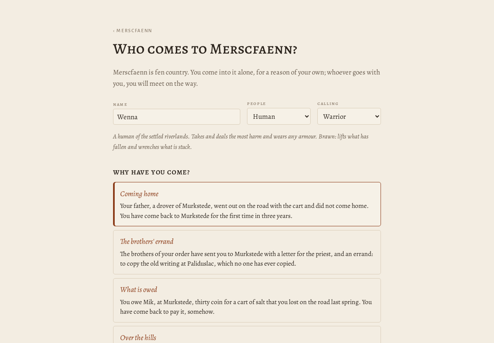
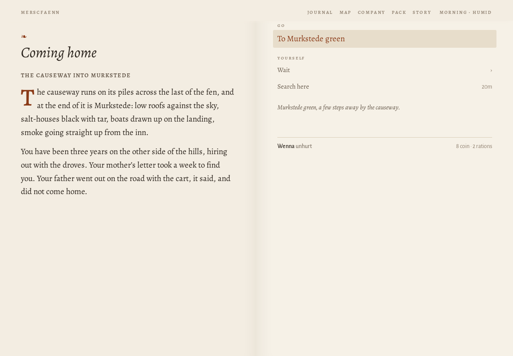
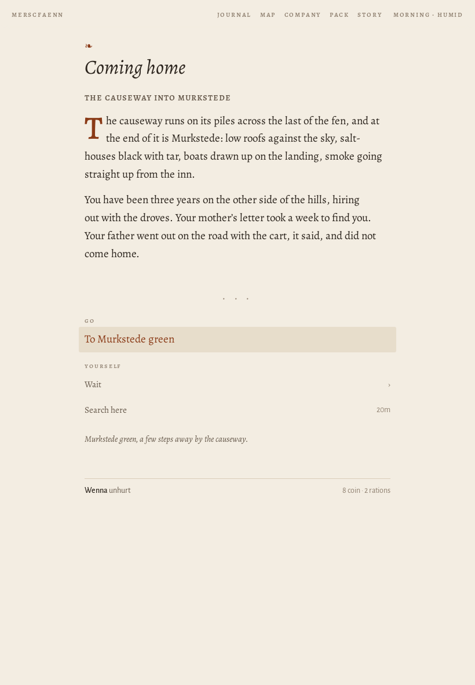
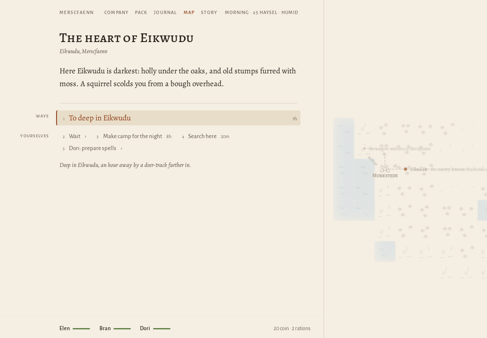
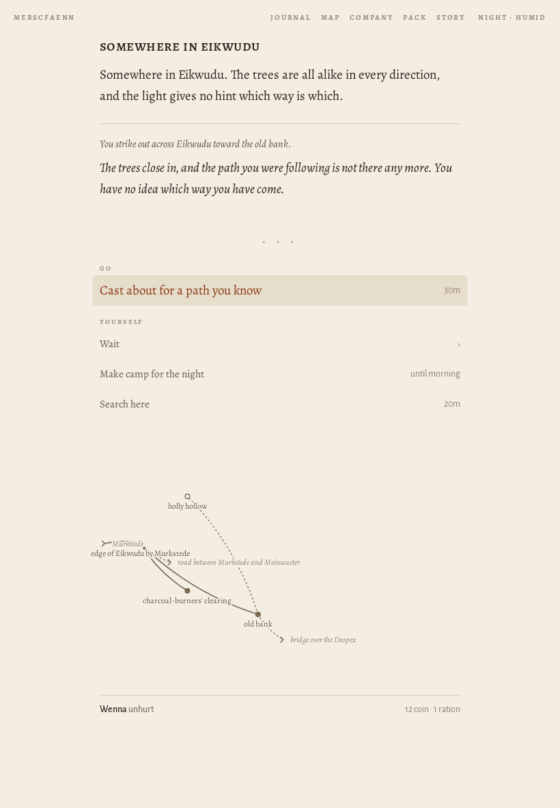

# Mission 11: one person, a country that holds together, and a page that is a book

The brief was blunt: the playable experience was profoundly unsatisfactory, and it could no longer be treated as a
collection of minor defects. It asked for an integrated reconstruction of Kyr as a beautiful, humane, imaginative and
genuinely playable fantasy RPG, built by finding the structures that kept producing the failures and changing them.

This report says what was found, what was chosen and why, what was built, how it plays, and what is still wrong.

## How to read the claims in this report

Four kinds of claim are made here, and each is marked where it matters:

- **Implemented**: the code and content exist, at the commits named.
- **Validated**: an automated test checks it. Tests check that the world does what it should. They do not check
  that it is good.
- **Played**: the builder played it through the built reader, in Chromium, at the sizes stated, and read what the
  page said at every step. The full transcripts and pictures of every journey are in
  [`doc/playtests/mission-11-2026-10-23`](../playtests/mission-11-2026-10-23). Journeys A, B and F were played on
  the final build (`12c87a9`). C, D, E and G were played on the commits just before it, and those later commits change
  nothing those journeys show.
- **Judged by a person**: no one but its builder has played this build. Nothing in this report has been judged by an
  independent human player, and nothing here should be read as if it had been.

Two further limits apply throughout:

- "Tablet" and "phone" mean Chromium at those sizes with touch emulation. Nothing was tried on a real iPad or in
  Safari.
- An automated player still exists, but it was not used as evidence of quality here. Where a script walked the game
  (the long session, for performance), it says so.

To play: **https://jweissman.github.io/kyrie/**, or add `?world=a1` to begin in the country described below.

The journeys can be reproduced. Each transcript lists the choices made, in order, with what the page said after
each. A world is the same for the same seed and the same choices, so following a transcript in the reader at its size
plays the same journey.

## 1. Why Kyr played as it did

The diagnosis ([`mission-11-diagnosis.md`](mission-11-diagnosis.md), with the old build's pictures in
[`mission-11-before`](../playtests/mission-11-before)) traced each failure the player met to a structure that
produced it:

| What the player met | What produced it |
|---|---|
| The opening was a form to fill in for three companions. | The campaign assumed a company of strangers. |
| What someone said was put in the journal. | The `ask` action taught a fact and answered "tells you what they have heard". |
| The page was a ledger that grew. | One column, where every answer was appended to the bottom. |
| A forest was three words at one dot on the map. | Wild country was a chain of three rooms inside one place with one position. |
| The map was tiles. | Each cell of the land was drawn as a square glyph. |
| Prose was generic, and wrong for where it was said ("the cold gets in at every gap", out on a road). | The runtime told every true line; nothing knew a roof from the sky, or what had been said before. |
| Sites repeated themselves, and the makers' history was one chain of inscription, then glossary, then great work. | Each work plan had one layout and one way to the great work. |
| Companions were silent. | A recruit became a member; their role, topics and town stayed behind. |

None of these could be polished away while its structure stood, so the structures were changed.

## 2. The medium: four treatments, and the book

Four treatments of the same three moments (arriving, speaking, travelling) were built as real pages and photographed
at tablet size ([`alternatives.md`](../design/mission-11/alternatives.md)):

- **A, the page:** one typeset column;
- **B, the folio:** an open book, the world on the left and what you might do on the right;
- **C, the chart:** the map as the screen, with the scene as a card on it;
- **D, woven prose:** the choices as links in the text.

The chart made travelling beautiful and everything else cramped. Woven prose was the most literary treatment, but it
could not hold a list of ways or a fight. The page was the calmest, but its choices moved under the hand.

**The choice was the folio held open on a wide screen, and the page on a narrow one.** The book separates the
brief's four functions by its form:

- the present situation is the left page;
- the immediate exchange follows it there and is replaced by the next;
- the available intentions are the right page, grouped by the kind of attention they take (speak, look, go, set
  out, yourself), and they do not move;
- memory is in the sheets that open over the right page (the journal, the story so far, the company, the pack).

From the rejected treatments, the chart's drawing was kept for the map plate and the way chart, and woven prose's
lesson was kept for conversation: what someone says is set as their words, where they said it.

The map is the one sheet that opens over the left page. It is the world drawn rather than told, and it leaves the
ways on beside it to choose from.

Charter: [`charter.md`](../design/mission-11/charter.md). Authoring before and after:
[`authoring.md`](../design/mission-11/authoring.md).

## 3. One person, and why they have come

**Implemented, validated and played.** The standard campaign begins with one person. A generated country offers the
origins it can hold, each written as a module bound to that country's own people and places:

- **Coming home.** The protagonist is the child of the drover who did not come home; his wife is their mother and his
  son their brother.
- **What is owed.** They owe a merchant thirty coin by market day, and are refused service when it passes.
- **Feverwort.** They carry herbs to a sick child's mother.
- **The brothers' errand.** They carry a letter from their order to a priest, and are to copy the old writing at the
  makers' first work.
- **Over the hills.** A trade, and no errand at all.

The protagonist page asks for a name, a people, a calling and a reason. Nothing else is asked, and no companions are
chosen: whoever goes with the protagonist is met on the way.

**Journey A, the first arrival** (a1, *Coming home*; played at 1180×820, 820×1180 and 390×844). The game opens on
the way in, under the chapter's name:

> ❧ *Coming home* — THE CAUSEWAY INTO MURKSTEDE
>
> The causeway runs on its piles across the last of the fen, and at the end of it is Murkstede: low roofs against the
> sky, salt-houses black with tar, boats drawn up on the landing, smoke going straight up from the inn.
>
> You have been three years on the other side of the hills, hiring out with the droves. Your mother’s letter took a
> week to find you. Your father went out on the road with the cart, it said, and did not come home.

That is who the protagonist is, where they have come from and why, what they know, and the circumstance they arrive
in. What they carry is in the pack. On the green their brother is waiting:

> Your brother is sitting on the rail of the green with your father’s old spear across his knees. He is taller by a
> head than when you went away.

Asked what he means to do, he answers on the page, in his own words, and the choice that follows is the one his
answer opens:

> ‘Go after him,’ says Amrod. ‘Mother says wait. I have waited three days.’ He looks at you, and at the road. ‘If you
> are going, I am coming with you. If you are not, I am going anyway.’

| 1180×820 | 820×1180 | 390×844 |
|---|---|---|
|  |  |  |

**What persists.** The origin's facts (`kin(party, son)`, `kin(party, wife)`) are what the drover's situation is
written against, so the same module is a stranger's errand or the protagonist's own family:

- The innkeeper does not tell a member of the family the rumour of the missing drover.
- The mother has her own question to be asked ("Ask your mother where he was going").
- The brother joins without hire and talks on the road: of the road their father took, and of the left wheel he
  never mended.

**Journey F, an expedition and its aftermath** (a1, *Coming home*; 1180×820 and 390×844) follows it through:

> Fresh ruts run off the edge of the road here, where the bank drops away.
>
> Amrod stops where the ruts go off the road and stands looking at them. ‘That is the left wheel,’ he says. ‘That is
> his.’

A search finds the cart, and the brother's grief is told as it happens:

> Below the road, where the bank drops away, a cart lies on its side in the ditch with a man under it, a day or more
> dead. The oxen are gone; something had them, and dragged them off toward the hills. His knife is still in his belt.
>
> Amrod goes down the bank to the cart before anyone can stop him, and kneels there a long time. When he comes back up
> he has nothing to say, and nobody asks him to.

Back at the inn, the mother is told:

> Malachai does not sit down. She takes your face in her hands and looks at it for a long time. ‘I knew,’ she says.
> ‘The dog knew.’ Then she goes back to the pot, because there are people to feed.

Then the knife can be shown to her. Outside, the green has changed, and says so once:

> *Since you were last here*
>
> The grey dog has gone in to lie by the kitchen fire.

At night there is the brother to sit up with. The other origins were played at engine level, and their tests hold
them:

- the debt is called in on market day, and the creditor refuses service;
- the priest, given the brothers' letter, says where their work lies and shows the way to it. Journey D found that
  this had been missing, and that the errand could not be done without it.

## 4. Ground: before and after the forest

**Before** ([`mission-11-before`](../playtests/mission-11-before)), Eikwudu was three rooms in a line:

- the heart was a dead end with one way back ("To deep in Eikwudu");
- on the map all three were one dot on a grid of tiles;
- there was no way through the wood, and no way to come out of it anywhere else.

**After (implemented, validated and played).** A stretch of wild country is ground:

- Its landmarks stand at their own places on the land, joined by trails: an edge, a clearing, a bank, a hollow, a
  mere.
- It is entered from every road and settlement it borders, with an edge of its own where none is near.
- A company can strike straight across between places it has been. That is quicker, and it can lose them.
- Lost, it can cast about until it finds a path, or follow running water.
- Somewhere with a view gives the lie of the land, and a companion who reads wild country finds the way.

The right-hand page carries a small way chart of the trails around the company in wild country and in sites.

**Journey B, the forest** (a1; 1180×820 and 820×1180):

1. From Murkstede green the ways about the town are under *Go*. The ways across country are under *Set out*, with
   their times: the edge of Eikwudu (40m), the road to Meóswaeter (1h 20m), the western edge (1h 20m).
2. The edge of Eikwudu leads on to a clearing, to the old bank, back to Murkstede and to the road. The old bank leads
   to the holly hollow and out of the wood altogether, to the bridge over the Deopex.
3. From the clearing, striking out for the old bank:

   > You strike out across Eikwudu toward the old bank.
   >
   > The trees close in, and the path you were following is not there any more. You have no idea which way you have
   > come.

   The only way on is *Cast about for a path you know*:

   > After an hour you come back to a place you are sure you have passed before.

   And then:

   > At last you come out on a path you know, and follow it to the edge of Eikwudu by Murkstede.

| The old bank, and the map | Struck out and lost (820×1180) |
|---|---|
|  |  |

A player can always tell whether a way is open, barred, or not yet found:

- The ways known are listed with their times.
- A way that is barred is listed with what bars it: *To the spring-pool*, under *"Black water fills the bottom of the
  shaft…"*.
- The map's key lists every way known to be shut and why.
- A way not yet found is not drawn, and the map says so: *"Only what you have seen, or know the way to, is drawn."*

**The map plate (implemented and played).** The map is a plate over the left page, with the ways on still beside it:

- the sea and the meres are shaped and lined;
- the woods are outlined and scattered with trees;
- the roads are cased;
- the paths into wild country are dotted;
- the company is ringed where it is, and nowhere at all when it is lost;
- wild country is named across its ground;
- no name crosses another.

It is legible at 1180×820 and at 820×1180. On a phone it is a plate that pans, and its smallest names are about
11 px.

## 5. Prose: before and after

**Coherence.**

| Before | After |
|---|---|
| Scenes held census and etymology ("Murkstede is a town of human folk, living by salt. The name is Westron for 'black stead'"). | What a name means is kept on the map, under *The names*: *"Murkstede — Westron for “black stead”"*. |
| "A raw cold gets in at every gap", said on an open road; "A hard wind pulls at cloaks and doors", where there are no doors. | Places know their shelter. The sky is told of greens, roads and wild country when the company comes out under it, or when it turns: *"The air is close and wet, and the flies are bad. The hay stands in cocks in the meadows…"*. Under a roof, only what gets in is told, and only when the weather turns: *"A raw cold gets in at every gap, and everyone sits close to the fire."* |
| Two hooks promised what the world did not hold ("a light in it some nights"; "Something lives in the water"). | They are told as what folk say. |
| The same settlement opening twice in one country ("a green with a pond on it…"). | No two settlements of a country are told alike. |
| A placeholder result ("You carry out the action"), and a draining cistern spoke of "the hall" in a shaft. | Removed (Journey B, Journey D). |

**Perception.** An observation can be noticed only by a company that brings a capability, and the narrator credits
the companion who noticed it. In e5, at a keep where wolves have their den:

> Wynd sees it first. Wolf-sign all round the gate: scats, bones dragged out and left, and the deep prints of a big
> dog-wolf.

There are signs like this at the doors of most works, for those with woodcraft, perception or lore:

- frogspawn by a cistern;
- sheep bones under a wyvern's tower;
- threads across an adit;
- a smugglers' boat;
- a ward-word over a door;
- grass trodden where a barrow's dead have walked.

**Selection.**

- A place is told first, then what stands out in it, then its signs, then the sky and its passing life.
- The passing life is told the first time only ("A woodpecker is at work somewhere close"; "Someone is raking out a
  salt-pan at the end of the green, and the steam comes off it white").
- What has changed is told once.
- What someone says is set as their words, where they said it.
- What was learned is said once.
- Nothing already on the page is said again.

The left page never grows: it holds the place and the last exchange, and the story so far is a sheet.

## 6. Companions

**Implemented, validated and played (Journey C).** Each settlement's traveller is somebody. At the Lucky Phoenix
Cyril, a pedlar, says what brings them to Murkstede, and offers to come along for three coin and keep. Once Cyril
travels with the company, Cyril can be spoken to wherever it is:

> ‘Meóswaeter. My cousin keeps the Peaceful Stag there: Osborn. If we pass that way, we will eat.’ Cyril smiles. ‘I
> am not much missed otherwise.’

> ‘News? Everybody wants news.’ Cyril counts it off on the fingers: what bread costs where, who has married and who
> has died. ‘And something nobody likes to talk about: Ísencepan, in the fen north-west of Meóswaeter. Folk go quiet
> when it comes up. That is news too.’

The news is real: the company now knows where Ísencepan is.

- **At night**, *Sit up late with Cyril* tells Cyril's story, a part a night.
- **At home**, played at engine level: brought home to Meóswaeter, Cyril is welcomed by a cousin who keeps the inn
  there, the company is fed for the road, and the cousin has something to say about Cyril.

Each calling knows something different:

| Calling | What they know |
|---|---|
| Charcoal-burner, trapper | The paths of the nearest wood |
| Eel-catcher | The fen |
| Drover | The high ground |
| Pilgrim | The country's gods and its oldest holy place |
| Soldier | The old forts |
| Mason | The makers' stonework |
| Tinker | Who made the old metalwork, and how |
| Scholar | How the makers ended |
| Minstrel | The song of the kingdom after them |

The last three are new ways into the country's past, which before could only be read from stones.

A fellow says something of their own the first time the company comes to a place that touches their calling, and a
fellow who reads wild country finds the way when the company is lost. In e5:

> Wynd stops, looks up at the light coming through the leaves, and turns you a quarter round. ‘This way.’ And it is.

A country's travellers follow different callings, from eleven, so no two have the same things to say.

## 7. Sites and discovery

**Implemented and validated.** Of several works of one plan in a country, no two are laid out alike. f6's three
barrows are:

- a long barrow with chambers off a stone passage;
- a passage grave whose round chamber is roofed by corbelling;
- a cairn on two levels, with a drop into an older chamber below.

a1's two cisterns are a long stair down to a pillared hall, and a stepped well open to the sky. The well's way chart
shows its depth (the head of the steps, the water-stair, the spring-pool below), and some shapes have a second way in
(the outfall of a cistern's channel, a robbers' shaft).

**The greatest of the makers' works is no longer found only by reading the old script.** A lesser work of the same
makers shows the way in their own manner:

- **The Water-Wardens** read still water, and the pool shows the dam.
- **The Star-Readers'** ring, set at night, holds one star still over their first tower.
- **The Barrow-Kin** spoke with their dead through flutes of bone. The flute kept at a barrow's door quiets the dead,
  who then let the company pass without a fight, and it is answered from the great howe.
- **The Delvers'** signs for *deeper* follow the vein to their pit.
- **The Stone-Singers'** figures sing loudest toward their greatest hall.

**Journey D, an unusual discovery** (a1, 1180×820, played):

1. Two torches bought from Mik, the salter.
2. The road to Meóswaeter, then Glōmdael, then the edge of Wychforwest, and a square doorway in a hillside:
   Obscurusfons.
3. Inside: the head of a stepped shaft, flights down to black water, and a niche with a bronze wheel. Winding it:

   > Deep in the hill a gate grinds open. The black water begins to fall, and goes on falling, and the dark fills with
   > the sound of it.

4. The first torch gutters out at the bottom, and the second is lit. In the spring-pool:

   > The still water shows the roof, and your own faces; and then neither, but a dam of dressed stone across a valley,
   > under a sky that is not this one, and water standing behind it as still as this. When the water lets it go you
   > know the place: Glōmmeós.

## 8. The living world

**Implemented, validated and played (Journey E).** A power answers what is done to it. At the bridge over the Deopex
a lord's customs-men keep the road:

> The bar stays down. ‘The lord’s toll,’ says the reeve, dipping his pen. ‘Three coin. Names?’

Walking on without paying, the company reaches Wǽttún, and:

> Behind you, word is going along the road: the lord is sending riders out to Faennslím green, asking after a company
> that turned on his toll.

Coming back over the bridge, the customs-men draw their swords:

> ‘Outlaws!’ The customs-men draw their swords.

The lone protagonist fought them, striking each turn, and fell:

> No one is left standing. The story so far is kept in the journal and the chronicle. Whoever comes next will begin
> again from the beginning.

The engine-level test plays the rest of it:

1. The inn at Faennslím bars its door.
2. The riders wait on its green and warn: *"'In the lord's name,' he says. 'Twenty coin for his toll-house, or you come
   with us.'"*
3. Paid, they go home, and the inn serves the company again.

The country's existing kits also hold its life:

- the toll's keepers buy their bread on credit at the inn, and the inns at either end of the road are dearer;
- outlaws hold a ringfort and raid a village;
- a widow puts a price on them.

All of it is deterministic world state, written in Kyr. None of it is an agent.

## Journey G: a long session

**Played (scripted walk) on the final build.** The same walk every time: at each step one of the ways on or one thing
to say, chosen by a running number, for 150 steps from Murkstede. The full transcript is in
[`G-long`](../playtests/mission-11-2026-10-23/G-long/journey-1180x820.md).

- The walk went through 30 places, across two march-stones into two countries beyond, and through being lost in a
  fen.
- No fight came up.
- What the measurements showed is in section 10.

## 9. What changed, layer by layer

### Kyr, the language

([`authoring.md`](../design/mission-11/authoring.md) shows each change as an author meets it.)

- **Places say whether they are sheltered:** `outdoors`, `indoors` or `underground`.
- **Observations say what they tell of:** `as fixture`, `feature`, `sign`, `weather`, `ambience`, `event` or
  `revelation`. They can be noticed only by a company that brings a capability: `noticed by woodcraft`, `lore`,
  `perception`.
- **A topic can be put to someone travelling with the company** (`Topic … with x travelling …`). Whoever the shared
  `recruit` action takes on is recorded as travelling with it.
- **Shared rules gained a few relations:** kin and expectation (`kin`, `expects`), having been somewhere (`been`), a
  fellow traveller and how much of their story they have told (`fellow`, `confided`, `hushed`).

Kyr gained no loops and no arbitrary computation. Each change is a declaration that the compiler checks.

### Kyrie, the runtime and presentation

- **A narrator** (`src/presentation/narrator.ts`) chooses what to tell from what is true:
  - a place's fixtures each time, and its passing life the first time;
  - the sky when the company comes out under it or the sky turns, and never under a roof;
  - what has changed since the company was last there, told once under "Since you were last here";
  - lines ordered by kind: the place, then what stands out, then signs, then sky and life;
  - what someone says, set as their speech;
  - what a fellow traveller noticed, credited to them;
  - and nothing the page already says, said again.

  Every line is set with curled quotation marks and apostrophes.
- **The screen model** lists travelling companions among the people to speak with, flagged so that they are not
  said to be "here".
- **The intentions model** (`src/ui/intentions.ts`) groups what can be done by the attention it takes:
  - Speak and Look, with a person or thing that has several things to it opening in place;
  - Go, the ways about the place;
  - Set out, the ways across country, with striking out, casting about and following water;
  - Yourself.

  A price or a time is said beside a choice, not in it.
- **The land model** (`src/ui/land-model.ts`) gives the map the cells of the places the company knows and the
  courses its ways take.

### Assembly and generation (Deem's tables and the region writer)

- **Deem's tables:** the travellers' callings were widened from three per terrain to six (`travellerCalling`), and
  the weather gained lines for each kind of place it is told at (`skyAt`: a green, a road, wild country, under a
  roof). Tables that are not Deem's own (settlement scenes, wild country, fellows) live in
  `data/generation/scenes`.
- **Origins** (`data/origins/*`, `src/world/origins.ts`): one protagonist, and a reason bound to the country's own
  people and places, written as a module.
- **Wild country** (`src/world/region-zones.ts`, `data/generation/scenes/wilds.json`):
  - landmarks at their own cells, joined by trails;
  - a way in from every road and settlement it borders, with an edge of its own where none is near;
  - striking out between places the company has been, being lost, casting about, following water, and a view that
    gives the lie of the land;
  - a fellow who reads wild country, who finds the way when the company has lost it.
- **Fellows** (`src/world/region-fellows.ts`, `data/generation/scenes/fellows.json`): each traveller has a home and
  kin elsewhere in the country, knowledge from their calling, a story over three nights, and remarks. A country's
  travellers follow different callings, from eleven.
- **The makers' works** (`data/generation/works/*.kyrt`, `src/world/region-works.ts`): several shapes for a plan,
  so that no two works of one plan in a country are alike; a sign of each art showing the way to the greatest work;
  and signs at the door that someone with the eye for them reads.
- **Settlements** (`src/world/settlement-scenes.ts`): five or six openings for each size, inn and taproom, with no
  two in a country alike; the trade going on, by day.
- **Weather** (`src/world/region-weather.ts`): the sky told as weather for greens, roads and wild country, and what
  gets in under a taproom's roof.
- **The toll road kit**: a lord who sends riders when his toll is run.

### The page (web/reader)

- **The book** (`book.tsx`, `verso.tsx`, `recto.tsx`, `sheet.tsx`):
  - a running head, a ribbon of sheets, and the time of day in words;
  - a two-page spread at 960 px and wider when the screen is wider than it is tall, and a single centred page
    otherwise.
- **The protagonist page** (`protagonist-page.tsx`): a name, a people, a calling, and why they have come.
- **The map plate** (`land-map.tsx`, `cartography.ts`, `map-marks.ts`, `map-labels.ts`):
  - each cover is contoured from a field roughened near its edges;
  - water is lined inside its shore;
  - marks are scattered, not tiled;
  - names are placed so that they never cross, and long ones are broken in two;
  - wild country is named across its ground;
  - the company's place is ringed;
  - under it, a key, the ways shut to you with their reasons, and what the names mean;
  - a mouse drags the land; a finger scrolls it.
- **The way chart** (`way-chart.tsx`): the trails about the company, drawn small beside the choices in wild country
  and in sites.
- **The fight view**: foes, what each means to do, and what just happened, set like the rest of the book.

## 10. Long sessions

**The engine alone** (Bun 1.4.3 on Linux, a1 with a full company, a deterministic walk of 600 steps through ways,
talk and the occasional wait):

| After | Median step | Slowest step | Memory | Size of the saved game | Places | Day |
|---|---|---|---|---|---|---|
| 100 steps | 57 ms | 296 ms | 789 MB | 2.18 MB | 12 | 4 |
| 300 steps | 54 ms | 90 ms | 785 MB | 2.57 MB | 16 | 13 |
| 600 steps | 58 ms | 111 ms | 826 MB | 3.14 MB | 32 | 28 |

- **Steps:** no step became slower over the session. Waiting one watch costs about 20 ms.
- **The saved game** grows by about 1.9 kB a step. The browser keeps it packed.
- **Starting a world** takes about 2.1 s in the engine. Drawing the country beyond at the first march-stone takes
  about 1.5 s.

A profile of those two puts about 1 s in parsing the generated Kyr text and about 0.55 s in deep copies made while
modules are loaded and installed. Neither was optimised in this mission.

**In the browser** (Chromium on the same machine, nothing else running), the long walk of Journey G:
the walk went 150 steps through 30 places and across two march-stones.

- A step took a median 402 ms. That includes the short beat a journey is given, at most 0.7 s.
- The 90th percentile was 727 ms.
- The slowest steps were the start (2.8 s), the two crossings (2.1 s and 2.6 s) and one long walk through a fen
  (2.7 s).
- The page's heap stayed at 14 MB. The engine runs in a worker, and its memory is not in that figure.

The first crossing to a march-stone takes about 2 s in the browser:

- the region installs in 1.1 s;
- each of its four scenarios installs in about 0.13 s;
- the page says *"The country beyond is being drawn…"* while it lasts.

An earlier measurement of 10–13 s was taken while the full test suite was running on the same machine. It is not a
fair figure, and it is reported here only because it was first noticed that way.

The page itself does not grow. The left page holds the place and the last exchange only. Over the long walk, the
page held between 53 and 171 elements throughout.

## 11. Tablets and the published site

The site was checked as served from **https://jweissman.github.io/kyrie/** (the deploy of `12c87a9`), in Chromium
with touch and an iPad user agent:

| Size | Title ready | World started | First move | Errors |
|---|---|---|---|---|
| 820×1180 (upright) | 1.47 s | 2.84 s | 0.27 s | none |
| 1180×820 (sideways) | 1.24 s | 2.82 s | 0.26 s | none |

Both offered the four origins a1 can hold. Both showed the book's groups (Speak, Go, Set out, Yourself) after the first
move, so this mission's reader is what is served.

At 820×1180 the book is one centred page, and the map plate opens at the top with the ways on below it. At
1180×820 it is the open book. The phone (390×844) was played through Journeys A and F. There the map plate pans
sideways and keeps its names legible rather than shrinking them.

None of this is Safari or an iPad. Gestures, Safari's storage limits and its text rendering are untried.

## 12. Critique

What follows is what is still wrong, or not yet good, after playing every journey above. Kyr is better than it was
at the start of this mission, and much of what the brief listed as failures now has a structural answer. Better is
not the same as good, though, and nothing here claims that it is artistically accomplished.

**Nobody else has played it.** Everything here is the builder's judgment, made by reading transcripts and pictures
from a headless Chromium. That is the most important limit of this report.

**The prose is still assembled.** It is coherent now: it no longer tells the sky under a roof, repeats a line, or
puts a census in a scene. But it is still built from tables of sentences, and a long session shows the joins:

- every wood has a charcoal-burners' clearing, a holly hollow and an old bank;
- every fen has an eel-catcher's hut and a duck decoy;
- the kingdom after the makers has the same name in two different worlds (Aergodríce in a1 and b2);
- a settlement's opening is now one of five or six for its size, and two worlds will share them.

**Places within a settlement are still the same four rooms:** green, inn, shrine and shop. A shrine is a cultural
place: its form, its look, its practice and its history are told, and offerings are made at it. But the town shrine
still sells the old glossary in every town, there are no households, and a settlement has one trade.

**Danger is not well calibrated or announced:**

- A lone protagonist died at step 40 of a 600-step walk.
- In Journey E, after the company runs the toll, nothing on the way back to the bridge warns that the lord's men
  will fall on it there.
- The giant frogs of Paliduslac ambush without warning, unless a companion with woodcraft reads the frogspawn at the
  door. That is the one form of scouting this mission added.
- Negotiation exists in a few places (the toll, the lord's fine, the barrow flute, a proud creature's price), but it
  is not general.
- Flight is a choice in a fight; its consequences were not examined.

**Death has no continuation.** When everyone falls, the game ends and offers to begin again. A coherent
continuation, in which the world goes on and someone comes after, was not built.

**Treasure has no history.** The works' treasures are Orsino's catalogue items, named and priced. Nothing records
whose they were or what they did.

**Cosmology is thin.** The makers' arts now show themselves in phenomena (a pool that shows a far place, a star
standing still in a ring, a flute answered across the country, a choir heard through stone), and the pilgrim knows
the country's gods. But the rest of Orsino's corpus (its planes, its powers and its stranger creatures) is barely
expressed. The region's "wonder" table is generic, and it is unused.

**Companions talk, but rarely to each other or in the moment.** A fellow's story is one of one or two per calling.
Their remarks are few. They say nothing during a fight or a conversation with someone else, and nothing about each
other.

**The page still has seams:**

- Probing choices ("Prod the bone flute with the pole", "Hold a flame to the bone flute", "Listen at…") still fill a
  thing's list.
- Rumour labels are long ("Ask about trouble at a grassed mound north-east of Meóswaeter").
- A wait for dark is interrupted by any event, which is right but abrupt.
- An event in Kyr fires on the watch after its condition holds, so a remark tied to a discovery has to be written as
  an observation to be told at the right moment.

**The map** is legible at desk and tablet sizes. Its italic names fall to about 11 px at its smallest scale, it has
no zoom, and on a touch screen a place whose name did not fit has no way to be named.

**The engine** spends most of its time parsing generated Kyr and copying modules. Starting a world takes about
2 seconds in a browser, and crossing into a new country about 2 seconds more. That is acceptable, but it is not
fast.

## 13. What is open

- Have people other than the builder play it, on a real iPad and in Safari.
- Danger:
  - say plainly when a way leads into a fight;
  - tune a lone protagonist's odds;
  - make flight and negotiation general.
- Continuation after death, in the same world.
- Settlements:
  - households, more than one trade, and institutions with interests;
  - the glossary belonging to one shrine, not every town's.
- Treasure that carries its history.
- More of Orsino's cosmology in places and phenomena.
- Companions who speak in the moment and about one another.
- A faster module pipeline: parse once, copy less.

