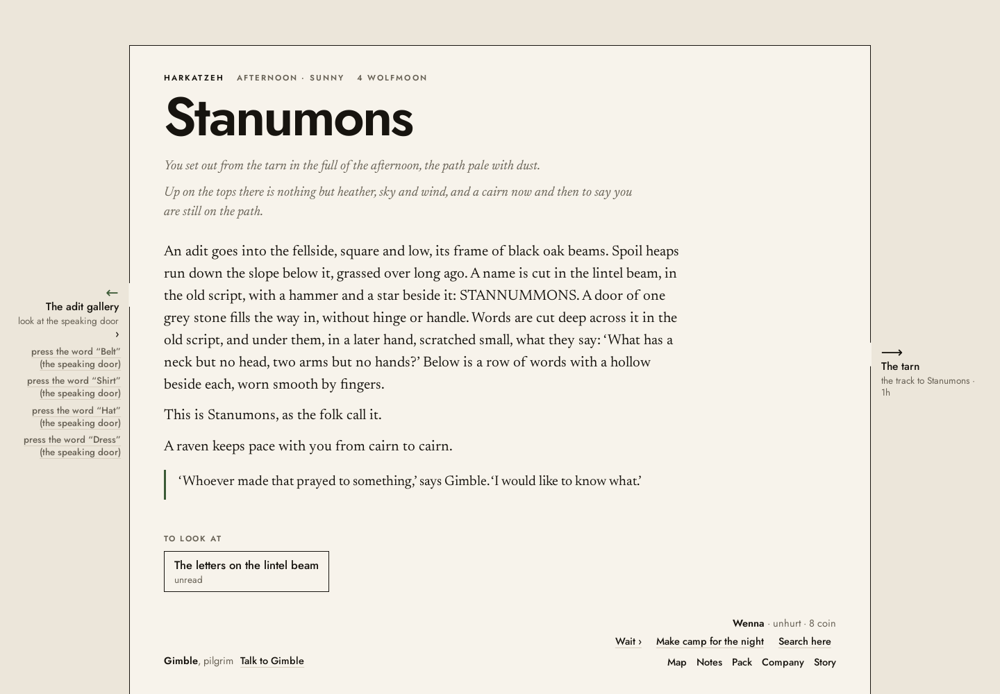
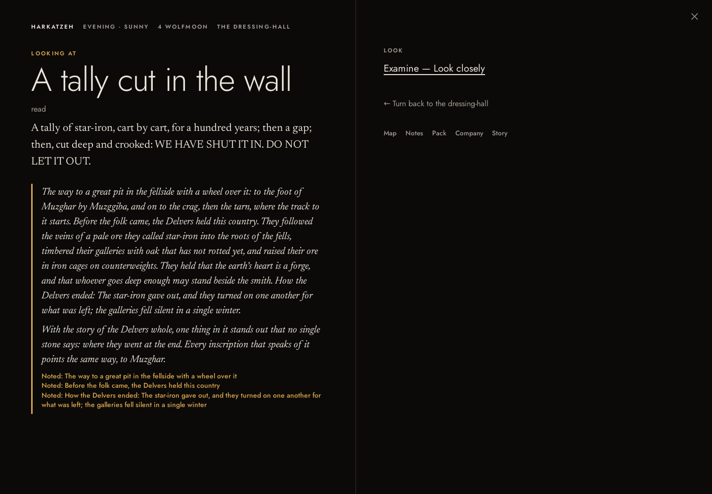
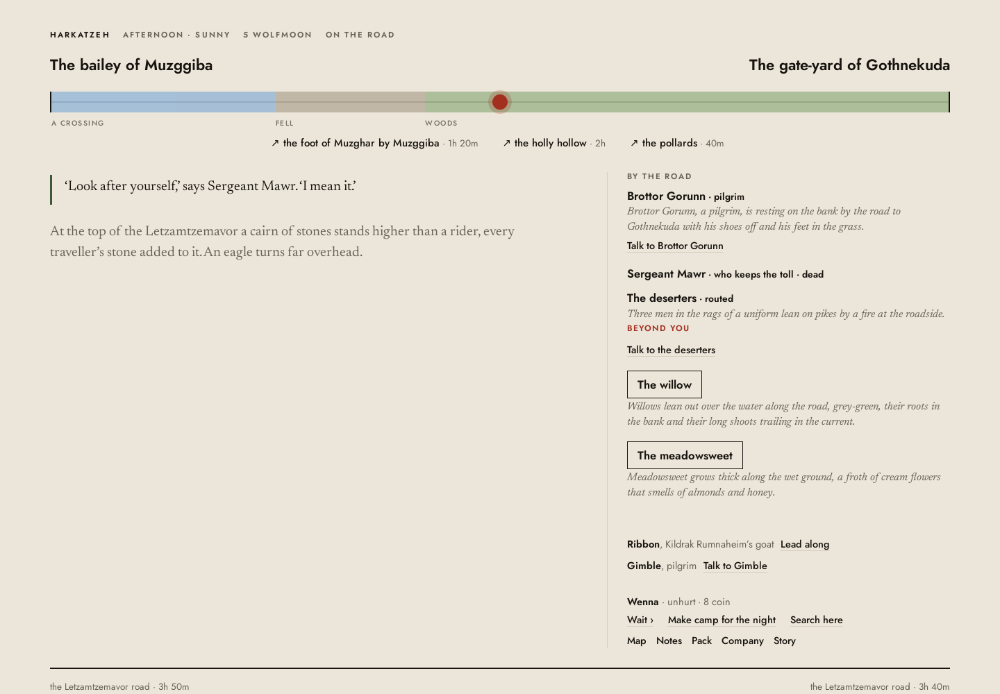

# Kyrie: an independent agent critique of the deployed game

24 October 2026. Reviewed as a new player through the graphical interface at [the deployed game](https://jweissman.github.io/kyrie/). No game code was changed. This is an agent review, not independent human testing.

Supporting records: [85-step action log](actions.md), [annotated screenshot index](evidence.md), and [retained in-game Story](evidence/story.txt). Twenty-five original screenshots are included.

## 1. Executive verdict

**Kyrie is an uneven literary RPG with a credible opening and a brittle relationship to its own fiction. I would not yet choose to continue it for pleasure after fifteen minutes.** I would be curious enough to investigate its sealed gallery, but insufficiently confident that careful attention would be rewarded. That distinction matters: the game has created curiosity; it has not earned sustained trust.

Calling this version a generic fantasy dashboard would be inaccurate. Its restrained paper palette, readable serif prose, road composition, and explicit personal errand are recognizable artistic choices. The shrine has a local history, the market has an amusing cheese queue, and the prior's advance against a future payment gives an adventure social and financial substance. A player can find an adventure without a walkthrough. I did.

The larger failure is that the world repeatedly stops behaving like the thing its prose describes. Inspection controls appear to do nothing. A lifted mechanism gives the wrong directional account. An inscription supplies a complete historical interpretation rather than evidence to consider. A taken crowbar remains in the room's prose. A dead toll collector can still receive a conversational farewell and answer it. At those moments, the player is operating loosely connected representations of a simulation rather than inhabiting a convincing place.

The dullness is not primarily a shortage of text or a need for more paintings. Too many invitations resolve into one-line answers, automatic state transitions, or uninformative actions. Curiosity repeatedly incurs navigation and reading costs without a proportionate change in understanding. Combat adds a separate rules vocabulary and screen, then discards its final action in the return to exploration. The game contains situations; it needs stronger continuity, decisions, and dramatic development between them.

**The smallest convincing improvement would be one fully coherent expedition loop:** discover a specific problem, understand and obtain the supplies it requires, investigate mechanisms through reliable controls, make a clearly signaled dangerous choice, see the final encounter and its consequences, then return to people who respond to what happened. Expand only after that loop is worth repeating.

## 2. Session and build record

| Field | Record |
| --- | --- |
| Date and time | 24 October 2026, approximately 09:35–09:59 EDT for graphical play and focused follow-ups. Initial access/setup began 09:34:55. Source investigation began only after the play assessment, near the end of that interval. |
| Deployment | `https://jweissman.github.io/kyrie/` |
| Visible version | No version or commit was visible in the screens visited. |
| Deployment identity | Public GitHub deployment **7299222408**, commit **be30f2635e45c5a7c79d03340f1f70e527a49708**, created 09:26:22 EDT, marked successful 09:26:38; target URL matches the game. HTML and bundle Last-Modified: 09:26:32 EDT. This is metadata-supported attribution, not a UI-exposed version. |
| Bundle fingerprint | `mono.js` ETag `"6adcb208-355ce2"`, length 3,497,186 bytes. Initial HTML ETag `"6adcb208-1ea"`. |
| Browser | Headless Chromium **130.0.6723.31**, rendered graphical player, 1440 × 1000 CSS pixels. Screenshots visually inspected; actions selected through visible controls. |
| Save/session | Fresh browser context, new game through Begin and normal creation. Kept default Wenna, dwarf warrior, and selected brothers' errand. Same loaded page and character throughout; follow-ups resumed this session without reload. |
| Change evidence | No material deployed change was observed during play. End-of-play bundle metadata matched. A fresh metadata check is retained in evidence. A persistent loaded bundle is not proof that the server never changed. |

[Deployment record](https://api.github.com/repos/jweissman/kyrie/deployments/7299222408/statuses); retained [deployment list](evidence/deployments.json), [status](evidence/deployment-status.json), [initial response](evidence/deployment-start.headers), and [end response](evidence/deployment-end.headers). The local tracked source inspected afterward had the same HEAD commit. Existing unrelated workspace changes were left untouched.

### Method and timing limits

The cold portion ended around 09:51, approximately sixteen minutes after the first title-screen capture, when the only torch expired during a search and Pack confirmed no spare. This is the requested early-stop exception for a substantially interrupted experience, **not a claimed 30–45 minute session**. I then performed bounded follow-ups: retreat, rest, revisit the naturally discovered toll encounter, fight, examine the aftermath, and consult Story and Company. I did not teleport, use a seed supplied by a builder, inspect hidden state, or consult source to navigate.

The minute bands below are reconstructed from tool timestamps and retained screens, not a stopwatch attached to every click. Automation setup and selector retries occurred and are excluded from claims about game usability or performance. In particular, an automation timeout is not evidence of a dead game control. The repeated inspection and Guard failures below are successful visible clicks followed by an unchanged or closed presentation, supported by later source inspection.

## 3. The first fifteen minutes

**Approximately minutes 0–3: a reason to arrive.** The title is spare and welcoming. Creation names the country and offers four materially different reasons to come. The brothers' errand is concrete: carry a letter, obtain help from a priest, copy old writing. This is much better than asking me to invent a purpose in a vast world. I keep the default character because the errand interests me more than optimization.

The shrine's lamp, peat offerings, and connection to a lost bridge suggest a community with a history. I approach Brottor, deliver the letter, and receive a route through the foot of Muzghar, crag, and tarn. The priest's recognition of an old correspondent creates a small human interval before the directions. I know who I am and why I should travel.

The altar then teaches a worse lesson. Selecting it opens a separate, black inspection screen. Examine returns no discovery. I make an offering, spend three of twelve coins, and receive the favour of light. The spending is explicit; the benefit is poetic but not yet interpretable. The inspection ends as the altar's remaining actionable presence disappears. My attention was on the altar; the interface decides I am finished with it.

**Approximately minutes 3–6: people become menus.** Baraznof's cheese queue and inhabitants' work make the market pleasant to read. Its many exits surround a large framed page; people extend down the page, while routes sit around its perimeter. It takes scanning in several directions to understand the town. Pack shows a sword, mail, torch, pole, coins, and two rations. The map marks Stanumons but initially separates it from the known road network. That is honest uncertainty, but does little to explain the next leg of the priest's route.

Dagny's promise of free news invites attention. Her available conversation is one work question. The answer is a mildly amusing profession line. Asking again appends exactly the same answer, marked asked. No question about the promised news develops. I become less willing to interview every inhabitant.

The inn improves matters: Gimgen provides a mine lead, warnings about light, and food to buy. I buy one ration. Gimble offers to accompany me for three coins; I recruit her and ask about home and religion. Her terse account of people gone away or dead is more affecting than the generic greeting. Her mention of an older holy place opens a wider horizon. I have a companion, but her combat identity and capabilities remain outside this exchange.

**Approximately minutes 6–10: an actual expedition begins.** I take the road toward Gothnekuda, following the map's broad orientation rather than any privileged route. The road's terrain strip, endpoints, travel times, and roadside moss are a useful change of composition. I gather moss because its description says it can bind a wound. Gimble gathers it; the action is successful, although the choice of actor was not clear beforehand.

Gothnekuda has a recognizable social arrangement: the brothers' swept yard and the unswept village supplying them. However, its herb-wife repeats Thora's grinding-and-sniffing sentence, and its peat-cutter repeats Kestra's leaning-turves sentence. This is the first unmistakable sign that inhabitants are drawn from reusable activity slots.

The prior wants a dangerous relic contained, promises the house's entire thousand coins, and offers ten in advance for light, deducted from the future payment. This is the strongest conversation: commitments generate stakes. I take the advance. On the road toward Muzggiba I meet a toll collector. A hard-fight warning persuades me to pay six coins. His warm road-dust greeting contradicts the coercive entrance, but payment has a clear result. I find the foot of Muzghar and camp rather than proceed through the night.

**Approximately minutes 10–13: curiosity briefly pays.** The crag offers a climb, and the reward is expanded geographic knowledge visibly reflected on the map. The route onward becomes legible. I continue by the tarn to Stanumons. This is successful adventure discovery through ordinary play, albeit across very long fictional walks.

At the entrance, the architecture and Delvers' sign are suggestive. Gimble wonders what the makers prayed to. Reading the lintel keeps the inspected object in focus. The door is guarded by a familiar clothing riddle, with four answer links crowded into the navigation margin. Shirt opens it. The slab's movement is vividly described and its changed state is acknowledged. The obstacle is slight compared with the century-old-writing premise, but the feedback works.

**Approximately minutes 13–15, extending to the interruption at minute 16:** darkness makes the torch useful. The adit distinguishes old craftsmanship from later exploitation. I take the crowbar, yet the room still says it lies there. Looking at the lift does not visibly inspect it. The offered repair works, but winding the cage up reports it going down. I descend anyway because the onward control is now available.

The tally's warning is compelling. The attached historical explanation immediately overexplains it and declares the story complete. Notes says I have copied the writing and should show Brottor; I performed Read, without a distinct copying decision or presented copy. At the barred door a suspicious flag is already labeled pressure plate. Looking at it does not visibly respond. Searching exhausts the torch. I have reached an intriguing decision and lost the means to investigate it.

**Fifteen-minute answer:** I want to know what is behind the door, but I would probably stop. I am becoming curious about the fiction while becoming distrustful of the interaction. That is a precarious foundation for asking me to provision and repeat a long return trip.

## 4. The boredom autopsy

### The invitation-to-reward ratio is too low

The altar invites close examination and yields nothing. Dagny advertises news and provides one occupational quip. The entrance offers an ancient mystery and resolves into a familiar multiple-choice riddle. These failures are different, but together teach the player to stop investing attention. The prior and crag are counterexamples: one expands a conflict, the other changes usable knowledge. More content should meet those standards.

### Discoverability works better than the subsequent pacing

This play does **not** support a claim that adventures are impossible to find. The initial errand and priest's directions work. The innkeeper exposes another substantial prospect. The problem is the cost and texture between the lead and its payoff: repeated journey sentences, lengthy fictional distances, separate screens for small actions, and little development during the return. A one-hour torch is a demanding expedition constraint when the interface does not keep remaining light in view. The innkeeper did warn me to take more light; this was also a preparation mistake on my part. The design failure is allowing that qualitative warning to substitute for usable supply information and accessible provisioning.

### A simulated world is not automatically a developing story

The recruited pilgrim can comment on old religion and gather medicine. That is enough to suggest attachment, but I saw no developing personal concern in the time played. Ordinary townspeople largely remain occupations with short topic slots. A prior with an institutional commitment is more engaging than a dozen alternate idle sentences. Characters need something they want, something they misunderstand, and a response to what the player does.

### Discovery too often arrives as certification

The tally is material evidence of fear. It should complicate the account of the Delvers. Instead the game grants history, supplies a synthesis, announces that the story is whole, and notes the facts. The player receives a package of conclusions. Exploration feels less like inference and more like collecting completed entries. The historical claim about internal conflict may be compatible with the warning, but the game does not stage that uncertainty.

### Tactical variety is obscured by failures and unexplained commitments

The toll fight starts with several misses and a resisted trick. These are not proof of bad balance across the game, but they create a dull first exchange. Prepare Charge then produces an extremely strong payoff, killing the enemy after an unexpectedly compulsory next turn. The experience swings from inconsequential turns to abrupt resolution without teaching a stable tactical model. A list of abilities is not equivalent to meaningful, understood decisions.

These mechanisms reinforce one another: shallow interactions encourage skimming; skimming makes warnings easier to miss; unclear preparation forces retreat; retreat repeats thin travel; automatic interpretation reduces the reward for close reading. A prettier layout alone would leave that loop intact.

## 5. Visual and interaction autopsy

There **is** an aesthetic conception: a literary page, warm paper, dark ink, paintings as sitters, geographic exits around a field, roads as traverses. The problem is that its modes do not form a consistent fictional grammar.

- **Hierarchy favors headings and frames over decisions.** Large place names consume substantial vertical space, including on the map. Sparse scenes leave a large empty field between text and the footer. Busy scenes extend downward while route labels occupy all four edges. Important mechanisms and their investigations live in narrow margins, while the center remains relatively empty.
- **The frame implies more geography than it explains.** Routes placed north, south, east, and west give a useful rough orientation, but also mix travel, obstruction, inspection, and answer selection. The named destination may perform the first attempt on its obstruction rather than move. A player has to infer a control's semantic type from small subordinate text.
- **Inspection changes the world's light.** The altar is on a pale outdoor page; looking at it switches to black. Later source confirms this is a universal mode rule, not a response to its physical illumination. The visual system makes a change of attention resemble a change of environment. Underground black is fitting; the same treatment outdoors weakens it as a signal.
- **Typography is generally comfortable, but emphasis is not disciplined.** Newsreader-style prose and plain sans-serif controls coexist well. Yet old location prose recedes into smaller, quieter text while mechanically generated information gets the dramatic response position. The tally's interesting warning competes with a long italic history block and yellow bookkeeping notes. Scale and contrast are being allocated by output category rather than significance.
- **Portraits dominate without guaranteeing identity.** Brottor's picture is a crowned, richly dressed sitter; Mawr's is an elaborately dressed portrait inconsistent with his described red coat and pike. Gimble becomes a giant G on a dark field. This is a pattern across actual people, not a complaint that every character needs custom art. Enlarging an unsuitable picture makes the contradiction harder to overlook. No kinship/pronoun contradiction was established beyond these observed visual mismatches.
- **Combat abandons the scene.** It keeps a location label, useful intent, health bars, and turn order, but no meaningful spatial or environmental reference. A fight on a windy road becomes a black action matrix. Company inspection and ordinary navigation disappear exactly when abilities and survivability become consequential. HP numbers are available on hover, but they are not the main reading of the screen.
- **Aftermath is another mode switch, not a dramatic beat.** I lose the final action's detailed result when the combat screen disappears. Two XP awards appear without an explanation of their different sources. Gimble's injury is not included in the ordinary protagonist-only status line. The road promptly resumes its normal description and interactions, including the dead man's conversation.

The software-like quality comes from **exposing categories of available functions without consistently representing player intentions**. Work it, Look, Take, route controls, topic buttons, and ability tiles each make sense locally. Across a sequence they do not reliably answer: what am I doing, to what, with whom, at what cost, and what will remain on screen afterward?

### Annotated evidence

Screenshots are unaltered. Annotations are in captions to preserve the original captures; see the [evidence index](evidence.md) for paired comparisons and precise areas to inspect.

**Plate A:** The central text establishes a stone door; the left margin mixes the destination, inspection opener, and four answer controls. These are the adventure's immediate decisions, presented in the least generous reading area.

**Plate B:** Upper left: a concise threatening inscription. Below: automatic historical interpretation and duplicate note announcements. Right: mostly empty action column. The player's discovery is visually outweighed by the system's explanation.

**Plate C:** Upper-left response: the dead sergeant speaks a caring farewell. Right: his dead status and the routed deserters' unchanged idle description. Bottom: Wenna is unhurt, while Gimble's serious injury is absent from this status summary.

## 6. Adventure-accessibility test and bounded journeys

| Milestone | Outcome and approximate elapsed time from first title capture |
| --- | --- |
| Meaningful purpose | Creation, within the opening few minutes. |
| Usable in-world lead | Priest's letter response, approximately 2–3 minutes. Route remembered in Notes. |
| Preparation | Offering, ration, companion, medicinal moss, and prior's advance during roughly minutes 3–9. Did not find/buy spare light before departure. |
| Meaningful noncombat pressure | Six-coin toll versus warned hard fight, roughly minutes 8–10. Paid. |
| Adventure exterior | Stanumons, roughly minutes 10–12. |
| Entered adventure | Answered door and entered adit, roughly minutes 12–13. |
| Significant mechanism | Lift repaired and used, roughly minutes 13–14; feedback unreliable. |
| Substantial mystery | Sealing warning and barred door, roughly minutes 14–16. |
| Cold interruption | Only torch expired during search at about minute 16. No combat inside the site. |
| Real combat | Follow-up on discovered toll road, approximately minutes 19–23; three rounds, victory, injured companion. Timing includes tooling overhead and is not a human completion estimate. |
| Reason to continue | Copy-return entry in Notes, unanswered sealed-door question, prior's relic commission, and older abbey lead. None was completed/paid out in this review. |

**Movement/discovery:** priest → foot of Muzghar → crag → tarn → Stanumons works. The initial route from Baraznof to the named foot is not explained as well as the subsequent landmarks; I found it by exploring the road network. Surveying the crag materially improves the map. The initially detached destination should be marked as reported geography, with a usable known route to the next landmark rather than a misleading promise of complete cartographic knowledge.

**Object investigation:** the altar's Examine produces nothing; offering exits focus. Lintel Read and tally Read preserve focus; Notes and Back restore the tally. Passage-associated door, lift, and plate inspections do not reveal the child interactions. This is a repeated distinction, not a claim that every inspection is broken. The crowbar inspection also repeats the previous torch-lighting response rather than giving much object-specific information.

**Conversation:** Dagny repeats a marked topic verbatim. Gimble's topics disappear as used, recruitment adds new subjects, and the prior develops from commission to advance. These are stronger structures. Generic greeting tone fails at the toll. Recruitment's label, Ask to join the company, is grammatically ambiguous about who joins, although the surrounding offer makes the intended transaction recoverable.

**Combat/aftermath:** deliberate attack on Mawr in the follow-up, through ordinary conversation. Guard closes its containing menu with no effect or target shown. Sweeping Strike misses; Mawr misses Gimble. Dirty Trick is resisted; his Cleave misses. Wenna prepares; Gimble misses, then uses Smoke Screen next round. Mawr still lands five damage. Wenna's forced Charge ends the encounter. 47 and 300 XP per member are separately reported; Company confirms 347/1000. Mawr is dead; deserters are routed. Dead conversation and spoken farewell remain possible. No death, fleeing, loot retrieval, leveling, or post-return recognition was tested.

**Visual consistency:** compared title, creation, shrine, market, two towns' occupational prose, road, survey map, inscriptions, companion conversation, company sheet, combat, and aftermath. The repeated patterns are oversized detached presentation modes, mismatched sitter imagery, generic voice crossing incompatible social situations, and state labels changing without associated prose changing. Initial market screenshots contained loading placeholders; I do not treat those transient images as proof of permanently missing art.

## 7. Ten most consequential findings

Ranked by damage to willingness to play, not repair cost. Confidence describes the observed finding; source causes are separately qualified below.

| Rank | Observation and evidence/reproduction | Why it matters; scope | Concrete direction; confidence |
| --- | --- | --- | --- |
| **1** | Kill Mawr → road still offers Talk → empty conversation → Take your leave → dead Mawr speaks. [Dead view](evidence/37-dead-talk.png), [farewell](evidence/38-aftermath-stable.png). | Destroys trust that consequential state changes govern the fiction. Runtime, narration, and presentation boundaries; systemic risk demonstrated by one encounter. | Filter speech by life/consciousness/hostility; end active address on death; replace talk with corpse-relevant intentions; require aftermath prose to reconcile every participant. **High.** |
| **2** | Click look at speaking door, iron lift-cage, pressure plate. No visible investigation opens. [Lift before](evidence/22-lift.png), [after](evidence/23-look-lift.png); [plate](evidence/30-plate.png). | Prevents cautious understanding of danger. Repeated passage-action rendering pattern, not an isolated bad sentence. | Give mechanisms persistent object focus, with nested actions actually visible and associated with their subject; distinguish Inspect from Move. **High.** |
| **3** | Tally Read grants history and fate, declares whole story, records claims as seen. [Tally](evidence/27-tally.png), [Notes](evidence/28-notes.png). | Removes inference and misrepresents certainty at the first major mystery. Knowledge, scenario authoring, and revelation pattern. | Separate inscription, interpretation, hearsay, and corroboration; reveal hypotheses and contradictions before synthesis. **High.** |
| **4** | Only torch expires during search; no ordinary remaining-light summary; Pack has no spare. [Dark retreat](evidence/31-dark-retreat.png). | Turns a warning into a costly return before meaningful danger is understood. Preparation feedback and expedition pacing; shortage partly my choice. | Visible estimated light, time cost before risky investigation, nearby actionable supply guidance, and a compact first expedition that teaches resource planning. **High** for observed shortage/presentation; broader economy untested. |
| **5** | Other abilities → Guard closes list without action/target; Prepare Charge forces Charge, hiding retreat without advance warning. [Guard](evidence/34-guard.png); [Company before](evidence/32-company.png). | Punishes tactical intention and conceals commitment. Nested menus plus ability-description semantics. | Preserve parent menus while selecting an ally; show target and effect; explicitly state next-turn compulsion and cancellation rules before preparation. **High.** |
| **6** | Taken crowbar remains in prose; lift-up action reports downward motion; routed deserters remain at their fire. [Story](evidence/story.txt), [lift](evidence/24-wind-lift.png), Plate C. | Makes description unreliable as actionable evidence. Repeated state/narration mismatch across objects and people. | Author observations against current state; distinguish transition result from reusable steady-state description; review before/after compositions. **High.** |
| **7** | Final Charge immediately becomes road outcome; two XP totals; wounded companion disappears from normal status. [Aftermath](evidence/38-aftermath-stable.png), [Gimble](evidence/39-company-after.png). | The cost and significance of victory are underplayed; player must reconstruct it elsewhere. Encounter-to-exploration boundary. | Hold final action, injury, deaths/rout, rewards by reason, and immediate options together until deliberately dismissed. **High.** |
| **8** | Dagny's sole work answer repeats; occupational activities recur in the next village; altar examination yields nothing. [Story](evidence/story.txt), [altar](evidence/06-examine.png). | Reduces curiosity to topic exhaustion; encounters suggest more depth than they deliver. Content/voice patterns, uneven rather than universal. | Give fewer people more specific situations and developing topics; remove empty invitations or supply a useful negative observation. **High** for examples, **medium** for world-wide prevalence. |
| **9** | Edge controls carry mechanisms and answer choices; map headings dominate; sparse fields have distant footers; inspection always black. Plates A/B; [initial map](evidence/08-map.png). | Excess scanning, mode reorientation, and weak attention hierarchy fragment a prose-first experience. Composition/stage architecture. | Preserve a stable scene anchor and place current intention beside its subject; let actual significance determine space and emphasis. **High** as critical assessment, not measured usability study. |
| **10** | Mawr's portrait contradicts concrete dress/role description; Gimble has giant initial while Brottor gets large ceremonial art. [Mawr](evidence/37-dead-talk.png), [Gimble](evidence/09-recruit.png). | Artwork asserts a world the prose does not support; portrait spectacle magnifies mismatch. Asset selection and art direction. | Curate a compatible visual corpus; use smaller explicitly illustrative art or no portrait when no fitting likeness exists; establish character identity before enlarging it. **High** for visible mismatch, **medium** for selection cause. |

## 8. Investigation of underlying causes — after play

These explanations do not convert the cold-play failures into successes. Source was inspected only after the cold portion and focused assessment. No automated scenario replay was used as evidence of player usability.

| Hypothesis tested | Source evidence at tested commit | Diagnosis and confidence |
| --- | --- | --- |
| Passage inspection controls lose their children | [PlaceStage.DoorView](../../../../web/reader/stage/place-stage.tsx) renders secondary choices with Act.View; [Act.List](../../../../web/reader/stage/act.tsx) is what renders opened descendants. DoorView does not render an opened descendant list. | Strong explanation for three apparently inert controls. Shared presentation defect, **high**. |
| Guard cannot expose target selection inside Other abilities | [MenuModel.siblings](../../../../web/reader/menu-model.ts) falls back to top-level section choices; [ReaderApp.choose](../../../../web/reader/reader-app.tsx) removes siblings when opening; [ChoiceList.ability](../../../../src/ui/choice-list.ts) makes multiple targets children. | Opening Guard can close the containing Other abilities node. Strong source-supported explanation; not instrumented through hidden state. Shared nested-choice defect, **medium-high**. |
| Dead speech survives death | [people.kyr](../../../../data/rules/people.kyr), take_leave, requires addressed status but not able(person). [Attending](../../../../src/ui/attention.ts) synthesizes Talk for a person with choices. [Telling](../../../../src/narrative/telling.ts) admits farewell on take_leave without a local living-person filter. | Several layers permit the contradiction. A local guard helps, but living state must govern all speech generation and available intentions. Runtime/narration contract, **high** for this path. |
| Crowbar and lift are poorly state-authored | [galleries.kyrt](../../../../data/generation/works/galleries.kyrt): miners observation is `when true`; working lift state describes descent and serves as the repair's visible result. | Direct authoring causes. Local instances of a repeated transition-versus-state distinction, **high**. |
| Historical revelation is automatic certification | Same gallery template teaches makers and fate on reading one tally. [RegionWorks.facts](../../../../src/world/region-works.ts) fires the whole-story inference when those two facts are known. | Direct explanation. Knowledge granularity and content policy, not lack of text volume, **high**. |
| Inspecting outdoors incorrectly suggests darkness | [Stage.light](../../../../web/reader/stage/stage.tsx) forces combat, examine, and fallen modes to dark before checking shelter/daylight. | Intentional mode styling with an adverse fictional consequence. Architectural design choice, **high**. |
| Company identity is obscured by generation | [RegionRecruits.traveller](../../../../src/world/region-recruits.ts) maps role to a desired class, then falls back to an allowed adventuring class for ancestry. | Explains how a pilgrim can be a thief. It is not inherently invalid fiction; the game needs to introduce the combination. Generation-to-presentation gap, **high**. |
| Portraits are insufficiently constrained | [Likeness](../../../../src/paintings/likeness.ts) scores concept, station, age, era, and sex; explicit own likenesses can bypass fallback selection. [TalkStage](../../../../web/reader/stage/talk-stage.tsx) enlarges the result. | These constraints do not ensure described costume, equipment, ancestry, or scene matches. Exact Mawr asset-assignment path was not traced. Architectural art policy, **medium**. |
| Charge's forced turn is hidden by prose | [conditions.json](../../../../data/catalog/orsino/conditions.json), preparing_to_charge, has `compel: charge`; the observed description foregrounds bonuses/duration. | Runtime has the commitment; presentation did not communicate it. Ability-description contract, **high**. |

The later-read [Mission 14 report](../report.md) describes a deeper multilevel expedition and acknowledges builder-only testing. My session found its lead but visited the smaller Stanumons errand site instead. That is not proof the deep expedition is absent, nor proof it is compelling. The opening selected through normal creation made Stanumons my immediate concern. A technically deep alternative cannot compensate for weaknesses in that actual first adventure.

Across the requested cause categories: visual composition, focus management, narration, player knowledge, generation, adventure routing, scenario content, and action semantics all contribute. The inspected authoring language already supports conditional observations and state changes; several defects misuse available capabilities. A richer epistemic distinction between witness, belief, and inference may require authoring/model work, but I did not establish that the language cannot express it. No performance benchmark or test-tooling audit was performed. Source comments and successful tests do not establish an excellent player experience.

## 9. Three materially different design directions

### A. The illustrated field journal — recommended first prototype

**Metaphor:** play is a developing account of an expedition, with the current scene always present. A compact persistent header holds place, time, party condition, light, and immediate purpose. The main page has one readable scene and an accumulating sequence of consequential beats, rather than replacing the entire composition for every subject.

Explore through named intentions in the scene: approach the priest, inspect the door, follow the tarn track. Dialogue opens beside or beneath the person, with a modest portrait and only the current exchange prominent. Older exchanges remain recoverable. Objects expand in place; inscriptions have a document face that distinguishes literal text, translation, and the company's tentative interpretation. Actions preserve that object until I turn away.

The map opens as a facing journal leaf with the current place pinned and the next known landmark emphasized; reported destinations are visibly uncertain. Travel condenses uneventful passage and pauses on decisions. Combat becomes a persistent encounter passage in the same location: compact participant strip, readable intent and risk, full rules available beside the decision. Advancement happens at a deliberate rest, with the current character sheet and proposed changes together.

Artwork is selected illustration rather than obligatory identity: a compatible detail or landscape can accompany a scene, and a major revelation can earn a larger spread. Ordinary events occupy a sentence; extraordinary discoveries get a stable, uncluttered reading surface and time to matter. No automatic declaration that a mystery is complete.

**Strength:** best fit for prose, continuity, and illustration; modest visual assets can remain purposeful. **Weakness:** an endless transcript could become exhausting. Keep a short current scene and edited consequential history rather than every administrative action. **Risk:** needs a reliable semantic event/focus model; simply appending current outputs would preserve contradictions. Prototype the full letter-to-return loop, not a pretty isolated screen.

### B. The expedition table — a challenge to the current page/stage architecture

**Metaphor:** the company makes an expedition through a persistent spatial model. The principal surface is a route or level plan with the party, paths, known hazards, refuge, and supplies. Location prose is an anchored reading panel tied to the selected place; actions occur in that shared space.

Exploration chooses routes, investigates visible obstacles, and weighs time and light. Movement shows an actual itinerary rather than switching between a room-field page and a road-strip page. People occupy places and schedules; selecting one creates a conversation attached to their marker. Objects are attached to specific features, with their evidence and available tools in a fixed inspector. Documents can be laid beside the map without losing the subject. The map is the primary model, not a separate mode with a large location heading.

Combat occurs on the same plan, with only spatial relationships the simulation genuinely supports. If combat has no tile positioning, show zones and engagement honestly rather than invent tactical geometry. Advancement and loadout appear in a persistent company drawer. Artwork provides restrained terrain and site illustration; prose carries atmosphere and human meaning. Significant discoveries change the understood map or situation, while routine travel is summarized.

**Strength:** makes geography, expedition resources, retreat, and mechanisms intelligible together. **Weakness:** may reduce literary intimacy and overstate cartographic certainty. **Risk:** fundamentally changes navigation/stage architecture and may demand spatial semantics the runtime lacks. Higher implementation cost; stronger candidate if resource expeditions are the actual central game.

### C. The dramatic scene book

**Metaphor:** a sequence of playable scenes about commitments and consequences. A scene has a location, participants, a pressing situation, and a few meaningful intentions. The player selects scenes through leads and an itinerary; unimportant travel is elided, with explicit time and supply consequences.

Dialogue is an exchange of positions, requests, disclosures, and commitments, rather than exhausting occupational topics. Object investigation is staged as a scene of evidence and hypotheses: inspect the worn flag, choose how to test it, understand what changed. Reading presents the document without automatically converting it into settled history. Maps show relationships among places and active leads, with detailed plans only when local navigation matters.

Combat remains turn based if desired, but every round is composed around an intelligible predicament and consequence in the current scene. A final action stays visible before the aftermath scene begins. Advancement is framed as a rest-and-reflection scene with mechanics available for comparison. Curated full-page artwork opens a chapter or major revelation; ordinary scenes rely on restrained prose. Location and participants remain stable until the scene actually changes.

**Strength:** strongest prospect for distinctive characters and authored dramatic pacing. **Weakness:** reduces the pleasure of unrestricted simulation and wandering. **Risk:** requires much better scenario authoring and many fewer filler interactions; procedural scenes can feel equally schematic if generated from shallow slots. This direction cannot be achieved by relabeling current cards.

**Recommendation:** prototype A across one complete excursion and return, retaining B as a serious alternative if deep expedition planning is the primary ambition. Judge the prototype by whether a fresh player can form and revise a plan, understand a discovery, and describe why they want to return. Attractive mockups alone would establish none of that.

## 10. Critical path to a compelling experience

**Immediate repairs:** make passage investigations and nested combat targets work; prevent dead speech; preserve final combat results; show all party injuries; disclose forced actions; show usable light information. Replace misleading portraits with compatible illustration or a restrained text treatment. Fix the actual before/after prose of the crowbar, lift, and deserters. These repairs restore the minimum trust needed for criticism of deeper content to be meaningful.

**Smallest structural slice:** choose the brothers' errand as a deliberate first expedition, not a disposable tutorial. Make its route and provisioning comprehensible. Give its first investigations useful information, its door a culturally specific obstacle rather than a stock riddle, and its sealed gallery a genuine decision informed by evidence. Separate copied writing from inferred history. Return to Brottor must acknowledge what Wenna learned, what happened to Gimble, and what the warning means. The prior's advance and the competing religious concern can form a larger horizon without requiring the player to finish a vast mine first.

**Interaction work:** adopt one continuity contract across all modes: current place, focused subject, acting member, cost/risk, latest consequence, and recovery path remain legible. Switching to Notes or Company should preserve focus—as it already did for the tally. A significant state change should reconcile description, available intentions, and character response before showing another generic line.

**Content work:** prioritize a few developing people over more occupational variants. Give Gimble a reason to care about the makers' religion that can change after the warning. Let the priest revise his request or interpretation. Design discoveries that alter a player's hypothesis and future options, rather than delivering collections of facts. Balance early challenges around understanding and consequential decisions, not long sequences of missed attacks.

**Long-term art:** establish a coherent corpus of place and character imagery, grounded regional architecture and material culture, and a vocabulary for the ordinary versus the uncanny. Preserve the successful local-history prose, but make history visible in actionable arrangements and conflicting accounts. Let the world's scale emerge through journeys that change something, not through unfamiliar names and long travel durations alone.

## 11. Uncertainty, limits, and final answer

One generated country, one default dwarf-warrior protagonist, one companion, two settlements, one small adventure, one paid toll, and one deliberately initiated follow-up combat were experienced. I did not reach the relic at Profundusmons, complete the return to Brottor, level up, test character death, verify the larger simulation's long-term response, or compare seeds and browsers. The sealed chamber remained unopened after torch exhaustion. Any source-revealed creature or deeper content is outside the experienced verdict.

The first title screen and metadata were accessed before source or builder reports. The only repository dependency used during cold play was the installed browser automation library; no game source, fixtures, design material, or prior playthrough was read to navigate. Screens were rendered and inspected visually, with visible text used to select controls. This is agent-operated graphical testing, with tool overhead, not a claim of human motor behavior or representative audience research.

No UI build stamp was found. Public deployment metadata and matching response timestamps support attribution to be30f263; no in-session material change was observed. Screens can catch asynchronous intermediate states; initial image placeholders and temporarily incomplete response captures are excluded from defect claims. The stable dead-sergeant farewell is explicitly retained so it cannot be dismissed as a transient response placeholder.

A fresh final bundle-metadata request at **10:06:58 EDT** still returned the same Last-Modified, ETag, and length; see [the retained response](evidence/deployment-final-fresh.headers). This is a metadata check, not a second complete playthrough. Other development edits appeared in the shared workspace during the review; the cited tracked source files were not among the modified files at the final check. I created only this review directory and its evidence.

**Would I willingly continue after fifteen minutes? Probably not.** I would leave with a real question about the sealed gallery and a weak confidence that the game will let me investigate it coherently. To change that answer, Kyrie needs reliable investigation, legible expedition preparation, discoveries that invite thought, combat whose commitments and aftermath remain intelligible, and people whose words stay true to their circumstances. Those changes would make the existing curiosity worth following.
