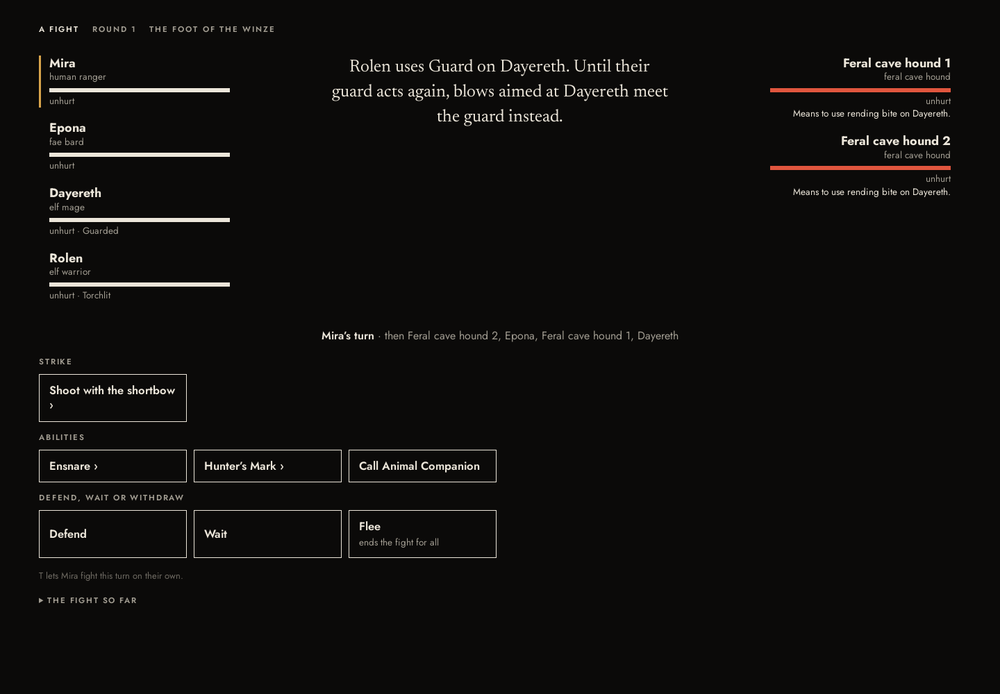
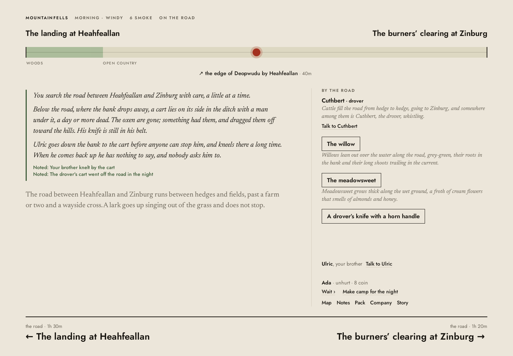
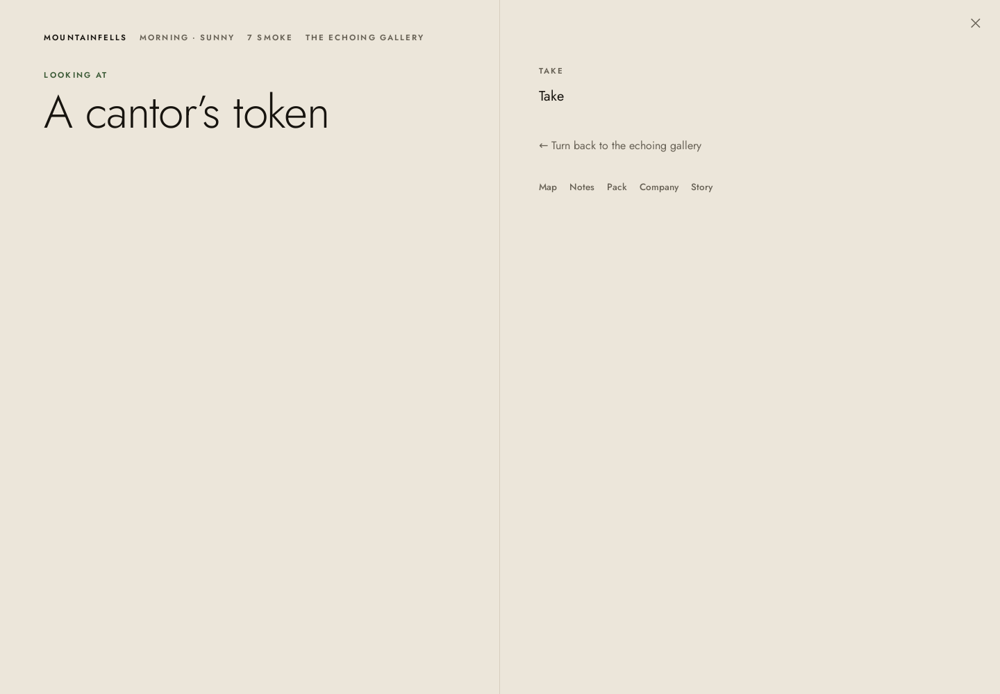

# Kyrie: interim independent experience review, second visit

24 October 2026. Agent-operated graphical play, not human user research. Read-only with respect to the game: no code, game data, deployment, or tests were changed. Review files and evidence were written separately.

Baseline: [the morning review of be30f263](../independent-review-2026-10-24/report.md). Supporting records: [chronology and action index](actions.md), [annotated evidence index](evidence.md), [post-play source diagnosis](source-notes.md). The evidence contains 82 selected original screenshots, complete command/UI text logs, deployment records, and compressed normal-interface saves.

## 1. Verdict on progress

**Kyrie is more playable and sometimes affecting. It has not yet become a reliably compelling or consistently beautiful RPG to inhabit for hours.** The earlier verdict—curiosity without sustained trust—needs qualification, not withdrawal. I now have evidence of a satisfying excursion and return, of companions belonging to places, and of a restrained family scene worth remembering. I also found ordinary saved progress that would not open in a fresh browser.

There are specific verified repairs. Passage inspection exposes its nested actions. Guard can select and protect an ally; healing provides another successful nested-target example. Prepare Charge discloses its compulsory follow-up in its hover description. Outdoor inspection preserves daylight. Torch time is visible. A battle's finishing damage and deaths are reported. On the later played build, the tinker supplies news and used topics stay exhausted after reopening the conversation.

Those improvements let deeper weaknesses emerge. A caster's member button opens actions instead of selecting their sheet. People disappear from the companion footer when they have nothing left to say. The spare-light counter reports none while Pack contains a spare. A father’s knife remains in his belt after collection. Artifact inspection can consist of a noun and Take. A philosophical position collapses after one summarized example and a successful roll. The interface continues to organize attention around available commands rather than the player's continuing subject.

The strongest newly experienced content is **not necessarily newly implemented content**. Different openings and countries exposed material the first session never reached. Epona's homecoming, the debt's repayment, and the missing-father sequence demonstrate the game's range; they cannot, without a controlled comparison, be credited as additions since be30f263. The functional repairs above are much firmer evidence of progress.

Would I voluntarily continue after fifteen minutes now? **Yes, for another excursion in these journeys.** Epona's connection to a village, the debt pressure, the singing halls, and Ulric's recognition of the cart tracks earn that much attention. Would I trust it with hours? **Not yet.** The smallest transformation is a reliable, well-composed expedition with a persistent party, truthful supplies, genuinely investigable evidence, and an aftermath that develops a relationship. More rooms and more dialogue are not the immediate requirement.

This is an **interim assessment**. Several deployments appeared during the review, and development continued in the shared workspace. I have not established final Mission 14 delivery and do not declare the mission complete.

## 2. Builds, sessions, and timing

All sessions used [the deployed player](https://jweissman.github.io/kyrie/), headless Chromium **130.0.6723.31**, **1440 × 1000** CSS pixels. Screens were rendered, captured, and visually inspected; actions used visible controls and ordinary hover text. No map coordinates, developer commands, privileged seeds, source routes, or fixtures were used to navigate. Seeds were not exposed in the visited interface. Each fresh journey began in a separate clean browser context.

| Phase | Local time, EDT, 24 October | Build attribution and session |
| --- | --- | --- |
| Initial regression exploration | About 12:54–1:00 p.m. | **4ecc0e8239a5af7cf92843368a9cb789883c6d7e**. Deployment 7301386713, created 12:35:13; bundle Last-Modified 12:35:22, ETag `6adcde4a-35770f`, 3,503,887 bytes. New Wenna, dwarf warrior, brothers' errand, Coldmoor. |
| Fresh journey 1 | 1:00–1:21:39 p.m.; resumed 2:49–2:54:56 p.m. | Same already loaded **4ecc0e82** bundle throughout. New Mira, human ranger, What is owed, Flowerholt. The roughly **87-minute interruption is excluded** from play duration. It did not reload or advance the game's simulation. |
| Fresh journey 2 | Creation around 2:55; play about 2:56–3:13:49 p.m. | **562164957f223aca1d64262edea67b5f64a39146**. Deployment 7303004561, created 2:52:09; bundle Last-Modified 2:52:26, ETag `6adcfe6a-358758`, 3,508,056 bytes. New Ada, human warrior, Coming home, Mountainfells. Same loaded build through the descent, withdrawal, restore, and resupply. |
| Final limited check | About 3:16–3:18 p.m. | **aa06ad016bc1224e20e8635e171fae6682a85f39**, deployment 7303183657, created 3:08:16; browser's actual bundle response Last-Modified 3:08:24, ETag `W/"6add0228-358b12"`. Fresh runtime, attempted ordinary save import. No fresh adventure or completed UI regression suite on this build. |

Public deployment/status records and HTTP metadata support the first two attributions; the UI has no exposed build stamp. The final check additionally retains [the actual browser bundle response headers](evidence/spot-browser-bundle.headers.json). A GitHub deployment SHA is not a byte-for-byte browser attestation of every cached asset. These are the best available practical identifiers, not guessed commits.

The two fresh journeys contain approximately **27½ and 18 minutes of active session elapsed time**, about **45½ minutes combined**, excluding the long pause. This includes agent/tool operation. Polling, screenshots, automatic waits, generation, and selector retries consume a material portion—roughly 10–15 minutes is a reasonable overhead allowance, not an instrumented measurement of human thinking time. Net meaningful reading/choosing/review was therefore shorter than the requested 45–75 minutes. I stopped at an exhausted tower investigation and a costly but successful withdrawal, rather than pad the quota with repeated empty actions. Evidence collection, source inspection, final-load checks, and report writing are additional time, not play. No human-equivalent duration is claimed.

The final save failure is **not proved to have been introduced by aa06ad01**. The earlier successful restore used an already running runtime; the later failure also changed that condition. Both retained Ada saves fail cold on aa06ad01. That establishes a serious cold-load failure, not a controlled version-regression attribution.

## 3. Regression matrix: the original ten findings

Every row distinguishes played behavior from later source evidence. No builder change report was read before play.

| Original finding | Current classification | Observed behavior, reproduction, and analogue | Build; confidence |
| --- | --- | --- | --- |
| **1. Dead characters converse and say farewell** | **Not verifiable in this session** for the original conversational path. | The naturally reached hound fight produced dead creatures with no Talk control. The discovered father is represented in prose, not as a formerly conversational NPC. Neither tests Mawr's old farewell path. No humanoid death was manufactured. Later source has conversation-ending guards, but that is not play verification. Corpse care was not offered for the father. [Hound aftermath](evidence/099-journey1-hounds-finale.png). | 4ecc0e82 / 56216495; high confidence in limitation. |
| **2. Passage mechanism inspection appears inert** | **Partially resolved.** Functional submenu failure is repaired in tested analogues. | Lockup door → inspection → visible Look/Push/Listen. Tower portcullis exposes the same children. Mine obstruction → Look explains touch trigger → safe pole action works. Singing-hall switch repeats that success; pivot-door changes state while focused. Passage actions still sit in the page margin and reset to the room. Original iron lift and pressure plate were not reached. [Lockup](evidence/008-audit-lockup-inspect.png), [useful inspection](evidence/068-journey1-trap-examined.png), [pivot](evidence/160-journey2-door-lifted.png). | Both played builds; high for tested behavior. |
| **3. One inscription certifies a whole history** | **Not verifiable in this session** for the original tally; encouraging partial evidence elsewhere. | The original tally was not revisited. A notebook gives specific explorer testimony; Jade explicitly offers a tentative reconstruction. Notes attributes Jade's history to him. Neither proves that literal writing, translation, competing interpretation, and confirmation work as a complete sequence. Source now splits the old tally/fate evidence and hedges synthesis; not counted as experienced success. [Notebook](evidence/078-journey1-notebook-read.png), [Jade](evidence/141-journey2-old-script.png). | 4ecc0e82 / 56216495; high on observations, low on exact old-case resolution. |
| **4. Light and provisioning are hard to plan** | **Partially resolved.** | Lit torch time is visible and changes during exploration. But collect a torch → Pack lists it under Dayereth → footer says nothing to spare. Analogue: buy a torch for Ulric on 56216495 → same false reserve summary. A neighboring smith supplies torches and a shrine heals; the starting town did not clearly direct me to a supplier. [Spare in Pack](evidence/080-journey1-light-inventory.png), [second purchase](evidence/172-journey2-smith-buy.png), [false summary](evidence/174-journey2-resupplied.png), [second Pack](evidence/175-journey2-spare-light-proof.png). | Both; high. |
| **5. Guard targeting fails; commitments unexplained** | **Partially resolved, with the original Guard failure resolved and verified in play.** | Other abilities → Guard → Dayereth → applied/intercepts. Cure Light Wounds → Rolen is an independent nested-target success. Prepare Charge's tooltip now explicitly says the next turn can only be Charge. I did not execute the compulsory follow-up again. Flee's stated even chance produced two failures and a successful whole-party withdrawal. [Guard targets](evidence/083-journey1-guard-targets.png), [effect](evidence/084-journey1-guard-applied.png), [healing targets](evidence/086-journey1-healing-targets.png), [withdrawal](evidence/165-journey2-retreat-result.png). | Both; high, with stated coverage limits. |
| **6. Prose fails to reflect changed objects/mechanisms/people** | **Regressed or replaced by a related defect.** | The original crowbar was not re-collected; source specifically conditions that sentence now. Generalization fails: take the father's knife → it remains in his belt in the scene. Positive analogues: spent traps lose their active description; collected coins leave a purse outline; defeated hounds stop watching the party. Original lift direction and routed deserters unverified. [Knife after Take](evidence/131-journey2-knife-taken.png), [coins](evidence/075-journey1-coins-gathered.png), [trap](evidence/069-journey1-trap-sprung.png). | 56216495 negative; 4ecc0e82 positives; high. |
| **7. Combat ending and party injuries disappear** | **Partially resolved.** | Victory presents final damage, deaths, and one clear 241-XP award; withdrawal returns to the previous room. Rolen's and Jade's injuries appear when their companion rows exist. Dayereth's row is absent, so his wound is omitted. No deliberate hold/acknowledgment screen was experienced on the two principal builds. A later source change cannot substitute for play. [Finale](evidence/099-journey1-hounds-finale.png), [injury/selection problem](evidence/100-journey1-postfight-sheet.png), [Jade visible](evidence/165-journey2-retreat-result.png). | Both; high. |
| **8. News, topics, and examination are thin or repetitive** | **Partially resolved.** | Nan supplies news; news/work disappear and remain exhausted after reopening. This repairs the original repeat-topic pattern on 56216495. Altar, lockup, portcullis tests and ruin/pit searches still often give nothing. Family, creditor, and reunion scenes have substantially more meaning than occupational filler; artifact inspections remain thin. [News](evidence/122-journey2-news.png), [revisit](evidence/124-journey2-news-revisit.png), [empty ruin](evidence/016-audit-ruin-search.png), [token](evidence/157-journey2-token.png). | 4ecc0e82 / 56216495; high for samples, not every NPC. |
| **9. Stage composition and focus fragment attention** | **Partially resolved.** | Outdoor altar stays light; pivot-door holds focus. Room/road/combat/books still replace the composition. Reading the notebook removes it from inspectable subjects. Using bandages from Pack returns to and appends into Orym's conversation. Map uses large headings and dense tiny labels; family grief competes with routine road subjects. [Altar](evidence/005-audit-altar.png), [bandaging](evidence/110-journey1-bandaged.png), [map](evidence/144-journey2-map.png), [discovery](evidence/127-journey2-ruts-searched.png). | Both; high as observed design critique. |
| **10. Portrait and fictional identity conflict** | **Still reproducible.** | Richly dressed sitters remain assigned to working roles. Mother reads conspicuously youthful beside the mature-looking brother; this is an artistic plausibility judgment, not a factual claim about depicted ages. Ulric's portrait becomes an initial upon recruitment, as Rolen's did. Mira's expedition credits an unexplained Immeral. [Brother](evidence/117-journey2-brother.png), [after joining](evidence/119-journey2-brother-joins.png), [mother](evidence/136-journey2-mother.png), [Immeral](evidence/065-journey1-mine.png). | Both; high on transitions/name, medium on aesthetic fit. |

This is not ten independent confirmations of success or failure. Several original cases were inaccessible in the drawn worlds. The deliberate analogues establish that the nested-menu repair generalizes, while the state-dependent prose repair does not consistently generalize.

## 4. Fresh journey 1: debt, a blocked tower, and a profitable expedition

### A useful pressure becomes a plan

Mira starts with 21 coins and a 30-coin debt. Orym has waited until market day. Asking for five more days changes the debt to 35 without first presenting a negotiable price. It is a sharp response and a real consequence; it is also a commitment hidden inside what sounds like an inquiry.

The inn complains about road tolls and charges three coins for a ration. A green light in a distant tower sounds worth investigating. I hire Epona, a minstrel, for three coins. Local rumor topics disappear when she joins, before I can ask about the well. Her later song is a summary of national history, not much of a performed song, but it makes that history available in play.

Paying the ford's three-coin toll leads to Tatharimlad. Epona recognizes home; Veyas recognizes her, laughs, blesses us, and provides food. This is an effective companion reward: somebody belongs here independently of me. It is buried in a settlement introduction containing several unrelated hooks and an exactly repeated river sentence.

The philosophers provide a different kind of agency. Dayereth describes his doctrine of the One. Telling the history Epona knows succeeds on her lore check, awards experience, overturns his conviction, and makes him willing to join. Knowledge has consequences. Yet the dramatic argument is unearned: the player selects a summarized example, a die determines it, and a lifelong metaphysical position is abandoned. The philosopher's changed life is larger than the exchange that supposedly caused it.

### Discovery succeeds; the invitation fails at the gate

Player-visible chain: **inn's tower rumor → Map shows lone tower near Tatharimlad → paid ford → Tatharimlad → foot of Sigakwinde → Rosaturris**. No source routing was used.

Rosaturris promises a green light, a portcullis, breach, well, and postern. Look closely, Push and pull, Listen, and Search all produce no useful result. Hover text eventually says the crypt needs lockwork or brawn, and the breach needs climbing. Those are recoverable capability requirements, but the main composition gives poor help with planning an alternative. The named well remains uninvestigable. I abandon the attempt, not the character.

Back at the alehouse, Rolen's bad knee and paid-off company make her more particular than an anonymous hire. I ask about the well before recruitment removes that rumor; she says it reaches the cellars. She joins for six coins. I now have a plausible return plan, but the nearby mine lead offers a better way to address the debt first.

### The deep site is ordinarily discoverable

Second visible chain: **Seren's old-workings topic → specific Argentumons directions → edge of Ringloew by Tatharimlad → marked one-hour track → mine**. I rest, prepare another Light, and follow it. The route is notably shorter and clearer than the tower approach.

Animal avoidance and ravens at noon make the mine ominous without immediately explaining its secret. An unexplained Immeral gets credited with noticing it; the four actual party names are different. At the entrance, a humming obstruction invites inspection. Look reveals that touch triggers it; the pole offers a safe test. That works and changes the scene. This is one of the clearest examples of rewarded caution.

Inside, a torch makes the mine visible and its remaining hour appears in the footer. A silver lamp has a promising name but virtually no inspection description. A rotted purse provides 32 coins and leaves its outline in the dust. The debt is now affordable. An abandoned camp's notebook supplies useful testimony about ladders, a jammed lift, and a bitten explorer. Its notebook vanishes as a focused subject after reading. Gathering a spare torch does not correct the footer's reserve count.

### An intelligible fight, then a satisfying return

I take a bounded hard-fight challenge against two cave hounds below the winze. Guard protects their announced target, Dayereth; Epona heals the intercepting Rolen; Dancing Lights impairs one hound; the ranger calls an animal; attacks and spell effects finish both. The result is far more tactically comprehensible than the morning's broken Guard interaction. The five allied turns, status lists, saves, and repeated effect announcements also make it laborious.

The finale reports the actual finishing hit, deaths, and shared XP. Dayereth has been hurt but is absent from the exploration footer and cannot be selected normally in Company because his action menu takes precedence. I withdraw with the money.

A marsh path back to Brethelmasto avoids the toll. That is a small, actual unscripted plan supported by geography. Orym accepts repayment, smiles for the first time, and admits he doubted me. The lamp sells for 120 coins and XP, but the price is revealed only after committing. Bandages heal Dayereth; choosing that action from Pack drops me back into Orym's dialogue, mixing medical administration into the creditor conversation.

**Why I would continue:** the debt is settled through an expedition I chose, a companion has a home, and the mine still has unanswered questions. **Why I would stop:** unreliable party/supply presentation, shallow artifact inspection, and much procedural clicking remain between the interesting beats. The newly valuable lamp also overwhelms the original 30-coin pressure before it has time to develop.

## 5. Fresh journey 2: coming home, then the singing halls

### Evidence and affection briefly align

Ada arrives after three years away. Ulric is waiting with their father's spear and refuses to wait longer. Petting the familiar dog reveals ditch mud and an iron-cut paw. Ulric remembers the cart's bad left wheel; on the road he recognizes its ruts. These details reward ordinary affection and careful attention. They suggest a particular family, not just a quest giver.

Visible chain: **mother's letter in opening → brother's road advice → familiar dog's evidence → named road → visible ruts → Search**. Search finds the father dead beneath the cart. Ulric kneels, then returns silently. This is good restrained writing.

The framing does not rise to it. The road continues with a singing lark, familiar plants, a passing drover, and standard controls. Talking to Ulric offers to tell him what I found, though he has just knelt at the body. His response redirects toward whatever took the oxen. No visible option addresses moving or tending the body. Taking the knife leaves the sentence saying it is still in the father's belt.

Notes supplies a humane next step missing from that scene: Mother is at the inn and does not know. Her response—she knew, the dog knew, and people still need feeding—is affecting. Showing the knife gives it a continuing personal meaning: keep it to use. An explicit XP award and scenario “seen through” announcement intrude on the quiet consequence. I am glad this scene exists; I want its composition and available intentions to respect it.

Nan also provides a fair regression comparison: actual news, a small joke, and used topics remain exhausted after reopening. The mother and brother still use the same family greeting sentence, exposing reuse just where particularity matters most.

### A second deep-site chain works

I hire Jade, whose interest in copying is more appealing than the library's demand for the result. His Stone-Singer history is explicitly a tentative reconstruction. The innkeeper describes singing halls with no chisel marks and something answering a song.

Visible chain: **inn singing-halls rumor → directions via edge of Deopwudu by Guldhricg → home forest edge → old bank → Guldhricg forest edge → marked track → Carmencaw**. The map initially shows neither the destination nor the town anchoring the directions. I find the chain by exploring plausible routes. I camp before entering, following the daylight warning.

The smooth, resonant architecture is genuinely different from the mine. A trap's label spoils that a hidden switch exists, but its inspection provides specific physical information and exposes a safe pole solution. An unavailable trapwork option says why it is unavailable. Those are useful improvements.

The listening-room's prose invites speech and listening but offers neither as an intention. A cantor's token has no description in inspection beyond its name and Take. The pivot-door is much better: lifting it preserves focus and changes its description. Past it, the sound disappears into a roof too high for the light. The place has atmosphere.

### Withdrawal and recovery work, but do not yet make a sustained expedition

Entering the choir immediately starts a banshee fight. It resists ordinary weapons and targets Jade. I choose the disclosed even-chance Flee; two attempts fail and Jade is badly wounded, then Ulric succeeds and everyone returns to the preceding room. That is a legitimate costly retreat. It is also a dramatic discontinuity: curiosity about a sound becomes repeated escape rolls before I can formulate much else.

Same-runtime save export, title return, and file import preserve room, date, coins, injury, and torch time. Returning outside and reaching Guldhricg brings another companion recognition scene and food. A smith sells a spare torch and the shrine heals Jade. This is an ordinary retreat/resupply loop. The reserve-light display still reports no spare after the purchase. I stop rather than grind the banshee or pretend a first-floor visit establishes a compelling campaign.

**Why I would continue:** the family sequence gave me a connection worth keeping, and the hall's acoustic premise is distinctive. **Why I would stop:** that premise has few responsive intentions, the body/family aftermath is too narrowly authored, and the first dangerous encounter abruptly ends the investigation. After the family goal closes, Notes says nothing is asked of me yet, rather than helping articulate the voluntary concerns still alive in the world.

## 6. The new boredom and engagement diagnosis

The game is no longer well described by “I could not find anything.” I found two deep sites through ordinary leads, an emotional return, an economic return, and a practical tactical sequence. The question is what happens between those moments.

**Anticipation works when a detail implies a test.** A bad wheel can leave recognizable tracks. A humming obstruction may trigger from touch. A note from vanished explorers can influence route choice. Companions can know people in the next village. These are stronger than interchangeable discovery announcements because they change a plan or relationship.

**The game still spends too much attention on unproductive invitations.** A named ruin has no substantial contents; a well cannot be investigated; a listening-room cannot be listened to; an artifact is a noun with Take. Once the player learns those limits, another attractive paragraph promises less. Adding descriptive volume would amplify that disappointment.

**Procedural variety is more convincing at the architectural level than at the interaction level.** Mines and sung halls have different materials, sounds, and purpose. Their early loops still converge on inspect the named trap, trigger it with a pole, take treasure, encounter a creature, monitor a torch. A genuinely different room should sometimes demand a different kind of attention, not just a different damage type.

**The emotional economy and numerical economy often work at different scales.** A father’s death gets a completion/XP announcement. A single historical example converts a philosopher's worldview. One early lamp is worth several times the debt driving the opening. Those may be mechanically sensible rewards; dramatically they compress relationships and pressures before they have developed.

**Boredom now comes partly from managing representation.** Checking whether a person is still here, whether a spare exists, whose sheet is visible, and which screen an action will return to consumes attention that should belong to the world. Correctness repairs can improve this without adding content. The shallow interpretations and premature emotional closure require content design and editing as well.

## 7. Visual and literary critique

Kyrie has an artistic conception. Warm paper, serif narrative, restrained controls, route placement, terrain strips, and dark interiors belong to a recognizable literary game. Some pages are attractive. The dominant problem is **composition over time**: the visual system does not consistently know which subject or consequence should retain the player's attention.

The framed location page gives enormous prominence to titles and spreads choices around its perimeter. Sparse rooms have distant footers; crowded towns require scanning a cast, long prose, all four edges, and global navigation. The map is legible enough to support a shortcut but spends generous space on the current location's title and little on readable place labels. The presence or absence of map knowledge is not explained well; source later indicates wayfinding capability legitimately changes coverage, so different maps are not automatically erroneous.

Conversation grants a portrait almost half the viewport regardless of its fit or the exchange's importance. Workers can become courtly sitters. Recruitment can remove the picture entirely. The image then behaves like an ornamental mode asset rather than a stable person's identity. Lack of a portrait is fine; a giant initial replacing a just-established face needs a coherent treatment. No real depicted person's age or identity is asserted by this critique.

The prose is strongest in material particulars and indirect emotion: the bad wheel, mud under the hand, the mother turning back to her pot, footsteps returning at the wrong pitch. It is weakest when it summarizes the event it should dramatize: a song, a philosophical conversion, or a generic object action. Reused greetings, journey sentences, plants, and work poses become visible as slots. Some editing and subtraction would improve the literary identity more than expansion.

Combat has better functional hierarchy: announced intent, turn order, targets, odds, and effects. It still looks like a black command matrix, with almost no spatial memory of the room. Five allied actors in a short encounter produce a great deal of status text. “Not burning” beside a Burning label and “takes it” after a missed attack make the prose less reliable than the underlying numbers may be. I did not trace every such phrase to its rules event and do not claim the simulation calculation itself is wrong.

Important discoveries need a different rhythm from ordinary inventory operations. The father's body, a one-coin bandage, and an ancient token all pass through broadly similar response machinery. The field journal remains the strongest direction to prototype: it must organize an ongoing subject and its consequences, not simply put current panels on parchment.

**Success:** the announced attack and the guard action can now support an understandable decision. This verifies behavior, not a claim that the combat composition is beautiful.

**Failure of emphasis:** the discovery and brother's reaction occupy the response, but the road's everyday subject list and onward layout retain their ordinary priority. The scene needs an aftermath, not additional prose about the lark.

**Missed opportunity:** the token has a culturally suggestive name, but its inspection offers no material or readable detail. Artwork would not solve the missing investigation.

**Final check, separate build:** a normal saved artifact prevents the saved world opening in a fresh runtime. This is stronger evidence against trusting hours of progress than any taste judgment about typography.

## 8. The next twelve highest-impact findings

Ranked by likely damage to an ordinary player's willingness to continue. “Bug” means an observed correctness/representation failure; “design” means a reasoned experiential shortcoming. Source explanations are bounded in [source-notes.md](source-notes.md).

| Rank / kind | Observation and evidence | Why it matters; likely cause category | Recommended direction; confidence |
| --- | --- | --- | --- |
| **1 — Bug** | Two Ada saves fail cold with `Unknown item definition cantor_token`; earlier same-runtime import succeeded. [Two failures](evidence/178-spot-aa06-load-state.png), [second](evidence/179-spot-aa06-earlier-save.png). aa06ad01. | Hours are not worth investing if normal treasure can block return. Save/catalog initialization; introduction version unproved. | Restore campaign-local definitions before rebuilding creatures/inventories; verify a fresh runtime, not only import into the already populated runtime. **High** observed, medium-high source diagnosis. |
| **2 — Bug** | Dayereth/Jade selection opens spell actions, leaving protagonist's sheet; companions with exhausted topics disappear from footer. [Mira's sheet after mage choice](evidence/062-journey1-mage-sheet.png), [Ada analogue](evidence/166-journey2-injured-sheet.png). Both builds. | Party composition, health, expertise, and preparation become unreliable exactly when needed. UI command tree and party projection. | Separate member selection from member actions; derive party strip from party membership, independent of available talk. **High.** |
| **3 — Bug** | Pack contains the collected/bought spare; footer says none. [First Pack](evidence/080-journey1-light-inventory.png), [newer-build proof](evidence/175-journey2-spare-light-proof.png), [footer](evidence/174-journey2-resupplied.png). | A repaired planning aid supplies false confidence or false scarcity. Presentation data identity/counting. | Count stable item definitions, then show light, reserves, magical alternatives, and relevant time costs together. **High.** |
| **4 — Design / possible local blockage** | Pit lead has no entrance after search; tower's well/breach/postern are poorly actionable; listening room offers neither speaking nor listening. [Pit](evidence/021-audit-pit-search.png), [tower](evidence/053-journey1-portcullis-listen.png), [room](evidence/155-journey2-listening-room.png). | The player learns to distrust invitations in prose. Discovery/intent exposure plus scenario design. | Make the first reasonable investigations explicit; show unmet capabilities in context; give the acoustic premise a playable test. Do not infer unimplemented entry everywhere from one sample. **High** observed, medium scope. |
| **5 — Bug / authoring pattern** | Father’s knife remains in belt after Take; brother must hear a discovery he witnessed; generic current scene ignores emotional state. [Knife](evidence/131-journey2-knife-taken.png), [tell brother](evidence/129-journey2-tell-brother.png). | Material evidence and people cease to reflect shared events. State-dependent observations and participant knowledge. | Split persistent facts from current object presence; gate responses on actual witness/knowledge; compose a reconciled aftermath. **High.** |
| **6 — Design / command semantics** | Extension adds five coins without a prior quote; Sell offers no actual price before commitment. [Extension](evidence/026-journey1-extension.png), [sale result](evidence/105-journey1-lamp-sold.png). | Consequences are real but not sufficiently understood choices. Transaction presentation/content. | Let a request elicit terms before acceptance; quote sale value and disposition before transfer. No universal confirmation dialog is needed. **High.** |
| **7 — Design** | Banshee room transition immediately becomes a resistant-foe fight; retreat becomes repeated rolls. [Encounter](evidence/162-journey2-choir.png), [failed escape](evidence/163-journey2-flee.png), [withdrawal](evidence/165-journey2-retreat-result.png). | Atmospheric investigation is interrupted before a clear tactical or exploratory plan can form. Encounter staging/perception. | Give a meaningful threshold or interpretable warning and an actual choice of approach; preserve room relationships in combat. Danger need not be removed. **High** experience, not a balance verdict. |
| **8 — Bug / presentation** | Burning/not-burning statements conflict; zero-damage effects and interception wording are hard to reconcile; ordinary view omits some injuries. [Scald](evidence/094-journey1-scald.png), [finale](evidence/099-journey1-hounds-finale.png). | Players cannot reliably reconstruct why the party changed. Combat event narration and aftermath. | Narrate resolved state changes with cause and duration; make all injuries visible; retain a concise final action before ordinary interaction. **High** wording, medium exact cause. |
| **9 — Design** | One lore-supported historical example converts Dayereth and completes a disputation. [Argument](evidence/041-journey1-argument.png). | A consequential character change feels like selecting a winning key, not thinking or persuading. Dramaturgy/content; not a need for more dice. | Develop a position through concrete objections, stakes, and later behavior; distinguish a shaken conviction from instant conversion. **High** as critique. |
| **10 — Design / focus** | Read notebook removes it; bandaging returns to creditor dialogue; maps and edge controls redistribute attention; important family intentions live only in Notes. [Notebook](evidence/078-journey1-notebook-read.png), [bandage](evidence/110-journey1-bandaged.png), [Notes](evidence/134-journey2-notes.png). | Players operate screens rather than sustain an intention. Presentation/focus architecture. | Preserve subject until deliberately left; separate character speech from off-subject administration; keep a stable place/party anchor and aftermath intentions. **High.** |
| **11 — Design / identity bug** | Misfitting portrait scale, picture-to-initial transitions, and an unexplained Immeral. [Mother](evidence/136-journey2-mother.png), [recruit](evidence/119-journey2-brother-joins.png), [mine](evidence/065-journey1-mine.png). | Images and names assert incompatible accounts of the inhabitants. Portrait policy and identity resolution. | Curate or omit images; keep identity stable across recruitment; use one player-aware name resolver. **High** name/transitions, medium aesthetic judgment. |
| **12 — Design / content presentation** | Artifacts can be Take-only; repeated plants/journeys and empty sites consume reading; completed family arc leaves “nothing asked ... yet.” [Token](evidence/157-journey2-token.png), [empty ruin](evidence/016-audit-ruin-search.png), [journal](evidence/177-journey2-final-notes.png). | Curiosity and attachment fail to accumulate into a voluntary horizon. Content editing, artifact presentation, memory of completed arcs. | Show existing object descriptions; vary what attention discovers; compress familiar travel; remember completed relationships and open questions without turning them all into mandatory quests. **High** examples, medium prevalence. |

## 9. Three bounded experience prototypes

### A. The father's return: an aftermath worthy of the discovery

Playable sequence: familiar dog → brother's wheel memory → road evidence → discovery → decide how to tend/recover the body, involve the brother, and inform the mother → knife's disposition → a later quiet visit. Preserve the current good writing. Add a few consequential intentions, not a long grief dialogue tree. Ulric should know what he witnessed. The world can remember the dead without forcing the player into revenge.

Use an illustrated journal spread that holds the discovery, present people, current place, and immediate intentions. Routine plants and travel controls recede. The mother's response gets time before any numerical reward. **Success criterion:** a fresh player can explain what they chose, what the family now knows, and why the knife or a future return matters; they need not choose the same response. **Risk:** becoming a prescribed cinematic sequence. Keep more than one humane plan and a clear way to leave.

### B. One honest expedition, from preparation to a changed return

Playable sequence: hear a specific hall lead → map the next known leg → inspect all party members → compare supplies and quoted costs → investigate one culturally specific mechanism and one useful document → choose a safe limit or risky descent → return, heal, resupply, and revisit the altered route. Use Argentumons/Carmencaw-scale existing content; do not add another dungeon.

The interface needs a stable party/light strip, real member selection, truthful reserve counts, visible document provenance, and a persistent object focus. Use the existing road strip and a facing map leaf, not a fantasy dashboard. A cold save/load is part of the sequence. **Success criterion:** the player can predict roughly what the next actions consume, describe a revised plan, and resume the expedition reliably in a fresh runtime. **Risk:** replacing atmosphere with accounting. Show the few resources that affect the present choice, with detail available on demand.

### C. A companion's belief tested by an artifact

Playable sequence: meet a companion with a position and a home → hear uncertain testimony → inspect an artifact with actual material and readable detail → try an interpretation in the world → discuss what the result does and does not show → return to the companion's institution or contact. Dayereth's conversion and Jade's history are useful starting points, but no single skill roll should settle the whole belief.

Show literal evidence, translation, speaker attribution, and the party's hypotheses separately within one reading focus. The companion may remain unconvinced or revise only part of their position. A later behavior should reveal that change. **Success criterion:** a player can articulate two plausible readings, cite the evidence for their plan, and notice a companion's changed behavior without a narrator declaring the story complete. **Risk:** excessive exposition. Write the physical test and disagreement first; remove material that does not change a decision.

The **illustrated field journal remains my preferred first prototype**, specifically B with one A-style aftermath. The architecture already demonstrates focus preservation on the pivot-door and usable nested choices. It does not demonstrably require a wholesale rewrite. What must change is the contract: stable subject, stable party, edited event history, clear navigation, and significance-based composition. The expedition table remains a strong alternative if route/resource planning becomes the central pleasure; the dramatic scene book is appropriate for deliberately authored family/institutional scenes. Neither is proved better by an attractive mockup.

## 10. What to preserve; Mission 15 priorities

Preserve the specific personal openings; the dog, wheel, mother, and knife; companion recognition in their own settlements; the creditor's restrained response; distinct architectural purposes; practical explorer testimony; context-sensitive trap investigation; announced enemy intent, Guard, and target selection; readable paper typography; the road's terrain/endpoints; ordinary retreat and geographic alternatives. These are experienced strengths, not credit for hidden code.

**Priority A — Restore confidence first.** Fresh-runtime save restoration, party/member selection, spare-light counting, consistent names, and state-dependent object/participant descriptions. Verify these across two different generated cases. A safe same-runtime import is insufficient. Complete the ending/withdrawal presentation with all party injuries visible. Do not spend Mission 15 chiefly adding content atop these failures.

**Priority B — Make one current loop worth repeating.** Prototype the complete plan/investigate/retreat/return sequence above. Give its central artifact more than a name, its mechanism a culturally meaningful test, and its companion a response that develops. Preserve the player's choice of goal. Tune early rewards against the opening pressure, and quote terms before financial commitment. Compress familiar travel rather than adding more interchangeable sentences.

**Priority C — Compose significance beautifully.** Retain the literary palette but stop allocating emphasis solely by output mode. Reduce oversized map headings; move critical mechanism choices into a generous reading area; keep place and party stable during books and combat; curate or omit unsuitable portraits; give a revelation and its aftermath a sustained composition. Prototype this on a full excursion, not just an initial state.

Defer more procedural room families, hundreds of portraits, larger dialogue tables, broader borders, and additional tactical catalogs until these priorities hold. No missing universal philosophical system was established. Several weaknesses are failures to present or use capabilities already present; the family aftermath and the instantaneous argument are content-design problems; fresh save restoration is a runtime integration problem. Treating all three as a UI rewrite would miss their causes.

## 11. Scope, uncertainty, and final answer

Visited: three drawn countries across regression and fresh sessions; a shrine, lockup exterior, empty ruin and inaccessible pit; two principal personal openings; multiple settlements and roads; tower exterior; upper mine and haulage access; upper singing halls and the choir threshold. Completed the debt and family returns. Experienced a three-round hound victory and a failed-then-successful banshee withdrawal. Tested ordinary purchase, sale, bandaging, shrine healing, recruitment, spells preparation, artifact collection, same-runtime save import, and fresh-runtime import failure.

Not verified: the original exact Mawr death/farewell, iron lift direction, pressure plate, or old tally in play; a completed deep dungeon; the deepest keeper; actual compelled Charge follow-up; character advancement; companion dismissal; burial/body recovery through some undiscovered route; mobile or cross-browser layouts; a completed UI/encounter test on aa06ad01. A descriptive father corpse does not establish that a formerly living conversational NPC is fixed. No tests were run as proof of enjoyment. Source inspection began after both player journeys and did not guide their routes.

Cold-load failure blocks the intended final two-defect spot-check on aa06ad01. The newer build may contain further fixes not experienced here; I do not silently attribute earlier behavior to it. Existing builder edits continued in the workspace and were left untouched. Source diagnosis uses pinned commits, not those moving files. The report is interim and not final Mission 14 acceptance.

**Has Kyrie moved toward a game a curious stranger would voluntarily inhabit? Yes. Has it reached reliable play for hours? No.** It can now earn affection and a chosen return journey. The smallest coherent next transformation is to make one such expedition truthful, resumable, investigable, and dramatically continuous from departure to homecoming. The successful ingredients are already visible. Their relationship needs more work than their quantity.
