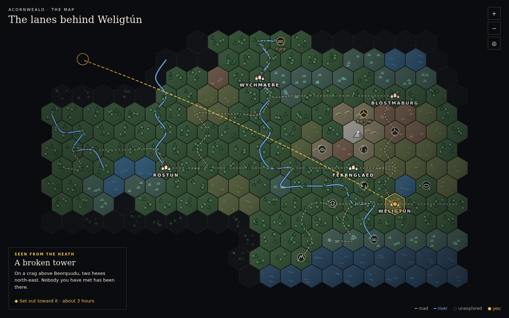
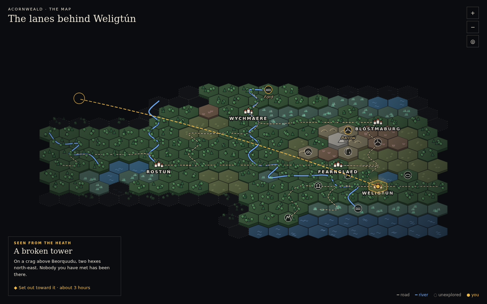
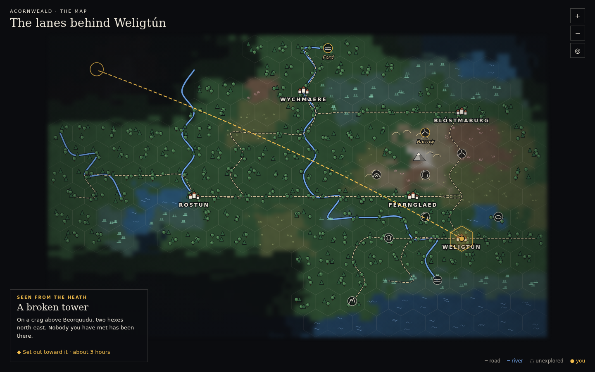

# Mission 18: the map, and exploring the open country

The owner's correction of 2026-10-29: the interim map (37970a0, a painted land on square cells within the stage) was
not a hex crawl; the map was to be reconsidered from first principles, allowed the whole screen, with three treatments
prototyped and compared and one chosen by how it looks and plays; and wilderness exploration was to become one of the
game's central pleasures. The map is not accepted until the owner has reviewed it as a visual and interactive
experience.

## Three treatments, compared

Each was drawn from the same generated country (kite's Acornweald, a few days' wandering known, the ring of country
just beyond it glimpsed), at the whole of a 1440 by 900 screen, with the same places, rivers and roads, the same marks
for where you are and where you are bound, and a chosen place's card at the foot.

| | A: an illustrated hex crawl | B: a restrained isometric hex terrain | C: a hybrid, painted land under a hex grid |
|---|---|---|---|
| |  |  |  |
| The land | each hex its land at a glance: trees, fells, a peak, reeds, water | tiles raised by their land; at this scale the height reads as a shadow | soft and continuous; the hexes, which are what is walked, disappear |
| Rivers, roads | features over the hexes, legible | the same, but the view is squashed into a band | legible, but on a ground with no grain |
| The unknown | a dotted ring of glimpsed hexes, then dark | the same | the painting fading out |
| Room for the country | most of the screen | a band across it; names crowd | most of the screen |
| Moving across it | the hex you would step into is plain | plain, but harder to point at | not plain |

**Chosen: A**, the illustrated terrain-first hex crawl. It is the only one in which what the company walks (a hex) is
what the eye reads first, it gives the country the most of the screen, and its marks carry the land's character
without a painting's blur. The isometric treatment added little height at this scale and took the room the country
needed; the hybrid was the most painterly and the least usable.

## What was built

**The map** (web/reader/map-view.tsx, hex-land.ts, hex-symbols.tsx): the whole screen, over the stage, with as little
over it as will do: where you are at the top left, the close and nearer, further and back-to-you at the top right, a
chosen hex or place in a card at the foot. Every hex the company knows is drawn as its land (one palette, dusk over an
old country: muted earth for the lands, deep water, marks in ink with a lit side, ivory names, gold for you and where
you are bound). The ring just beyond what is known is the edge of the unknown, dotted; past it, dark. Rivers and roads
run through the hexes' middles as curves, broken where they leave what is known, never leaping it. Each place known
stands on its hex with its own sign (a town's roofs, a tower, a ruin, a cave, a shrine, a barrow, a camp, a standing
stone, a tarn, a crag, a ford, a grove, a way in), its name beside it, a town's large, a place not yet been to in gold.
It is dragged to move about, its wheel or buttons bring it nearer; a hex chosen says its land and offers to go there
across country, a place chosen says the way there, leg by leg, and sets out.

**The open country** (src/world/region-tracts.ts): every cell of a generated country's land is a stretch of it, a
place, named for its land and where it lies from the nearest town ("open heath north of Weligtún", "the fells of
Barzelrehes"), and told as that land is, with its river, its road, the land rising to one side, a town close by. From
each stretch, the way across country into each of the six about it, as long as the harder land is going (half an hour
over fields, two over the heights), longer over a river; into whatever stands on it (a town, a site, a landmark, a
march-stone); onto the road that crosses it. A town has a way out into the country about it, so that a protagonist can
leave it simply to explore. On the page, those six ways are a compass ("Across country": north-west, the fells of
Barzelrehes, 1h 30m), apart from the place's own ways and the roads.

**Exploring** (LandModel.explored, ChartModel, Itineraries): a stretch walked makes known those about it; looked out
over from it ("Look out over the country from here", not in the dark), the country further off, as far as its land lets
the eye go (from the heights far, from a wood or a fen hardly past the next stretch), a stretch further for someone who
knows how to look or has a glass, only the nearer land in haze or rain. What stands up from the land within sight (a
town, a tower, a ruin, a crag; worked out by the lie of the land between, as from the vantage points of Mission 17) is
told by its bearing and distance and is known from then on, on the map and somewhere to set out toward. What does not
stand up (a cave, a grove, a clearing) is found by coming to its stretch. A journey may strike out across the open
country, walked or not, toward a hex chosen on the map, a place seen, or somewhere been (the way home); toward a place
only heard of it still goes by known ways to the edge of its wild country and asks there (PT-16).

Measured: a generated country now has some 380 places and 880 ways (from 135 and 170) and starts in about four seconds
(from three and a half). test/exploration.test.ts plays it: out of Ramavor into the country about it with no
destination, up onto the fells by the compass, looking out (a square tower a long way off, Barzelmizela some way off;
the known land from 81 hexes to 146), and across the country to the tower, kept known.

## What remains

- The owner's review of the map, in play.
- The wild's own life: what is met in the open country (beasts, travellers, weather's hazards) by its land, and the
  small finds of a stretch (a spring, a shepherd's hut, a wreck of a cart) beyond the places it already holds.
- Authored regions' open country: their land is drawn (AuthoredLand), but their stretches are their authors' rooms.
- The demonstration (OWN-11), played through the reader.
