# Mission 8: worth experiencing

Kyr now opens on a page to read. A company of three comes up the south road into Merrowdale, where a long straight
ridge lies across the valley and the village under it believes a giant king is buried there. The ridge is a dam, and
the tall figure that walks its crest at night is the last of its keepers. The steward has been selling the dam's
bronze, and the storm comes in three days. That is *The Long Man*, the one reference adventure the game now offers.
It was designed in prose before any Kyr was written, built from that design, played in the browser, criticised and
revised.

Behind it:
- the reader replaced the old client, with the engine in a worker;
- journeys take their time before they arrive;
- creatures meet the company by temperament;
- abilities are offered only where they can work;
- Kyr gained a handful of conventions for ordinary fictional facts: whose a thing is, a bar on one side of a door,
  facts people know, a creature's own words;
- the old campaigns left the game.

Everything in this report was tested by its builder. No one else has played this.

Sixteen commits, `168a68c` to `aac50fc`, are listed at the end. To play: `bun run web:build`, open
`site/index.html`, choose *The Long Man*.

## 1. What it looks like now

Screenshots are in [`doc/playtests/long-man-2026-10-22`](../playtests/long-man-2026-10-22). They were taken in
Chromium at 1440×900 and at 390×844 with touch input.

| | Desk | Phone |
|---|---|---|
| Arriving | 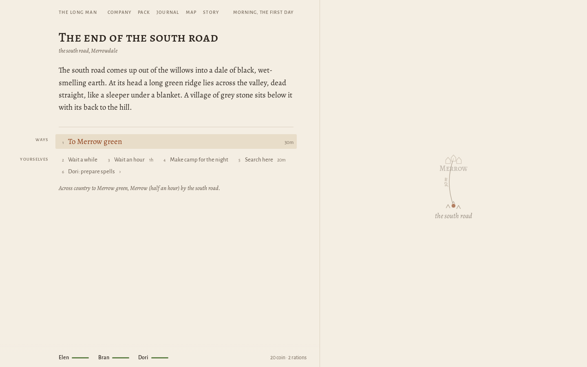 | 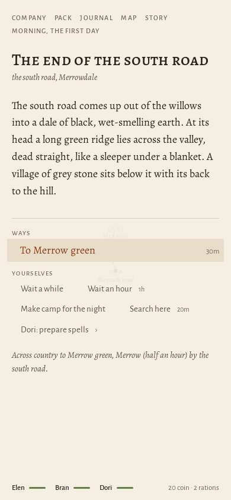 |
| Talk at the well | 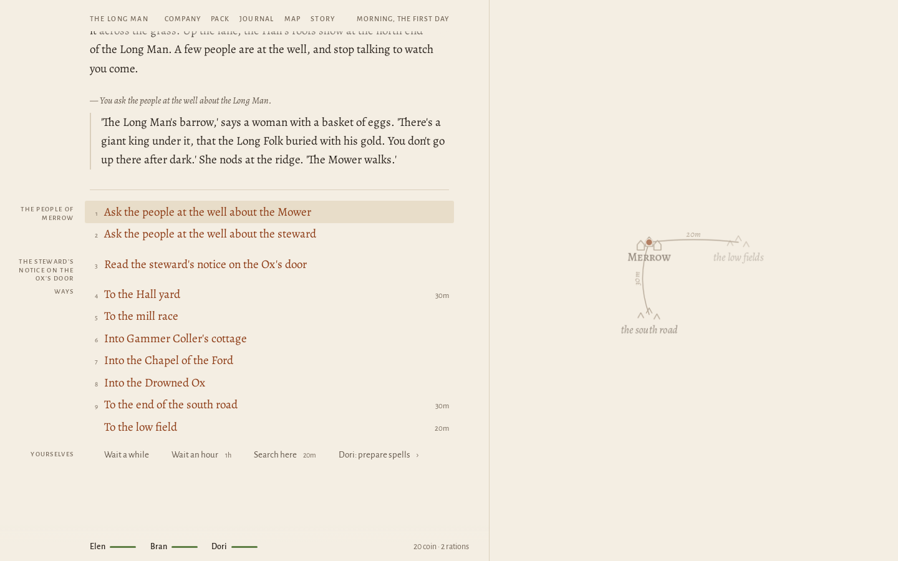 | 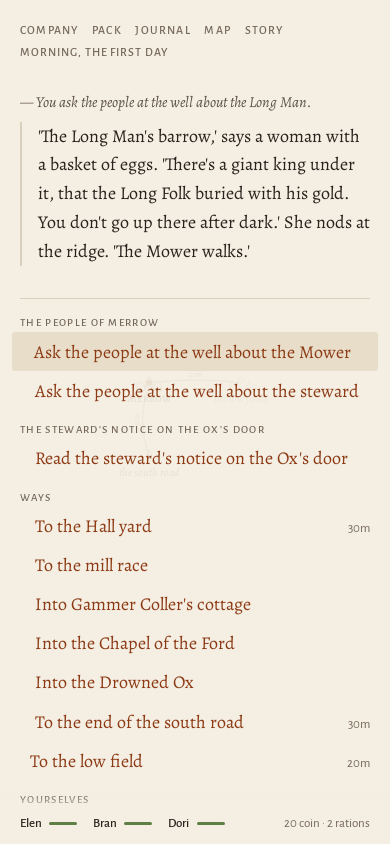 |
| The crest at night | 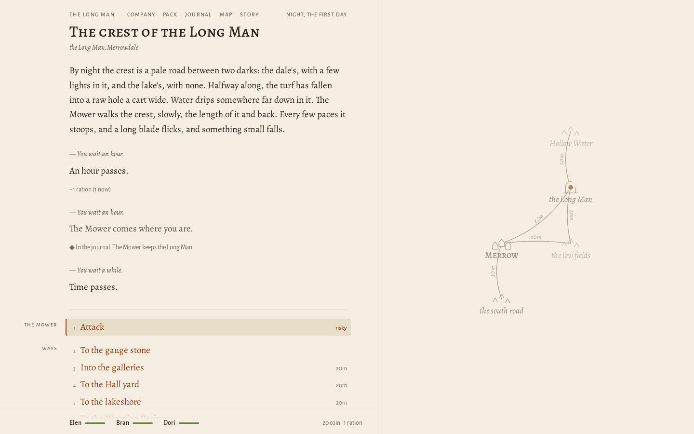 | 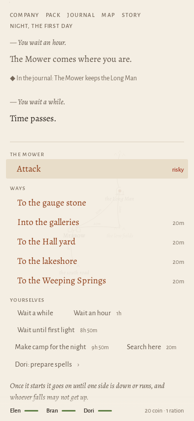 |
| The bronze given back | 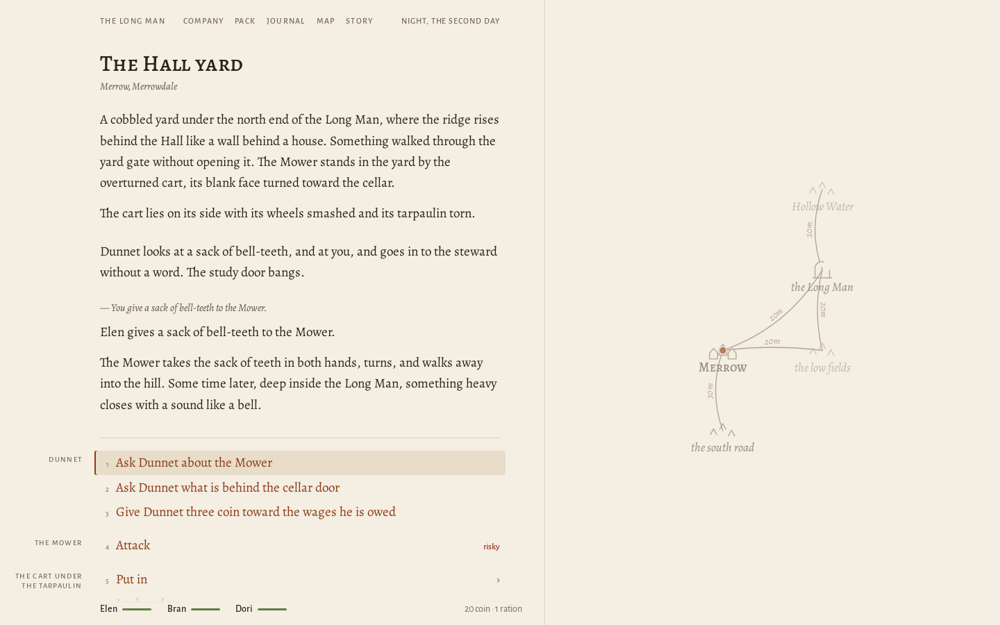 | 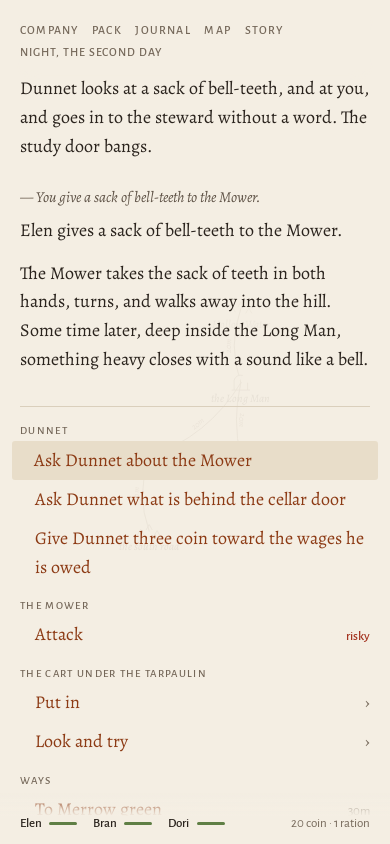 |
| A warning in the wet gallery | 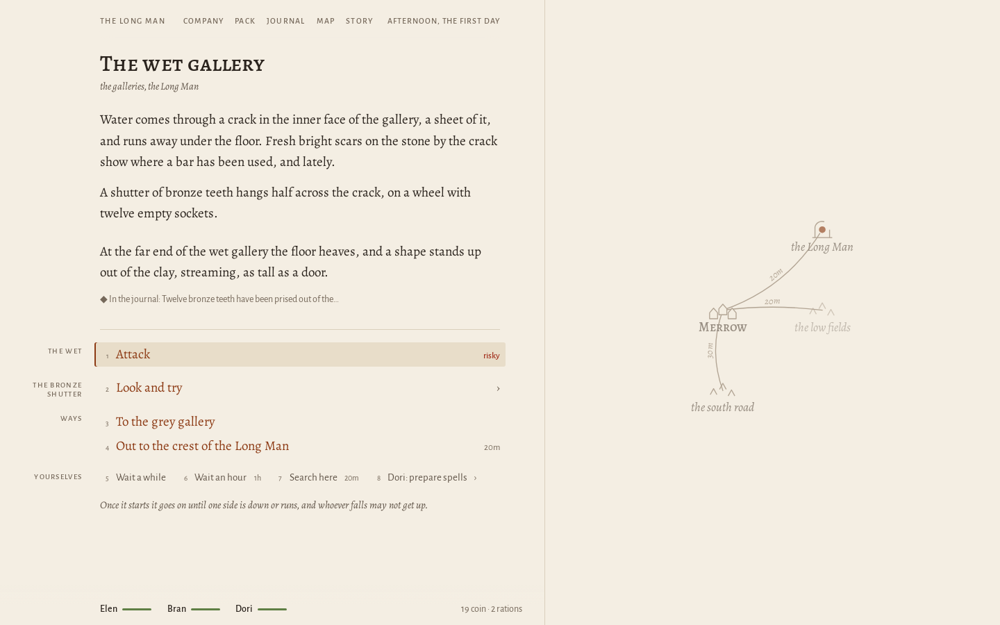 | 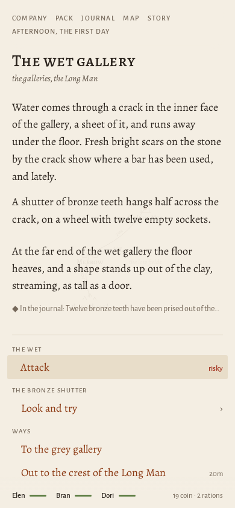 |
| A fight | 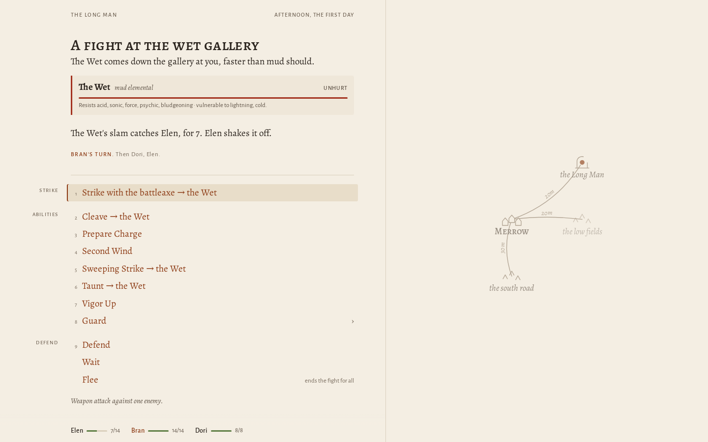 | 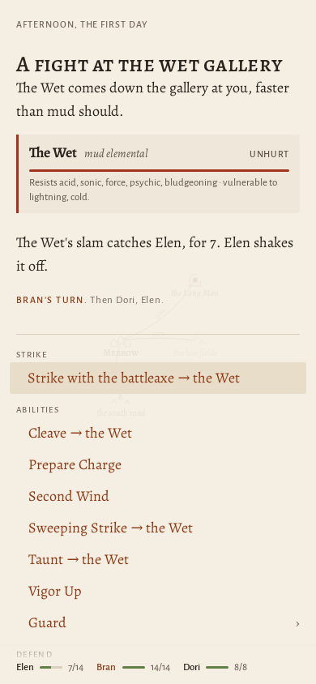 |
| The pack | 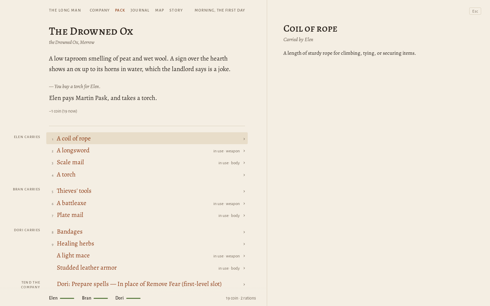 | 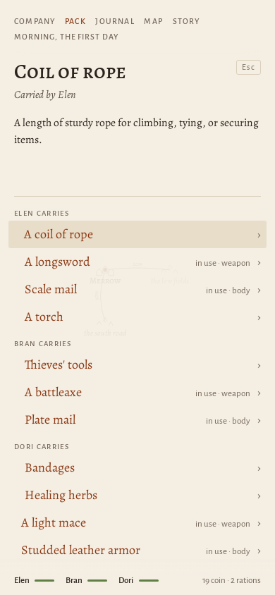 |
| The journal | 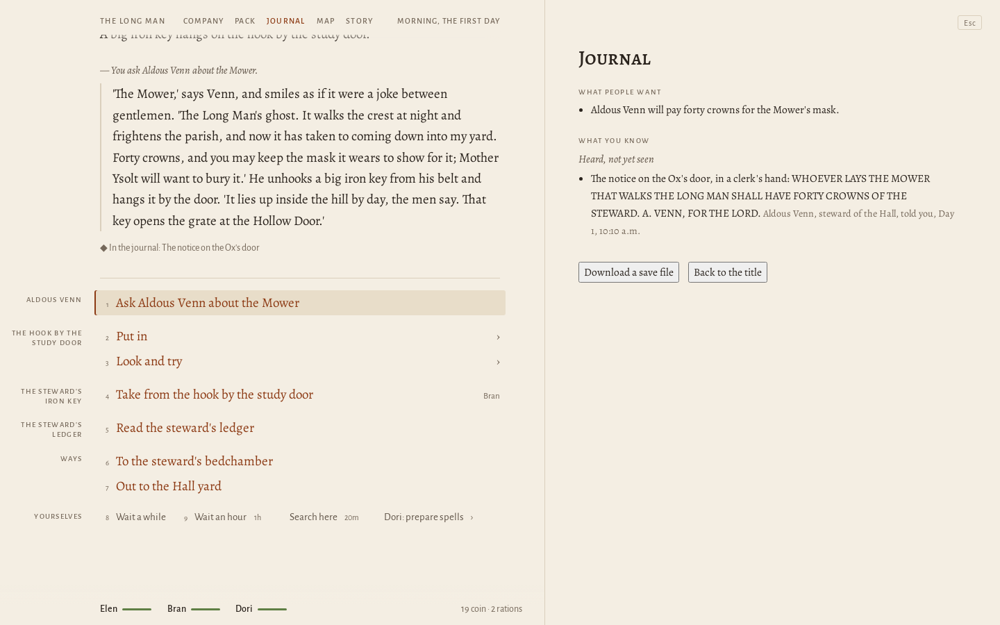 | 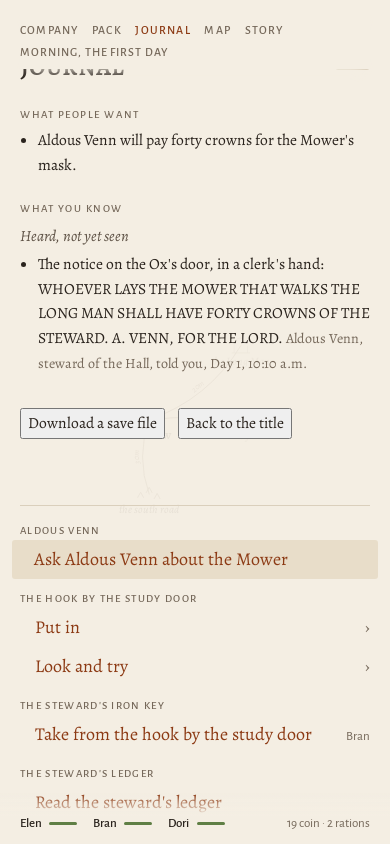 |
| The map | 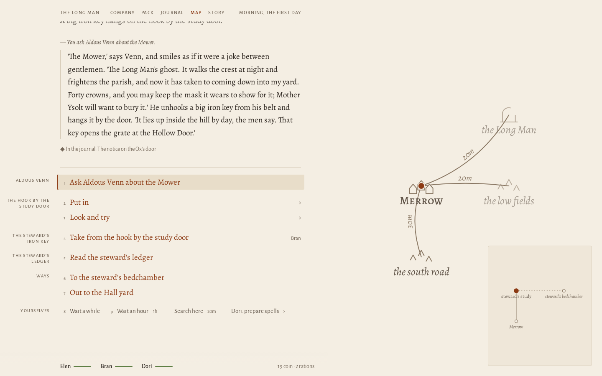 | 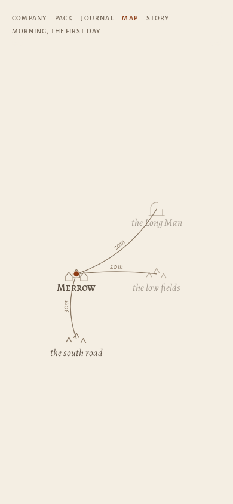 |
| An unknown campaign | 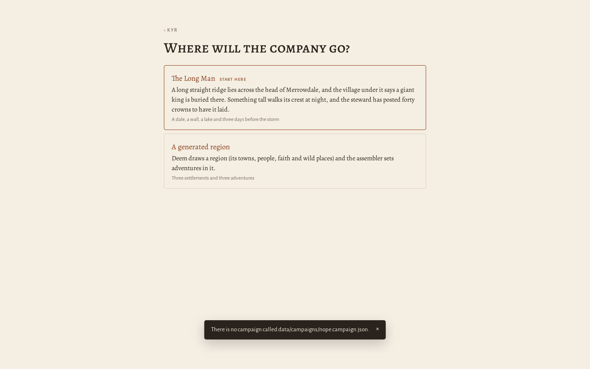 | 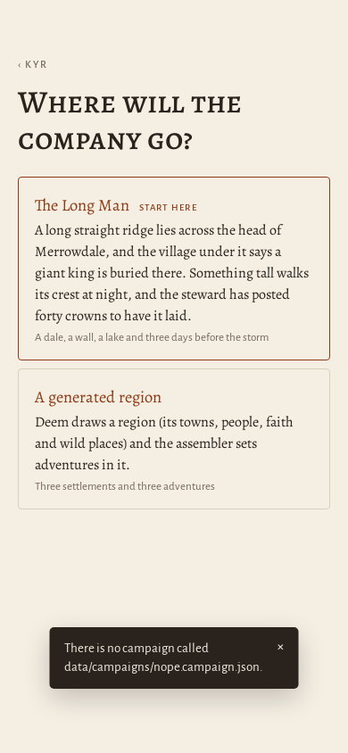 |

The desk layout:
- The page holds the place, what has happened there since the company came, and what can be done, grouped in the
  margin by what each choice is about.
- The land is drawn faintly beside the page from the region's own grid, with route times. During a journey the route
  lights and a mark travels it.
- The company is a line of names and health bars at the foot.
- The company, pack, journal and map open beside the page when asked for, and close with Esc.

On a phone:
- the land lies very faintly behind the text;
- a sheet opens at the head of the page, with the list still below it;
- the map takes the screen when asked for.

Light and dark themes follow the system.

## 2. A walk through *The Long Man*

This is the path in the walkthrough screenshots (`walk-01` to `walk-10`), with what lies to either side of it.

**The south road.** The company comes up out of the willows. *At its head a long green ridge lies across the valley,
dead straight, like a sleeper under a blanket.* One way on, half an hour to Merrow. The first thing the player can
infer is in the description: hills are not dead straight.

**Merrow green.** A well, a lime tree, grey houses with their backs to the hill. The people at the well have three
things to say, and each is a voice rather than a briefing:
- a woman with eggs tells of the giant king and the Mower;
- a boy says it is taller than the chapel door and stood looking at the springs half the night, and his mother cuffs
  him;
- someone mutters that the steward owes money downriver.

The steward's notice is on the Ox's door: forty crowns for whoever lays the Mower.
- **What can be attempted:** the Ox (a landlord, a bed, torches, rations, gossip about the storm and the barge due
  tomorrow), the chapel and its notched font, Gammer Coller's kitchen with a rod by the door, the mill, the low field,
  the Hall.

**The steward.** Venn is charming and anxious. He offers the bounty and hangs his iron key by the door ("That key
opens the grate at the Hollow Door"), so the company may borrow it. His ledger is on the desk and can be read:
twelve bronze teeth sold to Cass Rowell at eight crowns. Nothing says what the teeth are. It is the first piece of
evidence that will mean something later.

**The crest at night.** The obvious plan is to fight the thing on the hill. The company can instead wait on the
crest. At dusk *the Mower comes where you are*, and it does not attack. It walks the crest. Every few paces it stoops,
*a long blade flicks, and something small falls*: saplings. The journal now holds *The Mower keeps the Long Man*.
This is the first reversal, reached by watching rather than by being told. Attack is offered, marked risky. A
level-12 keeper against a level-1 company is not a fight anyone should take, and nothing stops a player from trying.

**The Hall yard at midnight.** *Something tall comes over the yard wall without climbing it.* The Mower goes to the
cart, tears the tarpaulin away, finds nothing and turns the cart over. It is looking for its bronze. Venn moved the
teeth to the cellar at dusk.
- A player who untied that tarpaulin by day met Dunnet: *'That's the steward's,'* and he goes to tell Venn if he sees
  the bronze in the company's hands, unless his three months' wages have been paid.

**The cellar.** Old grey stone at the back, *colder than a cellar's should be*. An iron bar leans against the barrels,
*one end bright with scraped bronze*. A search finds the door into the hill that Venn's men broke through, barred on
the cellar side. The teeth are in a barrel.
- **What can be attempted:**
  - take the teeth;
  - lift the bar and go into the hill;
  - take the iron bar.

**The bronze given back.** In the yard, the company gives the sack to the Mower. *The Mower takes the sack of teeth in
both hands, turns, and walks away into the hill. Some time later, deep inside the Long Man, something heavy closes
with a sound like a bell.* The player has done the right thing, possibly without knowing why.

**The storm, and the morning after.** On the third afternoon the wind goes round to the north. Two hours after the
third midnight a leaking wall would break. This one does not. On the fourth morning *the beck runs brown but low
between its banks, and nobody on the green is talking about the Long Man.* Merrow never learns how close it came.

**What lies to either side.** Each of these is played by a test (§6):
- **Inside the hill.** The galleries are reached by the cellar, the sinkhole (with a rope), the gauge shaft (climbing)
  or the culvert grate (with Venn's key, borrowed or lifted off its hook while he sleeps).
- **The Wet.** In the wet gallery the floor heaves and a shape stands up out of the clay. It warns once, and a company
  that stays is fallen on. Beside it is the bronze shutter with twelve empty sockets, and *fresh bright scars on the
  stone, where a bar has been used*: the teeth's purpose and Venn's ledger meet here.
- **Venn exposed.** Shown his own ledger beside what the bronze held shut, he gives up the key, writes to Cass, and
  leaves on her barge.
- **Ysolt.** The gauge shaft's notches are the font's notches: water heights. Told this, Mother Ysolt stands at the font
  looking at the highest notch, level with the roof-beam. On the night of the storm she rings the bell and Merrow goes
  up the hill.
- **The rod.** Gammer Coller's rod has a notched bronze shoe. On an island tower in Hollow Water, reached by punt past a
  pike as long as the punt, the master wheel has a socket notched to the same pattern. Turned, the lake goes down, the
  wall holds even leaking, the mill floods, and a drowned grey town comes up into the air.
- **Laid.** By day the Mower stands still in its niche. Venn's men's own iron bar levers its mask off. Venn pays forty
  crowns and Ysolt buries the mask, and nobody keeps the wall. Unless the company fits the teeth and heaves the shutter
  itself, the third night breaks it.

**What makes the place memorable** is that its strangest thing is a piece of maintenance, and that the frightening
figure is right. **How decisions matter:** there are five endings (mended, drawn down, warned, laid, lost) and each
leaves the dale visibly different on the fourth morning.

## 3. The conception, and what survived

The design ([README.md](../adventures/the-long-man/README.md), about 2,900 words) covers:
- three layers of time: the Hesk, Merrow, and the year the Long Man wept;
- the land in plan and in section;
- seven people with their own reasons;
- the things that still work;
- the dangers;
- three days as they go if nobody interferes;
- the discoveries that revise belief;
- five endings;
- a list of things a company might try that the world must answer.

| Idea | In play? |
|---|---|
| The ridge is a dam; the barrow belief is a mistake Merrow lives by | Yes: the culvert, the wheels and the notches each show it; the sluice chamber makes it plain |
| The Mower keeps the wall, and goes after its bronze | Yes: it cuts saplings on the crest by night, comes down for the cart, and mends the leak when given the teeth |
| The font's notches are water heights; the register's flood | Yes, and it is what moves Ysolt |
| The springs are the leak, made worse by the miller's spade | Yes: the spade-cuts are found by searching; Hob, shown them, stakes them before dawn |
| The rod is a sluice key; drawing down drowns the mill and raises the drowned town | Yes |
| Venn's key: borrowed, bought or lifted | Borrowed and lifted, yes; bought, no (no one sells it) |
| Venn exposed runs on Cass's barge | Yes (added after the browser pass; it was declared and never asserted) |
| Laying the Mower is possible and dooms the dale | Yes, by day with the bar (added after the browser pass; before it, only a hopeless fight) |
| The weirstone rings when struck | Only in prose: nothing in Kyr lets a player strike a wall and be answered |
| Dunnet is hurt when the Mower comes for the cart | No: not written. A hazard could strike him, as one lays the Mower; it was left out |
| The Mower goes to Cass's deck while the barge is at the landing | No: its hunt is one timed rule for the yard |
| Cass fights anyone who takes her cargo, and wants her money from somebody after | No: goods for sale cannot be taken at all, so there is nothing to fight over |
| Anyone in the culvert or the galleries when the wall breaks is drowned | Partly: the low ground drowns; the galleries do not |
| The drowned Hesk town, "with whatever is in it" | Partly: it can be walked and read; nothing in it can be taken or used |
| The sinkhole's edge is a fall without a rope | No: without a rope the way is simply not offered |

Where Kyr could not say what the design said, the module worked around it and the workaround is logged in
[mismatches.md](../adventures/the-long-man/mismatches.md). There are thirteen rows:
- seven fixed in the language (§4);
- one partly fixed;
- one that turned out to be my mistake;
- four still open.

The design was not simplified to fit.

## 4. Authoring: before and after

The test case the brief named was the clerk with a strongroom key. It now has its own fixture,
`test/fixtures/counting-house`, played by `test/authoring.test.ts`:
- a clerk, his coat, his key;
- a porter who serves him;
- a strongroom that only that key opens;
- a back door barred on the office side;
- a yard dog.

The Long Man was then rewritten in the same conventions. The full before and after is in
[authoring.md](../adventures/the-long-man/authoring.md). Two examples:

**Whose a thing is.** Before, each of Venn's key and Gammer Coller's rod needed its own "lent" relation and its own
noticing rule. Venn objected to *any* iron key:

```text
  Relation lentKey(group).
  Rule venn_misses_key when holding(party, cell_key) and together(venn, party) and not lentKey(venn) says "Venn's hand goes to his belt…" { Assert hostile(venn, party). }
```

Now:

```text
  Person venn "Aldous Venn" at study {
    Role "steward of the Hall". Ancestry human. Peaceable.
    Objects "Venn sees {?i} in your hands, and his face changes. 'That belongs to the Hall,' he says. 'Give it here.'".
  }
  Item key "the steward's iron key" is cell_key in key_hook owned by venn.
```

The belongings rules do the rest. An owner, or one who `serves` the owner, objects once, in their own words, unless
the thing was lent (`lends(venn, key, actor)`). The same convention replaced Dunnet's bespoke telling.

**A bar on one side of a door.** Before, a bespoke action requiring `at(actor, cellar)`. Now one line in the thing:

```text
    Change lift "Lift the oak bar off the door in the broken wall" from barred to unbarred at cellar.
```

Also new:
- `needing key` names a particular item, not a kind;
- a creature's temperament and words are written in the creature (`Temperament territorial. Warns "…". Comes "…".`);
- a discovery may stand with no source to read;
- a module needs no goal.

**Errors and a preview loop.** A load error now names the file and line, and what else has the name:

```text
test/fixtures/counting-house/site.kyr:5: Duplicate entity marsh
  'marsh' is already declared by the shared rules at data/rules/core.kyr:13; choose another name
```

`bun bin/kyrie.ts preview <campaign.json>` lints, builds the reader with the campaign, serves it, and on each save
lints, rebuilds (about a second for the counting-house, 2.3 s for The Long Man) and reloads the open page.

**Were ordinary interactions made simpler to express?** Yes, for possession, noticing, one-sided access, creature
manner and plain knowledge:
- the rewrite removed three bespoke relations, three noticing rules, one bespoke action, six entity-and-assertion
  pairs, two creature-fact blocks and three goals;
- in their place it added one room, two rules and three lines of a person's words.

**Is the language more consistent?** Somewhat. Each new convention reads like the rest of Kyr and composes with the
shared rules rather than adding a solver. But the module still has 35 rules and 4 bespoke actions, and some state
is still kept in hand-made relations: `noticedCart`, `promisedDoor`, `exposed`, `calm`. Kyr is pleasanter for these
situations. It is not yet pleasant in general.

## 5. What was fixed

**The interface.** The findings are in [mission-8-findings.md](mission-8-findings.md). The fixes:
- **Hover made the story flash.** Hover called `render()`, which rebuilt the screen model and replaced the root's
  HTML, replaying the newest entry's fade-in. The new client is keyed React with memoised entries. A browser test now
  counts mutations of the story while the pointer crosses every choice: none.
- **Setting out did not answer.** Each module's source was parsed three times and the shared rules once per module. A
  parse cache and the engine in a worker brought the old March from 5.2 s to 1.65 s, and a loading state appears
  within 150 ms (tested). The Long Man sets out in 0.86 s.
- **The admin-console layout.** The prose now has the page. Choices are grouped by subject. The party is a quiet line.
  Details open on demand.
- **Things told twice.** Timestamps on every entry, a scene line and a thing's state saying the same, a warning told
  as itself and again as "The Wet comes at you!", lines the page already said: now each is told once.
- **Fights.** Each exchange is a sentence, with the dice kept back. Each foe shows how hurt it looks and what it means
  to do.
- **The acceptance pass on The Long Man** photographed every state the brief names at both sizes and found the
  following, all fixed:
  - an unknown campaign silently opened a default;
  - catalog things named as headings in prose ("takes Torch");
  - menu paths echoed as actions ("You buy › Torch — 1 coin");
  - the journal and map emptying the choices;
  - the journal's chronicle in engine labels;
  - a tap leaving a hover behind, and the gloss redrawing between a tap and its click so the list moved under the
    finger;
  - phone sheets hiding the list;
  - the desktop top line letting text show through;
  - a door visible in the scene yet "found" by a search;
  - faint text at 2.7:1 contrast;
  - buttons without a visible focus ring.

**The rules.**
- Charge and every ability like it are offered only when their preparation, resources and targets allow
  (`test/legality.test.ts`).
- An ability that only affects creatures with a trait targets only those.
- Journeys pass their time on the way. Followers travel with the company. A way that closes during the journey turns
  it back. Arrival comes for the last watch, not the first (`test/journey.test.ts`).
- Hostile creatures act by temperament everywhere:
  - every monster has one from its kind;
  - unscripted ones get plain words;
  - territorial ones warn and then come;
  - ambushers are spotted by a watchful company.

**Prose.**
- The Long Man's text was read through after each browser pass.
- Repeated sensations were cut.
- Scenes no longer restate what a thing's state says.
- Shared rule text lost its implementation talk (evidence, assumptions, HP, cooldowns, deadlines).
- Buying and selling say who paid whom.

## 6. Tests and measurements

- **Suite:** 355 tests pass; 13 skipped by default, the browser tests among them. With `KYRIE_BROWSER=1` the 4
  browser tests pass.
- **Kyr lint:** The Long Man has 0 errors and 0 warnings.
- **Gates:** eslint (no warnings), both typechecks and Kyr lint pass at every commit.

What is tested for The Long Man and its fixtures:
- **Seven ways the three days can go** (`test/the-long-man.test.ts`):
  - the keeper walking;
  - mended;
  - broken;
  - Ysolt warned;
  - drawn down;
  - laid;
  - Venn exposed.
- **Three things its people do unprompted:**
  - Gammer Coller objecting to her rod;
  - Dunnet telling unless paid;
  - the key lifted while Venn sleeps.
- **The counting-house** (11 tests), including the four diagnostics.
- **The browser**, at both sizes (`test/long-man-browser.test.ts`):
  - an unknown campaign;
  - an echo;
  - one highlight after a tap;
  - the phone pack;
  - the Wet's warning told once and its onslaught once.

**Latency.** The table gives medians on this machine. Browser timings run from input to the page being ready again.

| What | Browser | Engine alone (Bun) |
|---|---:|---:|
| Set out in The Long Man | 861 ms | 83 ms load (384 ms cold) |
| Draw a generated region, then set out | 1,003 + 1,836 ms | |
| Talk | 115 ms | 9 ms, plus 39 ms to find what can be done |
| Step indoors | 202 ms | |
| Wait an hour | 153 ms (285 ms in a generated region) | 18 ms |
| A half-hour journey | 1,099 ms (shown for at least a second, on purpose) | 29 ms |
| Open the company sheet | 53 ms | |
| Save | after every action, built in the worker | 10 ms |
| Reload and carry on | 938 ms | 29 ms resume |

Mission 7 reported generated-world loads of about 4.2 s. Under Bun the old March now loads in 1.3 s. In the browser a
generated region is drawn in 1.0 s and entered in 1.8 s.

## 7. The four claims, kept apart

"Good" is my judgment as builder, and no one else's.

| Capability | Implemented | Validated | Playable | Good? |
|---|---|---|---|---|
| The reader: page, grouping, sheets on demand, map | yes | stability, focus, phone sheets, reload | yes, at both sizes | I think so on a desk. On a phone it is serviceable, and long menus need scrolling |
| Journeys in transit | yes | `journey.test.ts` | yes | yes: the map draws the way as it is made |
| Temperament: warnings, onslaughts, ambush | yes | inhabitants and legality tests | the Wet, yes; the Old Jack's ambush not seen in the browser | the Wet's warning works well |
| Legality of offered abilities | yes | `legality.test.ts` | yes | not a question of taste |
| Ownership, lending, objection, service | yes | counting-house, Long Man | yes | yes; the words are the person's |
| Changes at a place; particular items; plain discoveries | yes | counting-house | yes | yes |
| Diagnostics | yes | four cases tested | for authors | helpful; paths are repository-relative |
| Preview loop | yes | by hand only | for authors | useful; no automated test |
| *The Long Man* | yes | 10 tests, seven ways | yes, walked in the browser | worth an hour or two (§9) |
| Generated regions | yes | existing tests | yes | no: see §8 |
| Accessibility | keyboard, focus rings, AA contrast, landmarks | a probe | yes | not tried with a screen reader |

The Orsino capability audit was regenerated from the books. It counts 2,039 entries, with four problems, the same
four as before. Its Kyr-only counts rose with this mission's rules, items and species. Its coverage numbers say
nothing about whether the game is good, and this report does not lean on them.

## 8. Limitations

- **Generated worlds meet few peoples and few creatures.** Across 32 generated regions (8 seeds × 4 terrains) every
  person met was human (740), goblin (96), elf (19) or dwarf (11). Every creature was a cave spider, revenant, bear,
  wolf, bone hound or wisp, out of a canon of 108 species. The cause:
  - the generator's own creature tables name three animals;
  - most of the Orsino species carry no habitat that would place them.

  Deem also warns 53 times, for terrain and ancestry pairs with no matching scenario.

  This was investigated and not fixed. It constrains generated play, not The Long Man.
- **Local creatures and things still go in the global catalogs.** The great pike, the bell-teeth, the rod and the mask
  are catalog entries.
- **Possessions a person carries.** Venn's key is a container thing with three states and four rules.
- **Merchants do not resell.** Cass's resale of the teeth is three rules.
- **Reading cannot need a skill.** Only searching can.
- **People are thin.** Most have one to three topics, and the rest of what they do is rules. Hob stakes his cuts
  offstage, before dawn.
- **Time is spent by the hour.** Waiting for night or for the barge means pressing Wait an hour.
- **Rules text.** The company sheet reads as rules ("You gain defending for 1 turn"). This is shared with the
  handbooks and was left alone.
- **Combat for a level-1 party offers too much.** A warrior sees eleven choices, and fights in The Long Man are
  mostly to be avoided.
- **The old corpus is gone from the game.** It is in the history before `e4b485b`, and its March family lives on as a
  test bed in `test/fixtures/march`.

## 9. Builder testing and independent evaluation

All of this was tested by me:
- by scripts that play through the labels a player sees;
- by browser runs that photograph states;
- by reading the screenshots and the prose.

That cannot show that an independent person will enjoy The Long Man, find its clues, or care how the dale ends. No
human other than its builder has played it. The next step that would teach the most is to watch three people play it
cold.

## 10. Candid answers

**Is the new adventure actually worth exploring? Why?** Yes, for an hour or two. That makes it the first Kyr adventure
I would hand to someone.

What works:
- It has one good idea, the frightening thing is the keeper, and the player can reach it by four separate routes:
  - watching the crest;
  - the empty sockets and the scars;
  - the notches;
  - the Water-House words.
- It has a clock that makes the idea matter.
- Its endings are different worlds on the fourth morning.

What does not:
- It is small: one dale and about two dozen rooms.
- Its people speak briefly and then have nothing more to say.
- Much of its drama arrives as single paragraphs.
- The drowned town rewards the walk to it with words only.

**What discovery is most likely to surprise an experienced fantasy player?** Waiting on the crest instead of
attacking, and seeing the monster tend the wall: it is cutting saplings. The second is the font in the chapel, where
the highest "sin" notch is level with the roof-beam.

**What can be accomplished through reasoning and experimentation rather than an authored solution?**
- Getting into the hill four ways.
- Getting the bronze from the cart by day, the cellar by night, or Cass's deck for twelve coin.
- Handing it to the Mower without knowing why.
- Lifting Venn's key while he sleeps.
- Paying Dunnet so he looks away.
- Leaving the Wet alone after its warning.
- Saving the wall by drawing the lake down instead.
- Laying the Mower with its thieves' own bar.

These are alternatives the design anticipated, made of shared rules where possible. That is better than one scripted
solution, but it is not emergent play: nothing is simulated that the author did not foresee in kind. The parts that
work without being named are smaller:
- any owner or servant notices anything of theirs;
- journeys are interrupted by whatever is on the road;
- the world keeps its schedule whether or not the company is watching.

**What fictional situation was hardest to express naturally in Kyr?** Venn's key: a particular object a person
carries by day, hangs up at night, can lend, and can have lifted while he sleeps. Kyr has no notion of a person
carrying an item that others can take, so the belt is a container with a closed state and the hook a second state.
The workaround needed a third state and two more rules once a test showed the hook still describing a key that was
gone.

**What remains ugly, awkward, slow, confusing, shallow or boring?**
- **Ugly:** generated regions (§8), and the company sheet's rules text.
- **Awkward:**
  - local creatures in global catalogs;
  - hand-made relations for small facts;
  - echoes that are long ("You take a sack of bell-teeth out of a barrel by the cellar's back wall for Elen.").
- **Slow:** nothing badly. Setting out takes under a second; a journey takes a second on purpose.
- **Confusing:**
  - the Merrow green menu has fifteen choices;
  - fights offer a level-1 warrior eleven options;
  - "Dori: prepare spells" sits on every page.
- **Shallow:**
  - the people;
  - the drowned town;
  - Cass, who neither fights for her cargo nor wants her money afterwards;
  - the Mower, which never goes to the barge.
- **Boring:** waiting an hour at a time for night or noon.

**What did you remove because it wasn't good enough?**
- **The whole recommended corpus:** the Varrow and its high country, Brack, the March regions, the Lanthorn, the
  Unlit, Censer Hill, Skellfold, Thrale and the rest, and the two situations made only for them.
- **The old client:** sixteen files, with its rail, legend and footer.
- **Fourteen test files** tied to the retired content or the old client. Small fixtures replaced them where the
  mechanics mattered.
- **Smaller things:**
  - the journal's chronicle in engine labels;
  - per-module goals;
  - and text that explained the program:
    - "the journal keeps every one";
    - "Learned:";
    - "Your attempt did not succeed";
    - "sets aside a conflicting assumption".

In all, Mission 8 deleted more than it added: 6,313 lines out, 5,181 in.

**What should the next mission tackle?**
- **Independent players first.** Watch people play The Long Man without help, and fix what they trip on.
- **Generation that meets the bestiary and its peoples.** Give species habitats, draw generated creatures and persons
  from the catalogs by place, and judge a generated campaign against The Long Man rather than against fixtures.
- **The authoring gaps the adventure hit:**
  - possessions people carry;
  - merchants who resell;
  - creatures and things local to a module;
  - reading that needs a skill;
  - "wait until" a named time.
- **A second reference adventure in a different register.** A town of competing interests would test whether
  ownership, service, temperament and knowledge compose beyond one dale.

## Commits

| Commit | What |
|---|---|
| `168a68c` | Mission 8 findings, and a campaign that parses each text once |
| `e7cd390` | A reader: the page to read, the engine in a worker, and a fight told in words |
| `0f52a6e`, `ea0cff3` | Journeys take their time on the way, and arrive for their last watch |
| `b8b20e6` | Hostile creatures act by temperament everywhere, and abilities are offered only where they can work |
| `e4b485b`, `f915a43` | Retire the old corpus; fixtures, retargeted tests and documents |
| `b4180d8` | The Long Man: an adventure designed in prose before any Kyr |
| `0353787` | The Long Man, in Kyr |
| `4ca78b1` | The Long Man played through in the browser, and revised |
| `4f62d02` | Kyr says the clerk and the key: ownership, one-sided changes, temperament, plain facts, errors with places |
| `e652048` | The Long Man rewritten in the Kyr it asked for; a preview loop |
| `4635e2e` | Acceptance pass on The Long Man, at a desk and on a phone |
| `af7f32f` | Every ending the design names can now be reached |
| `b949fc3` | The morning after the storm, and echoes that say what was done |
| `aac50fc` | Readable quiet text, a focus ring on every control, the dale's people tested unprompted |
