# Mission 9: what playing it found

The user played Mission 8's reader and reported, in order of priority:

1. Fights were unpleasant to follow, and blows almost never landed.
2. *The Long Man* had strong bones and thin flesh.
3. Generated regions were generic: names that echoed each other, four peoples and six creatures across 32 regions,
   towns that were a salt-house, a shrine and a tavern, and a shrine of Belenus that was a menu item.
4. Arrival, companions, time and the map said too little: "Morning, the first day" and three icons on a diagram.

This report takes those in the same order. For each it gives what was found, what changed, and the evidence. Its last
section says what is still not good enough. No one but its builder has played any of this.

Nine commits, `e5bda34` to this report, are listed at the end. To play:
- run `bun run web:build` and open `site/index.html`;
- choose *The Long Man* or *A generated region*;
- for a generated region, *Go alone* is on the company page.

Screenshots are in [`doc/playtests/mission-9-2026-10-22`](../playtests/mission-9-2026-10-22). They were taken in
Chromium at 1440×900 and at 390×844 with touch input, by scripts that choose what a player would see on the page.

## 1. Fights

### What was wrong

**The page.**
- Foes' health, the fight's history and the choices were one scrolling column.
- Every action appended to the history and scrolled the page down, away from the foe it had just hit.

**The dice.** I measured before changing anything.
- Kyr's attack is Orsino's: THAC0 is 20 − ⌊level/2⌋, and AC is descending, from armour and Dexterity.
- Against what generated regions send at a first-level company, companions landed 52–73% of blows, and fights
  lasted 1–4 rounds. That is not "extraordinarily difficult".
- The fight the user remembered was *The Long Man*'s Wet. It was Orsino's mud elemental at level 5: Dexterity 19 in
  scale mail, AC 1. A first-level company landed 21% of its blows, went a median five of its turns (fourteen at the
  90th centile) without touching it, and fought for seven rounds. Orsino's own encounters at that level are goblins.
  The adventure was wrong, not the rules.
- A creature with two actions a turn and only a weapon could not fight at all. Its second blow was put on cooldown,
  and the fight stopped with "No legal tactical command". That is now fixed: a weapon may strike again in the same
  turn, as Orsino's many-handed monsters do.

### What changed

The fight page keeps, in order:
- each foe's condition, at the head of the page, with what the last blows took from it ("−9");
- a panel saying what happened since the company last chose: hits, misses, damage, what a save shrugged off
  ("the Wet shrugs off the armor shred", no longer "it"), and who fell;
- whose turn it is;
- the choices. Each blow says its chance as people put it ("2 in 3"), from the same dice the fight throws.

The whole fight, round by round, scrolls on its own beside the page. On a phone it folds under the turn, and the
foes stay at the top.

The Wet is now a slump: Kyr's own clay creature, slow and heavy, easy to hit and hard to stop, with two blows a
turn.

| | Desk | Phone |
|---|---|---|
| A fight begins | 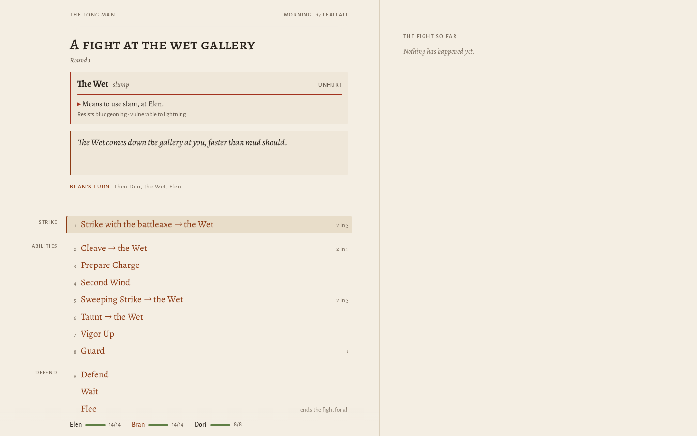 | 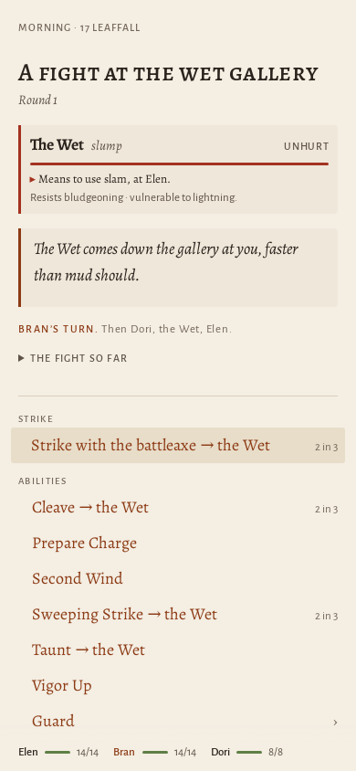 |
| After two choices | 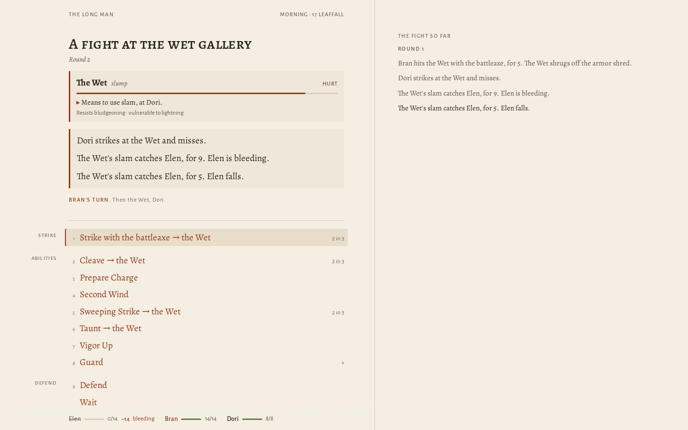 | 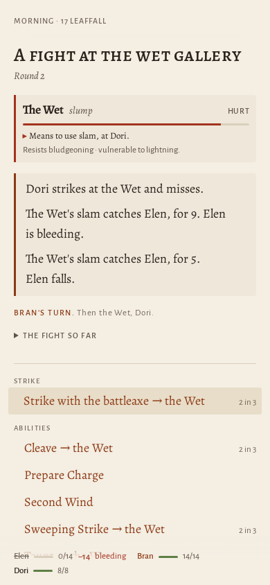 |
| After four | 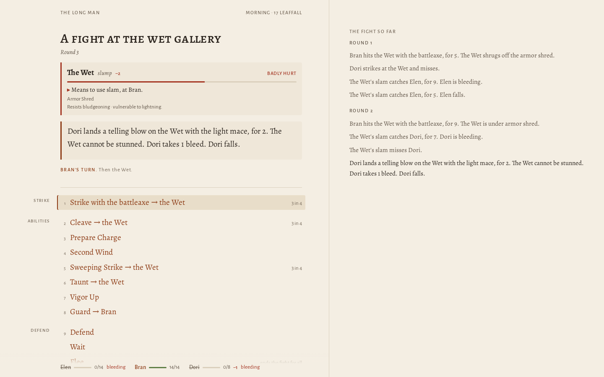 | 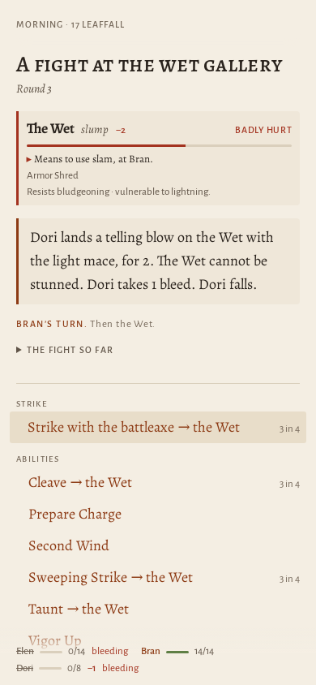 |

The page did not scroll after any choice in either run: `scrollTop` was 0 after each.

### How fights go now

Each row is 200 fights, played with the game's own tactics on both sides. The company is a first-level warrior,
ranger and cleric. "Dry spell" is the longest run of the company's turns with no damage dealt (median / 90th
centile).

| Encounter | Company hits | Foe hits | Rounds | Dry spell | Company wins |
|---|---|---|---|---|---|
| two wolves | 58% | 18% | 2 | 1 / 4 | 100% |
| a bear | 67% | 31% | 2 | 1 / 2 | 100% |
| three cave spiders | 51% | 22% | 4 | 2 / 5 | 97% |
| two revenants | 72% | 20% | 4 | 2 / 5 | 100% |
| the Wet (slump, level 5) | 75% | 46% | 4 | 1 / 3 | 87% |
| a den's ghoul | 63% | 27% | 1 | 1 / 2 | 100% |
| a den's wraith | 48% | 14% | 3 | 2 / 6 | 100% |
| a den's wendigo | 56% | 59% | 2 | 2 / 4 | 96% |
| a den's owlbear (now removed) | 58% | 62% | 3 | 1 / 3 | **48%** |

The owlbear row is the reason owlbears are no longer in the den tables (§3). Two frost wolves were cut to one for
the same reason: a pair beat a company of two six times in ten.

## 2. *The Long Man*

### What was thin

The user named three gaps: the drowned town was empty, the people were thin, and the barge-master and the foreman
had no material. The design gained a section before any Kyr was written (the README's §11). The module was then
built from it, so each addition is a thing to find, or a person acting on a reason. None is a new dialogue topic
standing in for content.

- **The town under the lake.** When Hollow Water goes down, the face-house holds the moulds the Hesk fired their
  keepers' faces in. One face was fired and never fitted. Venn takes it for the Mower's mask and pays for it; Mother
  Ysolt would bury it; and the keeper goes on keeping the wall. The last house is barred from outside, with its table
  laid. The tally on its door-post stops at forty-one, the same count as in the keeper's niche. A child's bell on the
  sill rings, and something under the hill rings back.
- **Pell.** Dunnet's mate went into the wet gallery for the teeth and did not come out, and Merrow was told he went
  downriver. His lantern lies in the clay. Brought to Dunnet, it breaks him. By nightfall he has told Mother Ysolt,
  and the steward is exposed before his parish.
- **Dunnet's arm** is broken by the flying shaft when the keeper turns the cart over. Bound with bandages, it buys
  what his wages would: the cellar bar lifted at dark.
- **Cass Rowell**, the barge-master, told what the bronze was holding shut, will not carry a weir downriver. She sets
  the sack on the landing and takes the Hall's plate for her sixty crowns.
- **Merrow keeps its own hours.** Its people go into the Ox at dark, where the talk is of the day. Cass drinks there
  on the second afternoon. Hob walks up to the springs at dusk with his spade. Martin bails his cellar when the low
  field goes under.

### How it was tested

Two sustained plays, three in-game days each, were driven through the browser by the labels on the page:
- one through the dale: the well, the steward, the yard at midnight, Dunnet, the sluice, Pell, Cass, the storm and
  the morning after;
- one through the water: the keeper watched, the rod lent, the punt, the Water-House, the lake going down, the
  drowned street, the face-house, the last house.

Both were played again today with the calendar in place. They found no errors and no answer slower than 1.5
seconds. The adventure now runs from the 17th to the 20th of Leaffall.

| | Desk | Phone |
|---|---|---|
| Talk at the well | 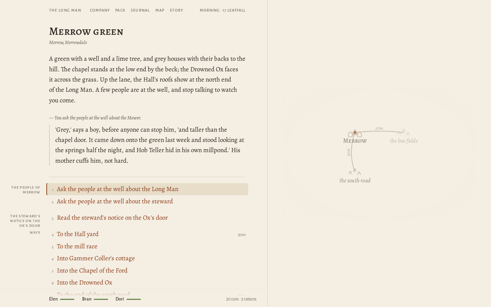 | 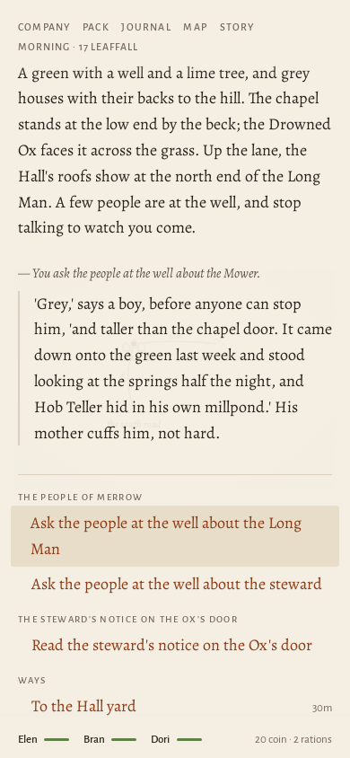 |
| Dunnet bound | 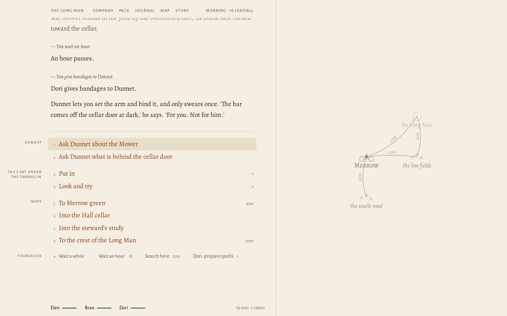 | 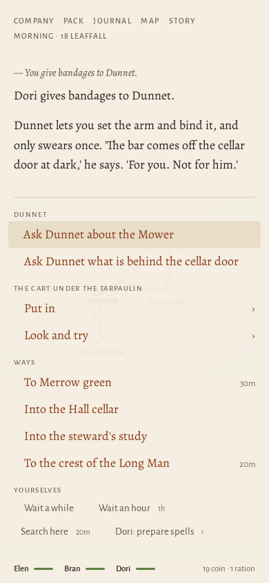 |
| Pell's lantern | 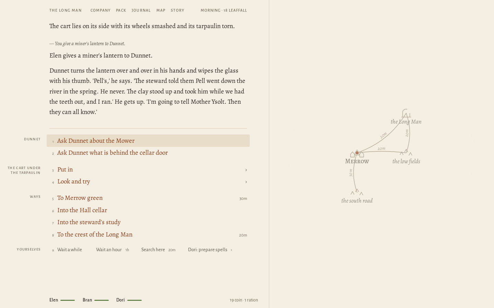 | 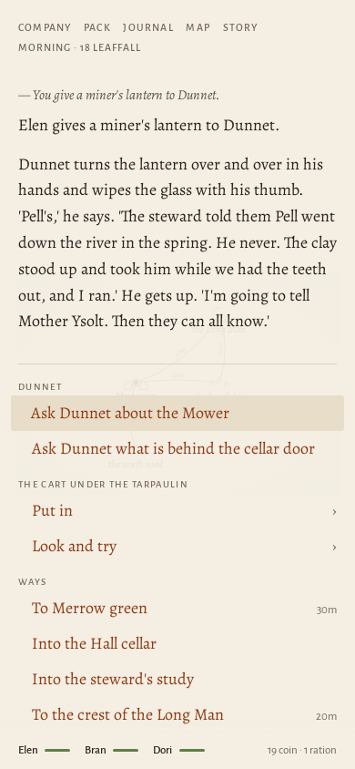 |
| Cass refuses | 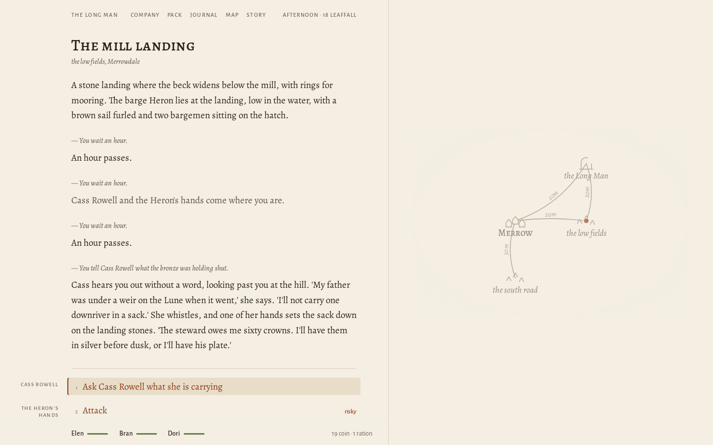 | 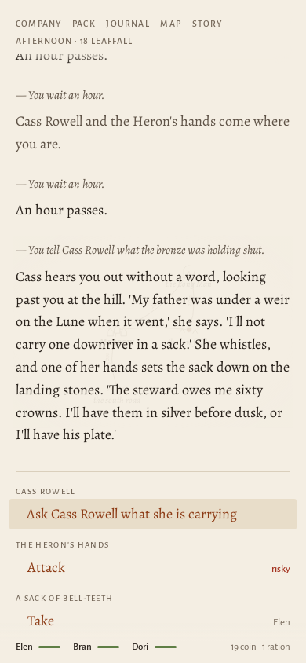 |
| The drowned street | 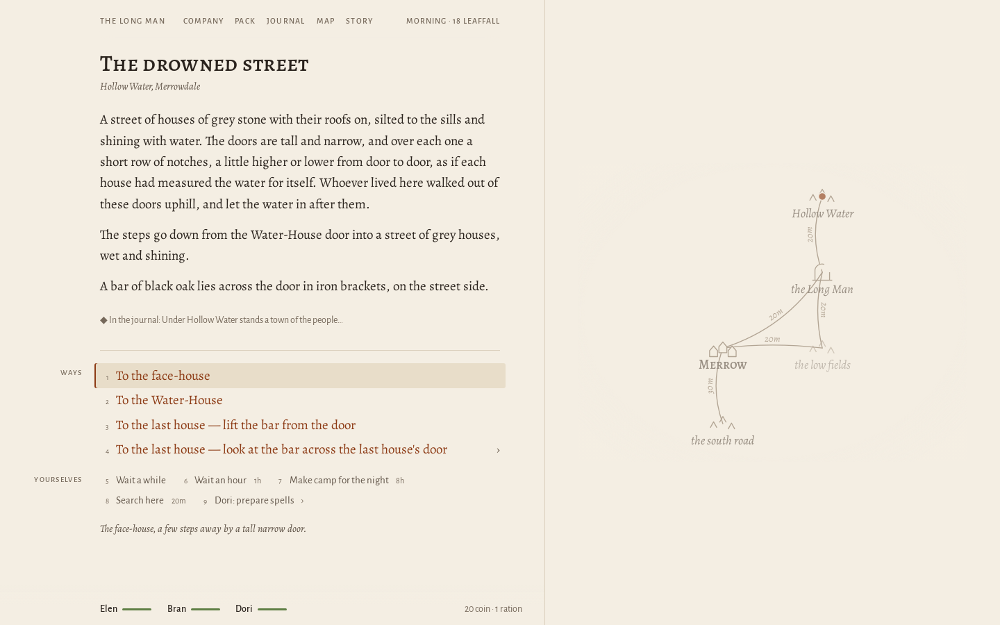 | 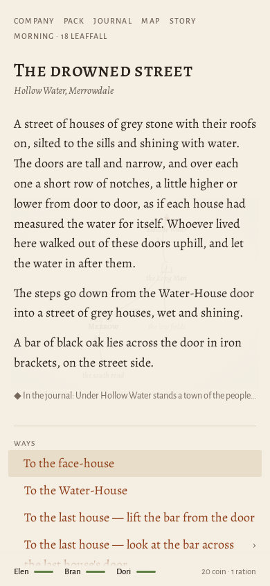 |
| The last house | 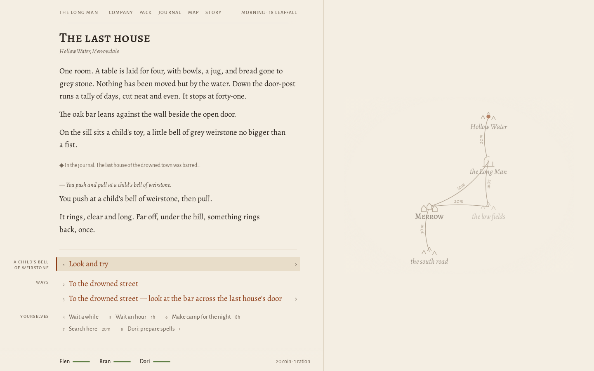 | 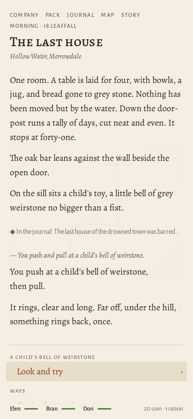 |
| The morning after | 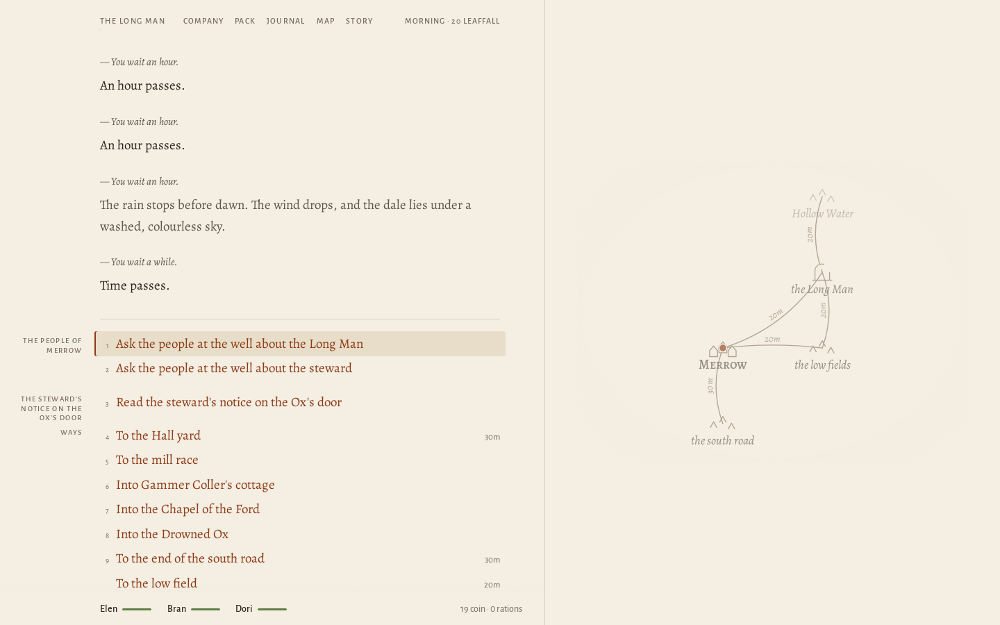 | 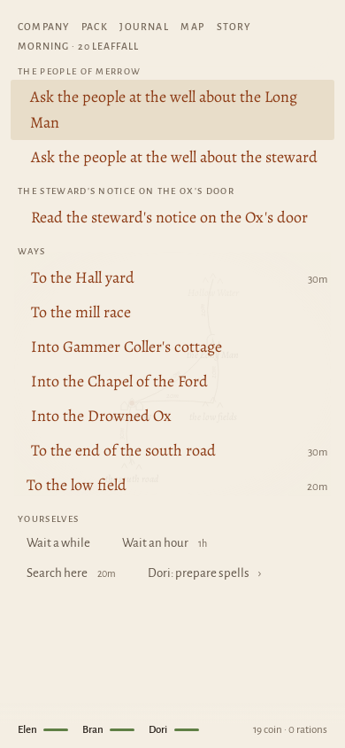 |

## 3. Generated regions

All the numbers below are from the same 32 seeds (`survey-0` to `survey-31`), generated and loaded as campaigns,
before and after.

| | Before | After |
|---|---|---|
| Pairs of names in a region a traveller could confuse | not checked ("Merscheald" beside "Merscstede") | 0 |
| Settlements in a region saying the same thing ("-dale" twice) | common | 0 |
| Peoples living in the regions | 4 | 14 |
| Species met | 6 | 11 |
| Situations in the towns | 0 | 64 (two per region) |
| Gods kept in one region | 1 (its three shrines all to the region's god) | 1 to 3: two in 18 regions, three in 10 |

### Names

- **Distinctness.** No two places in a region may share an opening, a run of consonants, or most of their letters.
  The test is `RegionLand.confusable`. Two settlements may not mean the same thing ("-dale" twice), and two sites
  may not share either word of their meaning ("Wet Walls, Wet Barrow, Wet Stones").
- **Thorn.** The default world's first town is still Merscheald. Its neighbours are now Meósdael and Wǽtwaeter.
- **Tongues.** A settlement is named in its own folk's tongue (Westron, Quenya, Khuzdul), so a dwarf hold in human
  country has a Khuzdul name. Ruins, barrows and towers keep names in Aenean, the old tongue (Palusporta, "marsh
  gate"). That says, without a word of exposition, that someone else built them.

### Land

Each region now has a named river, plus a wood, a mere or a pass with a peak above it, all from the language package.
They are places on the way:
- the first road fords the river;
- the second goes through the wood, along the mere on a causeway, or over the pass;
- the wood and the causeway are slow going;
- the pass takes two hours each way and is cold after dark (a hazard strikes once a night);
- the summit can be climbed, and shows every settlement and site where it lies, though not what the sites are;
- a ford, a causeway and a pass are chokepoints, so the toll kit prefers to set its bar there. In the default world
  the lord's toll-reeve sits at the ford of the Deopstrēam.

Settlements say what land they stand by ("It grew up where the road comes down to the ford of the Deopstrēam").

### Peoples and what lives in the wild

- **Peoples.** Orsino's halflings, gnomes, half-elves, half-orcs, lizardfolk, catfolk, sylphs, undines, birdfolk and
  fae are now Kyr ancestries. Each is a faithful translation of the registry's entry, with a ledger record. Each
  region takes a mix that fits its country (lizardfolk and undines by the water, birdfolk on the heights, gnomes
  where there is metal). One settlement is often another people's, and says how they came there ("were here before
  the dykes were cut, and keep to the water still"). Every townsperson is of their own people and named their way.
- **The defect behind the four ancestries.** It was not the tables alone. A generated `Person` with no ancestry was
  human, so elf and dwarf regions were full of humans: 15 elves and 8 dwarves in 32 regions, against 88 and 79 now.
- **Dens.** A den holds what lives in its kind of country (`ecology.json`, after Orsino's `monsterHome`), and the
  same kind of country in one region holds the same beast. A region has its wolves, or its ghouls, or a great pike
  by the mere. The dead can be laid to rest by someone who knows the rites; smoke only moves the living.
- **Animals.** Each wild place shows the animals of its country: frogs falling silent at the ford, ravens over the
  crags.

### Towns

Four situations a region may have in its towns, drawn apart from its adventures:

| Situation | What is going on | How it can end |
|---|---|---|
| The drover who did not come home | His dog lies by the inn door; his cart is in the ditch off the road | The widow thanks you; the son comes along, or goes out alone if no one brings word by the second evening |
| A fever on the green | The herbs are gone; willow grows by the water on the road, or herbs can be bought anywhere | The fever breaks and the sister comes along; or on the third morning the shrine bell is rung |
| The stranger who pays in old coin | A scholar wants taking to an old place to read it | Ten old coins; the place's history; a scholar who reads on with you |
| The boundary stones | The innkeeper and the merchant have not spoken since the stones moved; the priest knows, and will not say it to the merchant's face | The old holes found and the stones set back; or the merchant's coin taken, and the inn closed to you |

Each names its people by the town's folk. Each runs to the clock, and each can end with someone willing to join.

### Faith

- **Faithful to Orsino.** A shrine is a thing kept for a god:
  - one of Orsino's six forms (altar, statue, fountain, obelisk, mural, relic) with one of its looks;
  - the god titled as Orsino titles them ("Coventina, Goddess of Nature");
  - an offering of a few coins (Orsino's 1d4+1).
- **The blessing.** Leaving the offering gives the god's favour: the blessing of its domain from Orsino's
  `deityBlessings`, for ten turns of fighting. A good god heals a little and another hurts a little, as Orsino's
  shrine template does. Once a day at each shrine.
- **A place, not a menu item.** Each shrine has a practice of its faith ("a lamp burns before it day and night; at
  dusk the priest relights it from the inn's hearth") and a history of its place ("the first ferryman set it up, and
  the fords were counted safe from that day").
- **Many gods.** The first settlement keeps the region's god; another may keep the god of the land it stands by
  (Coventina at a ford, Taranis under a pass, Cernunnos by a wood).
- **What was found broken.** The shrine-blessing resolver had been unused since checkpoint C and keyed blessings to
  deities, which have none. It now keys them by domain, as Orsino does.

| | Desk | Phone |
|---|---|---|
| Arriving alone | 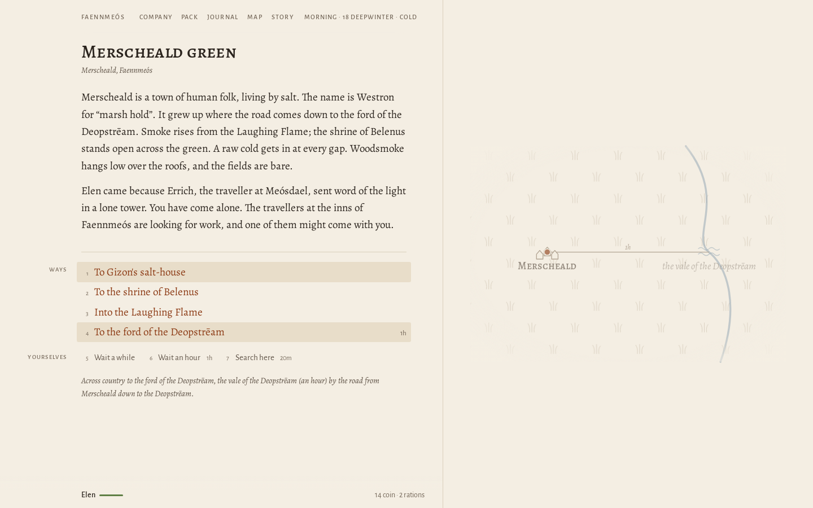 | 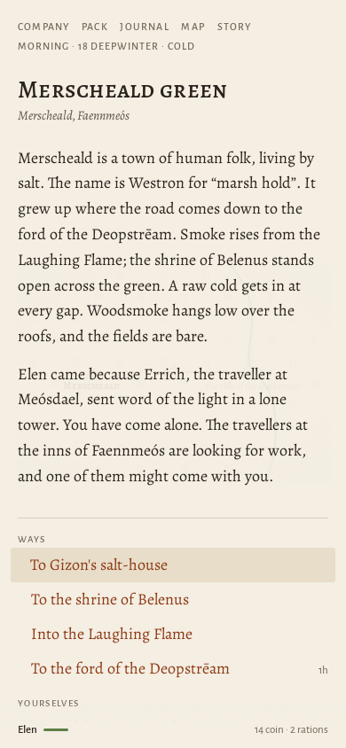 |
| A traveller taken on | 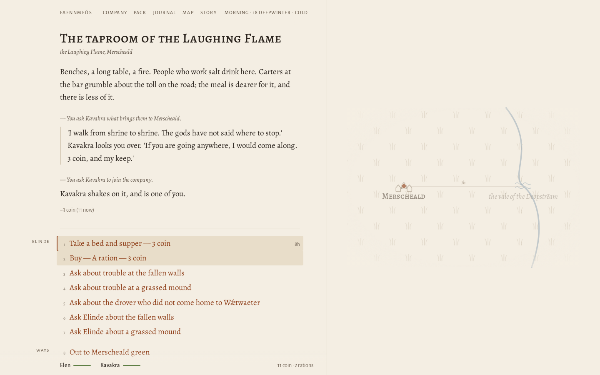 | 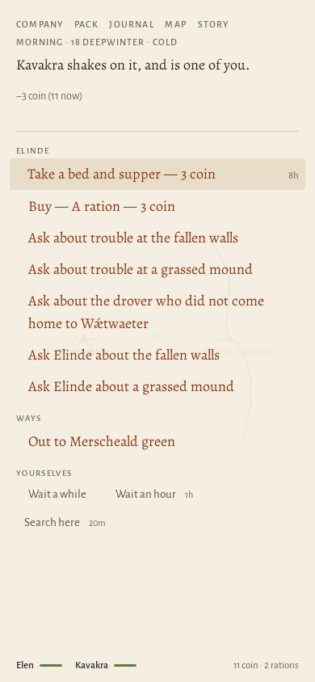 |
| A place's name learned | 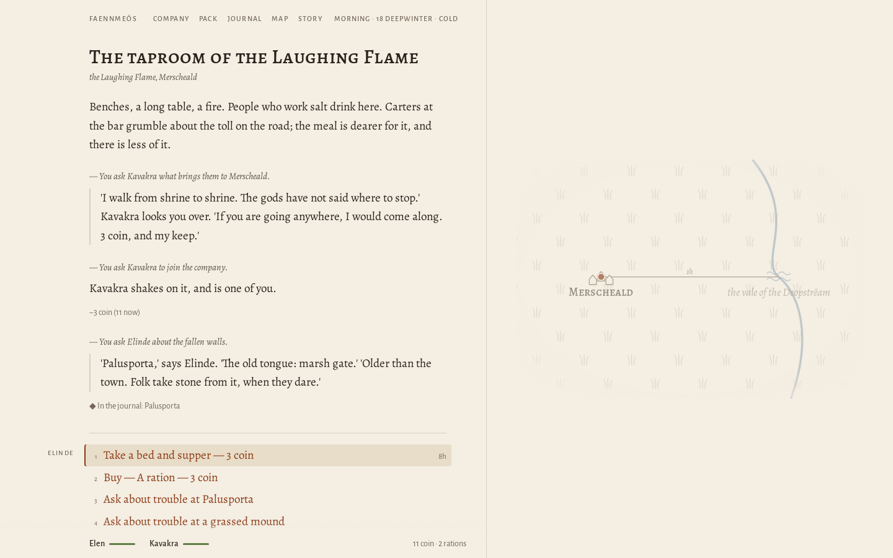 | 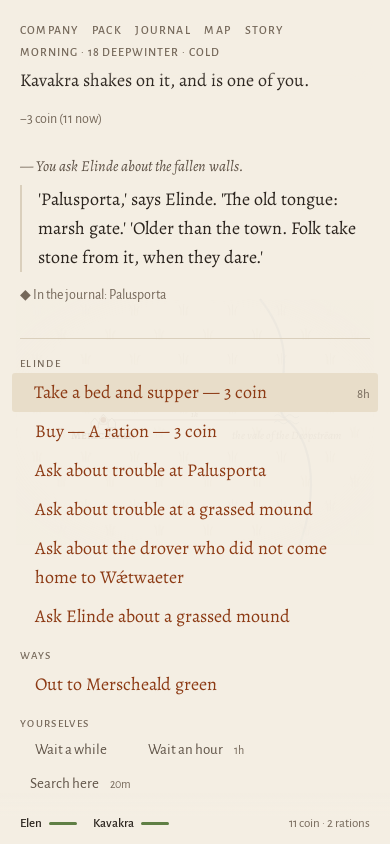 |
| An offering at the statue of Belenus | 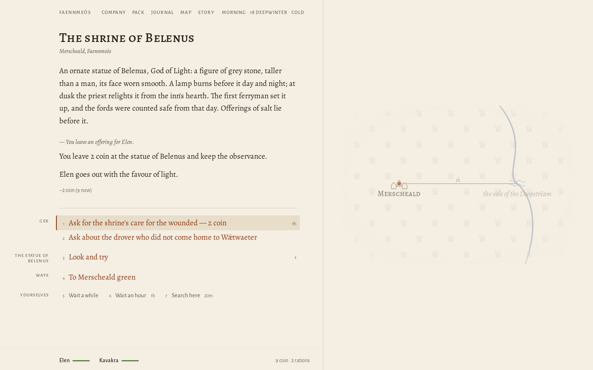 | 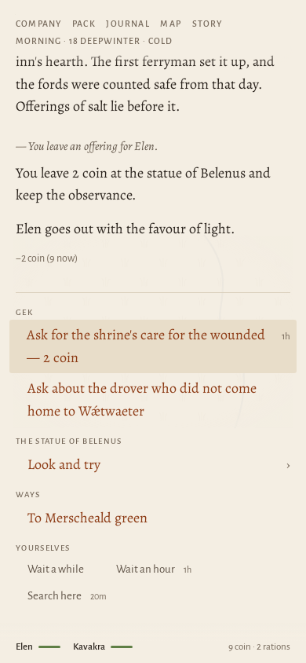 |
| The ford of the Deopstrēam, and the toll | 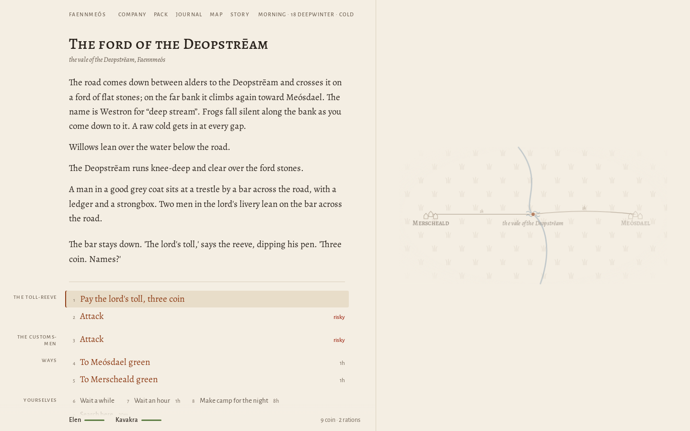 | 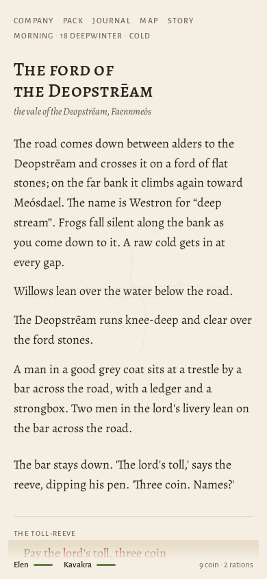 |
| The map | 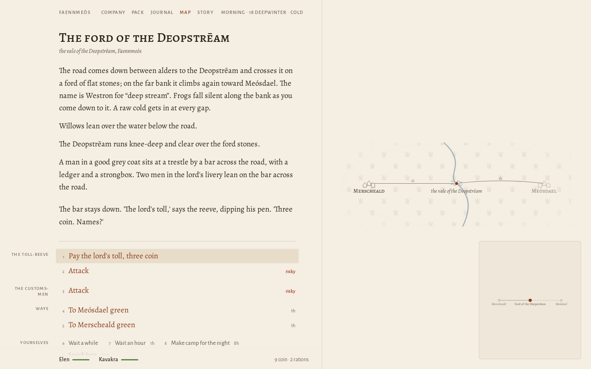 | 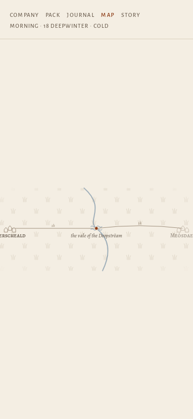 |

## 4. Arriving, companions, time and the map

- **Alone, with a reason.** A generated region can be set out into alone; the reader offers *Go alone* on the company
  page.
  - Each member arrives with a reason taken from their background. An old acquaintance in the region sent word of one
    of its troubles: "Elen came because Errich, the traveller at Meósdael, sent word of the light in a lone tower."
  - A company of one is told that the travellers at the inns are looking for work. None of this is a task.
- **Companions found on the road.**
  - Each inn's traveller has a calling that is a class (a drover fights, a pilgrim prays, a tinker opens locks).
    Asked what brings them there, they offer to come along for a few coins.
  - The town situations end with people willing to come for nothing.
  - Someone who joins is one of the company from then on: counted, fed, fought beside and saved with it. Under the
    surface, membership is now the campaign's current state, not its fixed definition.
- **Discovery.**
  - A generated site is seen as what it looks like ("the fallen walls", "a lone tower") until the company learns its
    name. The innkeeper of the settlement it is reached from knows the name and what is said of it, and an old site
    has its name cut over the door in the old script.
  - Choices, ways, rumours, the chart and the page all use what the company knows ("Ask Elinde about the fallen
    walls", then "Palusporta").
  - It is a Kyr construct any author can use: `Place w1 "Palusporta" … seen as "the fallen walls" until w1_named.`
- **Time.**
  - A campaign begins on a date of Imbar's reckoning: Orsino's annals count the Years of the Sun and Moon.
  - The line above the page says "Morning · 18 Deepwinter · cold"; looking closer gives the hour, the full date and
    the season.
  - A generated region has a climate from Orsino's `terrainClimates` and draws each day's weather from its
    `climateWeather`, corrected for the season.
  - The day after rain or a storm the river runs over its ford, which can then only be risked until it falls.
- **The map.** It draws:
  - the region's terrain as a texture;
  - its land forms (the ford's water, the wood's trees, the mere, the pass);
  - the river's course through the country it crosses;
  - route times;
  - the edges fading out beyond what the company knows.

  On a phone it opens at a legible scale centred on the company, and scrolls sideways.

## 5. What is still not good enough

- **Encounters repeat.** Eleven species are met, but two adventures supply most of them: the unquiet tower's
  revenants (84 across 32 regions) and the brood's spiders (84). There are three adventures and four town
  situations. After a few regions they will recognisably repeat. More authored scenarios matter more now than more
  tables.
- **Encounters do not scale with the company.**
  - Owlbears were taken out of the dens, not given to stronger companies.
  - A company of one is fragile: alone, a first-level warrior wins 72% of fights against two wolves and 57% against
    three spiders.
  - The arrival tells a lone traveller to hire someone, and the first inn's traveller costs 3 coins, but nothing
    stops a company of one walking into a den.
- **Recruits are thin.** Once joined they are fighters with a name, a people and a calling. They have nothing to say,
  no loyalty and no reasons. The travellers' offer comes after one question and feels transactional.
- **The town situations are few and stand alone.** They do not touch each other or the region's economy. The
  quarrel's "supper on the house" is coin. Priests act on their faith in one situation.
- **Weather and seasons are shallow.**
  - The weather is a schedule of twelve days drawn when the region is made; after that the last day's weather stays.
  - It matters only at the ford, and in what is seen.
  - Day length does not change with the season.
  - The pass does not close in winter.
  - There are no market days or feasts.
  - On a cold day "a raw cold gets in at every gap" at every outdoor place, which grows tiresome.
- **Discovery is partial.**
  - Only generated sites are seen-as until named.
  - *The Long Man* does not use the construct yet.
  - Places heard of but not reached are not drawn on the map.
  - The view from a summit does not mark it.
  - The map's fog is decoration over a map that still only draws what has been reached or can be walked to.
- **Names.**
  - Aenean names can be long and Latinate ("Nubilosusturris").
  - Where a tongue lacks a word, a site keeps an English name ("Gloom Howe").
  - Region names repeat across worlds: three of 32 are "Thornholt".
- **Generated prose is assembled from sentences.** It reads well in places, but a session of it shows the joins.
- **Loading.** A generated region now loads in about 1.6–1.9 seconds, up from 1.2: two town situations and an
  arrival are more modules.
- **No one else has played this.** Every playthrough here was scripted by its builder from the labels on the page.

## 6. Commits

| Commit | What |
|---|---|
| `e5bda34` | Fights that stay put and say what each blow did, and blows that land |
| `4dbee58` | *The Long Man*, deepened: the town under the lake, Pell, Dunnet's arm, Cass's refusal, Merrow's hours |
| `ec69d93` | Generated regions on real land, among many peoples, with dens that fit the country |
| `b57d085` | Shrines kept as Orsino's are, and places the company must learn the names of |
| `42ef546` | Towns with something going on in them, and companions found on the road |
| `d521a76` | A calendar, the weather by the day, and a map that fades where nothing is known |
| `02f50c1` | Why the company came, said apart from the town it comes to |
| `dd85d16` | Dens a first-level company can survive: no owlbears, and one white wolf |

The full suite passed before each of the first six commits, with browser tests opt-in. The last two (the arrival as
its own module, and the den tables) were checked with the gates and the tests they touch. The full suite passes again
with this report: see its commit. The gates (eslint with no warnings, both typechecks, Kyr lint) passed at every
commit.
