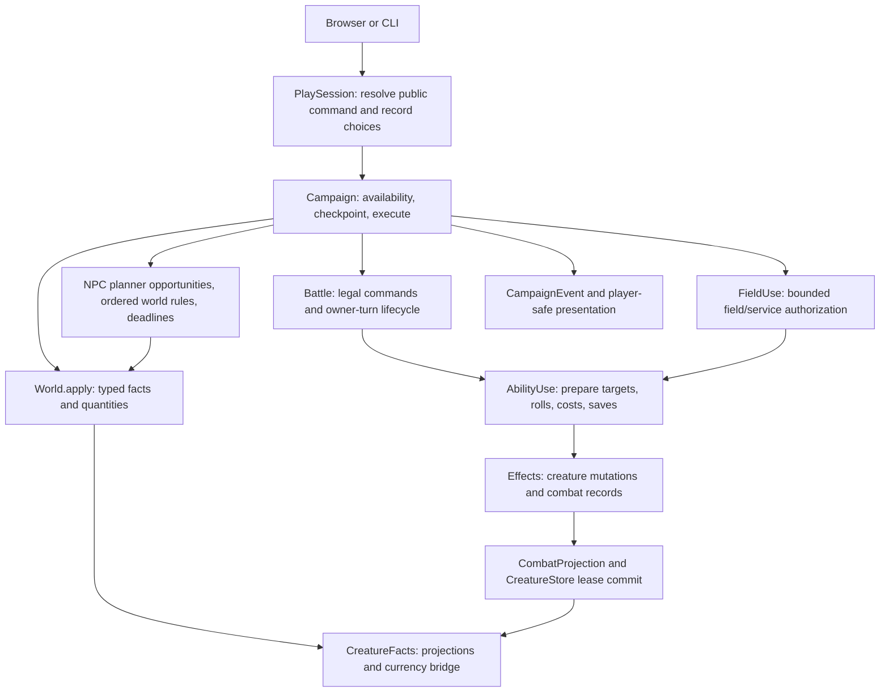

# Kyr's causal architecture: audit before the dungeon slice

Status: source audit and proposed design, 18 October 2026. No runtime changes are made by this document. The existing game is the reference implementation, not evidence that all the mechanics below exist.

Kyr has **two useful typed reducers with an incomplete bridge**: creature effects and symbolic world changes. Combat and permitted field magic genuinely share effect execution. Traps, equipment attachments, environmental creature damage, event reactions, and world-time conditions do not yet participate in that shared model. Replacing everything with a universal interpreter would discard working distinctions; adding another spell or trap interpreter would compound the gap.

## 1. Actual execution map



| Responsibility | Existing implementation and boundary |
| --- | --- |
| Command | Combat `Command` is `{actor, ability, target}` in [model.ts](../../src/model.ts#L22). World commands identify a grounded typed `Operator` with requirements, success/failure changes, optional resolver, cost, and time in [module.ts](../../src/lang/module.ts#L15). There is no common command envelope. |
| Admission | [PlaySession.perform](../../src/session/play-session.ts#L56) resolves a player-visible command and prevents concurrent session commands. [Campaign.action](../../src/campaign/campaign.ts#L270) rechecks availability. [Battle.step](../../src/battle.ts#L108) checks legal actor/ability/target, mana and cooldown through `legalCommands`. |
| Expressions | [Expressions](../../src/expressions.ts#L12) uses seeded DEEM and the same registered `FantasyRules.functions` used for generation. Ability context currently contains actor scores, HP, max HP, mana; not target state, world facts, source item or room. World predicates use their own typed fact/quantity/query evaluator; generation-time DEEM values must already be instantiated ([World.number](../../src/lang/world.ts#L18)). |
| Creature resolution | [AbilityUse.perform](../../src/ability-use.ts#L8) and [Effects.apply](../../src/effects.ts#L55), shared by Battle and FieldUse. Context still requires a `Fighter`, fighter array, encounter turn and battle flags. |
| World resolution | [World.apply](../../src/lang/world.ts#L55) applies ordered changes to a copy. Quantities must remain nonnegative safe integers; exclusive relations replace the previous final argument for the same subject. `cost` is planner weight, **not automatically deducted currency**. Resource spending must be explicit changes or ability costs. |
| Persistent authority | [CreatureStore.commit](../../src/creature-store.ts#L34) validates the whole leased set before writing; identities/generated base values cannot change. Symbolic world state owns locations, relationships and non-gold inventory quantities. [CreatureFacts](../../src/campaign/creature-facts.ts#L11) materializes planning facts and bridges gold changes back to canonical creatures. |
| Scheduling | [Campaign.complete](../../src/campaign/campaign.ts#L308): player resolution, world changes, then one NPC opportunity per actor per elapsed tick, ordered rules, pressure checks. Recovery heals only after all its ticks and a final shelter check. |
| Recording | `CombatEvent` is typed but battle-shaped ([model.ts](../../src/model.ts#L24)); `CampaignEvent` holds outcome, string fact diff, combat records, NPC decisions and perceptions ([campaign.ts](../../src/campaign/campaign.ts#L49)). Neither is an event-sourced authority. |
| Presentation | [ActionFeedbackView](../../src/presentation/action-feedback.ts#L12) uses the event plus player-visible before/after snapshots. It separates immediate result, discoveries, scene changes and newly available choices. Simulation diffs are not automatically safe player narration. |

### Representative traces: what works, and what does not

**Attack with resistance and an applied condition — implemented, with narrower semantics than “weapon attack.”** A selected ability such as `venom` is parsed into ordered damage/apply effects. Battle checks admission; AbilityUse prepares actor conditions, targets, amounts and save difficulties before paying mana and setting cooldown. Each effect is then resolved in source order. Damage is:

```text
max(0, floor(max(0, rolled + statusPower) * (1 - ancestryResistance)) - statusArmor)
then halve for guarding
```

See [effects.ts:63](../../src/effects.ts#L63). HP loss is capped at remaining HP, HP zero emits death, and the following apply skips a dead recipient. This is automatic hit damage; there is no equipped weapon, attack-roll/AC, critical-hit or general on-hit hook. An explicit following condition is not a triggered reaction; it can apply after zero damage and is independent of the preceding effect's save. Calling it “on hit” would overclaim.

**Spell with save and duration — partly implemented; triggered follow-up unsupported.** [AbilityUse:26](../../src/ability-use.ts#L26) rolls a separate d20 save per target per effect. Success entirely suppresses that effect; no half damage option. Kyr uses `round((score-10)/3)` ([fantasy-rules.ts](../../src/fantasy-rules.ts#L2)), deliberately different from the inspected Orsino formula. Reapplying the same status replaces its duration, not stack count. There is no event subscription, source-keyed attachment, concentration, reaction cost or once-per-trigger policy.

**Healing outside combat — implemented, not a second healing interpreter.** The generic [field_spell](../../data/rulesets/fieldcraft.kyr#L8) requires actual caster/recipient member references, co-location through their party, usable knowledge/mana and relevant treatment. [FieldUse](../../src/campaign/field-use.ts#L9) authorizes only ally heal/remove without saves, acquires canonical creatures, makes temporary combat projections, invokes AbilityUse, commits resulting state and releases. A new invocation gets fresh cooldowns by design. There is no portable consumable item instance/use/charge handler; a healing spell is not evidence of a potion system.

**Trap on entering a room — unsupported ordinary mechanic.** World rules can observe arrival and latch a fact such as `sprung(trap)`. They cannot invoke the creature damage/save reducer; their effects are `Change[]` only. A world action may call one of four named runtime resolvers ([runtime-capabilities.ts](../../src/campaign/runtime-capabilities.ts#L3)), but `invoke` rejects harmful field effects. Do not implement a trap as a pretend hostile creature encounter or a bespoke HP mutation.

**Environmental persistent condition — unsupported bridge, supported storage.** Contamination and unsafe rooms can already change facts, access, schedules and descriptions. Canonical creatures can store persistent poison/bleeding/weakness, and combat can apply them. A room rule cannot currently apply those conditions through shared resolution. Existing poisoned damage is a special Battle owner-turn loop ([battle.ts:130](../../src/battle.ts#L130)), directly calling `Effects.hp`; it bypasses resistance/armor rather than going through typed damage. A description saying water is poisonous must not imply implemented ingestion/exposure.

**Magical equipment modifier — unsupported.** `Creature` has no equipment slots, item instances, attunement, attachment source, inventory-to-modifier projection or durability ([creature.ts](../../src/creature.ts#L4)). Ancestry resistance and global status armor/power are the current modifier sources. A symbolic object named “flame sword” confers no damage unless an explicit implemented rule does so. Learning a spell permanently is implemented; inventory labels are not equipment mechanics.

**Access/relationship/physical world action — implemented in the symbolic reducer.** [site-capabilities.kyr](../../data/rulesets/site-capabilities.kyr#L15) supplies ordinary parameterized recover-key, endorse, open/close and disable actions. Effects mutate authority/access/functioning facts. A human-readable relationship such as “protects” has no extra semantics beyond the authored rules that consult its predicate. These fact changes cannot be consumed directly inside an ability expression today.

## 2. Ordering, transactions and replay risks

1. **Ability preparation is eager.** All effect conditions, candidate sets, amount rolls and difficulty rolls are computed against the pre-effect actor state ([ability-use.ts:11](../../src/ability-use.ts#L11)). “Heal, then if fully healed …” does not test the post-heal state. Group effects roll an amount once and share it across targets; saves roll per target. Changing either convention changes seeded histories. Target sets are prepared before deaths/summons, although individual effect handlers guard dead targets.
2. **Command-level rollback exists at Campaign, not at every reducer.** Campaign snapshots creatures, world/time, observations, log length and encounter ordinal, then restores on thrown errors ([campaign.ts:275](../../src/campaign/campaign.ts#L275)). Ordinary failure is different: combat loss applies failure changes and retains combat injuries. World.apply is copy-on-success, CreatureStore validates every record before commit. Standalone Battle mutates fighters/RNG/history and commits on each step; it has no step snapshot rollback if resolution unexpectedly throws after a partial effect. FieldUse's lease protects the persistent commit, but its local interpreter still mutates projections.
3. **Rollback coverage has a legacy edge.** `rewarded` is saved but absent from the command checkpoint; the old non-module reward path changes it ([campaign.ts:430](../../src/campaign/campaign.ts#L430)). This is a code-review risk, not a demonstrated regression in the current modular histories. Keep future side effects in the transaction rather than widening scattered checkpoints indefinitely.
4. **Costs need one authority.** Mana is paid after preparation and before saves; it remains paid on saved/ineffective effects. World quantities are explicitly authored and gold has a manual projection/commit bridge. Recovery spends its ration first, lets six hours elapse, then fails to heal if the shelter became unsafe ([campaign.ts:350](../../src/campaign/campaign.ts#L350)); this is deliberate, not rollback failure.
5. **World order is authored causality.** Per tick, NPCs run in definition order, then rules in source order, then deadlines. A rule sees earlier rule writes in the same pass; there is no automatic fixpoint or event recursion. Authors must latch irreversible rules. NPC action `time` bounds planner paths but execution grants one complete action per opportunity without an actor busy-until schedule ([Agency](../../src/campaign/agency.ts#L18), [Campaign:325](../../src/campaign/campaign.ts#L325)); multi-hour NPC work would currently be misleading.
6. **Duration means owner combat turns, including persistent statuses.** Battle applies status damage/skip, decrements duration, removes expired statuses, then grants the next command. Thus a duration-one skip still skips that owner's turn. Persistent means retain remaining count across encounters, not advance during travel. Encounter statuses are filtered at commit, cooldowns and guarding reset at projection. [statuses.json](../../data/statuses.json), [CombatProjection](../../src/combat-projection.ts#L16), [Battle.commit](../../src/battle.ts#L56). One world tick is ten fictional minutes; there is no conversion from turns to minutes ([FictionalTime](../../src/presentation/fictional-time.ts#L1)).
7. **Reactions are not implemented.** Death is logged but nothing subscribes to it; `Effect.when` is an initial condition, not an event trigger. Ordered world rules are observation-driven fact transitions, not damage/hit reactions. There is therefore no existing recursion policy to preserve. Any future queue needs deterministic priority/tie-breaking, trigger identity, per-event firing limits and a hard chain limit that fails the command atomically.
8. **Replay is command replay, not event replay.** [PlaySession.replay](../../src/session/play-session.ts#L89) records player combat choices, regenerates enemy tactics and rolls, and checks command count. Encounter/field seeds include campaign seed and ordinal. Saves embed instantiated world/module state and canonical creatures; global ability/status/race content and code are still loaded from the current build. Saves do not pin a ruleset digest. Stability is established for the same version/inputs, not arbitrary future content changes. Saving mid-command is deliberately prohibited ([Campaign.save](../../src/campaign/campaign.ts#L212)).
9. **Some ability effect names overstate campaign integration.** Summons append encounter fighters, but lease commits only original creatures; summons do not become persistent inhabitants. Ability `travel` sets a local escape flag/location; Battle does not commit it to campaign `at` facts. `revive` clears all statuses rather than source/lifetime-sensitive attachments. Keep these limitations explicit before placing such rewards in a dungeon.
10. **Presentation must not become causality.** Events lack stable event IDs, source-item provenance, parent/reaction IDs, typed world deltas and visibility policies. Campaign fact diffs include offscreen developments. The existing player-view filter is useful and should survive; a new event bus must not simply display every event.

## 3. Orsino stress cases

These are source requirements, not promised imports. Upstream revision verification and corpus counts belong in the companion corpus audit.

| Actual Orsino definition | Pressure on Kyr | Present status |
| --- | --- | --- |
| `statuses.json` poison: `onTurnEnd` damage `=1d4`, true damage, damage-type trigger, poison save | Shared damage execution, categorical saves, timing, condition trigger and attachment ownership | Kyr poison is fixed two HP at owner-turn start; deliberate different mechanic, not parity |
| `Status.ts` `onKill`, `onAttackHit`, `onHeal`, `onExpire`; `rules/Commands.ts` explicitly executes onKill | Typed committed outcome reactions; dead target/source distinction; deterministic ordering | Logged kills only; hooks unsupported |
| `StatusEffect` `equipment`, `planar`, `whileEnvironment`, `sourceKey`; effective stats, damage reduction, immunities | Same attachment/modifier collection from equipment, ancestry, room and plane; detach by source | Only ancestry resistance and status armor/power supported |
| Spell `saveKind` reflex/will/fortitude and category immunity | Ruleset-defined save categories and category-to-stat mapping, not an English parser special case | Six ability-stat saves only; no condition immunities |
| Reflection, temporary HP, resurrection eligibility, polymorph effective stats | Damage pipeline stages, recursion guard, derived values distinct from generated base | Unsupported; cannot approximate by changing base Creature fields |

Evidence: Orsino [Status.ts](../../../orsino/src/orsino/Status.ts#L98) (hooks), [StatusEffect](../../../orsino/src/orsino/Status.ts#L221) (source/environment/equipment), [poison definition](../../../orsino/settings/fantasy/statuses.json#L1007), [onKill execution](../../../orsino/src/orsino/rules/Commands.ts#L372), [turn-end hook](../../../orsino/src/orsino/Combat.ts#L964). These links target the sibling checkout when present. Declarations alone do not establish that every Orsino hook is executed faithfully; the corpus audit must distinguish that too.

## 4. Alternatives and the smallest coherent improvement

| Direction | Advantage | Cost/risk |
| --- | --- | --- |
| Extend named resolvers separately (`trap`, `drink`, `equip`, `shrine`) | Fast initial feature; simple per-command authorization | Repeats targeting, saves, modifiers and durations; reaches the forbidden parallel-interpreter architecture |
| Translate all world changes into one universal creature-effect engine | Superficially uniform commands/events | Large rewrite; world rules/planner no longer use simple inspectable changes; narrows semantic differences by hiding them |
| **Keep both reducers; share command resolution, primitive effects, attachments and receipts** | Preserves symbolic planning and canonical creature engine; one damage/save implementation across sources | Requires an explicit transaction and source/target boundary; cannot simply rename Fighter to Entity |

Recommend the third. Initially extract only what a harmful room trap, consumable and resistance-granting item require. Do not build every Orsino hook or an unrestricted event system first.

Proposed contracts (not current APIs):

```ts
type EffectSource = { kind: 'ability' | 'item' | 'trap' | 'environment'; id: string; owner?: string };
type Clock = { kind: 'ownerTurn'; remaining: number }
  | { kind: 'worldTime'; expiresAt: number } | { kind: 'whileAttached' };
type Attachment = { id: string; definition: string; source: EffectSource;
  target: string; clock: Clock; stackingKey: string };
type Receipt = { commandId: string; sequence: number; source: EffectSource;
  actor?: string; targets: string[]; outcomes: TypedOutcome[] };
```

`TypedOutcome` must include admitted/rejected attempts, saves, actual damage/healing, resource debit, attach/detach and committed fact/quantity changes. Rendering belongs downstream. Stable references identify world entities, canonical creatures and item instances explicitly; a trap does not need a fake Fighter actor. Creature and world reducers apply through a command transaction exposing staged read/write views. Damage uses one ordered mitigation pipeline. Initial target and expression sampling rules stay compatible unless intentionally versioned.

The first attachment supports one flat declared modifier or resistance plus explicit detach; no arbitrary scripts. Registry definitions are shared across sources; attach/detach owns applicability. Preserve immutable generated base stats and compute effective values. A condition retains owner-turn timing unless its definition explicitly requests a world clock; no silent conversion or broad clearing on rest.

### First executable architecture experiment

Use a tiny **engine fixture**, not another adventure: a character carrying a real antidote and optionally wearing a tested resistance charm enters a trapped passage.

1. The same poison damage/effect definition executes from an enemy ability and room trap, with equivalent saves/mitigation when source-independent inputs match. Trap's source is a world entity, not an invented creature.
2. Trap activation, inventory consumption, mana/charges and condition changes commit together. Inject a failure after proposed damage to prove no resource/world/creature partial writes or leaked receipt survive.
3. Equip/unequip charm changes effective resistance without touching generated base. Reapplying poison obeys a declared stacking key; one world-time test expires through travel while an owner-turn condition does not.
4. Potion uses the same healing/removal effect as a spell; source-specific authorization and consumption remain outside the effect primitive.
5. Replay and save/reload reproduce canonical state **and ordered receipts**. Player presentation shows only witnessed trap results, not hidden room contents.

This validates a common causal boundary, not dungeon quality. Afterwards introduce exactly one bounded reaction, such as source-keyed `after damage` retaliation once per parent event, with an explicit guard against ping-pong. Keep broader hooks deferred until the actual dungeon encounter needs them.

## 5. Dependencies for the classical RPG slice

First settle saves/stat-mod ruleset naming and deliberate adaptations; then staged transaction + common receipts; then source-independent damage/heal/apply/remove; then item instances/attachment modifiers and explicit clocks; then ordinary exploration traps, consumables and hazards. Only then place those systems into branching dungeon exploration, equipment treasure and a boss that requires their interaction.

Retain existing parser forms, World, CreatureStore, DEEM expressions, AbilityUse admission semantics, planner and player-view filtering. Add adapters and focused primitives before any syntax expansion. Defer generic reactions, arbitrary planar magic, transformations, persistent summons, spell reflection and complete Orsino porting. None is a prerequisite for proving a satisfying first dungeon, but none should be advertised before its operational semantics exist.
