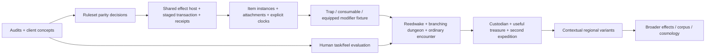

# Kyr's next game: coordinated Milestone A review

**Delivered:** source-based architecture/corpus audits, a distinct regional and dungeon specification, three client concepts, and one separately runnable interactive client prototype. **Not delivered or claimed:** the complete new campaign, a shared trap/equipment system, Orsino parity, or evidence of fun/first-time usability. Saint Orra, canonical creatures, persistence and the existing interfaces are preserved.

The next integration target is **the Serewater March**: a ferry town, wooded/chalk/wetland approaches, and a former bellfoundry that became a flood refuge and ossuary. Expeditions concern valuable salvage, missing people, burial obligations and physical routes. There is no master mechanism whose shutdown resolves the region. The party's choices include what to disturb, whom to help, how much to carry, how deeply to risk going and when to return.

## Read the evidence

1. [Three game-client alternatives and selected prototype](game-client-concepts.md). Build and open `site/folio.html`; the original player remains `site/index.html`.
2. [Actual command/event/effect architecture](causal-architecture.md): end-to-end traces, ordering, costs, transactions, duration, reactions, persistence and replay.
3. [Fresh Orsino inventory and generative audit](orsino-generative-audit.md): actual revisions, broad content, original DEEM composition, botanical/zoological gaps and minimal compatibility stress corpus.
4. [The region and classical RPG slice](rpg-vertical-slice.md): settlement roles, religious/ecological context, an eighteen-room three-level graph, alternative approaches, useful treasure and authoring boundary.
5. [Prototype screenshots, replay, dossier and candid evaluation](../playtests/lantern-road/README.md).

## Principal findings

**The current engine is worth keeping.** Combat and permitted field spells really share `AbilityUse`/`Effects`; World has its own useful typed fact reducer. Canonical stores, module instances, deterministic command replay, bounded NPC planning and player-safe projections remain sound foundations. The deficit is not the absence of a universal language.

**The missing causal bridge is concrete.** Traps and environmental exposure cannot currently use ordinary creature effects from room triggers. Equipment has no persistent instance/slot/source attachment model. Status poison ticks bypass the ordinary mitigation path. There are no generic reactions or world-time condition clocks. Adding a separate handler for each fantasy category would make future parity worse.

**Orsino offers a precedent, not a drop-in engine.** Reverified main `4cb27ce68cb204a82c6ce6eb1a29c2131dc67eb3`; newer review `7b76ce37d4081620b536bfecdd48e8cb7a58d97d` adds only the lockfile. Its trap, consumable, shrine and wonder flows already share `AbilityHandler`. Its equipment, source-keyed passives and broad generation content deserve examination together. However, differing saves/stat modifiers, encounter-shaped contexts, unseeded paths and linear dungeon construction prevent blind transplantation.

**The game needs expedition decisions, not more knowledge gates.** Contextual information must help choose a route, prepare, accept an obligation, judge risk or negotiate a specific permission. A register must identify particular remains, not universally switch off a guardian. Treasure must change reachable places or survival options. Returning before a boss is defeated must be useful play.

**Authoring should assemble bounded world components.** Bind stable geography, institutions, deities and roles first; then generate inhabitants/objects under their context; then install executable Kyr situations referencing those instances. Keep construction templates small and reusable. Do not invent a monolithic Adventure profile or treat an array of generated room descriptions as a dungeon graph. The specification gives a package boundary and validation/dossier requirements without proposing a new parser now.

## Alternatives and recommended dependency order

For execution, compare named category-specific handlers, a universal world/creature interpreter, and a shared source/transaction/receipt bridge over the existing reducers. Recommend the bridge. For presentation, compare illustrated theatre, first-person expedition window and living atlas. Provisionally recommend illustrated theatre; the separate prototype tests that choice without replacing the production player.

### The next bounded implementation

Before adding rooms, prove a non-adventure fixture: the same typed damage/poison definition executes from an attack and a room trap; a real equipped charm modifies both; one antidote consumes one actual item and resolves the shared removal effect. Include rejection, death, repeated trigger, source removal, explicit clock expiry, injected failure rollback and save/replay. Preserve existing sampling/save behavior unless intentionally versioned. This tests the highest-risk dependency without another authored puzzle.

Then build **one whole dungeon skeleton**, not one isolated room after another: all branches, loops and return paths, one physical trap, one wildlife interaction, town preparation, an ordinary encounter, the Custodian and bounded noncombat access. Add one equipment/tool reward that changes expedition two. Evaluate a retreating/investigating party and a heavily armed salvage party before generating extra settlements.

Religious, ecological and planar research can proceed in parallel, but only rules-backed traits enter the game. The broad compatibility suite should start with weapon/armor, healing consumable, poisoned spikes, one source-keyed status/reaction, one shrine blessing, one permanent wonder and one scoped planar modifier. Clearly name adaptations and explicitly reject unsupported properties rather than silently dropping them.

## Decisions to settle before broad implementation

- Choose a versioned fantasy ruleset policy for Orsino `/2` versus Kyr `/3` modifiers, category versus attribute saves, attack/AC versus automatic hits, and recovery. Do not silently reinterpret existing saved parties.
- Select item identity/ownership/equipment and modifier stacking rules; define transaction admission, payment-on-failure and source lifetimes.
- Choose explicit duration clocks and NPC action scheduling. The current single opportunity per tick is unsuitable for pretending an NPC completes hours of work instantly.
- Approve the slice scope: three-level authored topology first, contextual population/content generation second; neither arbitrary terrain nor a full economy.
- Evaluate the prototype with unfamiliar people. No human study has yet been conducted; tests and screenshots establish implementation only.

No broad rewrite or corpus import was undertaken. The prototype is a bounded renderer and authored fixture over the existing simulation, with its limitations visible in the report.
