# Four treatments of the same three moments

Before rebuilding the page, the same three moments were set in four different ways and photographed at tablet size
(1180×820 sideways and 820×1180 upright). The moments are:

- **arriving**: the first scene of a game, one person coming home;
- **speaking**: a conversation with someone whose answer matters;
- **travelling**: a fork on a road through a forest.

The pages are static HTML in this folder (`<treatment>-<moment>.html`), generated from one set of words
(`scenes.ts` in the mission's notes), and the photographs are in `shots/`.

| Treatment | Arriving | Speaking | Travelling |
|---|---|---|---|
| A. The page | 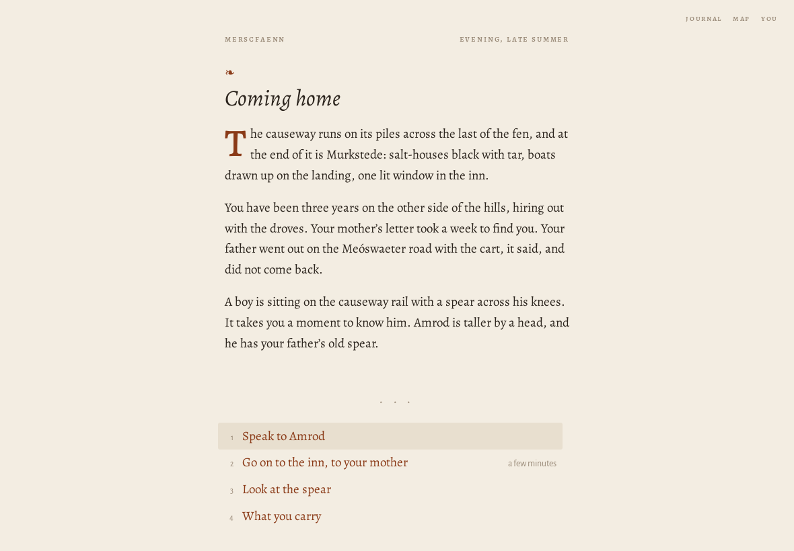 | 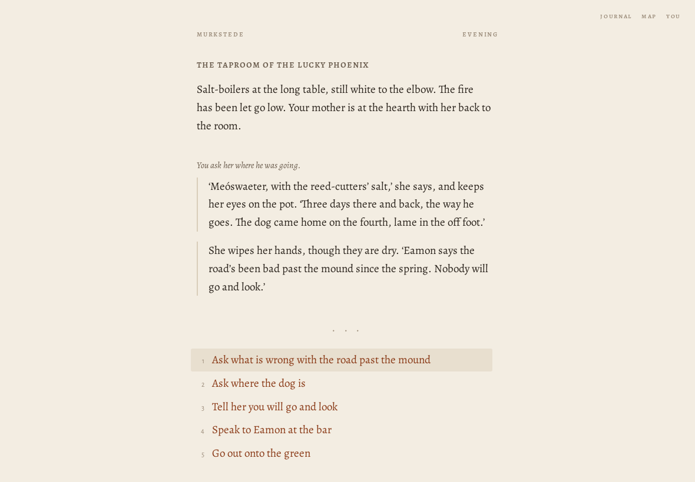 | 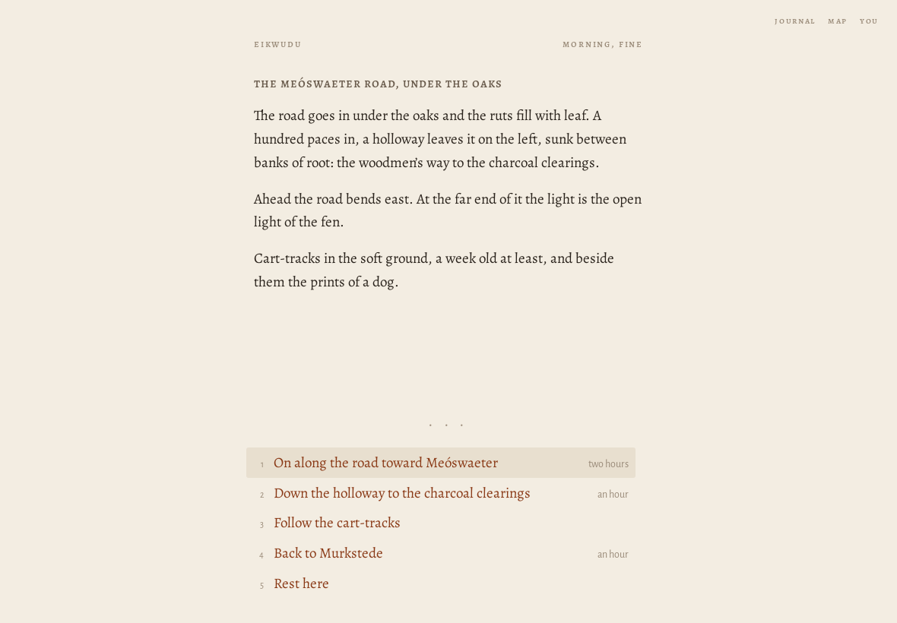 |
| B. The folio | 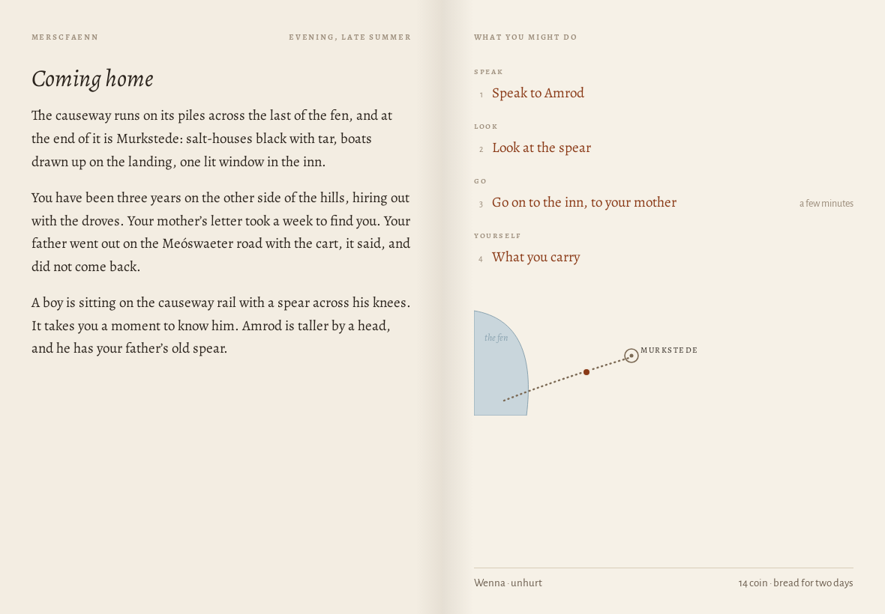 | 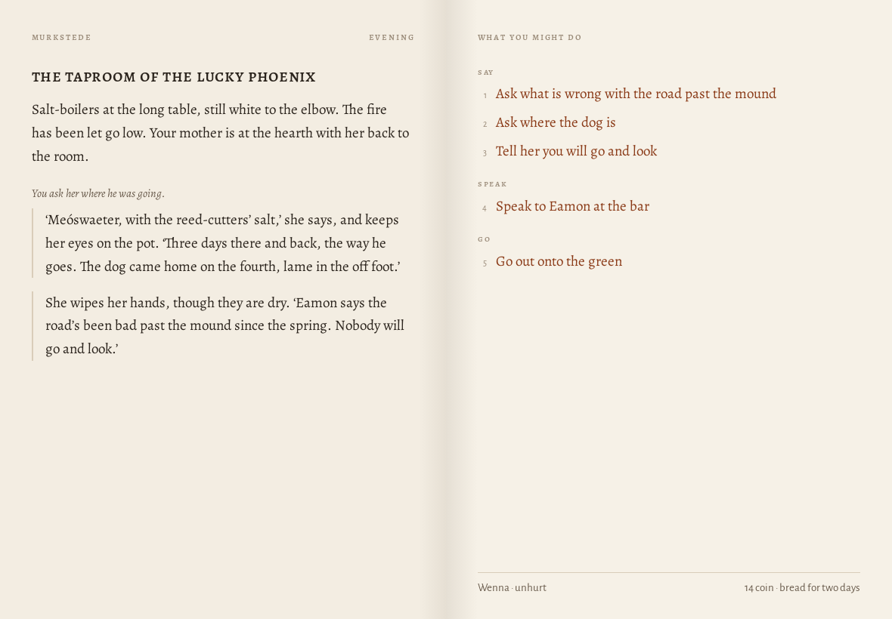 | 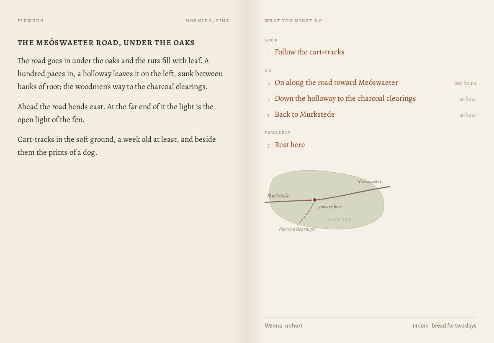 |
| C. The chart | 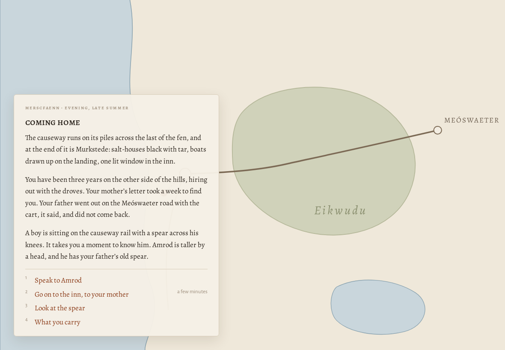 | 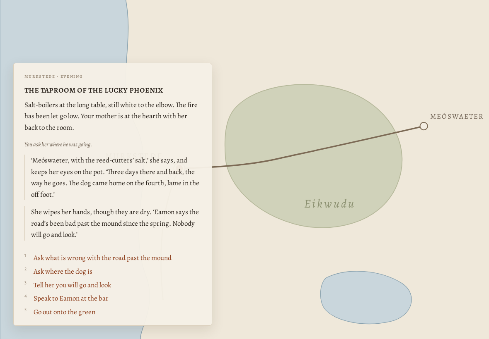 | 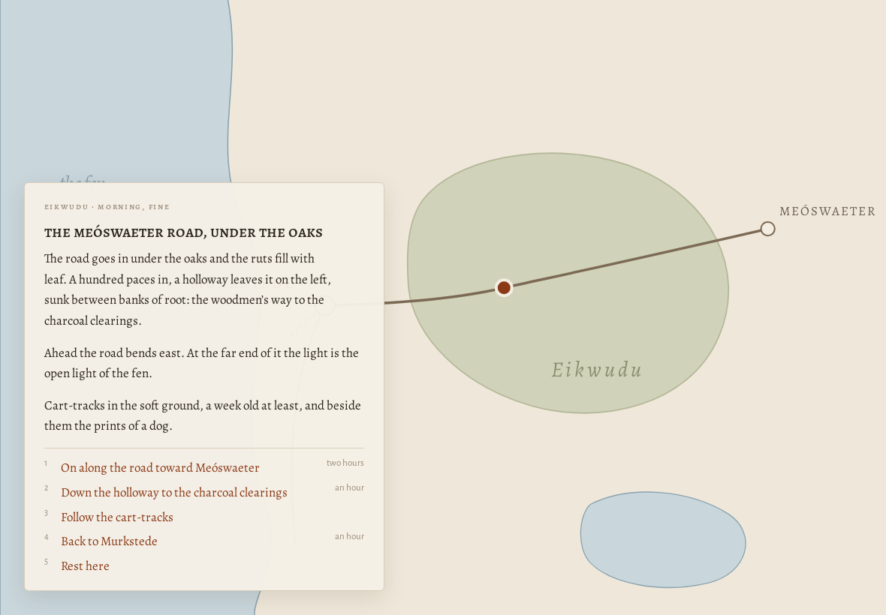 |
| D. Woven prose | 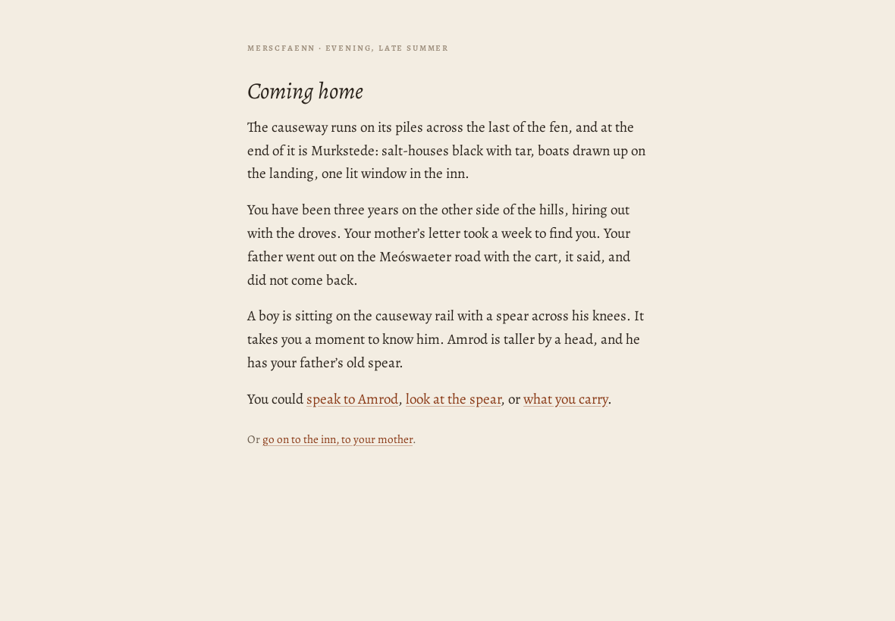 | 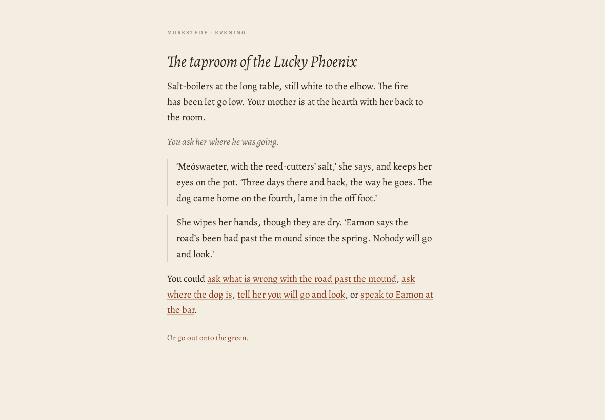 | 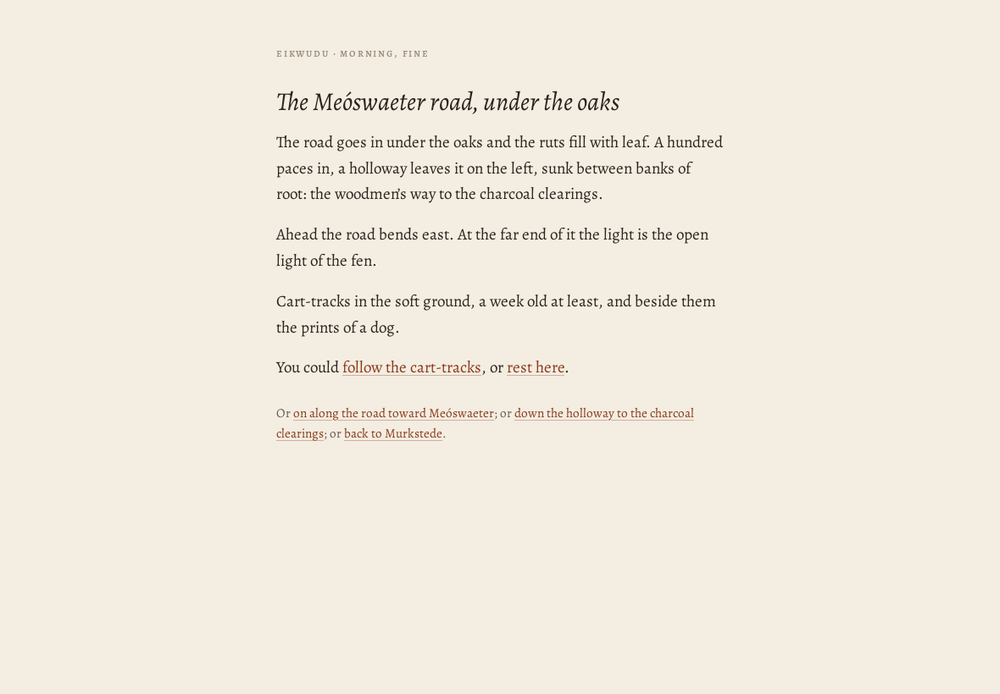 |

## A. The page

One typeset column, like a page of a novel: a running head, the scene, and below a small ornament the things you
might do.

- *For it:* the most literary of the four, and the calmest. It reads like a book and nothing competes with the
  words. The opening, with its chapter heading and initial, is the best moment in any treatment.
- *Against it:* the choices are at the foot of the text, so they move when the text is longer or shorter. A tablet
  held sideways is mostly empty margin. There is nowhere for a chart of the way, so in the forest the only spatial
  help is the prose.

## B. The folio

The book lies open. The left page is the world (the situation, then the exchange); the right page is what you might
do, grouped by kind, with a small chart of the way and a quiet line for the company at the foot.

- *For it:*
  - the four functions are separated by the form itself;
  - the choices never move when the scene changes;
  - the chart of the way sits where you choose the way;
  - a tablet held sideways is used, not left empty.

  Held upright it becomes A, with the choices following the scene.
- *Against it:* two panes can drift toward a dashboard. It has to stay paper and ink: no boxes, no badges, and only
  the faintest gutter.

## C. The chart

The map fills the screen and the scene is a card on it, as in a board game.

- *For it:* travelling is lovely: the road through the wood, the fork, where you are. The sense of the country is
  the strongest of the four.
- *Against it:*
  - Reading and speaking suffer badly. The card is cramped, it covers the map, and the inn is a card over a chart
    of fen.
  - Every interior and every conversation is the wrong shape for it.
  - It would demand a superb map at every moment, which the world cannot honestly supply yet.

## D. Woven prose

The choices are links within the text ("You could *ask where the dog is*, or *tell her you will go and look*").

- *For it:* the most immersive for a few choices, and conversation reads as conversation.
- *Against it:*
  - It does not scale: a fight, a shop or a company of four with spells would bury the prose in links.
  - The links move whenever the text changes.
  - They are small touch targets.
  - The intentions are mixed back into the situation, which is the confusion this mission exists to end.

## The choice

**The book: B as its wide form, A as its narrow one.**

- The book lies open on a wide screen or a sideways tablet, and its pages follow one another when the screen is held
  upright or is a phone.
- A's chapter heading and initial are kept for the moments that deserve them: the opening, entering a new country,
  a great discovery.
- C's drawing is kept for the charts. The regional chart opens on request as a plate over the right-hand page, and
  the small chart of the way sits on the right-hand page while the company is in wild country or a site.
- D's lesson is kept for conversation: what you can say reads as speech ("Ask where the dog is"), not as a menu of
  topics.

This was chosen because it is the one treatment that keeps the present situation, the exchange, the intentions and
memory apart by its very form, keeps the choices still, and has a place for spatial help, without giving up the
quality of a printed page.
