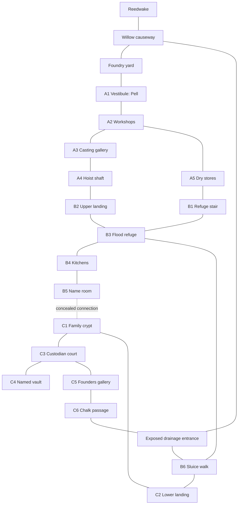

# The Serewater March: a classical RPG integration target

**Status: design specification, not implemented content.** Existing implementation is identified explicitly below. The proposed game-client prototype may enact a much shorter illustrated journey; its interactions are not evidence that this whole region, dungeon or effect vocabulary executes in Kyr.

The next target is a repeatable expedition into a substantial place, not another emergency with a correct mechanism to disable. The party decides what it can carry, whom it trusts, how deeply it ventures, what it will disturb, and when to turn back. A successful retreat with a wounded companion and a useful survey can be more valuable than a boss victory.

## 1. The place and the reasons to go

The Serewater is a temperate river basin where lowland reed marsh meets limestone pasture and wooded hills. Three settlements depend on the same river but have different roles:

- **Reedwake**, a ferry town, repairs boats, dries fish and sends wool and bell metal downstream. Its inn, quay, common shrine, outfitter and ferry office form a walkable home base. Neither its shops nor its people exist solely to supply the dungeon.
- **Chalkcross**, an upland market and grazing village, supplies wool, lime and pack animals. Its old burial society claims responsibility for the hill's dead.
- **Brackenholt**, a woodland hamlet, produces charcoal and timber. Its boatwrights need a replacement bronze bearing, while its households dispute how much woodland can be cut for renewed smelting.

These are proposed connected settlements, not three implemented economies. Initially only Reedwake is fully playable; the others have stable identities, routes and concretely authored contacts. They become explorable only when their interactions are authored and tested.

### Censer Hill, not a generic ruin

Above the floodplain stands a disused bellfoundry built over limestone caverns. During the Hundred-Day Flood, its cool storage chambers sheltered people from all three settlements. The upper foundry was later abandoned when its transport tram failed. The burial society converted the lower refuge into an ossuary, keeping names and remains together so displaced families could find their dead. A newer flood has exposed an old drainage entrance and washed unidentified bones downriver.

Today a licensed salvage company wants bronze and machinery, families want identification and proper custody, and the burial keeper wants dangerous lower vaults left closed. The place contains useful wealth, records, displaced wildlife and a guardian whose mandate is bounded but whose force is lethal. There need be no single conspiracy or all-explaining secret.

The party has several reasons to enter: recover a missing surveyor, sell an accurate route survey, recover a replacement bearing, investigate the washed-out burials, or simply seek treasure. Those interests overlap physically. They do not collapse into one quest ledger or require all players to share one motivation.

### People, commitments and uncertainty

| Person | Wants and available means | Knowledge or error | Executable minimum; proposed unless noted |
|---|---|---|---|
| Nera, Reedwake outfitter | Paying customers and safe repeat expeditions; finite supplies and repair service | Knows the dry approach; underestimates lower flooding | Structured topics, posted trades and finite stock; existing topic/trade basis, item/service extensions needed |
| Iven, burial keeper | Recover named remains without uncontrolled looting; can issue a custody writ and accompany a return | Knows the guardian's burial mandate, wrongly thinks the refuge register was destroyed | Conditional topics and explicit permission facts; no general persuasion claim |
| Edda, salvage forewoman | Retrieve a bronze bearing before her permit expires; has workers and hauling tools | Knows one shaft route, not the burial map | A bounded retrieve-or-withdraw objective; ownership, transport and tool requirements need shared rules |
| Pell, trapped surveyor | Escape and preserve a survey; can guide or exchange the survey for aid | Has observed a guardian patrol, not its entire mandate | Conversation, release obstruction, escort movement; no generic NPC rescue currently exists |
| The Mortuary Custodian | Keep unregistered removals from the lower ossuary; can block, demand return, fight | Recognizes registered bones and writs, not moral worth or intention | Authored target/engagement conditions, item presentation and combat; no autonomous mind-reading |

An actor's false assumption is stored separately from the objective fact and from knowledge. Acquiring the register permits Iven to correct his mistaken belief; reading an authored topic does not automatically make every sentence true or known. The existing discovery system provides simple `knows`/`assumesFalse` facts and explicit transfer. Reliability, inference and conflicting testimony remain outside the initial slice.

## 2. The dungeon is a navigable place

The full target has three levels and approximately eighteen rooms. The first construction milestone should establish the complete topology and persistence before filling every room with combat. Connections below are physical edges; locked, submerged, concealed and one-way edges carry explicit states.



**Branches and loops matter:** the dry stair reaches the refuge safely but passes the salvage party; the hoist moves bulky salvage but its exposed brake can fail; the drainage entrance bypasses the upper level but is unavailable at high water. The name room's concealed stair provides a short descent and a return route. The chalk passage forms a deep loop to the surface once its rubble is cleared. A secret is a persistent discovered edge, never a random reroll on every visit.

**Traps are comprehensible physical circumstances:** an old lifting counterweight in A4, a weakened kitchen floor in B4, and burial shutters in C3. Each has visible warning evidence, an armed/disabled/triggered state, a triggering movement or manipulation, a defined save and typed consequence, and a feasible retreat. Search can reveal a mechanism; having the information does not automatically disarm it. Tool use, bracing, an alternate route and deliberately triggering it from safety must be supported by explicit reusable capabilities, not an authored `solve_counterweight` action. Do not advertise these alternatives until implemented.

**Water is small and bounded:** surface weather selects an authored low/high water state on a deterministic schedule. It changes a specified list of edges and the lower landing hazard; it does not fluid-simulate the cave network. Posted river marks and a tide board communicate the schedule. There is no magic master pump that solves every pressure. A party trapped below can still use the dry secret stair or chalk passage if it established those routes.

**Populations have locations and resources:** a roost above the gallery, displaced river predators by the drain, the salvage crew in the upper workshop, and the Custodian below. Slain creatures stay dead; survivors keep wounds; robbed caches remain empty. Any replacement population requires an explicit arrival process. No automatic dungeon reset.

### Major encounter and alternatives

The Custodian is a construct assembled from funerary bronze and articulated stone, not an undifferentiated undead damage sponge. Its proposed mechanics are a clearly telegraphed crushing sweep, a slow restraining burial-chain, physical resistance with a specified crushing exception, and a ward keyed to registered remains. It should require adaptation rather than one globally superior damage type. Exact values wait for the effect audit and encounter tuning; none is presently a faithful Orsino port.

Combat is one approach. The party can pass with an authentic custody writ and the relevant register entry; return carried remains before the Custodian attacks; bypass its court via the secret route; or withdraw with the upper-level salvage. A forged writ is **not** promised: forgery detection and contested identity are outside the minimum. Showing the writ is ordinary item presentation to a receiver with explicit eligibility, not a special victory action. Passage does not deactivate the guardian, award all treasure or settle the ownership dispute.

The client prototype samples this journey with Oren (a surveyor) and an adapted White Hound. These are interface fixtures, not implementations of Pell's escort behavior, the Custodian or the finished dungeon.

## 3. One complete expedition and a reason to return

| Stage | Player decisions | State that must survive |
|---|---|---|
| Party creation | Ancestry/class, one modest background, role coverage; explain actual capabilities | Canonical generated base scores, learned features, identities; no separate browser character model |
| Town preparation | Buy light, rope, rations or treatment; hear competing accounts; choose a sponsor or remain independent | Coins and finite stock, carried items, information source and obligations |
| Wilderness | Dry ridge or wet causeway, travel timing, avoid or approach wildlife, spend supplies | Routes known, time, consumed items, surviving wildlife and injuries |
| First descent | Search, noise, route choice, load and safety; help Pell or leave | Trap states, discovered edges, NPC location and knowledge, loot moved |
| Deep encounter | Fight, present authority, return contested items, bypass or retreat | Persistent HP, mana, death, conditions, enemy state; explicit local combat cooldowns |
| Treasure and return | Carry useful gear, bulky bronze, records or named remains; choose recipients | Unique item identity, ownership, weight/load if supported, factual discoveries and commitments |
| Recovery | Spend money/supplies and time; choose treatment; repair or replace gear | Living survivors recover under explicit policy; dead companions remain dead |
| Improvement | Equip a situational tool, learn one technique or pay for training | A real capability change, not only XP or an inventory label |
| Second expedition | Revisit altered routes and inhabitants; use the first reward to reach or survive a new opportunity | Same dungeon and creatures; no regeneration of old encounters |

Minimum useful rewards:

- **Surveyor's line and pitons:** reusable access to marked vertical connections, with anchoring and retrieval state. Enables a shortcut on expedition two. This is proposed equipment/capability support, not a prose promise attached to a label.
- **A warded lantern:** consumes oil, reveals specified concealed inscriptions while lit and protects against one defined fear source. Its visibility and modifier effects must use shared attachments; no lantern-specific effect interpreter.
- **A salvage bearing:** valuable bulky cargo that must physically leave the site. Selling it pays real finite funds or fulfills an explicit contract. Keeping it can support a later repair opportunity, but no unspecified crafting simulation is claimed.
- **A recovered register:** knowledge and relationships, not a universal door key. It identifies particular remains, changes Iven's response and makes a lawful retrieval possible.
- **One earned technique/training choice:** a defined ability added to the canonical learned list. Full level-up/class progression is a separate implementation requirement; current stored XP does not satisfy it.

The playable client study uses a real learned ember invocation as its bounded reward. It deliberately does not mock equipment grants: the warded lantern and climbing kit remain requirements of the next slice, not implemented items. Its Vesper/Oren conversation and adapted White Hound encounter preview the rhythm; Pell, the full town cast and the Custodian remain proposed.

Success has dimensions: people recovered, named dead returned or disturbed, wealth extracted, factions helped, routes surveyed, injuries and deaths, and capability gained. The party can return poor but informed, rich but distrusted, or abandon the lower levels permanently. No aggregate victory bit ends the campaign.

## 4. Generative region construction

The hierarchy is **cosmological context → region → connected terrain patches → settlements/sites → rooms/encounters → canonical creatures and objects**. This is a construction dependency graph, not a requirement to simulate a universe.

1. Freeze region climate, watershed, seasonal phase and a small cultural/religious palette.
2. Construct connected terrain patches subject to constraints: settlements need access to water or a road; the bellfoundry needs upland limestone, fuel transport and a historical flood route. Reject an impossible graph before creating inhabitants.
3. Choose resources and roles appropriate to each patch. Generate inhabitants to fill actual roles before optional bystanders. An ancestry is a weighted contextual possibility, not a profession restriction.
4. Construct institutions and link their officers, property and services to the same IDs. One shared shrine tradition may have differing local obligations; do not randomly create incompatible gods for every room.
5. Instantiate sites from reusable structural grammars and authored constraints. The foundry's workshop/refuge/ossuary history constrains room roles, materials, connections and populations. It is not a table of unrelated random rooms.
6. Place encounters, objects and discoveries only after reachable room roles exist. Validate escape routes, boss bypasses, limited resource budgets, and references.
7. Freeze all instances with construction provenance. Runtime rolls never regenerate climate, population, treasure or topology. New arrivals are new explicit constructions with new IDs.

The first region uses an **authored topology with contextually generated contents**. A second context may change household names, weighted ancestry, available stock, weather schedule, animal palette and salvage-crew commitment without replacing the entire adventure. Arbitrary procedural dungeon layouts are deferred until structural constraints can be tested.

### Botany: a playable taxonomy, not random greenery

Separate taxon, habitat tolerances, seasonal availability, useful material and executable interaction. The following is a **fictional region design using familiar temperate associations**, not a scientific ecology simulator or an inventory of implemented Orsino plants.

| Plant/material group | Placement constraints | Potential play interaction | Minimum explicit rule |
|---|---|---|---|
| Willow and alder | Wet river margins; alder carr rather than dry chalk slopes | Poles, fuel, concealment; craft material | Finite harvestable stock; tool/time requirement; no automatic crafting |
| Reed and sedge | Shallow wetland patches | Thatching, marsh path clues, tinder when dry | Wet/dry material state if ignition matters; no botanical flavor granting fire resistance |
| Oak, hazel, hawthorn | Better-drained woodland and hedges | Nuts in season, stakes, shelter, path boundaries | Authored seasonal resource stock and shelter affordance |
| Short chalk grassland herbs | Exposed limestone slopes | Grazing signs, visibility, medicinal ingredient candidates | Exact named preparation and effect only after ruleset definition; no generic herb heals |
| Fungi and cave growth | Damp wood or suitable cave substrate | Rot clues, food risk, luminous fantasy variety | Identification/reliability policy and a specific effect; fantastical species labeled as such |
| Hearthroot, invented marsh plant | Restricted banks near old warm-water outflows | One preparation that treats a specified exposure condition | Deliberate fantasy adaptation, finite availability, recipe and eligibility |

Orsino botanical names and uses should be imported only after corpus audit; a flavor table does not establish medicinal or poison semantics. In the first slice, two resource plants with actual interactions are preferable to fifty unsupported names.

### Zoology and populations

Use habitat, diet category, group size, activity period, disposition and encounter role as generation constraints. Then bind any mechanical features from actual content definitions. Creatures do not gain mechanics just because prose calls them venomous or amphibious.

- Floodplain: herons and waterfowl as signs; otters as non-hostile encounters; boar at reed margins as an avoidable territorial risk. Do not put every animal in every wet cell.
- Woodland: deer, badger, fox and appropriate birds; tracking can reveal movement, a recent disturbance or a route. No trophic-cycle simulation is required.
- Chalk upland: managed sheep, corvids and burrowing mammals; grazing and scavenging evidence help orientation.
- Cavern/ruin: bats in a roost connected to exterior access; scavengers near food remains; a river predator only where a real water route exists. Animated funerary constructs use institution/history constraints rather than biological habitat.

A ranger's benefit should be concrete: identify a warning sign, avoid an ordinary wildlife encounter, or prepare an advantage through a defined interaction. It must not automatically dominate magical beasts or rewrite their intent. Animal companion generation and ranger pacification are different features and must not share a misleading name.

### Religion and cosmology

The March recognizes **The Keeper of Names**, a local funerary tradition, and **The Returning Current**, associated with safe travel and reciprocal aid. These are proposed setting inventions, not renamed Orsino deities. Their shrines share institutional IDs, duties and clergy; offerings, admission and granted effects are separate explicit rules. Donations do not silently create divine favor.

A regional cosmological context may bind the ordinary material world to a defined funerary threshold. The ossuary's inscriptions refer to it, but planar travel is deferred. If a planar property later suppresses fear or alters healing, it becomes an explicit scoped attachment to those operations, not a rewritten description or arbitrary global modifier. A shared effect can come from a shrine, item, spell or plane with different eligibility and lifetime.

## 5. Author-facing package and inspectable lowering

No new parser is proposed for this design milestone. Existing native `Person`, `Topic`, `Discovery`, actions and observations already reduce some friction. For example, the following **uses existing syntax but is proposed new content, not an installed runnable module**:

```kyr
Person pell "Pell" at vestibule {
  Role "surveyor trapped behind a fallen rack".
  Race human. Class thief. Level 2. Uses travel.
}
Discovery refuge_register "The refuge register survives in the dry name room." {
  Known by pell.
  Source register_marks "Recent survey marks" at vestibule readable by party.
}
Topic pell_request with pell "Ask what happened to the survey party" when true {
  Says "'The rack fell when they dragged the bearing through. I can still hear Edda above. Get me clear and I can show you the dry stair. I am not going back for their bronze.'".
}
```

`Person` lowers to canonical creation, a group entity/location and a controller. `Role` is descriptive. The topic lowers to a co-located action and a response; it neither rescues Pell nor communicates the register fact unless explicit effects are added. The `Discovery` is a claim backed by authored sources, with distinct actor knowledge. This precision is valuable; an author still needs a reusable obstruction/escort capability before the rescue is honestly playable.

A **proposed construction package**, not currently accepted `ModuleBundle` input, should keep one site source beside small independent tables and reusable library imports:

```text
serewater/
  region.json          # seed context, shared IDs, explicit installations/imports
  generation.json      # region -> habitat -> roles -> site contents; reusable constructors
  tables.json          # taxa, names, roles, contextual weights, not whole adventures
  reedwake.kyr         # places, people, services, relationships and grounded presentation
  censer-hill.kyr      # physical layout, history, discoveries, commitments, consequences
  package.json         # dependencies/exports; no duplicate cast/controller registry
```

The current manifest supports source arrays, reusable rules, imports/exports and a DEEM generation entry point. It does **not** yet accept arbitrary generated room graphs, item attachments or institutions. The smallest extension is a validated construction-output schema mapping generated declarations to the existing typed module/world and canonical stores. Do not serialize Kyr strings in DEEM or interpret generated English. Keep executable rules in Kyr/ruleset libraries.

Illustrative DEEM constructor fragment, using existing idioms (`gen`, inherited context, `_` intermediates, `>name` override):

```json
{
  "march_region": {
    "__no_id": true,
    "climate": "temperate_wet",
    "season": "autumn",
    "settlement": "=gen(march_settlement)",
    "approach": "=gen(march_causeway)"
  },
  "march_settlement": {
    "__no_id": true,
    ">name": "=lookup(marchSettlementName, riverside)",
    "role": "ferry_market",
    "principalTrade": "=lookup(marchTrade, #season)"
  },
  "march_causeway": {
    "__no_id": true,
    "habitat": "floodplain",
    "plantPalette": "=lookup(marchPlants, #habitat)",
    "wildlifePalette": "=lookup(marchWildlife, #habitat)"
  }
}
```

The corresponding tables use existing `discriminator`/`groups` records; `marchPlants.groups.floodplain` can contain independently reusable palette records, not a complete town/site plot. This fragment constructs descriptors only. Validation, entity instantiation, stable IDs and role binding remain the explicit assembly boundary. Context tests must check output meaning, inherited fields and overrides, not merely absence of exceptions.

A dossier should expose: construction seed/context/provenance; local-to-global IDs; locations and directional edges; canonical inhabitants and institutions; inventory/equipment ownership; actor knowledge and false assumptions; source locations; goals and permissions; trap/hazard attachments; schedules; outcomes and authorial descriptions. A player projection must conceal private facts and undiscovered geometry. An author dossier is not an omniscient journal.

## 6. Dependencies and acceptance gates

| Order | Smallest coherent work | Existing foundation | Missing dependency / honest acceptance |
|---|---|---|---|
| A: now | Architecture audit, corpus inventory, three client concepts and a short interactive journey | All current simulation and browser reference | Prototype feel and comprehension reviewed separately from mechanics; no claim of human usability without people testing |
| B1 | One reusable item/attachment contract and exploration-trigger path | Typed abilities, CreatureStore, world transactions, field healing | Same damage/condition/modifier definitions run from an attack and one exploration trap; explicit ordering, cost, lifetime and replay |
| B2 | Reedwake preparation plus whole persistent room graph, light/tool use and one trap | Places/routes, topics, discovery, finite trade, clock | Branch, loop, secret and retreat actually usable; no room-specific TypeScript |
| B3 | One distinctive ordinary encounter and Custodian, writ/register alternative | Existing combat engine, canonical commit, saves/resistance subset | Death, wounds, expended items and enemy state persist; noncombat alternative changes access without erasing the encounter |
| B4 | Treasure, return, equip/train, recover, second descent | Learned rewards and six-hour recovery | A first-expedition reward changes an actual later option; XP labels alone fail this gate |
| C | Contextual regional generation and second meaningful variant | DEEM templates/tables/contexts and module installations | Same executable libraries; coherent distinct roles/resources/populations; stable instance/dossier; no complete regional profile selection |
| D | Broader Orsino parity, planar/religious effects and longer-term institutions | Proven shared attachments and causal vocabulary | Port exact semantics or name adaptations explicitly; quantity is subordinate to preserved distinctions |

Highest-risk dependency: **one authoritative item/attachment and effect boundary across world triggers and creature resolution**. Without it, traps, enchanted equipment, lamps, shrine effects and boss features become unrelated handlers. The smallest architecture test is the same typed condition effect invoked by one combat attack and one traversed trap, plus one equipped modifier affecting both the trap save and combat save. It must exercise rollback/cost policy, repeated triggers, death, expiry and replay. The separate command/effect audit specifies alternatives before this extension is implemented.

Content risks are equally important: lawful passage could become a register-token puzzle; routine inventory management could overwhelm the text rhythm; environmental rules could promise interactions not implemented; the planned dungeon may still be too large to author coherently. Test a first-session route, a retreat and a second expedition before populating more rooms or settlements.

## 7. Explicit deferrals and evaluation

Deferred: unrestricted dialogue/persuasion, autonomous faction strategy, detailed economies/food webs/hydrology, procedural arbitrary dungeon topology, tactical-grid positioning, planar travel, full Orsino catalog, crafting without a concrete slice need, recruitment/resurrection/body retrieval beyond supported actions, and invented runtime narration.

Evaluation must include a first-time player who has not read this document: can they explain why they entered, why a route is risky, what Pell wants, what a combat/save result means, why they chose to return, and how their next expedition is different? Compare parties with different information/tool/combat options and seeds with different meaningful constraints. Automated histories establish causality and persistence; they do not establish atmosphere, motivation, fairness or enjoyment.
