# Monster Manual

The creatures of Kyr. A species is a kind of creature statted by its own nature: a natural weapon and hide, a hit die, rolled or fixed qualities, the abilities it fights with and the traits it is born with. People are statted by ancestry and calling instead, and are in the Player's Handbook.

Defeating a creature is worth its kind's experience for each of its levels: beast 150, undead 300, spirit 200, construct 350, dragon 800, monster 200; a person 30, or by ancestry (human 30, elf 40, dwarf 50, goblin 25). A fight won is worth what its foes were, ten for the square of their number and 25 more, shared among the company members still standing at its end.

A species acts as many times a turn as its kind does: most once, an owlbear or an angel twice, a dragon three times. Most of the bestiary is composed from Orsino's monster template and grows with level as the template does: every quality rises by one at levels 4, 12 and 20, and hit points by three a level.

## Creatures

Each kind, with what it fights with, by type. Habitat says where it is met. Temperament says how it meets a company that comes where it lives (the inhabitants rules in the Dungeon Master's Guide): it warns, bargains, keeps its post, strikes from hiding, falls on you at once, or slinks away, in the words the place gives it.

### Aberrations

#### Discerner

*Adapted · aberration* · `species:discerner`

- Type: aberration (monster)
- Hit points: 34 + Constitution modifier + 3 a level
- Actions a turn: 2
- Qualities: strength 18, dexterity 17, constitution 18, intelligence 24, wisdom 23, charisma 14
- Attack: tentacles, 1d4+1 bludgeoning
- Hide: Hide Armor, armour 1
- Spells a day: 2 + its level, its own powers drawing on them, back after a night's rest
- Found in: cave
- Worth: 600 + 50 experience a level

Terror: One enemy is frightened for 3 turns (a Wisdom save against 15 + level + the caster's spell bonus avoids it). Frightened: −2 to hit, −5 initiative, −1 to every roll, −2 to every save. A divine spell of the second level. Takes a second-level slot.

Curse: One enemy is cursed for 3 turns (a Wisdom save against 10 + level + the caster's spell bonus avoids it). Cursed: Strength −1, Dexterity −1, Intelligence −1, Wisdom −1, Charisma −1, Constitution −1. A divine cantrip, cast at will.

Sleep: Every enemy is asleep for 3 turns (a Wisdom save against 16 + level + the caster's spell bonus avoids it). Asleep: cannot act. An arcane spell of the third level. Takes a third-level slot.

Charm Person: One enemy is charmed for 3 turns (only humanoid creatures; a Wisdom save against 18 + level + the caster's spell bonus avoids it). Charmed: fights for the other side. An arcane spell of the first level. Takes a first-level slot.

Mind Melt: 2d6 (2–12) psychic damage to every enemy (may cause confused: a Wisdom save against 15 avoids it; may cause insane: an Intelligence save against 15 avoids it); every enemy is stunned for 3 turns (a Constitution save against 20 + level + the caster's spell bonus avoids it); every enemy is charmed for 3 turns (a Wisdom save against 15 + level + the caster's spell bonus avoids it). Confused: acts at random. Insane: −1 to every roll, −2 to will saves, acts at random. Stunned: −2 to every roll, cannot act. Charmed: fights for the other side. An arcane spell of the second level. Takes a second-level slot.

Confuse: One enemy is confused for 3 turns (a Wisdom save against 15 + level + the caster's spell bonus avoids it). Confused: acts at random. A divine spell of the first level. Takes a first-level slot.

Flesh to Stone: One enemy is petrified for 10 turns (a Constitution save against 18 + level + the caster's spell bonus avoids it). Petrified: immune to fear, immune to charm, immune to stun, immune to sleep, immune to poison, immune to disease, cannot act. An arcane spell of the sixth level. Takes a sixth-level slot.

Paralyzing Touch: One enemy is paralyzed for 3 turns (a Strength save against 14 + level + the caster's spell bonus avoids it). Paralyzed: Strength −5, Dexterity −5, cannot act. An arcane spell of the second level. Takes a second-level slot.

Scream: Every enemy is frightened for 3 turns (a Wisdom save against 12 + level + the caster's spell bonus avoids it). Frightened: −2 to hit, −5 initiative, −1 to every roll, −2 to every save. Again after 6 turns.

Planar Adaptation: +2 against magic, resists 50% of fire, resists 50% of cold, resists 50% of lightning.

> An aberration of Orsino's bestiary. It fights with tentacles, armoured in hide armor, and knows Terror, Curse, Sleep, Charm Person, Mind Melt, Confuse, Flesh to Stone, Paralyzing Touch and Scream.

*Left out — field:monsterGold: Orsino's 4d10 gold for the kill is not carried.*

*Adapted: Composed by OrsinoMonsters (aberration class, Discerner type, wildtype aspect, any terrain, level 1); attributes rise by round(level / 8) and hit points by three a level, as the template.*

#### Grey Render

*Kyr · aberration* · `species:grey_render`

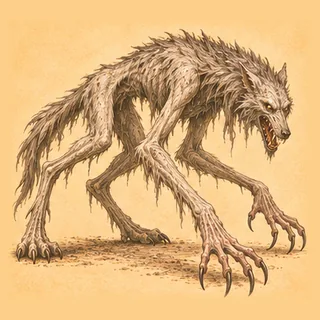

- Type: aberration (monster)
- Hit points: d12 a level
- Qualities: rolled (3d6 each)
- Attack: claws, 1d4 slashing
- Hide: Hide Armor, armour 1
- Worth: 200 + 75 experience a level

Scream: Every enemy is frightened for 3 turns (a Wisdom save against 12 + level + the caster's spell bonus avoids it). Frightened: −2 to hit, −5 initiative, −1 to every roll, −2 to every save. Again after 6 turns.

Charge: End preparing to charge on yourself; 3d8 + 1 + level bludgeoning damage to one enemy (may cause stunned: a Constitution save against 15 avoids it). Stunned: −2 to every roll, cannot act. Again after 3 turns.

> A massive, hulking creature with a hide like stone and a relentless hunger for flesh.

#### Hollow-stalker

*Kyr · aberration* · `species:hollow_stalker`

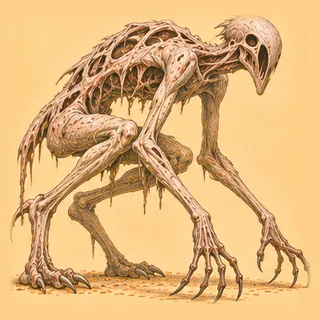

- Type: aberration (monster)
- Hit points: d8 a level
- Qualities: rolled (3d6 each)
- Attack: bite, 1d6 piercing
- Hide: Chitin Armor, armour 2
- Found in: cave
- Worth: 150 + 50 experience a level

Flee: Try to get away from the fight (1 in 2, then 3 in 4, then sure).

> A thing of the deep caves, eyeless and many-jointed, that hunts by the sound of breath and takes whatever comes down into the dark alone.

#### Mind Destroyer

*Adapted · aberration* · `species:mind_destroyer`

- Type: aberration (monster)
- Hit points: 34 + Constitution modifier + 3 a level
- Actions a turn: 2
- Qualities: strength 18, dexterity 17, constitution 18, intelligence 25, wisdom 22, charisma 14
- Attack: tentacles, 1d4+1 bludgeoning
- Hide: Hide Armor, armour 1
- Spells a day: 2 + its level, its own powers drawing on them, back after a night's rest
- Found in: cave
- Worth: 600 + 50 experience a level

Terror: One enemy is frightened for 3 turns (a Wisdom save against 15 + level + the caster's spell bonus avoids it). Frightened: −2 to hit, −5 initiative, −1 to every roll, −2 to every save. A divine spell of the second level. Takes a second-level slot.

Curse: One enemy is cursed for 3 turns (a Wisdom save against 10 + level + the caster's spell bonus avoids it). Cursed: Strength −1, Dexterity −1, Intelligence −1, Wisdom −1, Charisma −1, Constitution −1. A divine cantrip, cast at will.

Sleep: Every enemy is asleep for 3 turns (a Wisdom save against 16 + level + the caster's spell bonus avoids it). Asleep: cannot act. An arcane spell of the third level. Takes a third-level slot.

Charm Person: One enemy is charmed for 3 turns (only humanoid creatures; a Wisdom save against 18 + level + the caster's spell bonus avoids it). Charmed: fights for the other side. An arcane spell of the first level. Takes a first-level slot.

Mind Melt: 2d6 (2–12) psychic damage to every enemy (may cause confused: a Wisdom save against 15 avoids it; may cause insane: an Intelligence save against 15 avoids it); every enemy is stunned for 3 turns (a Constitution save against 20 + level + the caster's spell bonus avoids it); every enemy is charmed for 3 turns (a Wisdom save against 15 + level + the caster's spell bonus avoids it). Confused: acts at random. Insane: −1 to every roll, −2 to will saves, acts at random. Stunned: −2 to every roll, cannot act. Charmed: fights for the other side. An arcane spell of the second level. Takes a second-level slot.

Command: One enemy is fleeing for 2 turns (a Wisdom save against 20 avoids it). Fleeing: tries only to get away. A divine spell of the fifth level. Takes a fifth-level slot.

Confuse: One enemy is confused for 3 turns (a Wisdom save against 15 + level + the caster's spell bonus avoids it). Confused: acts at random. A divine spell of the first level. Takes a first-level slot.

Planar Adaptation: +2 against magic, resists 50% of fire, resists 50% of cold, resists 50% of lightning.

> An aberration of Orsino's bestiary. It fights with tentacles, armoured in hide armor, and knows Terror, Curse, Sleep, Charm Person, Mind Melt, Command and Confuse.

*Left out — field:monsterGold: Orsino's 4d10 gold for the kill is not carried.*

*Adapted: Composed by OrsinoMonsters (aberration class, Mind Destroyer type, wildtype aspect, any terrain, level 1); attributes rise by round(level / 8) and hit points by three a level, as the template.*

#### Mouther

*Adapted · aberration* · `species:mouther`

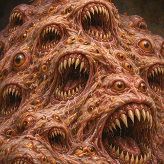

- Type: aberration (monster)
- Hit points: 34 + Constitution modifier + 3 a level
- Actions a turn: 2
- Qualities: strength 18, dexterity 17, constitution 23, intelligence 23, wisdom 20, charisma 14
- Attack: tentacles, 1d4+1 bludgeoning
- Hide: Hide Armor, armour 1
- Spells a day: 2 + its level, its own powers drawing on them, back after a night's rest
- Found in: cave
- Worth: 600 + 50 experience a level

Terror: One enemy is frightened for 3 turns (a Wisdom save against 15 + level + the caster's spell bonus avoids it). Frightened: −2 to hit, −5 initiative, −1 to every roll, −2 to every save. A divine spell of the second level. Takes a second-level slot.

Curse: One enemy is cursed for 3 turns (a Wisdom save against 10 + level + the caster's spell bonus avoids it). Cursed: Strength −1, Dexterity −1, Intelligence −1, Wisdom −1, Charisma −1, Constitution −1. A divine cantrip, cast at will.

Sleep: Every enemy is asleep for 3 turns (a Wisdom save against 16 + level + the caster's spell bonus avoids it). Asleep: cannot act. An arcane spell of the third level. Takes a third-level slot.

Charm Person: One enemy is charmed for 3 turns (only humanoid creatures; a Wisdom save against 18 + level + the caster's spell bonus avoids it). Charmed: fights for the other side. An arcane spell of the first level. Takes a first-level slot.

Mind Melt: 2d6 (2–12) psychic damage to every enemy (may cause confused: a Wisdom save against 15 avoids it; may cause insane: an Intelligence save against 15 avoids it); every enemy is stunned for 3 turns (a Constitution save against 20 + level + the caster's spell bonus avoids it); every enemy is charmed for 3 turns (a Wisdom save against 15 + level + the caster's spell bonus avoids it). Confused: acts at random. Insane: −1 to every roll, −2 to will saves, acts at random. Stunned: −2 to every roll, cannot act. Charmed: fights for the other side. An arcane spell of the second level. Takes a second-level slot.

Acid Spray: 3d6 (3–18) acid damage to everyone between you and where it is aimed, friend or foe (halved if resisted; may cause acid burn: a Constitution save against 15 avoids it). Acid Burn: takes 1d6 (1–6) acid damage each turn. An arcane spell of the second level. Takes a second-level slot.

Planar Adaptation: +2 against magic, resists 50% of fire, resists 50% of cold, resists 50% of lightning.

Regeneration: Heal 1d2 - 1 (0–1) each turn.

> An aberration of Orsino's bestiary. It fights with tentacles, armoured in hide armor, and knows Terror, Curse, Sleep, Charm Person, Mind Melt and Acid Spray.

*Left out — field:monsterGold: Orsino's 4d10 gold for the kill is not carried.*

*Adapted: Composed by OrsinoMonsters (aberration class, Mouther type, wildtype aspect, any terrain, level 1); attributes rise by round(level / 8) and hit points by three a level, as the template.*

#### Ooze

*Adapted · aberration* · `species:ooze`

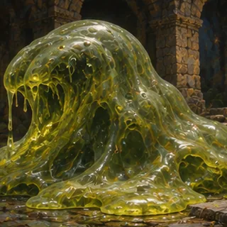

- Type: aberration (monster)
- Hit points: 34 + Constitution modifier + 3 a level
- Actions a turn: 2
- Qualities: strength 18, dexterity 17, constitution 24, intelligence 19, wisdom 17, charisma 14
- Attack: tentacles, 1d4+1 bludgeoning
- Hide: Hide Armor, armour 1
- Spells a day: 2 + its level, its own powers drawing on them, back after a night's rest
- Found in: cave
- Worth: 600 + 50 experience a level

Terror: One enemy is frightened for 3 turns (a Wisdom save against 15 + level + the caster's spell bonus avoids it). Frightened: −2 to hit, −5 initiative, −1 to every roll, −2 to every save. A divine spell of the second level. Takes a second-level slot.

Curse: One enemy is cursed for 3 turns (a Wisdom save against 10 + level + the caster's spell bonus avoids it). Cursed: Strength −1, Dexterity −1, Intelligence −1, Wisdom −1, Charisma −1, Constitution −1. A divine cantrip, cast at will.

Sleep: Every enemy is asleep for 3 turns (a Wisdom save against 16 + level + the caster's spell bonus avoids it). Asleep: cannot act. An arcane spell of the third level. Takes a third-level slot.

Charm Person: One enemy is charmed for 3 turns (only humanoid creatures; a Wisdom save against 18 + level + the caster's spell bonus avoids it). Charmed: fights for the other side. An arcane spell of the first level. Takes a first-level slot.

Mind Melt: 2d6 (2–12) psychic damage to every enemy (may cause confused: a Wisdom save against 15 avoids it; may cause insane: an Intelligence save against 15 avoids it); every enemy is stunned for 3 turns (a Constitution save against 20 + level + the caster's spell bonus avoids it); every enemy is charmed for 3 turns (a Wisdom save against 15 + level + the caster's spell bonus avoids it). Confused: acts at random. Insane: −1 to every roll, −2 to will saves, acts at random. Stunned: −2 to every roll, cannot act. Charmed: fights for the other side. An arcane spell of the second level. Takes a second-level slot.

Engulf: One enemy is engulfed for 3 turns (a Constitution save against 16 + level + the caster's spell bonus avoids it). Engulfed: cannot act, takes 2d6 (2–12) acid damage each turn. Again after 3 turns.

Planar Adaptation: +2 against magic, resists 50% of fire, resists 50% of cold, resists 50% of lightning.

> An aberration of Orsino's bestiary. It fights with tentacles, armoured in hide armor, and knows Terror, Curse, Sleep, Charm Person, Mind Melt and Engulf.

*Left out — field:monsterGold: Orsino's 4d10 gold for the kill is not carried.*

*Adapted: Composed by OrsinoMonsters (aberration class, Ooze type, wildtype aspect, any terrain, level 1); attributes rise by round(level / 8) and hit points by three a level, as the template.*

#### Tide-caller

*Kyr · aberration* · `species:tide_caller`

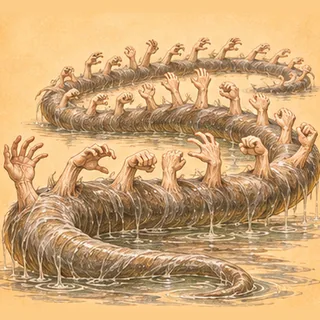

- Type: aberration (monster)
- Hit points: d10 a level
- Qualities: rolled (3d6 each)
- Attack: tentacles, 1d4+1 bludgeoning
- Hide: Hide Armor, armour 1
- Spells a day: 2 + its level, its own powers drawing on them, back after a night's rest
- Worth: 150 + 50 experience a level

Scream: Every enemy is frightened for 3 turns (a Wisdom save against 12 + level + the caster's spell bonus avoids it). Frightened: −2 to hit, −5 initiative, −1 to every roll, −2 to every save. Again after 6 turns.

Charm Person: One enemy is charmed for 3 turns (only humanoid creatures; a Wisdom save against 18 + level + the caster's spell bonus avoids it). Charmed: fights for the other side. An arcane spell of the first level. Takes a first-level slot.

> A thing that lives in the sea under certain shores and calls, in the voices of the drowned, to whoever is listening, and takes the ones who answer.

#### Xill

*Kyr · aberration* · `species:xill`

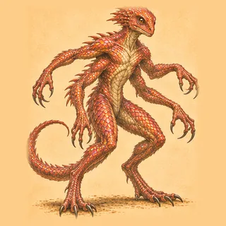

- Type: aberration (monster)
- Hit points: d8 a level
- Qualities: rolled (3d6 each)
- Attack: claws, 1d4 slashing
- Hide: Chitin Armor, armour 2
- Worth: 120 + 40 experience a level

> Xills are extraplanar beings with insect-like features and a penchant for ambushing travelers. They are known for their agility and deadly combat skills. Malevolent in the extreme, xills are known for brutality and totalitarianism. They combine a healthy dose of evil with a keen love of cruelty.

### Beasts

#### Badger

*Faithful · beast* · `species:badger`

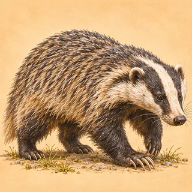

- Type: beast (animal)
- Hit points: 4 + Constitution modifier + 1 a level
- Qualities: strength 6, dexterity 5, constitution 6, intelligence 5, wisdom 5, charisma 5
- Attack: claws, 1d4 slashing
- Hide: Hide Armor, armour 1
- Found in: wood, meadow
- Worth: 10 experience a level

Defend: You are defending for a turn. Defending: 2 harder to hit. Again after 4 turns.

Flee: Try to get away from the fight (1 in 2, then 3 in 4, then sure).

> A small but fierce mammal with fine digging ability and extreme tenacity.

#### Bat

*Faithful · beast* · `species:bat`

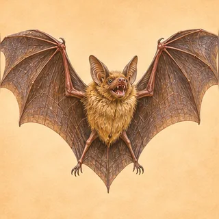

- Type: beast (animal)
- Hit points: 3 + Constitution modifier + 1 a level
- Qualities: strength 4, dexterity 6, constitution 4, intelligence 4, wisdom 5, charisma 6
- Attack: bite, 1d6 piercing
- Hide: Fur Armor, armour 0
- Found in: wood, cave
- Worth: 10 experience a level

Defend: You are defending for a turn. Defending: 2 harder to hit. Again after 4 turns.

Flee: Try to get away from the fight (1 in 2, then 3 in 4, then sure).

> A nocturnal flying mammal that uses echolocation to navigate in the dark.

#### Bear

*Adapted · beast* · `species:bear`

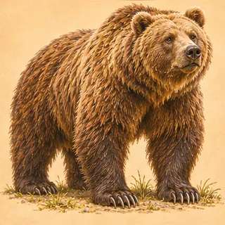

- Type: beast (animal)
- Hit points: d12 a level
- Qualities: rolled (3d6 each)
- Attack: claws, 1d4 slashing
- Hide: Fur Armor, armour 0
- Temperament: defensive
- Found in: wood, heights, cave
- Worth: 150 experience a level

Smash: 2d6 + level bludgeoning damage to one enemy (may cause stunned: a Constitution save against 15 avoids it). Stunned: −2 to every roll, cannot act. Again after 3 turns.

Maul: Weapon attack against one enemy; 1d6 + statMod(strength) bludgeoning damage to it (may cause stunned: a Constitution save against 15 avoids it); it is bleeding for 3 turns (a Constitution save against 15 + level + the caster's spell bonus avoids it). Stunned: −2 to every roll, cannot act. Bleeding: takes 1d2 (1–2) bleed damage each turn. Again after 2 turns.

Flee: Try to get away from the fight (1 in 2, then 3 in 4, then sure).

> A powerful woodland omnivore, dangerous when its young or feeding ground are threatened.

*Adapted: Uses the existing claws and fur profiles and executable Smash action. Kyr rolls its attributes; the Deem animal grammar composes the body.*

#### Beetle

*Faithful · beast* · `species:beetle`

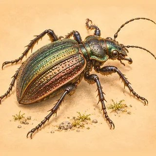

- Type: beast (animal)
- Hit points: 3 + Constitution modifier + 1 a level
- Qualities: strength 5, dexterity 5, constitution 6, intelligence 4, wisdom 5, charisma 4
- Attack: mandibles, 1d6 piercing
- Hide: Chitin Armor, armour 2
- Found in: wood, cave
- Worth: 10 experience a level

Defend: You are defending for a turn. Defending: 2 harder to hit. Again after 4 turns.

Flee: Try to get away from the fight (1 in 2, then 3 in 4, then sure).

> A small insect with a hard exoskeleton and strong mandibles for biting.

#### Bone-kite

*Kyr · beast* · `species:bone_kite`

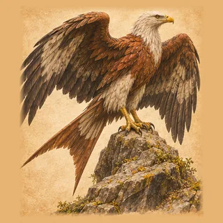

- Type: beast (animal)
- Hit points: d4 a level
- Qualities: rolled (3d6 each)
- Attack: beak, 1d4 piercing
- Hide: Hide Armor, armour 1
- Temperament: wary
- Worth: 10 experience a level

Flee: Try to get away from the fight (1 in 2, then 3 in 4, then sure).

> A rust-and-white carrion raptor that nests in the arches of the old viaduct and circles over what is about to fall.

#### Bone-scuttler

*Kyr · beast* · `species:bone_scuttler`

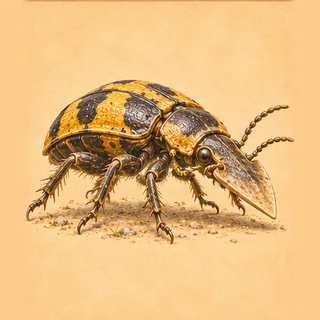

- Type: beast (animal)
- Hit points: d2 a level
- Qualities: rolled (3d6 each)
- Attack: mandibles, 1d6 piercing
- Hide: Chitin Armor, armour 2
- Temperament: wary
- Worth: 10 experience a level

Flee: Try to get away from the fight (1 in 2, then 3 in 4, then sure).

> A hand-sized armoured carrion-eater of the bone-beds that crosses the hot crust only by one line, and keeps the beds clean.

#### Butterfly

*Faithful · beast* · `species:butterfly`

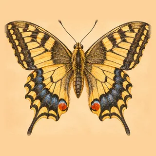

- Type: beast (animal)
- Hit points: 3 + Constitution modifier + 1 a level
- Qualities: strength 4, dexterity 8, constitution 5, intelligence 5, wisdom 6, charisma 7
- Attack: flutter, 1d2 bludgeoning
- Hide: Chitin Armor, armour 2
- Found in: meadow
- Worth: 10 experience a level

Defend: You are defending for a turn. Defending: 2 harder to hit. Again after 4 turns.

Flee: Try to get away from the fight (1 in 2, then 3 in 4, then sure).

> A delicate insect with colorful wings. Its flight is graceful and mesmerizing.

#### Cat

*Kyr · beast* · `species:cat`

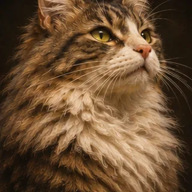

- Type: beast (animal)
- Hit points: d2 a level
- Qualities: rolled (3d6 each)
- Attack: claws, 1d4 slashing
- Hide: Fur Armor, armour 0
- Temperament: tame
- Found in: settlement
- Worth: 150 experience a level

Flee: Try to get away from the fight (1 in 2, then 3 in 4, then sure).

> A cat about the house: it keeps the mice down and goes where it likes.

#### Centipede

*Faithful · beast* · `species:centipede`

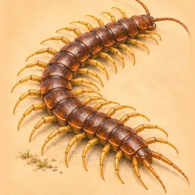

- Type: beast (animal)
- Hit points: 3 + Constitution modifier + 1 a level
- Qualities: strength 5, dexterity 7, constitution 5, intelligence 4, wisdom 5, charisma 4
- Attack: bite, 1d6 piercing
- Hide: Chitin Armor, armour 2
- Spells a day: 2 + its level, its own powers drawing on them, back after a night's rest
- Found in: wood, cave
- Worth: 10 experience a level

Defend: You are defending for a turn. Defending: 2 harder to hit. Again after 4 turns.

Flee: Try to get away from the fight (1 in 2, then 3 in 4, then sure).

Venomous Bite: 1d6 (1–6) poison damage to one enemy (halved if resisted; may cause poison: a Constitution save against 15 avoids it); it gains poison for 3 turns (a Constitution save against 12 + level + the caster's spell bonus avoids it). Poison: takes 1d4 (1–4) true damage each turn. A divine spell of the first level. Takes a first-level slot.

> A long, segmented insect with many legs and a venomous bite.

#### Chimera

*Adapted · beast* · `species:chimera`

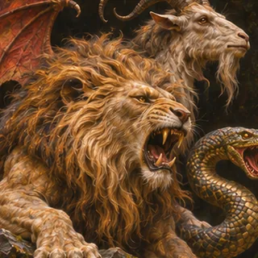

- Type: beast (monster)
- Hit points: 9 + Constitution modifier + 3 a level
- Actions a turn: 2
- Qualities: strength 17, dexterity 12, constitution 11, intelligence 3, wisdom 3, charisma 3
- Attack: claws, 1d4 slashing
- Hide: Hide Armor, armour 1
- Spells a day: 2 + its level, its own powers drawing on them, back after a night's rest
- Found in: heights
- Worth: 150 + 50 experience a level

Maul: Weapon attack against one enemy; 1d6 + statMod(strength) bludgeoning damage to it (may cause stunned: a Constitution save against 15 avoids it); it is bleeding for 3 turns (a Constitution save against 15 + level + the caster's spell bonus avoids it). Stunned: −2 to every roll, cannot act. Bleeding: takes 1d2 (1–2) bleed damage each turn. Again after 2 turns.

Prepare Charge: You are preparing to charge for 2 turns. Preparing to Charge: +2 to hit, +2 damage; and the next turn can only be Charge, nothing else. Again after 3 turns.

Charge: End preparing to charge on yourself; 3d8 + 1 + level bludgeoning damage to one enemy (may cause stunned: a Constitution save against 15 avoids it). Stunned: −2 to every roll, cannot act. Again after 3 turns.

Rage: You are raging for 3 turns. Raging: +1 to hit, 3 easier to hit, +2 damage. Again after 3 turns.

Poison Bite: 1d4 (1–4) poison damage to one enemy (may cause poison: a Constitution save against 15 avoids it). Poison: takes 1d4 (1–4) true damage each turn. Again after 3 turns.

Fireball: 6d6 (6–36) fire damage to everyone but you where it bursts, friend or foe (halved if resisted; may cause burning: a Constitution save against 15 avoids it). Burning: takes 1d3 (1–3) fire damage each turn. An arcane spell of the fourth level. Takes a fourth-level slot.

Lightning Bolt: 3d8 (3–24) electric damage to 2 different enemies, drawn at random (halved if resisted); each of them is paralyzed for 3 turns (a Strength save against 15 + level + the caster's spell bonus avoids it). Paralyzed: Strength −5, Dexterity −5, cannot act. An arcane spell of the fourth level. Takes a fourth-level slot.

Wild: +2 to hit, +2 damage, +2 evasion, +1 to every roll, resists 10% of all.

> A beast of Orsino's bestiary. It fights with claws, armoured in hide armor, and knows Maul, Charge, Rage, Poison Bite, Fireball and Lightning Bolt.

*Left out — field:monsterGold: Orsino's 0 gold for the kill is not carried.*

*Adapted: Composed by OrsinoMonsters (beast class, Chimera type, wildtype aspect, any terrain, level 1); attributes rise by round(level / 8) and hit points by three a level, as the template.*

#### Cow

*Kyr · beast* · `species:cow`

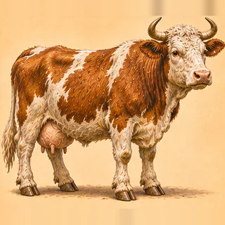

- Type: beast (animal)
- Hit points: d8 a level
- Qualities: rolled (3d6 each)
- Attack: horns, 1d4 bludgeoning
- Hide: Hide Armor, armour 1
- Temperament: tame
- Found in: settlement, meadow
- Worth: 150 experience a level

Flee: Try to get away from the fight (1 in 2, then 3 in 4, then sure).

> A milk cow, slow and certain.

#### Crocodile

*Adapted · beast* · `species:crocodile`

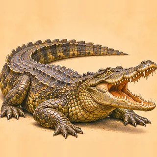

- Type: beast (animal)
- Hit points: d10 a level
- Qualities: rolled (3d6 each)
- Attack: bite, 1d6 piercing
- Hide: Scale Mail, armour 4
- Temperament: ambush
- Found in: fen, river
- Worth: 10 experience a level

Flee: Try to get away from the fight (1 in 2, then 3 in 4, then sure).

> A large aquatic reptile with powerful jaws and stealthy hunting.

*Adapted: Orsino's animal template made it a companion's size (fixed hit points no more than a squirrel's); as a beast of the wild Kyr rolls its qualities with a hit die of 10, as it does a wolf's, with a rending bite.*

#### Crow

*Faithful · beast* · `species:crow`

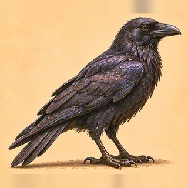

- Type: beast (animal)
- Hit points: 3 + Constitution modifier + 1 a level
- Qualities: strength 5, dexterity 8, constitution 5, intelligence 8, wisdom 6, charisma 6
- Attack: beak, 1d4 piercing
- Hide: Feather Armor, armour -1
- Found in: meadow, fells
- Worth: 10 experience a level

Defend: You are defending for a turn. Defending: 2 harder to hit. Again after 4 turns.

Flee: Try to get away from the fight (1 in 2, then 3 in 4, then sure).

> A highly intelligent bird remarkable for its problem-solving skills and adaptability.

#### Curlew

*Kyr · beast* · `species:curlew`

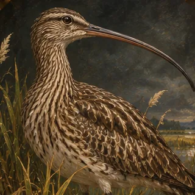

- Type: beast (animal)
- Hit points: 3 + Constitution modifier + 1 a level
- Qualities: strength 3, dexterity 7, constitution 3, intelligence 3, wisdom 6, charisma 4
- Attack: flutter, 1d2 bludgeoning
- Temperament: wary
- Found in: heath, meadow, fen
- Worth: 150 experience a level

Flee: Try to get away from the fight (1 in 2, then 3 in 4, then sure).

> A curlew of the moor and the wet meadows, whose call carries for miles.

#### Dawn-piper

*Kyr · beast* · `species:dawn_piper`

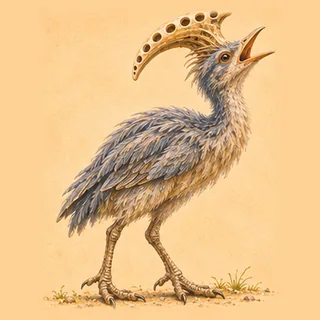

- Type: beast (animal)
- Hit points: d4 a level
- Qualities: rolled (3d6 each)
- Attack: beak, 1d4 piercing
- Hide: Hide Armor, armour 1
- Temperament: wary
- Worth: 10 experience a level

Flee: Try to get away from the fight (1 in 2, then 3 in 4, then sure).

> A hen-sized crested runner of the fern plain whose flock pipes together an hour before the great herd comes down to the lake.

#### Deer

*Faithful · beast* · `species:deer`

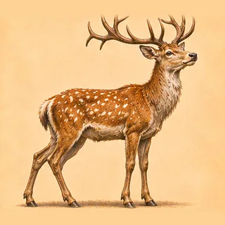

- Type: beast (animal)
- Hit points: 4 + Constitution modifier + 1 a level
- Qualities: strength 5, dexterity 7, constitution 5, intelligence 5, wisdom 6, charisma 5
- Attack: antlers, 1d6 piercing
- Hide: Hide Armor, armour 1
- Found in: wood, heath
- Worth: 10 experience a level

Defend: You are defending for a turn. Defending: 2 harder to hit. Again after 4 turns.

Flee: Try to get away from the fight (1 in 2, then 3 in 4, then sure).

> A graceful herbivore with exquisite agility and keen senses.

#### Dog

*Kyr · a hound, altered* · `species:dog`

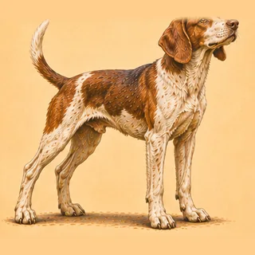

- Type: beast (animal)
- Hit points: d6 a level
- Qualities: rolled (3d6 each)
- Attack: bite, 1d6 piercing
- Hide: Fur Armor, armour 0
- Temperament: tame
- Found in: settlement, meadow, fells
- Worth: 150 experience a level

Flee: Try to get away from the fight (1 in 2, then 3 in 4, then sure).

> A working dog of a farm, a drove or an inn: it knows people, and keeps an eye on what is theirs.

#### Dolphin

*Kyr · beast* · `species:dolphin`

- Type: beast (animal)
- Hit points: d8 a level
- Qualities: rolled (3d6 each)
- Attack: headbutt, 1d4 bludgeoning
- Hide: Hide Armor, armour 1
- Found in: sea
- Worth: 10 experience a level

Flee: Try to get away from the fight (1 in 2, then 3 in 4, then sure).

> A sleek grey creature of the sea, quick and playful, that rides the bow-wave of boats.

#### Dragonfly

*Faithful · beast* · `species:dragonfly`

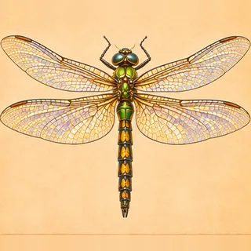

- Type: beast (animal)
- Hit points: 3 + Constitution modifier + 1 a level
- Qualities: strength 4, dexterity 8, constitution 5, intelligence 5, wisdom 6, charisma 9
- Attack: flutter, 1d2 bludgeoning
- Hide: Chitin Armor, armour 2
- Found in: fen, river
- Worth: 10 experience a level

Defend: You are defending for a turn. Defending: 2 harder to hit. Again after 4 turns.

Flee: Try to get away from the fight (1 in 2, then 3 in 4, then sure).

> A swift flying insect with iridescent wings and excellent maneuverability.

#### Dromedary

*Kyr · beast* · `species:dromedary`

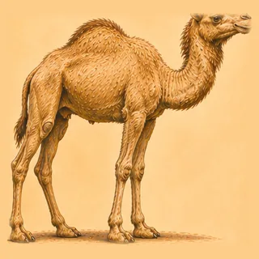

- Type: beast (animal)
- Hit points: d10 a level
- Qualities: rolled (3d6 each)
- Attack: kick, 1d2 bludgeoning
- Hide: Hide Armor, armour 1
- Found in: desert
- Worth: 10 experience a level

Flee: Try to get away from the fight (1 in 2, then 3 in 4, then sure).

> A desert-dwelling camel with a single hump, known for its endurance and ability to travel long distances without water.

#### Eagle

*Faithful · beast* · `species:eagle`

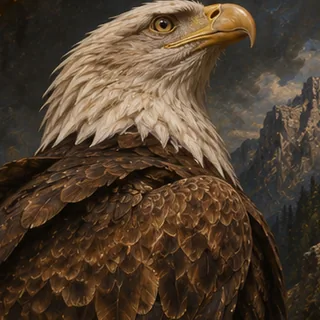

- Type: beast (animal)
- Hit points: 4 + Constitution modifier + 1 a level
- Qualities: strength 5, dexterity 8, constitution 5, intelligence 5, wisdom 6, charisma 5
- Attack: talons, 1d8 piercing
- Hide: Feather Armor, armour -1
- Found in: heights, fells
- Worth: 10 experience a level

Defend: You are defending for a turn. Defending: 2 harder to hit. Again after 4 turns.

Flee: Try to get away from the fight (1 in 2, then 3 in 4, then sure).

> A majestic bird of prey renowned for keen eyesight and capable of powerful flight.

#### Eel

*Kyr · beast* · `species:eel`

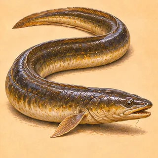

- Type: beast (animal)
- Hit points: d4 a level
- Qualities: rolled (3d6 each)
- Attack: bite, 1d6 piercing
- Hide: Hide Armor, armour 1
- Temperament: ambush
- Found in: river, fen
- Worth: 150 experience a level

Defend: You are defending for a turn. Defending: 2 harder to hit. Again after 4 turns.

Flee: Try to get away from the fight (1 in 2, then 3 in 4, then sure).

> An eel of the rivers and the still water, long as an arm and thick as a wrist, that lies in the weed by day and takes what comes down to it.

#### Elephant

*Kyr · beast* · `species:elephant`

- Type: beast (animal)
- Hit points: d12 a level
- Qualities: rolled (3d6 each)
- Attack: tusks, 1d8 piercing
- Hide: Hide Armor, armour 1
- Temperament: defensive
- Found in: desert, wood
- Worth: 10 experience a level

Smash: 2d6 + level bludgeoning damage to one enemy (may cause stunned: a Constitution save against 15 avoids it). Stunned: −2 to every roll, cannot act. Again after 3 turns.

Defend: You are defending for a turn. Defending: 2 harder to hit. Again after 4 turns.

> The greatest beast that walks: wise, long-lived, slow to anger and terrible in it.

#### Falcon

*Faithful · beast* · `species:falcon`

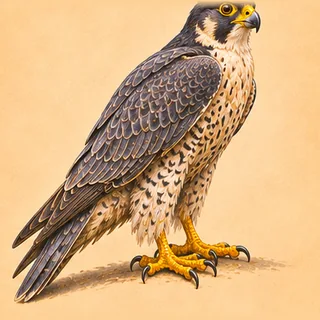

- Type: beast (animal)
- Hit points: 4 + Constitution modifier + 1 a level
- Qualities: strength 6, dexterity 6, constitution 6, intelligence 6, wisdom 6, charisma 6
- Attack: talons, 1d8 piercing
- Hide: Feather Armor, armour -1
- Found in: heath, heights
- Worth: 10 experience a level

Defend: You are defending for a turn. Defending: 2 harder to hit. Again after 4 turns.

Flee: Try to get away from the fight (1 in 2, then 3 in 4, then sure).

> A swift bird of prey possessing extreme speed and remarkable hunting prowess.

#### Fern-runner

*Kyr · beast* · `species:fern_runner`

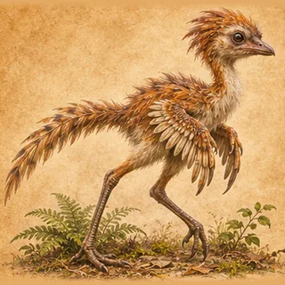

- Type: beast (animal)
- Hit points: d4 a level
- Qualities: rolled (3d6 each)
- Attack: bite, 1d6 piercing
- Hide: Hide Armor, armour 1
- Temperament: wary
- Worth: 10 experience a level

Flee: Try to get away from the fight (1 in 2, then 3 in 4, then sure).

> A cat-sized, feathered runner of the island's undergrowth, quick, curious and not at all afraid of doors.

#### Ferret

*Faithful · beast* · `species:ferret`

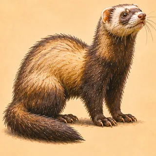

- Type: beast (animal)
- Hit points: 4 + Constitution modifier + 1 a level
- Qualities: strength 5, dexterity 7, constitution 6, intelligence 6, wisdom 6, charisma 6
- Attack: bite, 1d6 piercing
- Hide: Fur Armor, armour 0
- Found in: heath
- Worth: 10 experience a level

Defend: You are defending for a turn. Defending: 2 harder to hit. Again after 4 turns.

Flee: Try to get away from the fight (1 in 2, then 3 in 4, then sure).

> A small, agile mammal with great curiosity and playful nature.

#### Fox

*Faithful · beast* · `species:fox`

- Type: beast (animal)
- Hit points: 4 + Constitution modifier + 1 a level
- Qualities: strength 6, dexterity 7, constitution 6, intelligence 6, wisdom 6, charisma 6
- Attack: bite, 1d6 piercing
- Hide: Fur Armor, armour 0
- Found in: wood, meadow, heath
- Worth: 10 experience a level

Defend: You are defending for a turn. Defending: 2 harder to hit. Again after 4 turns.

Flee: Try to get away from the fight (1 in 2, then 3 in 4, then sure).

> A cunning and adaptable mammal of remarkable intelligence.

#### Frog

*Faithful · beast* · `species:frog`

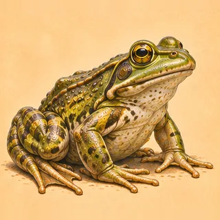

- Type: beast (animal)
- Hit points: 3 + Constitution modifier + 1 a level
- Qualities: strength 4, dexterity 6, constitution 5, intelligence 4, wisdom 5, charisma 5
- Attack: tongue, 1d4 bludgeoning
- Hide: Hide Armor, armour 1
- Found in: fen, river
- Worth: 10 experience a level

Defend: You are defending for a turn. Defending: 2 harder to hit. Again after 4 turns.

Flee: Try to get away from the fight (1 in 2, then 3 in 4, then sure).

> A small amphibian with a powerful jumping ability and croaking calls.

#### Glide-lizard

*Kyr · beast* · `species:glide_lizard`

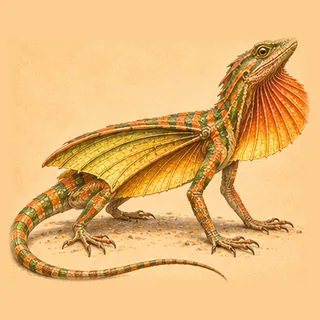

- Type: beast (animal)
- Hit points: d3 a level
- Qualities: rolled (3d6 each)
- Attack: bite, 1d6 piercing
- Hide: Hide Armor, armour 1
- Temperament: wary
- Worth: 10 experience a level

Flee: Try to get away from the fight (1 in 2, then 3 in 4, then sure).

> A cycad-living lizard with skin-wings between its limbs that glides from crown to crown at dusk toward the one hollow where it nests.

#### Goat

*Faithful · beast* · `species:goat`

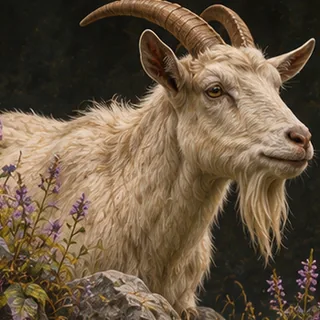

- Type: beast (animal)
- Hit points: 4 + Constitution modifier + 1 a level
- Qualities: strength 6, dexterity 5, constitution 6, intelligence 5, wisdom 5, charisma 6
- Attack: headbutt, 1d4 bludgeoning
- Hide: Fur Armor, armour 0
- Found in: fells, heights
- Worth: 10 experience a level

Defend: You are defending for a turn. Defending: 2 harder to hit. Again after 4 turns.

Flee: Try to get away from the fight (1 in 2, then 3 in 4, then sure).

> A sure-footed and hardy herbivore with a curious nature.

#### Grouse

*Kyr · beast* · `species:grouse`

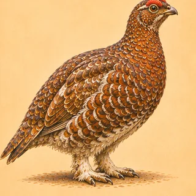

- Type: beast (animal)
- Hit points: 3 + Constitution modifier + 1 a level
- Qualities: strength 3, dexterity 7, constitution 3, intelligence 3, wisdom 6, charisma 4
- Attack: flutter, 1d2 bludgeoning
- Temperament: wary
- Found in: heath, fells
- Worth: 150 experience a level

Flee: Try to get away from the fight (1 in 2, then 3 in 4, then sure).

> A red grouse of the heather, that gets up at your feet and goes off low, scolding.

#### Hawk

*Faithful · beast* · `species:hawk`

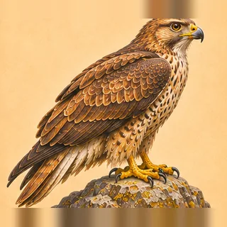

- Type: beast (animal)
- Hit points: 4 + Constitution modifier + 1 a level
- Qualities: strength 6, dexterity 7, constitution 6, intelligence 6, wisdom 7, charisma 6
- Attack: talons, 1d8 piercing
- Hide: Feather Armor, armour -1
- Found in: heath, fells
- Worth: 10 experience a level

Defend: You are defending for a turn. Defending: 2 harder to hit. Again after 4 turns.

Flee: Try to get away from the fight (1 in 2, then 3 in 4, then sure).

> A sharp-eyed bird of prey with excellent hunting skills.

#### Hedgehog

*Faithful · beast* · `species:hedgehog`

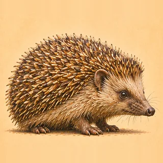

- Type: beast (animal)
- Hit points: 3 + Constitution modifier + 1 a level
- Qualities: strength 5, dexterity 5, constitution 6, intelligence 5, wisdom 6, charisma 5
- Attack: spines, 1d6 piercing
- Hide: Spine Armor, armour 1
- Found in: meadow, wood
- Worth: 10 experience a level

Defend: You are defending for a turn. Defending: 2 harder to hit. Again after 4 turns.

Flee: Try to get away from the fight (1 in 2, then 3 in 4, then sure).

> A small mammal covered in spines. When threatened it exhibits its defensive curling behavior.

#### Hen

*Kyr · beast* · `species:hen`

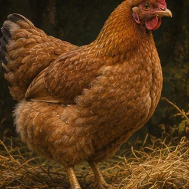

- Type: beast (animal)
- Hit points: d1 a level
- Qualities: rolled (3d6 each)
- Attack: beak, 1d4 piercing
- Hide: Feather Armor, armour -1
- Temperament: tame
- Found in: settlement
- Worth: 150 experience a level

Flee: Try to get away from the fight (1 in 2, then 3 in 4, then sure).

> A hen scratching about a yard.

#### Hook-claw

*Kyr · beast* · `species:hook_claw`

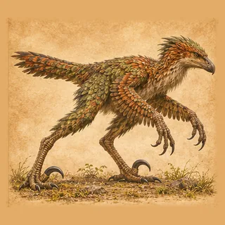

- Type: beast (animal)
- Hit points: d8 a level
- Qualities: rolled (3d6 each)
- Attack: claws, 1d4 slashing
- Hide: Hide Armor, armour 1
- Temperament: territorial
- Worth: 10 experience a level

Flee: Try to get away from the fight (1 in 2, then 3 in 4, then sure).

Howl: Every enemy is frightened for 2 turns (a Wisdom save against 12 avoids it). Frightened: −2 to hit, −5 initiative, −1 to every roll, −2 to every save. Again after 3 turns.

> A feathered pack hunter of the island's cycad forest, the size of a big dog, that takes what it can overpower with a great curved claw on each foot.

#### Horse

*Kyr · beast* · `species:horse`

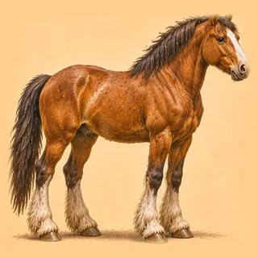

- Type: beast (animal)
- Hit points: d8 a level
- Qualities: rolled (3d6 each)
- Attack: kick, 1d2 bludgeoning
- Hide: Hide Armor, armour 1
- Temperament: tame
- Found in: settlement, meadow
- Worth: 150 experience a level

Flee: Try to get away from the fight (1 in 2, then 3 in 4, then sure).

> A horse broken to saddle or to the cart.

#### Hound

*Adapted · beast* · `species:hound`

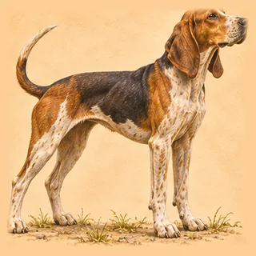

- Type: beast (animal)
- Hit points: d6 a level
- Qualities: rolled (3d6 each)
- Attack: bite, 1d6 piercing
- Hide: Fur Armor, armour 0
- Found in: wood, fells, cave
- Worth: 150 experience a level

Flee: Try to get away from the fight (1 in 2, then 3 in 4, then sure).

> A big rough-coated hound, bred to run game down and hold it.

*Adapted: Orsino's hound: bite and fur, its attributes rolled and a hit die so that it grows with its level. The dog, the cave hound and the knitted bone hound are made from it.*

#### Hummingbird

*Faithful · beast* · `species:hummingbird`

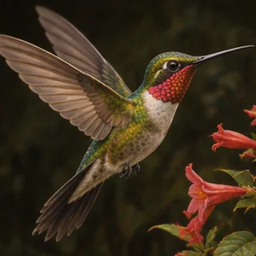

- Type: beast (animal)
- Hit points: 3 + Constitution modifier + 1 a level
- Qualities: strength 4, dexterity 8, constitution 5, intelligence 5, wisdom 6, charisma 7
- Attack: beak, 1d4 piercing
- Hide: Feather Armor, armour -1
- Found in: desert
- Worth: 10 experience a level

Defend: You are defending for a turn. Defending: 2 harder to hit. Again after 4 turns.

Flee: Try to get away from the fight (1 in 2, then 3 in 4, then sure).

> A tiny bird capable of hovering in mid-air thanks to its rapid wing flapping.

#### Hyena

*Adapted · beast* · `species:hyena`

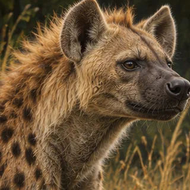

- Type: beast (animal)
- Hit points: d6 a level
- Qualities: rolled (3d6 each)
- Attack: bite, 1d6 piercing
- Hide: Fur Armor, armour 0
- Worth: 10 experience a level

Flee: Try to get away from the fight (1 in 2, then 3 in 4, then sure).

> A scavenging carnivore with powerful jaws and distinctive laugh-like vocalizations.

*Adapted: Orsino's animal template made it a companion's size (fixed hit points no more than a squirrel's); as a beast of the wild Kyr rolls its qualities with a hit die of 6, as it does a wolf's, with a rending bite.*

#### Kangaroo Rat

*Kyr · beast* · `species:kangaroo_rat`

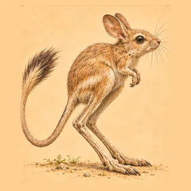

- Type: beast (animal)
- Hit points: d2 a level
- Qualities: rolled (3d6 each)
- Attack: bite, 1d6 piercing
- Hide: Hide Armor, armour 1
- Found in: desert
- Worth: 5 experience a level

Flee: Try to get away from the fight (1 in 2, then 3 in 4, then sure).

> A small desert-dwelling rodent with powerful hind legs for jumping.

#### Lantern-neck

*Kyr · beast* · `species:lantern_neck`

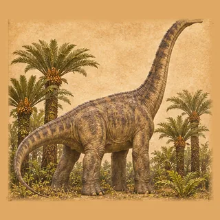

- Type: beast (animal)
- Hit points: d12 a level
- Qualities: rolled (3d6 each)
- Attack: tail, 1d6 bludgeoning
- Hide: Hide Armor, armour 1
- Temperament: defensive
- Worth: 20 experience a level

Defend: You are defending for a turn. Defending: 2 harder to hit. Again after 4 turns.

> The greatest animal of the island: a long-necked browser as big as a barn that lives on the canopy and notices nothing smaller than itself.

#### Lark

*Kyr · beast* · `species:lark`

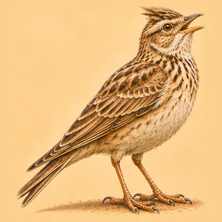

- Type: beast (animal)
- Hit points: 3 + Constitution modifier + 1 a level
- Qualities: strength 3, dexterity 7, constitution 3, intelligence 3, wisdom 6, charisma 4
- Attack: flutter, 1d2 bludgeoning
- Temperament: wary
- Found in: meadow, heath
- Worth: 150 experience a level

Flee: Try to get away from the fight (1 in 2, then 3 in 4, then sure).

> A skylark that goes up singing over the open fields and does not seem to come down.

#### Leopard

*Kyr · beast* · `species:leopard`

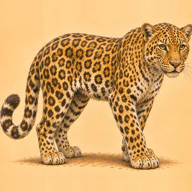

- Type: beast (animal)
- Hit points: d8 a level
- Qualities: rolled (3d6 each)
- Attack: claws, 1d4 slashing
- Hide: Fur Armor, armour 0
- Temperament: ambush
- Found in: wood, heights, desert
- Worth: 10 experience a level

Hide: You are hidden for 3 turns. Hidden: 4 harder to hit, +10 evasion; and on attacking, it ends. Again after 3 turns.

Flee: Try to get away from the fight (1 in 2, then 3 in 4, then sure).

> A spotted hunting cat that lies along a branch or in the rocks, and drags its kill up a tree.

#### Lion

*Adapted · beast* · `species:lion`

- Type: beast (animal)
- Hit points: d10 a level
- Qualities: rolled (3d6 each)
- Attack: bite, 1d6 piercing
- Hide: Fur Armor, armour 0
- Temperament: territorial
- Found in: desert
- Worth: 10 experience a level

Flee: Try to get away from the fight (1 in 2, then 3 in 4, then sure).

> A majestic big cat of enormous strength and courage.

*Adapted: Orsino's animal template made it a companion's size (fixed hit points no more than a squirrel's); as a beast of the wild Kyr rolls its qualities with a hit die of 10, as it does a wolf's, with a rending bite.*

#### Lizard

*Faithful · beast* · `species:lizard`

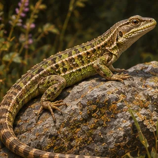

- Type: beast (animal)
- Hit points: 3 + Constitution modifier + 1 a level
- Qualities: strength 5, dexterity 6, constitution 5, intelligence 5, wisdom 5, charisma 5
- Attack: bite, 1d6 piercing
- Hide: Scale Mail, armour 4
- Found in: desert, heath
- Worth: 10 experience a level

Defend: You are defending for a turn. Defending: 2 harder to hit. Again after 4 turns.

Flee: Try to get away from the fight (1 in 2, then 3 in 4, then sure).

> A small reptile known with exquisite agility and unusual ability to regenerate lost tails.

#### Locatah

*Kyr · beast* · `species:locatah`

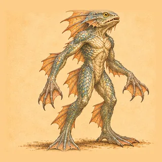

- Type: beast (monster)
- Hit points: d6 a level
- Qualities: rolled (3d6 each)
- Attack: dagger, 1d4 piercing
- Hide: Shell Armor, armour 4
- Worth: 50 + 20 experience a level

Flee: Try to get away from the fight (1 in 2, then 3 in 4, then sure).

Rapid Strike: Weapon attack against one enemy; weapon attack against it; weapon attack against it. Again after 3 turns.

> The nomadic locathahnim dwell in warm coastal waters, hunting fish and gathering crustaceans for food. Although humanoid in shape, they are clearly more fish than human.

#### Marsh boar

*Adapted · beast* · `species:boar`

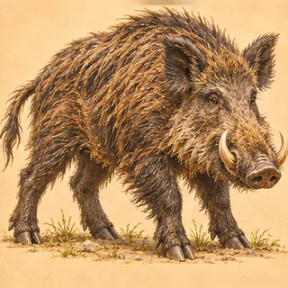

- Type: beast (animal)
- Hit points: d6 a level
- Qualities: rolled (3d6 each)
- Attack: tusks, 1d8 piercing
- Hide: Hide Armor, armour 1
- Temperament: territorial
- Found in: fen, river
- Worth: 150 experience a level

Flee: Try to get away from the fight (1 in 2, then 3 in 4, then sure).

> A territorial animal along reed margins.

*Adapted: Orsino's boar: tusks and hide. Kyr rolls its attributes and gives it the Kyr rending bite.*

#### Mole

*Faithful · beast* · `species:mole`

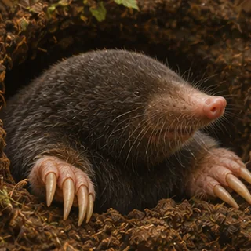

- Type: beast (animal)
- Hit points: 4 + Constitution modifier + 1 a level
- Qualities: strength 5, dexterity 6, constitution 5, intelligence 5, wisdom 5, charisma 5
- Attack: bite, 1d6 piercing
- Hide: Fur Armor, armour 0
- Found in: meadow
- Worth: 10 experience a level

Defend: You are defending for a turn. Defending: 2 harder to hit. Again after 4 turns.

Flee: Try to get away from the fight (1 in 2, then 3 in 4, then sure).

> A small burrowing mammal with powerful forelimbs for digging and poor eyesight.

#### Monkey

*Kyr · beast* · `species:monkey`

- Type: beast (animal)
- Hit points: d4 a level
- Qualities: strength 4, dexterity 12, constitution 6, intelligence 7, wisdom 10, charisma 6
- Attack: bite, 1d6 piercing
- Hide: Fur Armor, armour 0
- Found in: wood, grove
- Worth: 10 experience a level

Flee: Try to get away from the fight (1 in 2, then 3 in 4, then sure).

> A clever chattering tree-dweller that travels in troops and steals what is left unwatched.

#### Moth

*Faithful · beast* · `species:moth`

- Type: beast (animal)
- Hit points: 3 + Constitution modifier + 1 a level
- Qualities: strength 4, dexterity 8, constitution 5, intelligence 5, wisdom 6, charisma 7
- Attack: flutter, 1d2 bludgeoning
- Hide: Chitin Armor, armour 2
- Found in: wood
- Worth: 10 experience a level

Defend: You are defending for a turn. Defending: 2 harder to hit. Again after 4 turns.

Flee: Try to get away from the fight (1 in 2, then 3 in 4, then sure).

> A nocturnal flying insect attracted to light, with soft, furry wings.

#### Mud-skimmer

*Kyr · beast* · `species:mud_skimmer`

- Type: beast (animal)
- Hit points: d3 a level
- Qualities: rolled (3d6 each)
- Attack: mandibles, 1d6 piercing
- Hide: Chitin Armor, armour 2
- Temperament: wary
- Worth: 10 experience a level

Flee: Try to get away from the fight (1 in 2, then 3 in 4, then sure).

> A flat-headed shell-digger of the delta that goes in and out of the black water in dozens and is the first thing there to leave it when the lurker comes.

#### Nightmare

*Adapted · beast* · `species:nightmare`

- Type: beast (monster)
- Hit points: 9 + Constitution modifier + 3 a level
- Actions a turn: 2
- Qualities: strength 16, dexterity 13, constitution 11, intelligence 3, wisdom 3, charisma 3
- Attack: claws, 1d4 slashing
- Hide: Hide Armor, armour 1
- Worth: 150 + 50 experience a level

Maul: Weapon attack against one enemy; 1d6 + statMod(strength) bludgeoning damage to it (may cause stunned: a Constitution save against 15 avoids it); it is bleeding for 3 turns (a Constitution save against 15 + level + the caster's spell bonus avoids it). Stunned: −2 to every roll, cannot act. Bleeding: takes 1d2 (1–2) bleed damage each turn. Again after 2 turns.

Prepare Charge: You are preparing to charge for 2 turns. Preparing to Charge: +2 to hit, +2 damage; and the next turn can only be Charge, nothing else. Again after 3 turns.

Charge: End preparing to charge on yourself; 3d8 + 1 + level bludgeoning damage to one enemy (may cause stunned: a Constitution save against 15 avoids it). Stunned: −2 to every roll, cannot act. Again after 3 turns.

Rage: You are raging for 3 turns. Raging: +1 to hit, 3 easier to hit, +2 damage. Again after 3 turns.

Poison Bite: 1d4 (1–4) poison damage to one enemy (may cause poison: a Constitution save against 15 avoids it). Poison: takes 1d4 (1–4) true damage each turn. Again after 3 turns.

Scream: Every enemy is frightened for 3 turns (a Wisdom save against 12 + level + the caster's spell bonus avoids it). Frightened: −2 to hit, −5 initiative, −1 to every roll, −2 to every save. Again after 6 turns.

Wild: +2 to hit, +2 damage, +2 evasion, +1 to every roll, resists 10% of all.

> A beast of Orsino's bestiary. It fights with claws, armoured in hide armor, and knows Maul, Charge, Rage, Poison Bite and Scream.

*Left out — field:monsterGold: Orsino's 0 gold for the kill is not carried.*

*Adapted: Composed by OrsinoMonsters (beast class, Nightmare type, wildtype aspect, any terrain, level 1); attributes rise by round(level / 8) and hit points by three a level, as the template.*

#### Otter

*Faithful · beast* · `species:otter`

- Type: beast (animal)
- Hit points: 4 + Constitution modifier + 1 a level
- Qualities: strength 6, dexterity 7, constitution 6, intelligence 6, wisdom 6, charisma 6
- Attack: bite, 1d6 piercing
- Hide: Fur Armor, armour 0
- Found in: river, lake
- Worth: 10 experience a level

Defend: You are defending for a turn. Defending: 2 harder to hit. Again after 4 turns.

Flee: Try to get away from the fight (1 in 2, then 3 in 4, then sure).

> A playful aquatic mammal with great agility in water and dexterous forepaws.

#### Owl

*Faithful · beast* · `species:owl`

- Type: beast (animal)
- Hit points: 4 + Constitution modifier + 1 a level
- Qualities: strength 5, dexterity 7, constitution 5, intelligence 6, wisdom 7, charisma 5
- Attack: talons, 1d8 piercing
- Hide: Feather Armor, armour -1
- Found in: wood
- Worth: 10 experience a level

Defend: You are defending for a turn. Defending: 2 harder to hit. Again after 4 turns.

Flee: Try to get away from the fight (1 in 2, then 3 in 4, then sure).

> A nocturnal bird of prey with night vision and silent flight.

#### Owlbear

*Adapted · beast* · `species:owlbear`

- Type: beast (monster)
- Hit points: 9 + Constitution modifier + 3 a level
- Actions a turn: 2
- Qualities: strength 17, dexterity 8, constitution 11, intelligence 3, wisdom 3, charisma 3
- Attack: claws, 1d4 slashing
- Hide: Hide Armor, armour 1
- Found in: wood
- Worth: 150 + 50 experience a level

Maul: Weapon attack against one enemy; 1d6 + statMod(strength) bludgeoning damage to it (may cause stunned: a Constitution save against 15 avoids it); it is bleeding for 3 turns (a Constitution save against 15 + level + the caster's spell bonus avoids it). Stunned: −2 to every roll, cannot act. Bleeding: takes 1d2 (1–2) bleed damage each turn. Again after 2 turns.

Prepare Charge: You are preparing to charge for 2 turns. Preparing to Charge: +2 to hit, +2 damage; and the next turn can only be Charge, nothing else. Again after 3 turns.

Charge: End preparing to charge on yourself; 3d8 + 1 + level bludgeoning damage to one enemy (may cause stunned: a Constitution save against 15 avoids it). Stunned: −2 to every roll, cannot act. Again after 3 turns.

Rage: You are raging for 3 turns. Raging: +1 to hit, 3 easier to hit, +2 damage. Again after 3 turns.

Poison Bite: 1d4 (1–4) poison damage to one enemy (may cause poison: a Constitution save against 15 avoids it). Poison: takes 1d4 (1–4) true damage each turn. Again after 3 turns.

Stomp: 1d6 (1–6) bludgeoning damage to every enemy (may cause stunned: a Constitution save against 15 avoids it); every enemy is prone for 3 turns (a Dexterity save against 14 + level + the caster's spell bonus avoids it). Stunned: −2 to every roll, cannot act. Prone: Dexterity −2, cannot act. Again after 3 turns.

Wild: +2 to hit, +2 damage, +2 evasion, +1 to every roll, resists 10% of all.

> A beast of Orsino's bestiary. It fights with claws, armoured in hide armor, and knows Maul, Charge, Rage, Poison Bite and Stomp.

*Left out — field:monsterGold: Orsino's 0 gold for the kill is not carried.*

*Adapted: Composed by OrsinoMonsters (beast class, Owlbear type, wildtype aspect, any terrain, level 1); attributes rise by round(level / 8) and hit points by three a level, as the template.*

#### Panther

*Adapted · beast* · `species:panther`

- Type: beast (animal)
- Hit points: d8 a level
- Qualities: rolled (3d6 each)
- Attack: claws, 1d4 slashing
- Hide: Fur Armor, armour 0
- Temperament: ambush
- Found in: wood
- Worth: 10 experience a level

Flee: Try to get away from the fight (1 in 2, then 3 in 4, then sure).

> A sleek and stealthy big cat with great agility and hunting prowess.

*Adapted: Orsino's animal template made it a companion's size (fixed hit points no more than a squirrel's); as a beast of the wild Kyr rolls its qualities with a hit die of 8, as it does a wolf's, with a rending bite.*

#### Pass-marmot

*Kyr · beast* · `species:pass_marmot`

- Type: beast (animal)
- Hit points: d4 a level
- Qualities: rolled (3d6 each)
- Attack: bite, 1d6 piercing
- Hide: Hide Armor, armour 1
- Temperament: wary
- Worth: 10 experience a level

Flee: Try to get away from the fight (1 in 2, then 3 in 4, then sure).

> A stout burrowing sentinel of the high pass, that whistles once at a thing it fears and twice at a thing it hates.

#### Pegasus

*Kyr · beast* · `species:pegasus`

- Type: beast (monster)
- Hit points: d10 a level
- Qualities: rolled (3d6 each)
- Attack: kick, 1d2 bludgeoning
- Hide: Hide Armor, armour 1
- Worth: 100 + 50 experience a level

Charge: End preparing to charge on yourself; 3d8 + 1 + level bludgeoning damage to one enemy (may cause stunned: a Constitution save against 15 avoids it). Stunned: −2 to every roll, cannot act. Again after 3 turns.

> A majestic winged horse known for its grace and speed. The pegasus is a magnificent winged horse that sometimes serves the cause of good. Though highly prized as aerial steeds, pegasi are wild and shy creatures not easily tamed.

#### Pig

*Kyr · beast* · `species:pig`

- Type: beast (animal)
- Hit points: d6 a level
- Qualities: rolled (3d6 each)
- Attack: tusks, 1d8 piercing
- Hide: Hide Armor, armour 1
- Temperament: tame
- Found in: settlement, wood
- Worth: 150 experience a level

Flee: Try to get away from the fight (1 in 2, then 3 in 4, then sure).

> A pig in its sty, or rooting in the wood under the swineherd's eye.

#### Pike

*Kyr · beast* · `species:pike`

- Type: beast (animal)
- Hit points: d6 a level
- Qualities: rolled (3d6 each)
- Attack: bite, 1d6 piercing
- Hide: Hide Armor, armour 1
- Temperament: ambush
- Found in: river, lake
- Worth: 150 experience a level

Flee: Try to get away from the fight (1 in 2, then 3 in 4, then sure).

Of deep water: Immune to reflex.

> A long lean fish of still water and slow rivers, that lies among the weed and takes what passes.

#### Plate-back

*Kyr · beast* · `species:plate_back`

- Type: beast (animal)
- Hit points: d10 a level
- Qualities: rolled (3d6 each)
- Attack: tail, 1d6 bludgeoning
- Hide: Scale Mail, armour 4
- Temperament: defensive
- Worth: 12 experience a level

Defend: You are defending for a turn. Defending: 2 harder to hit. Again after 4 turns.

> A low, slow grazer of the forest margins, walled in bony plates, that sleeps in rings with its young inside.

#### Pony

*Faithful · beast* · `species:pony`

- Type: beast (animal)
- Hit points: 4 + Constitution modifier + 1 a level
- Qualities: strength 7, dexterity 6, constitution 7, intelligence 5, wisdom 5, charisma 6
- Attack: kick, 1d2 bludgeoning
- Hide: Hide Armor, armour 1
- Found in: heath, fells
- Worth: 10 experience a level

Defend: You are defending for a turn. Defending: 2 harder to hit. Again after 4 turns.

Flee: Try to get away from the fight (1 in 2, then 3 in 4, then sure).

> A small horse with surprising strength and endurance. It has a gentle temperament.

#### Rabbit

*Faithful · beast* · `species:rabbit`

- Type: beast (animal)
- Hit points: 5 + Constitution modifier + 1 a level
- Qualities: strength 4, dexterity 6, constitution 5, intelligence 5, wisdom 6, charisma 5
- Attack: bite, 1d6 piercing
- Hide: Fur Armor, armour 0
- Found in: meadow, heath
- Worth: 10 experience a level

Defend: You are defending for a turn. Defending: 2 harder to hit. Again after 4 turns.

Flee: Try to get away from the fight (1 in 2, then 3 in 4, then sure).

> A small herbivorous mammal possessing excellent speed and agility.

#### Ram

*Faithful · beast* · `species:ram`

- Type: beast (animal)
- Hit points: 4 + Constitution modifier + 1 a level
- Qualities: strength 7, dexterity 5, constitution 7, intelligence 5, wisdom 5, charisma 5
- Attack: horns, 1d4 bludgeoning
- Hide: Hide Armor, armour 1
- Found in: fells, heights
- Worth: 10 experience a level

Defend: You are defending for a turn. Defending: 2 harder to hit. Again after 4 turns.

Flee: Try to get away from the fight (1 in 2, then 3 in 4, then sure).

> A sturdy sure-footed herbivore capable of powerful headbutts.

#### Rat

*Adapted · beast* · `species:rat`

- Type: beast (animal)
- Hit points: d2 a level
- Qualities: strength 4, dexterity 10, constitution 6, intelligence 3, wisdom 10, charisma 3
- Attack: bite, 1d6 piercing
- Hide: Fur Armor, armour 0
- Temperament: wary
- Found in: settlement, cave, river
- Worth: 150 experience a level

Defend: You are defending for a turn. Defending: 2 harder to hit. Again after 4 turns.

Flee: Try to get away from the fight (1 in 2, then 3 in 4, then sure).

> A rat of the barns and cellars: quick, bold in numbers, and never far from grain.

*Adapted: Orsino's rat (bite and fur), with its two hit points at the first level, and a hit die, so that it grows with its level: Orsino's fixed two had made a rat of any level one blow (M19-60). A swarm of rats at the first level is a nuisance, as every adventure that has them was written for.*

#### Raven

*Faithful · beast* · `species:raven`

- Type: beast (animal)
- Hit points: 3 + Constitution modifier + 1 a level
- Qualities: strength 5, dexterity 7, constitution 5, intelligence 6, wisdom 6, charisma 6
- Attack: beak, 1d4 piercing
- Hide: Feather Armor, armour -1
- Found in: fells, heights
- Worth: 10 experience a level

Defend: You are defending for a turn. Defending: 2 harder to hit. Again after 4 turns.

Flee: Try to get away from the fight (1 in 2, then 3 in 4, then sure).

> A highly intelligent bird with exceptional problem-solving skills and adaptability.

#### Rhinoceros

*Kyr · beast* · `species:rhino`

- Type: beast (animal)
- Hit points: d12 a level
- Qualities: rolled (3d6 each)
- Attack: horns, 1d4 bludgeoning
- Hide: Hide Armor, armour 1
- Temperament: territorial
- Found in: desert
- Worth: 10 experience a level

Prepare Charge: You are preparing to charge for 2 turns. Preparing to Charge: +2 to hit, +2 damage; and the next turn can only be Charge, nothing else. Again after 3 turns.

Charge: End preparing to charge on yourself; 3d8 + 1 + level bludgeoning damage to one enemy (may cause stunned: a Constitution save against 15 avoids it). Stunned: −2 to every roll, cannot act. Again after 3 turns.

Defend: You are defending for a turn. Defending: 2 harder to hit. Again after 4 turns.

> A great grey beast of the hot scrub, short-sighted and short-tempered, that charges whatever it cannot make out.

#### Ridge-goat

*Kyr · beast* · `species:ridge_goat`

- Type: beast (animal)
- Hit points: d6 a level
- Qualities: rolled (3d6 each)
- Attack: headbutt, 1d4 bludgeoning
- Hide: Hide Armor, armour 1
- Temperament: wary
- Worth: 10 experience a level

Flee: Try to get away from the fight (1 in 2, then 3 in 4, then sure).

> A grey, long-horned goat of the high fells that has learned the legion's roads and will not set a hoof on any stone that will not bear it.

#### Sail-wing

*Kyr · beast* · `species:sail_wing`

- Type: beast (animal)
- Hit points: d6 a level
- Qualities: rolled (3d6 each)
- Attack: beak, 1d4 piercing
- Hide: Hide Armor, armour 1
- Temperament: territorial
- Worth: 15 experience a level

Flee: Try to get away from the fight (1 in 2, then 3 in 4, then sure).

> A leathery flier of the island's sea-cliffs that nests in great colonies and drives off anything that walks on the ledges.

#### Salt-ox

*Kyr · beast* · `species:salt_ox`

- Type: beast (animal)
- Hit points: d10 a level
- Qualities: rolled (3d6 each)
- Attack: horns, 1d4 bludgeoning
- Hide: Hide Armor, armour 1
- Temperament: defensive
- Worth: 10 experience a level

Defend: You are defending for a turn. Defending: 2 harder to hit. Again after 4 turns.

> The Last Cohort's draught ox, shaggy and broad-backed, bred over eleven centuries to draw salt-sleds on the Descent and to stand still at a bugle.

#### Sheep

*Kyr · beast* · `species:sheep`

- Type: beast (animal)
- Hit points: d4 a level
- Qualities: rolled (3d6 each)
- Attack: headbutt, 1d4 bludgeoning
- Hide: Fur Armor, armour 0
- Temperament: tame
- Found in: settlement, fells, meadow
- Worth: 150 experience a level

Flee: Try to get away from the fight (1 in 2, then 3 in 4, then sure).

> A sheep of the hill flocks, in its heavy coat.

#### Shore-brooder

*Kyr · beast* · `species:shore_brooder`

- Type: beast (animal)
- Hit points: d10 a level
- Qualities: rolled (3d6 each)
- Attack: beak, 1d4 piercing
- Hide: Hide Armor, armour 1
- Temperament: defensive
- Worth: 15 experience a level

Defend: You are defending for a turn. Defending: 2 harder to hit. Again after 4 turns.

> A great flightless beaked animal that nests on the strand under the cliffs and will not leave its clutch for anything that walks.

#### Snake

*Faithful · beast* · `species:snake`

- Type: beast (animal)
- Hit points: 3 + Constitution modifier + 1 a level
- Qualities: strength 7, dexterity 6, constitution 7, intelligence 6, wisdom 6, charisma 6
- Attack: bite, 1d6 piercing
- Hide: Scale Mail, armour 4
- Spells a day: 2 + its level, its own powers drawing on them, back after a night's rest
- Found in: heath, desert, fen, cave
- Worth: 10 experience a level

Defend: You are defending for a turn. Defending: 2 harder to hit. Again after 4 turns.

Flee: Try to get away from the fight (1 in 2, then 3 in 4, then sure).

Venomous Bite: 1d6 (1–6) poison damage to one enemy (halved if resisted; may cause poison: a Constitution save against 15 avoids it); it gains poison for 3 turns (a Constitution save against 12 + level + the caster's spell bonus avoids it). Poison: takes 1d4 (1–4) true damage each turn. A divine spell of the first level. Takes a first-level slot.

> A legless reptile of profound stealth and, in some species, venomous bite.

#### Spider

*Adapted · beast* · `species:spider`

- Type: beast (animal)
- Hit points: d4 a level
- Qualities: rolled (3d6 each)
- Attack: bite, 1d6 piercing
- Hide: Chitin Armor, armour 2
- Spells a day: 2 + its level, its own powers drawing on them, back after a night's rest
- Temperament: ambush
- Found in: wood, cave
- Worth: 150 experience a level

Venomous Bite: 1d6 (1–6) poison damage to one enemy (halved if resisted; may cause poison: a Constitution save against 15 avoids it); it gains poison for 3 turns (a Constitution save against 12 + level + the caster's spell bonus avoids it). Poison: takes 1d4 (1–4) true damage each turn. A divine spell of the first level. Takes a first-level slot.

Flee: Try to get away from the fight (1 in 2, then 3 in 4, then sure).

Ensnare: One enemy is entangled for 3 turns (a Dexterity save against 12 + level + the caster's spell bonus avoids it). Entangled: −2 to hit, −5 evasion, −5 initiative, Dexterity −5. Again after 3 turns.

> A hunting spider as big as a cat, all legs and patience: it bites, and its bite is venomous.

*Adapted: Orsino's spider: bite and chitin. Kyr's base spider, a hunting spider as big as a cat with Orsino's venomous bite; the cave spider is this one great and of the dark (variations great and cave), not a kind of its own (the owner, 5 November).*

#### Squirrel

*Faithful · beast* · `species:squirrel`

- Type: beast (animal)
- Hit points: 2 + Constitution modifier + 1 a level
- Qualities: strength 4, dexterity 7, constitution 5, intelligence 6, wisdom 6, charisma 5
- Attack: bite, 1d6 piercing
- Hide: Fur Armor, armour 0
- Found in: wood
- Worth: 10 experience a level

Defend: You are defending for a turn. Defending: 2 harder to hit. Again after 4 turns.

Flee: Try to get away from the fight (1 in 2, then 3 in 4, then sure).

> A small rodent of great agility and bushy tail. It is an excellent climber.

#### Stilt-runner

*Kyr · beast* · `species:stilt_runner`

- Type: beast (animal)
- Hit points: d8 a level
- Qualities: rolled (3d6 each)
- Attack: kick, 1d2 bludgeoning
- Hide: Hide Armor, armour 1
- Temperament: wary
- Worth: 10 experience a level

Flee: Try to get away from the fight (1 in 2, then 3 in 4, then sure).

Defend: You are defending for a turn. Defending: 2 harder to hit. Again after 4 turns.

> A tall, fast, flightless eater of eggs and fruit, curious about people and quick to bolt.

#### Stoat

*Faithful · beast* · `species:stoat`

- Type: beast (animal)
- Hit points: 4 + Constitution modifier + 1 a level
- Qualities: strength 5, dexterity 7, constitution 6, intelligence 6, wisdom 6, charisma 6
- Attack: bite, 1d6 piercing
- Hide: Fur Armor, armour 0
- Found in: heath, fells, snow
- Worth: 10 experience a level

Defend: You are defending for a turn. Defending: 2 harder to hit. Again after 4 turns.

Flee: Try to get away from the fight (1 in 2, then 3 in 4, then sure).

> A small carnivorous mammal with exceptional agility and clever hunting techniques.

#### Three-horn

*Kyr · beast* · `species:three_horn`

- Type: beast (animal)
- Hit points: d12 a level
- Qualities: rolled (3d6 each)
- Attack: horns, 1d4 bludgeoning
- Hide: Scale Mail, armour 4
- Temperament: territorial
- Worth: 10 experience a level

Prepare Charge: You are preparing to charge for 2 turns. Preparing to Charge: +2 to hit, +2 damage; and the next turn can only be Charge, nothing else. Again after 3 turns.

Charge: End preparing to charge on yourself; 3d8 + 1 + level bludgeoning damage to one enemy (may cause stunned: a Constitution save against 15 avoids it). Stunned: −2 to every roll, cannot act. Again after 3 turns.

Defend: You are defending for a turn. Defending: 2 harder to hit. Again after 4 turns.

> A browsing beast of the fern plain with a bony frill and three horns, that will hold a calf's ground against anything.

#### Tiger

*Adapted · beast* · `species:tiger`

- Type: beast (animal)
- Hit points: d10 a level
- Qualities: rolled (3d6 each)
- Attack: claws, 1d4 slashing
- Hide: Fur Armor, armour 0
- Temperament: territorial
- Found in: wood, snow
- Worth: 10 experience a level

Flee: Try to get away from the fight (1 in 2, then 3 in 4, then sure).

> A powerful big cat with great strength, agility, and striking striped coat.

*Adapted: Orsino's animal template made it a companion's size (fixed hit points no more than a squirrel's); as a beast of the wild Kyr rolls its qualities with a hit die of 10, as it does a wolf's, with a rending bite.*

#### Turtle

*Faithful · beast* · `species:turtle`

- Type: beast (animal)
- Hit points: 4 + Constitution modifier + 1 a level
- Qualities: strength 5, dexterity 4, constitution 8, intelligence 5, wisdom 6, charisma 5
- Attack: bite, 1d6 piercing
- Hide: Shell Armor, armour 4
- Found in: river, lake
- Worth: 10 experience a level

Defend: You are defending for a turn. Defending: 2 harder to hit. Again after 4 turns.

Flee: Try to get away from the fight (1 in 2, then 3 in 4, then sure).

> A slow-moving reptile with a hard protective shell and long lifespan.

#### Tyrant

*Kyr · beast* · `species:tyrant`

- Type: beast (animal)
- Hit points: d12 a level
- Qualities: rolled (3d6 each)
- Attack: bite, 1d6 piercing
- Hide: Scale Mail, armour 4
- Temperament: ambush
- Worth: 30 experience a level

Prepare Charge: You are preparing to charge for 2 turns. Preparing to Charge: +2 to hit, +2 damage; and the next turn can only be Charge, nothing else. Again after 3 turns.

Charge: End preparing to charge on yourself; 3d8 + 1 + level bludgeoning damage to one enemy (may cause stunned: a Constitution save against 15 avoids it). Stunned: −2 to every roll, cannot act. Again after 3 turns.

Maul: Weapon attack against one enemy; 1d6 + statMod(strength) bludgeoning damage to it (may cause stunned: a Constitution save against 15 avoids it); it is bleeding for 3 turns (a Constitution save against 15 + level + the caster's spell bonus avoids it). Stunned: −2 to every roll, cannot act. Bleeding: takes 1d2 (1–2) bleed damage each turn. Again after 2 turns.

> The island's great hunter: a bulk-headed killer as long as a barn, with a bite that breaks the backs of the herd.

#### Unicorn

*Kyr · beast* · `species:unicorn`

- Type: beast (monster)
- Hit points: d10 a level
- Qualities: rolled (3d6 each)
- Attack: horns, 1d4 bludgeoning
- Hide: Hide Armor, armour 1
- Spells a day: 2 + its level, its own powers drawing on them, back after a night's rest
- Worth: 150 + 50 experience a level

Charge: End preparing to charge on yourself; 3d8 + 1 + level bludgeoning damage to one enemy (may cause stunned: a Constitution save against 15 avoids it). Stunned: −2 to every roll, cannot act. Again after 3 turns.

Heal Ally: Heal one ally for 4d8 + level; end diseased, poison, cursed, blinded, slow or paralyzed on that ally. A divine spell of the fifth level. Takes a fifth-level slot.

> These fierce, noble beasts shun contact with all but sylvan creatures (dryads, pixies, and the like), showing themselves only to defend their woodland homes. Unicorns are elusive but occasionally allow themselves to be tamed and ridden by good human or elven maidens of pure heart.

#### Wendigo

*Adapted · beast* · `species:wendigo`

- Type: beast (monster)
- Hit points: 9 + Constitution modifier + 3 a level
- Actions a turn: 2
- Qualities: strength 18, dexterity 8, constitution 12, intelligence 3, wisdom 3, charisma 3
- Attack: claws, 1d4 slashing
- Hide: Hide Armor, armour 1
- Spells a day: 2 + its level, its own powers drawing on them, back after a night's rest
- Worth: 150 + 50 experience a level

Maul: Weapon attack against one enemy; 1d6 + statMod(strength) bludgeoning damage to it (may cause stunned: a Constitution save against 15 avoids it); it is bleeding for 3 turns (a Constitution save against 15 + level + the caster's spell bonus avoids it). Stunned: −2 to every roll, cannot act. Bleeding: takes 1d2 (1–2) bleed damage each turn. Again after 2 turns.

Prepare Charge: You are preparing to charge for 2 turns. Preparing to Charge: +2 to hit, +2 damage; and the next turn can only be Charge, nothing else. Again after 3 turns.

Charge: End preparing to charge on yourself; 3d8 + 1 + level bludgeoning damage to one enemy (may cause stunned: a Constitution save against 15 avoids it). Stunned: −2 to every roll, cannot act. Again after 3 turns.

Rage: You are raging for 3 turns. Raging: +1 to hit, 3 easier to hit, +2 damage. Again after 3 turns.

Poison Bite: 1d4 (1–4) poison damage to one enemy (may cause poison: a Constitution save against 15 avoids it). Poison: takes 1d4 (1–4) true damage each turn. Again after 3 turns.

Life Drain: Drain 1d6 (1–6) health from one enemy (none if resisted; may cause diseased: a Constitution save against 15 avoids it). Diseased: −2 to every save, Constitution −2, takes 1d4 (1–4) necrotic damage each turn. A divine spell of the second level. Takes a second-level slot.

Wild: +2 to hit, +2 damage, +2 evasion, +1 to every roll, resists 10% of all.

> A beast of Orsino's bestiary. It fights with claws, armoured in hide armor, and knows Maul, Charge, Rage, Poison Bite and Life Drain.

*Left out — field:monsterGold: Orsino's 0 gold for the kill is not carried.*

*Adapted: Composed by OrsinoMonsters (beast class, Wendigo type, wildtype aspect, any terrain, level 1); attributes rise by round(level / 8) and hit points by three a level, as the template.*

#### Whale

*Kyr · beast* · `species:whale`

- Type: beast (animal)
- Hit points: d20 a level
- Qualities: rolled (3d6 each)
- Attack: headbutt, 1d4 bludgeoning
- Hide: Hide Armor, armour 1
- Found in: sea
- Worth: 10 experience a level

Defend: You are defending for a turn. Defending: 2 harder to hit. Again after 4 turns.

> The great beast of the open sea, longer than a ship, that blows a plume of spray where it surfaces.

#### Wolf

*Adapted · beast* · `species:wolf`

- Type: beast (animal)
- Hit points: d6 a level
- Qualities: rolled (3d6 each)
- Attack: bite, 1d6 piercing
- Hide: Fur Armor, armour 0
- Temperament: wary
- Found in: wood, fells
- Worth: 150 experience a level

Howl: Every enemy is frightened for 2 turns (a Wisdom save against 12 avoids it). Frightened: −2 to hit, −5 initiative, −1 to every roll, −2 to every save. Again after 3 turns.

Flee: Try to get away from the fight (1 in 2, then 3 in 4, then sure).

> A grey wolf of the uplands: a pack hunter with a rending bite.

*Adapted: Orsino's wolf stat line (base 3 + kind) is not used; Kyr wolves roll their attributes.*

#### Yrthak

*Kyr · beast* · `species:yrthak`

- Type: beast (monster)
- Hit points: d10 a level
- Qualities: rolled (3d6 each)
- Attack: claws, 1d4 slashing
- Hide: Scale Mail, armour 4
- Worth: 150 + 50 experience a level

> A strange predator from desolate wastelands, the yrthak terrorizes the area it inhabits as an always hungry dragon might. A yrthak is blind. It senses sound and movement by means of a special organ on its long tongue. It emits powerfully focused beams of sound from the protrusion on its head. The creature is a yellowish-green color, with the wings and fin being more yellow and the head and body more green. The teeth are yellow.

#### Zebra

*Kyr · beast* · `species:zebra`

- Type: beast (animal)
- Hit points: d6 a level
- Qualities: rolled (3d6 each)
- Attack: kick, 1d2 bludgeoning
- Hide: Fur Armor, armour 0
- Found in: desert, meadow
- Worth: 10 experience a level

Flee: Try to get away from the fight (1 in 2, then 3 in 4, then sure).

Defend: You are defending for a turn. Defending: 2 harder to hit. Again after 4 turns.

> A striped wild horse of the hot plains, that runs in herds and kicks hard when cornered.

### Celestials

#### Angel

*Adapted · celestial* · `species:angel`

- Type: celestial (monster)
- Hit points: 25 + Constitution modifier + 3 a level
- Actions a turn: 2
- Qualities: strength 20, dexterity 19, constitution 16, intelligence 15, wisdom 22, charisma 22
- Attack: longsword, 1d8 slashing
- Hide: Chain Mail, armour 5
- Spells a day: 2 + its level, its own powers drawing on them, back after a night's rest
- Worth: 450 + 50 experience a level

Smite Evil: 1d8 + level radiant damage to one enemy (may cause blinded: a Dexterity save against 15 avoids it). Blinded: −4 to hit, −10 evasion, −2 to every roll. A divine spell of the first level. Takes a first-level slot.

Heal Ally: Heal one ally for 4d8 + level; end diseased, poison, cursed, blinded, slow or paralyzed on that ally. A divine spell of the fifth level. Takes a fifth-level slot.

Bless: One ally is blessed for 3 turns. Blessed: +1 to hit, +1 damage. A divine spell of the first level. Takes a first-level slot.

Inspire: Every ally is inspired for 3 turns. Inspired: +2 to hit, +1 to every save, 5 more hit points (spent first). Again after 8 turns.

Celestial Radiance: +1d4 healing, resists 50% of radiant, resists 50% of necrotic.

Formidable: +3 to hit, +3 damage, +2 to will saves, resists 10% of bludgeoning, resists 10% of piercing, resists 10% of slashing.

> A celestial of Orsino's bestiary. It fights with longsword, armoured in chain mail, and knows Smite Evil, Heal Ally, Bless and Inspire.

*Left out — trait:piety: Divine Favor is not a nature Kyr plays.*

*Left out — field:monsterGold: Orsino's 3d10 gold for the kill is not carried.*

*Adapted: Composed by OrsinoMonsters (celestial class, Angel type, wildtype aspect, any terrain, level 1); attributes rise by round(level / 8) and hit points by three a level, as the template.*

#### Archon

*Adapted · celestial* · `species:archon`

- Type: celestial (monster)
- Hit points: 25 + Constitution modifier + 3 a level
- Actions a turn: 2
- Qualities: strength 21, dexterity 20, constitution 16, intelligence 15, wisdom 21, charisma 21
- Attack: longsword, 1d8 slashing
- Hide: Chain Mail, armour 5
- Spells a day: 2 + its level, its own powers drawing on them, back after a night's rest
- Worth: 450 + 50 experience a level

Smite Evil: 1d8 + level radiant damage to one enemy (may cause blinded: a Dexterity save against 15 avoids it). Blinded: −4 to hit, −10 evasion, −2 to every roll. A divine spell of the first level. Takes a first-level slot.

Heal Ally: Heal one ally for 4d8 + level; end diseased, poison, cursed, blinded, slow or paralyzed on that ally. A divine spell of the fifth level. Takes a fifth-level slot.

Bless: One ally is blessed for 3 turns. Blessed: +1 to hit, +1 damage. A divine spell of the first level. Takes a first-level slot.

Defend: You are defending for a turn. Defending: 2 harder to hit. Again after 4 turns.

Celestial Radiance: +1d4 healing, resists 50% of radiant, resists 50% of necrotic.

> A celestial of Orsino's bestiary. It fights with longsword, armoured in chain mail, and knows Smite Evil, Heal Ally, Bless and Defend.

*Left out — field:monsterGold: Orsino's 3d10 gold for the kill is not carried.*

*Adapted: Composed by OrsinoMonsters (celestial class, Archon type, wildtype aspect, any terrain, level 1); attributes rise by round(level / 8) and hit points by three a level, as the template.*

#### Deva

*Adapted · celestial* · `species:deva`

- Type: celestial (monster)
- Hit points: 25 + Constitution modifier + 3 a level
- Actions a turn: 2
- Qualities: strength 20, dexterity 19, constitution 16, intelligence 15, wisdom 23, charisma 21
- Attack: longsword, 1d8 slashing
- Hide: Chain Mail, armour 5
- Spells a day: 2 + its level, its own powers drawing on them, back after a night's rest
- Worth: 450 + 50 experience a level

Smite Evil: 1d8 + level radiant damage to one enemy (may cause blinded: a Dexterity save against 15 avoids it). Blinded: −4 to hit, −10 evasion, −2 to every roll. A divine spell of the first level. Takes a first-level slot.

Heal Ally: Heal one ally for 4d8 + level; end diseased, poison, cursed, blinded, slow or paralyzed on that ally. A divine spell of the fifth level. Takes a fifth-level slot.

Bless: One ally is blessed for 3 turns. Blessed: +1 to hit, +1 damage. A divine spell of the first level. Takes a first-level slot.

Inspire: Every ally is inspired for 3 turns. Inspired: +2 to hit, +1 to every save, 5 more hit points (spent first). Again after 8 turns.

Celestial Radiance: +1d4 healing, resists 50% of radiant, resists 50% of necrotic.

Formidable: +3 to hit, +3 damage, +2 to will saves, resists 10% of bludgeoning, resists 10% of piercing, resists 10% of slashing.

> A celestial of Orsino's bestiary. It fights with longsword, armoured in chain mail, and knows Smite Evil, Heal Ally, Bless and Inspire.

*Left out — field:monsterGold: Orsino's 3d10 gold for the kill is not carried.*

*Adapted: Composed by OrsinoMonsters (celestial class, Deva type, wildtype aspect, any terrain, level 1); attributes rise by round(level / 8) and hit points by three a level, as the template.*

#### Solar

*Adapted · celestial* · `species:solar`

- Type: celestial (monster)
- Hit points: 25 + Constitution modifier + 3 a level
- Actions a turn: 2
- Qualities: strength 22, dexterity 20, constitution 16, intelligence 15, wisdom 22, charisma 22
- Attack: longsword, 1d8 slashing
- Hide: Chain Mail, armour 5
- Spells a day: 2 + its level, its own powers drawing on them, back after a night's rest
- Worth: 450 + 50 experience a level

Smite Evil: 1d8 + level radiant damage to one enemy (may cause blinded: a Dexterity save against 15 avoids it). Blinded: −4 to hit, −10 evasion, −2 to every roll. A divine spell of the first level. Takes a first-level slot.

Heal Ally: Heal one ally for 4d8 + level; end diseased, poison, cursed, blinded, slow or paralyzed on that ally. A divine spell of the fifth level. Takes a fifth-level slot.

Bless: One ally is blessed for 3 turns. Blessed: +1 to hit, +1 damage. A divine spell of the first level. Takes a first-level slot.

Inspire: Every ally is inspired for 3 turns. Inspired: +2 to hit, +1 to every save, 5 more hit points (spent first). Again after 8 turns.

Rally the Faithful: Heal every ally for 1d6 (1–6); every ally is rallied for 3 turns. Rallied: +1 to hit, +1 to every save, Constitution +2. A divine spell of the third level. Takes a third-level slot.

Celestial Radiance: +1d4 healing, resists 50% of radiant, resists 50% of necrotic.

Formidable: +3 to hit, +3 damage, +2 to will saves, resists 10% of bludgeoning, resists 10% of piercing, resists 10% of slashing.

> A celestial of Orsino's bestiary. It fights with longsword, armoured in chain mail, and knows Smite Evil, Heal Ally, Bless, Inspire and Rally the Faithful.

*Left out — field:monsterGold: Orsino's 3d10 gold for the kill is not carried.*

*Adapted: Composed by OrsinoMonsters (celestial class, Solar type, wildtype aspect, any terrain, level 1); attributes rise by round(level / 8) and hit points by three a level, as the template.*

### Constructs

#### Automaton

*Adapted · construct* · `species:automaton`

- Type: construct (monster)
- Hit points: 6 + Constitution modifier + 3 a level
- Qualities: strength 15, dexterity 7, constitution 15, intelligence 9, wisdom 9, charisma 8
- Attack: slam, 1d6 piercing
- Hide: Plate Mail, armour 7
- Worth: 350 + 50 experience a level

Defend: You are defending for a turn. Defending: 2 harder to hit. Again after 4 turns.

Prepare Charge: You are preparing to charge for 2 turns. Preparing to Charge: +2 to hit, +2 damage; and the next turn can only be Charge, nothing else. Again after 3 turns.

Charge: End preparing to charge on yourself; 3d8 + 1 + level bludgeoning damage to one enemy (may cause stunned: a Constitution save against 15 avoids it). Stunned: −2 to every roll, cannot act. Again after 3 turns.

Hide: You are hidden for 3 turns. Hidden: 4 harder to hit, +10 evasion; and on attacking, it ends. Again after 3 turns.

Rapid Strike: Weapon attack against one enemy; weapon attack against it; weapon attack against it. Again after 3 turns.

Constructed Resilience: Resists 50% of bludgeoning, resists 50% of piercing, resists 50% of slashing, immune to poison, immune to disease, immune to sleep, immune to bleed.

> A construct of Orsino's bestiary. It fights with slam, armoured in plate mail, and knows Defend, Charge, Hide and Rapid Strike.

*Left out — field:monsterGold: Orsino's 2d10 gold for the kill is not carried.*

*Adapted: Composed by OrsinoMonsters (construct class, Automaton type, wildtype aspect, any terrain, level 1); attributes rise by round(level / 8) and hit points by three a level, as the template.*

#### Clockwork Soldier

*Adapted · construct* · `species:clockwork_soldier`

- Type: construct (monster)
- Hit points: 6 + Constitution modifier + 3 a level
- Qualities: strength 15, dexterity 7, constitution 16, intelligence 9, wisdom 9, charisma 8
- Attack: slam, 1d6 piercing
- Hide: Plate Mail, armour 7
- Worth: 350 + 50 experience a level

Defend: You are defending for a turn. Defending: 2 harder to hit. Again after 4 turns.

Prepare Charge: You are preparing to charge for 2 turns. Preparing to Charge: +2 to hit, +2 damage; and the next turn can only be Charge, nothing else. Again after 3 turns.

Charge: End preparing to charge on yourself; 3d8 + 1 + level bludgeoning damage to one enemy (may cause stunned: a Constitution save against 15 avoids it). Stunned: −2 to every roll, cannot act. Again after 3 turns.

Hide: You are hidden for 3 turns. Hidden: 4 harder to hit, +10 evasion; and on attacking, it ends. Again after 3 turns.

Smash: 2d6 + level bludgeoning damage to one enemy (may cause stunned: a Constitution save against 15 avoids it). Stunned: −2 to every roll, cannot act. Again after 3 turns.

Constructed Resilience: Resists 50% of bludgeoning, resists 50% of piercing, resists 50% of slashing, immune to poison, immune to disease, immune to sleep, immune to bleed.

Disciplined: +1 to hit, +1 damage, +3 evasion, +2 against magic.

> A construct of Orsino's bestiary. It fights with slam, armoured in plate mail, and knows Defend, Charge, Hide and Smash.

*Left out — field:monsterGold: Orsino's 2d10 gold for the kill is not carried.*

*Adapted: Composed by OrsinoMonsters (construct class, Clockwork Soldier type, wildtype aspect, any terrain, level 1); attributes rise by round(level / 8) and hit points by three a level, as the template.*

#### Golem

*Adapted · construct* · `species:golem`

- Type: construct (monster)
- Hit points: 6 + Constitution modifier + 3 a level
- Qualities: strength 17, dexterity 7, constitution 17, intelligence 9, wisdom 9, charisma 8
- Attack: slam, 1d6 piercing
- Hide: Plate Mail, armour 7
- Resists: immune to poison
- Temperament: obedient
- Found in: cave
- Worth: 350 experience a level

Smash: 2d6 + level bludgeoning damage to one enemy (may cause stunned: a Constitution save against 15 avoids it). Stunned: −2 to every roll, cannot act. Again after 3 turns.

Defend: You are defending for a turn. Defending: 2 harder to hit. Again after 4 turns.

Constructed Resilience: Resists 50% of bludgeoning, resists 50% of piercing, resists 50% of slashing, immune to poison, immune to disease, immune to sleep, immune to bleed.

> A body shaped by a maker out of one stuff (clay, stone, iron) and set to work: it does not tire, and does not stop.

*Adapted: Orsino's Golem type; what it is made of is its material (data/catalog/variations.json, axis material, from Orsino's golemSubstances). Thirteen hit points at the first level, three more a level, as the construct line.*

### Demons

#### Balor

*Adapted · demon* · `species:balor`

- Type: demon (monster)
- Hit points: 20 + Constitution modifier + 3 a level
- Actions a turn: 2
- Qualities: strength 20, dexterity 17, constitution 17, intelligence 12, wisdom 11, charisma 9
- Attack: claws, 1d4 slashing
- Hide: Leather Armor, armour 2
- Spells a day: 2 + its level, its own powers drawing on them, back after a night's rest
- Worth: 400 + 50 experience a level

Curse: One enemy is cursed for 3 turns (a Wisdom save against 10 + level + the caster's spell bonus avoids it). Cursed: Strength −1, Dexterity −1, Intelligence −1, Wisdom −1, Charisma −1, Constitution −1. A divine cantrip, cast at will.

Terror: One enemy is frightened for 3 turns (a Wisdom save against 15 + level + the caster's spell bonus avoids it). Frightened: −2 to hit, −5 initiative, −1 to every roll, −2 to every save. A divine spell of the second level. Takes a second-level slot.

Burning Hands: 2d6 (2–12) fire damage to everyone between you and where it is aimed, friend or foe (may cause burning: a Constitution save against 15 avoids it). Burning: takes 1d3 (1–3) fire damage each turn. An arcane spell of the second level. Takes a second-level slot.

Mass Curse: Every enemy is cursed for 3 turns (a Wisdom save against 15 + level + the caster's spell bonus avoids it). Cursed: Strength −1, Dexterity −1, Intelligence −1, Wisdom −1, Charisma −1, Constitution −1. A divine spell of the third level. Takes a third-level slot.

Fiendish Resilience: Resists 50% of fire, resists 50% of poison, immune to charm.

> A demon of Orsino's bestiary. It fights with claws, armoured in leather armor, and knows Curse, Terror, Burning Hands and Mass Curse.

*Left out — field:monsterGold: Orsino's 3d10 gold for the kill is not carried.*

*Adapted: Composed by OrsinoMonsters (demon class, Balor type, wildtype aspect, any terrain, level 1); attributes rise by round(level / 8) and hit points by three a level, as the template.*

#### Fiend

*Adapted · demon* · `species:fiend`

- Type: demon (monster)
- Hit points: 20 + Constitution modifier + 3 a level
- Actions a turn: 2
- Qualities: strength 18, dexterity 16, constitution 16, intelligence 12, wisdom 11, charisma 9
- Attack: claws, 1d4 slashing
- Hide: Leather Armor, armour 2
- Spells a day: 2 + its level, its own powers drawing on them, back after a night's rest
- Worth: 400 + 50 experience a level

Curse: One enemy is cursed for 3 turns (a Wisdom save against 10 + level + the caster's spell bonus avoids it). Cursed: Strength −1, Dexterity −1, Intelligence −1, Wisdom −1, Charisma −1, Constitution −1. A divine cantrip, cast at will.

Terror: One enemy is frightened for 3 turns (a Wisdom save against 15 + level + the caster's spell bonus avoids it). Frightened: −2 to hit, −5 initiative, −1 to every roll, −2 to every save. A divine spell of the second level. Takes a second-level slot.

Burning Hands: 2d6 (2–12) fire damage to everyone between you and where it is aimed, friend or foe (may cause burning: a Constitution save against 15 avoids it). Burning: takes 1d3 (1–3) fire damage each turn. An arcane spell of the second level. Takes a second-level slot.

Fiendish Resilience: Resists 50% of fire, resists 50% of poison, immune to charm.

> A demon of Orsino's bestiary. It fights with claws, armoured in leather armor, and knows Curse, Terror and Burning Hands.

*Left out — field:monsterGold: Orsino's 3d10 gold for the kill is not carried.*

*Adapted: Composed by OrsinoMonsters (demon class, Fiend type, wildtype aspect, any terrain, level 1); attributes rise by round(level / 8) and hit points by three a level, as the template.*

#### Ifrit

*Adapted · demon* · `species:ifrit`

- Type: demon (monster)
- Hit points: 20 + Constitution modifier + 3 a level
- Actions a turn: 2
- Qualities: strength 19, dexterity 18, constitution 17, intelligence 12, wisdom 11, charisma 9
- Attack: claws, 1d4 slashing
- Hide: Leather Armor, armour 2
- Spells a day: 2 + its level, its own powers drawing on them, back after a night's rest
- Worth: 400 + 50 experience a level

Curse: One enemy is cursed for 3 turns (a Wisdom save against 10 + level + the caster's spell bonus avoids it). Cursed: Strength −1, Dexterity −1, Intelligence −1, Wisdom −1, Charisma −1, Constitution −1. A divine cantrip, cast at will.

Terror: One enemy is frightened for 3 turns (a Wisdom save against 15 + level + the caster's spell bonus avoids it). Frightened: −2 to hit, −5 initiative, −1 to every roll, −2 to every save. A divine spell of the second level. Takes a second-level slot.

Burning Hands: 2d6 (2–12) fire damage to everyone between you and where it is aimed, friend or foe (may cause burning: a Constitution save against 15 avoids it). Burning: takes 1d3 (1–3) fire damage each turn. An arcane spell of the second level. Takes a second-level slot.

Fireball: 6d6 (6–36) fire damage to everyone but you where it bursts, friend or foe (halved if resisted; may cause burning: a Constitution save against 15 avoids it). Burning: takes 1d3 (1–3) fire damage each turn. An arcane spell of the fourth level. Takes a fourth-level slot.

Fiendish Resilience: Resists 50% of fire, resists 50% of poison, immune to charm.

> A demon of Orsino's bestiary. It fights with claws, armoured in leather armor, and knows Curse, Terror, Burning Hands and Fireball.

*Left out — field:monsterGold: Orsino's 3d10 gold for the kill is not carried.*

*Adapted: Composed by OrsinoMonsters (demon class, Ifrit type, wildtype aspect, any terrain, level 1); attributes rise by round(level / 8) and hit points by three a level, as the template.*

#### Marilith

*Adapted · demon* · `species:marilith`

- Type: demon (monster)
- Hit points: 20 + Constitution modifier + 3 a level
- Actions a turn: 2
- Qualities: strength 19, dexterity 18, constitution 16, intelligence 12, wisdom 11, charisma 9
- Attack: claws, 1d4 slashing
- Hide: Leather Armor, armour 2
- Spells a day: 2 + its level, its own powers drawing on them, back after a night's rest
- Worth: 400 + 50 experience a level

Curse: One enemy is cursed for 3 turns (a Wisdom save against 10 + level + the caster's spell bonus avoids it). Cursed: Strength −1, Dexterity −1, Intelligence −1, Wisdom −1, Charisma −1, Constitution −1. A divine cantrip, cast at will.

Terror: One enemy is frightened for 3 turns (a Wisdom save against 15 + level + the caster's spell bonus avoids it). Frightened: −2 to hit, −5 initiative, −1 to every roll, −2 to every save. A divine spell of the second level. Takes a second-level slot.

Burning Hands: 2d6 (2–12) fire damage to everyone between you and where it is aimed, friend or foe (may cause burning: a Constitution save against 15 avoids it). Burning: takes 1d3 (1–3) fire damage each turn. An arcane spell of the second level. Takes a second-level slot.

Rapid Strike: Weapon attack against one enemy; weapon attack against it; weapon attack against it. Again after 3 turns.

Fiendish Resilience: Resists 50% of fire, resists 50% of poison, immune to charm.

> A demon of Orsino's bestiary. It fights with claws, armoured in leather armor, and knows Curse, Terror, Burning Hands and Rapid Strike.

*Left out — field:monsterGold: Orsino's 3d10 gold for the kill is not carried.*

*Adapted: Composed by OrsinoMonsters (demon class, Marilith type, wildtype aspect, any terrain, level 1); attributes rise by round(level / 8) and hit points by three a level, as the template.*

### Dragons

#### Dragon

*Adapted · dragon* · `species:dragon`

- Type: dragon (monster)
- Hit points: 99
- Qualities: strength 35, dexterity 28, constitution 32, intelligence 29, wisdom 27, charisma 31
- Attack: claws, 1d4 slashing; claws, 1d4 slashing; bite, 1d6 piercing, in one round
- Hide: Scale Mail, armour 4
- Temperament: proud
- Found in: heights, cave
- Worth: 800 experience a level

Formidable: +3 to hit, +3 damage, +2 to will saves, resists 10% of bludgeoning, resists 10% of piercing, resists 10% of slashing.

Aerial Mobility: +1 to hit, +5 evasion.

> A great winged reptile: scaled, clawed, cunning and proud.

*Adapted: Orsino's Dragon (of the dragon class); Kyr keeps ninety-nine hit points at any level, which the fights with dragons were written for (Orsino's grow from eighty-five by three a level). Its flying is its trait; its colour is its lineage (data/catalog/variations.json, axis lineage, from Orsino's dragonColors), which gives its breath. Orsino's maul is left out: a dragon of Kyr fights by its bite and its lineage's breath. It claws twice and bites in a round (the old-school routine), or breathes by its lineage.*

#### Drake

*Adapted · dragon* · `species:drake`

- Type: dragon (monster)
- Hit points: 85 + Constitution modifier + 3 a level
- Actions a turn: 3
- Qualities: strength 31, dexterity 29, constitution 30, intelligence 28, wisdom 27, charisma 29
- Attack: bite, 1d6 piercing
- Hide: Scale Mail, armour 4
- Found in: fells, heights
- Worth: 800 + 50 experience a level

Maul: Weapon attack against one enemy; 1d6 + statMod(strength) bludgeoning damage to it (may cause stunned: a Constitution save against 15 avoids it); it is bleeding for 3 turns (a Constitution save against 15 + level + the caster's spell bonus avoids it). Stunned: −2 to every roll, cannot act. Bleeding: takes 1d2 (1–2) bleed damage each turn. Again after 2 turns.

Formidable: +3 to hit, +3 damage, +2 to will saves, resists 10% of bludgeoning, resists 10% of piercing, resists 10% of slashing.

Aerial Mobility: +1 to hit, +5 evasion.

> A dragon of Orsino's bestiary. It fights with bite, armoured in scale mail, and knows Fly and Maul.

*Left out — field:monsterGold: Orsino's 10d100 gold for the kill is not carried.*

*Adapted: Composed by OrsinoMonsters (dragon class, Drake type, wildtype aspect, any terrain, level 1); attributes rise by round(level / 8) and hit points by three a level, as the template.*

#### Pseudodragon

*Faithful · dragon* · `species:pseudodragon`

- Type: dragon (animal)
- Hit points: 3 + Constitution modifier + 1 a level
- Qualities: strength 8, dexterity 7, constitution 8, intelligence 8, wisdom 8, charisma 8
- Attack: bite, 1d6 piercing
- Hide: Scale Mail, armour 4
- Found in: wood, heights
- Worth: 10 experience a level

Defend: You are defending for a turn. Defending: 2 harder to hit. Again after 4 turns.

Flee: Try to get away from the fight (1 in 2, then 3 in 4, then sure).

> A small dragon-like creature with keen intelligence and magical resistance.

#### Wyrm

*Adapted · dragon* · `species:wyrm`

- Type: dragon (monster)
- Hit points: 85 + Constitution modifier + 3 a level
- Actions a turn: 3
- Qualities: strength 34, dexterity 28, constitution 32, intelligence 30, wisdom 28, charisma 30
- Attack: bite, 1d6 piercing
- Hide: Scale Mail, armour 4
- Found in: heights
- Worth: 800 + 50 experience a level

Maul: Weapon attack against one enemy; 1d6 + statMod(strength) bludgeoning damage to it (may cause stunned: a Constitution save against 15 avoids it); it is bleeding for 3 turns (a Constitution save against 15 + level + the caster's spell bonus avoids it). Stunned: −2 to every roll, cannot act. Bleeding: takes 1d2 (1–2) bleed damage each turn. Again after 2 turns.

Formidable: +3 to hit, +3 damage, +2 to will saves, resists 10% of bludgeoning, resists 10% of piercing, resists 10% of slashing.

Aerial Mobility: +1 to hit, +5 evasion.

> A dragon of Orsino's bestiary. It fights with bite, armoured in scale mail, and knows Fly and Maul.

*Left out — field:monsterGold: Orsino's 10d100 gold for the kill is not carried.*

*Adapted: Composed by OrsinoMonsters (dragon class, Wyrm type, wildtype aspect, any terrain, level 1); attributes rise by round(level / 8) and hit points by three a level, as the template.*

#### Wyrmling

*Faithful · dragon* · `species:wyrmling`

- Type: dragon (animal)
- Hit points: 2 + Constitution modifier + 1 a level
- Qualities: strength 10, dexterity 5, constitution 9, intelligence 11, wisdom 11, charisma 10
- Attack: bite, 1d6 piercing
- Hide: Scale Mail, armour 4
- Found in: heights, desert
- Worth: 10 experience a level

Defend: You are defending for a turn. Defending: 2 harder to hit. Again after 4 turns.

Flee: Try to get away from the fight (1 in 2, then 3 in 4, then sure).

> A small dragon-like creature with intelligence and magical resistance.

#### Wyvern

*Adapted · dragon* · `species:wyvern`

- Type: dragon (monster)
- Hit points: 85 + Constitution modifier + 3 a level
- Actions a turn: 3
- Qualities: strength 32, dexterity 30, constitution 30, intelligence 27, wisdom 27, charisma 29
- Attack: bite, 1d6 piercing
- Hide: Scale Mail, armour 4
- Found in: heights
- Worth: 800 + 50 experience a level

Maul: Weapon attack against one enemy; 1d6 + statMod(strength) bludgeoning damage to it (may cause stunned: a Constitution save against 15 avoids it); it is bleeding for 3 turns (a Constitution save against 15 + level + the caster's spell bonus avoids it). Stunned: −2 to every roll, cannot act. Bleeding: takes 1d2 (1–2) bleed damage each turn. Again after 2 turns.

Formidable: +3 to hit, +3 damage, +2 to will saves, resists 10% of bludgeoning, resists 10% of piercing, resists 10% of slashing.

Aerial Mobility: +1 to hit, +5 evasion.

> A dragon of Orsino's bestiary. It fights with bite, armoured in scale mail, and knows Fly and Maul.

*Left out — field:monsterGold: Orsino's 10d100 gold for the kill is not carried.*

*Adapted: Composed by OrsinoMonsters (dragon class, Wyvern type, wildtype aspect, any terrain, level 1); attributes rise by round(level / 8) and hit points by three a level, as the template.*

### Elementals

#### Elemental

*Adapted · elemental* · `species:elemental`

- Type: elemental (monster)
- Hit points: 16 + Constitution modifier + 3 a level
- Qualities: strength 16, dexterity 19, constitution 16, intelligence 12, wisdom 13, charisma 12
- Attack: slam, 1d6 piercing
- Hide: Scale Mail, armour 4
- Worth: 200 + 50 experience a level

Defend: You are defending for a turn. Defending: 2 harder to hit. Again after 4 turns.

Elemental Affinity: Resists 10% of acid, resists 10% of sonic, resists 10% of force, resists 10% of psychic.

> A body of one of the elements, given will and anger: earth that walks, fire that reaches, water that stands up.

*Left out — field:monsterGold: Orsino's 1d10 gold for the kill is not carried.*

*Adapted: Orsino's Elemental type (elemental class), composed at the wildtype aspect, any terrain, level 1; what each element gives (an affinity, a weakness and a gift) is its element overlay (data/catalog/variations.json, axis element).*

#### Mephit

*Adapted · elemental* · `species:mephit`

- Type: elemental (monster)
- Hit points: 16 + Constitution modifier + 3 a level
- Qualities: strength 12, dexterity 20, constitution 8, intelligence 12, wisdom 13, charisma 12
- Attack: slam, 1d6 piercing
- Hide: Scale Mail, armour 4
- Worth: 200 + 50 experience a level

Defend: You are defending for a turn. Defending: 2 harder to hit. Again after 4 turns.

Elemental Affinity: Resists 10% of acid, resists 10% of sonic, resists 10% of force, resists 10% of psychic.

> An elemental of Orsino's bestiary. It fights with slam, armoured in scale mail, and knows Defend.

*Left out — field:monsterGold: Orsino's 1d10 gold for the kill is not carried.*

*Adapted: Composed by OrsinoMonsters (elemental class, Mephit type, wildtype aspect, any terrain, level 1); attributes rise by round(level / 8) and hit points by three a level, as the template.*

#### Slump

*Kyr · elemental* · `species:slump`

- Type: elemental (monster)
- Hit points: d12 a level
- Actions a turn: 2
- Qualities: strength 18, dexterity 6, constitution 18, intelligence 3, wisdom 8, charisma 3
- Attack: slam, 1d6 piercing
- Hide: Hide Armor, armour 1
- Spells a day: 2 + its level, its own powers drawing on them, back after a night's rest
- Temperament: territorial
- Found in: fen, river, cave
- Worth: 200 experience a level

Slow: Every enemy gains slow for 4 turns (a Dexterity save against 14 + level + the caster's spell bonus avoids it). Slow: −10 initiative, Dexterity −5, -1 more blows a turn. An arcane spell of the second level. Takes a second-level slot.

Earth Affinity: Resists 50% of bludgeoning, takes 100% more lightning, immune to stun.

> Clay that water has worked loose and set moving: slow, heavy, and hard to hurt with a blunt blow. It holds its ground, and falls back into mud when the water leaves it.

### Feys

#### Dryad

*Adapted · fey* · `species:dryad`

- Type: fey (monster)
- Hit points: 12 + Constitution modifier + 3 a level
- Qualities: strength 9, dexterity 17, constitution 10, intelligence 11, wisdom 12, charisma 18
- Attack: dagger, 1d4 piercing
- Hide: Leather Armor, armour 2
- Spells a day: 2 + its level, its own powers drawing on them, back after a night's rest
- Found in: grove
- Worth: 250 + 50 experience a level

Charm Person: One enemy is charmed for 3 turns (only humanoid creatures; a Wisdom save against 18 + level + the caster's spell bonus avoids it). Charmed: fights for the other side. An arcane spell of the first level. Takes a first-level slot.

Sleep: Every enemy is asleep for 3 turns (a Wisdom save against 16 + level + the caster's spell bonus avoids it). Asleep: cannot act. An arcane spell of the third level. Takes a third-level slot.

Hide: You are hidden for 3 turns. Hidden: 4 harder to hit, +10 evasion; and on attacking, it ends. Again after 3 turns.

Call Animal Companion: Call the beast your people keep company with, to fight for you until the fight ends. Again after 8 turns.

> A fey of Orsino's bestiary. It fights with dagger, armoured in leather armor, and knows Charm Person, Sleep, Hide and Call Animal Companion.

*Left out — trait:enchanting: Faerie Charm is not a nature Kyr plays.*

*Left out — field:monsterGold: Orsino's 1d10 gold for the kill is not carried.*

*Adapted: Composed by OrsinoMonsters (fey class, Dryad type, wildtype aspect, any terrain, level 1); attributes rise by round(level / 8) and hit points by three a level, as the template.*

#### Lillend

*Kyr · fey* · `species:lillend`

- Type: fey (monster)
- Hit points: d8 a level
- Qualities: rolled (3d6 each)
- Attack: longsword, 1d8 slashing
- Hide: Clothing, armour 0
- Spells a day: 2 + its level, its own powers drawing on them, back after a night's rest
- Worth: 150 + 50 experience a level

Charm Person: One enemy is charmed for 3 turns (only humanoid creatures; a Wisdom save against 18 + level + the caster's spell bonus avoids it). Charmed: fights for the other side. An arcane spell of the first level. Takes a first-level slot.

> A graceful, otherworldly being with an enchanting presence and a connection to the natural world.

#### Nymph

*Adapted · fey* · `species:nymph`

- Type: fey (monster)
- Hit points: 12 + Constitution modifier + 3 a level
- Qualities: strength 9, dexterity 12, constitution 10, intelligence 11, wisdom 16, charisma 19
- Attack: dagger, 1d4 piercing
- Hide: Leather Armor, armour 2
- Spells a day: 2 + its level, its own powers drawing on them, back after a night's rest
- Found in: grove, lake
- Worth: 250 + 50 experience a level

Charm Person: One enemy is charmed for 3 turns (only humanoid creatures; a Wisdom save against 18 + level + the caster's spell bonus avoids it). Charmed: fights for the other side. An arcane spell of the first level. Takes a first-level slot.

Sleep: Every enemy is asleep for 3 turns (a Wisdom save against 16 + level + the caster's spell bonus avoids it). Asleep: cannot act. An arcane spell of the third level. Takes a third-level slot.

Hide: You are hidden for 3 turns. Hidden: 4 harder to hit, +10 evasion; and on attacking, it ends. Again after 3 turns.

Call Animal Companion: Call the beast your people keep company with, to fight for you until the fight ends. Again after 8 turns.

> A fey of Orsino's bestiary. It fights with dagger, armoured in leather armor, and knows Charm Person, Sleep, Hide and Call Animal Companion.

*Left out — trait:enchanting: Faerie Charm is not a nature Kyr plays.*

*Left out — field:monsterGold: Orsino's 1d10 gold for the kill is not carried.*

*Adapted: Composed by OrsinoMonsters (fey class, Nymph type, wildtype aspect, any terrain, level 1); attributes rise by round(level / 8) and hit points by three a level, as the template.*

#### Pixie

*Adapted · fey* · `species:pixie`

- Type: fey (monster)
- Hit points: 12 + Constitution modifier + 3 a level
- Qualities: strength 9, dexterity 18, constitution 10, intelligence 11, wisdom 12, charisma 18
- Attack: dagger, 1d4 piercing
- Hide: Leather Armor, armour 2
- Spells a day: 2 + its level, its own powers drawing on them, back after a night's rest
- Found in: grove
- Worth: 250 + 50 experience a level

Charm Person: One enemy is charmed for 3 turns (only humanoid creatures; a Wisdom save against 18 + level + the caster's spell bonus avoids it). Charmed: fights for the other side. An arcane spell of the first level. Takes a first-level slot.

Sleep: Every enemy is asleep for 3 turns (a Wisdom save against 16 + level + the caster's spell bonus avoids it). Asleep: cannot act. An arcane spell of the third level. Takes a third-level slot.

Hide: You are hidden for 3 turns. Hidden: 4 harder to hit, +10 evasion; and on attacking, it ends. Again after 3 turns.

Confuse: One enemy is confused for 3 turns (a Wisdom save against 15 + level + the caster's spell bonus avoids it). Confused: acts at random. A divine spell of the first level. Takes a first-level slot.

> A fey of Orsino's bestiary. It fights with dagger, armoured in leather armor, and knows Charm Person, Sleep, Hide and Confuse.

*Left out — trait:enchanting: Faerie Charm is not a nature Kyr plays.*

*Left out — field:monsterGold: Orsino's 1d10 gold for the kill is not carried.*

*Adapted: Composed by OrsinoMonsters (fey class, Pixie type, wildtype aspect, any terrain, level 1); attributes rise by round(level / 8) and hit points by three a level, as the template.*

#### Satyr

*Adapted · fey* · `species:satyr`

- Type: fey (monster)
- Hit points: 12 + Constitution modifier + 3 a level
- Qualities: strength 9, dexterity 16, constitution 10, intelligence 11, wisdom 12, charisma 17
- Attack: dagger, 1d4 piercing
- Hide: Leather Armor, armour 2
- Spells a day: 2 + its level, its own powers drawing on them, back after a night's rest
- Found in: grove, wood
- Worth: 250 + 50 experience a level

Charm Person: One enemy is charmed for 3 turns (only humanoid creatures; a Wisdom save against 18 + level + the caster's spell bonus avoids it). Charmed: fights for the other side. An arcane spell of the first level. Takes a first-level slot.

Sleep: Every enemy is asleep for 3 turns (a Wisdom save against 16 + level + the caster's spell bonus avoids it). Asleep: cannot act. An arcane spell of the third level. Takes a third-level slot.

Hide: You are hidden for 3 turns. Hidden: 4 harder to hit, +10 evasion; and on attacking, it ends. Again after 3 turns.

> A fey of Orsino's bestiary. It fights with dagger, armoured in leather armor, and knows Charm Person, Sleep and Hide.

*Left out — trait:enchanting: Faerie Charm is not a nature Kyr plays.*

*Left out — field:monsterGold: Orsino's 1d10 gold for the kill is not carried.*

*Adapted: Composed by OrsinoMonsters (fey class, Satyr type, wildtype aspect, any terrain, level 1); attributes rise by round(level / 8) and hit points by three a level, as the template.*

#### Sprite

*Adapted · fey* · `species:sprite`

- Type: fey (monster)
- Hit points: 12 + Constitution modifier + 3 a level
- Qualities: strength 9, dexterity 18, constitution 10, intelligence 11, wisdom 12, charisma 17
- Attack: dagger, 1d4 piercing
- Hide: Leather Armor, armour 2
- Spells a day: 2 + its level, its own powers drawing on them, back after a night's rest
- Found in: grove
- Worth: 250 + 50 experience a level

Charm Person: One enemy is charmed for 3 turns (only humanoid creatures; a Wisdom save against 18 + level + the caster's spell bonus avoids it). Charmed: fights for the other side. An arcane spell of the first level. Takes a first-level slot.

Sleep: Every enemy is asleep for 3 turns (a Wisdom save against 16 + level + the caster's spell bonus avoids it). Asleep: cannot act. An arcane spell of the third level. Takes a third-level slot.

Hide: You are hidden for 3 turns. Hidden: 4 harder to hit, +10 evasion; and on attacking, it ends. Again after 3 turns.

Magic Missile: 1d4 + floor((level / 3)) force damage to 2 + round((level / 2)) different enemies, drawn at random (may cause fatigued: a Constitution save against 15 avoids it). Fatigued: −1 to every roll, Strength −1, Dexterity −1, Constitution −1. An arcane spell of the first level. Takes a first-level slot.

> A fey of Orsino's bestiary. It fights with dagger, armoured in leather armor, and knows Charm Person, Sleep, Hide and Magic Missile.

*Left out — trait:enchanting: Faerie Charm is not a nature Kyr plays.*

*Left out — field:monsterGold: Orsino's 1d10 gold for the kill is not carried.*

*Adapted: Composed by OrsinoMonsters (fey class, Sprite type, wildtype aspect, any terrain, level 1); attributes rise by round(level / 8) and hit points by three a level, as the template.*

### Giants

#### Behemoth

*Adapted · giant* · `species:behemoth`

- Type: giant (monster)
- Hit points: 48 + Constitution modifier + 3 a level
- Qualities: strength 27, dexterity 16, constitution 24, intelligence 16, wisdom 18, charisma 17
- Attack: greatsword, 1d10 slashing
- Hide: Chain Mail, armour 5
- Found in: fells
- Worth: 500 + 50 experience a level

Maul: Weapon attack against one enemy; 1d6 + statMod(strength) bludgeoning damage to it (may cause stunned: a Constitution save against 15 avoids it); it is bleeding for 3 turns (a Constitution save against 15 + level + the caster's spell bonus avoids it). Stunned: −2 to every roll, cannot act. Bleeding: takes 1d2 (1–2) bleed damage each turn. Again after 2 turns.

Prepare Charge: You are preparing to charge for 2 turns. Preparing to Charge: +2 to hit, +2 damage; and the next turn can only be Charge, nothing else. Again after 3 turns.

Charge: End preparing to charge on yourself; 3d8 + 1 + level bludgeoning damage to one enemy (may cause stunned: a Constitution save against 15 avoids it). Stunned: −2 to every roll, cannot act. Again after 3 turns.

Taunt: One enemy is taunted for 3 turns (a Wisdom save against 18 + level + the caster's spell bonus avoids it). Taunted: whoever has it can strike at nobody but whoever gave it. Again after 3 turns.

Stomp: 1d6 (1–6) bludgeoning damage to every enemy (may cause stunned: a Constitution save against 15 avoids it); every enemy is prone for 3 turns (a Dexterity save against 14 + level + the caster's spell bonus avoids it). Stunned: −2 to every roll, cannot act. Prone: Dexterity −2, cannot act. Again after 3 turns.

Dig In: You gain dug in for 3 turns. Dug In: −2 to hit, 2 harder to hit, +3 to every save. Again after 3 turns.

Titanic Strength: +2 to hit, +2 damage.

Formidable: +3 to hit, +3 damage, +2 to will saves, resists 10% of bludgeoning, resists 10% of piercing, resists 10% of slashing.

> A giant of Orsino's bestiary. It fights with greatsword, armoured in chain mail, and knows Maul, Charge, Taunt, Stomp and Dig In.

*Left out — field:monsterGold: Orsino's 5d10 gold for the kill is not carried.*

*Adapted: Composed by OrsinoMonsters (giant class, Behemoth type, wildtype aspect, any terrain, level 1); attributes rise by round(level / 8) and hit points by three a level, as the template.*

#### Colossus

*Adapted · giant* · `species:colossus`

- Type: giant (monster)
- Hit points: 48 + Constitution modifier + 3 a level
- Qualities: strength 26, dexterity 16, constitution 23, intelligence 16, wisdom 18, charisma 17
- Attack: greatsword, 1d10 slashing
- Hide: Chain Mail, armour 5
- Worth: 500 + 50 experience a level

Maul: Weapon attack against one enemy; 1d6 + statMod(strength) bludgeoning damage to it (may cause stunned: a Constitution save against 15 avoids it); it is bleeding for 3 turns (a Constitution save against 15 + level + the caster's spell bonus avoids it). Stunned: −2 to every roll, cannot act. Bleeding: takes 1d2 (1–2) bleed damage each turn. Again after 2 turns.

Prepare Charge: You are preparing to charge for 2 turns. Preparing to Charge: +2 to hit, +2 damage; and the next turn can only be Charge, nothing else. Again after 3 turns.

Charge: End preparing to charge on yourself; 3d8 + 1 + level bludgeoning damage to one enemy (may cause stunned: a Constitution save against 15 avoids it). Stunned: −2 to every roll, cannot act. Again after 3 turns.

Taunt: One enemy is taunted for 3 turns (a Wisdom save against 18 + level + the caster's spell bonus avoids it). Taunted: whoever has it can strike at nobody but whoever gave it. Again after 3 turns.

Smash: 2d6 + level bludgeoning damage to one enemy (may cause stunned: a Constitution save against 15 avoids it). Stunned: −2 to every roll, cannot act. Again after 3 turns.

Titanic Strength: +2 to hit, +2 damage.

Formidable: +3 to hit, +3 damage, +2 to will saves, resists 10% of bludgeoning, resists 10% of piercing, resists 10% of slashing.

> A giant of Orsino's bestiary. It fights with greatsword, armoured in chain mail, and knows Maul, Charge, Taunt and Smash.

*Left out — field:monsterGold: Orsino's 5d10 gold for the kill is not carried.*

*Adapted: Composed by OrsinoMonsters (giant class, Colossus type, wildtype aspect, any terrain, level 1); attributes rise by round(level / 8) and hit points by three a level, as the template.*

#### Titan

*Adapted · giant* · `species:titan`

- Type: giant (monster)
- Hit points: 48 + Constitution modifier + 3 a level
- Qualities: strength 30, dexterity 16, constitution 27, intelligence 16, wisdom 18, charisma 17
- Attack: greatsword, 1d10 slashing
- Hide: Chain Mail, armour 5
- Spells a day: 2 + its level, its own powers drawing on them, back after a night's rest
- Worth: 500 + 50 experience a level

Maul: Weapon attack against one enemy; 1d6 + statMod(strength) bludgeoning damage to it (may cause stunned: a Constitution save against 15 avoids it); it is bleeding for 3 turns (a Constitution save against 15 + level + the caster's spell bonus avoids it). Stunned: −2 to every roll, cannot act. Bleeding: takes 1d2 (1–2) bleed damage each turn. Again after 2 turns.

Prepare Charge: You are preparing to charge for 2 turns. Preparing to Charge: +2 to hit, +2 damage; and the next turn can only be Charge, nothing else. Again after 3 turns.

Charge: End preparing to charge on yourself; 3d8 + 1 + level bludgeoning damage to one enemy (may cause stunned: a Constitution save against 15 avoids it). Stunned: −2 to every roll, cannot act. Again after 3 turns.

Taunt: One enemy is taunted for 3 turns (a Wisdom save against 18 + level + the caster's spell bonus avoids it). Taunted: whoever has it can strike at nobody but whoever gave it. Again after 3 turns.

Earthquake: 3d8 (3–24) bludgeoning damage to everyone but you where it bursts, friend or foe (none if resisted; may cause stunned: a Constitution save against 15 avoids it); each caught is prone for 3 turns (a Constitution save against 12 + level + the caster's spell bonus avoids it). Stunned: −2 to every roll, cannot act. Prone: Dexterity −2, cannot act. An arcane spell of the fourth level. Takes a fourth-level slot.

Titanic Strength: +2 to hit, +2 damage.

Formidable: +3 to hit, +3 damage, +2 to will saves, resists 10% of bludgeoning, resists 10% of piercing, resists 10% of slashing.

> A giant of Orsino's bestiary. It fights with greatsword, armoured in chain mail, and knows Maul, Charge, Taunt and Earthquake.

*Left out — field:monsterGold: Orsino's 5d10 gold for the kill is not carried.*

*Adapted: Composed by OrsinoMonsters (giant class, Titan type, wildtype aspect, any terrain, level 1); attributes rise by round(level / 8) and hit points by three a level, as the template.*

### Humanoids

#### Yuanti

*Kyr · humanoid* · `species:yuanti`

- Type: humanoid (monster)
- Hit points: d8 a level
- Qualities: rolled (3d6 each)
- Attack: claws, 1d4 slashing
- Hide: Studded Leather Armor, armour 3
- Spells a day: 2 + its level, its own powers drawing on them, back after a night's rest
- Worth: 120 + 40 experience a level

Charm Person: One enemy is charmed for 3 turns (only humanoid creatures; a Wisdom save against 18 + level + the caster's spell bonus avoids it). Charmed: fights for the other side. An arcane spell of the first level. Takes a first-level slot.

Dodge: You are dodging for 3 turns. Dodging: 2 harder to hit, +5 evasion. Again after 3 turns.

> Yuanti are serpentine outsiders with a genius intellect and a penchant for manipulation. They are known for their magical abilities and their ability to charm and deceive other creatures. The yuan-ti are descended from humans whose bloodlines have been mingled with those of snakes. Their evilness, cunning, and ruthlessness are legendary.

### Spirits

#### Wisp

*Kyr · spirit* · `species:wisp`

- Type: spirit (spirit)
- Hit points: d4 a level
- Qualities: rolled (3d6 each)
- Attack: flutter, 1d2 bludgeoning
- Worth: 200 experience a level

Defend: You are defending for a turn. Defending: 2 harder to hit. Again after 4 turns.

Flee: Try to get away from the fight (1 in 2, then 3 in 4, then sure).

> A drifting mote of light that answers a summoner's call.

### Undeads

#### Banshee

*Adapted · undead* · `species:banshee`

- Type: undead (monster)
- Hit points: 10 + Constitution modifier + 3 a level
- Qualities: strength 8, dexterity 8, constitution 6, intelligence 10, wisdom 13, charisma 11
- Attack: claws, 1d4 slashing
- Hide: Clothing, armour 0
- Spells a day: 2 + its level, its own powers drawing on them, back after a night's rest
- Found in: barrow
- Worth: 300 + 50 experience a level

Curse: One enemy is cursed for 3 turns (a Wisdom save against 10 + level + the caster's spell bonus avoids it). Cursed: Strength −1, Dexterity −1, Intelligence −1, Wisdom −1, Charisma −1, Constitution −1. A divine cantrip, cast at will.

Scream: Every enemy is frightened for 3 turns (a Wisdom save against 12 + level + the caster's spell bonus avoids it). Frightened: −2 to hit, −5 initiative, −1 to every roll, −2 to every save. Again after 6 turns.

Life Drain: Drain 1d6 (1–6) health from one enemy (none if resisted; may cause diseased: a Constitution save against 15 avoids it). Diseased: −2 to every save, Constitution −2, takes 1d4 (1–4) necrotic damage each turn. A divine spell of the second level. Takes a second-level slot.

Undead Nature: Takes 100% more radiant, immune to poison, immune to charm, immune to sleep, immune to disease.

Ethereal Form: +5 evasion, resists 50% of bludgeoning, resists 50% of piercing, resists 50% of slashing.

> An undead of Orsino's bestiary. It fights with claws, armoured in clothing, and knows Curse, Scream and Life Drain.

*Left out — field:monsterGold: Orsino's 2d10 gold for the kill is not carried.*

*Adapted: Composed by OrsinoMonsters (undead class, Banshee type, wildtype aspect, any terrain, level 1); attributes rise by round(level / 8) and hit points by three a level, as the template.*

#### Ghoul

*Adapted · undead* · `species:ghoul`

- Type: undead (monster)
- Hit points: 10 + Constitution modifier + 3 a level
- Qualities: strength 11, dexterity 11, constitution 10, intelligence 10, wisdom 9, charisma 5
- Attack: claws, 1d4 slashing
- Hide: Clothing, armour 0
- Spells a day: 2 + its level, its own powers drawing on them, back after a night's rest
- Found in: barrow, ruin, fen
- Worth: 300 + 50 experience a level

Curse: One enemy is cursed for 3 turns (a Wisdom save against 10 + level + the caster's spell bonus avoids it). Cursed: Strength −1, Dexterity −1, Intelligence −1, Wisdom −1, Charisma −1, Constitution −1. A divine cantrip, cast at will.

Scream: Every enemy is frightened for 3 turns (a Wisdom save against 12 + level + the caster's spell bonus avoids it). Frightened: −2 to hit, −5 initiative, −1 to every roll, −2 to every save. Again after 6 turns.

Life Drain: Drain 1d6 (1–6) health from one enemy (none if resisted; may cause diseased: a Constitution save against 15 avoids it). Diseased: −2 to every save, Constitution −2, takes 1d4 (1–4) necrotic damage each turn. A divine spell of the second level. Takes a second-level slot.

Paralyzing Touch: One enemy is paralyzed for 3 turns (a Strength save against 14 + level + the caster's spell bonus avoids it). Paralyzed: Strength −5, Dexterity −5, cannot act. An arcane spell of the second level. Takes a second-level slot.

Undead Nature: Takes 100% more radiant, immune to poison, immune to charm, immune to sleep, immune to disease.

Regeneration: Heal 1d2 - 1 (0–1) each turn.

> An undead of Orsino's bestiary. It fights with claws, armoured in clothing, and knows Curse, Scream, Life Drain and Paralyzing Touch.

*Left out — field:monsterGold: Orsino's 2d10 gold for the kill is not carried.*

*Adapted: Composed by OrsinoMonsters (undead class, Ghoul type, wildtype aspect, any terrain, level 1); attributes rise by round(level / 8) and hit points by three a level, as the template.*

#### Lich

*Adapted · undead* · `species:lich`

- Type: undead (monster)
- Hit points: 10 + Constitution modifier + 3 a level
- Qualities: strength 8, dexterity 8, constitution 16, intelligence 16, wisdom 12, charisma 5
- Attack: claws, 1d4 slashing
- Hide: Clothing, armour 0
- Spells a day: 2 + its level, its own powers drawing on them, back after a night's rest
- Found in: barrow
- Worth: 300 + 50 experience a level

Curse: One enemy is cursed for 3 turns (a Wisdom save against 10 + level + the caster's spell bonus avoids it). Cursed: Strength −1, Dexterity −1, Intelligence −1, Wisdom −1, Charisma −1, Constitution −1. A divine cantrip, cast at will.

Scream: Every enemy is frightened for 3 turns (a Wisdom save against 12 + level + the caster's spell bonus avoids it). Frightened: −2 to hit, −5 initiative, −1 to every roll, −2 to every save. Again after 6 turns.

Life Drain: Drain 1d6 (1–6) health from one enemy (none if resisted; may cause diseased: a Constitution save against 15 avoids it). Diseased: −2 to every save, Constitution −2, takes 1d4 (1–4) necrotic damage each turn. A divine spell of the second level. Takes a second-level slot.

Animate Dead: Raise a fallen ally with 40% of their health, undead nature now. An arcane spell of the third level. Takes a third-level slot.

Death: Slay one enemy (a Constitution save against 20 + level + the caster's spell bonus avoids it). A divine spell of the eighth level. Takes an eighth-level slot.

Undead Nature: Takes 100% more radiant, immune to poison, immune to charm, immune to sleep, immune to disease.

Formidable: +3 to hit, +3 damage, +2 to will saves, resists 10% of bludgeoning, resists 10% of piercing, resists 10% of slashing.

Fiendish Resilience: Resists 50% of fire, resists 50% of poison, immune to charm.

Bone Resilience: Resists 50% of piercing, takes 100% more bludgeoning, immune to bleed.

> An undead of Orsino's bestiary. It fights with claws, armoured in clothing, and knows Curse, Scream, Life Drain, Animate Dead and Death.

*Left out — field:monsterGold: Orsino's 2d10 gold for the kill is not carried.*

*Adapted: Composed by OrsinoMonsters (undead class, Lich type, wildtype aspect, any terrain, level 1); attributes rise by round(level / 8) and hit points by three a level, as the template.*

#### Mummy

*Adapted · undead* · `species:mummy`

- Type: undead (monster)
- Hit points: 10 + Constitution modifier + 3 a level
- Qualities: strength 12, dexterity 8, constitution 12, intelligence 10, wisdom 12, charisma 5
- Attack: claws, 1d4 slashing
- Hide: Clothing, armour 0
- Resists: physical 50%, fire takes 50% more
- Spells a day: 2 + its level, its own powers drawing on them, back after a night's rest
- Found in: barrow
- Worth: 300 + 50 experience a level

Curse: One enemy is cursed for 3 turns (a Wisdom save against 10 + level + the caster's spell bonus avoids it). Cursed: Strength −1, Dexterity −1, Intelligence −1, Wisdom −1, Charisma −1, Constitution −1. A divine cantrip, cast at will.

Scream: Every enemy is frightened for 3 turns (a Wisdom save against 12 + level + the caster's spell bonus avoids it). Frightened: −2 to hit, −5 initiative, −1 to every roll, −2 to every save. Again after 6 turns.

Life Drain: Drain 1d6 (1–6) health from one enemy (none if resisted; may cause diseased: a Constitution save against 15 avoids it). Diseased: −2 to every save, Constitution −2, takes 1d4 (1–4) necrotic damage each turn. A divine spell of the second level. Takes a second-level slot.

Mass Curse: Every enemy is cursed for 3 turns (a Wisdom save against 15 + level + the caster's spell bonus avoids it). Cursed: Strength −1, Dexterity −1, Intelligence −1, Wisdom −1, Charisma −1, Constitution −1. A divine spell of the third level. Takes a third-level slot.

Reckless Attack: Weapon attack against one enemy; weapon attack against it; you are reckless for 3 turns (a Wisdom save against 15 + level + the caster's spell bonus avoids it). Reckless: −2 to hit, 2 easier to hit. Again after 3 turns.

Undead Nature: Takes 100% more radiant, immune to poison, immune to charm, immune to sleep, immune to disease.

Regeneration: Heal 1d2 - 1 (0–1) each turn.

> An undead of Orsino's bestiary. It fights with claws, armoured in clothing, and knows Curse, Scream, Life Drain, Mass Curse and Reckless Attack.

*Left out — trait:cursed: Kyr has no cursed.*

*Left out — field:monsterGold: Orsino's 2d10 gold for the kill is not carried.*

*Adapted: Composed by OrsinoMonsters (undead class, Mummy type, wildtype aspect, any terrain, level 1); attributes rise by round(level / 8) and hit points by three a level, as the template. Its resistances are the old games' (a mummy is harmed by fire, and by a blade only by half; the fresh playtest of 7 November: two first-levels felled a barrow's king with swords as they would a corpse).*

#### Revenant

*Adapted · undead* · `species:revenant`

- Type: undead (monster)
- Hit points: d12 a level
- Qualities: rolled (3d6 each)
- Attack: claws, 1d4 slashing
- Hide: Clothing, armour 0
- Resists: physical 50%, radiant takes 100% more, fire takes 50% more
- Spells a day: 2 + its level, its own powers drawing on them, back after a night's rest
- Found in: fen, barrow
- Worth: 300 experience a level

Defend: You are defending for a turn. Defending: 2 harder to hit. Again after 4 turns.

Curse: One enemy is cursed for 3 turns (a Wisdom save against 10 + level + the caster's spell bonus avoids it). Cursed: Strength −1, Dexterity −1, Intelligence −1, Wisdom −1, Charisma −1, Constitution −1. A divine cantrip, cast at will.

Scream: Every enemy is frightened for 3 turns (a Wisdom save against 12 + level + the caster's spell bonus avoids it). Frightened: −2 to hit, −5 initiative, −1 to every roll, −2 to every save. Again after 6 turns.

Life Drain: Drain 1d6 (1–6) health from one enemy (none if resisted; may cause diseased: a Constitution save against 15 avoids it). Diseased: −2 to every save, Constitution −2, takes 1d4 (1–4) necrotic damage each turn. A divine spell of the second level. Takes a second-level slot.

> A barrow's dead warden, risen to drain the living and lull them to sleep.

*Adapted: Orsino undead monster class: claws, cloth, curse, fear and life drain. It does not carry Orsino's undead trait; its resistances are Kyr's.*

#### Spirit

*Adapted · undead* · `species:spirit`

- Type: undead (monster)
- Hit points: 10 + Constitution modifier + 3 a level
- Qualities: strength 8, dexterity 8, constitution 6, intelligence 14, wisdom 14, charisma 5
- Attack: claws, 1d4 slashing
- Hide: Clothing, armour 0
- Spells a day: 2 + its level, its own powers drawing on them, back after a night's rest
- Found in: ruin, barrow
- Worth: 300 + 50 experience a level

Curse: One enemy is cursed for 3 turns (a Wisdom save against 10 + level + the caster's spell bonus avoids it). Cursed: Strength −1, Dexterity −1, Intelligence −1, Wisdom −1, Charisma −1, Constitution −1. A divine cantrip, cast at will.

Scream: Every enemy is frightened for 3 turns (a Wisdom save against 12 + level + the caster's spell bonus avoids it). Frightened: −2 to hit, −5 initiative, −1 to every roll, −2 to every save. Again after 6 turns.

Life Drain: Drain 1d6 (1–6) health from one enemy (none if resisted; may cause diseased: a Constitution save against 15 avoids it). Diseased: −2 to every save, Constitution −2, takes 1d4 (1–4) necrotic damage each turn. A divine spell of the second level. Takes a second-level slot.

Slow: Every enemy gains slow for 4 turns (a Dexterity save against 14 + level + the caster's spell bonus avoids it). Slow: −10 initiative, Dexterity −5, -1 more blows a turn. An arcane spell of the second level. Takes a second-level slot.

Paralyzing Touch: One enemy is paralyzed for 3 turns (a Strength save against 14 + level + the caster's spell bonus avoids it). Paralyzed: Strength −5, Dexterity −5, cannot act. An arcane spell of the second level. Takes a second-level slot.

Hide: You are hidden for 3 turns. Hidden: 4 harder to hit, +10 evasion; and on attacking, it ends. Again after 3 turns.

Undead Nature: Takes 100% more radiant, immune to poison, immune to charm, immune to sleep, immune to disease.

Ethereal Form: +5 evasion, resists 50% of bludgeoning, resists 50% of piercing, resists 50% of slashing.

> An undead of Orsino's bestiary. It fights with claws, armoured in clothing, and knows Curse, Scream, Life Drain, Slow, Paralyzing Touch and Hide.

*Left out — field:monsterGold: Orsino's 2d10 gold for the kill is not carried.*

*Adapted: Composed by OrsinoMonsters (undead class, Spirit type, wildtype aspect, any terrain, level 1); attributes rise by round(level / 8) and hit points by three a level, as the template.*

#### Vampire

*Adapted · undead* · `species:vampire`

- Type: undead (monster)
- Hit points: 10 + Constitution modifier + 3 a level
- Qualities: strength 8, dexterity 12, constitution 6, intelligence 10, wisdom 9, charisma 10
- Attack: claws, 1d4 slashing
- Hide: Clothing, armour 0
- Spells a day: 2 + its level, its own powers drawing on them, back after a night's rest
- Found in: ruin
- Worth: 300 + 50 experience a level

Curse: One enemy is cursed for 3 turns (a Wisdom save against 10 + level + the caster's spell bonus avoids it). Cursed: Strength −1, Dexterity −1, Intelligence −1, Wisdom −1, Charisma −1, Constitution −1. A divine cantrip, cast at will.

Scream: Every enemy is frightened for 3 turns (a Wisdom save against 12 + level + the caster's spell bonus avoids it). Frightened: −2 to hit, −5 initiative, −1 to every roll, −2 to every save. Again after 6 turns.

Life Drain: Drain 1d6 (1–6) health from one enemy (none if resisted; may cause diseased: a Constitution save against 15 avoids it). Diseased: −2 to every save, Constitution −2, takes 1d4 (1–4) necrotic damage each turn. A divine spell of the second level. Takes a second-level slot.

Charm Person: One enemy is charmed for 3 turns (only humanoid creatures; a Wisdom save against 18 + level + the caster's spell bonus avoids it). Charmed: fights for the other side. An arcane spell of the first level. Takes a first-level slot.

Greater energy drain: Weapon attack against one enemy; take 2 levels from it, until a restoration. Again after 3 turns.

Undead Nature: Takes 100% more radiant, immune to poison, immune to charm, immune to sleep, immune to disease.

Regeneration: Heal 1d2 - 1 (0–1) each turn.

> An undead of Orsino's bestiary. It fights with claws, armoured in clothing, and knows Curse, Scream, Life Drain and Charm Person.

*Left out — field:monsterGold: Orsino's 2d10 gold for the kill is not carried.*

*Adapted: Composed by OrsinoMonsters (undead class, Vampire type, wildtype aspect, any terrain, level 1); attributes rise by round(level / 8) and hit points by three a level, as the template.*

#### Wraith

*Adapted · undead* · `species:wraith`

- Type: undead (monster)
- Hit points: 10 + Constitution modifier + 3 a level
- Qualities: strength 8, dexterity 13, constitution 6, intelligence 10, wisdom 13, charisma 5
- Attack: claws, 1d4 slashing
- Hide: Clothing, armour 0
- Spells a day: 2 + its level, its own powers drawing on them, back after a night's rest
- Found in: barrow, ruin
- Worth: 300 + 50 experience a level

Curse: One enemy is cursed for 3 turns (a Wisdom save against 10 + level + the caster's spell bonus avoids it). Cursed: Strength −1, Dexterity −1, Intelligence −1, Wisdom −1, Charisma −1, Constitution −1. A divine cantrip, cast at will.

Scream: Every enemy is frightened for 3 turns (a Wisdom save against 12 + level + the caster's spell bonus avoids it). Frightened: −2 to hit, −5 initiative, −1 to every roll, −2 to every save. Again after 6 turns.

Life Drain: Drain 1d6 (1–6) health from one enemy (none if resisted; may cause diseased: a Constitution save against 15 avoids it). Diseased: −2 to every save, Constitution −2, takes 1d4 (1–4) necrotic damage each turn. A divine spell of the second level. Takes a second-level slot.

Energy drain: Weapon attack against one enemy; take a level from it, until a restoration. Again after 3 turns.

Undead Nature: Takes 100% more radiant, immune to poison, immune to charm, immune to sleep, immune to disease.

Ethereal Form: +5 evasion, resists 50% of bludgeoning, resists 50% of piercing, resists 50% of slashing.

> An undead of Orsino's bestiary. It fights with claws, armoured in clothing, and knows Curse, Scream and Life Drain.

*Left out — field:monsterGold: Orsino's 2d10 gold for the kill is not carried.*

*Adapted: Composed by OrsinoMonsters (undead class, Wraith type, wildtype aspect, any terrain, level 1); attributes rise by round(level / 8) and hit points by three a level, as the template.*

#### Zombie

*Kyr · undead* · `species:zombie`

- Type: undead (monster)
- Hit points: d6 a level
- Qualities: rolled (3d6 each)
- Attack: claws, 1d4 slashing
- Hide: Clothing, armour 0
- Found in: barrow, ruin
- Worth: 100 + 25 experience a level

Rage: You are raging for 3 turns. Raging: +1 to hit, 3 easier to hit, +2 damage. Again after 3 turns.

Infect: Inflict Disease, at no cost. Again after 3 turns.

Undead Nature: Takes 100% more radiant, immune to poison, immune to charm, immune to sleep, immune to disease.

> A reanimated corpse, mindless and driven by hunger for the living.

## Devices

Engines, wards, barriers, charges and vessels: things that take part in a fight without being creatures. Each is set where it stands (Device turret.) and does what it was made to do whenever it can; nothing summons one, and none is met in a den.

### Antimagic ward

*Adapted · ward* · `species:antimagic_ward`

- Type: ward (device)
- Hit points: 8
- Qualities: strength 3, dexterity 3, constitution 3, intelligence 3, wisdom 3, charisma 3
- Attack: slam, 1d6 piercing
- Spells a day: 2 + its level, its own powers drawing on them, back after a night's rest
- Temperament: obedient
- Worth: 200 experience a level

Wait: .

Dispel Magic (not playable): no mechanics

Magebane: You are magebane for 3 turns. Magebane: against an enemy who casts, 2d6 (2–12) true damage to that enemy. An arcane spell of the second level. Takes a second-level slot.

Pure Beam: 1d4 (1–4) radiant damage to one enemy (halved if resisted; may cause blinded: a Dexterity save against 15 avoids it); 3d4 (3–12) radiant damage to it (only undead creatures; halved if resisted; may cause blinded: a Dexterity save against 15 avoids it). Blinded: −4 to hit, −10 evasion, −2 to every roll. A divine spell of the first level. Takes a first-level slot.

Silence: Every enemy gains silence for 3 turns (a Wisdom save against 15 + level + the caster's spell bonus avoids it). Silence: cannot cast spells. An arcane spell of the third level. Takes a third-level slot.

Inanimate Nature: Immune to charm, immune to fear, immune to stun, immune to sleep, immune to poison, immune to disease, immune to bleed.

Arcane Ward: +3 against magic, resists 10% of all.

Defender: 2 harder to hit, resists 20% of bludgeoning, resists 20% of piercing, resists 20% of slashing.

> A circle of cut stones that hums when magic is near, and silences it.

*Adapted: Orsino's device: every quality 3, eight hit points, inanimate, waiting when it has nothing to do, and its own powers; it fights where it was set and is never a creature (Kyr strikes with a slam where Orsino's strikes for 1d2 true damage). Its material is Kyr's.*

### Barrier

*Adapted · barrier* · `species:barrier`

- Type: barrier (device)
- Hit points: 8
- Qualities: strength 3, dexterity 3, constitution 3, intelligence 3, wisdom 3, charisma 3
- Attack: slam, 1d6 piercing
- Temperament: obedient
- Worth: 200 experience a level

Wait: .

Defend: You are defending for a turn. Defending: 2 harder to hit. Again after 4 turns.

Inanimate Nature: Immune to charm, immune to fear, immune to stun, immune to sleep, immune to poison, immune to disease, immune to bleed.

Defender: 2 harder to hit, resists 20% of bludgeoning, resists 20% of piercing, resists 20% of slashing.

> A wall of force or of stone set across the way, which does nothing but stand there and be in it.

*Adapted: Orsino's device: every quality 3, eight hit points, inanimate, waiting when it has nothing to do, and its own powers; it fights where it was set and is never a creature (Kyr strikes with a slam where Orsino's strikes for 1d2 true damage). Its material is Kyr's.*

### Bomb

*Adapted · charge* · `species:bomb`

- Type: charge (device)
- Hit points: 8
- Qualities: strength 3, dexterity 3, constitution 3, intelligence 3, wisdom 3, charisma 3
- Attack: slam, 1d6 piercing
- Temperament: obedient
- Worth: 200 experience a level

Wait: .

Countdown: You are ticking for 3 turns. Ticking: when it ends, Detonation, at no cost. Again after 3 turns.

Inanimate Nature: Immune to charm, immune to fear, immune to stun, immune to sleep, immune to poison, immune to disease, immune to bleed.

> A thing that ticks, and will not tick for long.

*Adapted: Orsino's device: every quality 3, eight hit points, inanimate, waiting when it has nothing to do, and its own powers; it fights where it was set and is never a creature (Kyr strikes with a slam where Orsino's strikes for 1d2 true damage). Its material is Kyr's.*

### Phylactery

*Adapted · vessel* · `species:phylactery`

- Type: vessel (device)
- Hit points: 8
- Qualities: strength 3, dexterity 3, constitution 3, intelligence 3, wisdom 3, charisma 3
- Attack: slam, 1d6 piercing
- Spells a day: 2 + its level, its own powers drawing on them, back after a night's rest
- Temperament: obedient
- Worth: 200 experience a level

Wait: .

Animate Dead: Raise a fallen ally with 40% of their health, undead nature now. An arcane spell of the third level. Takes a third-level slot.

Black Ritual: You are summoning for 3 turns. Summoning: when it ends, Summon Lich, at no cost. Again after 3 turns.

Life Drain: Drain 1d6 (1–6) health from one enemy (none if resisted; may cause diseased: a Constitution save against 15 avoids it). Diseased: −2 to every save, Constitution −2, takes 1d4 (1–4) necrotic damage each turn. A divine spell of the second level. Takes a second-level slot.

Inanimate Nature: Immune to charm, immune to fear, immune to stun, immune to sleep, immune to poison, immune to disease, immune to bleed.

Fiendish Resilience: Resists 50% of fire, resists 50% of poison, immune to charm.

> A small dark vessel that holds what keeps something from staying dead.

*Adapted: Orsino's device: every quality 3, eight hit points, inanimate, waiting when it has nothing to do, and its own powers; it fights where it was set and is never a creature (Kyr strikes with a slam where Orsino's strikes for 1d2 true damage). Its material is Kyr's.*

### Turret

*Adapted · engine* · `species:turret`

- Type: engine (device)
- Hit points: 8
- Qualities: strength 3, dexterity 3, constitution 3, intelligence 3, wisdom 3, charisma 3
- Attack: slam, 1d6 piercing
- Temperament: obedient
- Worth: 200 experience a level

Wait: .

Arrow Volley: 3d4 (3–12) piercing damage to every enemy (halved if resisted; may cause bleeding: a Constitution save against 15 avoids it). Bleeding: takes 1d2 (1–2) bleed damage each turn. Again after 3 turns.

Inanimate Nature: Immune to charm, immune to fear, immune to stun, immune to sleep, immune to poison, immune to disease, immune to bleed.

> An engine of the makers that looses bolts at whatever moves in front of it.

*Adapted: Orsino's device: every quality 3, eight hit points, inanimate, waiting when it has nothing to do, and its own powers; it fights where it was set and is never a creature (Kyr strikes with a slam where Orsino's strikes for 1d2 true damage). Its material is Kyr's.*

## Variations

A creature is its kind with any of these laid over it, one of each axis: an old great rat, a frost wolf, a great brood-mother of the cave spiders. An author gives them in a Person (Variant elder.); a generated country lays them on what dens where the hint holds.

| Variation | Axis | Called | What is seen | Adds | Laid on where |
|---|---|---|---|---|---|
| young | age | young | not yet grown: quick, unsure of itself, and readier to run | Strength -2, Constitution -2, Dexterity +1, health -1 a level | only by an author |
| elder | age | old | grey and scarred, the one the others make way for, and the last to run | Strength +1, Constitution +2, Dexterity -1, Wisdom +2, health +1 a level, Stout Constitution | only by an author |
| runt | size | runt | small for its kind, and the quicker for it | Strength -2, Constitution -1, Dexterity +2, health -1 a level | only by an author |
| great | size | great | twice the size of the rest of its kind | Strength +3, Constitution +2, Dexterity -2, health +2 a level | only by an author |
| brood_mother | role | brood-mother | swollen and slow, keeping to her eggs and not leaving them | Strength +1, Constitution +3, Dexterity -2, health +3 a level | only by an author |
| pack_leader | role | lead | the one the rest follow, and watch | Strength +1, Constitution +1, Charisma +2, health +1 a level, Berserker Rage | only by an author |
| frost | region | frost | thick-coated and pale, bred where the winters are long | Frost adapted | #climate == 'cold' \|\| #habitat == 'snow' |
| marsh | region | fen | dark and slick with the mud of the fens it was bred in | Marsh adapted | #habitat == 'fen' |
| sunburnt | region | sun-scorched | lean and dun-coloured, bred where the sun is hard | Fire lineage | #climate == 'arid' |
| cave | haunt | cave | of the deep dark: pale, long in the leg, at home where nothing sees | Dexterity +1 | #habitat == 'cave' \|\| #habitat == 'barrow' \|\| #habitat == 'ruin' |
| starving | disposition | starving | ribs showing; it will not wait to be sure of you | Strength -1, Constitution -2, Dexterity +1, Berserker Rage | #habitat == 'snow' \|\| #habitat == 'fells' \|\| #habitat == 'heights' |
| blighted | corruption | blighted | something has got into it: patchy, weeping, and wrong in the way it moves | Constitution +1, Charisma -3, Poison lineage | #habitat == 'barrow' \|\| #habitat == 'ruin' |
| skeletal | undeath | skeletal | bare bone held together by what raised it, nothing in its eye-pits but a faint light | Strength -2, Constitution -3, Undead Nature, Bone Resilience | only by an author |
| spectral | undeath | spectral | a cold grey shape of what it was, which blows go through | Undead Nature, Ethereal Form | only by an author |
| vampiric | undeath | vampiric | pale and red-mouthed, quicker than it was alive, and hungry for blood | Strength +1, Dexterity +1, Charisma +2, Wisdom +1, Constitution -1, Undead Nature, Regeneration, Life Drain, Charm Person, Dominate Person | only by an author |
| zombie | undeath | rotting | dead flesh walking, slow and stinking, falling apart as it comes | Dexterity -2, Intelligence -4, Wisdom -2, Undead Nature, Infect | only by an author |
| custodian | role | custodian | set to keep a place, with a sweep of the arm and a chain for whoever will not go | Sweeping Strike | only by an author |
| clay | material | clay | made of clay: red-brown, smooth when wet and cracking when dry | Constitution +2, Dexterity -1 | only by an author |
| stone | material | stone | made of stone: grey, rough-dressed | Constitution +3, Dexterity -2 | only by an author |
| iron | material | iron | made of iron: grey-black, rust at the seams | Constitution +4, Dexterity -3, Strength +1 | only by an author |
| wood | material | wood | made of wood: grained, brown to grey | Constitution +1, Strength -1 | only by an author |
| gold | material | gold | made of gold: deep yellow that does not dull | Constitution +5, Dexterity -4, Strength +2 | only by an author |
| bone | material | bone | made of bone: yellow-white, porous at the ends | Constitution +2, Dexterity -1, Strength +1 | only by an author |
| crystal | material | crystal | made of crystal: clear, with the light caught in it | Constitution +3, Dexterity -2, Intelligence +1 | only by an author |
| silver | material | silver | made of silver: white and bright, blackening in the air | Constitution +4, Dexterity -3, Charisma +1, Wisdom +1 | only by an author |
| glass | material | glass | made of glass: clear or green, sharp where it breaks | Constitution +1, Charisma +2, Intelligence +1 | only by an author |
| platinum | material | platinum | made of platinum: grey-white and very heavy | Constitution +5, Dexterity -4, Strength +2, Charisma +1 | only by an author |
| bronze | material | bronze | made of bronze: brown-gold, dark with handling | Constitution +3, Dexterity -2, Strength +1 | only by an author |
| black_lineage | lineage | black | its fine scales devour light | Acid lineage, Acid breath | only by an author |
| blue_lineage | lineage | blue | its shining azure scales sparkle like the summer sky | Lightning lineage, Lightning breath | only by an author |
| brass_lineage | lineage | brass | its polished scales reflect like burnished steel | Disintegrating breath | only by an author |
| bronze_lineage | lineage | bronze | its scales gleam like polished metal | Deafening breath | only by an author |
| copper_lineage | lineage | copper | its scales glow like embers in a fire | Blinding breath | only by an author |
| gold_lineage | lineage | gold | its shimmering scales shine like the midday sun | Holy breath | only by an author |
| green_lineage | lineage | green | its green and brown scales blend seamlessly with the forest foliage | Poison lineage, Poison breath | only by an author |
| red_lineage | lineage | red | its crimson scales shimmer like molten lava | Fire lineage, Fire breath | only by an author |
| silver_lineage | lineage | silver | its glowing scales shimmer like moonlight on water | Maddening breath | only by an author |
| white_lineage | lineage | white | its opalescent scales glisten like freshly fallen snow | Cold lineage, Cold breath | only by an author |
| air_element | element | air | made of air | Air Affinity, Fire Vulnerability, Lightning Bolt | only by an author |
| ash_element | element | ash | made of ash | Air Affinity, Fire Vulnerability, Hide | only by an author |
| crystal_element | element | crystal | made of crystal | Water Affinity, Earth Vulnerability, Prismatic Spray | only by an author |
| dust_element | element | dust | made of dust | Earth Affinity, Air Vulnerability, Poison Cloud | only by an author |
| earth_element | element | earth | made of earth | Earth Affinity, Air Vulnerability, Earthquake | only by an author |
| fire_element | element | fire | made of fire | Fire Affinity, Water Vulnerability, Burning Hands | only by an author |
| ice_element | element | ice | made of ice | Water Affinity, Earth Vulnerability, Ray of Frost | only by an author |
| jewel_element | element | jewel | made of jewel | Water Affinity, Earth Vulnerability, Prismatic Spray | only by an author |
| lava_element | element | lava | made of lava | Fire Affinity, Water Vulnerability, Burning Hands | only by an author |
| mud_element | element | mud | made of mud | Earth Affinity, Air Vulnerability, Slow | only by an author |
| salt_element | element | salt | made of salt | Fire Affinity, Water Vulnerability, Acid Spray | only by an author |
| sand_element | element | sand | made of sand | Earth Affinity, Air Vulnerability, Sandstorm | only by an author |
| smoke_element | element | smoke | made of smoke | Air Affinity, Fire Vulnerability, Hide | only by an author |
| steam_element | element | steam | made of steam | Fire Affinity, Water Vulnerability, Scald | only by an author |
| storm_element | element | storm | made of storm | Air Affinity, Fire Vulnerability, Lightning Bolt | only by an author |
| water_element | element | water | made of water | Water Affinity, Earth Vulnerability, Drench | only by an author |
| wood_element | element | wood | made of wood | Earth Affinity, Air Vulnerability, Ensnare | only by an author |
| male | sex |  | the male: heavier, horned or antlered, and readier to stand | Strength +2, Dexterity -1, Constitution +2, Charisma +1 | only by an author |

## Natural abilities

What creatures do with their bodies: bites, breath, howls. A blow that must be wound up shows the turn before it falls.

### Acid breath

*Kyr · natural ability* · `ability:breathe_acid`

2d6 + 2 × level acid damage to everyone between you and where it is aimed, friend or foe (a Constitution save against 15 + level halves it; may cause acid burn: a Constitution save against 15 avoids it). Acid Burn: takes 1d6 (1–6) acid damage each turn. Again after 3 turns. 3 times a day, until a night's rest.

> Breath pours over everyone before the creature; a breath save halves damage. Recharges in three turns, and comes at most three times a day.

### Blinding breath

*Kyr · natural ability* · `ability:breathe_blinding`

2d6 + 2 × level radiant damage to everyone between you and where it is aimed, friend or foe (a Constitution save against 15 + level halves it; may cause blinded: a Dexterity save against 15 avoids it); each caught is blinded for 2 turns (a Constitution save against 15 + level avoids it). Blinded: −4 to hit, −10 evasion, −2 to every roll. Again after 3 turns. 3 times a day, until a night's rest.

> A glare of breath pours over everyone before the creature and blinds those who do not save; a breath save halves it. Recharges in three turns, and comes at most three times a day.

### Cold breath

*Kyr · natural ability* · `ability:breathe_cold`

2d6 + 2 × level cold damage to everyone between you and where it is aimed, friend or foe (a Constitution save against 15 + level halves it; may cause frozen: a Dexterity save against 15 avoids it). Frozen: Dexterity −5, cannot act. Again after 3 turns. 3 times a day, until a night's rest.

> Breath pours over everyone before the creature; a breath save halves damage. Recharges in three turns, and comes at most three times a day.

### Deafening breath

*Kyr · natural ability* · `ability:breathe_thunder`

2d6 + 2 × level thunder damage to everyone between you and where it is aimed, friend or foe (a Constitution save against 15 + level halves it); each caught is deafened for 2 turns (a Constitution save against 15 + level avoids it). Deafened: −2 to hit, 2 easier to hit, −2 damage, −1 to every save, resists 50% of sonic. Again after 3 turns. 3 times a day, until a night's rest.

> A roar of breath pours over everyone before the creature and deafens those who do not save; a breath save halves it. Recharges in three turns, and comes at most three times a day.

### Disintegrating breath

*Kyr · natural ability* · `ability:breathe_disintegration`

2d6 + 2 × level force damage to everyone between you and where it is aimed, friend or foe (a Constitution save against 15 + level halves it; may cause fatigued: a Constitution save against 15 avoids it). Fatigued: −1 to every roll, Strength −1, Dexterity −1, Constitution −1. Again after 3 turns. 3 times a day, until a night's rest.

> A breath that unmakes what it touches pours over everyone before the creature; a breath save halves it. Recharges in three turns, and comes at most three times a day.

### Energy drain

*Kyr · natural ability* · `ability:energy_drain`

Weapon attack against one enemy; take a level from it, until a restoration. Again after 3 turns.

> A cold touch that takes a level of the one it lands on: their strength in a fight, their spells and their health, until a restoration gives it back.

### Fire breath

*Adapted · natural ability* · `ability:breathe_fire`

2d6 + 2 × level fire damage to everyone between you and where it is aimed, friend or foe (a Constitution save against 15 + level halves it; may cause burning: a Constitution save against 15 avoids it). Burning: takes 1d3 (1–3) fire damage each turn. Again after 3 turns. 3 times a day, until a night's rest.

> Fire pours over everyone before the creature. A quick or hardy creature takes half. The fire takes a while to rekindle; three times a day at most.

*Adapted: Area fire damage scales as 2d6 + 2 per creature level, with a breath save for half and a three-turn recharge. Maturity supplies a generated dragon level; its natural bite remains available. A cone: it catches whoever stands between the creature and where it is aimed, friend or foe (see Positions); three times a day, as the old games' dragons breathe (Kyr's own: Orsino's breath is a weapon, unlimited).*

### Greater energy drain

*Kyr · natural ability* · `ability:greater_energy_drain`

Weapon attack against one enemy; take 2 levels from it, until a restoration. Again after 3 turns.

> A touch that takes two levels of the one it lands on, until a restoration gives them back.

### Holy breath

*Kyr · natural ability* · `ability:breathe_holy`

2d6 + 2 × level radiant damage to everyone between you and where it is aimed, friend or foe (a Constitution save against 15 + level halves it; may cause blinded: a Dexterity save against 15 avoids it). Blinded: −4 to hit, −10 evasion, −2 to every roll. Again after 3 turns. 3 times a day, until a night's rest.

> A breath of searing light pours over everyone before the creature; a breath save halves it. Recharges in three turns, and comes at most three times a day.

### Howl

*Kyr · natural ability* · `ability:howl`

Every enemy is frightened for 2 turns (a Wisdom save against 12 avoids it). Frightened: −2 to hit, −5 initiative, −1 to every roll, −2 to every save. Again after 3 turns.

> A long howl that turns the blood cold: whoever hears it fights afraid for a while.

### Lightning breath

*Kyr · natural ability* · `ability:breathe_lightning`

2d6 + 2 × level lightning damage to everyone between you and where it is aimed, friend or foe (a Constitution save against 15 + level halves it; may cause paralyzed: a Strength save against 15 avoids it). Paralyzed: Strength −5, Dexterity −5, cannot act. Again after 3 turns. 3 times a day, until a night's rest.

> Breath pours over everyone before the creature; a breath save halves damage. Recharges in three turns, and comes at most three times a day.

### Maddening breath

*Kyr · natural ability* · `ability:breathe_madness`

2d6 + 2 × level psychic damage to everyone between you and where it is aimed, friend or foe (a Constitution save against 15 + level halves it; may cause confused: a Wisdom save against 15 avoids it; may cause insane: an Intelligence save against 15 avoids it); each caught is confused for 2 turns (a Constitution save against 15 + level avoids it). Confused: acts at random. Insane: −1 to every roll, −2 to will saves, acts at random. Again after 3 turns. 3 times a day, until a night's rest.

> A breath that turns the mind pours over everyone before the creature and confuses those who do not save; a breath save halves it. Recharges in three turns, and comes at most three times a day.

### Maul

*Adapted · natural ability* · `ability:maul`

- Wound up: rears up on its hind legs

Weapon attack against one enemy; 1d6 + statMod(strength) bludgeoning damage to it (may cause stunned: a Constitution save against 15 avoids it); it is bleeding for 3 turns (a Constitution save against 15 + level + the caster's spell bonus avoids it). Stunned: −2 to every roll, cannot act. Bleeding: takes 1d2 (1–2) bleed damage each turn. Again after 2 turns.

> Make a powerful attack that deals 1d6 + strength modifier extra damage and inflicts bleeding on a successful hit.

*Adapted: Orsino's Maul without its slow (which Kyr cannot execute), given to bears as a blow they gather for a turn first: stun the bear in between and it is lost.*

### Poison breath

*Kyr · natural ability* · `ability:breathe_poison`

2d6 + 2 × level poison damage to everyone between you and where it is aimed, friend or foe (a Constitution save against 15 + level halves it; may cause poison: a Constitution save against 15 avoids it). Poison: takes 1d4 (1–4) true damage each turn. Again after 3 turns. 3 times a day, until a night's rest.

> Breath pours over everyone before the creature; a breath save halves damage. Recharges in three turns, and comes at most three times a day.

## Creature traits

What a creature's nature gives it: flight, size, an element it draws on or fears.

### Air Affinity

*Faithful · affinity trait* · `trait:air_affinity`

Resists 50% of lightning, resists 50% of cold, takes 100% more fire, immune to paralyze.

> Resistant to lightning and cold damage. Immune to paralysis effects.

### Air Vulnerability

*Faithful · affinity trait* · `trait:air_vulnerability`

Takes 100% more lightning, takes 100% more cold.

> Vulnerable to lightning and cold damage.

### Countermeasures

*Not playable · nature trait* · `trait:automatic_fire`

> Unleash a barrage of bolts in response to hostile attacks.

*Not playable — statuses: Trait statuses with hooks or compulsion are not executed.*

### Celestial Radiance

*Faithful · nature trait* · `trait:celestial`

+1d4 healing, resists 50% of radiant, resists 50% of necrotic.

> You were forged in the light of the heavens.

### Constructed Resilience

*Faithful · nature trait* · `trait:construct`

Resists 50% of bludgeoning, resists 50% of piercing, resists 50% of slashing, immune to poison, immune to disease, immune to sleep, immune to bleed.

> Immune to poison, sleep and disease. Weak to physical damage.

### Arcane Ward

*Not playable · nature trait* · `trait:counter_arcane`

+3 against magic, resists 10% of all.

> This creature has a natural resistance to magical attacks.

*Not playable — reflectSpellChance: Kyr does not execute this Orsino effect yet.*

*Not playable — statuses: Trait statuses with hooks or compulsion are not executed.*

### Cursed Fate

*Faithful · nature trait* · `trait:cursed_trait`

−1 to every roll, −2 against magic, takes 100% more radiant.

> Vulnerable to radiant damage

### Earth Affinity

*Faithful · affinity trait* · `trait:earth_affinity`

Resists 50% of bludgeoning, takes 100% more lightning, immune to stun.

> Resistant to bludgeoning damage. Immune to stun effects.

### Earth Vulnerability

*Faithful · affinity trait* · `trait:earth_vulnerability`

Takes 100% more bludgeoning.

> Vulnerable to bludgeoning damage.

### Elemental Affinity

*Faithful · nature trait* · `trait:elemental`

Resists 10% of acid, resists 10% of sonic, resists 10% of force, resists 10% of psychic.

> Resistant to nonstandard elemental damage types.

### Fiendish Resilience

*Faithful · nature trait* · `trait:fiendish`

Resists 50% of fire, resists 50% of poison, immune to charm.

> Resistant to fire and poison damage. Immune to charm effects.

### Fire Affinity

*Faithful · affinity trait* · `trait:fire_affinity`

Resists 50% of fire, takes 100% more cold, immune to breath.

> Resistant to fire damage. Immune to breath effects.

### Fire Vulnerability

*Faithful · affinity trait* · `trait:fire_vulnerability`

Takes 100% more fire.

> Vulnerable to fire damage.

### Firekissed

*Faithful · affinity trait* · `trait:firekissed`

+2 against fear, resists 40% of fire.

> This creature is imbued with the essence of fire.

### Aerial Mobility

*Faithful · nature trait* · `trait:flying`

- Brings: Fly

+1 to hit, +5 evasion.

> This creature can fly, granting it enhanced mobility and evasion in combat.

### Titanic Strength

*Faithful · nature trait* · `trait:huge`

+2 to hit, +2 damage.

> Gain +2 to hit and +2 bonus damage with melee attacks.

### Humanoid Traits

*Faithful · nature trait* · `trait:humanoid`

+1 against charms, +1 against fear.

> Humankind is known for its versatility, resilience, and stubbornness.

### Mind Over Matter

*Not playable · nature trait* · `trait:illusory`

Resists 50% of psychic, immune to poison, immune to disease, immune to sleep, immune to paralyze.

> Resistant to mental attacks and biological effects, but vulnerable to being dispelled when attacked.

*Not playable — statuses: Trait statuses with hooks or compulsion are not executed.*

### Hidden Presence

*Faithful · nature trait* · `trait:imperceptible`

> Difficult to detect and hit.

### Inanimate Nature

*Not playable · nature trait* · `trait:inanimate`

Immune to charm, immune to fear, immune to stun, immune to sleep, immune to poison, immune to disease, immune to bleed.

> Immune to charm, fear, stun, sleep, poison, and disease. Cannot be resurrected.

*Not playable — resurrectable: Kyr does not execute this Orsino effect yet.*

*Not playable — hasPrimaryAttack: Kyr does not execute this Orsino effect yet.*

*Not playable — mayBeHealed: Kyr does not execute this Orsino effect yet.*

### Ethereal Form

*Faithful · nature trait* · `trait:incorporeal`

+5 evasion, resists 50% of bludgeoning, resists 50% of piercing, resists 50% of slashing.

> Resistant to physical damage and difficult to hit.

### Planar Adaptation

*Faithful · nature trait* · `trait:outsider`

+2 against magic, resists 50% of fire, resists 50% of cold, resists 50% of lightning.

> Resistant to elements and gain +2 to save vs magic.

### Radiant

*Faithful · affinity trait* · `trait:radiant`

+2 to hit, +1 damage, +1 to every roll, +2 against fear, resists 10% of necrotic.

> This creature is blessed with divine favor, enhancing its combat prowess and resilience.

### Regeneration

*Faithful · nature trait* · `trait:regeneration`

Heal 1d2 - 1 (0–1) each turn.

> This creature regenerates health over time, allowing it to recover from wounds quickly.

### Bone Resilience

*Faithful · nature trait* · `trait:skeletal`

Resists 50% of piercing, takes 100% more bludgeoning, immune to bleed.

> Arrows and pointed blades pass through you, but blunt force harms you more.

### Undead Nature

*Faithful · nature trait* · `trait:undead`

Takes 100% more radiant, immune to poison, immune to charm, immune to sleep, immune to disease.

> Unaffected by biological effects.

### Defender

*Faithful · nature trait* · `trait:wall`

2 harder to hit, resists 20% of bludgeoning, resists 20% of piercing, resists 20% of slashing.

> Unyielding and sturdy, this creature is difficult to damage.

### Water Affinity

*Faithful · affinity trait* · `trait:water_affinity`

Resists 50% of cold, takes 100% more fire, takes 100% more lightning, immune to will.

> Resistant to cold damage.

### Water Vulnerability

*Faithful · affinity trait* · `trait:water_vulnerability`

Takes 100% more cold.

> Vulnerable to cold damage.

### Wild

*Faithful · nature trait* · `trait:wild`

+2 to hit, +2 damage, +2 evasion, +1 to every roll, resists 10% of all.

> This creature is attuned to the primal forces of nature, granting it enhanced physical prowess and resilience.

### Of deep water

*Kyr · nature trait* · `trait:deep_water`

Immune to reflex.

> It lies in deep water: there is nothing to knock it down onto, and the water is between it and whatever one would duck.

### Frost adapted

*Kyr · nature trait* · `trait:frost_adapted`

Resists 50% of cold, takes 25% more fire.

### Marsh adapted

*Kyr · nature trait* · `trait:marsh_adapted`

Resists 50% of poison.

### Fire lineage

*Kyr · nature trait* · `trait:fire_lineage`

Resists 75% of fire.

### Cold lineage

*Kyr · nature trait* · `trait:cold_lineage`

Resists 75% of cold.

### Acid lineage

*Kyr · nature trait* · `trait:acid_lineage`

Resists 75% of acid.

### Lightning lineage

*Kyr · nature trait* · `trait:lightning_lineage`

Resists 75% of lightning.

### Poison lineage

*Kyr · nature trait* · `trait:poison_lineage`

Resists 75% of poison.

## Plants

What grows wild in Imbar, and where: each is met where its country is, and more often on the rock it likes; what is gathered from it is carried away.

### Actaea

*Kyr · plant* · `plant:actaea`

- Grows in: wood, meadow
- Does best on: loam, clay vale
- Gathered: a handful of actaea flowers
- Good for: love, courage, protection
- Found: seldom

> A perennial plant with clusters of small white flowers and dark berries.

### Alder

*Kyr · plant* · `plant:alder`

- Grows in: river and bank, fen
- Good for: material
- Found: wherever it can grow

> Dark cone-like catkins and roots at the water line.

### Alhuren

*Kyr · plant* · `plant:alhuren`

- Grows in: wood, fells
- Does best on: loam, rocky
- Gathered: a sprig of alhuren
- Good for: magic, protection, divination
- Found: seldom

> A mystical plant with silver leaves and glowing blue flowers.

### Amaranth

*Kyr · plant* · `plant:amaranth`

- Grows in: meadow, farm and settlement
- Does best on: loam, clay vale
- Gathered: a handful of amaranth
- Good for: medicine, food, protection, invisibility
- Found: seldom

Amaranth: Heal (1) health to ally.

> A tall plant with broad leaves and clusters of small, colorful flowers.

### Aster

*Kyr · plant* · `plant:aster`

- Grows in: meadow, farm and settlement
- Does best on: loam, clay vale
- Gathered: a handful of aster
- Good for: medicine, decoration, love
- Found: here and there

> A tall plant with daisy-like flowers, often purple or blue.

### Bamboo

*Kyr · plant* · `plant:bamboo`

- Grows in: wood, farm and settlement
- Does best on: loam, clay vale
- Gathered: a stalk of bamboo
- Good for: construction, crafting, protection, luck, wishes
- Found: here and there

> A tall, woody grass with jointed stems.

### Banewort

*Kyr · plant* · `plant:banewort`

- Grows in: wood, meadow
- Does best on: loam, clay vale
- Gathered: a sprig of banewort
- Good for: medicine, protection, curses, poison
- Found: seldom

> A low-growing plant with dark green leaves and small, inconspicuous flowers.

### Bay

*Kyr · plant* · `plant:bay`

- Grows in: wood, farm and settlement
- Does best on: loam, clay vale
- Gathered: a sprig of bay
- Good for: medicine, cooking, protection, purification, healing
- Found: seldom

Bay: Heal (1d4) health to ally.

> A shrub with aromatic leaves and small yellow flowers.

### Betony

*Kyr · plant* · `plant:betony_plant`

- Grows in: wood, meadow
- Does best on: clay vale, limestone
- Gathered: a twist of betony
- Good for: medicine
- Found: seldom

Betony: Heal (1d4+1) health to ally. Remove bleed from ally.

> A hairy square stem a foot high, a rosette of scalloped leaves at its foot, and a short dense spike of purple-red flowers.

### Bloodroot

*Kyr · plant* · `plant:bloodroot`

- Grows in: wood, meadow
- Does best on: loam, clay vale
- Gathered: a sprig of bloodroot
- Good for: medicine, protection, healing, purification, love
- Found: seldom

Bloodroot: Heal (1d4) health to ally.

> A perennial plant with large leaves and clusters of white flowers.

### Bruisewort

*Kyr · plant* · `plant:bruisewort`

- Grows in: wood, meadow
- Does best on: loam, clay vale
- Gathered: a handful of bruisewort leaves
- Good for: safety, healing, protection
- Found: seldom

Bruisewort: Heal (1d4) health to ally.

> A hardy plant with thick leaves and small purple flowers.

### Carenfil

*Kyr · plant* · `plant:carenfil`

- Grows in: farm and settlement, meadow
- Does best on: loam, clay vale
- Gathered: a handful of carenfil flowers
- Good for: protection, love
- Found: seldom

> A fragrant flowering plant with delicate petals.

### Cedron

*Kyr · plant* · `plant:cedron`

- Grows in: farm and settlement, meadow
- Does best on: loam, clay vale
- Gathered: a sprig of cedron
- Good for: medicine, purification, love
- Found: seldom

> A tall herb with aromatic leaves.

### Celandine

*Kyr · plant* · `plant:celandine`

- Grows in: wood, meadow
- Does best on: loam, clay vale
- Gathered: a sprig of celandine
- Good for: medicine, protection, healing, escape, happiness
- Found: seldom

Celandine: Heal (1d4) health to ally.

> A small plant with bright yellow flowers and lobed leaves.

### Cherry

*Kyr · plant* · `plant:cherry`

- Grows in: farm and settlement, meadow
- Does best on: loam, clay vale
- Gathered: a handful of cherries
- Good for: divination, love
- Found: seldom

> A small tree with pink blossoms and red fruit.

### Cinnamon

*Kyr · plant* · `plant:cinnamon`

- Grows in: farm and settlement, wood
- Does best on: loam, clay vale
- Gathered: a stick of cinnamon bark
- Good for: protection, love, healing, magic
- Found: seldom

Cinnamon: Heal (1d4) health to ally.

> A small tree with aromatic bark and green leaves.

### Cinquefoil

*Kyr · plant* · `plant:cinquefoil`

- Grows in: meadow, wood
- Does best on: loam, clay vale
- Gathered: a sprig of cinquefoil
- Good for: medicine, protection, prophecy, sleep
- Found: seldom

> A low-growing plant with five-petaled yellow flowers and serrated leaves.

### Cloudberry

*Adapted · plant* · `plant:cloudberry_plant`

- Grows in: heights, fells, snowfields
- Does best on: peat moor, granite
- Gathered: a few cloudberries
- Good for: food, medicine
- Found: here and there

Cloudberry: Heal (1d4+1) health to ally.

> A low plant of the high bogs with a single amber berry like a raspberry.

### Comfrey

*Adapted · plant* · `plant:comfrey_plant`

- Grows in: river and bank, meadow
- Does best on: clay vale
- Gathered: some comfrey leaves
- Good for: medicine
- Found: here and there

Comfrey: Heal (2d4) health to ally. Remove bleed from ally.

> Tall hairy leaves and hanging bells of purple or cream, by wet ground.

### Daffodil

*Kyr · plant* · `plant:daffodil`

- Grows in: farm and settlement, meadow
- Does best on: loam, clay vale
- Gathered: a sprig of daffodil
- Good for: medicine, love, luck, fertility
- Found: seldom

> A bulbous plant with bright yellow trumpet-shaped flowers.

### Dandelion

*Adapted · plant* · `plant:dandelion_plant`

- Grows in: meadow, farm and settlement
- Does best on: clay vale, limestone
- Gathered: a handful of dandelion
- Good for: medicine, food
- Found: often

Dandelion: Heal (1d3) health to ally. Remove poison from ally.

> A rosette of toothed leaves and a bright yellow flower that goes to a clock of seed.

### Dragonwort

*Kyr · plant* · `plant:dragonwort`

- Grows in: wood, farm and settlement
- Does best on: loam, clay vale
- Gathered: a sprig of dragonwort
- Good for: medicine, protection, fertility
- Found: seldom

> A striking plant with vibrant red flowers and spiky leaves.

### Dropberry

*Kyr · plant* · `plant:dropberry`

- Grows in: farm and settlement, meadow
- Does best on: loam, clay vale
- Gathered: a handful of dropberries
- Good for: protection, love, healing, magic
- Found: seldom

Dropberry: Heal (1d4) health to ally.

> A small shrub with red berries that hang down from the branches.

### Dulse

*Kyr · plant* · `plant:dulse`

- Grows in: sea and shore
- Does best on: sand, rocky
- Gathered: a handful of dulse
- Good for: food, lust, harmony, fertility
- Found: seldom

Dulse: Heal (1) health to ally.

> A red seaweed with a leathery texture, commonly found along rocky shores.

### Euphrosyne

*Kyr · plant* · `plant:euphrosyne`

- Grows in: meadow, farm and settlement
- Does best on: loam, clay vale
- Gathered: a sprig of eyebright
- Good for: medicine, prophecy
- Found: seldom

> A delicate plant with small white flowers and a sweet fragrance.

### Feverwort

*Kyr · plant* · `plant:feverwort_plant`

- Grows in: meadow, wood
- Does best on: limestone, clay vale
- Gathered: some feverwort
- Good for: medicine
- Found: here and there

Feverwort: Heal (1d6) health to ally.

> A small plant with pale, bitter leaves and white flowers in a flat head.

### Foxglove

*Adapted · plant* · `plant:foxglove_plant`

- Grows in: wood, heath and moor
- Does best on: granite, slate country, sandstone
- Gathered: a foxglove spire
- Good for: poison, medicine
- Found: here and there

Foxglove: Heal (1d4+2) health to ally. Remove poison from ally. Remove fatigue from ally. Remove weakened from ally.

> A tall spire of hanging purple bells, speckled inside, over a rosette of soft leaves.

### Furze

*Kyr · plant* · `plant:furze`

- Grows in: heath and moor
- Does best on: loam, rocky
- Gathered: a sprig of furze
- Good for: protection, magic
- Found: seldom

> A spiny shrub with bright yellow flowers.

### Gentian

*Kyr · plant* · `plant:gentian`

- Grows in: fells, meadow
- Does best on: loam, rocky
- Gathered: a sprig of gentian
- Good for: medicine, love, protection
- Found: seldom

> A vibrant blue flower with a trumpet-like shape.

### Gilliflower

*Kyr · plant* · `plant:gilliflower`

- Grows in: farm and settlement, meadow
- Does best on: loam, clay vale
- Gathered: a sprig of gilliflower
- Good for: medicine, protection, love, strength, healing
- Found: seldom

Gilliflower: Heal (1d4) health to ally.

> A fragrant plant with clusters of small, colorful flowers.

### Goodberry

*Adapted · plant* · `plant:goodberry_plant`

- Grows in: wood, heath and moor
- Does best on: sandstone, ironstone
- Gathered: a handful of goodberries
- Good for: food, medicine
- Found: here and there

Goodberry: Heal (1d4+1) health to ally.

> A bramble with small, glossy red berries that ripen sweet.

### Groundbread

*Kyr · plant* · `plant:groundbread`

- Grows in: meadow, farm and settlement
- Does best on: loam, clay vale
- Gathered: a handful of groundbread leaves
- Good for: fertility, protection, happiness
- Found: seldom

> A low-growing plant with broad leaves and small white flowers.

### Hazel

*Kyr · plant* · `plant:hazel`

- Grows in: wood, farm and settlement
- Does best on: loam, clay vale
- Gathered: a sprig of hazel
- Good for: medicine, magic, protection, luck, fertility, wishes
- Found: seldom

> A small tree with broad leaves and clusters of nuts.

### Heather

*Adapted · plant* · `plant:heather_plant`

- Grows in: heath and moor, fells
- Does best on: granite, sandstone, peat moor
- Gathered: a bunch of heather
- Good for: medicine
- Found: often

Heather: Heal (1d3+1) health to ally. Remove fatigue from ally.

> Low wiry shrubs covered in tiny purple-pink bells.

### Hyssop

*Kyr · plant* · `plant:hyssop`

- Grows in: farm and settlement, meadow
- Does best on: loam, clay vale
- Gathered: a sprig of hyssop
- Good for: medicine, protection, magic, purification
- Found: seldom

> A small herb with spikes of blue flowers.

### Kingsfoil

*Adapted · plant* · `plant:kingsfoil_plant`

- Grows in: grove, wood
- Gathered: a sprig of kingsfoil
- Good for: medicine
- Found: seldom

Kingsfoil: Heal (2d4+2) health to ally. Remove poison from ally.

> A low three-leaved herb with a clean, sharp scent when crushed.

### Meadowsweet

*Kyr · plant* · `plant:meadowsweet`

- Grows in: river and bank, fen
- Gathered: a handful of meadowsweet
- Good for: medicine
- Found: wherever it can grow

Healing herbs: Heal (1d6) health to ally.

> Froth of cream flowers, smelling of almonds.

### Ofbit

*Kyr · plant* · `plant:ofbit`

- Grows in: wood, meadow
- Does best on: loam, clay vale
- Gathered: a handful of ofbit flowers
- Good for: love, protection, luck
- Found: seldom

> A small plant with delicate blue flowers and thin stems.

### Pennyroyal

*Kyr · plant* · `plant:pennyroyal`

- Grows in: farm and settlement, meadow
- Does best on: loam, clay vale
- Gathered: a sprig of pennyroyal
- Good for: strength, protection, peace
- Found: seldom

> A low-growing herb with small, purple flowers.

### Poppy

*Kyr · plant* · `plant:poppy`

- Grows in: farm and settlement, meadow
- Does best on: loam, clay vale
- Gathered: a sprig of poppy
- Good for: fertility, love, sleep, luck, invisibility
- Found: seldom

> A tall herb with bright red flowers.

### Purslane

*Kyr · plant* · `plant:purslane`

- Grows in: farm and settlement, meadow
- Does best on: loam, clay vale
- Gathered: a sprig of purslane
- Good for: sleep, protection, love, luck, happiness
- Found: seldom

> A low-growing succulent with small, fleshy leaves.

### Rosemary

*Kyr · plant* · `plant:rosemary`

- Grows in: farm and settlement, meadow
- Does best on: loam, clay vale
- Gathered: a sprig of rosemary
- Good for: protection, love, purification, healing, sleep
- Found: seldom

Rosemary: Heal (1d4) health to ally.

> A woody herb with needle-like leaves and small blue flowers.

### Rosenoble

*Kyr · plant* · `plant:rosenoble`

- Grows in: farm and settlement, wood
- Does best on: loam, clay vale
- Gathered: a sprig of rosenoble
- Good for: love, healthy, protection
- Found: seldom

> A striking plant with deep red roses and thorny stems.

### Rue

*Kyr · plant* · `plant:rue`

- Grows in: farm and settlement, meadow
- Does best on: loam, clay vale
- Gathered: a sprig of rue
- Good for: healing, love, health, magic
- Found: seldom

Rue: Heal (1d4) health to ally.

> A bushy herb with bluish-green leaves and yellow flowers.

### Sphagnum moss

*Kyr · plant* · `plant:sphagnum`

- Grows in: fen
- Gathered: a wad of sphagnum moss
- Good for: medicine
- Found: wherever it can grow

Bandages: Heal (1d4 + 1) health to ally.

> Red and green moss in the wet hollows, holding water like a sponge.

### Staggerweed

*Kyr · plant* · `plant:staggerweed`

- Grows in: meadow, wood
- Does best on: loam, clay vale
- Gathered: a sprig of staggerweed
- Good for: medicine, magic, health, protection
- Found: seldom

> A low-growing herb with small, inconspicuous flowers.

### Starwort

*Kyr · plant* · `plant:starwort`

- Grows in: farm and settlement, meadow
- Does best on: loam, clay vale
- Gathered: a handful of starwort flowers
- Good for: fidelity, love
- Found: seldom

> A low-growing plant with star-shaped white flowers.

### Stellaria

*Kyr · plant* · `plant:stellaria`

- Grows in: farm and settlement, meadow
- Does best on: loam, clay vale
- Gathered: a sprig of stellaria
- Good for: medicine, love
- Found: seldom

> A small herb with star-shaped white flowers.

### Sweetgrass

*Kyr · plant* · `plant:sweetgrass`

- Grows in: farm and settlement, meadow
- Does best on: loam, clay vale
- Gathered: a sprig of sweetgrass
- Good for: protection, love, healing, magic
- Found: seldom

Sweetgrass: Heal (1d4) health to ally.

> A tall grass with long, fragrant green blades.

### Tansy

*Kyr · plant* · `plant:tansy`

- Grows in: farm and settlement, meadow
- Does best on: loam, clay vale
- Gathered: a sprig of tansy
- Good for: protection, love, healing, magic
- Found: seldom

Tansy: Heal (1d4) health to ally.

> A tall plant with yellow button-like flowers and feathery leaves.

### Thistle

*Kyr · plant* · `plant:thistle`

- Grows in: farm and settlement, meadow
- Does best on: loam, clay vale
- Gathered: a sprig of thistle
- Good for: protection, love, healing, magic
- Found: seldom

Thistle: Heal (1d4) health to ally.

> A spiny plant with purple flowers.

### Thyme

*Kyr · plant* · `plant:thyme`

- Grows in: farm and settlement, meadow
- Does best on: loam, clay vale
- Gathered: a sprig of thyme
- Good for: protection, love, healing, purification
- Found: seldom

Thyme: Heal (1d4) health to ally.

> A low-growing herb with small green leaves and tiny purple flowers.

### Willow

*Kyr · plant* · `plant:willow`

- Grows in: river and bank
- Gathered: some willow bark
- Good for: medicine, material
- Found: wherever it can grow

Willow bark: Heal (1d6) health to ally.

> Grey-green leaves, long whippy shoots, and roots in the bank.

### Woodbine

*Kyr · plant* · `plant:woodbine`

- Grows in: wood, farm and settlement
- Does best on: loam, clay vale
- Gathered: a sprig of woodbine
- Good for: love, protection, magic
- Found: seldom

> A climbing plant with clusters of fragrant flowers.

### Yarrow

*Kyr · plant* · `plant:yarrow`

- Grows in: meadow, river and bank, wood
- Gathered: a handful of yarrow
- Good for: medicine
- Found: wherever it can grow

Prepared yarrow poultice: Remove bleeding from ally. Heal (1d3) health to ally.

> Flat pale flower heads above feathery leaves.

## Appendix: Orsino's bestiary

Orsino composes a monster from a class (its stat line, weapon, hide, attacks a turn and worth), a type, an aspect, a terrain and a rank, with a colour for dragons and a substance for golems. Animals and elementals are their own tables. Each is listed with how much of it Kyr holds: most are still Orsino's data only.

### Monster classes

10 in Orsino; 3 held by Kyr.

#### Aberration

*Orsino data only · monsterClass* · `orsino:monsterClass:aberration`

- Stat line: hp 34, str +2, dex +1, con +2, int +3, wis +1, cha -2, base 16
- Weapon: tentacles
- Hide: hide
- Attacks a turn: 2
- Worth: 600 experience
- Gold: 4d10
- Traits: outsider
- Abilities: melee, terror, curse, sleep, charm, psionic blast
- Kinds: Ooze, Mind Destroyer, Discerner, Mouther

#### Beast

*Orsino data only · monsterClass* · `orsino:monsterClass:beast`

- Stat line: hp 9, str +6, dex +2, con +1, int -4, wis -4, cha -4, base 6
- Weapon: claws
- Hide: hide
- Attacks a turn: 2
- Worth: 150 experience
- Gold: 0
- Traits: wild
- Abilities: melee, maul, prepare charge, charge, enrage, poison bite
- Kinds: Owlbear, Nightmare, Wendigo, Chimera

#### Celestial

*Orsino data only · monsterClass* · `orsino:monsterClass:celestial`

- Stat line: hp 25, str +2, dex +1, con +2, int +1, wis +3, cha +2, base 14
- Weapon: longsword
- Hide: chainmail
- Attacks a turn: 2
- Worth: 450 experience
- Gold: 3d10
- Traits: celestial
- Abilities: melee, smite, heal, bless
- Kinds: Angel, Archon, Deva, Solar

#### Construct

*Represented · monsterClass* · `orsino:monsterClass:construct`

- Stat line: hp 6, str +3, dex -1, con +4, int 0, wis 0, cha -1, base 9
- Weapon: slam
- Hide: plate
- Attacks a turn: 1
- Worth: 350 experience
- Gold: 2d10
- Traits: construct
- Abilities: melee, defend, prepare charge, charge, hide
- Kinds: Golem, Automaton, Clockwork Soldier

*Kyr creature of the construct type. It does not carry Orsino's construct trait; its poison immunity and physical resistance are Kyr's.*

*Left out: Not yet modelled in Kyr.*

#### Demon

*Orsino data only · monsterClass* · `orsino:monsterClass:demon`

- Stat line: hp 20, str +4, dex +2, con +2, int +1, wis 0, cha -2, base 11
- Weapon: claws
- Hide: leather
- Attacks a turn: 2
- Worth: 400 experience
- Gold: 3d10
- Traits: fiendish
- Abilities: melee, curse, terror, burning hands
- Kinds: Ifrit, Balor, Marilith, Fiend

#### Dragon

*Represented · monsterClass* · `orsino:monsterClass:dragon`

- Stat line: hp 85, str +6, dex +4, con +5, int +4, wis +3, cha +5, base 21
- Weapon: bite
- Hide: scale
- Attacks a turn: 3
- Worth: 800 experience
- Gold: 10d100
- Traits: formidable, flying
- Abilities: melee, flight, maul
- Kinds: Dragon, Wyvern, Drake, Wyrm

*Stat line, stat base, terrain, aspect and type overlays and hit points are composed by OrsinoMonsters exactly as the monster template computes them (red, Dragon type, wildtype, mountain, minor rank, level 1): Str 35, Dex 28, Con 32, Int 29, Wis 27, Cha 31, 99 HP. Kyr's statMod reads those scores.*

*Left out: Scale armour gives Orsino AC 4; Kyr has no armour class yet.*

*Left out: Orsino dragons attack three times a turn; a Kyr creature acts once per turn.*

*Left out: The 10d100 gold hoard is not placed; the lair holds only authored items.*

*Left out: Partly. Formidable is a passive trait (without its toHit). Flying is not attached: its only effects, evasion and toHit, have no Kyr meaning yet.*

*Left out: Partly. Melee with the colour's breath weapon becomes orsino_fire_breath. Maul (slow's attribute, initiative and extra-attack penalties; dice-based bleeding) and flight (an arcane spell) are not given.*

#### Elemental

*Orsino data only · monsterClass* · `orsino:monsterClass:elemental`

- Stat line: hp 16, str 0, dex +3, con 0, int 0, wis +1, cha 0, base 12
- Weapon: slam
- Hide: scale
- Attacks a turn: 1
- Worth: 200 experience
- Gold: 1d10
- Traits: elemental
- Abilities: melee, defend
- Kinds: Mephit, Elemental

#### Fey

*Orsino data only · monsterClass* · `orsino:monsterClass:fey`

- Stat line: hp 12, str -1, dex +2, con 0, int +1, wis +2, cha +3, base 10
- Weapon: dagger
- Hide: leather
- Attacks a turn: 1
- Worth: 250 experience
- Gold: 1d10
- Traits: enchanting
- Abilities: melee, charm, sleep, hide
- Kinds: Dryad, Satyr, Nymph, Pixie, Sprite

#### Giant

*Orsino data only · monsterClass* · `orsino:monsterClass:giant`

- Stat line: hp 48, str +4, dex -2, con +3, int -2, wis 0, cha -1, base 18
- Weapon: greatsword
- Hide: chainmail
- Attacks a turn: 1
- Worth: 500 experience
- Gold: 5d10
- Traits: huge
- Abilities: melee, maul, prepare charge, charge, taunt
- Kinds: Titan, Behemoth, Colossus

#### Undead

*Represented · monsterClass* · `orsino:monsterClass:undead`

- Stat line: hp 10, str 0, dex 0, con -2, int +2, wis +1, cha -3, base 8
- Weapon: claws
- Hide: cloth
- Attacks a turn: 1
- Worth: 300 experience
- Gold: 2d10
- Traits: undead
- Abilities: melee, curse, fear, life drain
- Kinds: Lich, Vampire, Wraith, Banshee, Mummy, Ghoul, Spirit

*Kyr creature of the undead type. It does not carry Orsino's undead trait (its immunities); its resistances are Kyr's.*

*Left out: Not yet modelled in Kyr.*

### Monster types

40 in Orsino; 40 held by Kyr.

#### Angel

*Adapted · monsterType* · `orsino:monsterType:Angel`

- Class: celestial
- Changes: str +4, dex +4, wis +5, cha +6
- Traits: formidable, piety
- Abilities: smite, inspire

*An authored record migrated from Orsino (animals.json, monsters.json).*

*Left out: Divine Favor is not a nature Kyr plays.*

*Left out: Orsino's 3d10 gold for the kill is not carried.*

#### Archon

*Adapted · monsterType* · `orsino:monsterType:Archon`

- Class: celestial
- Changes: str +5, dex +5, wis +4, cha +5
- Traits: —
- Abilities: smite, defend

*An authored record migrated from Orsino (animals.json, monsters.json).*

*Left out: Orsino's 3d10 gold for the kill is not carried.*

#### Automaton

*Adapted · monsterType* · `orsino:monsterType:Automaton`

- Class: construct
- Changes: str +3, dex -1, con +2
- Traits: —
- Abilities: rapid strike, defend

*An authored record migrated from Orsino (animals.json, monsters.json).*

*Left out: Orsino's 2d10 gold for the kill is not carried.*

#### Balor

*Adapted · monsterType* · `orsino:monsterType:Balor`

- Class: demon
- Changes: str +5, dex +4, con +4
- Traits: —
- Abilities: mass curse, curse

*An authored record migrated from Orsino (animals.json, monsters.json).*

*Left out: Orsino's 3d10 gold for the kill is not carried.*

#### Banshee

*Adapted · monsterType* · `orsino:monsterType:Banshee`

- Class: undead
- Changes: wis +4, cha +6
- Traits: incorporeal
- Abilities: fear, curse

*An authored record migrated from Orsino (animals.json, monsters.json).*

*Left out: Orsino's 2d10 gold for the kill is not carried.*

#### Behemoth

*Adapted · monsterType* · `orsino:monsterType:Behemoth`

- Class: giant
- Changes: str +5, con +3
- Traits: formidable
- Abilities: stomp, dig in, maul

*An authored record migrated from Orsino (animals.json, monsters.json).*

*Left out: Orsino's 5d10 gold for the kill is not carried.*

#### Chimera

*Adapted · monsterType* · `orsino:monsterType:Chimera`

- Class: beast
- Changes: str +5, dex +4, con +4
- Traits: —
- Abilities: fireball, maul, lightning bolt

*An authored record migrated from Orsino (animals.json, monsters.json).*

*Left out: Orsino's 0 gold for the kill is not carried.*

#### Clockwork Soldier

*Adapted · monsterType* · `orsino:monsterType:Clockwork Soldier`

- Class: construct
- Changes: str +3, dex -1, con +3
- Traits: disciplined
- Abilities: defend, smash

*An authored record migrated from Orsino (animals.json, monsters.json).*

*Left out: Orsino's 2d10 gold for the kill is not carried.*

#### Colossus

*Adapted · monsterType* · `orsino:monsterType:Colossus`

- Class: giant
- Changes: str +4, con +2
- Traits: formidable
- Abilities: smash, maul

*An authored record migrated from Orsino (animals.json, monsters.json).*

*Left out: Orsino's 5d10 gold for the kill is not carried.*

#### Deva

*Adapted · monsterType* · `orsino:monsterType:Deva`

- Class: celestial
- Changes: str +4, dex +4, wis +6, cha +5
- Traits: formidable
- Abilities: smite, inspire

*An authored record migrated from Orsino (animals.json, monsters.json).*

*Left out: Orsino's 3d10 gold for the kill is not carried.*

#### Discerner

*Adapted · monsterType* · `orsino:monsterType:Discerner`

- Class: aberration
- Changes: int +5, wis +6
- Traits: —
- Abilities: confuse, charm, flesh to stone, paralyzing touch, sleep, fear, curse

*An authored record migrated from Orsino (animals.json, monsters.json).*

*Left out: Orsino's 4d10 gold for the kill is not carried.*

#### Dragon

*Represented · monsterType* · `orsino:monsterType:Dragon`

- Class: dragon
- Changes: str +6, dex +4, con +5, int +4, wis +3, cha +5
- Traits: —
- Abilities: flight, maul

*The type's attribute overlay (+6 Str, +4 Dex, +5 Con, +4 Int, +3 Wis, +5 Cha) is part of the composed stat line.*

*Left out: Flight and maul are not given; see monsterClass:dragon.*

#### Drake

*Adapted · monsterType* · `orsino:monsterType:Drake`

- Class: dragon
- Changes: str +4, dex +4, con +4, int +3, wis +3, cha +3
- Traits: —
- Abilities: flight, maul

*An authored record migrated from Orsino (animals.json, monsters.json).*

*Left out: Orsino's 10d100 gold for the kill is not carried.*

#### Dryad

*Adapted · monsterType* · `orsino:monsterType:Dryad`

- Class: fey
- Changes: dex +5, cha +5
- Traits: —
- Abilities: charm, summon animal

*An authored record migrated from Orsino (animals.json, monsters.json).*

*Left out: Faerie Charm is not a nature Kyr plays.*

*Left out: Orsino's 1d10 gold for the kill is not carried.*

#### Elemental

*Adapted · monsterType* · `orsino:monsterType:Elemental`

- Class: elemental
- Changes: str +4, dex +4, con +4
- Traits: —
- Abilities: —

*An authored record migrated from Orsino (animals.json, monsters.json).*

*Left out: Orsino's 1d10 gold for the kill is not carried.*

#### Fiend

*Adapted · monsterType* · `orsino:monsterType:Fiend`

- Class: demon
- Changes: str +3, dex +3, con +3
- Traits: —
- Abilities: curse

*An authored record migrated from Orsino (animals.json, monsters.json).*

*Left out: Orsino's 3d10 gold for the kill is not carried.*

#### Ghoul

*Adapted · monsterType* · `orsino:monsterType:Ghoul`

- Class: undead
- Changes: str +3, dex +3, con +4
- Traits: regeneration
- Abilities: life drain, paralyzing touch

*An authored record migrated from Orsino (animals.json, monsters.json).*

*Left out: Orsino's 2d10 gold for the kill is not carried.*

#### Golem

*Adapted · monsterType* · `orsino:monsterType:Golem`

- Class: construct
- Changes: str +4, dex -2, con +3
- Traits: —
- Abilities: defend, smash

*Composed by OrsinoMonsters (construct class, Golem type, wildtype aspect, cave terrain, minor rank, level 1). Plate natural armour and the charge and hide abilities are not modelled.*

#### Ifrit

*Adapted · monsterType* · `orsino:monsterType:Ifrit`

- Class: demon
- Changes: str +4, dex +5, con +4
- Traits: —
- Abilities: fireball, burning hands

*An authored record migrated from Orsino (animals.json, monsters.json).*

*Left out: Orsino's 3d10 gold for the kill is not carried.*

#### Lich

*Adapted · monsterType* · `orsino:monsterType:Lich`

- Class: undead
- Changes: con +10, int +6, wis +3
- Traits: formidable, fiendish, skeletal
- Abilities: life drain, curse, fear, animate dead, death

*An authored record migrated from Orsino (animals.json, monsters.json).*

*Left out: Orsino's 2d10 gold for the kill is not carried.*

#### Marilith

*Adapted · monsterType* · `orsino:monsterType:Marilith`

- Class: demon
- Changes: str +4, dex +5, con +3
- Traits: —
- Abilities: rapid strike, curse

*An authored record migrated from Orsino (animals.json, monsters.json).*

*Left out: Orsino's 3d10 gold for the kill is not carried.*

#### Mephit

*Adapted · monsterType* · `orsino:monsterType:Mephit`

- Class: elemental
- Changes: dex +5, con -4
- Traits: —
- Abilities: —

*An authored record migrated from Orsino (animals.json, monsters.json).*

*Left out: Orsino's 1d10 gold for the kill is not carried.*

#### Mind Destroyer

*Adapted · monsterType* · `orsino:monsterType:Mind Destroyer`

- Class: aberration
- Changes: int +6, wis +5
- Traits: —
- Abilities: psionic blast, command, confuse

*An authored record migrated from Orsino (animals.json, monsters.json).*

*Left out: Orsino's 4d10 gold for the kill is not carried.*

#### Mouther

*Adapted · monsterType* · `orsino:monsterType:Mouther`

- Class: aberration
- Changes: con +5, int +4, wis +3
- Traits: regeneration
- Abilities: acid spray, psionic blast

*An authored record migrated from Orsino (animals.json, monsters.json).*

*Left out: Orsino's 4d10 gold for the kill is not carried.*

#### Mummy

*Adapted · monsterType* · `orsino:monsterType:Mummy`

- Class: undead
- Changes: str +4, con +6, wis +3
- Traits: regeneration, cursed
- Abilities: mass curse, fear, reckless attack

*An authored record migrated from Orsino (animals.json, monsters.json).*

*Left out: Kyr has no cursed.*

*Left out: Orsino's 2d10 gold for the kill is not carried.*

#### Nightmare

*Adapted · monsterType* · `orsino:monsterType:Nightmare`

- Class: beast
- Changes: str +4, dex +5, con +4
- Traits: —
- Abilities: charge, maul, fear

*An authored record migrated from Orsino (animals.json, monsters.json).*

*Left out: Orsino's 0 gold for the kill is not carried.*

#### Nymph

*Adapted · monsterType* · `orsino:monsterType:Nymph`

- Class: fey
- Changes: wis +4, cha +6
- Traits: —
- Abilities: charm, summon animal

*An authored record migrated from Orsino (animals.json, monsters.json).*

*Left out: Faerie Charm is not a nature Kyr plays.*

*Left out: Orsino's 1d10 gold for the kill is not carried.*

#### Ooze

*Adapted · monsterType* · `orsino:monsterType:Ooze`

- Class: aberration
- Changes: con +6
- Traits: —
- Abilities: engulf

*An authored record migrated from Orsino (animals.json, monsters.json).*

*Left out: Orsino's 4d10 gold for the kill is not carried.*

#### Owlbear

*Adapted · monsterType* · `orsino:monsterType:Owlbear`

- Class: beast
- Changes: str +5, con +4
- Traits: —
- Abilities: maul, stomp

*An authored record migrated from Orsino (animals.json, monsters.json).*

*Left out: Orsino's 0 gold for the kill is not carried.*

#### Pixie

*Adapted · monsterType* · `orsino:monsterType:Pixie`

- Class: fey
- Changes: dex +6, cha +5
- Traits: —
- Abilities: charm, hide, confuse

*An authored record migrated from Orsino (animals.json, monsters.json).*

*Left out: Faerie Charm is not a nature Kyr plays.*

*Left out: Orsino's 1d10 gold for the kill is not carried.*

#### Satyr

*Adapted · monsterType* · `orsino:monsterType:Satyr`

- Class: fey
- Changes: dex +4, cha +4
- Traits: —
- Abilities: charm, hide

*An authored record migrated from Orsino (animals.json, monsters.json).*

*Left out: Faerie Charm is not a nature Kyr plays.*

*Left out: Orsino's 1d10 gold for the kill is not carried.*

#### Solar

*Adapted · monsterType* · `orsino:monsterType:Solar`

- Class: celestial
- Changes: str +6, dex +5, wis +5, cha +6
- Traits: formidable
- Abilities: smite, inspire, rally

*An authored record migrated from Orsino (animals.json, monsters.json).*

*Left out: Orsino's 3d10 gold for the kill is not carried.*

#### Spirit

*Adapted · monsterType* · `orsino:monsterType:Spirit`

- Class: undead
- Changes: int +4, wis +5
- Traits: incorporeal
- Abilities: slow, paralyzing touch, hide

*An authored record migrated from Orsino (animals.json, monsters.json).*

*Left out: Orsino's 2d10 gold for the kill is not carried.*

#### Sprite

*Adapted · monsterType* · `orsino:monsterType:Sprite`

- Class: fey
- Changes: dex +6, cha +4
- Traits: —
- Abilities: hide, magic missile

*An authored record migrated from Orsino (animals.json, monsters.json).*

*Left out: Faerie Charm is not a nature Kyr plays.*

*Left out: Orsino's 1d10 gold for the kill is not carried.*

#### Titan

*Adapted · monsterType* · `orsino:monsterType:Titan`

- Class: giant
- Changes: str +8, con +6
- Traits: formidable
- Abilities: earthquake, maul

*An authored record migrated from Orsino (animals.json, monsters.json).*

*Left out: Orsino's 5d10 gold for the kill is not carried.*

#### Vampire

*Adapted · monsterType* · `orsino:monsterType:Vampire`

- Class: undead
- Changes: dex +4, cha +5
- Traits: regeneration
- Abilities: charm, life drain

*An authored record migrated from Orsino (animals.json, monsters.json).*

*Left out: Orsino's 2d10 gold for the kill is not carried.*

#### Wendigo

*Adapted · monsterType* · `orsino:monsterType:Wendigo`

- Class: beast
- Changes: str +6, con +5
- Traits: —
- Abilities: maul, life drain

*An authored record migrated from Orsino (animals.json, monsters.json).*

*Left out: Orsino's 0 gold for the kill is not carried.*

#### Wraith

*Adapted · monsterType* · `orsino:monsterType:Wraith`

- Class: undead
- Changes: dex +5, wis +4
- Traits: incorporeal
- Abilities: fear, curse

*An authored record migrated from Orsino (animals.json, monsters.json).*

*Left out: Orsino's 2d10 gold for the kill is not carried.*

#### Wyrm

*Adapted · monsterType* · `orsino:monsterType:Wyrm`

- Class: dragon
- Changes: str +7, dex +3, con +6, int +5, wis +4, cha +4
- Traits: —
- Abilities: flight, maul

*An authored record migrated from Orsino (animals.json, monsters.json).*

*Left out: Orsino's 10d100 gold for the kill is not carried.*

#### Wyvern

*Adapted · monsterType* · `orsino:monsterType:Wyvern`

- Class: dragon
- Changes: str +5, dex +5, con +4, int +2, wis +3, cha +3
- Traits: —
- Abilities: flight, maul

*An authored record migrated from Orsino (animals.json, monsters.json).*

*Left out: Orsino's 10d100 gold for the kill is not carried.*

### Animals

44 in Orsino; 44 held by Kyr.

#### Badger

*Faithful · animal* · `orsino:animal:badger`

- Stat line: hp 3, str +3, dex +2, con +3, int +2, wis +2, cha +2
- Weapon: claws
- Hide: hide

> A small but fierce mammal with fine digging ability and extreme tenacity.

*An authored record migrated from Orsino (animals.json, monsters.json).*

#### Bat

*Faithful · animal* · `orsino:animal:bat`

- Stat line: hp 1, str +1, dex +3, con +1, int +1, wis +2, cha +3
- Weapon: bite
- Hide: fur

> A nocturnal flying mammal that uses echolocation to navigate in the dark.

*An authored record migrated from Orsino (animals.json, monsters.json).*

#### Bear

*Represented · animal* · `orsino:animal:bear`

- Stat line: hp 4, str +8, dex +2, con +8, int +2, wis +2, cha +2
- Weapon: claws
- Hide: fur

> A large and powerful mammal with great strength and a protective disposition.

*Retains claws, fur and a defensive disposition. Kyr rolls scores, uses a 12-point hit die and the existing executable Smash action; the original animal stat line is not transcribed.*

*Left out: The weapon and body become the species' natural weapon and armour.*

*Left out: Kyr rolls a species' attributes and hit points; the Orsino animal stat line is not used.*

#### Beetle

*Faithful · animal* · `orsino:animal:beetle`

- Stat line: hp 2, str +2, dex +2, con +3, int +1, wis +2, cha +1
- Weapon: mandibles
- Hide: chitin

> A small insect with a hard exoskeleton and strong mandibles for biting.

*An authored record migrated from Orsino (animals.json, monsters.json).*

#### Boar

*Represented · animal* · `orsino:animal:boar`

- Stat line: hp 3, str +6, dex +2, con +6, int +2, wis +2, cha +2
- Weapon: tusks
- Hide: hide

> An aggressive wild pig with sharp tusks.

*The natural weapon and armour are Orsino's; the species' attributes are rolled, and its Kyr abilities are its own.*

*Left out: The weapon and body become the species' natural weapon and armour.*

*Left out: Kyr rolls a species' attributes and hit points; the Orsino animal stat line is not used.*

#### Butterfly

*Faithful · animal* · `orsino:animal:butterfly`

- Stat line: hp 2, str +1, dex +5, con +2, int +2, wis +3, cha +4
- Weapon: flutter
- Hide: chitin

> A delicate insect with colorful wings. Its flight is graceful and mesmerizing.

*An authored record migrated from Orsino (animals.json, monsters.json).*

#### Centipede

*Faithful · animal* · `orsino:animal:centipede`

- Stat line: hp 2, str +2, dex +4, con +2, int +1, wis +2, cha +1
- Weapon: bite
- Hide: chitin

> A long, segmented insect with many legs and a venomous bite.

*An authored record migrated from Orsino (animals.json, monsters.json).*

#### Crocodile

*Adapted · animal* · `orsino:animal:crocodile`

- Stat line: hp 5, str +6, dex +2, con +6, int +2, wis +3, cha +2
- Weapon: bite
- Hide: scale

> A large aquatic reptile with powerful jaws and stealthy hunting.

*An authored record migrated from Orsino (animals.json, monsters.json).*

#### Crow

*Faithful · animal* · `orsino:animal:crow`

- Stat line: hp 2, str +2, dex +5, con +2, int +5, wis +3, cha +3
- Weapon: beak
- Hide: feathers

> A highly intelligent bird remarkable for its problem-solving skills and adaptability.

*An authored record migrated from Orsino (animals.json, monsters.json).*

#### Deer

*Faithful · animal* · `orsino:animal:deer`

- Stat line: hp 3, str +2, dex +4, con +2, int +2, wis +3, cha +2
- Weapon: antlers
- Hide: hide

> A graceful herbivore with exquisite agility and keen senses.

*An authored record migrated from Orsino (animals.json, monsters.json).*

#### Dragonfly

*Faithful · animal* · `orsino:animal:dragonfly`

- Stat line: hp 2, str +1, dex +5, con +2, int +2, wis +3, cha +6
- Weapon: flutter
- Hide: chitin

> A swift flying insect with iridescent wings and excellent maneuverability.

*An authored record migrated from Orsino (animals.json, monsters.json).*

#### Eagle

*Faithful · animal* · `orsino:animal:eagle`

- Stat line: hp 3, str +2, dex +5, con +2, int +2, wis +3, cha +2
- Weapon: talons
- Hide: feathers

> A majestic bird of prey renowned for keen eyesight and capable of powerful flight.

*An authored record migrated from Orsino (animals.json, monsters.json).*

#### Falcon

*Faithful · animal* · `orsino:animal:falcon`

- Stat line: hp 3, str +3, dex +3, con +3, int +3, wis +3, cha +3
- Weapon: talons
- Hide: feathers

> A swift bird of prey possessing extreme speed and remarkable hunting prowess.

*An authored record migrated from Orsino (animals.json, monsters.json).*

#### Ferret

*Faithful · animal* · `orsino:animal:ferret`

- Stat line: hp 3, str +2, dex +4, con +3, int +3, wis +3, cha +3
- Weapon: bite
- Hide: fur

> A small, agile mammal with great curiosity and playful nature.

*An authored record migrated from Orsino (animals.json, monsters.json).*

#### Fox

*Faithful · animal* · `orsino:animal:fox`

- Stat line: hp 3, str +3, dex +4, con +3, int +3, wis +3, cha +3
- Weapon: bite
- Hide: fur

> A cunning and adaptable mammal of remarkable intelligence.

*An authored record migrated from Orsino (animals.json, monsters.json).*

#### Frog

*Faithful · animal* · `orsino:animal:frog`

- Stat line: hp 2, str +1, dex +3, con +2, int +1, wis +2, cha +2
- Weapon: tongue
- Hide: hide

> A small amphibian with a powerful jumping ability and croaking calls.

*An authored record migrated from Orsino (animals.json, monsters.json).*

#### Goat

*Faithful · animal* · `orsino:animal:goat`

- Stat line: hp 3, str +3, dex +2, con +3, int +2, wis +2, cha +3
- Weapon: headbutt
- Hide: fur

> A sure-footed and hardy herbivore with a curious nature.

*An authored record migrated from Orsino (animals.json, monsters.json).*

#### Hawk

*Faithful · animal* · `orsino:animal:hawk`

- Stat line: hp 3, str +3, dex +4, con +3, int +3, wis +4, cha +3
- Weapon: talons
- Hide: feathers

> A sharp-eyed bird of prey with excellent hunting skills.

*An authored record migrated from Orsino (animals.json, monsters.json).*

#### Hedgehog

*Faithful · animal* · `orsino:animal:hedgehog`

- Stat line: hp 2, str +2, dex +2, con +3, int +2, wis +3, cha +2
- Weapon: spines
- Hide: spine

> A small mammal covered in spines. When threatened it exhibits its defensive curling behavior.

*An authored record migrated from Orsino (animals.json, monsters.json).*

#### Hound

*Represented · animal* · `orsino:animal:hound`

- Stat line: hp 3, str +4, dex +4, con +4, int +4, wis +4, cha +4
- Weapon: bite
- Hide: fur

> A loyal and intelligent canine companion known for its keen senses and tracking ability.

*The natural weapon and armour are Orsino's; the species' attributes are rolled, and its Kyr abilities are its own.*

*Left out: The weapon and body become the species' natural weapon and armour.*

*Left out: Kyr rolls a species' attributes and hit points; the Orsino animal stat line is not used.*

#### Hummingbird

*Faithful · animal* · `orsino:animal:hummingbird`

- Stat line: hp 2, str +1, dex +5, con +2, int +2, wis +3, cha +4
- Weapon: beak
- Hide: feathers

> A tiny bird capable of hovering in mid-air thanks to its rapid wing flapping.

*An authored record migrated from Orsino (animals.json, monsters.json).*

#### Hyena

*Adapted · animal* · `orsino:animal:hyena`

- Stat line: hp 4, str +5, dex +3, con +5, int +2, wis +2, cha +2
- Weapon: bite
- Hide: fur

> A scavenging carnivore with powerful jaws and distinctive laugh-like vocalizations.

*An authored record migrated from Orsino (animals.json, monsters.json).*

#### Lion

*Adapted · animal* · `orsino:animal:lion`

- Stat line: hp 4, str +4, dex +3, con +4, int +2, wis +2, cha +4
- Weapon: bite
- Hide: fur

> A majestic big cat of enormous strength and courage.

*An authored record migrated from Orsino (animals.json, monsters.json).*

#### Lizard

*Faithful · animal* · `orsino:animal:lizard`

- Stat line: hp 2, str +2, dex +3, con +2, int +2, wis +2, cha +2
- Weapon: bite
- Hide: scale

> A small reptile known with exquisite agility and unusual ability to regenerate lost tails.

*An authored record migrated from Orsino (animals.json, monsters.json).*

#### Mole

*Faithful · animal* · `orsino:animal:mole`

- Stat line: hp 3, str +2, dex +3, con +2, int +2, wis +2, cha +2
- Weapon: bite
- Hide: fur

> A small burrowing mammal with powerful forelimbs for digging and poor eyesight.

*An authored record migrated from Orsino (animals.json, monsters.json).*

#### Moth

*Faithful · animal* · `orsino:animal:moth`

- Stat line: hp 2, str +1, dex +5, con +2, int +2, wis +3, cha +4
- Weapon: flutter
- Hide: chitin

> A nocturnal flying insect attracted to light, with soft, furry wings.

*An authored record migrated from Orsino (animals.json, monsters.json).*

#### Otter

*Faithful · animal* · `orsino:animal:otter`

- Stat line: hp 3, str +3, dex +4, con +3, int +3, wis +3, cha +3
- Weapon: bite
- Hide: fur

> A playful aquatic mammal with great agility in water and dexterous forepaws.

*An authored record migrated from Orsino (animals.json, monsters.json).*

#### Owl

*Faithful · animal* · `orsino:animal:owl`

- Stat line: hp 3, str +2, dex +4, con +2, int +3, wis +4, cha +2
- Weapon: talons
- Hide: feathers

> A nocturnal bird of prey with night vision and silent flight.

*An authored record migrated from Orsino (animals.json, monsters.json).*

#### Panther

*Adapted · animal* · `orsino:animal:panther`

- Stat line: hp 4, str +3, dex +4, con +3, int +3, wis +3, cha +3
- Weapon: claws
- Hide: fur

> A sleek and stealthy big cat with great agility and hunting prowess.

*An authored record migrated from Orsino (animals.json, monsters.json).*

#### Pony

*Faithful · animal* · `orsino:animal:pony`

- Stat line: hp 4, str +4, dex +3, con +4, int +2, wis +2, cha +3
- Weapon: kick
- Hide: hide

> A small horse with surprising strength and endurance. It has a gentle temperament.

*An authored record migrated from Orsino (animals.json, monsters.json).*

#### Pseudodragon

*Faithful · animal* · `orsino:animal:pseudodragon`

- Stat line: hp 3, str +5, dex +4, con +5, int +5, wis +5, cha +5
- Weapon: bite
- Hide: scale

> A small dragon-like creature with keen intelligence and magical resistance.

*An authored record migrated from Orsino (animals.json, monsters.json).*

#### Rabbit

*Faithful · animal* · `orsino:animal:rabbit`

- Stat line: hp 4, str +1, dex +3, con +2, int +2, wis +3, cha +2
- Weapon: bite
- Hide: fur

> A small herbivorous mammal possessing excellent speed and agility.

*An authored record migrated from Orsino (animals.json, monsters.json).*

#### Ram

*Faithful · animal* · `orsino:animal:ram`

- Stat line: hp 4, str +4, dex +2, con +4, int +2, wis +2, cha +2
- Weapon: horns
- Hide: hide

> A sturdy sure-footed herbivore capable of powerful headbutts.

*An authored record migrated from Orsino (animals.json, monsters.json).*

#### Rat

*Represented · animal* · `orsino:animal:rat`

- Stat line: hp 2, str +1, dex +2, con +1, int +1, wis +1, cha +1
- Weapon: bite
- Hide: fur

> A small rodent of great adaptability and resourcefulness.

*Orsino's bite and fur become the species' natural weapon and armour; Kyr gives the rat a hit die so that it grows with its level (Orsino's fixed two hit points had made a rat of any level one blow), and its own qualities.*

*Left out: The weapon and body become the species' natural weapon and armour.*

*Left out: Kyr gives the rat a hit die; the Orsino animal stat line's hit points are not used.*

#### Raven

*Faithful · animal* · `orsino:animal:raven`

- Stat line: hp 2, str +2, dex +4, con +2, int +3, wis +3, cha +3
- Weapon: beak
- Hide: feathers

> A highly intelligent bird with exceptional problem-solving skills and adaptability.

*An authored record migrated from Orsino (animals.json, monsters.json).*

#### Snake

*Faithful · animal* · `orsino:animal:snake`

- Stat line: hp 3, str +4, dex +3, con +4, int +3, wis +3, cha +3
- Weapon: bite
- Hide: scale

> A legless reptile of profound stealth and, in some species, venomous bite.

*An authored record migrated from Orsino (animals.json, monsters.json).*

#### Spider

*Represented · animal* · `orsino:animal:spider`

- Stat line: hp 2, str +2, dex +4, con +2, int +2, wis +2, cha +2
- Weapon: bite
- Hide: chitin

> An eight-legged arachnid with a unique web-spinning ability and very stealthy movement.

*Orsino's bite and chitin become the species' natural weapon and armour; Kyr enlarges it into a cave hunter with rolled attributes and Orsino's venomous bite and ensnare.*

*Left out: The weapon and body become the species' natural weapon and armour.*

*Left out: Kyr rolls a species' attributes and hit points; the Orsino animal stat line is not used.*

#### Squirrel

*Faithful · animal* · `orsino:animal:squirrel`

- Stat line: hp 1, str +1, dex +4, con +2, int +3, wis +3, cha +2
- Weapon: bite
- Hide: fur

> A small rodent of great agility and bushy tail. It is an excellent climber.

*An authored record migrated from Orsino (animals.json, monsters.json).*

#### Stag

*Adapted · animal* · `orsino:animal:stag`

- Stat line: hp 4, str +4, dex +3, con +4, int +2, wis +3, cha +3
- Weapon: antlers
- Hide: hide

> A majestic herbivore with impressive antlers and graceful movements.

*Generated by the Orsino translator.*

#### Stoat

*Faithful · animal* · `orsino:animal:stoat`

- Stat line: hp 3, str +2, dex +4, con +3, int +3, wis +3, cha +3
- Weapon: bite
- Hide: fur

> A small carnivorous mammal with exceptional agility and clever hunting techniques.

*An authored record migrated from Orsino (animals.json, monsters.json).*

#### Tiger

*Adapted · animal* · `orsino:animal:tiger`

- Stat line: hp 5, str +4, dex +4, con +4, int +3, wis +3, cha +3
- Weapon: claws
- Hide: fur

> A powerful big cat with great strength, agility, and striking striped coat.

*An authored record migrated from Orsino (animals.json, monsters.json).*

#### Turtle

*Faithful · animal* · `orsino:animal:turtle`

- Stat line: hp 4, str +2, dex +1, con +5, int +2, wis +3, cha +2
- Weapon: bite
- Hide: shell

> A slow-moving reptile with a hard protective shell and long lifespan.

*An authored record migrated from Orsino (animals.json, monsters.json).*

#### Wolf

*Represented · animal* · `orsino:animal:wolf`

- Stat line: hp 3, str +5, dex +3, con +5, int +4, wis +4, cha +4
- Weapon: bite
- Hide: fur

> A social carnivore known for its pack behavior, keen senses, and endurance.

*The natural weapon and armour are Orsino's; the species' attributes are rolled, and its Kyr abilities are its own.*

*Left out: The weapon and body become the species' natural weapon and armour.*

*Left out: Kyr rolls a species' attributes and hit points; the Orsino animal stat line is not used.*

#### Wyrm

*Faithful · animal* · `orsino:animal:wyrm`

- Stat line: hp 3, str +7, dex +2, con +6, int +8, wis +8, cha +7
- Weapon: bite
- Hide: scale

> A small dragon-like creature with intelligence and magical resistance.

*An authored record migrated from Orsino (animals.json, monsters.json).*

### Elementals

17 in Orsino; 17 held by Kyr.

#### Air

*Faithful · elemental* · `orsino:elemental:air`

- Traits: air affinity, fire vulnerability
- Abilities: lightning bolt

*Generated by the Orsino translator.*

#### Ash

*Faithful · elemental* · `orsino:elemental:ash`

- Traits: air affinity, fire vulnerability
- Abilities: hide

*Generated by the Orsino translator.*

#### Crystal

*Faithful · elemental* · `orsino:elemental:crystal`

- Traits: water affinity, earth vulnerability
- Abilities: prismatic spray

*Generated by the Orsino translator.*

#### Dust

*Faithful · elemental* · `orsino:elemental:dust`

- Traits: earth affinity, air vulnerability
- Abilities: poison cloud

*Generated by the Orsino translator.*

#### Earth

*Faithful · elemental* · `orsino:elemental:earth`

- Traits: earth affinity, air vulnerability
- Abilities: earthquake

*Generated by the Orsino translator.*

#### Fire

*Faithful · elemental* · `orsino:elemental:fire`

- Traits: fire affinity, water vulnerability
- Abilities: burning hands

*Generated by the Orsino translator.*

#### Ice

*Faithful · elemental* · `orsino:elemental:ice`

- Traits: water affinity, earth vulnerability
- Abilities: ray of frost

*Generated by the Orsino translator.*

#### Jewel

*Faithful · elemental* · `orsino:elemental:jewel`

- Traits: water affinity, earth vulnerability
- Abilities: prismatic spray

*Generated by the Orsino translator.*

#### Lava

*Faithful · elemental* · `orsino:elemental:lava`

- Traits: fire affinity, water vulnerability
- Abilities: burning hands

*Generated by the Orsino translator.*

#### Mud

*Faithful · elemental* · `orsino:elemental:mud`

- Traits: earth affinity, air vulnerability
- Abilities: slow

*Generated by the Orsino translator.*

#### Salt

*Faithful · elemental* · `orsino:elemental:salt`

- Traits: fire affinity, water vulnerability
- Abilities: acid spray

*Generated by the Orsino translator.*

#### Sand

*Faithful · elemental* · `orsino:elemental:sand`

- Traits: earth affinity, air vulnerability
- Abilities: sandstorm

*Generated by the Orsino translator.*

#### Smoke

*Faithful · elemental* · `orsino:elemental:smoke`

- Traits: air affinity, fire vulnerability
- Abilities: hide

*Generated by the Orsino translator.*

#### Steam

*Faithful · elemental* · `orsino:elemental:steam`

- Traits: fire affinity, water vulnerability
- Abilities: scald

*Generated by the Orsino translator.*

#### Storm

*Faithful · elemental* · `orsino:elemental:storm`

- Traits: air affinity, fire vulnerability
- Abilities: lightning bolt

*Generated by the Orsino translator.*

#### Water

*Faithful · elemental* · `orsino:elemental:water`

- Traits: water affinity, earth vulnerability
- Abilities: drench

*Generated by the Orsino translator.*

#### Wood

*Faithful · elemental* · `orsino:elemental:wood`

- Traits: earth affinity, air vulnerability
- Abilities: ensnare

*Generated by the Orsino translator.*

### Aspects

31 in Orsino; 31 held by Kyr.

| Name | Changes | Abilities | In Kyr |
|---|---|---|---|
| Agile | dex +1, wis +1 | dodge | adapted |
| Alpha | str +2, dex +1, con +1, int +1, wis +1, cha +1 | taunt, smash | adapted |
| Ancient | str +2, con +2, int +3, wis +3, cha +2 | second wind, inspire, ward | adapted |
| Apex | str +3, dex +2, con +2, int +1 | prepare charge, charge, maul | adapted |
| Beloved | wis -1, cha +4 | inspire, charm | adapted |
| Blessed | cha +2 | inspire | adapted |
| Cruel | str +3, int +1, cha -1 | enrage, vicious mockery | adapted |
| Cunning | dex -1, int +1, wis +2 | hide | adapted |
| Curious | int +2, wis +2, cha -1 | — | adapted |
| Cursed | int +2, wis +3, cha -2 | fear | adapted |
| Dauntless | str +3, con +2, wis +1, cha +1 | second wind, rally | adapted |
| Dread | str +2, con -1, cha +3 | maul, enrage | adapted |
| Ferocious | str +2, dex -1, con +1 | prepare charge, charge | adapted |
| Forgotten | con -1, int +2, wis +1, cha +1 | hide | adapted |
| Giant | str +6, dex -2, con +2, wis +2 | maul | adapted |
| Majestic | str +3, con +2, cha +3 | inspire, bless | adapted |
| Mysterious | int +2, wis +2, cha +2 | confuse | adapted |
| Nimble | dex +2 | hide | adapted |
| Noble | str +2, cha +3 | inspire, charm | adapted |
| Phantasmal | str -2, dex -4, con -3, int +3, wis +2 | confuse, ghost touch | adapted |
| Primal | str +4, dex +1, con +2, wis +1 | maul, enrage | adapted |
| Sacred | wis +3, cha +2 | inspire | adapted |
| Savage | str +3, dex +1, int -1 | prepare charge, charge | adapted |
| Sovereign | str +4, con +3, wis +2, cha +2 | inspire, fear, confuse | adapted |
| Sturdy | con +1, wis +1 | second wind | adapted |
| Swift | dex +3, con -1 | rapid strike | adapted |
| Terrifying | str +1, cha +4 | fear | adapted |
| Venomous | dex +2, con +2 | poison bite | adapted |
| Vicious | str +3, dex -1 | maul | adapted |
| Warped | str -2, dex +2, con -2, int +2, wis -2, cha +2 | charm, enrage, maul, fear, poison bite | adapted |
| Wildtype | — | — | adapted |

### Ranks

8 in Orsino; 0 held by Kyr.

| Name | Changes | In Kyr |
|---|---|---|
| Champion | hit points +13, ac -1 | — |
| Epic | hit points +21, ac -2 | — |
| Greater | hit points +5, ac 0 | — |
| Legendary | hit points +34, ac -2 | — |
| Lesser | hit points +1, ac +1 | — |
| Major | hit points +8, ac -1 | — |
| Minor | hit points +2, ac +1 | — |
| Standard | hit points +3, ac 0 | — |

### Dragon colours

10 in Orsino; 10 held by Kyr.

| Name | Breath | Description | In Kyr |
|---|---|---|---|
| Black | doom breath | Its fine scales devour light. | faithful |
| Blue | lightning breath | Its shining azure scales sparkle like the summer sky. | faithful |
| Brass | disintegrating breath | Its polished scales reflect like burnished steel. | faithful |
| Bronze | deafening breath | Its scales gleam like polished metal. | faithful |
| Copper | blinding breath | Its scales glow like embers in a fire. | faithful |
| Gold | holy breath | Its shimmering scales shine like the midday sun. | faithful |
| Green | poison breath | Its green and brown scales blend seamlessly with the forest foliage. | faithful |
| Red | fire breath | Its crimson scales shimmer like molten lava. | adapted |
| Silver | maddening breath | Its glowing scales shimmer like moonlight on water. | faithful |
| White | ice breath | Its opalescent scales glisten like freshly fallen snow. | faithful |

### Golem substances

10 in Orsino; 10 held by Kyr.

| Name | Changes | In Kyr |
|---|---|---|
| Bone | str +1, dex -1, con +2 | faithful |
| Clay | dex -1, con +2 | faithful |
| Crystal | dex -2, con +3, int +1 | faithful |
| Glass | dex 0, con +1, int +1, cha +2 | faithful |
| Gold | str +2, dex -4, con +5 | faithful |
| Iron | str +1, dex -3, con +4 | faithful |
| Platinum | str +2, dex -4, con +5, cha +1 | faithful |
| Silver | dex -3, con +4, wis +1, cha +1 | faithful |
| Stone | dex -2, con +3 | faithful |
| Wood | str -1, dex 0, con +1 | faithful |

### People by trade

89 in Orsino; 0 held by Kyr.

| Name | Changes | Abilities | Role | In Kyr |
|---|---|---|---|---|
| Acolyte | str 0, con +1, int +1, wis +2 | heal, bless, paralyzing touch | skirmisher | — |
| Adept | str +1, con +2, int +2, wis +3 | dirty trick, cure minor, cure, cure moderate, bless, shocking grasp, paralyzing touch, raise dead, resist fire | skirmisher | — |
| Adventurer | str +2, dex +2, con +2, int +2, wis +2, cha +2 | prepare charge, charge, second wind, heal, cure minor, cure, magic missile, shocking grasp | skirmisher | — |
| Amanuensis | str -1, dex -1, int +2, wis +1, cha +1 | cure minor, cure, bless, prayer | support | — |
| Apprentice | str -1, dex -1, int +2, wis +1, cha -1 | spark, firebolt, magic missile | artillery | — |
| Archaeologist | str +1, dex +2, con +2, int +3, wis +2, cha +1 | prepare charge, charge, hide, rapid strike, cure minor, cure | skirmisher | — |
| Archmage | str -2, dex +2, con +4, int +8 | armor, magic missile, life drain, shocking grasp, sleep | artillery | — |
| Assassin | str +2, dex +4, int +1 | hide, backstab, poison weapon, prepare charge, charge | assassin | — |
| Bandit | str +2, dex +2, con +3 | prepare charge, charge, hide, backstab, rapid strike, trickfire, dirty trick | assassin | — |
| Bard | dex +2, int +2, cha +4 | cure, inspire, charm | support | — |
| Benefactor | str -1, dex -1, int +2, wis -1, cha +2 | cure minor, cure | support | — |
| Berserker | str +6 | enrage, prepare charge, charge | tank | — |
| Blackguard | str +4, dex +2, con +4, int +2, wis +2, cha +2 | smite, prepare charge, charge, second wind, curse, life drain, paralyzing touch | tank | — |
| Bridgeminder | str +2 | taunt, prepare charge, charge | skirmisher | — |
| Brute | str +4 | enrage, prepare charge, charge | tank | — |
| Captain | str +3, dex +2, con +3 | prepare charge, charge, second wind, taunt, rally | skirmisher | — |
| Chieftain | str +4, con +3 | enrage, prepare charge, charge | tank | — |
| Chirurgeon | str +1, dex +2, con +2, int +3, wis +4, cha +1 | cure minor, cure, cure moderate, heal, remove fear, resist fire, infect, weakness | support | — |
| Chosen One | str +5, dex +5, con +5, int +5, wis +5 | enrage, heal, inspire, curse, fear, inspire, charm, prepare charge, charge | — | — |
| Cleric | con +2, wis +3 | cure minor, minor ward, smite, cure, bless, resist fire, hold person | controller | — |
| Creep | str -1, dex +1 | hide | skirmisher | — |
| Criminal | dex +2, cha +1 | hide | skirmisher | — |
| Cult Master | str +4, dex +2, con +5, int +6, wis +4, cha +4 | hex, obscuring mist, ghost touch, life drain, terror, poison cloud, mass curse, deathtouch | boss | — |
| Cultist | str +1, con +2, int +2 | heal, cure minor, ghost touch, curse, terror, paralyzing touch, silence, animate dead | controller | — |
| Cutthroat | str +2, dex +2 | hide, enrage, prepare charge, charge | skirmisher | — |
| Death Priest | str +3, dex +2, con +4, int +4, wis +6 | cure moderate, curse, terror, life drain, firebolt, burning hands, chant | artillery | — |
| Destroyer | str +8, dex +2, con +6, int +2 | fear, maul, curse, enrage, prepare charge, charge | tank | — |
| Devotee | str -1, dex -1, int +1, wis +2, cha +1 | cure minor, cure | support | — |
| Doomsman | str +3, dex +2, con +4, int +4, wis +3, cha +2 | curse, terror, life drain, firebolt, burning hands, animate dead, insanity | controller | — |
| Dweller | str +3, dex +2 | hide, prepare charge, charge | skirmisher | — |
| Elder | con +4, int +6 | cure minor, cure, curse, terror, life drain, silence, judgment, command, blade barrier | controller | — |
| Factotum | str -1, dex -1, int +1, wis +1, cha +2 | cure minor, inspire | support | — |
| Funerarian | str +2, dex +2, con +3, int +3, wis +4, cha +2 | cure minor, cure, curse, terror, life drain, resurrect, raise dead, animate dead | support | — |
| Fury | str +8, con +6 | enrage, prepare charge, charge | tank | — |
| General | str +6, dex +2, con +4, int +2 | enrage, prepare charge, charge, inspire, second wind | boss | — |
| Gloomstalker | str +2, dex +3, con +3, int +2, wis +2, cha +1 | prepare charge, charge, hide, backstab, rapid strike | assassin | — |
| Godsworn | str +2, dex +2, con +3, int +1, wis +4, cha +2 | prepare charge, charge, hide, backstab, rapid strike, cure minor, cure, bless, resist fire, hold person | assassin | — |
| Gravedigger | str 0, dex +2, con +2 | rapid strike, hide, dig in | skirmisher | — |
| Guardian | con +4 | second wind, taunt, shield, prepare charge, charge, remove fear, cure disease, chant | tank | — |
| Herald | str -1, dex -1, int +1, wis -1, cha +2 | inspire | support | — |
| Hermit | con +1, wis +2 | hide, bless, inspire | support | — |
| Hexmaster | str -1, dex -1, con 0, int +4, wis +3, cha +2 | vexate, hex, obscuring mist, poison cloud, dirty trick, rapid strike | controller | — |
| Hierophant | str +2, dex +2, con +4, int +3, wis +5, cha +5 | prepare charge, charge, minor ward, sleep, curse, fear, life drain, poison cloud, resist fire, cure, cure serious, blade barrier | tank | — |
| High Priest | str -2, dex +2, con +4, int +6, wis +8, cha +8 | smite, bless, curse, inspire, cure serious, holy, prayer | boss | — |
| Idol Worshipper | str -1, dex -1, con 0, int +2, wis +3, cha +2 | cure minor, cure, bless, meditate, chant, terror, mass curse | support | — |
| Jestermage | str -2, dex +2, con -1, int +4, wis +1, cha +3 | vexate, magic missile, shocking grasp, firebolt, burning hands, charm, confusion, mirror image | artillery | — |
| King | str +6, dex +2, con +6, int +4 | enrage, prepare charge, charge, heal | boss | — |
| Lord | str +8, dex +4, con +8, int +6, wis +6 | enrage, prepare charge, charge, heal | boss | — |
| Loser | str -1, dex -1, con -1, cha +2 | prepare charge, charge | skirmisher | — |
| Lurker | str +4, dex +2 | hide, backstab, prepare charge, charge | assassin | — |
| Mage | str +2, dex +2, con +4, int +6 | magic missile, shocking grasp, sleep | artillery | — |
| Magelet | con +1, int +2 | magic missile, shocking grasp | artillery | — |
| Magician | con +2, int +3 | magic missile, shocking grasp, sleep | artillery | — |
| Medic | con +4, int +2 | heal, cure minor, cure | support | — |
| Mendicant | str -2, dex -2, con -2, int +1, wis +2, cha +2 | cure minor, cure, bless, meditate, chant | support | — |
| Mercenary | str +2, dex +2 | prepare charge, charge | skirmisher | — |
| Miner | str +1, con +2 | prepare charge, charge | skirmisher | — |
| Miser | str +2, con +4 | enrage, prepare charge, charge | skirmisher | — |
| Monarch | str +10, dex +4, con +10, int +6, wis +6 | inspire, enrage, prepare charge, charge, heal | boss | — |
| Necromancer | str +3, dex +2, con +4, int +8 | hex, obscuring mist, poison cloud, dirty trick, rapid strike | boss | — |
| Novice | str -1, dex -2, con 0, int +1, wis +1, cha -1 | rapid strike, trickfire, pain, paralyzing touch, life drain, ghost touch | skirmisher | — |
| Peasant | str +1, dex +1, con +1, cha -1 | prepare charge, charge | skirmisher | — |
| Poxmonger | str -2, dex -2, con -1, int +2, wis +1, cha +2 | infect, spread disease, hex, terror, poison cloud, inflict disease, deathtouch | controller | — |
| Preacher | str -1, dex -1, int +2, wis +2, cha +2 | sunmark, rally, inspire, bless, remove fear | controller | — |
| Priest | str -1, con +1, int +2, wis +3, cha +2 | cure minor, cure, cure moderate, bless, paralyzing touch, holy, judgment, curse, chant, prayer | support | — |
| Primate | str +4, dex +2, con +4, int +6, wis +8, cha +6 | cure minor, cure, minor ward, smite, bless, curse, inspire, cure serious, judgment, holy, mass curse, prayer | boss | — |
| Princeling | str +6, dex +2, con +4, int +4 | inspire, terror, prepare charge, charge | skirmisher | — |
| Prophet | str +1, con +2, int +3, wis +4, cha +2 | cure minor, cure, bless, meditate, chant, terror, mass curse | controller | — |
| Ranger | str +4, dex +4, con +2 | heal, set spear, prepare charge, charge | skirmisher | — |
| Runt | str -2 | hide | skirmisher | — |
| Sage | int +4 | dancing lights, cure minor, cure, curse, terror, blade barrier, command | artillery | — |
| Scholar | int +4 | magic missile, sleep, shocking grasp | artillery | — |
| Shaman | int +2, wis +1 | heal | support | — |
| Shaman King | str +4, dex +2, con +4, int +6, wis +6 | heal, curse, terror | support | — |
| Sharpshooter | dex +4, int +2 | snipe, rapid fire | artillery | — |
| Slinger | dex +3 | rapid fire | skirmisher | — |
| Soldier | str +1, con +1 | prepare charge, charge | skirmisher | — |
| Stalker | str +2, dex +4 | hide, backstab | assassin | — |
| Templar | str +2, con +3, int +1, wis +4, cha +2 | prepare charge, charge, cure minor, cure, bless, resist fire, hold person | tank | — |
| Thief | dex +2, cha +1 | hide, backstab | assassin | — |
| Thug | str +2 | taunt, prepare charge, charge | skirmisher | — |
| Tombrobber | str +2, dex +1, con +3, int -1, wis -1, cha +2 | rapid strike, hide | assassin | — |
| Warden | str +1, con +2 | second wind, taunt | tank | — |
| Warlord | str +7, dex +3, con +6, int +5, wis +4 | enrage, prepare charge, charge, heal | boss | — |
| Warmage | str +4, dex +2, con +4, int +4, wis +4, cha +4 | enrage, prepare charge, charge, curse, terror, life drain, poison cloud, resist fire | controller | — |
| Warrior | str +3, dex +2, con +2 | second wind, prepare charge, charge | skirmisher | — |
| Whelp | str -1, dex -1 | hide | skirmisher | — |
| Withersake | str +4, dex +2, con +2, int +2, wis +2, cha +4 | enrage, prepare charge, charge, heal, cure minor, cure | skirmisher | — |
| Wizard | str -1, dex -1, con +1, int +3 | trickfire, pain | artillery | — |

