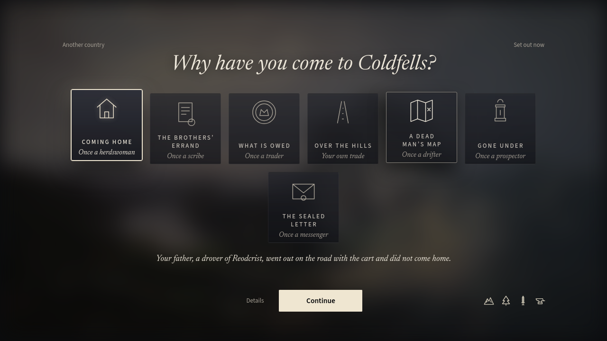
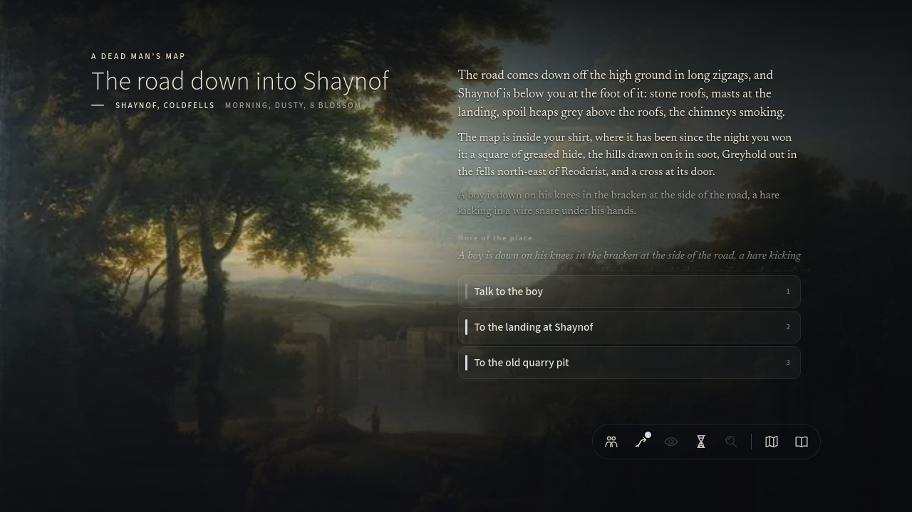
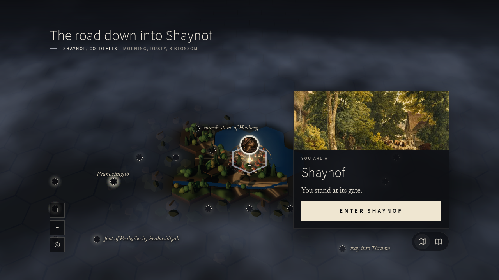
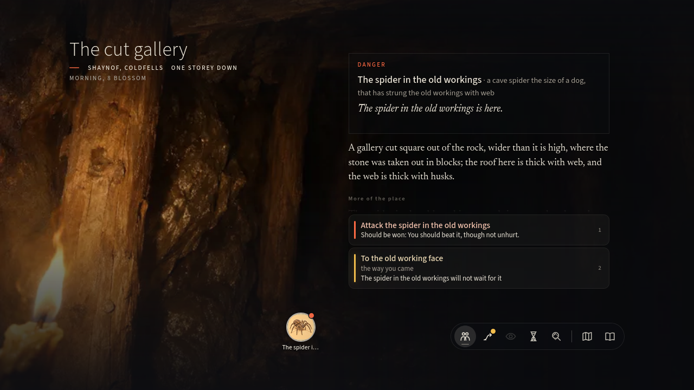
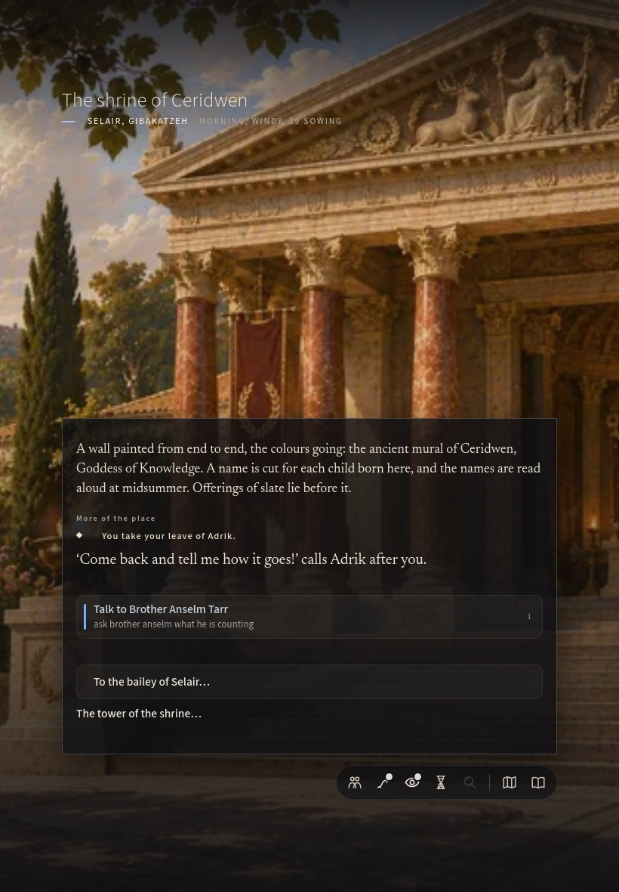

# Westernesse: independent blind playtest

**Date:** 2026-11-13  
**Build:** `2ea49419`  
**Deployment reviewed:** <https://jweissman.github.io/kyrie/>

## Method and boundaries

This report was completed from the deployed public game, approached as a first-time player with a fresh character and no privileged knowledge. Before completing the report, I did not inspect source code or read mission briefs, design doctrine, issue registers, implementation notes, or previous playtest reports.

The first run ended early rather than forcing thirty minutes after the second prolonged combat explicitly described as “easily won.” The outcome felt predetermined, but the interface continued to demand repeated turns and displayed streams of arithmetic. I then completed a shorter, substantially different second start in another region and checked a tablet-sized viewport.

## 1. The first impression

The title screen suggests a literary, austere fantasy work—part history, part interactive novel. “Vol I: A History of Emprise” promises a world with depth and an authorial point of view. The restraint is attractive.

Character creation initially strengthens that impression. Its cards are handsome, the premises are concise, and “A dead man’s map” is an excellent invitation:

> You won a map at dice off a drover who was dead by morning.

That single sentence did more to make me want to play than most of the subsequent mechanical explanation.

The first rupture came almost immediately: selecting a card requires holding it. A normal click merely focuses the card, even though it looks selected. The accessibility label says “hold to do it,” but the visible design does not make the unusual gesture sufficiently legible. I initially believed the game had ignored me.

The Details panel then used the heading “In play, by the rules.” That was the first moment the work stopped sounding like a world and began sounding like a rules application documenting itself.

The completed character summary—“A catfolk thief. A dead man’s map. Once a drifter. A dart in hand.”—was excellent: compact, specific, and immediately playable.

The opening scene was the strongest portion of the first run. The road descending into Shaynof, the map under the shirt, the trapped hare, the keeper’s whistle, and the silent boy create geography, pressure, and moral choice at once. This felt authored rather than assembled.

From there, my impression evolved from “an unusually atmospheric exploratory RPG” into “a beautiful world browser repeatedly interrupted by visible simulation machinery.”

## 2. Chronological account of play

### Entry and character creation

I chose “A dead man’s map,” Catfolk, Thief, and a Roads background.

I wanted to create a nimble drifter who could follow the map, trespass, and discover things. The game offered evocative choices, but every card used the unfamiliar press-and-hold convention. Default selections were already active, including ancestry and calling, before I had expressed a preference.

I expected a click to select, followed by Continue. Recovery was possible, but only after experimentation. The friction was small in duration but disproportionately damaging because it occurred during the first interaction.

The visual composition was consistently strong, though the background and calling choices already hinted at the game’s tendency to describe characters as bundles of capabilities rather than lives.

### The road into Shaynof

The opening presented three immediate possibilities: talk to the boy, go to the landing, or visit the quarry. I spoke to the boy because the keeper was approaching and the situation seemed urgent.

I chose to stand in the road and distract the keeper. The result was good:

> The keeper hears you out, and looks past you at the bracken, and back at you. The boy is gone. The keeper will know your face again.

This was my first genuinely satisfying choice. It produced a clean success with a future consequence and respected the scene’s urgency.

Immediately beneath it, however, the game displayed “1 on the die, needing 11.” With no prior explanation, I could not tell whether one was excellent, disastrous, or whether the prose described a qualified success. The fiction had communicated the result perfectly; the arithmetic made me less certain. I recovered naturally by ignoring the unexplained number and trusting the prose.

### Attempting to pursue the map

I opened the map to look for Greyhold. The map is one of the game’s strongest aesthetic achievements: sculptural, fogged, geographical, and unlike a conventional software map.

But it did not help me pursue the goal. Greyhold existed among the map labels, yet I could not meaningfully select or route toward it. The prominent “Enter Shaynof” button merely returned me to the same road scene rather than entering the town.

This was the first failed invitation of the main premise. The game had given me a map, named my destination, and encouraged me to search there, but its actual navigation vocabulary did not let me translate that desire into action.

I abandoned the map intention and chose a nearby destination instead.

### The landing and the corn-store

At Shaynof’s landing, I found Brottor, Ginger, a notice, a factor who knew about old workings, and a huge corn-store padlock. As a thief, I chose the lock.

I expected risk, observation, a small puzzle, a skill roll, suspicion, or at least a tactile description of the lock yielding. Instead:

> The corn-store padlock hangs open on its hasp.

That was the whole event. A character-defining capability had been mechanically acknowledged but dramatically skipped. It felt like checking a permission flag, not performing an illicit act.

This was mechanically present but experientially empty.

The unlocked store did sustain curiosity, however. The trapdoor, darkness, candle, oversized droppings, rat-runs, and old drain formed a legible descending chain. Lighting the candle materially changed the place. For several minutes I became absorbed because each location implied another layer underneath it.

### The rat fight

Three rats blocked the run. The game said:

> Easily won: They are no match for you.

Combat then opened a dense interface of health, targets, turn order, actions, probabilities, rolls, damage, and secondary mechanical narration.

My first attack produced this juxtaposition:

> Haze lands a telling blow on the first rat with the dart, for 9.

followed by:

> The first rat takes 1 piercing damage (roll 9, critical +1, 1 was all it had left).

The game simultaneously told me the blow did nine damage and one damage. I can infer the distinction between the damage roll and actual remaining health, but the presentation makes a simple act sound internally contradictory.

The line “Haze looks away solemnly” after killing a cellar rat was also unconvincing. It felt like generic emotional garnish attached to an event rather than a response belonging to the character I had created.

I used “Let Haze fight this turn” thereafter. The fight was harmless and short enough to endure, but it had already taught me that combat meant reading procedural bookkeeping.

### Deeper underground

After the fight, exploration became interesting again. I found:

- A larger rat that could simply be bypassed despite the warning that it “will not wait.”
- A man-sized centipede, described as a hard fight, which could also be bypassed without consequence.
- An older undercroft beneath several later structures.
- A lettered floor flag that did not sit level.
- A new aim concerning the ring of letters.

The undercroft was the strongest discovery in the first run. The prose gave the place historical depth:

> The corn-store, the church and the quarry were all dug down into it, from three sides, by people who did not know it was here.

Following the new aim also revealed a previously unavailable route. This was a genuine reward for curiosity: knowledge changed the explorable structure.

But the surrounding danger lost credibility. Enemies repeatedly “would not have me here for long” or “would not wait,” while letting me walk past them. The language generated urgency that the game did not enforce.

### The beetle fight: where interest substantially weakened

The route toward the undercroft clue was blocked by three beetles. Once again:

> Easily won: They are no match for you.

This fight lasted six rounds. Haze remained entirely unhurt while multiple attacks missed on both sides. I repeatedly selected automatic turns and watched near-certain failure play out as interface churn.

This was the point at which I would have stopped playing independently. The game had announced that no meaningful decision or danger was present, then demanded several rounds of confirmation anyway. It transformed discovery into clerical work.

Afterward, the game offered another gallery guarded by another oversized creature. The pattern was now clear: evocative place, monster gate, combat ledger, evocative place, monster gate. I abandoned the intention rather than fight the spider.

### Second start

The second start placed a default dwarf warrior-scribe at the shrine of Ceridwen in Selair. I used “Set out now” rather than repeat full character creation.

This opening was materially better composed. The mural, offerings of slate, names of local children, and Brother Anselm copying figures made the place particular. Adrik’s opening line felt like a person speaking:

> ‘You’ve come a long way to find somebody,’ says Adrik. ‘Is it me?’

Asking about noises under the churchyard produced a crypt key, a payment offer, a concrete mystery, and a new aim. Delivering the letter produced recognition of its author, hospitality, a warning about missing sheep, a rope, directions, and a reason for the destination. This was the game successfully sustaining an invitation.

The dialogue transcript did become long and mechanically annotated, but the underlying scene was much stronger than the first run’s NPC interaction. It suggested that Westernesse can create convincing characters when a conversation is tightly authored around relationships and local history.

At tablet size, the shrine scene was visually excellent. The composition reorganized cleanly, the painting dominated the page, and the text remained readable. I encountered no serious tablet-layout impediment.

## 3. The most damaging failures

### 1. Combat converts certainty into tedium

The game frequently predicts “easily won” or “no match for you,” yet still requires round-by-round participation. When the result is effectively settled, combat offers neither tactical uncertainty nor dramatic danger—only repetition.

This is the most damaging failure because combat sits directly across promising exploration routes. It teaches the player that curiosity will be taxed with paperwork.

### 2. The fiction and simulation often contradict one another

Examples include:

- “For 9” followed by “takes 1.”
- An “even chance” presented with “1 on the die, needing 11,” without readable success language.
- Enemies who “will not wait” but permit the player to walk past untouched.
- An “Enter Shaynof” map action that returns to the road outside Shaynof.
- “No light” immediately followed by the available action “Haze: light a candle.”

None of these necessarily indicates a broken underlying system. The experiential failure is that the game repeatedly makes the player arbitrate between prose and state. Trust shifts away from the world and toward decoding interface conventions.

### 3. The originating quest is not actionable enough

“A dead man’s map” is a superb premise. The first goal names Greyhold. Yet the map did not give me a comprehensible route or next step toward it.

The central invitation therefore failed before incidental content began. I did not choose the corn-store because it seemed more important; I chose it because I could not see how to pursue the thing the game had taught me to care about.

### 4. Character abilities are acknowledged without being dramatized

Picking the fist-sized padlock was reduced to the lock being open. The game recognized that I was a thief but did not let me feel like one.

This is worse than lacking the mechanic. The interface advertises responsiveness—my character can do this special thing—then withholds suspense, texture, consequence, and satisfaction.

### 5. Danger is abundant but frequently unbelievable

Oversized rats, beetles, a man-long centipede, and a dog-sized spider appeared in rapid succession beneath one town. Most were either trivial or safely bypassed.

The sheer density makes the underworld feel stocked rather than inhabited. Repetition also blunts escalation: by the time the spider appeared, it was not alarming; it was the next mandatory combat panel.

### 6. The interface exposes too much classificatory language

Labels such as “to learn,” “to gain,” “worth a look,” “an aim,” “for you,” “easily won,” and “by the rules” may be useful internally, but together they make the game resemble a content-management system describing its own nodes.

The player is rarely allowed simply to notice that something looks interesting or dangerous. The software pre-classifies the experience in advance.

### 7. The selection language is unnecessarily awkward

Press-and-hold is used for character cards and some world actions without a sufficiently visible or intuitive rationale. Ordinary clicks appear to do almost the right thing, which makes the failure especially confusing.

This is an unfamiliar mechanic rather than an unintelligible one, but it provides no corresponding pleasure. It feels like friction for its own sake.

### 8. The visual ambition and interaction density pull in opposite directions

The maps, paintings, typography, darkness, and spatial transitions are often beautiful. But play repeatedly resolves into panels, tags, lists, toolbars, disabled commands, probabilities, and transcripts.

Westernesse has a coherent visual language at the level of scenes. It does not yet have a coherent experiential language across scenes, dialogue, exploration, and combat.

## 4. Editorial judgment

If I could change only three things:

1. **Collapse foregone combat into a single consequential action.** If enemies are “no match,” resolve the encounter immediately or make avoidance the natural result. Reserve full combat for situations with meaningful tactical or mortal uncertainty.
2. **Make every starting premise immediately pursuable.** A new player who chooses a dead man’s map should be able to understand the next route toward Greyhold from the first map interaction. Incidental discoveries should compete with that goal, not replace it because the goal is operationally obscure.
3. **Let the fiction carry more of the interface’s meaning.** Remove or subordinate taxonomic labels, raw arithmetic, and internal-sounding classifications. Present outcomes once, clearly. When a character does something distinctive—picks a lock, deceives a keeper, reads an inscription—give the act texture and consequence.

The distinctive strengths worth protecting are substantial:

- The landscape has names, routes, local histories, and geological depth.
- The best prose is economical and concrete.
- The map has genuine visual identity.
- Character premises can be excellent.
- The undercroft discovery demonstrated that curiosity can uncover layered history and alter available routes.
- The second start showed that NPCs can feel situated in relationships and institutions rather than functioning merely as quest dispensers.
- The tablet presentation was striking and readable.

Westernesse is most compelling when it behaves like an archaeological fantasy: roads over older roads, buildings cut into forgotten rooms, letters connecting distant people, local knowledge revealing paths, and present lives resting on unread histories. It is least compelling when it turns those discoveries into tagged content nodes separated by low-stakes combat accounting.

## Would I play it again tomorrow?

No.

I would remember the road into Shaynof, the sculptural map, the undercroft, and Adrik. I would be curious about Eaglespire and the lettered flag. But I would also expect every promising route to be interrupted by another encounter whose outcome the game has already declared and whose resolution still requires several rounds of administrative clicking.

That expectation outweighs the curiosity. I would want to return to Westernesse’s world, but not yet to the act of playing Westernesse.
