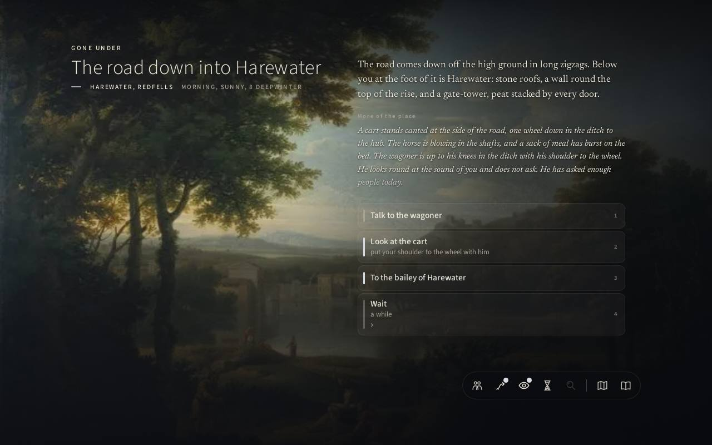
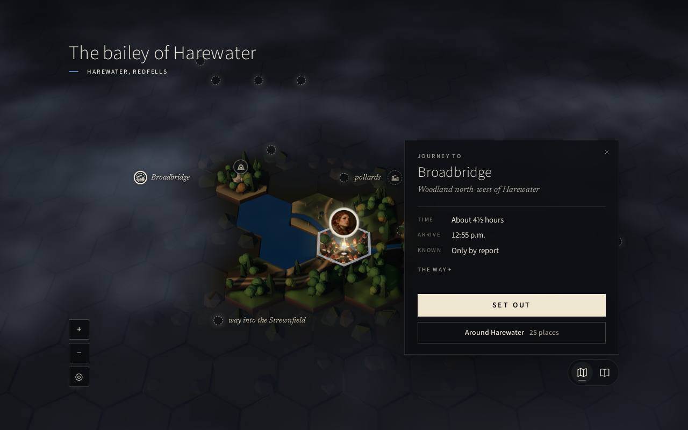
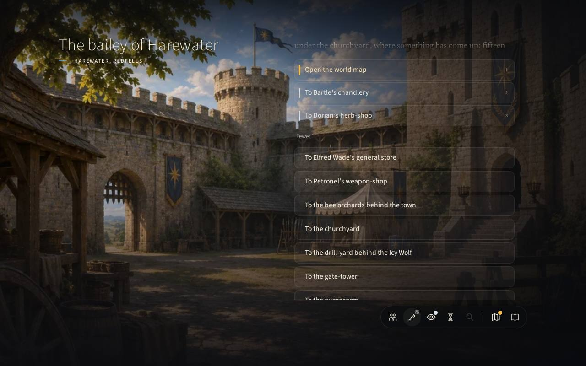
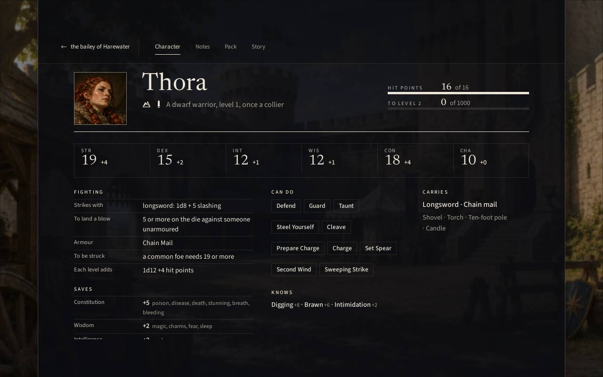
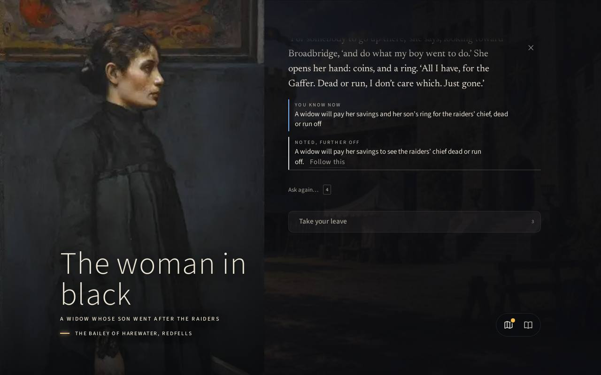
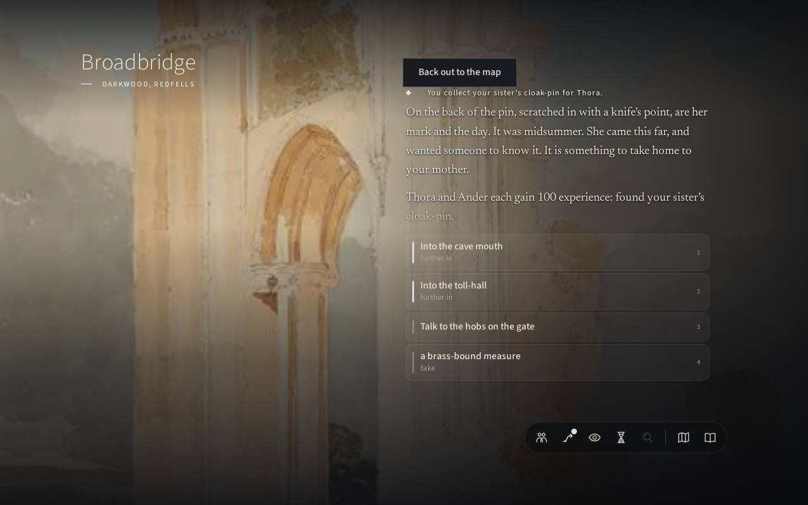
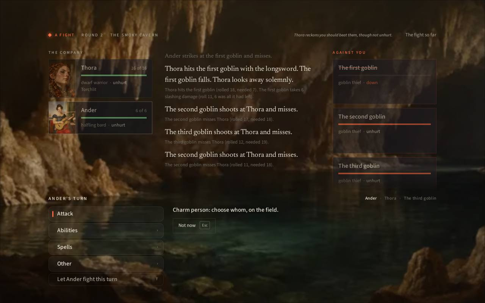
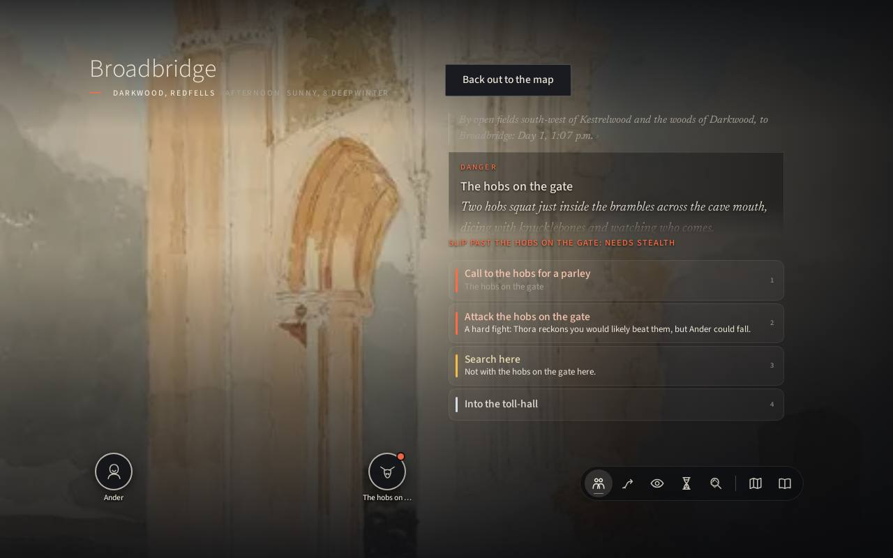
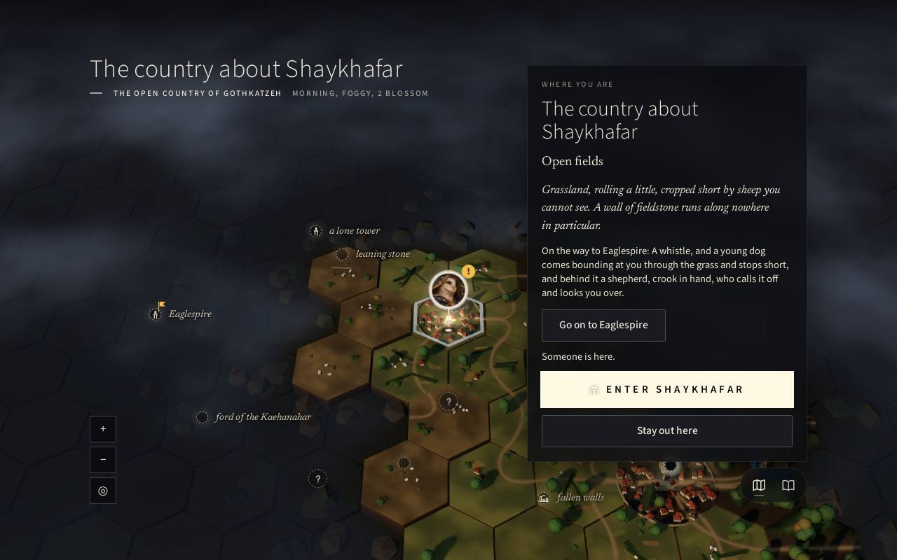
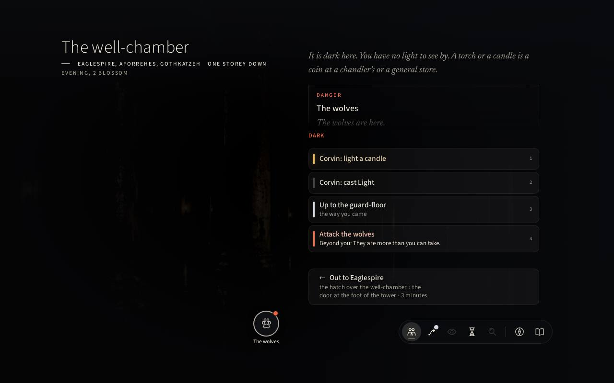

# Westernesse: blind playtest, third tier of Gate 1

**Date:** 2026-11-15 (played 14 November, late)
**Build:** `2e603c8a`, as shown in the title screen's corner
**Deployment:** <https://jweissman.github.io/kyrie/>
**Player:** an automated blind agent driving headless Chromium at 1280×800, choosing each act only from the screenshot and the page's visible text. I read no source, data, register or design documents. I read the 13 November blind report only after both runs, for section 6.

Two runs:

1. **Thora**: dwarf warrior, *Gone Under* (her sister went into Broadbridge after silver and did not come out), born under the Scythe, Stone and Earth. Country: Redfells, starting at Harewater. About 45 decisions, three fights.
2. **Corvin**: birdfolk mage (abjurer), *The Sealed Letter*, born under the Hart, The Shadows. Country: Gothkatzeh, starting at Barzelnekuda. 27 decisions, no fights.

No crash, hang or console error in either run. Creation is instant. Starting a world took 10 to 12 seconds behind an honest "Setting out… Drawing the world / Placing its people / Telling where you are".

---

## 1. The first impression and the opening

**What draws you in.** The title is quiet and confident: a spaced WESTERNESSE, *Vol I: A History of Emprise*, stars, seven candles on a dark hill. The first creation question is the right one, *Why have you come to Redfells?*, and the origin cards (*The Brothers' Errand*, *A Dead Man's Map*, *Gone Under*, *The Sealed Letter*) are good hooks. "Your sister went out to Broadbridge at midsummer with two from Harewater who swore there was silver in it. They came back. She did not." is the best sentence in creation, and it made me choose her. Picking with a click works now. Each page takes one decision, a small icon tray at the bottom right gathers what you have chosen, and the name page offers five names and a dice roll. A full creation took under a minute.

The first scene is handsome: a Claude-like landscape painting, "The road down into Harewater", and a cart in the ditch with a wagoner who "has asked enough people today". That is a fine first problem: concrete, small, moral, and solved in the body. Putting my shoulder to it gave a good line ("the noise of it goes further than you would like") and a note in my book.

**What breaks it.**

- **The goal is never shown.** The page's text holds a "YOUR FIRST GOAL … Follow this" card, but on screen it does not appear in either run. The opening shows the cart and four choices, nothing about my sister ([01](01-opening-goal-invisible.jpg)). I learnt the goal only by opening *Your book* two scenes later.
- **Creation's promises break on the first look at the character page.** Creation's summary said "A battleaxe in hand"; the details pane listed the battleaxe as "suits you best" with its numbers; the character page says *Strikes with longsword* and carries a longsword ([04](04-longsword-not-battleaxe.jpg)). Corvin's summary said "A sling in hand"; he strikes with a staff. Thora's origin card said "Once a prospector", and the line under her name says "Once a collier". Corvin's card said "Once a messenger", and his says "Once a poisoner". (The second label comes from the "What did you do before this?" page, but that page reads as a second answer to a question the origin had already answered.)
- The star sign's *Details* only repeats the card's one line. I never learnt what being born under the Scythe does.

---

## 2. Chronological account

### Run 1: Thora, *Gone Under*, Redfells

1. **Road into Harewater.** Helped the wagoner by brawn. He gave me 2 coin and a bowl at the inn. Talking to him offered only "Let him thank you" and "Take your leave". There was no way to ask about my sister or the road.
2. **The bailey.** A fine painting. The first offers were Hugh the ambassador, the well-post notice, "Talk to the castellan, ask about the old workings", and "Wrench the padlock's hasp out of the old door" (vandalism as a top suggestion in a castle yard). I opened the book, found the aim and pressed *Follow this*. The bailey's choices then changed completely: a gold-marked "woman in black" (not in the description) and "Open the world map".
3. **The widow.** A superb portrait. She wants the raiders' chief, "the Gaffer", gone. Her answer filed the same sentence twice, under YOU KNOW NOW and again under NOTED, FURTHER OFF ([05](05-widow-repeated-notes.jpg)). "Ask again…" repeats her whole speech word for word.
4. **The notice** added three more aims (rats, catacombs, spiders).
5. **Finding the companion.** The rail said "Go: a companion, that way". The Go lens showed three ways and an "All 33" link. All 33 is a flat alphabetical list that runs off the bottom of the fixed screen and cannot be scrolled; the inn ("Into the Icy Wolf by the door") was among the unreachable ones (**blocker B1**, [03](03-all-33-ways-unreachable.jpg)). I got round it through the drill-yard behind the inn, whose short list did include the taproom.
6. **The Icy Wolf.** The taproom painting is lovely. Xander the innkeeper (a Velázquez portrait, captioned "Trujillo Juan" in the corner like a name tag) had "Ask about your sister" in gold. His answer is the best writing I met: "Midsummer, at the table by the door, with the two of them, laughing about silver… One of them said in his cups that she would not turn back." I hired Ander, a halfling minstrel, for 6 coin. The hire panel gives an honest stat block (Constitution 4).
7. **The map.** Superb ([02](02-map-journey.jpg)). It showed "Journey to Broadbridge: about 4½ hours, arrive 12:55 p.m., known only by report", and SET OUT. The route summary reads "The road, then the road, an hour and a half out of Kestrelwood, then the way across country, then the way across country, then the way across country, then the way across country". The token walked; the trip took about 8 seconds.
8. **Broadbridge.** "Something here is dangerous." Two hobs at the gate "across the cave mouth" (at a stone toll-house by the water). The painting here is a blurred, low-resolution fresco, much weaker than the others ([08](08-broadbridge-hobs.jpg)). I parleyed: "Gaffer says come in and wipe your feet." Searching at the door found my sister's cloak-pin, with her mark and the day scratched on the back. Taking it gave **SEEN THROUGH: Gone under**, 300 experience, and the game moved my followed aim to *Dorian's rats in Harewater* ([06](06-sister-seen-through-at-a-pin.jpg)). The aim was "search there for what became of her", and I never learnt what became of her.
9. **The hobs' cave.** I lit a torch in the captives' pit, a room whose text first said I had no light and should buy a torch, though I carried one. I untied a shepherd's boy. The hold turned hostile ("THIEVES!"). Three fights followed: three goblin thieves, the Gaffer, then the two gate hobs. Each was forecast as "A hard fight: Thora reckons you would likely beat them, but Ander could fall". Each was over in two or three rounds, and both of us were unhurt every time. Ander's Charm Person found no target ([07](07-charm-person-no-target.jpg), **blocker B2**). After the Gaffer, the way out was barred (⊘) by the gate hobs, and the only route back to them was hidden in the Go lens (**blocker B3**). The Gaffer's chest held a shovel. Leaving the cave put me straight onto the map, where no route home was marked for the boy, because the aim being followed was the rats.

### Run 2: Corvin, *The Sealed Letter*, Gothkatzeh

1. **A new country, the same opening.** "The road down into Barzelnekuda" has the same painting, the same canted cart and the same wagoner, word for word. The difference is good: Corvin was offered "lead the horse" and "lift a sack of meal off the back while he is at the wheel", while "put your shoulder to the wheel" was greyed with "needs brawn". I stole the meal. The wagoner later "told me", under TOLD YOU, NOT YET SEEN FOR YOURSELF, that I had left him in the ditch: my own act, filed as hearsay.
2. **The landing** is a different painting and a different quay, but the same skeleton: "two columns of smoke… one thick and black from the digging, one thin and white from the old woman's fire" (the identical sentence), the same well-post notice, the same corn-store padlock, the same Spade-Company.
3. **Map, then Shaykhafar.** It took 3 hours of game time and a few seconds. Jebeddo was right at the gate. The origin promised "the merchant at Shaykhafar", but she is a herb-wife. Delivering the letter is a good small scene ("You did not read it," Jebeddo says. It is not a question.) It also gave SEEN THROUGH and a lure: Eaglespire.
4. **On the road** a shepherd's dog interrupted. The panel's filled, primary button was "ENTER SHAYKHAFAR", the town I had just left. Meeting the shepherd was the secondary "Stay out here" ([09](09-road-meeting-enter-town-primary.jpg)). Finding his ewe was a nice thirty-second vignette.
5. **The fells**: "A grey wolf gets up from behind the stones with blood to the eyes, and does not run." I chose "Go on to Eaglespire" and nothing happened.
6. **Eaglespire.** The inscription is given twice in a row. The stair "needs climbing or a coil of rope; Adrik Holderhek, chandler, sells iron spikes". Rope or spikes? The well-chamber below was dark, and the text said again "You have no light… a torch or a candle is a coin", while Corvin carries a candle and knows *Light* ([10](10-no-light-with-a-candle.jpg)). Wolves were there, "Beyond you". I went back up and the run ended. That is a fair wall for a 4-HP mage alone, and it is signposted, but nothing in Corvin's first hour drew on him being a birdfolk, a mage or a former poisoner.

---

## 3. Blockers

| # | Class | What I did | What I saw | Shot |
|---|---|---|---|---|
| B1 | Act offered that can't be done (unreachable) | In the bailey I followed the rail's "Go: a companion, that way" and pressed *All 33* | A flat alphabetical list of 33 ways that runs past the bottom of the fixed 800 px screen. The mouse wheel, arrow keys and Tab do not scroll it. Everything below "To the guardroom", including the inn the companion signal pointed at, is shown but cannot be reached. | [03](03-all-33-ways-unreachable.jpg) |
| B2 | Act offered that can't be done (refused silently) | In two fights against goblins I chose Ander → Spells → *Charm Person* | "Charm person: choose whom, on the field." No foe card lights up, clicking one does nothing, and nothing says why (goblins not "persons"?). The only way out is *Not now*. | [07](07-charm-person-no-target.jpg) |
| B3 | No way forward (from the default list) | After killing the Gaffer and his band, I tried to leave | "⊘ Out to Broadbridge", barred by the gate hobs. None of the four default choices led back toward them. "Up to the cave mouth" existed only inside the Go lens. I found it, but a player who never opens Go is shut in a cleared cave. | (cavern scene, not kept) |

**Not blockers, but close:**
- **The opening goal is not visible on screen.** It is present in the page text but not drawn ([01](01-opening-goal-invisible.jpg)). I was never lost, because the gold pips and the book carried me. A player who never opens the book starts with no stated purpose.
- **"Around Harewater, 25 places"** on the map's journey panel promises a list but just closes the map.

**None met:** creation trouble that stopped play, a crash, or a hang.

---

## 4. Friction

### Promises the screen makes that the game doesn't keep
- **Creation against the character:** battleaxe → longsword, sling → staff, prospector → collier, messenger → poisoner, "the merchant at Shaykhafar" → a herb-wife. Each is small, but they come first, so they teach the player not to trust what the cards say.
- **"You have no light to see by. A torch or a candle is a coin at a chandler's"** shown to characters carrying a torch, a candle, and the *Light* spell (both runs). The lighting acts sit right below it.
- **Fight forecasts do not discriminate.** Three hob fights all read "A hard fight… Ander could fall", and all were won unhurt in two or three rounds. A forecast that is always the same is noise. ("Beyond you" for the wolves did make me turn back, so that tier works.)
- **Combat lines against the board:** "Sweeping Strike… lands, for 8… The second goblin goes down" while its card reads *near death · Prone* and it acts again. "Shrugs off the armor shred" refers to a move whose card says it knocks prone.
- **The sister's story is closed by a pin.** *Gone Under* is closed as SEEN THROUGH at the threshold, before the player learns what became of her. The game then moves "following" to rats in another town, though the shepherd's boy I had just freed and promised to take home was standing beside me.
- **The rail's "Go: a companion, that way"** still showed after I had hired the companion.
- **The road meeting** makes "Enter [the town you just left]" the primary act.
- **TOLD YOU, NOT YET SEEN FOR YOURSELF** lists something the player did, as told by its victim.

### An interface in the way of play
- **Long lists in a fixed screen** (B1). Conversations show the same pattern: "Something else… 5–24" folds 20 topics, and their hidden buttons extend down to y ≈ 1500 px.
- **Choice lists grow over the prose.** Opening a sub-choice (the cart) slid the list up over the scene description. In the bailey the last description line is half-hidden under the first choice.
- **Choices change all at once on Follow.** The bailey's list swapped wholesale (castellan and padlock gone, a woman in black not in the description) when I pressed Follow in the book.
- **Numbering skips** (1, 3; 1, 2, 3, 5, 25). A keyboard player wonders what 2 and 4 were.
- **Exits are listed twice**, as choice 1 and as the ← exit button in the same panel. "Back out to the map" sits on top of the narration's first line at Broadbridge. "Take your leave" in Ander's talk is overlapped by the bottom-right rail.
- The **place-and-time subtitle** ("MORNING, SUNNY, 8 DEEPWINTER") is unreadable over the bright bailey painting.
- **Taxonomic labels are still many:** YOU KNOW NOW, NOTED FURTHER OFF, A NEW AIM, 3 NEW AIMS, SEEN THROUGH, *your aim*, *another aim*, *for you*, *examine, look closely*, *take*.

### Prose that is too much, unspecific or repeated
- **The same sentence twice on one screen:** the widow's bounty; the inscription at Broadbridge (WĪDBRYCG twice) and at Eaglespire (AQUILASPIRA twice); the shepherd's whistle (header and body).
- **"Ask again…"** returns the whole speech verbatim.
- **The route line** "then the way across country" four times.
- **Template greetings that contradict their scenes.** "Hears you come, and finishes what he was doing before he looks round" is used for the innkeeper and again for a shepherd who has just whistled his dog off you. A bound, crying boy greets his rescuer with "Now then! A new face. What can I do for you?" When he is following you, his farewell is "Off you go, then… don't do anything I'd be ashamed to hear about".
- **Combat garnish:** "Thora looks away solemnly" after cutting down a goblin thief. Ander's "That was fun!" came twice in two fights.
- **Naming drift:** the hobs become "goblin thieves" in combat. Hobs "across the cave mouth" are at a river toll-house.
- **Small slips:** "carries shovel"; "Ask *them* to come with you" for the boy; American "armor"; "You collect your sister's cloak-pin *for Thora*" when I am Thora; "sunny… Deepwinter… the sun is warm on the walls".

### Navigation loops
- Leaving the cave goes straight to the map, skipping Broadbridge, where the toll-hall and its strongroom aim still were.
- "Around Harewater" and "Enter Shaykhafar" both send you back to where you were.
- No true loop trapped me.

### Characters not differing
- **The same opening for two different characters in two different countries:** the same road painting, cart, wagoner and lines. The towns have the same skeleton: two smoke columns in identical words, well-post notice, corn-store padlock, Spade-Company. Eaglespire was the lure again.
- **Where they did differ, it was good:** the cart offered brawn to the dwarf and stealth to the birdfolk. The character pages are distinct. The owl portrait for a birdfolk mage is a delight.
- **But nothing in either first hour drew on ancestry or star sign.** The birdfolk's "far of sight" and "light of bone" never appeared, and the mage was told the stair "needs climbing". The dwarf's calling list had two entries against the birdfolk's seven, with no reason given.

### Slowness
- None worth a complaint. World start was 10 to 12 s with honest progress lines. A 4½-hour journey played in about 8 s with the token walking the map. Scenes changed within the 2 to 3 s I allowed after each act.

---

## 5. What is genuinely good

- **The map.** A sculpted, fogged hex country with a journey panel ("about 4½ hours, arrive 12:55 p.m., known only by report") and a token that walks. It routed me to my aim at once in both runs. It is the best single thing in the game.
- **Portraits and paintings.** The widow in black, Xander, and the owl in a starry hood are memorable. The bailey, the taproom and the cave mouth are rich and consistent. The talk screen's large left-third portrait gives a person presence.
- **The best prose is very good, and specific.** Xander's memory of the sister; the pin with her mark and the day ("She came this far, and wanted someone to know it"); "You did not read it," Jebeddo says. It is not a question.; the ewe "complaining of it".
- **Abilities shape the offers, and consequences stick.** Brawn against stealth at the cart. The shoulder-heave "noise of it goes further than you would like". The theft is remembered. Lighting a torch changes the room.
- **Aims chain and lead.** In run 1, gold took me from the book to Xander's "ask about your sister", to the map, to Broadbridge, to the pin, with no dead hop. In run 2 the letter reached its recipient in 12 decisions.
- **Combat is now short and legible.** Company on the left, foes on the right with intentions ("→ Thora · shoot with the dart"), a clear turn line, *T* to let a character act, and dice in small grey under each plain sentence. "What it cost: Thora unhurt · Ander unhurt" is a good closing line.
- **Hiring is clean:** the price, a full honest stat block, one act.
- **Speed and stability:** no errors, no waits, a minute from title to world.

---

## 6. Against the 13 November blind playtest

Read only after both runs.

**No longer met:**
- *Press-and-hold creation.* Gone: a click selects, and Continue moves on.
- *The map couldn't route to the starting goal.* Fixed, and well: the aim is on the map with a journey panel and SET OUT.
- *Six-round "easily won" fights.* Fights now last two or three rounds, and *T* or *Press on to the end* exist.
- *"In play, by the rules"* and similar rules-headings. Not seen.
- *The origin premise not pursuable.* Both premises were pursuable at once. The new problem is the opposite: they close too soon, and in run 1 without an answer.

**Met again:**
- *"Looks away solemnly"* after killing vermin, word for word.
- *"No light" shown beside "light a candle."* Word for word, twice, and now also beside a carried torch and a Light spell.
- *Danger language the game doesn't enforce.* "The wolves… will not have you here for long" is the same register. The hob fights all forecast "Ander could fall" and all ended unhurt.
- *Contradictory hit lines.* The 9-versus-1 pair has gone; "goes down" against *near death* and "armor shred" for a prone move are its successors.
- *Taxonomic labels* (YOU KNOW NOW, NOTED, SEEN THROUGH, *for you*, *your aim*). They are still everywhere, though quieter in type.
- *Raw arithmetic in the log.* Still there, now subordinated in small grey.
- *An "Enter [town]" act that returns you to where you were.* It has a cousin in the road meeting's primary "Enter Shaykhafar" and the map's "Around Harewater".
- *Eaglespire as the lure.* It was the next lure again, in a different country.
- *A pre-filled creation.* The icon tray shows a dwarf and a warrior before any choice is made.

**New:**
- Long lists overflowing a fixed screen (B1).
- A spell offered with no legal target and no reason (B2).
- An exit barred with the way to resolve it hidden in a lens (B3).
- The opening goal not drawn on screen.
- Creation's weapon and trade not matching the character.
- An origin story closed by a pin at the door, then followed by a jump to a far-off aim.
- The identical opening and town skeleton in two generated countries.
- Template greetings that contradict their scene.
- The same sentence filed twice per answer (YOU KNOW NOW / NOTED, FURTHER OFF) and inscriptions given twice.

---

## Would I play again tomorrow?

Yes, which the 13 November tester could not say. The map and the first ten minutes now carry a player forward, combat no longer taxes curiosity, and the best scenes (Xander, the pin, Jebeddo) are worth coming back for. What would stop me on the third evening is sameness, not friction: the same cart, the same smoke columns, the same notice, the same tower. Next to that, the small untruths (weapons, light, forecasts) teach me to read the screen against itself. The top three fixes I would make:

1. Make creation's promises true in play: the weapon, the trade, and the star's meaning.
2. Fit every list to the screen, or let it scroll. Make every offered act doable or say why not.
3. Let an origin end when its question is answered (what became of her?), and give the second character a different first scene.

---

## Screenshots

