# Westernesse: a cold playtest, 14 November 2026

*Played at https://jweissman.github.io/kyrie/ in headless Chromium, driven by clicks, keys and touch events. Run 1 at 1440×757 (build 2ea49419), about 27 minutes. Run 2 at 820×1180 tablet size, with touch taps and long presses (build 87d9d584, which went live between my runs), about 25 minutes across two characters. Before or during play I read nothing of the code, docs or earlier reports.*

---

## 1. The first impression

The title screen is confident and quiet: WESTERNESSE in wide-spaced capitals, a small diamond on a hairline rule, "Vol I: A History of Emprise" in italic, embers drifting. Three choices, NEW GAME picked out in gold. It promises a book rather than a dashboard, and I liked it at once.

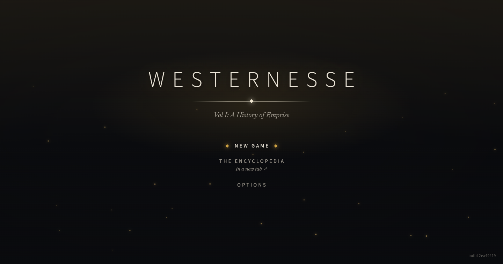

Creation opens on a good question: *Why have you come to Tinmoor?* Six cards follow, each a reason that also sets a past: "The Brothers' Errand, once a scribe", "Gone Under, once a prospector", "A Dead Man's Map, once a drifter". Leading with motive rather than stats is the right instinct. Each card's one-line premise is evocative: "Your sister went out to Bellarch at midsummer with two from Willowbury who swore there was silver in it."

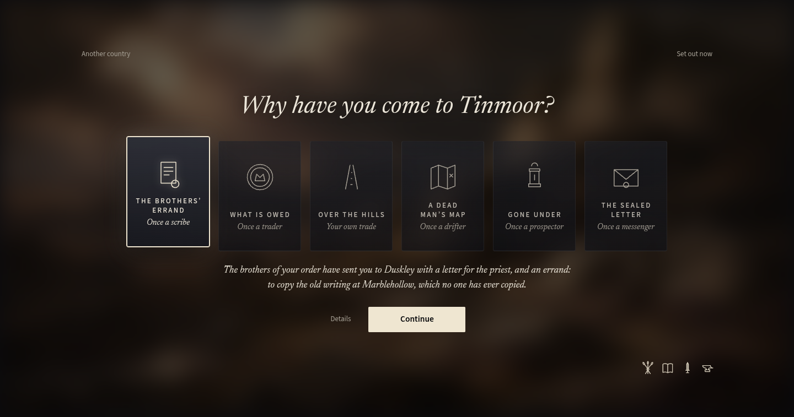

Then came my first real snag. **Clicking a card does nothing.** The cards are labelled ", hold to do it", and only a press of about a second and a half selects one. I tried a plain click, a 120 ms press, a 400 ms press, arrow keys and hover. None changed the selection. On the tablet a tap did nothing either, and only a long press worked. For the first minute I thought the screen was broken. Everyone who plays will hit this before they meet a single line of fiction. (The quality-swap buttons later in creation do respond to ordinary clicks, so it is not my browser.)

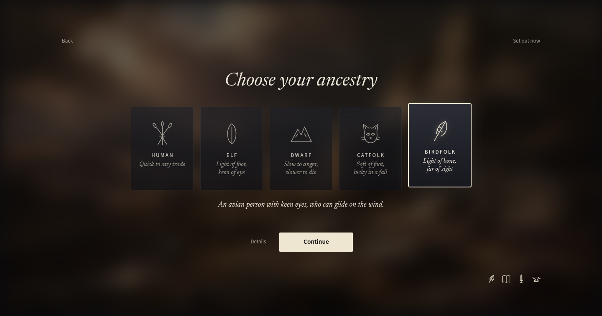

The rest of creation is handsome. The cards are clean line icons. "Not for dwarves" greys out callings honestly. A row of small glyphs at the bottom right builds up who you are as you choose. The name step offers a culture-flavoured roll table (a birdfolk woman got Sora, Kestrel, Wren, Iris, Avocet), and you can type your own. "Details" opens a real sheet. It explains how a blow works, shows that a light crossbow does "7.5 a blow on average", and lets you swap two rolled qualities by clicking one and then the other. That is a lovely touch of old-school control.

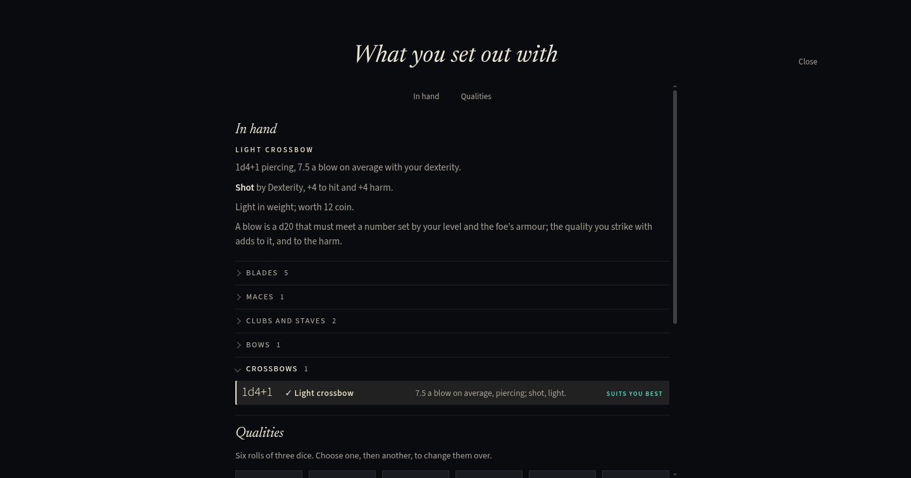

Two oddities. The reason card already says "once a scribe … Makes you a scribe", and a later step asks again *What did you do before this?* with Learning preselected, so I seemed to be answering the same question twice. And the Details page for a reason is nearly empty: one line, "Makes you a scribe, who knows lore", on a large black page.

The opening itself is excellent: a full-bleed painting with a few sentences of prose and "TOUCH TO GO ON".

> You have the letter inside your coat: from the brothers of your order, over the hills, to the priest of Danu at Duskley, asking that Wren, who reads the old script, be given a bed and shown the way to Marblehollow.

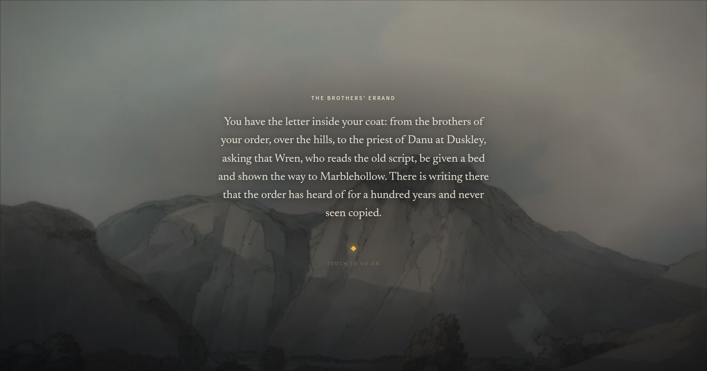

In the second run the opening went further, with a little moral choice on the road before the town: a poacher's boy with a hare in a snare and a keeper's whistle up the road. The painting even has the keeper and his dog. That was the most "a world, not an interface" moment of the whole session.

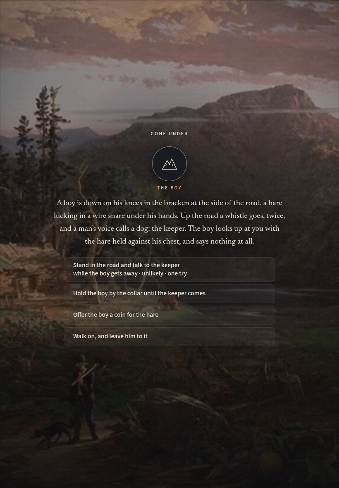

---

## 2. The runs

### Run 1: Wren, birdfolk bard, once a scribe; cautious and curious

**Intent.** I would deliver the letter, learn everything I could before going anywhere, hire help, and only then go down to Marblehollow to copy the old writing.

**Duskley.** The first scene is the shrine of Danu. I got a big painting, a short paragraph, two people with blue-edged "talk" cards, and a slim icon rail (talk, go, look, wait, search, map, book). The layout is calm and legible. The painting is a sunlit Roman temple with flowering urns and cypresses, though. The header says *Morning, snowy, 7 Frost*, and the text describes "a figure of black wood … Offerings of peat lie before it." Picture, weather and prose describe three different places.

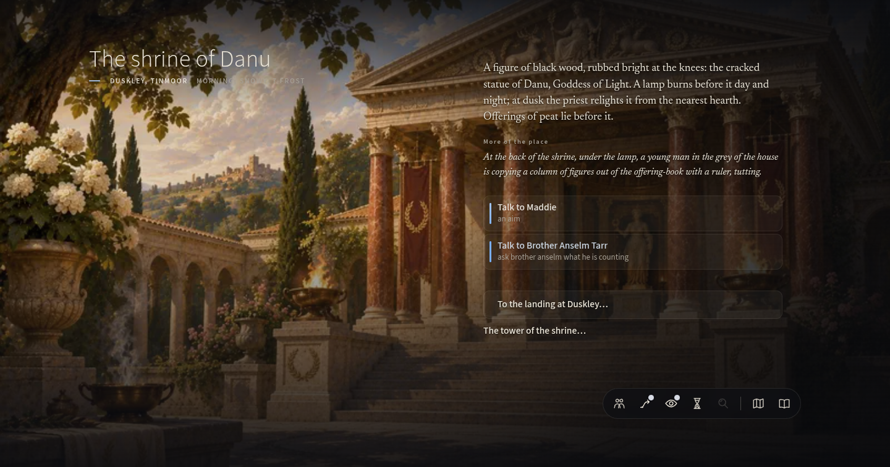

Talking to Maddie the priestess was the best stretch of the session. The portrait fills the left third of the screen (a Rembrandt-school woman in candlelight, gorgeous). The topics are sensible, and some of them are *checks*. "Watch for what goes unsaid · an even chance · one try" turned up:

> It is in how Maddie says 'down there': not as doctrine, but as a place someone went. … Maddie's brother went down into Marblehollow and did not come back up.

That led on to "Speak to Maddie of the brother who went down". A persuasion roll then got me the shrine's old lore about the Stone-Singers' dirge bell. This is exactly what I want from a talk system: noticing, then earning, a deeper conversation.

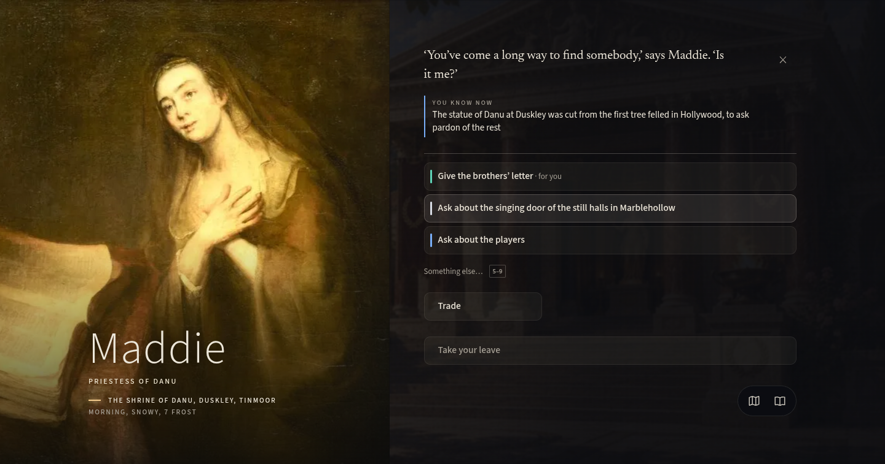

The cracks showed in the same conversation, though. I gave her the letter, and she said: *"Brother Anselm's hand. I did not know he was still living."* A young acolyte called **Brother Anselm Tarr** was standing ten feet away in the same shrine, copying figures. Her acolyte and the letter's elderly author seem to share a name by accident, and the line reads as a contradiction. The place-name "Hollywood" ("The statue … was cut from the first tree felled in Hollywood") made me laugh out loud, which I doubt was the intent.

Duskley then filled up fast. A castellan offered 300 coin for the Stone-Singers' tuning-stone, setting a rival claim against the priestess's warning, and that is a good tension. The well-post had three jobs (rats, catacombs, spiders). The innkeeper, Cadfael, handed me a quarry key and an antidote. A boy at the inn confessed he'd dropped his dad's knife among spider egg-sacs. I hired Osborn, a halfling scholar, at the Fiery Flame for 6 coin.

Then the game undercut its own premise. I asked my new companion "about the old script":

> 'I have pieced together how the Stone-Singers ended, I think. They sang the last of themselves into the stone of their hall…'
> **A NEW AIM** — You have read and set down the old writing at Marblehollow. Maddie at Duskley should see it.

I had not been to Marblehollow. I walked back to Maddie, chose "Show what you copied at Marblehollow", and got a framed **SEEN THROUGH: The brothers' errand**, 300 experience and 40 coin. The reason I chose at creation was finished in about fifteen minutes without my leaving town, because the hired help said one sentence.

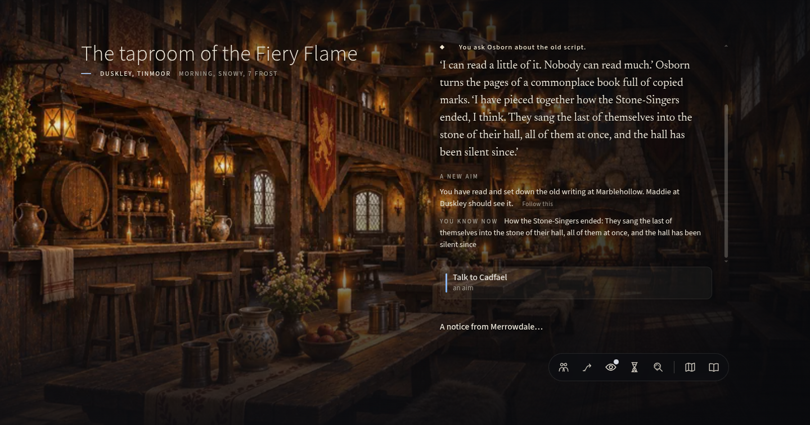
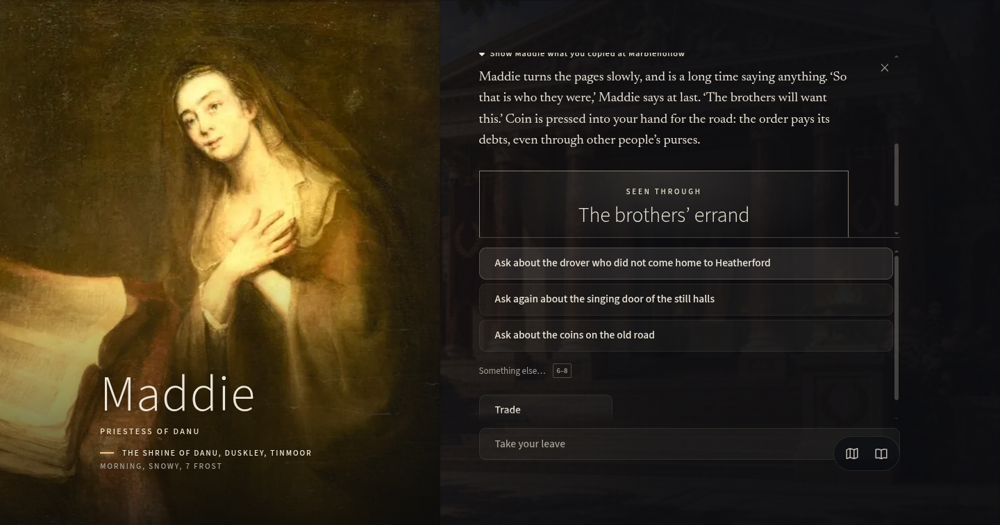

Before that, the crypt gave me the best single puzzle of the day. Maddie's key opened the stone door. "Wren: light a candle" (the line just above it said "You have no light to see by") revealed a chalk ring, and my lore background spoke up on its own:

> You know these marks from the old scripts. … they are copied badly: the warding line, the one that keeps the dead off whoever calls them, is not there. It is Wren's lore that makes it out.

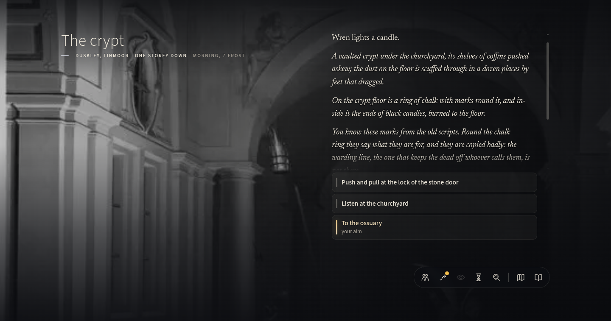

In the ossuary I met the grave-robber with the black candle. Looking at the candle unlocked a new option, "Tell the man with the black candle what his book left out of the ring". I took it:

> His hand shakes when he pinches the candle out. He goes up the stair without looking at the dead, and out of Duskley before morning. … the dead fold down into the bone-heaps like coats let fall, and are only bones again.

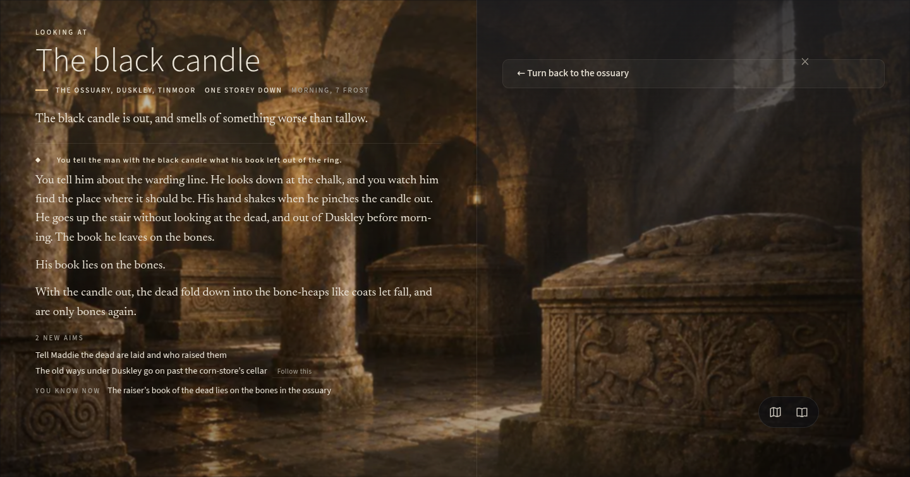

That is a real reward for *who I chose to be*. My background turned into knowledge, the knowledge into a peaceful solution, and the solution read well. The two zombies left in the charnel passage made a short, clear fight: portraits on both sides, intents shown ("→ Osborn · claws"), every roll logged, and a plain "Let Osborn fight this turn" for when you don't want to micromanage. Under the crypt was more than I expected: an undercroft older than the town, a lettered flag that slid aside when pressed in order, and a sealed vault with a barrow-ghoul "long dead and still at its post". Being cautious, I backed out.

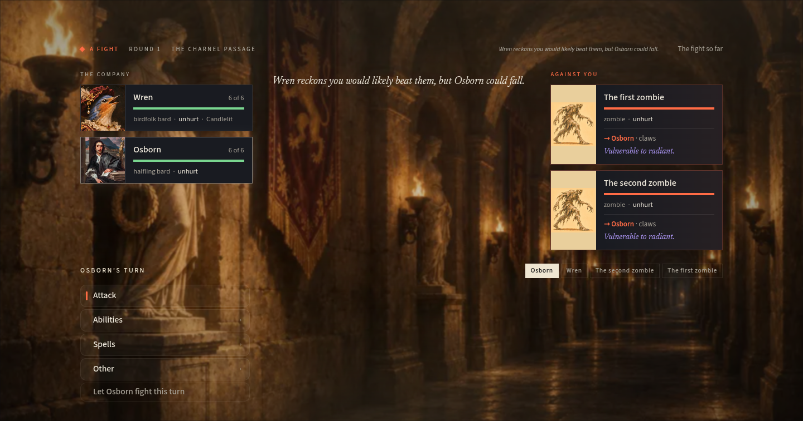

**The road and Marblehollow.** The 3D hex map is a pretty diorama: low-poly forest hexes, fog over the unknown, my bird portrait as the pin. Marblehollow sits one hex south. "Set out" put me in "the country about Duskley", where *a pedlar … lifts his staff to you from a long way off.* The map panel said "Someone is here." Its big primary button said **ENTER DUSKLEY**, the town I had just left. I chose "Stay out here" and opened Talk, and the pedlar's portrait appeared. Clicking it did nothing, and neither did a long press. Clicking the encounter line opened a travel log instead. The one person I met on the road could not be spoken to.

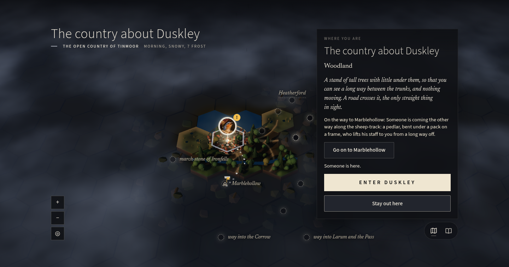
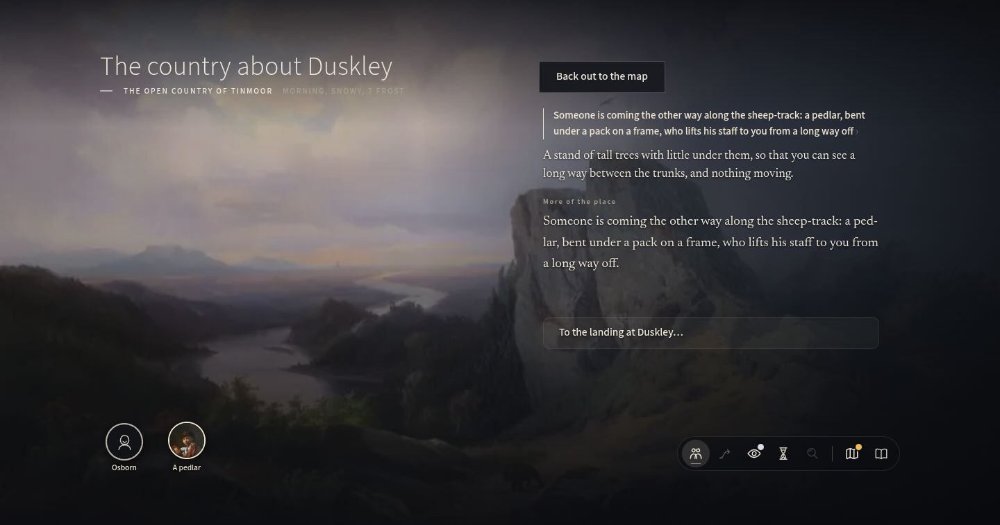

At Marblehollow the hobs on the gate took a parley. Their chief, the Gaffer, sat "on a heap of stolen fleeces in a bishop's mitre and somebody's spectacles", which is a lovely image. He offered to leave the farms alone for "a ring, a cup, a pretty", but no "give" option ever appeared. In the captives' pit a bound shepherd's boy, "trying not to cry", greeted me with the stock line *"Come in, come in, whoever you are. Everybody else has."* His tears and the cheerful line pull against each other. Reading the marks at the cave mouth pieced together where the Stone-Singers went ("If it is right, it was Greenwood"). It is a satisfying deduction, but it arrived after the game had already closed the errand. The inscription also read MARMORISCAVUS in one line and MARMORISCAW two lines later.

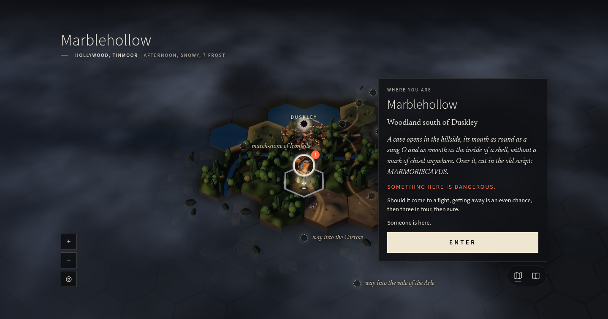
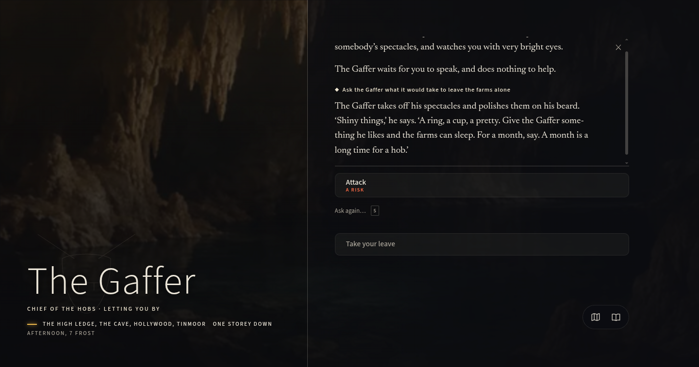

I stopped there at about 27 minutes. I had the shepherd's boy in tow, an open vault under the town, spiders in the quarry, a castellan's commission and a Gaffer to bribe. I was nowhere near short of things to do. I was short of a reason to care about any one of them, because the thread I came for had been snipped.

### Run 2: Hild, dwarf warrior, once a prospector; direct, on a tablet

**Intent.** At 820×1180, using taps, I would find out what happened to my sister at Darkgate. I would not dawdle, break what was in the way, and fight what stood in front of me.

Each New Game generated a new country (Thornholt, Aewentaure, Mountainmoor, Ironfells). The browser crashed twice under me before the first scene; that was my own setup, not the game. The tablet layout of creation is good: two rows of cards, readable type. The top third of every creation screen is empty, though.

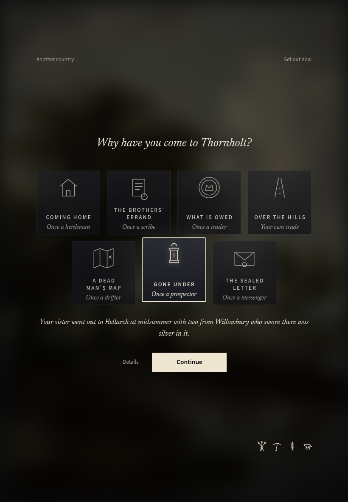

After the poacher's boy (I stood in the road to talk the keeper down, failed the deception roll, and the boy got away regardless), I came into **Barazkhafar**. The tablet scene layout is the best version of the UI I saw: painting on top, a single text card beneath, icon rail below that. Nothing overlapped.

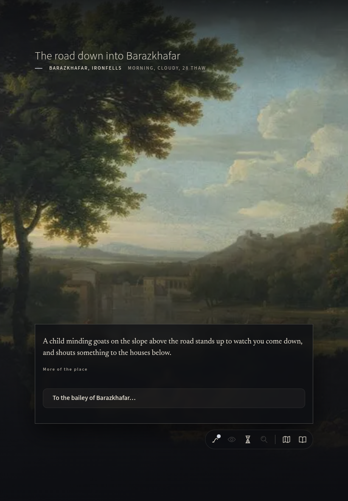

Then I recognised it. A muddy bailey, a well-post notice, **a padlocked corn-store**, a shrine, a quarry pit, an innkeeper with **the same Rembrandt portrait** (Jan Six, with the painting's credit caption in the corner) and the same first line, *"… hears you come, and finishes what he was doing before he looks round."* "A notice from Merrowdale…" sat in this taproom too. The country had a new name, but the town was built from the same kit as Duskley. The "woodland" hex outside was described word for word as in run 1: *"A stand of tall trees with little under them … A road crosses it, the only straight thing in sight."*

Being direct, I wrenched the padlock's hasp out of the corn-store door. No one in a fort's bailey said a word. I killed three rats and an old buck rat in two quick fights. The warrior's "Sweeping Strike" and "Cleave" fire on their own. After killing a rat, "Hild looks away solemnly." Searching the nest burned out my torch in one action, and searching a gallery later burned out my candle the same way.

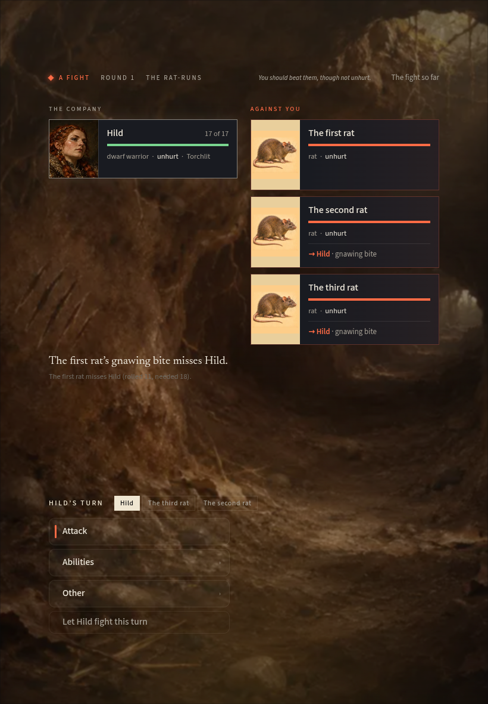

I went to the inn to ask about my sister. The innkeeper had nineteen topics. "Ask about your sister", the reason I had come to this town, was **the last one in a folded list**, below the circus, the king-barrow and "the philosophers on the green at Barzelmizela". The answer was good, though:

> 'Midsummer, at the table by the door, with the two of them, laughing about silver.' … 'she would not turn back at the door of Darkgate, where the light gives out, and so they left her there. If you go, look there, just inside.'

I hired Baern, a dwarf cleric with a spell list of twenty-two entries ("gloom, gust, … salt spray, shadow mote … toxic spray"), and opened the map. On the tablet the place card covers the middle of the screen, and Darkgate sat underneath it. I had to drag the map to find it. Tapping it said **"NO WAY KNOWN … You know no way there yet: go into the country beside it, and the way will show."** The only button was "Explore nearby · 31 places", which meant the town's alleys. I worked out that I had to tap an adjacent woodland hex, set out, and tap Darkgate again. This is the core verb of travel, and it took me five minutes.

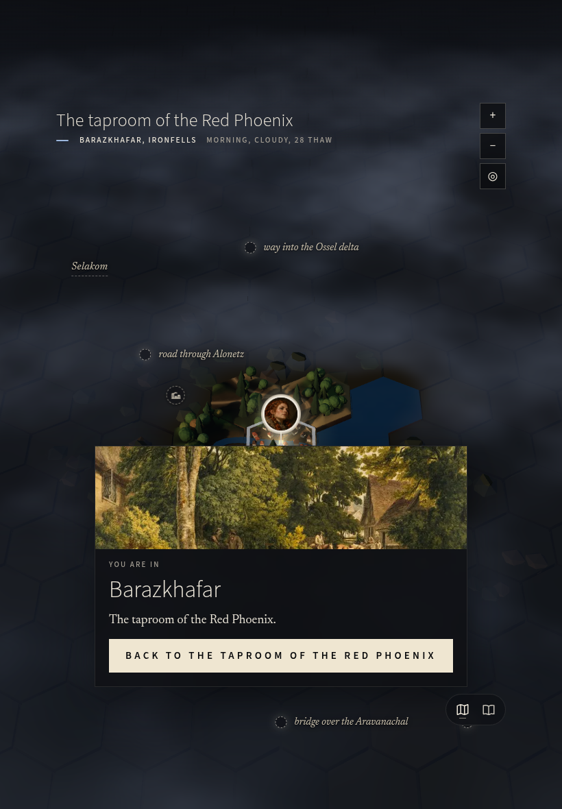
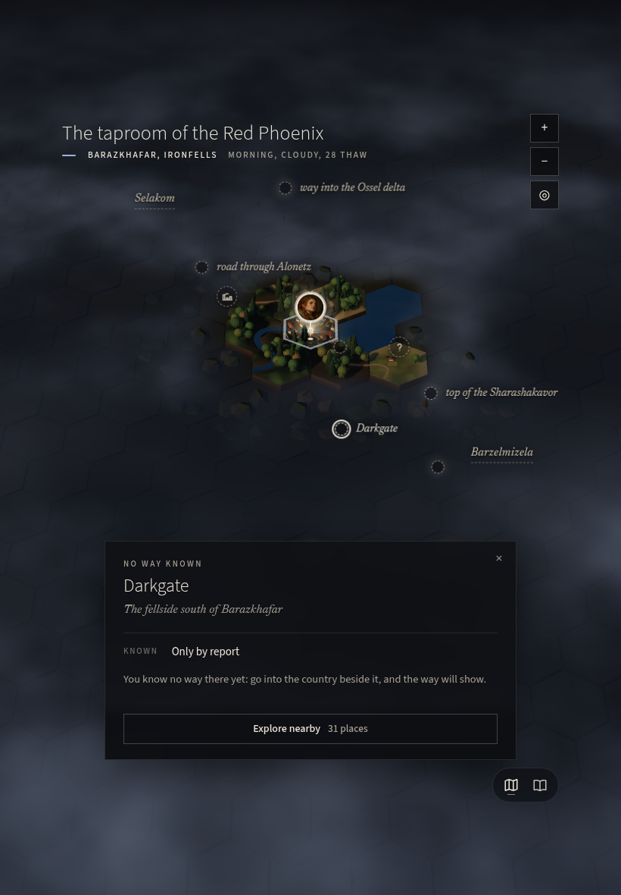

Darkgate itself was a good little dungeon to walk. A riddle door (*"I speak without a mouth…"*) with four labelled answers. A rusted lift-wheel that I broke free. Frost spiders at the foot of the shaft (the encounter called them "a frost cave spider" and the fight called them "great cave spiders"). A dressing-hall with a cold furnace. At the end, an iron door barred from *this* side, which every reader knows means "don't". I lifted the bars:

> The iron door swings open of its own weight, and the cold comes out of the dark behind it, and has a shape.

"Hild reckons it is more than the company can take." So I walked past it into the gallery beyond, and nothing happened. Behind it I found a garnet ("You collect a garnet for Hild") and a flute the game described as "a flute of pale wood … with no dust on it". Two lines later it was "a split old reed, and will not sound". When I played it anyway: "You have never played, but the flute knows how." Of my sister there was no sign, and searching "just inside" turned up nothing.

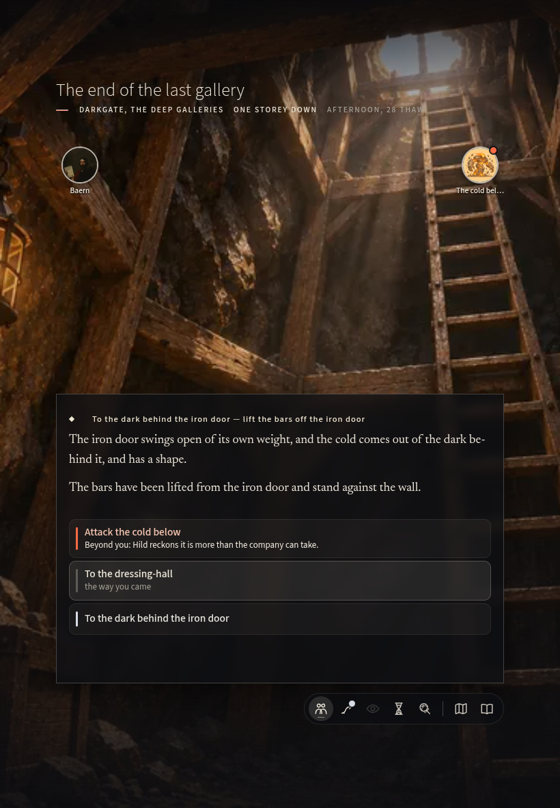

When I followed the gold "toward your aim" link, it walked me straight back into the ice elemental. The fight was honest and tense. Baern fell to a ray of frost, and Hild got the elemental to "near death". Then came this:

> Hild critically hits the cold below … 5 was all it had left. … The cold below returns with 1 HP.
> The cold below's slam catches Hild, for 7. … Hild returns with 1 HP.

The log says it was dead, and the card says it isn't. Next round Hild failed a death save and the run was over. The ice elemental's portrait, by the way, is orange fire.

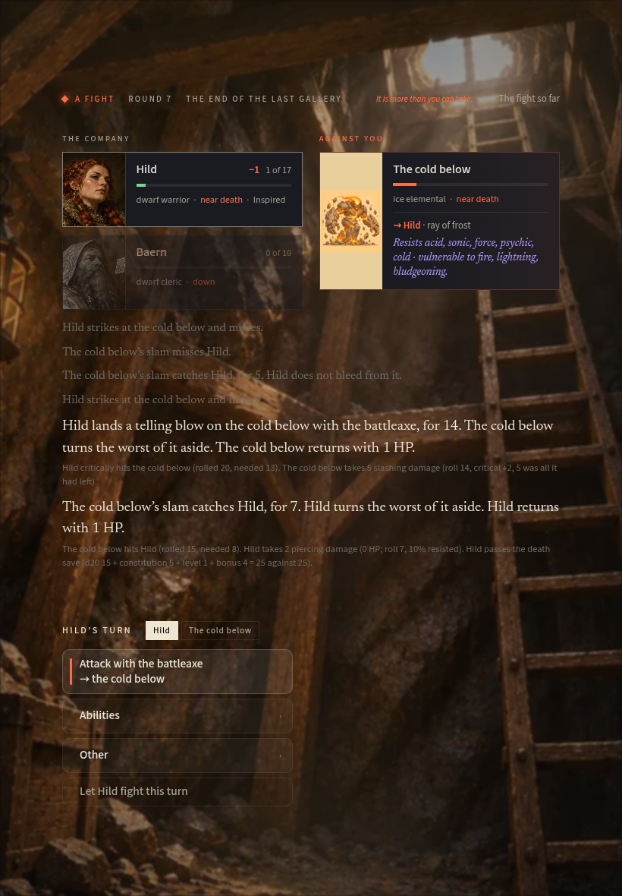

The death screen is handsome and terse: *"No one is left standing … The country goes on without you. What you did there is in the story so far."* Under it was a garbled line, "You were set upon as you went to take the iron door to the end of the last gallery." I chose "Begin again in this country", picked a trader who owes Soren fifty coin, and walked to the bailey. It was morning on day 1 again, and the corn-store padlock hung untouched. The country had not gone on. It had been reset.

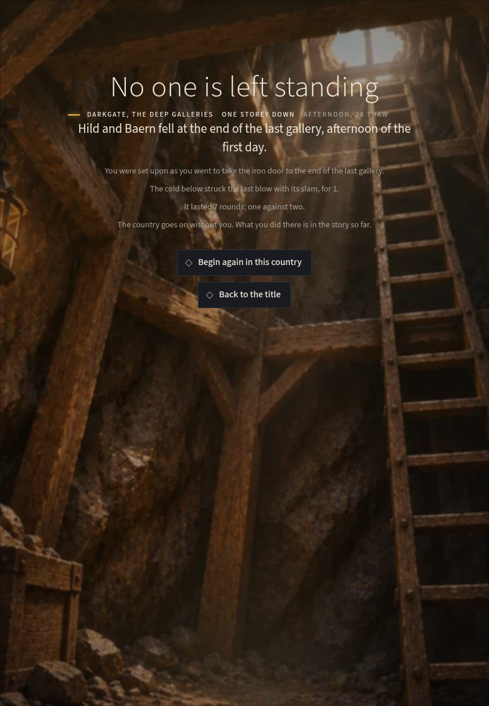

---

## 3. The moments that worked

- **Talk as investigation.** "Watch for what goes unsaid" turning into Maddie's lost brother, and that opening a new conversation, is the most promising system here. Checks are announced plainly ("an even chance · one try"), rolls are shown afterwards, and successes produce *facts*, not numbers.
- **Background as a key.** The scribe reading the miscopied ward, and then talking the grave-robber into putting out his own candle, was a real, earned, non-violent solution, and the prose for it is good.
- **The prose voice.** Short and concrete, with a dry wit. "Piety has fashions. It is a *habit*, and I should like to know who taught it." Bones "stacked to the roof in patient courses." The Gaffer in his mitre and somebody's spectacles. Maddie's "Open it, and I will not pray for you, nor heal you, nor sit up with your dead."
- **The art.** The talk portraits and most scene paintings are beautiful, and the dark, quiet UI lets them breathe. On the tablet the stacked layout is the best version of the screen.
- **Layered places.** Under Duskley's churchyard are a crypt, an ossuary, a charnel passage, an undercroft "older than anything above it" and a sealed vault, each a click deeper. That vertical surprise is exactly what a dungeon-curious player wants.
- **The road prologue.** A poacher's boy, a keeper's whistle and four choices, before you have seen a menu. It gives the run a moral texture from the first minute.
- **Combat legibility.** Enemy intents, honest odds ("Hild reckons you would likely beat them, but Baern could fall"), and an optional detailed log. The fights are short enough not to drag.

---

## 4. The most damaging failures

**1. The story you chose can be finished by accident, off-stage.** One question to a hired scholar declared the Marblehollow inscription "read and set down", and the priestess paid out for a copy I never made. A cold player's whole reason for being there evaporated at minute fifteen, and everything after felt optional. In run 2 the sister's trail ran out "just inside" Darkgate with nothing there, so neither of my chosen reasons ever paid off in the place it pointed to.

**2. A tap or click doesn't select in creation.** Every card says ", hold to do it", and only a long press works, with mouse and touch alike. It is the first thing any player does, and it fails silently.

**3. The world contradicts itself, and often.** A Roman summer temple under a "snowy, 7 Frost" header with peat offerings. "I did not know he was still living" about a man who appears to be standing in the room. MARMORISCAVUS and MARMORISCAW, OBSCURUSPORTA and OBSCURUSPORT. A flute that is pale wood, then a split reed, and plays anyway. "You have no light" above "light a candle". An ice elemental painted as fire. A monster at "5 was all it had left" that is still swinging. A death screen that says the country goes on, followed by a fresh morning with the padlock rehung. Each is small, but together they keep reminding you that no one is minding the world.

**4. Towns are a kit, and it shows by the second run.** The corn-store padlock, the rats, the well-post notice, the shrine, the quarry, the Merrowdale notice, the innkeeper's portrait and opening line, the woodland paragraph. The procedural seams are visible within an hour. The generated names also wobble ("Hollywood", "Peahgiba", "Lent" in a land of Danu and Aine).

**5. Too many threads, and the important one is buried.** In my first eight minutes in Duskley I collected nine aims and rumours. The innkeeper in run 2 offered nineteen topics, and my sister came last. Talk lists, the "All 36" destination list and Baern's twenty-two spells are menus, not conversations. It is generous, but a newcomer can't tell what matters.

**6. Things that look interactive, aren't.** The pedlar on the road can't be spoken to. The Gaffer names his price, but you can't pay it. "The goblins slip away from you" when no goblins were ever introduced. An enemy that is "beyond you" lets you stroll past. "ENTER DUSKLEY" is the primary button while you are leaving Duskley.

**7. Travel is harder than it should be.** "No way known" leaves you only "Explore nearby · 31 places" (the town), when what you need is the adjacent hex. On the tablet the place card covers the target. Room exits shuffle: "Back" means wherever you came from, and the way up from a cellar can drop out of the list until you open Go.

**8. Mechanics leak into the prose.** "Hild gains inspired for 3h." "Baern takes 2 true damage." "The first great cave spider is under migraine." "You collect a garnet for Hild." "Told you … — the boy … told you" for something *I* did. And `*habit*` shows its raw asterisks in the Story log.

---

## 5. If I could change only three things

1. **Protect the chosen reason.** Make the creation reason the spine of the first hour. It should complete only *at* the place it names, by the player's own act. Elsewhere it can collect clues (Osborn's theory should be a clue, not a completion), and the town should keep pointing back to it until it is done.
2. **One coherence pass on what the player sees.** Make the painting agree with the season and the prose. Use one spelling per inscription. Don't contradict an object description within a paragraph. Keep combat HP and the log in agreement. Let the death screen tell the truth about persistence. Make every portrait and "someone is here" either answerable or plainly not.
3. **Make the first touches obvious.** A click or tap should select in creation, with holding as an optional shortcut. Fix the primary button on the map when you leave a town. Offer "head for the edge of the country beside it" as the action when no way is known. Put the player's own reason at the top of every talk list.

---

## 6. Would I play it again tomorrow?

Yes, but only half for the game in front of me. I'd come back for Maddie's grief and the miscopied warding line, for the Gaffer in his mitre, for the cellar under the cellar under the churchyard, and to see Greenwood, where the Stone-Singers went. Those moments have a voice and a sense of history that most RPGs never reach.

I'd come back warily, though. In fifty minutes the game told me my errand was done when it wasn't, contradicted itself about a dozen times, and greeted me in my second country with the first country's innkeeper. A world needs to keep its own story straight before it can ask me to keep mine. Right now Westernesse writes like a novelist and remembers like a slot machine. Fix the spine and the seams, and I would play it for a week.
