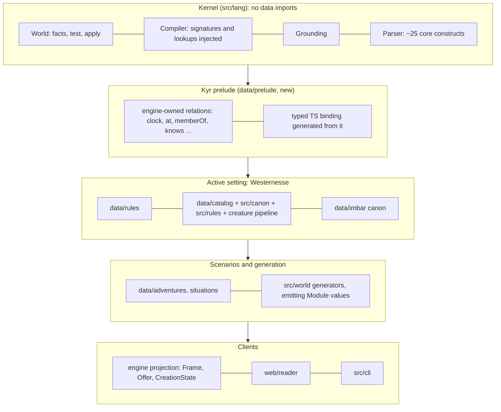
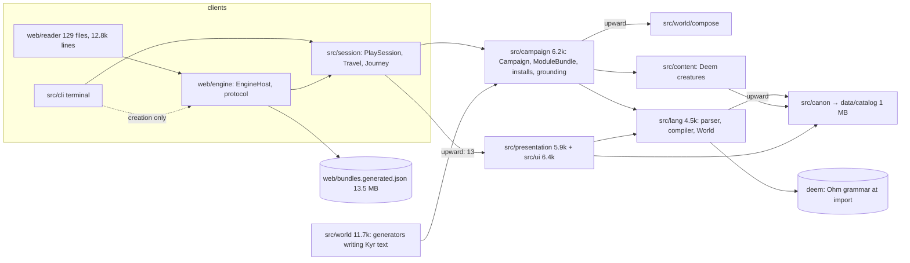

# Kyrie: an independent architecture review (November 2026)

An outsider's reading of the engine behind Westernesse, from the code and from measurements, not from the project's
own conclusions. Where the project's documents (`doc/architecture/mission-21/loading-boundaries.md`,
`order-independent-generation.md`, `workflow-parity.md`) say something the code or the numbers do not, it is said
below (section 7). Nothing in `src/`, `web/` or `data/` was changed. The probes written for this review are
`scripts/review-2026-11/*.ts`. Each one says what it measures in its header. They share one way of starting each
scale (`scripts/review-2026-11/scales.ts`), and they pass lint and typecheck.

## 0. Conditions

| | |
|---|---|
| commit | `8fd20138` (`origin/ci/lead-10`, 26 commits ahead of `main` at `87d9d584`), branch `review/architecture-m21` |
| machine | Intel i9-9900K (8 cores, 16 threads), 15 GB RAM, WSL2 (Linux 6.18.58.1), Ubuntu 22.04, Bun 1.4.3 |
| load | **shared and busy**: other agents' `bun test`, Firefox and Chromium ran throughout; load average 5–16 |
| parse store | `node_modules/.cache/kyrie-parse`, warm unless a row says *cold* (`KYRIE_PARSE_STORE=0`) |

Because the machine was shared, absolute times vary by ±30–50 % between runs of the same command. Every timing
table gives two runs where two were taken, and the findings rest on proportions, counts, sizes and scaling curves,
which do not vary. A quiet machine will give lower numbers. Re-run the commands one at a time.

### Commands that reproduce every number

```sh
bun scripts/load-costs.ts                                   # Table 1 (the project's probe; ~80 s; heavy)
bun scripts/review-2026-11/start.ts full --seed=fresh1      # Table 2, a new world (heavy, ~10 s)
bun scripts/review-2026-11/phases.ts full --twice --installs --series=ModuleBundle.load   # Table 3 (heavy)
bun --cpu-prof --cpu-prof-dir=/tmp/p scripts/review-2026-11/start.ts full --twice        # profile (heavy)
bun scripts/review-2026-11/profile.ts /tmp/p/*.cpuprofile 60 --callers='^structuredClone$'
bun scripts/review-2026-11/turn.ts full | scenario          # Table 5 (heavy for full)
bun scripts/review-2026-11/phases.ts full --turns=5         # Table 5, per turn (heavy)
bun scripts/review-2026-11/rules-size.ts                    # Table 4 (light, ~2 s)
bun scripts/review-2026-11/exclusive.ts                     # Table 6 (light, ~25 s single-threaded)
bun scripts/review-2026-11/import-times.ts                  # Table 7 (light, 75 small processes)
bun build <entry> --target=bun --metafile=/tmp/m.json --outdir=/tmp/o && bun scripts/review-2026-11/imports.ts /tmp/m.json <entry>   # Table 8
bun scripts/review-2026-11/layers.ts                        # Table 9 and the layer diagram (light)
bun scripts/review-2026-11/hardcoded.ts [--names=<category>] [--examples=<category>]           # Table 11 (light)
bun scripts/review-2026-11/kernel.ts                        # the kernel prototype (light)
bun scripts/review-2026-11/unknown-reads.ts tiny | scenario # silent fact reads (light for tiny)
bun scripts/review-2026-11/seeds.ts                         # Section 4's seed and order demonstrations (~8 s)
```

---

## 1. Where initialization time goes

### 1.1 Each scale, cold, warm and again (the project's own probe)

`bun scripts/load-costs.ts`, two sweeps (17:20 and 17:44). Each mode runs in a fresh process: *cold* has no parse
store, *warm* has a full store, and *again* runs the same start a second time in one process.

| scale | import ms | cold run ms | warm run ms | again ms | what a warm run crosses |
|---|---:|---:|---:|---:|---|
| kernel: one module parsed, compiled, grounded | 151 / 104 | 11 / 11 | 12 / 10 | 1 / 1 | 1 parse |
| rules: the 18 shared rule files parsed (116 KB) | 62 / 59 | 314 / 311 | 338 / 285 | 6 / 4 | 18 parses (the store is not used by this scale) |
| tiny (`Tiny.start`) | 164 / 144 | 569 / 534 | 248 / 215 | 89 / 93 | 2 installs (canon + module), 1 Deem creature |
| one adventure (Low Water) | 154 / 146 | 2,056 / 2,097 | 619 / 592 | 91 / 89 | 2 installs, 57 creatures |
| Deem draws one country | 184 / 139 | 176 / 160 | 164 / 159 | 33 / 59 | 1 region |
| **full Westernesse (a1)** | 201 / 246 | **16,783 / 14,410** | **9,255 / 6,190** | **9,293 / 5,839** | 39 installs, 627 creatures, 187 texts kept (4.9 MB) |

The full world, cold: parse 151 texts (3.35 MB) took 9.0 / 8.2 s, installs 7.1 / 6.2 s, the campaign 15.6 / 13.0 s,
world assembly 0.7 / 1.0 s, creatures 0.18 s, screen 0.46 / 0.38 s, leaf 0.03 s. Warm: installs 3.3 / 2.2 s,
campaign 7.9 / 5.1 s.

Three things stand out:

1. **Cold parsing is about 2.4 ms per KB of Kyr** (3.35 MB in 8.2–9.0 s, about 400 KB/s). That is slow for a
   parser, and it is the whole of the cold–warm gap.
2. **"Again" is no cheaper than "warm" for a drawn world.** The campaign load cache (`Campaign.loads`, a
   `LoadCache` keyed by `BundleSource` identity, `src/campaign/load-cache.ts:12`) never hits for a generated world.
   `WorldAssembler.assemble` returns a new `OverlayBundleSource` every time (`src/world/world-assembler.ts:138`), so
   the key never repeats. The cache still forks on the first take (`campaign.ts:89-90`, `use = l => l.fork()` runs on
   every take), so each drawn start pays a fork it cannot use: 122–186 ms at a1. The original stays alive, held by
   the WeakMap for as long as the session holds the source. Once the session is dropped it is collected. I checked:
   the heap after GC was 158 → 165 → 167 MB over three starts in one process, so there is no leak.
   (`Scenarios.source()` in the page's engine is likewise a new `MemoryBundleSource` per call,
   `web/scenarios.ts:83`, seven call sites, so every cache keyed by source misses there too:
   `LoadCache`, `ModuleCanon.sources`, `Composition.vocabularies`, `CityResidents.read`.)
3. **The warm a1 figure is the replayed-seed figure, not a player's.** See 1.2.

### 1.2 A new world, the cost a player actually pays

`bun scripts/review-2026-11/start.ts full --seed=fresh1` (and `fresh2`), with the parse store warm for every
authored file:

| seed | start ms | parsed fresh | parse ms | installs | campaign ms |
|---|---:|---|---:|---:|---:|
| a1 (replayed) | 6,190–9,255 | 0 | 0 | 39 | 5,111–7,879 |
| fresh1 | 10,221 | 61 texts, 1,671 KB | 4,272 | 39 (2,559 ms) | 9,461 |
| fresh2 | 10,657 | 55 texts, 1,684 KB | 4,191 | 38 (2,433 ms) | 9,930 |

A country nobody has seen yet writes about 1.7 MB of new Kyr text in TypeScript (`RegionWriter`, `ScenarioWord`,
`Origins`, `RegionRecruits` and the rest; section 3) and parses it all again with Ohm. **That round trip, from
generator to text to parser to AST, is about 4.2 s of a 10 s new-world start**, roughly 40 %. The disk store cannot
help, because the text is new. The browser keeps parses in IndexedDB (`web/engine/parse-keep.ts`), but keyed by
`BuildStamp`, so after every deploy the first start in a browser is the *cold* column again: 13–17 s on this machine,
less whatever `warmRules`/`prepare` read ahead while the player was on the title and creation pages.

### 1.3 Where a warm full start goes, stage by stage

`src/costs.ts` notes only the boundaries `src` chose to note. Its tally leaves 3.4–4.6 s of `campaign` unexplained
(campaign minus install), and its `session` stage is identical to `campaign`. To attribute that time I wrapped the
inner stages in place (`scripts/review-2026-11/phases.ts`; the wrappers live in the script, not in `src`). The times
are inclusive and overlap. The second round of `--twice` is shown, with a1, warm:

| stage | calls | ms | note |
|---|---:|---:|---|
| `Campaign.assemble` | 1 | 9,072 | (wrapper overhead and machine load inflate the totals; read the proportions) |
| `ModuleBundle.load`, an install's draft | 39 | 3,706 | of which `ModuleAssembly.compose` 1,784, `ModuleNamespace.draft` 763, `own` 464 |
| `structuredClone`, all callers | 49,302 | 1,681 | profile below: about 1.1 s of self time a start |
| **`Composition.expand` (kits)** | 1 | **1,365** | **of which `Geography.distances` 1,119** |
| `ModuleInstallations.prepare` (join) | 39 | 1,324 | |
| `ModuleCompiler.validate` | 52 | 1,190 | once per install over rules and module, plus the whole |
| `CreatureFacts.project` | 39 | 942 | |
| `ModuleInstallations.populate` | 37 | 903 | |
| `ModuleCompiler.instantiate` | 39 | 837 | |
| `WorldAssembler.assemble` | 1 | 663 | Deem country 118, `RegionWriter.write` 249 |
| `ModuleInstallations.check` (whole) | 1 | 538 | |
| `ScreenModel.build` (first observation) | 1 | 465 | `PlayerView.observe` 232 of it |
| `EngineDeclarations.declare` | 38 | 454 | |
| `Projection.refresh` | 2 | 444 | |
| `Content.createCreature` | 627 | 294 | Deem `generate` 1,318 calls, 297 ms |
| `Campaign.fork` (load cache, unusable) | 1 | 186 | |
| `CanonInstall.first` (data/imbar) | 1 | 53 | |
| `Narrator.leaf` | 1 | 29 | |

A CPU profile of two warm starts without wrappers (13.8 s sampled; `bun --cpu-prof` and then
`scripts/review-2026-11/profile.ts`) gives, per start:

- **`structuredClone` self time: about 1.1 s (16 %).** By nearest caller: `ModuleBundle.loading` about 200 ms (the
  merged shared rules copied for every install, `module-bundle.ts:340`), `ModuleNamespace.action` about 175 (each
  action copied while namespacing), `ModuleAssembly.compose` about 160 (`definition.schemas = structuredClone(...)`,
  `module-assembly.ts:85`), `ModuleBundle.own`/`parsed` about 210 (`module-bundle.ts:124`), `ModuleNamespace.change`
  about 105, `Composition.region` about 75 (the region parsed again for the ledger, a cache hit copied),
  `Campaign.fork` about 66, `ModuleInstallations.extended` about 51.
- **`Geography.reach` and `distances`: about 640 ms.** Dijkstra with a linear minimum scan
  (`compose/geography.ts:119-120`) from every room: 480 rooms, 23,984 `hours` facts committed to the ledger
  (O(R²) facts, roughly O(R³) work). Measured alone: 1,214 ms.
- **`World.change`: about 300 ms of self time.** It is quadratic for exclusive relations (Table 6).
- **`LocalKinds.seen`: about 120 ms.** Every parse lookup builds its cache key by scanning the text for every
  installed kind id (`canon/local-catalog.ts:102-106`).
- Ohm's semantics, for Deem expressions and `ModuleParser.predicate` at run time: about 270 ms.

### 1.4 The per-install fixed cost: the shared rules recomposed for each

`bun scripts/review-2026-11/rules-size.ts`

| the 16 world rule modules joined | |
|---|---|
| Kyr | 113 KB; 82 actions, 263 relations, 183 entities, 22 initial facts, 54 rules |
| serialized | 0.22 MB (actions 0.12 MB) |
| `structuredClone(rules)` | 3.2 ms (median of 15) |
| `structuredClone(rules.actions)` | 1.7 ms |
| `ModuleAssembly.compose(a one-place situation, rules)`, the copy aside | **9.6 ms** (20.7 in a second, busier run) |

Every install joins its own module to a fresh copy of the whole rule set, compiles and validates the join, copies its
actions as schemas, namespaces each action again, and then `ModuleInstallations.prepare` dedupes the rules back out
(`union`, `module-installations.ts:64-80`). So every install starts at about 15–20 ms before any content of its own.
a1 has 39 installs (`--installs`): canon 63 ms, region 858, circus 273, howe 122, walk 100, keep 91, arcology 90 …
and **13 `word` modules (19–43 ms each) and 8 kit fragments (`raiders*`, `tollKeepers`, `pricePatron`, 19–33 ms
each)**. Twenty-one of the 39 installs are fixed overhead with little content: about 0.6 s.

### 1.5 Repeated or unneeded work, an inventory

| what | where | cost (a1 warm) |
|---|---|---|
| shared rules copied, recomposed and revalidated per install | `module-bundle.ts:340`, `module-assembly.ts:75-85`, `module-namespace.ts:59-63` | ≈0.6–0.8 s |
| three parse caches, each returning copies: `ParseStore` (disk, v8 serialize), `ParseCache` (copies on set, `parse-cache.ts:22`; `ModuleParser.parse` copies on hit, `module-parser.ts:96`), `ModuleBundle.parses` (copies on every return, `module-bundle.ts:124`) | `src/lang`, `src/campaign` | ≈0.3 s of clones |
| a fork no one can reuse, on every drawn start | `campaign.ts:89-90`, `load-cache.ts:17` | 120–190 ms |
| all-pairs hours between 480 rooms, committed whether a kit reads them or not | `compose/geography.ts:90-130` | ≈1.1–1.2 s |
| exclusive-relation asserts scan the whole relation | `lang/world.ts:334-339` | ≈0.3 s now; quadratic (Table 6) |
| a cache key that scans every installed kind for each lookup | `canon/local-catalog.ts:102` | ≈0.12 s |
| region files parsed for the ledger and again for the install (hit, copied) | `compose/composition.ts:80`, `module-bundle.ts:150` | ≈75 ms |
| a journey builds a full screen and leaf for every leg, and shows only the last | `web/engine/engine-host.ts:250-251` → `perform` → `settled` (`:313`) | ≈300 ms per extra leg at a1 |
| `campaign.state` (a deep copy of state and creatures) read for one field | `world/frontier.ts:143` (`campaign.state.calendar`) | 61 ms each time |
| loaded at import, not needed by the caller: | | |
| · Deem's grammar built from `.ohm` source, for validating ability conditions | `lang/parse.ts:1`, `deem/src/deem.ts:25` | 50–130 ms per process (½ of the parser's import) |
| · the 1 MB catalog, for one ability lookup in the compiler | `lang/module-compiler.ts:2-4, 280` | the compiler's import 117 → 156 ms; 36 JSON files |
| · 13.5 MB of authored files, in the terminal too | `web/scenarios.ts:1` via `engine-host.ts` | 352 ms, 36 MB heap at import |
| · the creature pipeline, paintings and Deem, for action grounding | `campaign/action-schemas.ts:6` → `engine-writes` → `creature-facts` → `content` | grounding drags in 211 files |

### 1.6 What scales with what

| grows with | stage | measured |
|---|---|---|
| bytes of Kyr text (authored cold; *generated always*) | parse | ≈2.4 ms/KB; a new country writes ≈1.7 MB |
| number of installs (39 at a1; each country beyond adds ≈10–15) | compose, compile, namespace, copy | ≈15–20 ms fixed each + content |
| rooms R in the composed country | `Geography.distances` | R = 480 → 24k facts, 1.2 s; O(R²) facts, ≈O(R³) time |
| facts in an exclusive relation (`at` 1,658 at a1) | `World.change` | quadratic: Table 6 |
| creatures (627) | `CreatureFacts.project`, `createCreature` | ≈1.5 ms per creature with projection; linear |
| whole joined module (11,339 entities, 2,287 action schemas) | final `check`, save, restore, per-turn screen | Table 5 |

### 1.7 After the start: a turn, a save

`bun scripts/review-2026-11/turn.ts full` and `scenario`; `bun scripts/review-2026-11/phases.ts full --turns=5`
(and `--turns=10`):

| | a1 | Low Water |
|---|---:|---:|
| entities / action schemas / relations / facts | 11,339 / 2,287 / 2,511 / 32,720 | 1,418 / 510 / 656 / 2,637 |
| screen: first / again unchanged / after one command | 331 / 80 / 190 ms | 118 / 36 / 42 ms |
| leaf: first / again / after | 33 / 13 / 70 ms | 18 / 3 / 26 ms |
| one `wait` through `PlaySession.perform` | 323 ms (124 in a quieter run) | 47 ms |
| **a whole turn (perform, screen, leaf), mean of 5 / 10** | **486 / 525 ms**, of which the screen **306 / 330** | – |
| of the screen: `PlayerView.observe` | ≈95–107 ms per turn | |
| of the screen: `ChartModel.build` (every known place's ways, `ui/chart-model.ts:39-52`, `passage-model.ts:70-83`) | ≈93 ms per turn | |
| the world's own turn (`WatchLoop.pass`) | 33 ms | |
| `campaign.state` | 61 ms | 7 ms |
| `save()` (copied) / checkpoint to JSON | 262 / 408 ms | 48 / 63 ms |
| **save size** | **19,176 KB** (compiled module 11,073 KB, creatures 309 KB) | 2,800 KB (module 1,622 KB) |
| restore from JSON | 841 ms | 180 ms |

**At full scale the presentation costs more than the simulation**: about 63 % of a turn is building the screen,
and most of that is recomputed for the whole known world after each command (the caches are WeakMaps keyed by the
`World`, which every command replaces). A save holds the compiled world, so it is 19 MB and grows with every country
drawn.

### 1.8 Table 6: exclusive relations are quadratic

`bun scripts/review-2026-11/exclusive.ts`. `World.change` copies an exclusive relation's facts into an array and
scans it on every assert (`for (const [k, call] of [...named])`, `src/lang/world.ts:334-339`):

| facts asserted in one apply | exclusive `at` ms | plain relation ms |
|---:|---:|---:|
| 1,000 | 52 | 1 |
| 2,000 | 175 | 1 |
| 4,000 | 751 | 5 |
| 8,000 | 3,937 | 8 |
| 16,000 | 16,741 | 11 |

a1 holds 1,658 `at` facts in its first country. A world that grows country by country (section 4) multiplies that.
At five countries the first-country cost of about 0.3 s becomes several seconds. An index from leading arguments to
key would make this O(1).

---

## 2. Why a small rule needs so much world

### 2.1 Import graphs (Table 8)

`bun build <entry> --target=bun --metafile` (then `scripts/review-2026-11/imports.ts`):

| entry | files | bytes | JSON read at import | the edge that drags in the setting |
|---|---:|---:|---|---|
| `src/lang/world.ts` | 8 | 48 KB | none | (clean: the true kernel) |
| `src/lang/module-parser.ts` | 99 | 795 KB | 2 (229 KB: the Kyr and Abilities grammar recipes) | `parse.ts` → `deem` → its own Ohm grammar; `→ src/spatial`, `→ information/discovery` |
| `src/lang/module-compiler.ts` | 151 | 1,964 KB | **36 (1,265 KB; the catalog 1,030 KB)** | `module-compiler.ts:3-4` → `canon/canon-vocabulary`, `canon/canon` → `data/catalog/*`; `→ expressions → fantasy-rules → data/generation` |
| `src/campaign/action-schemas.ts` (grounding) | 211 | 2,422 KB | catalog, generation, paintings | `action-schemas.ts:6` → `engine-writes` → `creature-facts` → `canon`, `content` → `canon-validation` → `data/paintings` |
| `src/campaign/campaign.ts` | 291 | 2,969 KB | 61 (1,543 KB) | `→ company-choices → paintings/likeness`; `module-bundle → world/compose/composition` |
| `src/session/play-session.ts` | 381 | 3,660 KB | 73 (1,618 KB) | `→ presentation/player-view`, `undertakings`; `→ narrative/telling → presentation/narrator → instruments → data/imbar/sky.json` |
| `src/ui/screen-model.ts` | 384 | 3,717 KB | 79 (1,718 KB) | `→ presentation/mechanics-text → deem`; `→ world/seats → world-grid → place-names → languages` |
| `test/support/tiny.ts` | 450 | 4,148 KB | | everything above |
| `src/world/drawn-world.ts` | 546 | 5,327 KB | | |
| `web/engine/engine-host.ts` | 619 | 19,021 KB | **`web/bundles.generated.json` 13,231 KB** | `→ web/scenarios` (imported by `src/cli/kyrie.ts:4`, so by the terminal too) |

(Bun's metafile marks a few relative imports (`./lang/world`, `../creature-store`, `./operators`) as "external",
apparently a bundler quirk. Those are small files already counted under other entries.)

Import time, fresh process, median of 5 (`scripts/review-2026-11/import-times.ts`, Table 7): `world.ts` 4 ms;
`grammars.ts` 24; `deem` 50; `module-parser` 117; `canon` 123; `module-compiler` 156; `content` 190; `campaign` 220;
`play-session` 249; `screen-model` 252; `tiny.ts` 277; `drawn-world` 311; `engine-host` 352 (36 MB of heap). A
noisier earlier run gave about twice these figures, with Deem 130–200 ms and the parser 243–278 ms. In both runs Deem
is about half the parser's import.

### 2.2 What a tiny world still installs

`Tiny.start('Place yard … Company party …')` crosses (Table 1): two installs, each with all 16 world rule modules,
because the canon (`data/imbar/module.json`, 6 Kyr files) declares `"rules": ["world"]` and is installed first in
every campaign whose source has a `data/imbar` (`campaign.ts:111`, `CanonInstall.first`). It also makes one party
member by Deem (`SingleModule`'s default `Ama`, through the whole creature pipeline and catalog), and builds a full
`ScreenModel` and leaf. The one-place world ends up holding **746 entities, 82 action schemas, 263 relations and
243 facts** (`bun scripts/review-2026-11/turn.ts tiny`): the canon's planes and the catalog's kinds, almost none of
them its own. In process this is about 74–93 ms; in a fresh process 215 ms warm and 534 ms cold. The
`rules` option exists (`single-module.ts:14`), but the canon install does not depend on it.

What prevents a setting-independent Kyr runner today:

1. **The compiler reads the catalog** (`module-compiler.ts:2-4`, used once at `:280` for `ability` arguments), and
   `expressions.ts` imports `fantasy-rules` and its tables.
2. **The parser carries the ability language and Deem** (`module-parser.ts:1` → `parse.ts`). Deem is used only to
   check that ability conditions and amounts parse (`parse.ts:188, 195`), and it builds its grammar from source at
   import.
3. **Grounding lives in `src/campaign`** and imports the creature pipeline (`action-schemas.ts:6`).
4. **The watch (rules firing, people acting) runs only inside a `Campaign`**, which requires the canon, the shared
   rules and a party of Deem creatures.
5. **The shared rules are not self-contained.** They name catalog things (`data/rules/probing.kyr:9`,
   `needs(prodding, pole)`), which only `Cast.itemKinds` declares while composing with a situation. Compiled alone,
   the rules fail with `Invalid argument pole in needs(prodding, pole)`.
6. **The kernel hard-codes the rules' vocabulary.** `src/lang/engine-owned.ts:8-14` lists by name 30 relations
   declared in `data/rules` (`watch`, `dark`, `memberOf`, `ownedItem`, `knows`, …).

**Prototype** (`scripts/review-2026-11/kernel.ts`, about 15 lines of logic). It parses a Kyr module, then grounds,
tests and applies its action with only `ModuleParser` and `World`: no compiler, campaign, canon, catalog or Deem
creature. Result: `world.ts` imports in 2 ms and the parser in 60–66 ms; parse 4.3 ms; ground, test and apply
0.8 ms; the goal holds. The kernel the project needs is already present in `src/lang/world.ts`. What is missing is a
boundary around it.

### 2.3 What the test suite pays for world

From `test/timings.json` (written at `2ce8c468`; per-file wall time under `--parallel`, so contended, but comparable
between files). Each file is classified by the harness its source uses, by regex over its text:

| a spec that starts | files | file-time | share | mean per file | files > 10 s |
|---|---:|---:|---:|---:|---:|
| a generated country (`WorldAssembler.assemble`, `DrawnWorld.start`, or a support fixture that does) | 302 | 25,788 s | **57 %** | 85 s | 284 |
| an authored campaign (`PlaySession.start`, `Campaign.load`, adventure fixtures) | 204 | 12,621 s | 28 % | 62 s | 98 |
| no session | 324 | 5,803 s | 13 % | 18 s | 63 |
| an engine host or a browser | 44 | 945 s | 2 % | 21 s | 14 |
| **`Tiny.start` / `Alone.start`** | **48** | **60 s** | **0.13 %** | **1.25 s** | 0 |

`WorldAssembler.assemble` appears in 203 spec files, `DrawnWorld.start` in 65, `Tiny.start` in 64 and `Alone.start`
in one. A spec that draws a country costs about 70 times one that does not. **The largest test-time lever is
moving the specs of a situation's own rules from a generated country to `Alone`/`Tiny`**, not making the country
faster. `test/support/alone.ts` already exists for this. It has one user.

### 2.4 Inexpensive boundary changes, by payoff

1. Inject the compiler's catalog lookups (`new ModuleCompiler(signatures, { ability: id => … })`): the compiler no
   longer imports `canon`, and its import loses 36 JSON files.
2. Load Deem lazily in `parse.ts`/`module-compiler.ts`, or ship Deem's grammar as an Ohm recipe, as Kyr's already is
   (8e48572c): about half of the parser's import.
3. Move grounding (`ActionSchemas.ground/instance`) into `src/lang`, and pass `EngineWrites` in as a parameter.
4. `SingleModule({ canon: false, rules: ['core'] })` and a fixed, Deem-free member for kernel specs.
5. Write new situation specs on `Alone`. Its host is a dozen lines of Kyr.

---

## 3. Westernesse in the TypeScript

### 3.1 Inventory (Table 11)

`bun scripts/review-2026-11/hardcoded.ts` reads all 37,738 string literals in `src/` and `web/` with the TypeScript
parser and matches each whole against the ids the data declares. Generic words (`at`, `name`, `party`, …) are
excluded, so the counts are lower bounds for some categories. Ambiguous matches remain (for example `travel` and
`magic`, which are domain ids as well as words), so the deity/domain and some rules rows overcount. Use `--names` to
see each category's matches.

| category | ids declared | distinct named in TS | lang | campaign | world | presentation | ui | cli | web/reader | all |
|---|---:|---:|---:|---:|---:|---:|---:|---:|---:|---:|
| **data/rules relation read by name** (first argument of `world.one/related/relatedTo/measured/relates/declares/stamp`, `ModuleWriter.call`) | – | **159** | 23 | 220 | 36 | 169 | 159 | 12 | 0 | **723** |
| any data/rules relation, action or entity named | 557 | 306 | 197 | 378 | 89 | 307 | 339 | 98 | 188 | 1,949 |
| **Kyr source written as strings** | – | – | 2 | 9 | **104** | 0 | 0 | 23 | 0 | 142 |
| prose (literals of six words or more) | – | – | 45 | 52 | 223 | 63 | 41 | 250 | 132 | 1,244 |
| species / variation / plant | 247 | 49 | 2 | 12 | 80 | 12 | 6 | 2 | 24 | 211 |
| ability / trait / condition / skill | 99 | 28 | 2 | 9 | 5 | 32 | 30 | 1 | 14 | 146 |
| ancestry / calling / background / profession | 403 | 47 | 2 | 3 | 30 | 6 | 6 | 21 | 6 | 138 |
| item | 408 | 47 | 5 | 9 | 13 | 9 | 20 | 3 | 41 | 124 |
| scenario / adventure id | 46 | 6 | 1 | 0 | 3 | 2 | 5 | 5 | 1 | 21 |
| canon (data/imbar) entity | 146 | 1 | 0 | 1 | 0 | 0 | 0 | 2 | 0 | 4 |

Most-named relations: `at` 150, `connects` 37, `leadsTo` 31, `knows` 26, `itemKind` 23, `memberOf` 19, `capable` 15,
`pronouns` 14, `watch` 13, `able` 13, `ownedItem` 12 … The files that name most: `campaign/local-observations.ts`
(29), `campaign/creature-facts.ts` (29; 105 rules names in all), `ui/chart-model.ts` (28),
`presentation/aim-leads.ts` (28), `ui/screen-model.ts` (23), `ui/passage-model.ts` (22). Ancestry and profession
ids: `paintings/likeness.ts` (36). Kyr written in TS: `world/region-tracts.ts`, `scenario-word.ts`, `origins.ts`,
`region-recruits.ts`, and the `cli/new-*` authoring tools.

Two more measures:

- **The Kyr grammar is the RPG's grammar.** `src/lang/Kyr.ohm` has 110 capitalized keywords. About 25 are a rule
  language (`Module Kind Relation Entity Initially Action Requires Assert Retract Set Increase Decrease Goal Budget
  Query Measure Rule Description Cost Resolve Result Otherwise …`). The rest belong to the world model:
  `Person Race Class Calling Ancestry Species Undead Lair Slay Hurts Guards Sells Buys Offers Pronouns Likeness
  Temperament Grave Hazard Company …`. `ModuleParser`'s semantics table (`module-parser.ts:22-89`) wires about 150
  of these actions.
- **Relation reads by name are unchecked.** `World.related/relatedTo/one` return no facts for a name the module does
  not declare (`world.ts:69-80`), where `world.test` of the same name throws. Over a tiny start and five turns,
  4,060 reads by name were made. In Low Water, 28,836. In each, one undeclared name (`mounted`, 6 reads) was read
  silently (`scripts/review-2026-11/unknown-reads.ts`). The incidence today is low, so the hazard is structural:
  rename a relation in `data/rules`, and 723 TypeScript literals go quietly blank instead of failing to compile.

### 3.2 The most consequential cases

1. **The kernel owns the rules' names.** `src/lang/engine-owned.ts:8-14` (30 relation names) and
   `module-compiler.ts:2-4, 280` (the catalog). Engine-owned state should be declared in a Kyr prelude, with an
   `Engine` marker the compiler reads, and the kernel should take vocabulary as data.
2. **The rule set is a list in TypeScript.** `ModuleBundle.world` (`module-bundle.ts:64-67`): 16 module names that
   every module is compiled against. A setting should declare its prelude in a manifest.
3. **Creature facts are projected by name.** `creature-facts.ts` writes about 105 rules names: hit points, ability,
   proficiency and care become `able`, `capable`, `needsCare`, `proficient`, … This is the bridge between the
   TypeScript creature model (Orsino) and the Kyr world. It is the right place for a typed, generated binding.
4. **The world's generators write Kyr as text** (104 literals in `src/world`), which is then parsed back: 4.2 s per
   new world (1.2). The generator is TypeScript in the scenario layer that knows the rules' surface syntax. It
   should build `Module` values.
5. **Presentation reads the world by relation name** (169 + 159 reads in `presentation` and `ui`). The glance, chart
   and passage models each re-derive meaning from raw facts (`connects`, `leadsTo`, `inside`, `passageKind`, …)
   instead of reading a typed projection the engine maintains.
6. **Campaign logic with setting words**: `campaign.ts:315` (prose: "Your shelter becomes unsafe…"), `:372`
   (`ModuleWriter.call('restful', site)`), `:355` (`['combat', 'recover', 'rough']`), `:297` (`'witnessedAttack'`).
   `world-assembler.ts:80-84` holds a fixture company (Elen, Bran, Dori) and `:134-137` the pitch prose.

### 3.3 Where the boundaries should lie



The test is mechanical. `bun scripts/review-2026-11/layers.ts` today finds these value imports going *upward*
against that order:

| from → to | imports | e.g. |
|---|---:|---|
| `src/lang` → `src/(root)`, `src/canon` | 6 + 2 | `module-compiler → canon/canon`, `module-compiler → expressions`, `world-constructs → item-names` |
| `src/session` → `src/presentation`, `src/ui` | 8 + 5 | `play-session → player-view, undertakings`; `travel → ui/itinerary, ui/passage-model` (journey routing lives in the UI layer) |
| `src/campaign` → `src/world`, `src/paintings` | 1 + 1 | `module-bundle → world/compose/composition`; `company-choices → paintings/likeness` |
| `src/rules` → `src/campaign` | 2 | `advancement`, `checks → campaign/party-capabilities` |
| `src/information` → `src/presentation` | 1 | `information-view → player-view` |
| `src/world` → `presentation`, `narrative`, `paintings` | 3 + 3 + 4 | |
| `src/presentation` ⇄ `src/ui` | 22 / 24 | a cycle between the two presentation layers |

---

## 4. Progressive world realization

### 4.1 What already supports it

- **Addresses.** Countries are cells (`WorldGrid.id/seed`, `world-grid.ts:13-19`). A cell's Deem draw is a pure
  function of its address, and is memoized. A neighbour's *name* is checked against the other cells' *first
  draws*, which never change (`world-grid.ts:28-36`). That is a constraint decided from addresses alone: the pattern
  this needs.
- **Streams by identity.** `RandomStreams.key(seed, domain, ...identity)` is a JSON array (`random-streams.ts:5-7`).
  `Content.createCreature` draws each domain (population, class, qualities, name, traits, spells, hit points, gear)
  on its own stream (`content.ts:160, 213-215`), so adding a trait changes traits and nothing else.
- **A global plan.** `Countries.plan(seed, first)` allocates the authored countries to cells before any of them is
  realized.
- **Coarse summaries.** `WorldGrid.drawn` gives any cell's name and terrain without laying it out. That is already a
  "stable identity, deferred detail" level.

### 4.2 What breaks it (measured)

`bun scripts/review-2026-11/seeds.ts`:

**(a) Every generated country's module has the same seed.** The seed is
`RandomStreams.key(worldSeed, 'module', <the Kyr module's own id>, request.randomIdentity ?? '')`
(`module-bundle.ts:321`). Every drawn country's source begins `Module region …` (`region-writer.ts:136, 146`), and no
request anywhere sets `randomIdentity` (it is declared at `module-bundle.ts:24` and read at `:321`, and that is
all). Each person's seed is `${moduleSeed}:creature:${localId}` (`module-namespace.ts:135`). Drawing the countries
west (`xm1y0`, Fencarr) and north (`x0ym1`, Cloudreach) of a1's first:

```
xm1y0 (Fencarr) seed ["a1","module","region",""]
x0ym1 (Cloudreach) seed ["a1","module","region",""]
module seeds equal: true
  s1_inndog_person: Storm (xm1y0) and Bran (x0ym1), both dog : {"str":11,"dex":11,"con":12,"int":13,"wis":10,"cha":11,"hp":7}
  s2_priest_person: Felix (xm1y0) and Tobias (x0ym1), both human commoner: {"str":15,"dex":12,"con":11,"int":14,"wis":17,"cha":9,"hp":5}
  s2_r7_person: Averil (xm1y0) and Oswy (x0ym1), both human commoner: {"str":12,"dex":17,"con":14,"int":13,"wis":11,"cha":10,"hp":6}
people held by the same local id in both: 88; with the same creature seed: 88
of those of the same people and calling: 17; with identical rolled qualities (all six) and hit points: 10
```

**So yes: the same generated person rolls the same body in every country.** Every person at the same local id shares
the stream in every country. Where their people and calling agree, the six qualities and hit points come out
identical (10 of 17 here; the other 7 differ by level, background or profession modifiers, not by dice). The
same holds for the first country (`region`, the same seed), and for two installations of one scenario. The
command streams are coupled too. `RandomStreams.identity` re-keys an entity by its owner's seed
(`random-streams.ts:9-12`), so `xm1y0__w1` and `x0ym1__w1` are one identity, and searching one advances the
occurrence count for the other. The comment there ("renaming an installation does not change its draws") describes
this as a feature. The project's own note calls it *inferred*. It is now measured.

**(b) A country depends on the order it is reached in.** `Frontier.drawn` (`frontier.ts:141-145`) draws a country
from what the live campaign holds: `exclude` (scenarios already placed anywhere), `taken` (works already named), `held`
(paintings already held) and `named`. The same cell, drawn first and drawn after its neighbour:

```
west of the first placed: den, unquiet-tower, drover, disputation
north, drawn first:             den word1 den2 word2 drover oxen word3 oldcoin word4
north, drawn after the west:    fever word1 quarrel word2
the same country either way: false
```

There are two more order dependences at install time: `ModuleBundle.apart` adds everyone already in the world to a
story's `taken` names (`module-bundle.ts:93-99, 323`), and `StoryPeople.reserve` renames townsfolk. A word module's
id is its placement's index (`world-assembler.ts:226`), so removing one placement renumbers the rest.

### 4.3 Feasibility and the hazards

It is feasible, and most of the mechanism exists. A design that keeps determinism:

1. **Identity is an address path**: `seed / cell / module-installation-id / local-id`. Fix (a) by putting the
   *installation* id into the module seed (`key(seed, 'module', request.id === mine.id ? '' : request.id, …)` keeps
   the first country's draws as they are and separates the rest).
2. **Global commitments are decided from addresses, not from realized state.** Replace `exclude/taken/held` with
   allocations computed from the seed over the grid, as `Countries.plan` does: a one-instance scenario gets a cell by
   a seeded draw over all candidate cells, and a name is reserved by hashing its address into the pool. A cell can
   then ask "is the fever mine?" without any other cell being realized.
3. **Detail is realized lazily and memoized by address.** For example, hours between places become a computed query,
   not 24k committed facts (`Geography.distances` is the first candidate). A country's interior is realized at its
   march, from its address alone.

The correctness hazards, and what each needs:

| hazard | today | needs |
|---|---|---|
| unique entities (one fever, one circus, one herald) | first-come by `exclude` | seeded allocation over cells, independent of visits |
| linked situations (word of a placement spreading; heralds bound to several countries) | word modules are installs indexed by position | word keyed by the placement's address; a herald's binding a function of the plan |
| saves | the whole compiled world in every save (19 MB at a1, 11 MB of it module); restore 0.84 s | save identity + commitments + deltas, and re-realize from the address. Then the *edition* of the content must be pinned, or migration made explicit |
| content changes | a save keeps the rules it was made with (`module-installations.ts:64-72`); replay of a transcript (seed + steps, `Digest` per step) breaks on any data change | an edition id in the save; realized-but-unvisited detail may regenerate under new content, visited detail must be kept as deltas |
| off-screen events | `WatchLoop`/`CampaignTick` run every installed actor each command (33 ms at a1). Unrealized places have no actors | coarse simulation at the summary level (the cell's clock), and catching up on realization, deterministically from the address and the elapsed time |
| the module seed collision | (a) above | the one-line fix, with a transcript version bump, because replays of drawn worlds beyond the first country change |

---

## 5. Workflow duplication across clients

### 5.1 A command's path from client to world and back

```mermaid
sequenceDiagram
  participant R as web/reader (page)
  participant W as engine-worker / EngineHost
  participant T as src/cli/terminal
  participant S as PlaySession
  participant C as Campaign
  participant P as ScreenModel + Narrator
  R->>W: postMessage {perform, command}
  W->>S: perform(command, controlling)
  T->>S: leg(command)  (its own path; travel via Travel.go / crossing.travelling)
  S->>C: executeAsync(id) → action (offered → CampaignGrounding → ActionSchemas)
  C->>C: Battle? (controller: page via 'fight' requests, terminal via its own Terminal.command)
  C->>C: apply · Journey · refresh (Projection → CreatureFacts) · WatchLoop.pass · Perceptions
  S->>S: expander (Frontier.expand: may draw and install a country) · Telling · Undertakings · Digest
  W->>P: settled(): ScreenModel.build + Narrator.leaf → Frame
  W-->>R: reply Frame (glance.offer, screen, leaf)
  T->>P: Terminal.scene: ScreenModel.build + Narrator.leaf → TerminalScene lines
```

### 5.2 What is shared and what is not

| workflow | engine (shared) | page | terminal | verdict |
|---|---|---|---|---|
| creation: steps, cards, ranking | `CreationFlow` (`web/engine/creation-flow.ts`) through `EngineCreation` and the `creation` / `set-out` requests | builds its **own** `CreationFlow` in the main thread (`reader-opening.ts:65-71`) and **never sends `creation`** (grep: no `kind: 'creation'` in `web/reader`) | uses the requests (`terminal-creation.ts:18-27`) | half shared: the terminal is a client; the page is a second implementation |
| creation: what a choice settles | `CreationFlow.choose/change` (`creation-flow.ts:86-122`) | `ReaderOpening.edit/change/origin/place/reroll/spells/suit` (`reader-opening.ts:89-175`): **the same rules re-written**, comments included ("A people takes only the callings open to it…" appears in both) and steps the flow lacks (specialty, weapon, spells, qualities, trade) | – | duplicated |
| setting out | `set-out` (from the engine's flow) vs `begin` (from the page's party) | `begin` with its own `starting()` (`reader-opening.ts:184-195`, weapon by `CreationRules.best`) | `set-out` | two start paths |
| the four acts led with | `Glance.offer` from `Offers.scene` (`presentation/offer.ts`), `Promotion` (`ui/promotion.ts`) | uses `glance.offer.primary` (`stage/glance.tsx:190, 399-404`), falls back to its own `GlanceStage.foreground` (`:405-417`: pressing, walks, flattening, `slice(0, 4)`), and still uses that fallback for `atRest` (`:451-455`) | `Terminal.led(glance)` (`terminal.ts:207-214`), then **adds its own choices**: set-outs from `screen.destinations/around/roads`, `LandCrossing.offers`, `travel:` acts (`:136-158`); falls back to `all.slice(0, 4)` | mostly shared; each client still adds its own |
| talk | `Attending.talk` (ui) | `talk-stage.tsx` | `Attending.talk` + its own four (three replies and leave, `:169-180`) and its own `talking` state machine (`:363-365`) | duplicated progression |
| fight | `Battle`, `CombatModel` sections | `fight` requests; `FightMoves` by section (`stage/fight-moves.tsx`) | `Battle` directly; `CombatChoices` sorted weapon blow first, four (`terminal.ts:48-80`) | duplicated |
| journeys | `Travel.go` | `EngineHost.travel` (`engine-host.ts:231-256`): binds the aim, logs each leg, **builds a full Frame per leg** | `PlaySession.leg` (`play-session.ts:100-117`), whose own comment says it is "never the page's own path for what the player chooses", yet the terminal's player choices go through it (`terminal.ts:352`) | two drivers over one core |
| following an aim | `Undertakings.follow` | `follow` request | calls `Undertakings.follow` directly (`terminal.ts:255-266`) with its own `attended` flag | thin, but separate |
| data source | – | `MemoryBundleSource` of the 13.5 MB snapshot `web/bundles.generated.json` | interactive (`--create`, TTY): the **same snapshot** through `EngineHost` (`kyrie.ts:104-110`); otherwise `NodeBundleSource` (files on disk) | one CLI, two content sources, chosen by `isTTY`; in sync today (908 of 908 files identical) and guarded by `test/repository.test.ts` |

`EngineHost` and its protocol are the right common contract. The terminal uses it for creation only, then plays the
session directly with its own foreground, talk, fight and travel. The page uses it for play, but makes a life its
own way. The project's `workflow-parity.md` lists most of this. Its remedies are the right ones, and none has
landed for play.

---

## 6. Recommendations

Payoffs are measured on this machine at a1, warm, unless marked. "Determinism risk" means the risk of changing what a
seed or a transcript produces. "Isolation risk" means the risk of tests coupling through process-global state.

### 6.1 Inexpensive: could land now

| # | change | measured payoff | size | determinism risk | isolation risk |
|---|---|---|---|---|---|
| N1 | `Geography.reach`: a binary heap (or BFS on unit ticks), and distances only from the rooms a kit can read | 1.1–1.2 s of every start (≈15–18 % of a warm a1, ≈11 % of a new world) | ~20 lines | none if exact (distances are minima). Pin with a test comparing the 23,984 ledger facts before and after | none |
| N2 | module seed by installation id (`module-bundle.ts:321`) | correctness: 88 shared identities per pair of countries; coupled command streams | 1–3 lines | **changes rolls in every country beyond the first** and in repeated scenarios: bump the transcript version; saves are unaffected (they carry the module) | none |
| N3 | index exclusive relations by leading arguments (`world.ts:334`) | ≈0.3 s now; removes the quadratic term (16k facts: 16.7 s → ≈10 ms) | ~15 lines | none (same set semantics; keep insertion order) | none |
| N4 | don't cache or fork a campaign whose source cannot recur (drawn worlds), and memoize `Scenarios.source()` | 120–190 ms per start; caches keyed by source start to hit in the browser | ~10 lines | none | low: a memoized source shares parse state across games, which is already the case for text-keyed caches |
| N5 | `EngineHost.travel`: build the Frame only for the last leg | ≈300 ms per extra leg at a1 | ~15 lines | none | none |
| N6 | inject the compiler's catalog lookups; load Deem lazily (or ship its grammar as a recipe) | parser import ≈ −50 %, compiler −36 JSON files; a setting-free kernel import | small | none | improves |
| N7 | `SingleModule({ canon: false, rules })`, a Deem-free member; then move situation-rule specs to `Alone`/`Tiny` | the 302 generated-country spec files are 57 % of suite file-time, at a mean of 85 s against 1.25 s for tiny | per spec, incremental | none | improves (smaller worlds share less global state) |
| N8 | strict reads in tests: `World.related/one` throw on an undeclared relation when `KYRIE_STRICT` is set | turns 723 silent string reads into failures | ~5 lines | none | none |
| N9 | `Costs`: note `compose` (kits) and `compile`, and say that `session` is `campaign` | attributes the hidden 1.4 s and makes the probe honest | ~5 lines | none | none |
| N10 | `Frontier.drawn`: read the calendar without `campaign.state` | 61 ms per draw | 1 line | none | none |

### 6.2 Redesigns: a later mission

| # | change | measured payoff | size | risk |
|---|---|---|---|---|
| L1 | **compile the shared rules once per edition**, compose installs by reference (frozen), and stop the per-install copies and revalidation; batch or merge `word` and kit-fragment installs into their placements | ≈0.6–0.9 s per start, plus most of the 1.1 s of `structuredClone` | medium | aliasing: freeze in tests. Merging word modules changes ids in saves |
| L2 | **generators emit `Module` values, not Kyr text** (the 104 literals in `src/world`) | ≈4.2 s of a 10 s new-world start; the browser's cold start after each deploy | large | ids and text must match exactly. Pin by comparing the AST of today's text with the new output for many seeds |
| L3 | **a typed projection for presentation**: the engine maintains what the chart, passage and glance models re-derive from raw facts every turn, invalidated by relation stamps (`World.stamped` exists) | ≈150–250 ms of a 486–525 ms turn | large | low; parity tests exist |
| L4 | **the terminal plays by `EngineHost` frames**; the page renders `CreationState` and loses `ReaderOpening.edit…`; talk and fight hands become engine `Offer`s | removes about five duplicated workflows | medium | the conformance tests (`test/creation-conformance`) extend to play |
| L5 | **a Kyr prelude** declaring engine-owned relations, with a generated TS binding; the kernel grammar split from the world-model grammar | the kernel becomes setting-independent; a renamed relation fails to compile | large | the grammar split must parse every existing file identically (the parse store gives a corpus) |
| L6 | **order-independent generation**: address-keyed allocation of unique scenarios, reserved names and paintings; ids by address, not by index | determinism by construction; enables lazy countries | large | changes every drawn world beyond the first: an edition boundary |
| L7 | **saves as identity, commitments and deltas**, with the edition pinned | 19 MB → small; restore 0.84 s → realization cost | large | needs L6 and an explicit content-migration policy |

### 6.3 The five to do first

1. **N1, the geography heap.** The largest single CPU item in a start, and about twenty lines.
2. **N2, the module seed.** A correctness bug in every multi-country world, with a three-line fix and a version bump.
3. **N7, specs on `Alone`/`Tiny`.** The suite's biggest lever, measured at about 70 times per file.
4. **N3, the exclusive-relation index**, before worlds grow. A quadratic in the kernel's write path.
5. **L1, rules compiled once.** It removes the per-install floor that dominates the small installs, and most
   defensive copies. Start with N6 and N8 so the kernel boundary and strict reads guard it.

---

## 7. Where the code contradicts its comments or the project's documents

1. `src/lang/parse-store.ts:12` says "the browser parses as it always has", but `web/engine/parse-keep.ts` keeps
   parses in IndexedDB. That store is keyed by `BuildStamp`, so each deploy starts cold.
2. `src/lang/parse-cache.ts:12` says "each caller takes its own copy" of `ParseCache.get`, but `get` returns the
   shared instance. The copy is made by its caller (`module-parser.ts:96`).
3. `src/session/play-session.ts:95-99` says `leg` is "never the page's own path for what the player chooses", yet
   the terminal, "a 1:1 player of the same system" (`workflow-parity.md`), sends every player choice through it
   (`terminal.ts:352`).
4. `loading-boundaries.md` says "parsing any Kyr loads the whole catalog". That is no longer true:
   `module-parser.ts`'s graph has no `data/catalog` (two JSON files, the grammar recipes). The compiler still loads
   it, and so does the probe's "kernel" scale. That scale is not a kernel: it goes through `ModuleCompiler` and
   `ActionSchemas`.
5. `loading-boundaries.md` and `workflow-parity.md` give the full start as "a1: about 6.5 s warm". That is the cost
   of a *replayed* seed. A new seed, which is what a player gets, measured 10.2–10.7 s warm (4.2 s parsing generated
   text), and a browser after a deploy pays the cold figure.
6. `src/costs.ts` says each boundary "notes itself". The kit composition (1.4 s) is not a stage, and `session`
   equals `campaign`, so 3.4–4.6 s of a warm start is unattributed by the project's probe.
7. `random-streams.ts:8`: "renaming an installation does not change its draws". True, but it is the same mechanism
   that makes every country's people draw alike (4.2a).
8. `test/support/tiny.ts`: "started in a tenth of a second". True in process (74–93 ms). In a fresh process it is
   0.22 s warm and 0.53 s cold, and the tiny world still installs the canon and all 16 rule modules.
9. `module-compiler.ts:2` ("the compiler still reads the setting's catalogs") is candid and correct. It is the edge
   that keeps the kernel from being one.

## 8. The architecture as it is



The heaviest value-import edges (`scripts/review-2026-11/layers.ts`): `src/world → data` 87, `src/campaign → src/lang` 83,
`web/reader → src/presentation` 73, `src/campaign → src/(root)` 50, `src/presentation → src/lang` 49,
`src/world → src/(root)` 46, `src/canon → data` 42.

## Summary

**Top findings**

- A warm start of a1 is 6–9 s (cold 14–17 s). A *new* world, which is what a player gets, is about 10 s warm, and
  4.2 s of that is Ohm re-parsing Kyr text that TypeScript generators just wrote.
- Of a warm start: installs about 40 %, with a fixed 15–20 ms per install for recomposing the shared rules, ×39;
  `structuredClone` about 16 %; one all-pairs distance table about 1.2 s; and an exclusive-relation write path that
  is quadratic (16k facts: 16.7 s).
- At full scale the screen costs more than the simulation: about 63 % of a 0.5 s turn. A save is 19 MB, 11 MB of
  it the compiled world.
- The kernel exists (`World` imports in 2 ms, and a 15-line runner works) but is not bounded. The compiler imports
  the catalog, the parser imports Deem, grounding imports the creature pipeline, and the kernel names 30 of the
  rules' relations.
- TypeScript reads 159 `data/rules` relations by string in 723 places, and those reads fail silently. The grammar's
  ~110 keywords are the RPG's, not a rule language's.
- Every generated country's module has the same seed. Measured: 88 shared identities, and identical bodies where the
  people and calling agree. A country beyond also depends on the order it is reached in. Progressive realization is
  feasible on the existing address and stream machinery, once commitments are made from addresses instead of from
  realized state.
- The page and the terminal share `EngineHost` only in part. The page has its own creation rules. The terminal has
  its own play loop: travel, talk, fight and follow.
- Tests: specs that draw a generated country are 57 % of suite file-time, at a mean of 85 s against 1.25 s for
  `Tiny`/`Alone`.

**The five to do first**: (1) the geography distance heap, (2) the module seed by installation id, (3) situation
specs on `Alone`/`Tiny` with a tinier tiny world, (4) an index for exclusive relations, (5) the shared rules compiled
once per edition and composed by reference.
