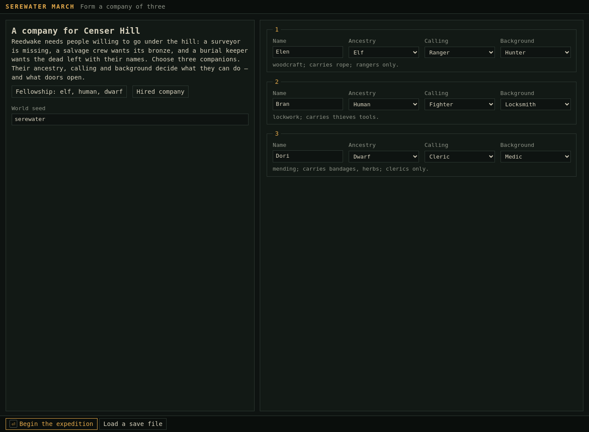
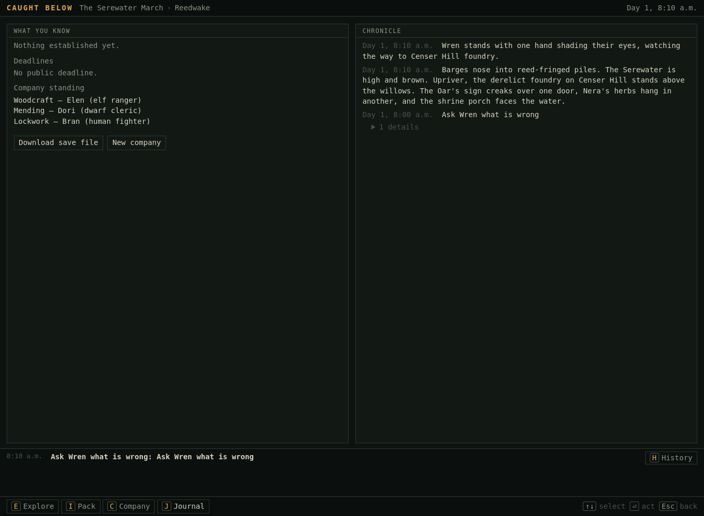
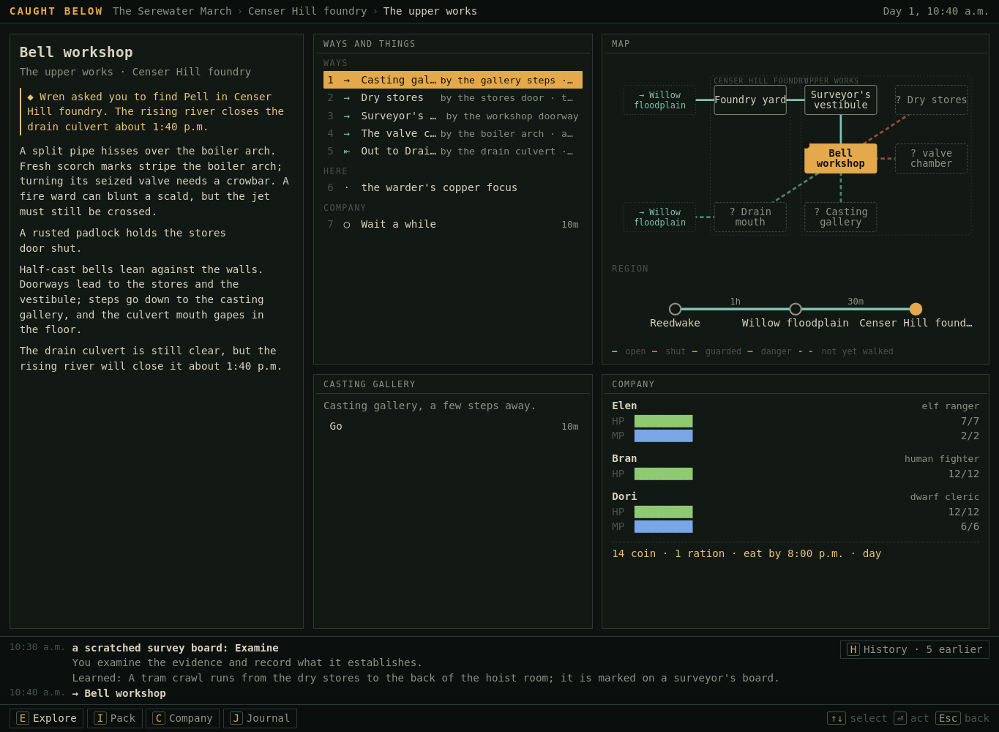
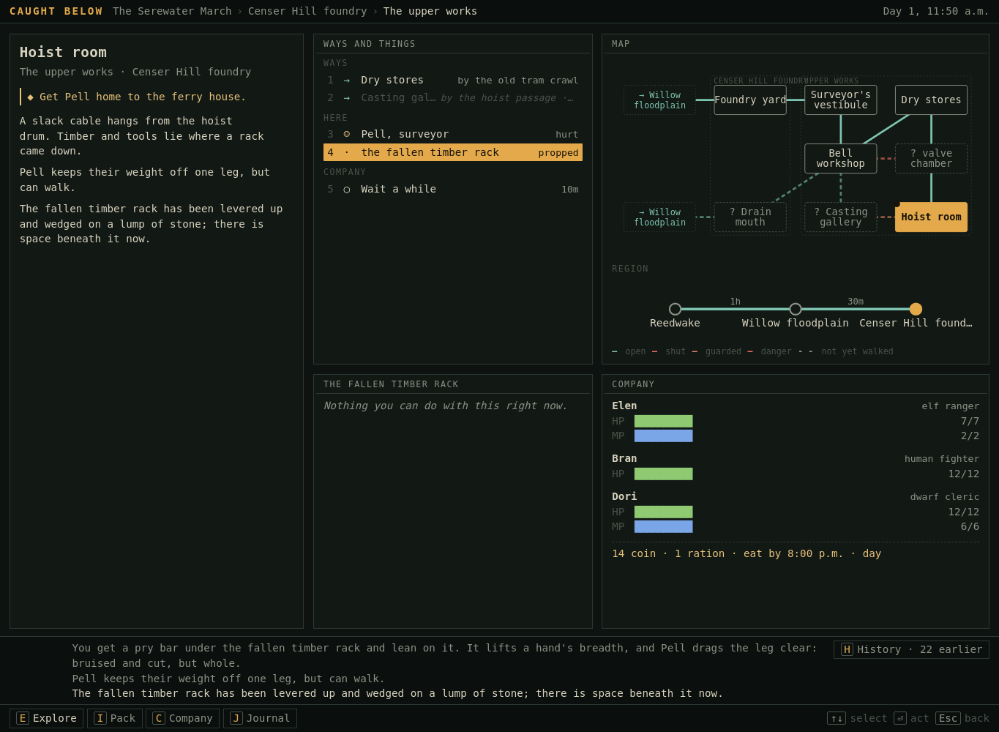
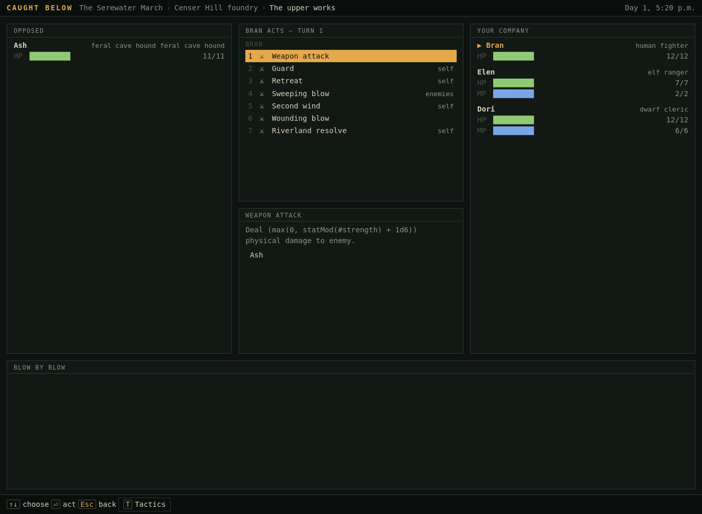
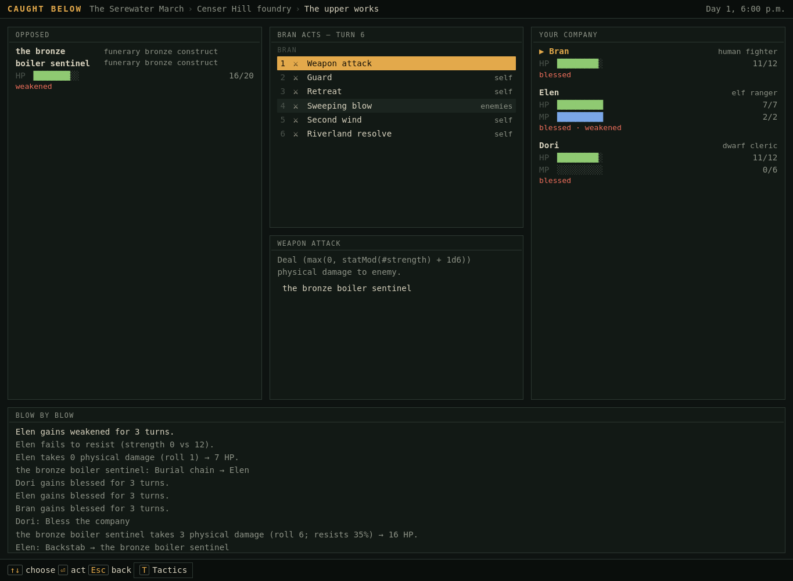
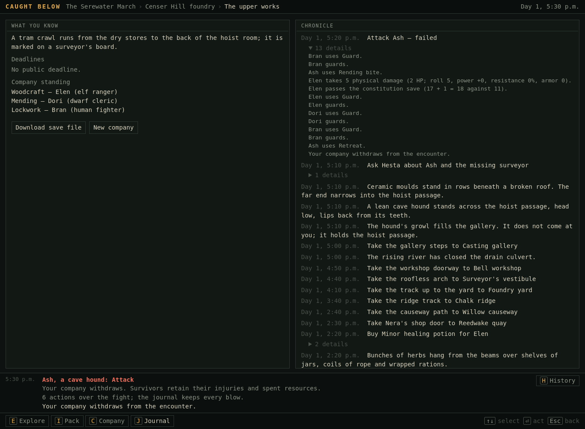

# A. Cold playtest record

## Method and exposure boundary

Played on 19 October 2026 using a fresh Chromium context, desktop viewport 1365×1000, local static build, default seed `serewater`, default companions Elen (elf ranger/hunter), Bran (human fighter/locksmith), Dori (dwarf cleric/medic).

Launch: `bun run web:build`, then `site/mono.html?campaign=data/campaigns/caught-below-reedwake.campaign.json`. README launch guidance identifies Mono and Caught Below as recommended. The README excerpt also exposed the older Serewater campaign synopsis; this is a limitation of the cold setup. I did not open implementation, test scripts, scenario source, linked walkthroughs, intended journeys, or builder reports before finishing the blind phase. Campaign-specific expectations below come from the visible UI.

No dedicated interactive browser tool was available. Playwright supplied a browser connection and individual UI clicks/key presses, visible-text reads, screenshots, and ordinary save downloads. I selected unfamiliar actions after reading the previous screen. No walkthrough script, engine command injection, planner, test hook, or save editing drove blind play. The final familiar return route was batched into three explicitly chosen movements, with a capture after each. This is one assessor's exploratory review, not a study of recruited human participants or a timing benchmark.

Chronology below uses game time. Screenshot numbers are capture order, not turn counts. Every existing capture has a paired `.txt` body-text record in the [gallery](evidence-index.md). Capture 91 was not written because browser automation timed out after delivering the rest click; the next screen confirms the rest took effect. Capture 78's premature filename says “defeated,” but the image correctly shows the sentinel still alive at 2 HP. Defeat is only inferred when the UI actually shows it, never from a filename or command receipt.

## Launch and orientation

| Evidence | Attempt / expectation | Actual experience |
|---|---|---|
| [01](evidence/01-launch.png) | Open the recommended campaign. Understand who we are and what we are doing. | Header says **SEREWATER MARCH**; title “A company for Censer Hill.” Missing surveyor, salvage crew, burial keeper are introduced together. Ancestry/calling/background dropdowns give no comparison of combat roles. Background hints help: hunter carries rope, locksmith has lockwork, medic has supplies. I keep the defaults. “World seed” is prominent without a player purpose. |
| [02](evidence/02-begin.png) | Begin expedition. | Brand changes to **CAUGHT BELOW**. At Reedwake quay, 8:00 a.m.; five routes, Wren, Wait. River, foundry, inn, shop, shrine are described concretely. I can locate the room within a settlement. I do not know what the three companions' abilities do yet. Map shows named destinations with question marks; unclear whether unknown or merely unvisited. |
| [03–04](evidence/04-wren-talk.png) | Select Wren and Talk. | Wren watches the foundry in the scene; conversation replaces this with “They wait for you to speak.” One question is available. Map and full party bars remain prominent during a one-topic conversation. |
| [05](evidence/05-wren-answer.png) | Ask what is wrong. | At 8:10, Wren says Pell should have returned “by mid-morning,” already treats absence as urgent, and says the culvert closes about 1:40 p.m. Understandable mission and deadline, but the morning timing is odd. Question remains repeatable for another ten minutes. History repeats the question instead of retaining the answer. |
| [06](evidence/06-company.png) | Inspect Company to learn abilities. | Elen has STR 5, DEX 11, WIS 15. “Weapon attack” is described as `Deal (max(0, statMod(#strength) + 1d6)) physical damage to enemy.` I cannot judge its expected usefulness without learning an expression language. “Guard: Defend.” “Retreat: Flee.” These rename rather than explain. Backstab and healing exist, but no role summary. Bottom pane says “Nothing you can do with this right now.” |
| [07](evidence/07-journal.png) | Find the task/deadline I just learned. | **“Nothing established yet.” “No public deadline.”** Instead of rescue notes, the journal foregrounds company capabilities. Wren's actual plea is buried under a collapsed chronicle detail. This makes the journal an unreliable adventure aid. |

## First expedition and the rescue

| Evidence | Attempt / expectation | Outcome and misunderstanding |
|---|---|---|
| [08](evidence/08-causeway.png) | Leave for Willow causeway, then press Go, assuming the row had selected the destination. | Clicking the row already moved us to the causeway at 9:10. Go then moved us along the newly selected first exit to Chalk ridge at 9:40. An unintended second movement cost 30 minutes. I learn that some rows execute immediately, while Wren's row opened choices. |
| [09–10](evidence/10-vestibule.png) | Climb to Foundry yard; enter the upper works. | 10:10 yard, 10:20 vestibule. Rails, roofless arch, footprints give concrete orientation. Room changes take ten minutes, but the menu calls them “a few steps away.” |
| [11](evidence/11-board.png) | Read a scratched survey board. | Click immediately consumes ten minutes. “You examine the evidence and record what it establishes.” Then a meaningful discovery: tram crawl connects stores and hoist room. Board still says “can be read” while its action pane says nothing can be done. The information is useful; its presentation sounds like evidence bookkeeping. |
| [12](evidence/12-workshop.png) | Enter Bell workshop. | 10:40. Strong layout paragraph: stores and vestibule doorways, gallery steps, culvert in floor. Steam hazard and padlock state precede the room description. Exits are truncated in the middle column. The copper focus is present only as a row, with no account of what it does. |
| [13–15](evidence/15-focus-taken.png) | Select copper focus, Take, choose Dori because she is the cleric. | Three stages, ten minutes. “Dori takes the warder's copper focus.” followed by “Dori gains 1 the warder's copper focus.” Fiction and inventory bookkeeping duplicate each other; cannot yet tell whether it needs equipping. |
| [16](evidence/16-locked-stores.png) | Click Dry stores to inspect the locked route. | **Automatically picks the padlock**, taking ten minutes. I did not choose a lockpicking action or a companion. Scene and log both say the door stands open; the log repeats that exact sentence twice. Bran's background matters, but the interface hides that causal connection. |
| [17–19](evidence/19-pry-taken.png) | Enter stores; collect pry bar for Bran. | 11:10 arrival, 11:20 collected. Low opening in brick wall plausibly corresponds to known tram crawl. Taking again requires object → Take → recipient, despite other world actions automatically selecting the party's method. |
| [20–23](evidence/23-pell-answer.png) | Follow crawl to Hoist room; speak with Pell. | 11:30 arrival; injured person, fallen rack, slack hoist cable. Good cry for help warns not to haul. Conversation still starts “They wait for you to speak,” despite the urgent trapped state. Pell suggests fetching the pry bar we already carry; no acknowledgement of preparation. |
| [24–25](evidence/25-lever.png) | Inspect rack; choose lever rather than dig or heave. | Three concrete alternatives: lever 10m, hand digging 40m, heaving with a person choice. At 11:50 the rack lifts a hand's breadth, Pell drags free, rack becomes propped. This is meaningful physical interaction with legible consequences. This is the point at which play feels most like an RPG. |
| [26–27](evidence/27-escort.png) | Talk to Pell and ask them to come with us. | At noon “Pell falls in beside you.” Task changes to get Pell home. Companion remains listed as hurt, not clearly marked as following in a persistent escort summary. |
| [28](evidence/28-ash.png) | Try the adjacent Casting gallery route to understand another way out. | No movement or time cost. “Ash bars the way.” Who is Ash? No person/creature row here, no appearance, no interaction. Cannot tell whether to negotiate, inspect, fight, or approach from the other side. I return by the known crawl. |
| [29–32](evidence/32-low-path.png) | Stores → workshop → culvert → causeway. | Pell follows with named passage messages. At 12:30 we are outside at Drain mouth; at 1:00 on causeway. The escort's continued presence is demonstrable. The still-open culvert deadline is stated in scene prose. |
| [33](evidence/33-home-quay.png) | Return to Reedwake. | 2:00 p.m. Wren runs to Pell. “For a while nobody says anything sensible.” Excellent economical reunion; task asks me to speak to Wren. The long travel consumes clock time without other choices or events. |
| [34–35](evidence/35-wren-thanks.png) | Speak with Wren for closure. | 2:10; purse 14 → 20. Wren and Pell go into ferry house. **No thanks or explanation of the six coins is visible in the conversation.** It collapses back to exploration as they leave. Only a resource delta and movement messages survive in the immediate strip. |

## Preparation and continued exploration

| Evidence | Attempt / expectation | Outcome |
|---|---|---|
| [36–37](evidence/37-nera.png) | Visit Nera and see whether we can talk. | Shop contains sale rows and Nera, described only as “Human.” Her options are Buy; no conversation. Herbs, jars and other scenery are not inspectable. No explanation of why we cannot ask her about the rescue. |
| [38–40](evidence/40-bought.png) | Buy a healing potion for the frail ranger. | Potion → Buy from Nera, 3 coin → Elen. 2:30 p.m.; purse 20 → 17, potion carried. Clear transaction once nested choices are traversed, but generic bookkeeping and character names crowd the log. |
| [41–46](evidence/46-workshop-return.png) | Return to foundry for unexplored rooms: quay → causeway → ridge → yard → vestibule → workshop. | 2:40–5:00 p.m. No new objective or lead prompted the return; I am exploring the remaining map and fulfilling the study. Open padlock persists. Culvert is now closed. Reliable local state persistence, weak continuing adventure motivation. |
| [47](evidence/47-gallery.png) | Enter gallery from the workshop. | Now Ash is visibly a cave hound, guarding a passage rather than attacking. Hesta also appears as a row but is absent from the room prose. Physical passage and a nonhostile guard are comprehensible from this side. |
| [48–50](evidence/50-hesta-answer.png) | Ask Hesta about Ash and the missing surveyor. | She suggests food or the hunter's approach, warns that striking Ash forfeits her medical help, mentions a flame sword in valve chamber. Good actionable relationship. Topic still calls Pell “missing” after the completed rescue; Hesta never responds to that outcome. |
| [51–52](evidence/52-ash-options.png) | Save the game, inspect Ash. | Journal contains the tram discovery, not a rescue summary or Hesta's leads. Save downloaded before combat. Ash offers Attack, calm approach, ration. I deliberately choose violence for the study, despite no current story reason to fight. |

## Combat 1 — Ash, withdrawal

| Evidence | Decision | What I can follow |
|---|---|---|
| [53](evidence/53-combat-start.png) | Attack from Ash's menu. | Exploration disappears. Ash 11 HP. Bran acts first. No room title, ground description, Hesta, guard objective, or next-turn sequence in the fight view. Actor arrow and heading clearly identify Bran. “feral cave hound” is printed twice. |
| [54](evidence/54-wounding-preview.png) | Click Wounding blow, expecting to learn its effect. | It executes on Ash immediately: 3 damage, weakened. Ash automatically bites Elen for 4; she is at 3/7. Current turn jumps to 3. Log reads newest line first, reversing even the components of an attack. Condition effect not explained. Filename reflects my preview expectation; the capture records execution. |
| [55](evidence/55-retreat.png) | Retreat on Elen's turn. | Returns to same gallery at 5:30, still alongside Ash. Elen's wound persists. Hesta visibly refuses salve. Meaningful relationship consequence; unclear physical meaning of a retreat that leaves us here. |

## Combat 2 — wounded re-entry, fall and revival

| Evidence | Decision | Result |
|---|---|---|
| [56](evidence/56-second-combat-disadvantaged.png) | Attack again while Elen is 3/7. | Ash remains 8/11 and weakened. This is a resource-disadvantaged party re-entry, not an outnumbered or higher-level challenge. Persisting enemy injury is useful, but not summarized before commitment. |
| [57](evidence/57-tactics.png) | Click Tactics expecting advice or tactical settings. | It immediately chooses Bran's Sweeping blow for 4 damage. Ash bites Elen for 3, she falls. No consent to delegation is communicated by “Tactics.” Dori now acts; event order must again be read upward. |
| [58](evidence/58-recall.png) | Use Recall the fallen. | Sole fallen ally is automatically selected. Elen returns with 2 HP; Dori mana 6 → 2. This is understandable through changed bars and log, though “falls” and revival do not establish whether zero HP means death or unconsciousness. |
| [59–61](evidence/61-full-combat-history.png) | Bran attacks; then inspect Hesta and expand History. | Ash dies, passage clears, three companions each gain 20 XP. Fight closes immediately. Hesta has only Talk, her services gone. Full history reveals “Your company prevails. Survivors retain their injuries and spent resources.” Also repeats “Your company wins the encounter.” Long combat details are compressed to a count and isolated falls/XP lines. The visible summary includes Elen falling but omits her revival. |
| [62–65](evidence/65-recovered.png) | Pack → potion → Use on → Elen. | Potion description gives a readable dice amount: 2d4+2 to a living companion. At 5:50 Elen recovers 5 HP to 7/7 and potion disappears. Good recovery feedback. Healing spells are under “Tend the company” in Pack, a location I would not infer from Company. |

## Combat 3 — sentinel, depleted healing resources

| Evidence | Decision | Result |
|---|---|---|
| [66](evidence/66-valve.png) | Follow pipe walk to valve chamber. | 6:00. Sentinel resists steel, cannot be poisoned; prose explicitly says fighting is optional. Steam arch, safe pipe walk and sword are visible. Dori has only 2 mana, potion spent: a preparation disadvantage, though it does not prove this enemy is stronger than the party. |
| [67](evidence/67-sentinel-options.png) | Click sentinel to inspect its options. | **Combat starts immediately.** No Attack choice appears: only one legal action meant entity selection executed it. Enemy acts first, Bronze sweep hits party for 1 each except Elen, who saves. This contradicts the invitation to look around a bypassable creature. |
| [68–69](evidence/69-sentinel-backstab.png) | Bran Wounding blow; Elen Backstab. | 3 rolled physical damage becomes 1 against 35% resistance. Backstab works with no approach, concealment or facing decision: 6 rolled becomes 3. Formula does not give a full explanation of adjustments. Sentinel's borrowed funerary identity is visible in its type. |
| [70–71](evidence/71-bless-resolve.png) | Use arrow keys to preview Bless, then Enter. | Keyboard selection previews while clicking executes. Preview says “Apply blessed to party for 3 turns”; does not explain blessed. Party gets blessed, Dori mana reaches 0. Sentinel chains Elen, deals 0 but weakens her after a failed Strength save. Why zero damage? Why different values than the roll? Have to infer from separated log lines. |
| [72–75](evidence/75-bran-attack.png) | Sweep, Elen weapon attack, Dori weapon attack, Bran weapon attack. | Sentinel 16 → 13 → 13 → 9 → 6. Elen's attack does zero. Sentinel uses Guard, but guarding is not shown as a condition next to HP. Bran rolls 8 and deals 3 after hidden-to-this-view adjustments. Abilities disappear when unavailable without cooldown explanation. |
| [76–79](evidence/79-elen-hit.png) | Elen guards (her ordinary attack has been weak), Dori attacks, Bran attacks, Elen attacks. | Sentinel 6 → 5 → 2 → dead. Buffs expire at different actor turns. Bran ends 10/12; Dori 11/12, mana 0. Fifteen actions, few changing decisions, mostly wait for damage and cooldowns. No spatial play or environmental intervention within combat. |

## Mechanism, return, rest, next morning

| Evidence | Attempt | Result |
|---|---|---|
| [80](evidence/80-valve-turned.png) | Turn steam valve using bar. | 6:20, pipe shut and boiler arch clear. Sensible physical action; exact state sentence duplicated in history. It does not move us through the arch. This distinction is useful when stated, unlike the silent padlock action. |
| [81–82](evidence/82-sword-taken.png) | Take flame sword for Bran. | 6:30. Sword was a row, not physically situated in prose. Cannot tell from the room whether it was guarded treasure or a freely accessible object. |
| [83–88](evidence/88-night-quay.png) | Return via opened arch, vestibule, yard, ridge, causeway, quay. | 6:40–9:00. At 8:00 ration silently becomes 0; next meal changes to next day. No eating event, just `ration: 1 → 0`. Same quay paragraph at night. Route graph helped navigate; regional compression understated the journey's two separate half-hour legs. |
| [89–90](evidence/90-inn-options.png) | Enter inn, select Maud. | 9:10. Inn prose mentions stairs to rooms but no upstairs route. Maud has bed and supper for 3 coin, 8h, and Buy. No Talk. Clear price and duration, unclear recovery promise before selecting. |
| [92–93](evidence/93-morning.png) | Take lodging, inspect Company and scene afterward. | Day 2 5:10, all HP and mana restored; purse 14. Inn paragraph unchanged. Next meal is now 8:00 p.m. on day 3, despite 0 rations; this extension is not explained by the simple “bed and supper” label. Company displays personal coin alongside the different shared purse, with no spending relationship explained. |
| [94](evidence/94-morning-journal.png) | Look for unresolved adventure and save. | One known fact (tram crawl), no deadlines, capability list, long reverse chronicle. Rescue, service refusal, loot, changed routes and opportunities are not summarized. Shrine and ferry house remain unvisited; I can identify unvisited doors, not a reason to pursue another adventure. End-of-blind checkpoint downloaded. |

**Blind phase ends here.** No further observations below are presented as discoveries by an uninformed player.

## Post-blind directed probe: attempted defeat, actual enemy flight

After inspecting implementation, I reloaded the pre-combat checkpoint through the UI and tried a repetitive Guard-only branch to observe defeat. This is a directed diagnostic probe, not exploratory play. No engine commands or altered character statistics were used.

- [95](evidence/95-directed-reload.png): save loads party/world correctly but immediate History says “Nothing has happened yet.” Journal history still exists.
- [96–97](evidence/97-directed-defeat.png): attack Ash; Bran guards, Ash bites Elen for 5, Elen guards. Capture 97's filename describes the intended test, **not an actual defeat**.
- A bounded repeated-Guard UI probe follows. It recorded 91 samples including the first individual action. Only **four Guard actions** were executed in total. After the encounter ended, the broad “Guard” text selector also matched Ash's `guarding` row and repeatedly opened his menu. These later samples are redundant UI selection, not turns. They are retained in [raw probe output](evidence/directed-defeat-steps.json) to make this limitation auditable; no conclusions about combat duration use that count.
- [98](evidence/98-directed-defeat-final.png): actual outcome is withdrawal; Ash still guarding, Elen 2/7. No party defeat.
- [99](evidence/99-directed-withdraw-details.png): expanded journal proves **“Ash uses Retreat.”** The next line is **“Your company withdraws from the encounter.”** This is misattributed enemy retreat, not player flight. No Hesta refusal appeared in this branch after the non-damaging initiation/guards.

Full-party defeat, multi-enemy target selection, offensive spell attacks, poison immunity in action, and large multi-level navigation were not played. Defeat and these mechanics are discussed as code-inspected or remaining validation, not observed successes. The primary experience is one campaign with three encounters against two enemies; it cannot establish the quality of every campaign or of a larger adventure.
