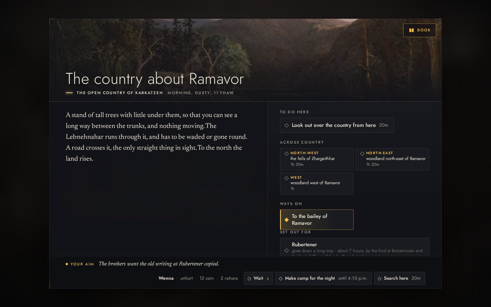
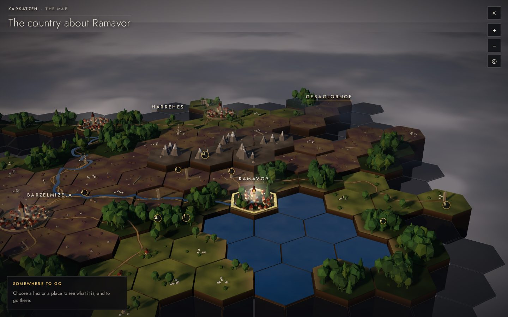
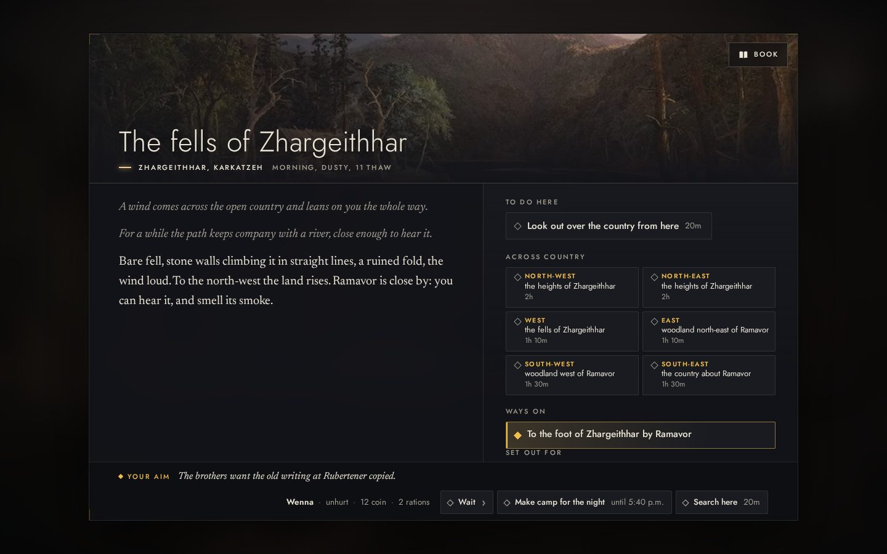
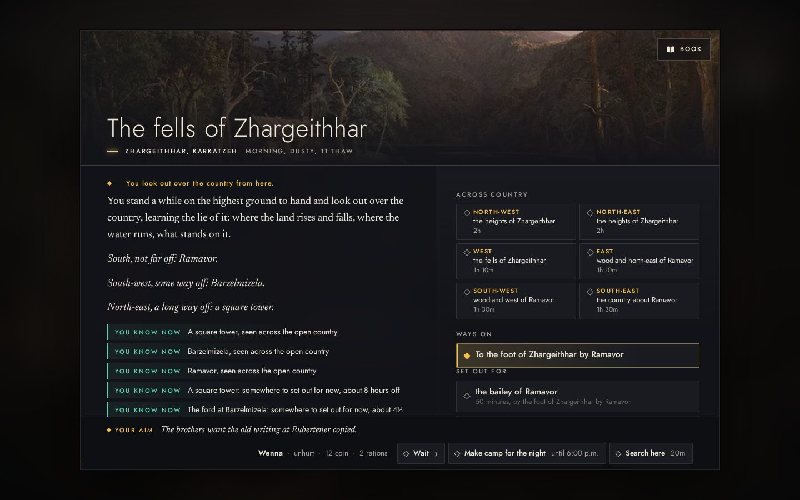
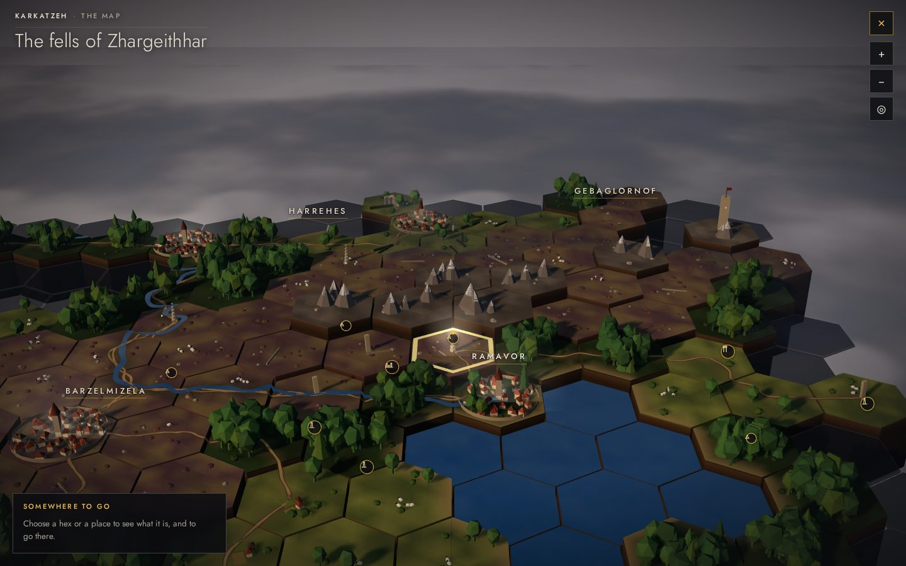
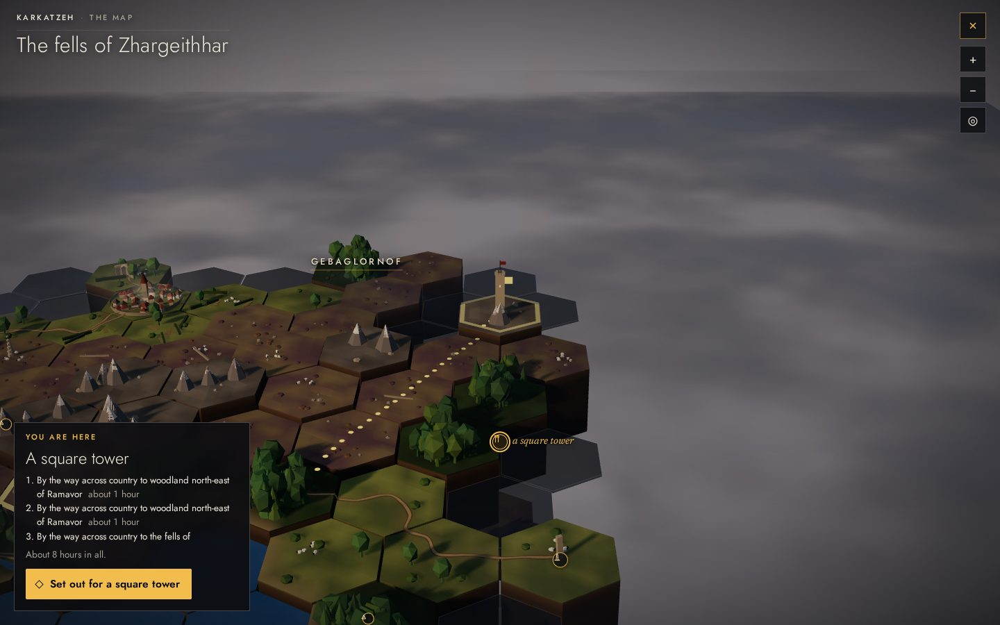
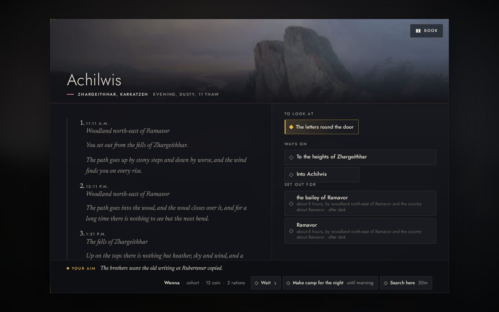
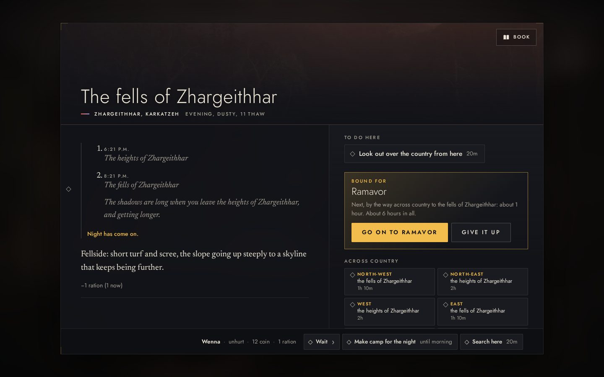
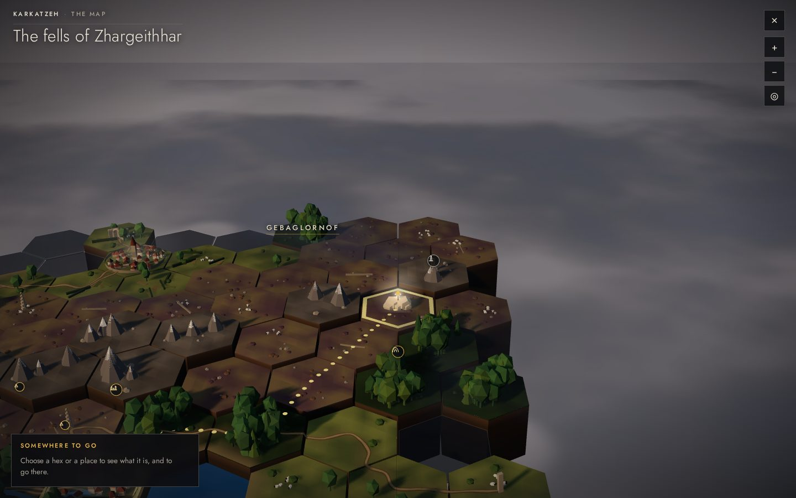

# Out into the country, through the reader (OWN-11)

*Mission 18, 2026-10-29. The owner's exploration demonstration: a new solo protagonist leaves a settlement to explore
without a destination, opens the full-screen map, sees familiar terrain and the edge of the unknown, crosses unknown
country and reveals more, finds a place by looking out, goes to it, comes back by ordinary travel, and keeps what was
learned. Played through the built reader (`site/mono.html?world=b2`) with the map as the owner chose it, the table of
hex tiles in three dimensions. Every step is a choice on the page, found by its label, or a place on the map chosen by
the keys; nothing injected. Software GL stood in for a GPU.*

| | |
|---|---|
|  | **Leaving a town to explore.** From Ramavor's bailey, "To the country about Ramavor": no errand, no destination. The page gives the six ways across country as a compass, each with its land and how long. |
|  | **The map.** The country about Ramavor as far as it is known: the town on its lake, Barzelmizela and Harrehes, the fells and their heights, woods, a winding river, roads; places by their signs; the rest under mist. |
|  | **Across unknown country.** North by the compass, up onto the fells of Zhargeithhar. |
|  | **Looking out.** From the fells: what stands up from the land within sight is told by its bearing and distance, among them a square tower a long way off. |
|  | **The map again.** The country newly known stands up out of the mist (the tiles rise as they come to be known). The square tower, with its pennant, is on the map in the north-east. |
|  | **Toward what was seen.** The tower chosen by the keys (the view glides to it): the way there dotted over the land to a gold pennant, and the card at the foot with the legs and the time, about eight hours, and setting out. |
|  | **Arrived.** The square tower is Achilwis: the letters round its door to look at, a way in. The journey is told leg by leg on the left. |
|  | **Home by ordinary travel.** The map's town chosen, "Set out for Ramavor": night comes on, on the fells, and the journey waits ("Go on to Ramavor", "Give it up"). |
|  | **What is kept.** The country walked and seen stays known: the tower visited, the way home dotted to Ramavor. |

## What it showed, and what it changed

- Leaving a town without a destination, crossing country hex by hex, looking out, setting out toward a place seen
  and arriving all work through the page and the map together.
- A place seen from afar but with no way yet known (the fallen walls, in an earlier run) had offered nothing on the
  map's card. A place seen on land the company knows now offers to go across country to its hex, as a hex does.
- The card said "You are here" of the distant tower, judging by the wild country the tower stands in. It now judges a
  place by the place.
- The legs of a long journey across country name the same stretch twice where two stretches share a name ("woodland
  north-east of Ramavor"): left as it is for now.
