# The March as a living world (October 21, 2026)

One company (the fellowship: Elen, elf ranger and hunter; Bran, human warrior and locksmith; Dori, dwarf cleric)
played through the built browser client at 1280×900, by keys, over two in-game days. Screenshots were taken as it
happened; two of them show glitches that were fixed afterwards (noted below). The same journeys, and a second one
for the register, are played by `test/living-world-browser.test.ts` (`KYRIE_BROWSER=1`).

## Out to Holt keep, the long way

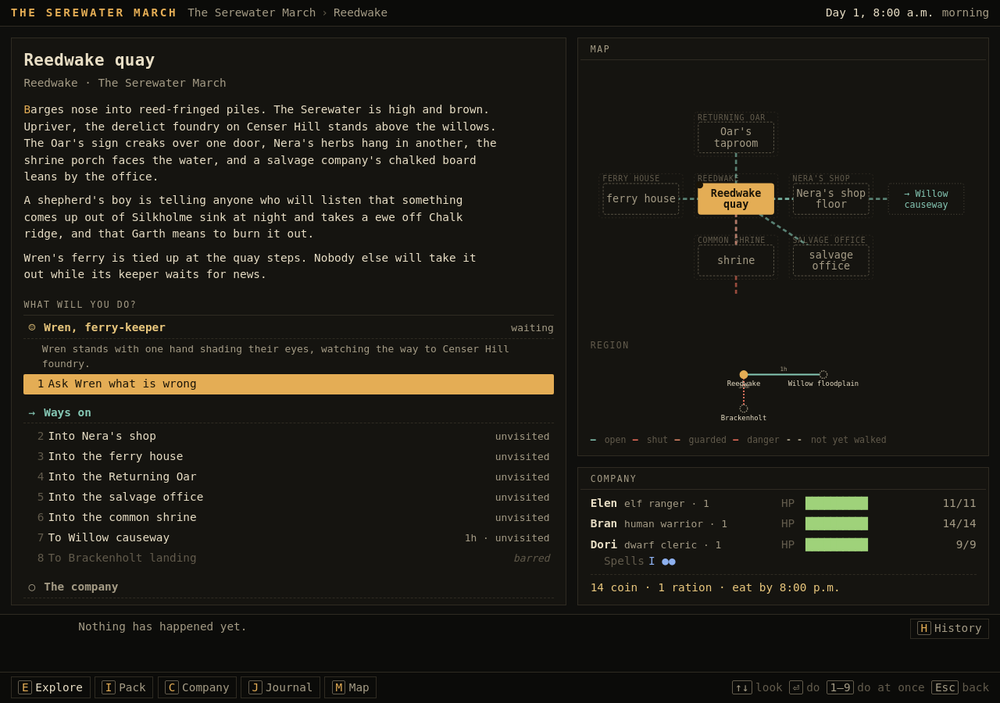

Two torches from Nera, bought in one step each (they go to whoever carries least). The ferry is tied up while Wren
waits for Pell, so the company walks: the causeway, the ridge, Chalkcross green, the edge of the holt, where Elen
smokes the bears out of the bracken, and on to Brackenholt and the tower lane. About five and a half hours.

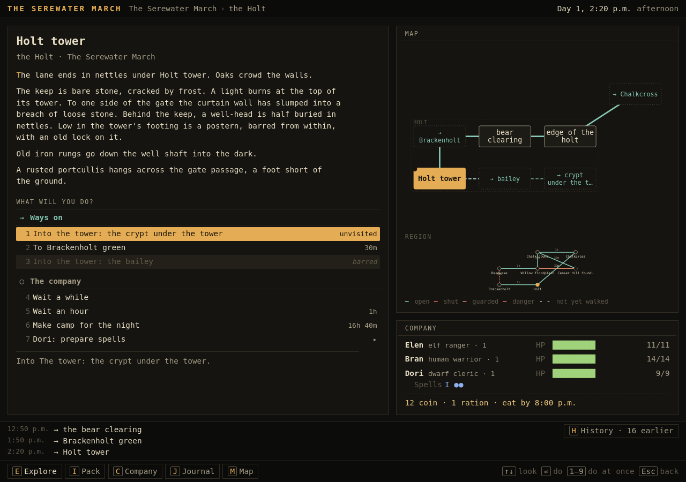

The keep from outside: a breach for climbers (nobody here climbs), the well behind it (nobody here has heard of it),
the postern (Bran picks it), and the gate, barred by its portcullis. The scene reads as a paragraph now, with the
portcullis on its own line.

## The keep

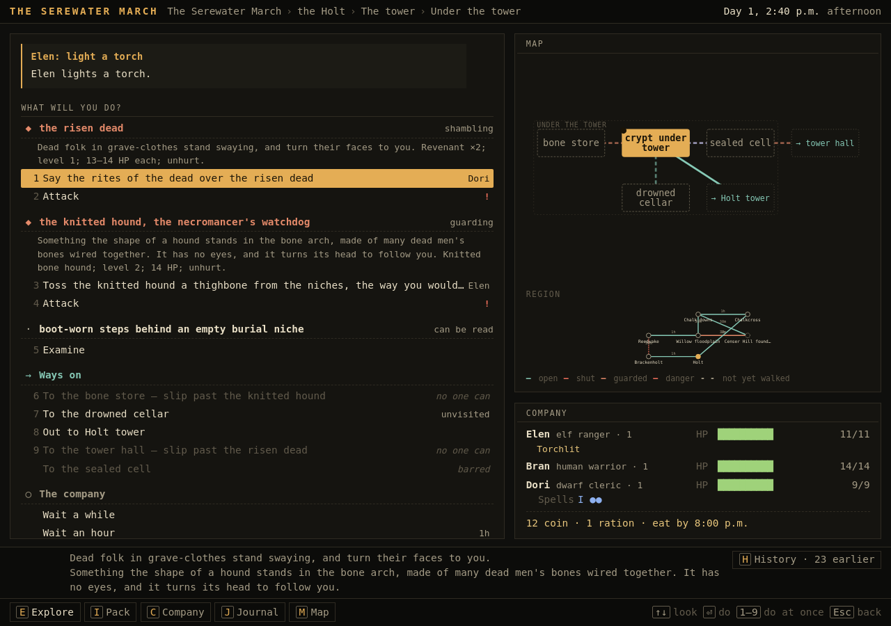

The undercroft is dark until a torch is lit, and each torch lasts about an hour. The map draws the floor the
company is on, with stubs up to the hall and out to the tower's foot. From here the dead at the top of the steps and
the bone hound in its arch can be seen, and worn steps behind an empty niche give away a back stair. Dori says the
rites over the dead; they lie down for good.

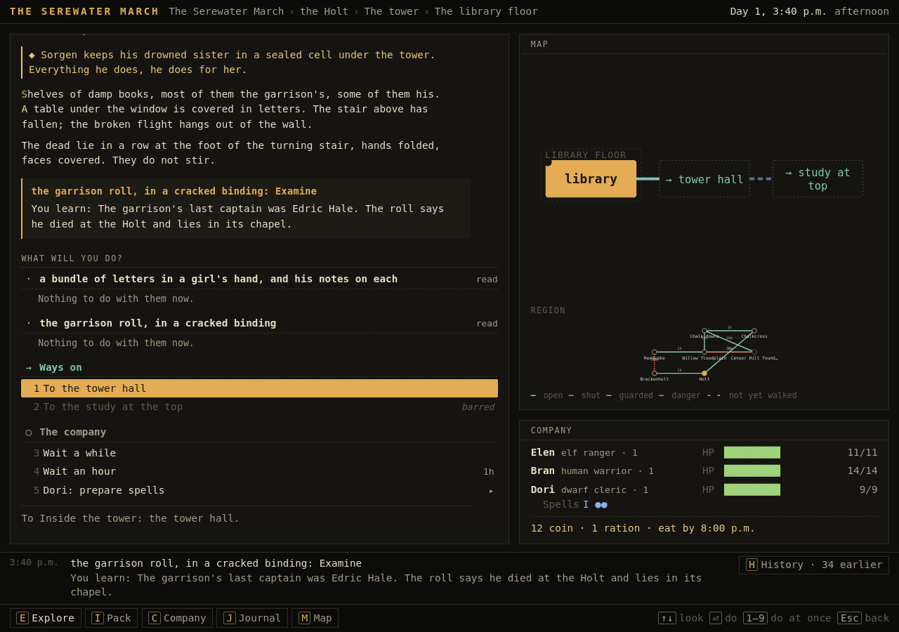

Two things to read: the girl's letters, which tell why Sorgen does what he does, and the garrison roll, which names
the captain. Up the tower the stair has fallen; climbers only.

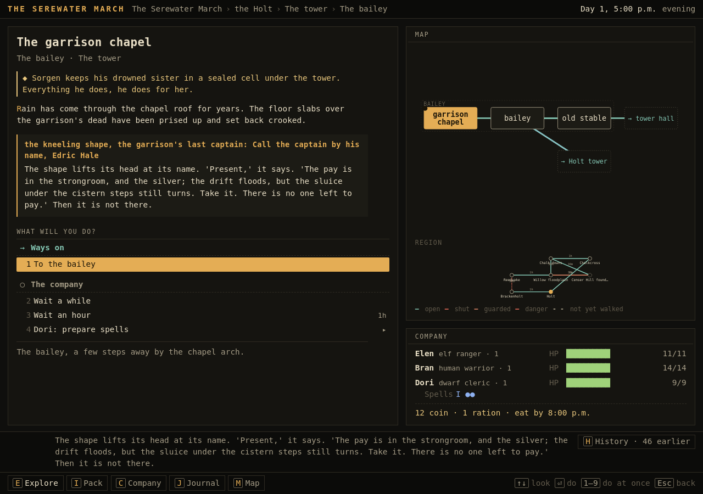

Out in the bailey Bran winds the gate winch, and the portcullis stays up from then on. The stable has a garrison
plan of the undercroft. In the roofless chapel a shape kneels at the altar and will not look round, until it is
called by the name in the roll; then it says where the pay and the silver are, and that the sluice still turns.

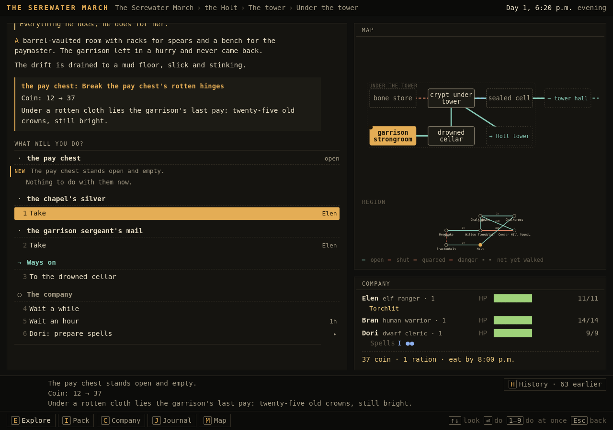

The drowned cellar's drift could have been swum, at a cost to whoever went first; knowing about the sluice, the
company drains it. Twenty-five old crowns in the pay chest, the chapel's silver, a sergeant's mail. The second torch
gutters out in the strongroom, and the company feels its way out in the dark and leaves by the gate it opened.

## The night, and what it did

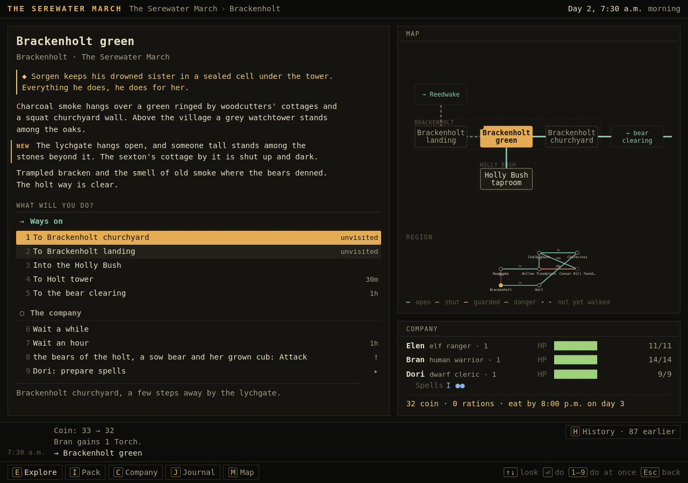

A bed at the Holly Bush and two more torches. In the morning the green has news, marked as such: the lychgate hangs
open and someone tall stands among the stones; the sexton's cottage is dark. Overnight Sorgen called the first
warden out of his grave, Agnes fled across the river, and Iven sent to the Ecumenon. (This capture still shows the
smoked-out bears offered as a target from the green; a guard is now reached only while it stands at the far end of
its way.)

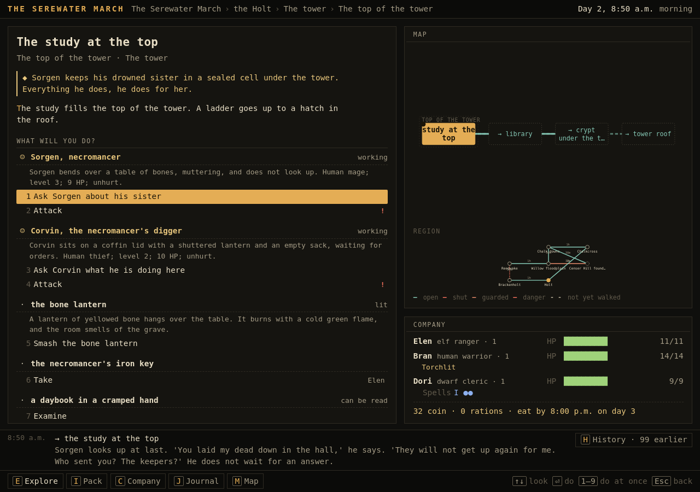

Up the back stair to the study. Sorgen looks up for once: "You laid my dead down in the hall." Corvin is back from
the smugglers' path with an empty sack: the register is already in his master's hands. (The strip shows a purchase
told twice; fixed.)

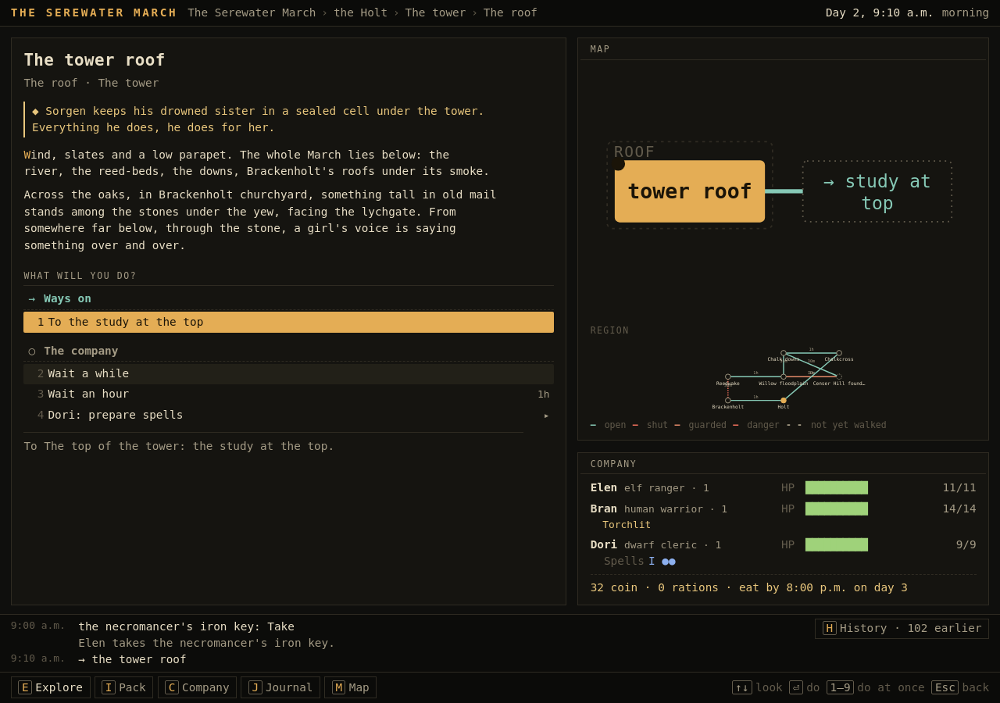

From the roof: the first warden in Brackenholt churchyard, facing the lychgate; and from below, through the stone, a
girl's voice saying something over and over.

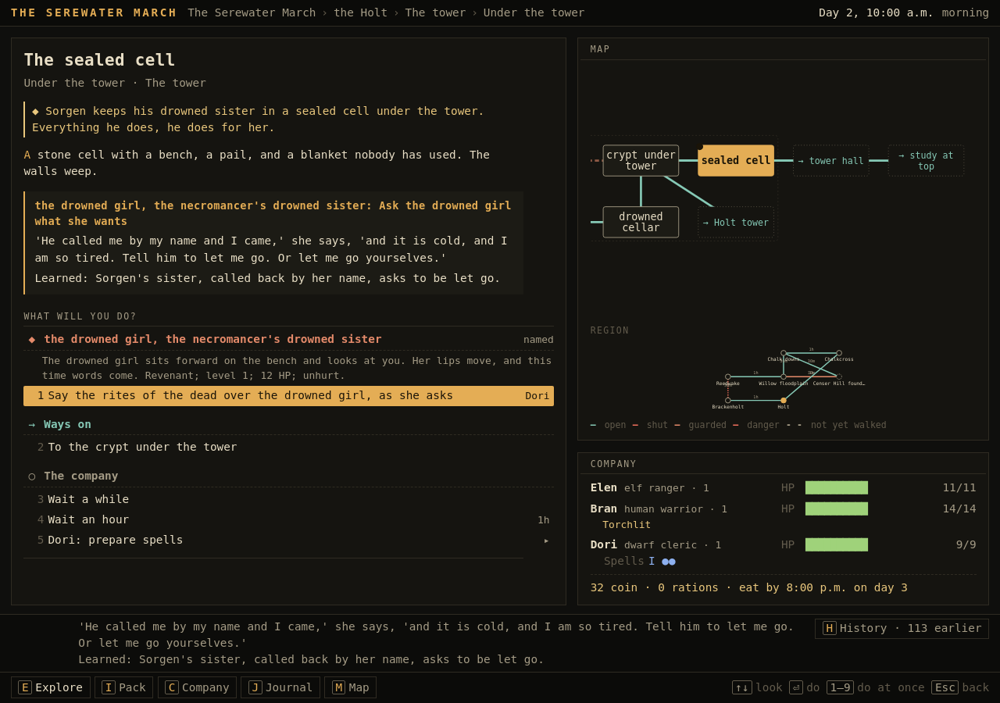

Sorgen's iron key opens the sealed cell. Called back by her name from the register, the drowned girl speaks now:
"Tell him to let me go. Or let me go yourselves."

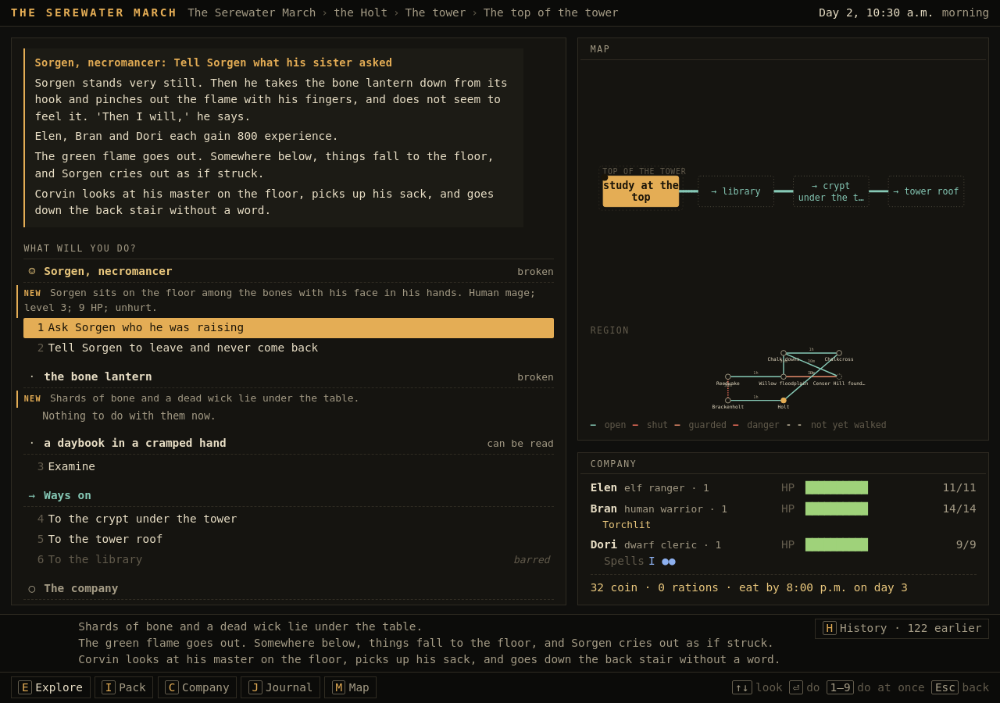

Told what she asked, he pinches out the bone lantern himself. The tower's dead fall where they stand, the company
is credited with the tower, and Corvin picks up his sack and leaves by the back stair without a word. The founders
under Censer Hill were not yet raised; had the company come a night later, they would still be walking.

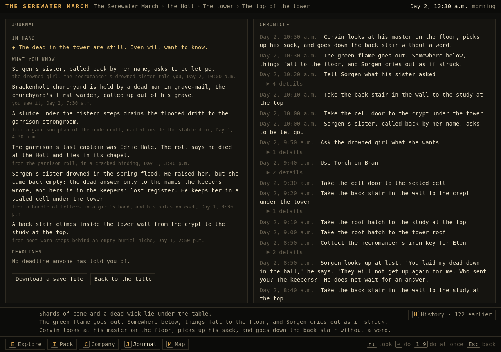

Everything the company knows, newest first, each with how it knows it: what it saw, what it read and in what, and
who told it.

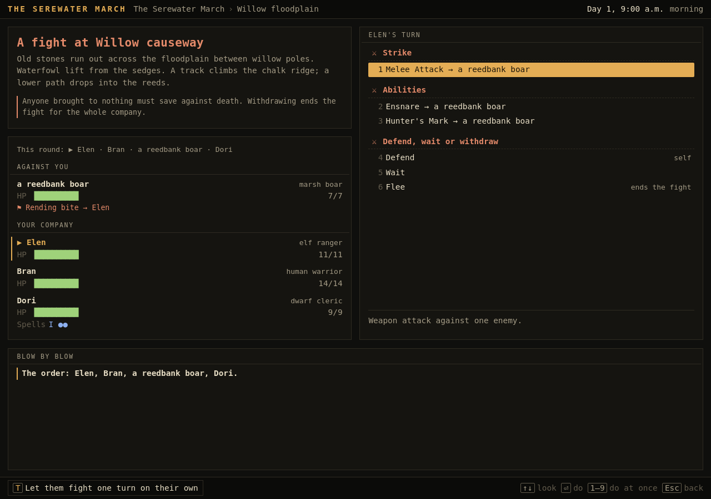

A fight from earlier in the day, for reference: declared intents, the round's order, the acting companion's choices
grouped as strike, abilities, defend or withdraw.

## What it was like

The second expedition into the keep was the best part: the gate open from last time, the torches bought on the way,
and the world moved on in between (the churchyard fallen, the girl speaking). Light makes each delve a decision.
Talking Sorgen down felt earned rather than given, because the letters, the key and her voice all had to be found.

What still felt thin: the overland walk is a list of ways rather than a journey; Corvin and Sorgen never act
against the company in person (people do not start fights); the strip at the bottom repeats what the response
already said; and the first visit to the keep is dense with things to read, which a player may well skip.
