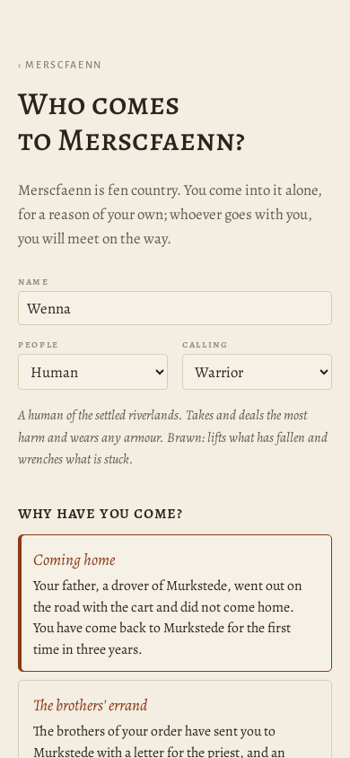
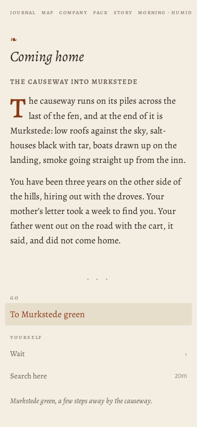
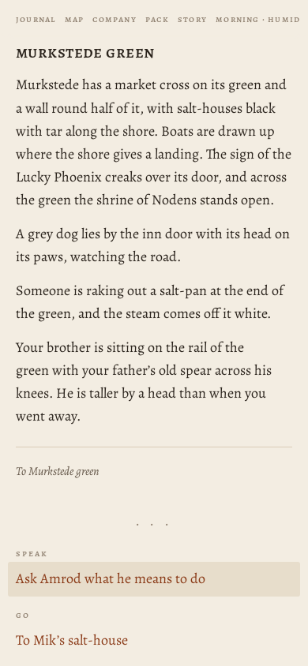
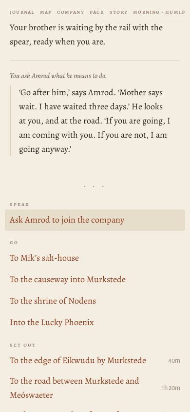

# Journey ?world=a1 at 390×844



> origin: Coming home

## The opening page

```
MERSCFAENN
Who comes to Merscfaenn?

Merscfaenn is fen country. You come into it alone, for a reason of your own; whoever goes with you, you will meet on the way.

name
people
Human
Elf
Dwarf
calling
Warrior
Mage
Thief
Cleric
Bard
Ranger
Monk

A human of the settled riverlands. Takes and deals the most harm and wears any armour. Brawn: lifts what has fallen and wrenches what is stuck.

why have you come?
Coming home
Your father, a drover of Murkstede, went out on the road with the cart and did not come home. You have come back to Murkstede for the first time in three years.
The brothers' errand
The brothers of your order have sent you to Murkstede with a letter for the priest, and an errand: to copy the old writing at Paliduslac, which no one has ever copied.
What is owed
You owe Mik, at Murkstede, thirty coin for a cart of salt that you lost on the road last spring. You have come back to pay it, somehow.
Over the hills
You have come over the hills into Merscfaenn with your trade and not much else, to see what there is for someone who will work.
Begin
Another country
```
## Begin

*the causeway into Murkstede · explore · 2845 ms · 55 nodes · 14 MB*

```
❧

Coming home
the causeway into murkstede

The causeway runs on its piles across the last of the fen, and at the end of it is Murkstede: low roofs against the sky, salt-houses black with tar, boats drawn up on the landing, smoke going straight up from the inn.

You have been three years on the other side of the hills, hiring out with the droves. Your mother’s letter took a week to find you. Your father went out on the road with the cart, it said, and did not come home.
```
- **Go**: To Murkstede green
- **Yourself**: Wait (4) · Search here



## ^To Murkstede green

*Murkstede green · explore · 241 ms · 87 nodes · 14 MB*

```
murkstede green

Murkstede has a market cross on its green and a wall round half of it, with salt-houses black with tar along the shore. Boats are drawn up where the shore gives a landing. The sign of the Lucky Phoenix creaks over its door, and across the green the shrine of Nodens stands open.

A grey dog lies by the inn door with its head on its paws, watching the road.

Someone is raking out a salt-pan at the end of the green, and the steam comes off it white.

Your brother is sitting on the rail of the green with your father’s old spear across his knees. He is taller by a head than when you went away.

To Murkstede green
```
- **Speak**: Ask Amrod what he means to do
- **Go**: To Mik's salt-house · To the causeway into Murkstede · To the shrine of Nodens · Into the Lucky Phoenix
- **Set out**: To the edge of Eikwudu by Murkstede · To the road between Murkstede and Meóswaeter · To the western edge of Merscfaenn
- **Yourself**: Wait (4) · Search here



## Amrod

*Murkstede green · explore · 182 ms · 87 nodes · 14 MB*

```
murkstede green

Murkstede has a market cross on its green and a wall round half of it, with salt-houses black with tar along the shore. Boats are drawn up where the shore gives a landing. The sign of the Lucky Phoenix creaks over its door, and across the green the shrine of Nodens stands open.

A grey dog lies by the inn door with its head on its paws, watching the road.

Your brother is waiting by the rail with the spear, ready when you are.

You ask Amrod what he means to do.

‘Go after him,’ says Amrod. ‘Mother says wait. I have waited three days.’ He looks at you, and at the road. ‘If you are going, I am coming with you. If you are not, I am going anyway.’
```
- **Speak**: Ask Amrod to join the company
- **Go**: To Mik's salt-house · To the causeway into Murkstede · To the shrine of Nodens · Into the Lucky Phoenix
- **Set out**: To the edge of Eikwudu by Murkstede · To the road between Murkstede and Meóswaeter · To the western edge of Merscfaenn
- **Yourself**: Wait (4) · Search here




Errors: none