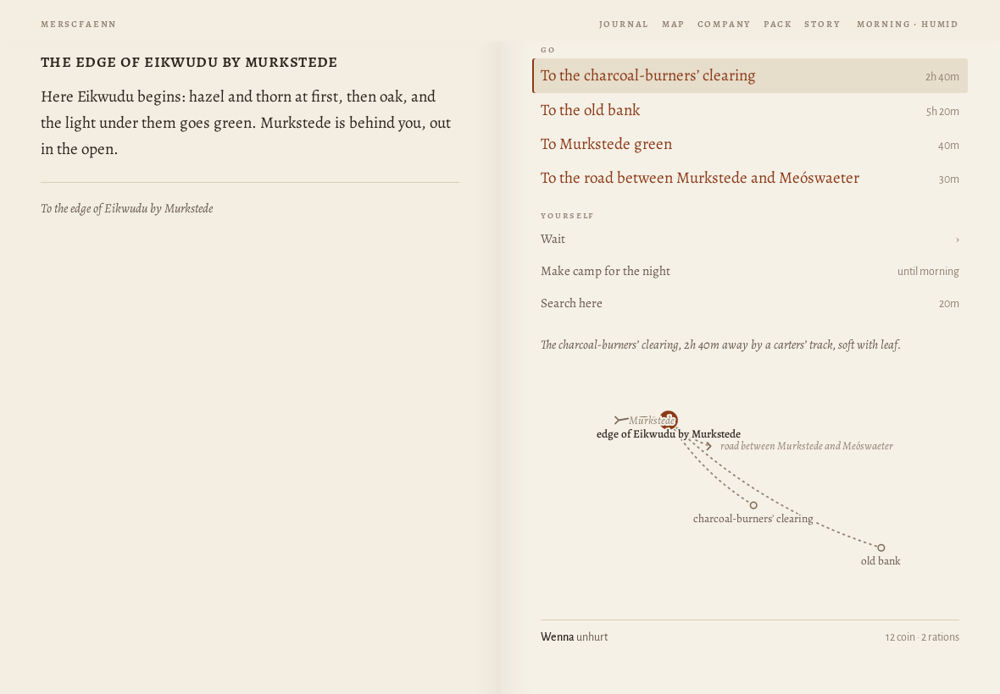
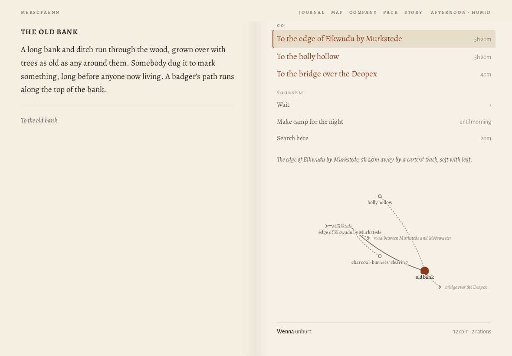
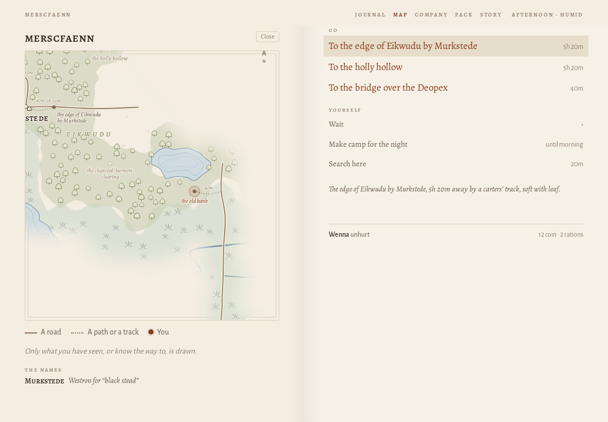
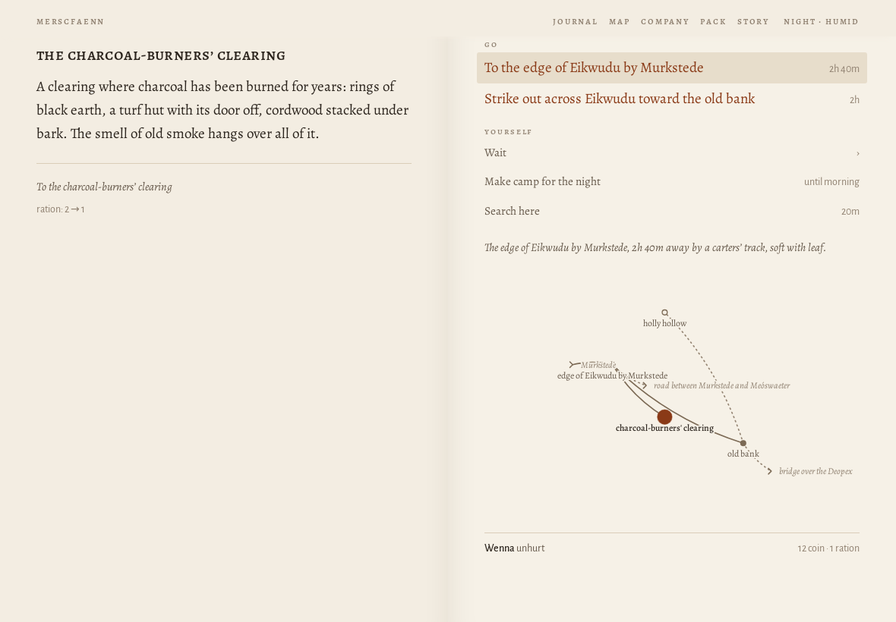
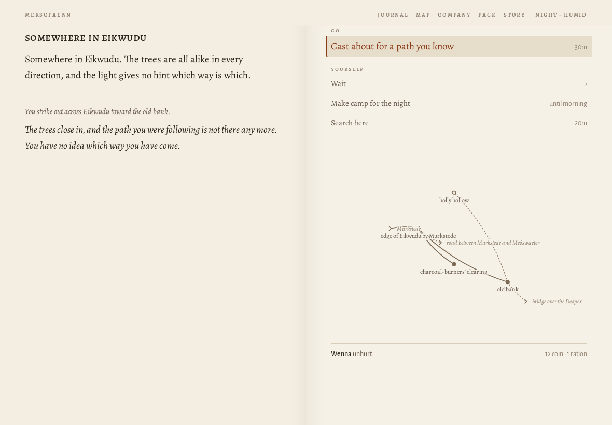
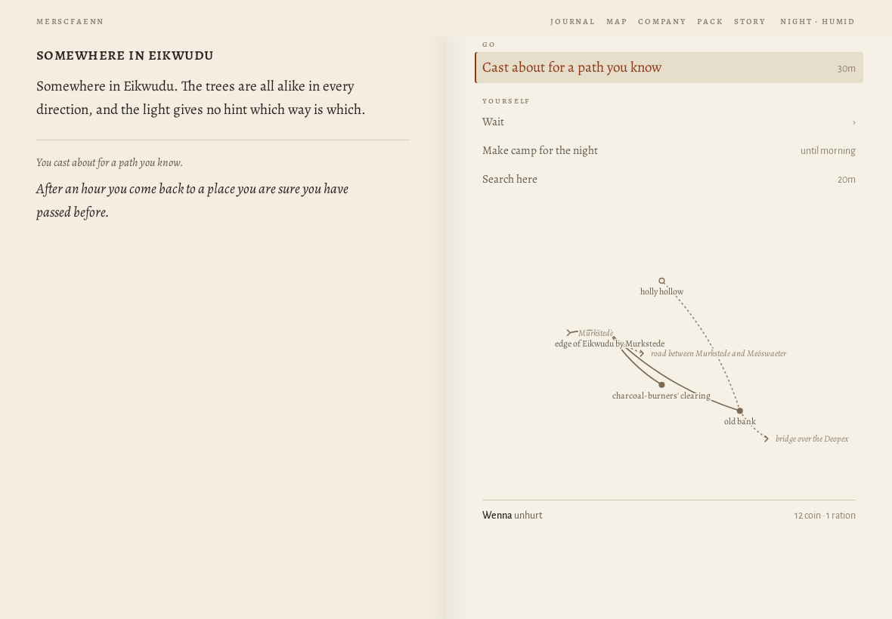
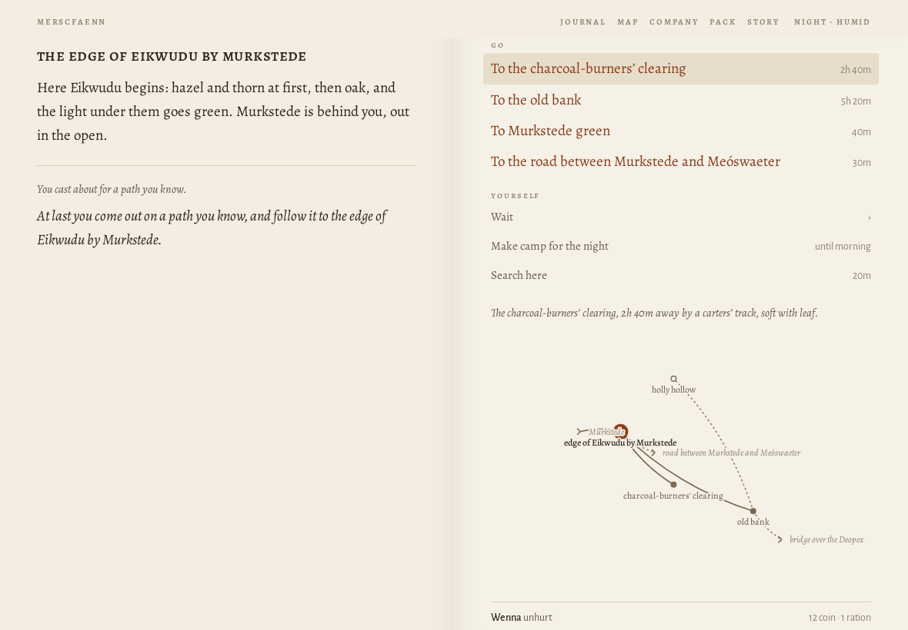

# Journey ?world=a1 at 1180×820

> origin: Over the hills

## The opening page

```
MERSCFAENN
Who comes to Merscfaenn?

Merscfaenn is fen country. You come into it alone, for a reason of your own; whoever goes with you, you will meet on the way.

name
people
Human
Elf
Dwarf
calling
Warrior
Mage
Thief
Cleric
Bard
Ranger
Monk

A human of the settled riverlands. Takes and deals the most harm and wears any armour. Brawn: lifts what has fallen and wrenches what is stuck.

why have you come?
Coming home
Your father, a drover of Murkstede, went out on the road with the cart and did not come home. You have come back to Murkstede for the first time in three years.
The brothers' errand
The brothers of your order have sent you to Murkstede with a letter for the priest, and an errand: to copy the old writing at Paliduslac, which no one has ever copied.
What is owed
You owe Mik, at Murkstede, thirty coin for a cart of salt that you lost on the road last spring. You have come back to pay it, somehow.
Over the hills
You have come over the hills into Merscfaenn with your trade and not much else, to see what there is for someone who will work.
Begin
Another country
```
## Begin

*the causeway into Murkstede · explore · 2851 ms · 55 nodes · 14 MB*

```
❧

Over the hills
the causeway into murkstede

The causeway runs on its piles across the last of the fen, and at the end of it is Murkstede: low roofs against the sky, salt-houses black with tar, boats drawn up on the landing, smoke going straight up from the inn.

You have come over the hills into Merscfaenn with your trade and not much else. There is work in any country for someone who will do what others will not, and the place to hear of it is the inn.
```
- **Go**: To Murkstede green
- **Yourself**: Wait (4) · Search here

## ^To Murkstede green

*Murkstede green · explore · 173 ms · 87 nodes · 14 MB*

```
murkstede green

Murkstede has a market cross on its green and a wall round half of it, with salt-houses black with tar along the shore. Boats are drawn up where the shore gives a landing. The sign of the Lucky Phoenix creaks over its door, and across the green the shrine of Nodens stands open.

A grey dog lies by the inn door with its head on its paws, watching the road.

Someone is raking out a salt-pan at the end of the green, and the steam comes off it white.

Amrod, the drover’s son, who wants to go after his father, is here.

To Murkstede green
```
- **Speak**: Ask Amrod about his father
- **Go**: To Mik's salt-house · To the causeway into Murkstede · To the shrine of Nodens · Into the Lucky Phoenix
- **Set out**: To the edge of Eikwudu by Murkstede · To the road between Murkstede and Meóswaeter · To the western edge of Merscfaenn
- **Yourself**: Wait (4) · Search here

## to the edge of Eikwudu

*the edge of Eikwudu by Murkstede · explore · 413 ms · 97 nodes · 14 MB*

```
the edge of eikwudu by murkstede

Here Eikwudu begins: hazel and thorn at first, then oak, and the light under them goes green. Murkstede is behind you, out in the open.

To the edge of Eikwudu by Murkstede
```
- **Go**: To the charcoal-burners' clearing · To the old bank · To Murkstede green · To the road between Murkstede and Meóswaeter
- **Yourself**: Wait (4) · Make camp for the night · Search here



## old bank

*the old bank · explore · 717 ms · 103 nodes · 14 MB*

```
the old bank

A long bank and ditch run through the wood, grown over with trees as old as any around them. Somebody dug it to mark something, long before anyone now living. A badger’s path runs along the top of the bank.

To the old bank
```
- **Go**: To the edge of Eikwudu by Murkstede · To the holly hollow · To the bridge over the Deopex
- **Yourself**: Wait (4) · Make camp for the night · Search here



## MAP

*the old bank · map · 82 ms · 331 nodes · 14 MB*

```
Close
merscfaenn
the old bank
Murkstede
EIKWUDU
the western edgeof Merscfaenn
the edge of Eikwuduby Murkstede
the charcoal-burners'clearing
the holly hollow
1h 20m
40m
1h 20m
40m
N
A road
A path or a track
You

Only what you have seen, or know the way to, is drawn.

the names
Murkstede
Westron for “black stead”
```
- **Go**: To the edge of Eikwudu by Murkstede · To the holly hollow · To the bridge over the Deopex
- **Yourself**: Wait (4) · Make camp for the night · Search here



## edge of Eikwudu by Murkstede$

*the edge of Eikwudu by Murkstede · explore · 716 ms · 107 nodes · 14 MB*

```
the edge of eikwudu by murkstede

Here Eikwudu begins: hazel and thorn at first, then oak, and the light under them goes green. Murkstede is behind you, out in the open.

To the edge of Eikwudu by Murkstede
```
- **Go**: To the charcoal-burners' clearing · To the old bank · To Murkstede green · To the road between Murkstede and Meóswaeter
- **Yourself**: Wait (4) · Make camp for the night · Search here

## charcoal

*the charcoal-burners' clearing · explore · 712 ms · 101 nodes · 14 MB*

```
the charcoal-burners’ clearing

A clearing where charcoal has been burned for years: rings of black earth, a turf hut with its door off, cordwood stacked under bark. The smell of old smoke hangs over all of it.

To the charcoal-burners’ clearing

ration: 2 → 1
```
- **Go**: To the edge of Eikwudu by Murkstede · Strike out across Eikwudu toward the old bank
- **Yourself**: Wait (4) · Make camp for the night · Search here



## Strike out across Eikwudu toward the old bank

*somewhere in Eikwudu · explore · 128 ms · 95 nodes · 14 MB*

```
somewhere in eikwudu

Somewhere in Eikwudu. The trees are all alike in every direction, and the light gives no hint which way is which.

You strike out across Eikwudu toward the old bank.

The trees close in, and the path you were following is not there any more. You have no idea which way you have come.
```
- **Go**: Cast about for a path you know
- **Yourself**: Wait (4) · Make camp for the night · Search here



## Cast about

*somewhere in Eikwudu · explore · 96 ms · 95 nodes · 14 MB*

```
somewhere in eikwudu

Somewhere in Eikwudu. The trees are all alike in every direction, and the light gives no hint which way is which.

You cast about for a path you know.

After an hour you come back to a place you are sure you have passed before.
```
- **Go**: Cast about for a path you know
- **Yourself**: Wait (4) · Make camp for the night · Search here



## Cast about

*the edge of Eikwudu by Murkstede · explore · 113 ms · 108 nodes · 14 MB*

```
the edge of eikwudu by murkstede

Here Eikwudu begins: hazel and thorn at first, then oak, and the light under them goes green. Murkstede is behind you, out in the open.

You cast about for a path you know.

At last you come out on a path you know, and follow it to the edge of Eikwudu by Murkstede.
```
- **Go**: To the charcoal-burners' clearing · To the old bank · To Murkstede green · To the road between Murkstede and Meóswaeter
- **Yourself**: Wait (4) · Make camp for the night · Search here

> MISS /Cast about/ among: To the charcoal-burners' clearing · To the old bank · To Murkstede green · To the road between Murkstede and Meóswaeter · Wait · Make camp for the night · Search here

## Cast about

*the edge of Eikwudu by Murkstede · explore · 2 ms · 108 nodes · 14 MB*

```
the edge of eikwudu by murkstede

Here Eikwudu begins: hazel and thorn at first, then oak, and the light under them goes green. Murkstede is behind you, out in the open.

You cast about for a path you know.

At last you come out on a path you know, and follow it to the edge of Eikwudu by Murkstede.
```
- **Go**: To the charcoal-burners' clearing · To the old bank · To Murkstede green · To the road between Murkstede and Meóswaeter
- **Yourself**: Wait (4) · Make camp for the night · Search here




Errors: none