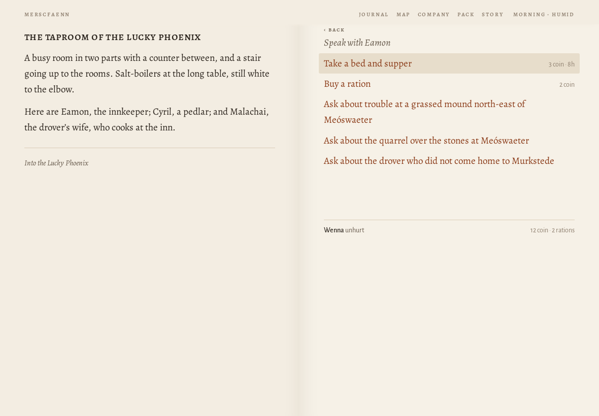
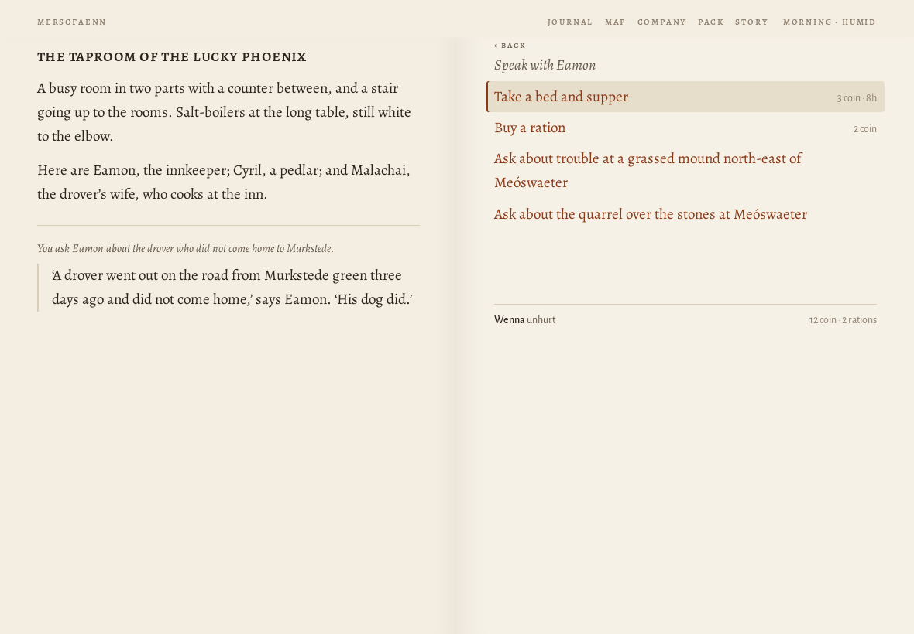
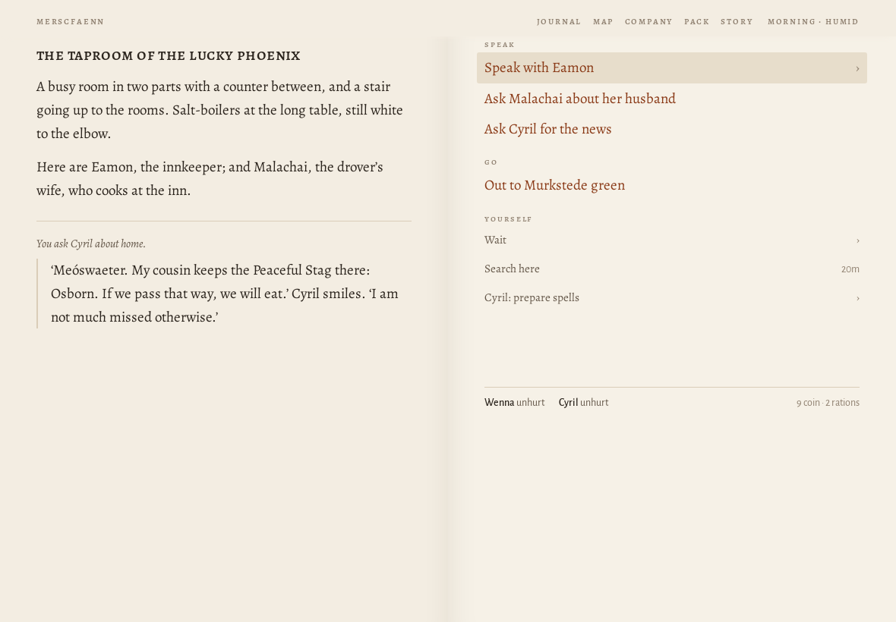
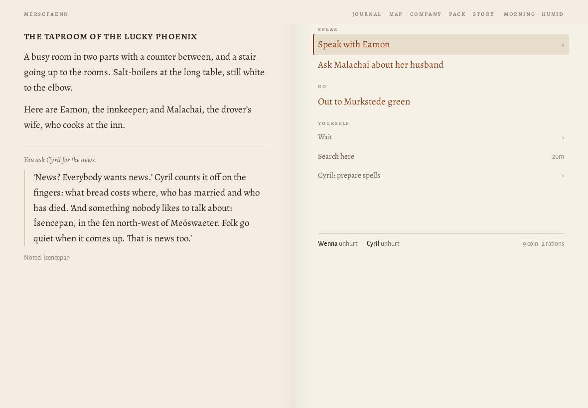
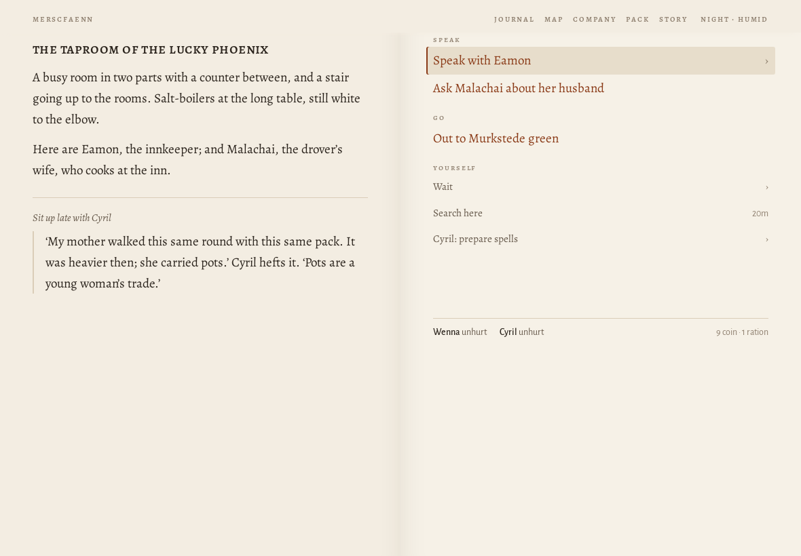

# Journey ?world=a1 at 1180×820

> origin: Over the hills

## The opening page

```
MERSCFAENN
Who comes to Merscfaenn?

Merscfaenn is fen country. You come into it alone, for a reason of your own; whoever goes with you, you will meet on the way.

name
people
Human
Elf
Dwarf
calling
Warrior
Mage
Thief
Cleric
Bard
Ranger
Monk

A human of the settled riverlands. Takes and deals the most harm and wears any armour. Brawn: lifts what has fallen and wrenches what is stuck.

why have you come?
Coming home
Your father, a drover of Murkstede, went out on the road with the cart and did not come home. You have come back to Murkstede for the first time in three years.
The brothers' errand
The brothers of your order have sent you to Murkstede with a letter for the priest, and an errand: to copy the old writing at Paliduslac, which no one has ever copied.
What is owed
You owe Mik, at Murkstede, thirty coin for a cart of salt that you lost on the road last spring. You have come back to pay it, somehow.
Over the hills
You have come over the hills into Merscfaenn with your trade and not much else, to see what there is for someone who will work.
Begin
Another country
```
## Begin

*the causeway into Murkstede · explore · 2840 ms · 55 nodes · 13 MB*

```
❧

Over the hills
the causeway into murkstede

The causeway runs on its piles across the last of the fen, and at the end of it is Murkstede: low roofs against the sky, salt-houses black with tar, boats drawn up on the landing, smoke going straight up from the inn.

You have come over the hills into Merscfaenn with your trade and not much else. There is work in any country for someone who will do what others will not, and the place to hear of it is the inn.
```
- **Go**: To Murkstede green
- **Yourself**: Wait (4) · Search here

## ^To Murkstede green

*Murkstede green · explore · 162 ms · 87 nodes · 13 MB*

```
murkstede green

Murkstede has a market cross on its green and a wall round half of it, with salt-houses black with tar along the shore. Boats are drawn up where the shore gives a landing. The sign of the Lucky Phoenix creaks over its door, and across the green the shrine of Nodens stands open.

A grey dog lies by the inn door with its head on its paws, watching the road.

Someone is raking out a salt-pan at the end of the green, and the steam comes off it white.

Amrod, the drover’s son, who wants to go after his father, is here.

To Murkstede green
```
- **Speak**: Ask Amrod about his father
- **Go**: To Mik's salt-house · To the causeway into Murkstede · To the shrine of Nodens · Into the Lucky Phoenix
- **Set out**: To the edge of Eikwudu by Murkstede · To the road between Murkstede and Meóswaeter · To the western edge of Merscfaenn
- **Yourself**: Wait (4) · Search here

## Into the Lucky Phoenix

*the taproom of the Lucky Phoenix · explore · 157 ms · 69 nodes · 13 MB*

```
the taproom of the lucky phoenix

A busy room in two parts with a counter between, and a stair going up to the rooms. Salt-boilers at the long table, still white to the elbow.

Here are Eamon, the innkeeper; Cyril, a pedlar; and Malachai, the drover’s wife, who cooks at the inn.

Into the Lucky Phoenix
```
- **Speak**: Speak with Eamon (5) · Speak with Cyril (3) · Ask Malachai about her husband
- **Go**: Out to Murkstede green
- **Yourself**: Wait (4) · Search here

## Speak with Eamon

*the taproom of the Lucky Phoenix · explore · 12 ms · 60 nodes · 13 MB*

```
the taproom of the lucky phoenix

A busy room in two parts with a counter between, and a stair going up to the rooms. Salt-boilers at the long table, still white to the elbow.

Here are Eamon, the innkeeper; Cyril, a pedlar; and Malachai, the drover’s wife, who cooks at the inn.

Into the Lucky Phoenix
```
- *open*: Speak with Eamon → Take a bed and supper · Buy a ration · Ask about trouble at a grassed mound north-east of Meóswaeter · Ask about the quarrel over the stones at Meóswaeter · Ask about the drover who did not come home to Murkstede
- **Speak**: Speak with Eamon (5) · Speak with Cyril (3) · Ask Malachai about her husband
- **Go**: Out to Murkstede green
- **Yourself**: Wait (4) · Search here



## drover

*the taproom of the Lucky Phoenix · explore · 115 ms · 58 nodes · 13 MB*

```
the taproom of the lucky phoenix

A busy room in two parts with a counter between, and a stair going up to the rooms. Salt-boilers at the long table, still white to the elbow.

Here are Eamon, the innkeeper; Cyril, a pedlar; and Malachai, the drover’s wife, who cooks at the inn.

You ask Eamon about the drover who did not come home to Murkstede.

‘A drover went out on the road from Murkstede green three days ago and did not come home,’ says Eamon. ‘His dog did.’
```
- *open*: Speak with Eamon → Take a bed and supper · Buy a ration · Ask about trouble at a grassed mound north-east of Meóswaeter · Ask about the quarrel over the stones at Meóswaeter
- **Speak**: Speak with Eamon (4) · Speak with Cyril (2) · Ask Malachai about her husband
- **Go**: Out to Murkstede green
- **Yourself**: Wait (4) · Search here



## Speak with Cyril

*the taproom of the Lucky Phoenix · explore · 15 ms · 50 nodes · 13 MB*

```
the taproom of the lucky phoenix

A busy room in two parts with a counter between, and a stair going up to the rooms. Salt-boilers at the long table, still white to the elbow.

Here are Eamon, the innkeeper; Cyril, a pedlar; and Malachai, the drover’s wife, who cooks at the inn.

You ask Eamon about the drover who did not come home to Murkstede.

‘A drover went out on the road from Murkstede green three days ago and did not come home,’ says Eamon. ‘His dog did.’
```
- *open*: Speak with Cyril → Ask about trouble at a grassed mound north-east of Meóswaeter · Ask Cyril what brings them to Murkstede
- **Speak**: Speak with Eamon (4) · Speak with Cyril (2) · Ask Malachai about her husband
- **Go**: Out to Murkstede green
- **Yourself**: Wait (4) · Search here

## what brings

*the taproom of the Lucky Phoenix · explore · 108 ms · 50 nodes · 13 MB*

```
the taproom of the lucky phoenix

A busy room in two parts with a counter between, and a stair going up to the rooms. Salt-boilers at the long table, still white to the elbow.

Here are Eamon, the innkeeper; Cyril, a pedlar; and Malachai, the drover’s wife, who cooks at the inn.

You ask Cyril what brings them to Murkstede.

‘Ribbons, pins and news. The news sells best.’ Cyril looks you over. ‘If you are going anywhere, I would come along. 3 coin, and my keep.’
```
- *open*: Speak with Cyril → Ask Cyril to join the company · Ask about trouble at a grassed mound north-east of Meóswaeter
- **Speak**: Speak with Eamon (4) · Speak with Cyril (2) · Ask Malachai about her husband
- **Go**: Out to Murkstede green
- **Yourself**: Wait (4) · Search here

## join

*the taproom of the Lucky Phoenix · explore · 159 ms · 55 nodes · 13 MB*

```
the taproom of the lucky phoenix

A busy room in two parts with a counter between, and a stair going up to the rooms. Salt-boilers at the long table, still white to the elbow.

Here are Eamon, the innkeeper; and Malachai, the drover’s wife, who cooks at the inn.

You ask Cyril to join the company.

Cyril shakes on it, and is one of you.

coin: 12 → 9
```
- *open*: Speak with Cyril → Ask Cyril about home · Ask Cyril for the news
- **Speak**: Speak with Eamon (4) · Ask Malachai about her husband · Speak with Cyril (2)
- **Go**: Out to Murkstede green
- **Yourself**: Wait (4) · Search here · Cyril: prepare spells (2)

## home

*the taproom of the Lucky Phoenix · explore · 127 ms · 76 nodes · 13 MB*

```
the taproom of the lucky phoenix

A busy room in two parts with a counter between, and a stair going up to the rooms. Salt-boilers at the long table, still white to the elbow.

Here are Eamon, the innkeeper; and Malachai, the drover’s wife, who cooks at the inn.

You ask Cyril about home.

‘Meóswaeter. My cousin keeps the Peaceful Stag there: Osborn. If we pass that way, we will eat.’ Cyril smiles. ‘I am not much missed otherwise.’
```
- **Speak**: Speak with Eamon (4) · Ask Malachai about her husband · Ask Cyril for the news
- **Go**: Out to Murkstede green
- **Yourself**: Wait (4) · Search here · Cyril: prepare spells (2)



## news

*the taproom of the Lucky Phoenix · explore · 89 ms · 75 nodes · 13 MB*

```
the taproom of the lucky phoenix

A busy room in two parts with a counter between, and a stair going up to the rooms. Salt-boilers at the long table, still white to the elbow.

Here are Eamon, the innkeeper; and Malachai, the drover’s wife, who cooks at the inn.

You ask Cyril for the news.

‘News? Everybody wants news.’ Cyril counts it off on the fingers: what bread costs where, who has married and who has died. ‘And something nobody likes to talk about: Ísencepan, in the fen north-west of Meóswaeter. Folk go quiet when it comes up. That is news too.’

Noted: Ísencepan
```
- **Speak**: Speak with Eamon (4) · Ask Malachai about her husband
- **Go**: Out to Murkstede green
- **Yourself**: Wait (4) · Search here · Cyril: prepare spells (2)



## Wait › until dark

*the taproom of the Lucky Phoenix · explore · 296 ms · 78 nodes · 13 MB*

```
the taproom of the lucky phoenix

A busy room in two parts with a counter between, and a stair going up to the rooms. Salt-boilers at the long table, still white to the elbow.

Here are Eamon, the innkeeper; and Malachai, the drover’s wife, who cooks at the inn.

You wait until dark.

The light goes. It is dark.

ration: 2 → 1
```
- **Speak**: Speak with Eamon (4) · Ask Malachai about her husband · Sit up late with Cyril
- **Go**: Out to Murkstede green
- **Yourself**: Wait (4) · Search here · Cyril: prepare spells (2)

> MISS /Speak with Cyril/ among: Speak with Eamon · Ask Malachai about her husband · Sit up late with Cyril · Out to Murkstede green · Wait · Search here · Cyril: prepare spells

## Speak with Cyril

*the taproom of the Lucky Phoenix · explore · 2 ms · 78 nodes · 13 MB*

```
the taproom of the lucky phoenix

A busy room in two parts with a counter between, and a stair going up to the rooms. Salt-boilers at the long table, still white to the elbow.

Here are Eamon, the innkeeper; and Malachai, the drover’s wife, who cooks at the inn.

You wait until dark.

The light goes. It is dark.

ration: 2 → 1
```
- **Speak**: Speak with Eamon (4) · Ask Malachai about her husband · Sit up late with Cyril
- **Go**: Out to Murkstede green
- **Yourself**: Wait (4) · Search here · Cyril: prepare spells (2)

## Sit up

*the taproom of the Lucky Phoenix · explore · 101 ms · 73 nodes · 13 MB*

```
the taproom of the lucky phoenix

A busy room in two parts with a counter between, and a stair going up to the rooms. Salt-boilers at the long table, still white to the elbow.

Here are Eamon, the innkeeper; and Malachai, the drover’s wife, who cooks at the inn.

Sit up late with Cyril

‘My mother walked this same round with this same pack. It was heavier then; she carried pots.’ Cyril hefts it. ‘Pots are a young woman’s trade.’
```
- **Speak**: Speak with Eamon (4) · Ask Malachai about her husband
- **Go**: Out to Murkstede green
- **Yourself**: Wait (4) · Search here · Cyril: prepare spells (2)




Errors: none