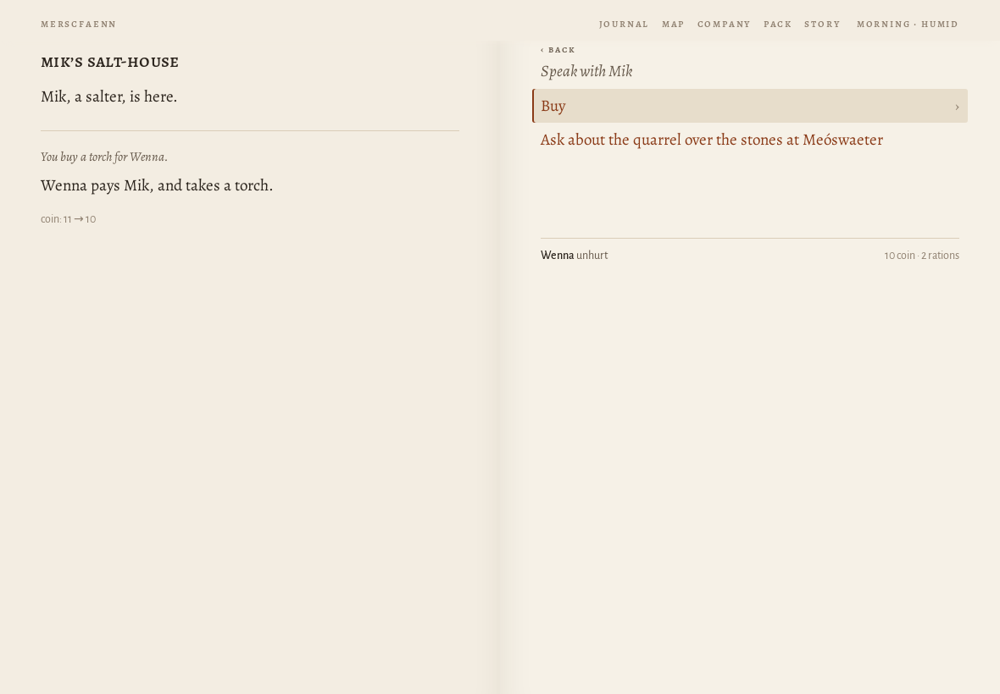
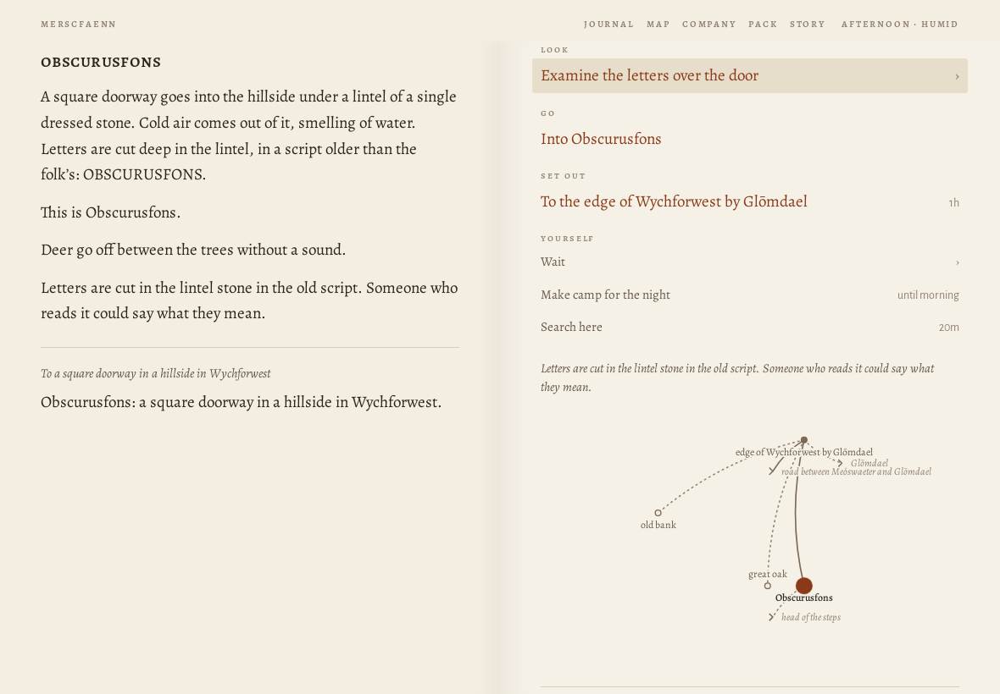
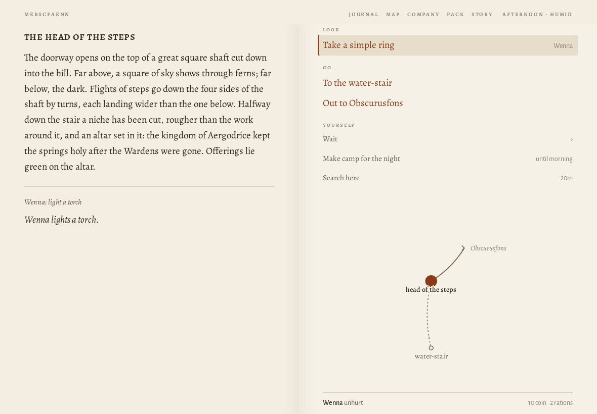
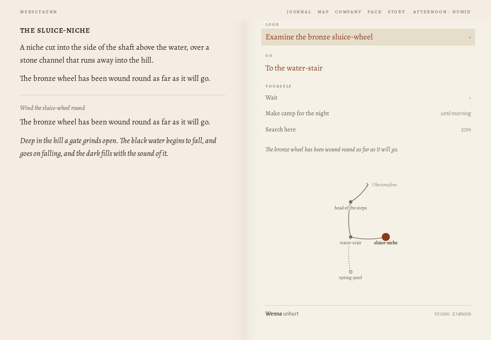
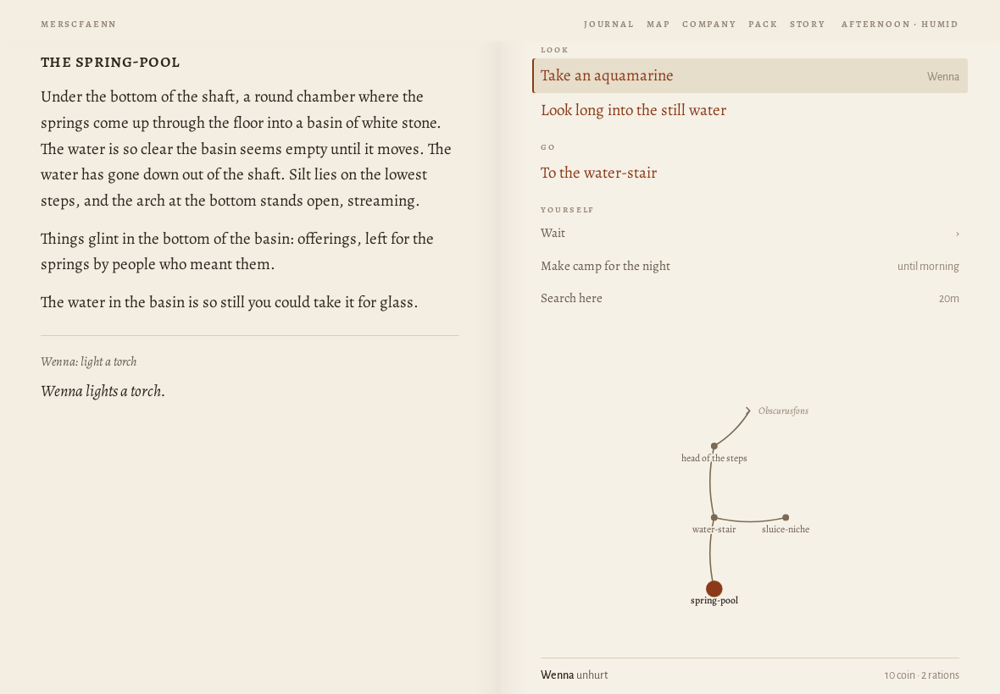
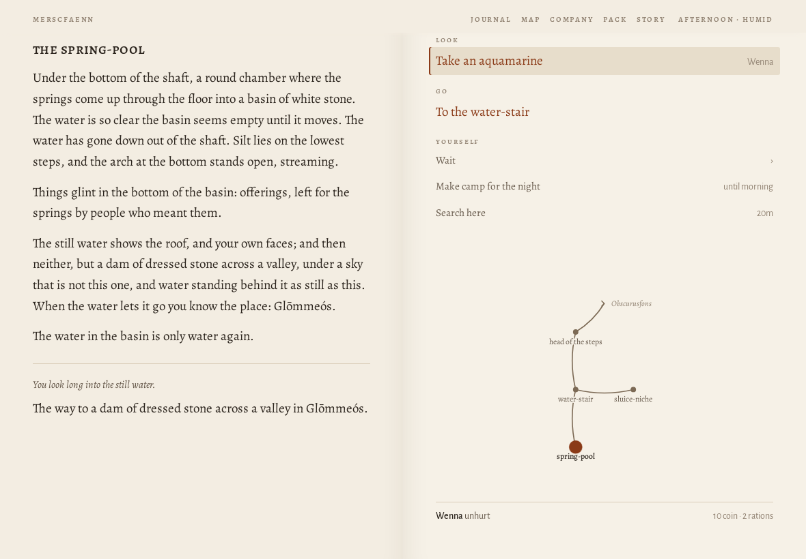
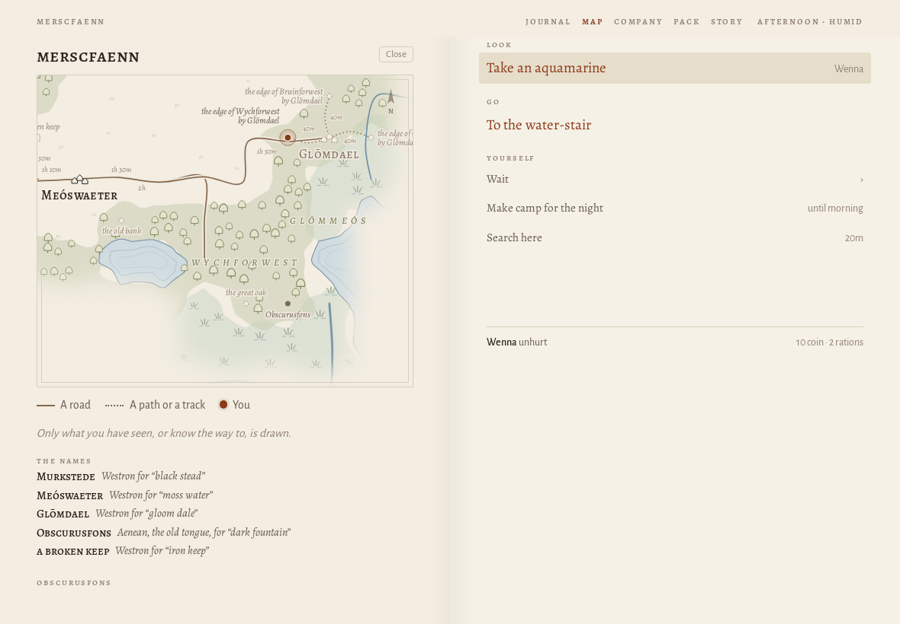

# Journey ?world=a1 at 1180×820

> origin: Over the hills

## The opening page

```
MERSCFAENN
Who comes to Merscfaenn?

Merscfaenn is fen country. You come into it alone, for a reason of your own; whoever goes with you, you will meet on the way.

name
people
Human
Elf
Dwarf
calling
Warrior
Mage
Thief
Cleric
Bard
Ranger
Monk

A human of the settled riverlands. Takes and deals the most harm and wears any armour. Brawn: lifts what has fallen and wrenches what is stuck.

why have you come?
Coming home
Your father, a drover of Murkstede, went out on the road with the cart and did not come home. You have come back to Murkstede for the first time in three years.
The brothers' errand
The brothers of your order have sent you to Murkstede with a letter for the priest, and an errand: to copy the old writing at Paliduslac, which no one has ever copied.
What is owed
You owe Mik, at Murkstede, thirty coin for a cart of salt that you lost on the road last spring. You have come back to pay it, somehow.
Over the hills
You have come over the hills into Merscfaenn with your trade and not much else, to see what there is for someone who will work.
Begin
Another country
```
## Begin

*the causeway into Murkstede · explore · 2845 ms · 55 nodes · 13 MB*

```
❧

Over the hills
the causeway into murkstede

The causeway runs on its piles across the last of the fen, and at the end of it is Murkstede: low roofs against the sky, salt-houses black with tar, boats drawn up on the landing, smoke going straight up from the inn.

You have come over the hills into Merscfaenn with your trade and not much else. There is work in any country for someone who will do what others will not, and the place to hear of it is the inn.
```
- **Go**: To Murkstede green
- **Yourself**: Wait (4) · Search here

## ^To Murkstede green

*Murkstede green · explore · 173 ms · 87 nodes · 13 MB*

```
murkstede green

Murkstede has a market cross on its green and a wall round half of it, with salt-houses black with tar along the shore. Boats are drawn up where the shore gives a landing. The sign of the Lucky Phoenix creaks over its door, and across the green the shrine of Nodens stands open.

A grey dog lies by the inn door with its head on its paws, watching the road.

Someone is raking out a salt-pan at the end of the green, and the steam comes off it white.

Amrod, the drover’s son, who wants to go after his father, is here.

To Murkstede green
```
- **Speak**: Ask Amrod about his father
- **Go**: To Mik's salt-house · To the causeway into Murkstede · To the shrine of Nodens · Into the Lucky Phoenix
- **Set out**: To the edge of Eikwudu by Murkstede · To the road between Murkstede and Meóswaeter · To the western edge of Merscfaenn
- **Yourself**: Wait (4) · Search here

## To Mik's salt-house

*Mik's salt-house · explore · 142 ms · 61 nodes · 13 MB*

```
mik’s salt-house

Mik, a salter, is here.

To Mik’s salt-house
```
- **Speak**: Speak with Mik (2)
- **Go**: To Murkstede green
- **Yourself**: Wait (4) · Search here

## Speak with Mik › Buy › A torch

*Mik's salt-house · explore · 161 ms · 52 nodes · 13 MB*

```
mik’s salt-house

Mik, a salter, is here.

You buy a torch for Wenna.

Wenna pays Mik, and takes a torch.

coin: 12 → 11
```
- *open*: Speak with Mik → Buy · Ask about the quarrel over the stones at Meóswaeter
- **Speak**: Speak with Mik (2)
- **Go**: To Murkstede green
- **Yourself**: Wait (4) · Search here

## Speak with Mik › Buy › A torch

*Mik's salt-house · explore · 146 ms · 52 nodes · 13 MB*

```
mik’s salt-house

Mik, a salter, is here.

You buy a torch for Wenna.

Wenna pays Mik, and takes a torch.

coin: 11 → 10
```
- *open*: Speak with Mik → Buy · Ask about the quarrel over the stones at Meóswaeter
- **Speak**: Speak with Mik (2)
- **Go**: To Murkstede green
- **Yourself**: Wait (4) · Search here



## ^To Murkstede green

*Murkstede green · explore · 92 ms · 86 nodes · 13 MB*

```
murkstede green

Murkstede has a market cross on its green and a wall round half of it, with salt-houses black with tar along the shore. Boats are drawn up where the shore gives a landing. The sign of the Lucky Phoenix creaks over its door, and across the green the shrine of Nodens stands open.

A grey dog lies by the inn door with its head on its paws, watching the road.

Amrod, the drover’s son, who wants to go after his father, is here.

To Murkstede green
```
- **Speak**: Ask Amrod about his father
- **Go**: To Mik's salt-house · To the causeway into Murkstede · To the shrine of Nodens · Into the Lucky Phoenix
- **Set out**: To the edge of Eikwudu by Murkstede · To the road between Murkstede and Meóswaeter · To the western edge of Merscfaenn
- **Yourself**: Wait (4) · Search here

## road between Murkstede and Meóswaeter$

*the road between Murkstede and Meóswaeter · explore · 542 ms · 71 nodes · 13 MB*

```
the road between murkstede and meóswaeter

The road between Murkstede and Meóswaeter goes through scattered woods and the clearings of charcoal-burners. A snake swims across a channel with its head held up like a stick.

Fresh ruts run off the edge of the road here, where the bank drops away.

To the road between Murkstede and Meóswaeter
```
- **Go**: To a broken keep · To Meóswaeter green · To Murkstede green · To the edge of Eikwudu by Murkstede
- **Yourself**: Wait (4) · Make camp for the night · Search here

## Meóswaeter green$

*Meóswaeter green · explore · 475 ms · 82 nodes · 13 MB*

```
meóswaeter green

Meóswaeter is one farm grown into four, their yards running together, with reed drying in ricks behind the houses. Next to the Peaceful Stag is the shrine of Nodens, so close that the inn’s smoke goes over its roof. A man goes by with a bundle of reed on his back as big as himself.

A woman in black sits on the step of a cold house with her hands in her lap, watching the road.

To Meóswaeter green
```
- **Speak**: Ask the woman in black what she is waiting for
- **Go**: To Edrick's herb-shop · To the shrine of Nodens · Into the Peaceful Stag
- **Set out**: To the road between Meóswaeter and Faennslím · To the road between Meóswaeter and Glōmdael · To the road between Murkstede and Meóswaeter
- **Yourself**: Wait (4) · Search here

## road between Meóswaeter and Glōmdael$

*the road between Meóswaeter and Glōmdael · explore · 645 ms · 74 nodes · 13 MB*

```
the road between meóswaeter and glōmdael

Open farmland on either hand: strip-fields, a mill-pond, cattle that lift their heads as you pass. A lizard watches from a tussock, its throat pulsing.

To the road between Meóswaeter and Glōmdael
```
- **Go**: To Glōmdael green · To Meóswaeter green · To the edge of Bruinforwest by Glōmdael · To the edge of Glōmmeós by Glōmdael · To the edge of Wychforwest by Glōmdael
- **Yourself**: Wait (4) · Make camp for the night · Search here

## edge of Wychforwest by Glōmdael$

*the edge of Wychforwest by Glōmdael · explore · 375 ms · 106 nodes · 13 MB*

```
the edge of wychforwest by glōmdael

Here Wychforwest begins: hazel and thorn at first, then oak, and the light under them goes green. Glōmdael is behind you, out in the open.

To the edge of Wychforwest by Glōmdael
```
- **Go**: To a square doorway in a hillside in Wychforwest · To the great oak · To the old bank · To Glōmdael green · To the road between Meóswaeter and Glōmdael
- **Yourself**: Wait (4) · Make camp for the night · Search here

## square doorway|Obscurusfons

*Obscurusfons · explore · 444 ms · 113 nodes · 13 MB*

```
obscurusfons

A square doorway goes into the hillside under a lintel of a single dressed stone. Cold air comes out of it, smelling of water. Letters are cut deep in the lintel, in a script older than the folk’s: OBSCURUSFONS.

This is Obscurusfons.

Deer go off between the trees without a sound.

Letters are cut in the lintel stone in the old script. Someone who reads it could say what they mean.

To a square doorway in a hillside in Wychforwest

Obscurusfons: a square doorway in a hillside in Wychforwest.
```
- **Look**: Examine the letters over the door (4)
- **Go**: Into Obscurusfons
- **Set out**: To the edge of Wychforwest by Glōmdael
- **Yourself**: Wait (4) · Make camp for the night · Search here



## Into

*the head of the steps · explore · 114 ms · 77 nodes · 13 MB*

```
the head of the steps

You have no light.

It is pitch dark. Without a light you can see nothing here, and do nothing that needs seeing.

Into Obscurusfons
```
- **Go**: To the water-stair · Out to Obscurusfons
- **Yourself**: Wenna: light a torch · Wait (4) · Make camp for the night

## light

*the head of the steps · explore · 147 ms · 85 nodes · 13 MB*

```
the head of the steps

The doorway opens on the top of a great square shaft cut down into the hill. Far above, a square of sky shows through ferns; far below, the dark. Flights of steps go down the four sides of the shaft by turns, each landing wider than the one below. Halfway down the stair a niche has been cut, rougher than the work around it, and an altar set in it: the kingdom of Aergodríce kept the springs holy after the Wardens were gone. Offerings lie green on the altar.

Wenna: light a torch

Wenna lights a torch.
```
- **Look**: Take a simple ring
- **Go**: To the water-stair · Out to Obscurusfons
- **Yourself**: Wait (4) · Make camp for the night · Search here



## water-stair

*the water-stair · explore · 148 ms · 100 nodes · 13 MB*

```
the water-stair

The lowest flights of the shaft, where the steps go down into black water as if into the floor of a room. Sound falls into the shaft from somewhere far above and does not come back up. Nothing moves in the water. Nothing has, for a long time. Black water fills the bottom of the shaft over the lowest flights, still as a floor. Under it, at the foot of the last flight, the top of an arch.

One pillar is cut with marks from the floor to as high as you can reach, each with a word beside it in the old script.

To the water-stair
```
- **Look**: Examine marks cut up a pillar (5)
- **Go**: To the head of the steps · To the sluice-niche · To the spring-pool [Black water fills the bottom of the shaft over the lowest flights, still as a floor. Under it, at the foot of the last flight, the top of an arch.]
- **Yourself**: Wait (4) · Make camp for the night · Search here

## sluice-niche

*the sluice-niche · explore · 144 ms · 94 nodes · 13 MB*

```
the sluice-niche

A niche cut into the side of the shaft above the water, over a stone channel that runs away into the hill.

A wheel of bronze as high as a man is set in the wall above the channel, green with age and fast in its seat.

To the sluice-niche
```
- **Look**: Look at the bronze sluice-wheel (2)
- **Go**: To the water-stair
- **Yourself**: Wait (4) · Make camp for the night · Search here

## Look at the bronze sluice-wheel › Wind

*the sluice-niche · explore · 191 ms · 95 nodes · 13 MB*

```
the sluice-niche

A niche cut into the side of the shaft above the water, over a stone channel that runs away into the hill.

The bronze wheel has been wound round as far as it will go.

Wind the sluice-wheel round

The bronze wheel has been wound round as far as it will go.

Deep in the hill a gate grinds open. The black water begins to fall, and goes on falling, and the dark fills with the sound of it.
```
- **Look**: Examine the bronze sluice-wheel (5)
- **Go**: To the water-stair
- **Yourself**: Wait (4) · Make camp for the night · Search here



## water-stair

*the water-stair · explore · 113 ms · 102 nodes · 13 MB*

```
the water-stair

The lowest flights of the shaft, where the steps go down into black water as if into the floor of a room. Sound falls into the shaft from somewhere far above and does not come back up. Nothing moves in the water. Nothing has, for a long time.

One pillar is cut with marks from the floor to as high as you can reach, each with a word beside it in the old script.

Since you were last here

The water has gone down out of the shaft. Silt lies on the lowest steps, and the arch at the bottom stands open, streaming.

To the water-stair
```
- **Look**: Examine marks cut up a pillar (5)
- **Go**: To the head of the steps · To the sluice-niche · To the spring-pool
- **Yourself**: Wait (4) · Make camp for the night · Search here

## spring-pool

*the spring-pool · explore · 159 ms · 85 nodes · 13 MB*

```
the spring-pool

You have no light.

It is pitch dark. Without a light you can see nothing here, and do nothing that needs seeing.

To the spring-pool

Wenna’s torch gutters out.
```
- **Go**: To the water-stair
- **Yourself**: Wenna: light a torch · Wait (4) · Make camp for the night

## light

*the spring-pool · explore · 159 ms · 98 nodes · 13 MB*

```
the spring-pool

Under the bottom of the shaft, a round chamber where the springs come up through the floor into a basin of white stone. The water is so clear the basin seems empty until it moves. The water has gone down out of the shaft. Silt lies on the lowest steps, and the arch at the bottom stands open, streaming.

Things glint in the bottom of the basin: offerings, left for the springs by people who meant them.

The water in the basin is so still you could take it for glass.

Wenna: light a torch

Wenna lights a torch.
```
- **Look**: Take an aquamarine · Look long into the still water
- **Go**: To the water-stair
- **Yourself**: Wait (4) · Make camp for the night · Search here



## Look long into the still water

*the spring-pool · explore · 97 ms · 96 nodes · 13 MB*

```
the spring-pool

Under the bottom of the shaft, a round chamber where the springs come up through the floor into a basin of white stone. The water is so clear the basin seems empty until it moves. The water has gone down out of the shaft. Silt lies on the lowest steps, and the arch at the bottom stands open, streaming.

Things glint in the bottom of the basin: offerings, left for the springs by people who meant them.

The still water shows the roof, and your own faces; and then neither, but a dam of dressed stone across a valley, under a sky that is not this one, and water standing behind it as still as this. When the water lets it go you know the place: Glōmmeós.

The water in the basin is only water again.

You look long into the still water.

The way to a dam of dressed stone across a valley in Glōmmeós.
```
- **Look**: Take an aquamarine
- **Go**: To the water-stair
- **Yourself**: Wait (4) · Make camp for the night · Search here



## MAP

*the spring-pool · map · 93 ms · 448 nodes · 13 MB*

```
Close
merscfaenn
Murkstede
Meóswaeter
Glōmdael
WYCHFORWEST
EIKWUDU
GLŌMMEÓS
the western edgeof Merscfaenn
a broken keep
the edge of Wychforwestby Glōmdael
Obscurusfons
the edge of Glōmmeósby Glōmdael
the edge of Bruinforwestby Glōmdael
the old bank
the great oak
1h 20m
40m
1h 20m
1h 10m
1h 30m
2h
30m
1h 50m
40m
40m
40m
N
A road
A path or a track
You

Only what you have seen, or know the way to, is drawn.

the names
Murkstede
Westron for “black stead”
Meóswaeter
Westron for “moss water”
Glōmdael
Westron for “gloom dale”
Obscurusfons
Aenean, the old tongue, for “dark fountain”
a broken keep
Westron for “iron keep”
obscurusfons
head of the steps
water-stair
sluice-niche
spring-pool
Obscurusfons
```
- **Look**: Take an aquamarine
- **Go**: To the water-stair
- **Yourself**: Wait (4) · Make camp for the night · Search here




Errors: none