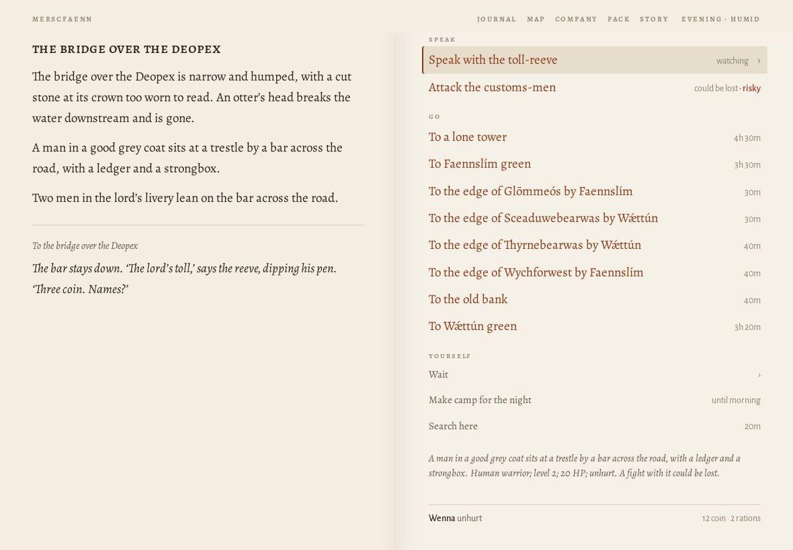
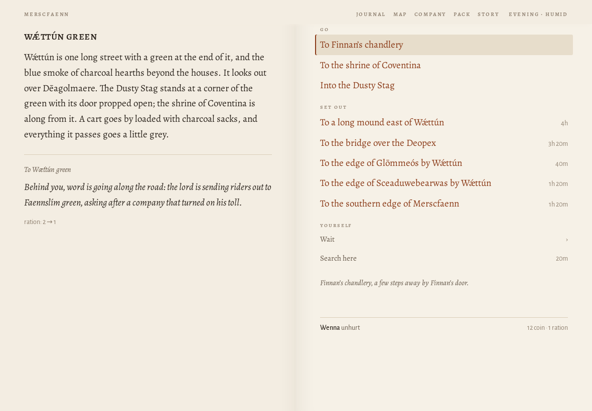
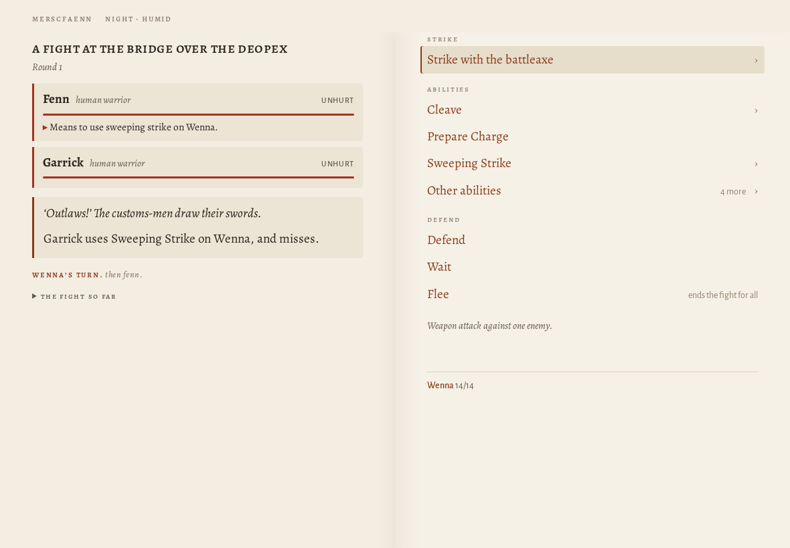
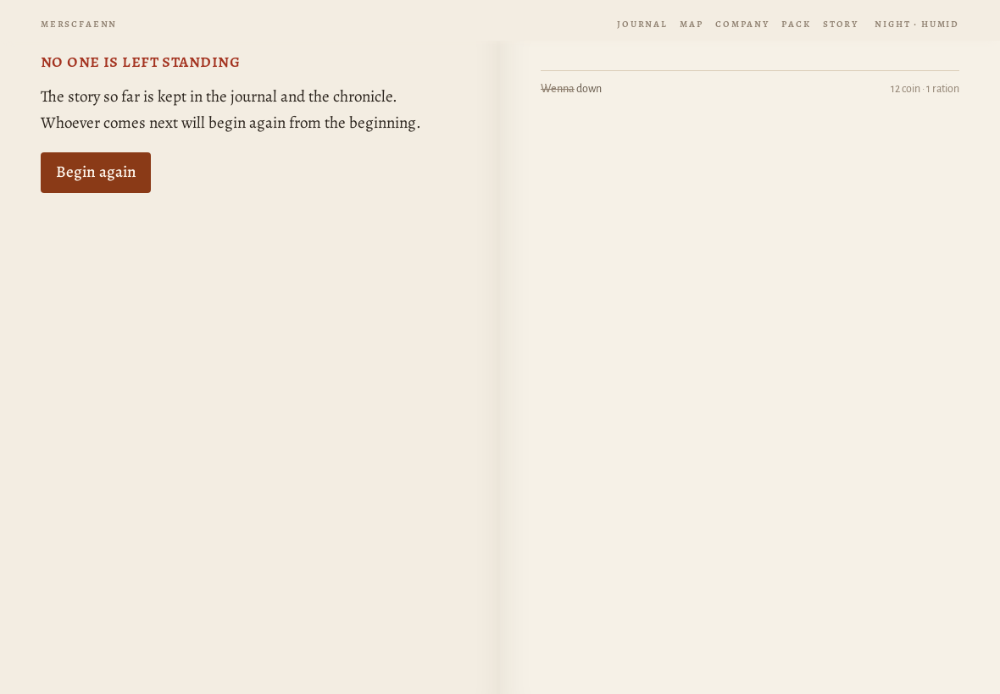

# Journey ?world=a1 at 1180×820

> origin: Over the hills

## The opening page

```
MERSCFAENN
Who comes to Merscfaenn?

Merscfaenn is fen country. You come into it alone, for a reason of your own; whoever goes with you, you will meet on the way.

name
people
Human
Elf
Dwarf
calling
Warrior
Mage
Thief
Cleric
Bard
Ranger
Monk

A human of the settled riverlands. Takes and deals the most harm and wears any armour. Brawn: lifts what has fallen and wrenches what is stuck.

why have you come?
Coming home
Your father, a drover of Murkstede, went out on the road with the cart and did not come home. You have come back to Murkstede for the first time in three years.
The brothers' errand
The brothers of your order have sent you to Murkstede with a letter for the priest, and an errand: to copy the old writing at Paliduslac, which no one has ever copied.
What is owed
You owe Mik, at Murkstede, thirty coin for a cart of salt that you lost on the road last spring. You have come back to pay it, somehow.
Over the hills
You have come over the hills into Merscfaenn with your trade and not much else, to see what there is for someone who will work.
Begin
Another country
```
## Begin

*the causeway into Murkstede · explore · 2841 ms · 55 nodes · 13 MB*

```
❧

Over the hills
the causeway into murkstede

The causeway runs on its piles across the last of the fen, and at the end of it is Murkstede: low roofs against the sky, salt-houses black with tar, boats drawn up on the landing, smoke going straight up from the inn.

You have come over the hills into Merscfaenn with your trade and not much else. There is work in any country for someone who will do what others will not, and the place to hear of it is the inn.
```
- **Go**: To Murkstede green
- **Yourself**: Wait (4) · Search here

## ^To Murkstede green

*Murkstede green · explore · 173 ms · 87 nodes · 13 MB*

```
murkstede green

Murkstede has a market cross on its green and a wall round half of it, with salt-houses black with tar along the shore. Boats are drawn up where the shore gives a landing. The sign of the Lucky Phoenix creaks over its door, and across the green the shrine of Nodens stands open.

A grey dog lies by the inn door with its head on its paws, watching the road.

Someone is raking out a salt-pan at the end of the green, and the steam comes off it white.

Amrod, the drover’s son, who wants to go after his father, is here.

To Murkstede green
```
- **Speak**: Ask Amrod about his father
- **Go**: To Mik's salt-house · To the causeway into Murkstede · To the shrine of Nodens · Into the Lucky Phoenix
- **Set out**: To the edge of Eikwudu by Murkstede · To the road between Murkstede and Meóswaeter · To the western edge of Merscfaenn
- **Yourself**: Wait (4) · Search here

## road between Murkstede and Meóswaeter$

*the road between Murkstede and Meóswaeter · explore · 544 ms · 71 nodes · 13 MB*

```
the road between murkstede and meóswaeter

The road between Murkstede and Meóswaeter goes through scattered woods and the clearings of charcoal-burners. A snake swims across a channel with its head held up like a stick.

Fresh ruts run off the edge of the road here, where the bank drops away.

To the road between Murkstede and Meóswaeter
```
- **Go**: To a broken keep · To Meóswaeter green · To Murkstede green · To the edge of Eikwudu by Murkstede
- **Yourself**: Wait (4) · Make camp for the night · Search here

## Meóswaeter green$

*Meóswaeter green · explore · 491 ms · 82 nodes · 13 MB*

```
meóswaeter green

Meóswaeter is one farm grown into four, their yards running together, with reed drying in ricks behind the houses. Next to the Peaceful Stag is the shrine of Nodens, so close that the inn’s smoke goes over its roof. A man goes by with a bundle of reed on his back as big as himself.

A woman in black sits on the step of a cold house with her hands in her lap, watching the road.

To Meóswaeter green
```
- **Speak**: Ask the woman in black what she is waiting for
- **Go**: To Edrick's herb-shop · To the shrine of Nodens · Into the Peaceful Stag
- **Set out**: To the road between Meóswaeter and Faennslím · To the road between Meóswaeter and Glōmdael · To the road between Murkstede and Meóswaeter
- **Yourself**: Wait (4) · Search here

## road between Meóswaeter and Faennslím$

*the road between Meóswaeter and Faennslím · explore · 557 ms · 74 nodes · 13 MB*

```
the road between meóswaeter and faennslím

A drove road, broad and rutted, between Meóswaeter and Faennslím, with thorn hedges and the odd byre. The frogs stop, all at once, and start again behind you.

To the road between Meóswaeter and Faennslím
```
- **Go**: To a long mound north of Faennslím · To Faennslím green · To Meóswaeter green · To the edge of Glōmmeós by Faennslím · To the edge of Wychforwest by Faennslím
- **Yourself**: Wait (4) · Make camp for the night · Search here

## Faennslím green$

*Faennslím green · explore · 508 ms · 82 nodes · 13 MB*

```
faennslím green

Faennslím is a green with a pond on it and houses round it, and eel-traps stacked against every wall. It looks out over Haseclaene. The Ancient Boar faces the shrine of Boann across the green. Two women are skinning eels on a bench by the water, and the cats are watching.

To Faennslím green
```
- **Go**: To Bask's salt-house · To the shrine of Boann · Into the Ancient Boar
- **Set out**: To the bridge over the Deopex · To the edge of Glōmmeós by Faennslím · To the edge of Wychforwest by Faennslím · To the road between Faennslím and Glōmdael · To the road between Meóswaeter and Faennslím
- **Yourself**: Wait (4) · Search here

## bridge over the Deopex$

*the bridge over the Deopex · explore · 731 ms · 103 nodes · 13 MB*

```
the bridge over the deopex

The bridge over the Deopex is narrow and humped, with a cut stone at its crown too worn to read. An otter’s head breaks the water downstream and is gone.

A man in a good grey coat sits at a trestle by a bar across the road, with a ledger and a strongbox.

Two men in the lord’s livery lean on the bar across the road.

To the bridge over the Deopex

The bar stays down. ‘The lord’s toll,’ says the reeve, dipping his pen. ‘Three coin. Names?’
```
- **Speak**: Speak with the toll-reeve (2) · Attack the customs-men
- **Go**: To a lone tower · To Faennslím green · To the edge of Glōmmeós by Faennslím · To the edge of Sceaduwebearwas by Wǽttún · To the edge of Thyrnebearwas by Wǽttún · To the edge of Wychforwest by Faennslím · To the old bank · To Wǽttún green
- **Yourself**: Wait (4) · Make camp for the night · Search here



## Wǽttún green$

*Wǽttún green · explore · 764 ms · 85 nodes · 13 MB*

```
wǽttún green

Wǽttún is one long street with a green at the end of it, and the blue smoke of charcoal hearths beyond the houses. It looks out over Dēagolmaere. The Dusty Stag stands at a corner of the green with its door propped open; the shrine of Coventina is along from it. A cart goes by loaded with charcoal sacks, and everything it passes goes a little grey.

To Wǽttún green

Behind you, word is going along the road: the lord is sending riders out to Faennslím green, asking after a company that turned on his toll.

ration: 2 → 1
```
- **Go**: To Finnan's chandlery · To the shrine of Coventina · Into the Dusty Stag
- **Set out**: To a long mound east of Wǽttún · To the bridge over the Deopex · To the edge of Glōmmeós by Wǽttún · To the edge of Sceaduwebearwas by Wǽttún · To the southern edge of Merscfaenn
- **Yourself**: Wait (4) · Search here



## bridge over the Deopex$

*the bridge over the Deopex · combat · 165 ms · 92 nodes · 13 MB*

```
a fight at the bridge over the deopex

Round 1

Fenn
human warrior
UNHURT

Means to use sweeping strike on Wenna.

Garrick
human warrior
UNHURT

‘Outlaws!’ The customs-men draw their swords.

Garrick uses Sweeping Strike on Wenna, and misses.

wenna’s turn. then fenn.

the fight so far
```
- **Strike**: Strike with the battleaxe (2)
- **Abilities**: Cleave (2) · Prepare Charge · Sweeping Strike (2) · Other abilities (4)
- **Defend, wait or withdraw**: Defend · Wait · Flee



## FIGHT

*the bridge over the Deopex · explore · 407 ms · 34 nodes · 13 MB*

```
no one is left standing

The story so far is kept in the journal and the chronicle. Whoever comes next will begin again from the beginning.

Begin again
```
- **Go**: To a lone tower [Not possible from here right now.] · To Faennslím green [Not possible from here right now.] · To the edge of Glōmmeós by Faennslím [Not possible from here right now.] · To the edge of Sceaduwebearwas by Wǽttún [Not possible from here right now.] · To the edge of Thyrnebearwas by Wǽttún [Not possible from here right now.] · To the edge of Wychforwest by Faennslím [Not possible from here right now.] · To the old bank [Not possible from here right now.] · To Wǽttún green [Not possible from here right now.]




Errors: none