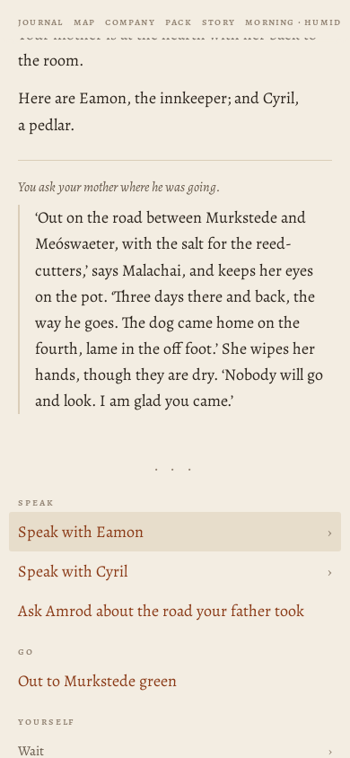
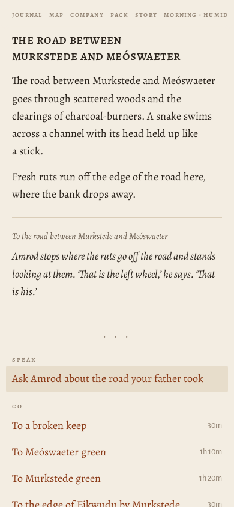
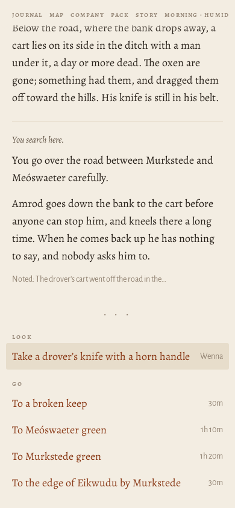
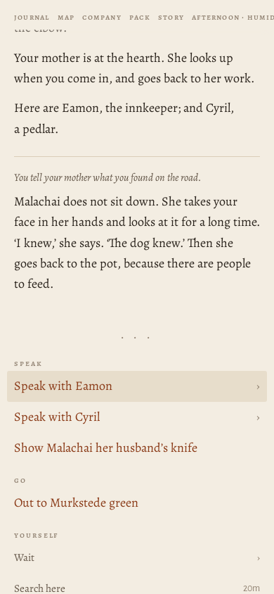
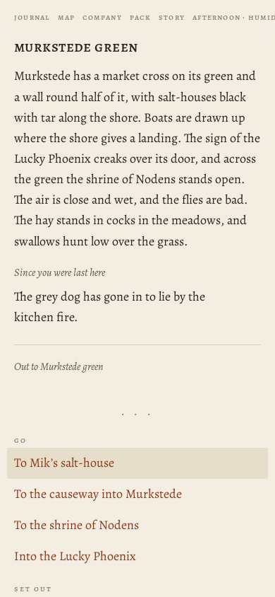
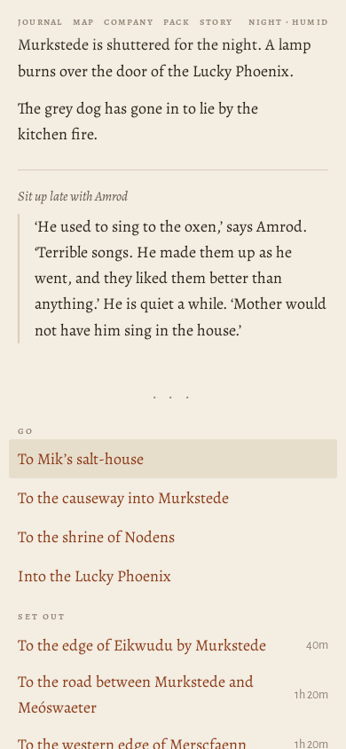

# Journey ?world=a1 at 390×844

> origin: Coming home

## The opening page

```
MERSCFAENN
Who comes to Merscfaenn?

Merscfaenn is fen country. You come into it alone, for a reason of your own; whoever goes with you, you will meet on the way.

name
people
Human
Elf
Dwarf
calling
Warrior
Mage
Thief
Cleric
Bard
Ranger
Monk

A human of the settled riverlands. Takes and deals the most harm and wears any armour. Brawn: lifts what has fallen and wrenches what is stuck.

why have you come?
Coming home
Your father, a drover of Murkstede, went out on the road with the cart and did not come home. You have come back to Murkstede for the first time in three years.
The brothers' errand
The brothers of your order have sent you to Murkstede with a letter for the priest, and an errand: to copy the old writing at Paliduslac, which no one has ever copied.
What is owed
You owe Mik, at Murkstede, thirty coin for a cart of salt that you lost on the road last spring. You have come back to pay it, somehow.
Over the hills
You have come over the hills into Merscfaenn with your trade and not much else, to see what there is for someone who will work.
Begin
Another country
```
## Begin

*the causeway into Murkstede · explore · 2850 ms · 55 nodes · 14 MB*

```
❧

Coming home
the causeway into murkstede

The causeway runs on its piles across the last of the fen, and at the end of it is Murkstede: low roofs against the sky, salt-houses black with tar, boats drawn up on the landing, smoke going straight up from the inn.

You have been three years on the other side of the hills, hiring out with the droves. Your mother’s letter took a week to find you. Your father went out on the road with the cart, it said, and did not come home.
```
- **Go**: To Murkstede green
- **Yourself**: Wait (4) · Search here

## ^To Murkstede green

*Murkstede green · explore · 251 ms · 87 nodes · 14 MB*

```
murkstede green

Murkstede has a market cross on its green and a wall round half of it, with salt-houses black with tar along the shore. Boats are drawn up where the shore gives a landing. The sign of the Lucky Phoenix creaks over its door, and across the green the shrine of Nodens stands open.

A grey dog lies by the inn door with its head on its paws, watching the road.

Someone is raking out a salt-pan at the end of the green, and the steam comes off it white.

Your brother is sitting on the rail of the green with your father’s old spear across his knees. He is taller by a head than when you went away.

To Murkstede green
```
- **Speak**: Ask Amrod what he means to do
- **Go**: To Mik's salt-house · To the causeway into Murkstede · To the shrine of Nodens · Into the Lucky Phoenix
- **Set out**: To the edge of Eikwudu by Murkstede · To the road between Murkstede and Meóswaeter · To the western edge of Merscfaenn
- **Yourself**: Wait (4) · Search here

## Amrod

*Murkstede green · explore · 170 ms · 87 nodes · 14 MB*

```
murkstede green

Murkstede has a market cross on its green and a wall round half of it, with salt-houses black with tar along the shore. Boats are drawn up where the shore gives a landing. The sign of the Lucky Phoenix creaks over its door, and across the green the shrine of Nodens stands open.

A grey dog lies by the inn door with its head on its paws, watching the road.

Your brother is waiting by the rail with the spear, ready when you are.

You ask Amrod what he means to do.

‘Go after him,’ says Amrod. ‘Mother says wait. I have waited three days.’ He looks at you, and at the road. ‘If you are going, I am coming with you. If you are not, I am going anyway.’
```
- **Speak**: Ask Amrod to join the company
- **Go**: To Mik's salt-house · To the causeway into Murkstede · To the shrine of Nodens · Into the Lucky Phoenix
- **Set out**: To the edge of Eikwudu by Murkstede · To the road between Murkstede and Meóswaeter · To the western edge of Merscfaenn
- **Yourself**: Wait (4) · Search here

## join

*Murkstede green · explore · 209 ms · 88 nodes · 14 MB*

```
murkstede green

Murkstede has a market cross on its green and a wall round half of it, with salt-houses black with tar along the shore. Boats are drawn up where the shore gives a landing. The sign of the Lucky Phoenix creaks over its door, and across the green the shrine of Nodens stands open.

A grey dog lies by the inn door with its head on its paws, watching the road.

You ask Amrod to join the company.

Amrod shakes on it, and is one of you.
```
- **Speak**: Ask Amrod about the road your father took
- **Go**: To Mik's salt-house · To the causeway into Murkstede · To the shrine of Nodens · Into the Lucky Phoenix
- **Set out**: To the edge of Eikwudu by Murkstede · To the road between Murkstede and Meóswaeter · To the western edge of Merscfaenn
- **Yourself**: Wait (4) · Search here

## Into the Lucky Phoenix

*the taproom of the Lucky Phoenix · explore · 223 ms · 76 nodes · 14 MB*

```
the taproom of the lucky phoenix

A busy room in two parts with a counter between, and a stair going up to the rooms. Salt-boilers at the long table, still white to the elbow.

Your mother is at the hearth with her back to the room.

Here are Eamon, the innkeeper; and Cyril, a pedlar.

Into the Lucky Phoenix
```
- **Speak**: Speak with Eamon (4) · Speak with Cyril (2) · Ask your mother where he was going · Ask Amrod about the road your father took
- **Go**: Out to Murkstede green
- **Yourself**: Wait (4) · Search here

## mother

*the taproom of the Lucky Phoenix · explore · 176 ms · 74 nodes · 14 MB*

```
the taproom of the lucky phoenix

A busy room in two parts with a counter between, and a stair going up to the rooms. Salt-boilers at the long table, still white to the elbow.

Your mother is at the hearth with her back to the room.

Here are Eamon, the innkeeper; and Cyril, a pedlar.

You ask your mother where he was going.

‘Out on the road between Murkstede and Meóswaeter, with the salt for the reed-cutters,’ says Malachai, and keeps her eyes on the pot. ‘Three days there and back, the way he goes. The dog came home on the fourth, lame in the off foot.’ She wipes her hands, though they are dry. ‘Nobody will go and look. I am glad you came.’
```
- **Speak**: Speak with Eamon (4) · Speak with Cyril (2) · Ask Amrod about the road your father took
- **Go**: Out to Murkstede green
- **Yourself**: Wait (4) · Search here



## Out to Murkstede green

*Murkstede green · explore · 161 ms · 88 nodes · 14 MB*

```
murkstede green

Murkstede has a market cross on its green and a wall round half of it, with salt-houses black with tar along the shore. Boats are drawn up where the shore gives a landing. The sign of the Lucky Phoenix creaks over its door, and across the green the shrine of Nodens stands open.

A grey dog lies by the inn door with its head on its paws, watching the road.

The air is close and wet, and the flies are bad. The hay stands in cocks in the meadows, and swallows hunt low over the grass.

Out to Murkstede green
```
- **Speak**: Ask Amrod about the road your father took
- **Go**: To Mik's salt-house · To the causeway into Murkstede · To the shrine of Nodens · Into the Lucky Phoenix
- **Set out**: To the edge of Eikwudu by Murkstede · To the road between Murkstede and Meóswaeter · To the western edge of Merscfaenn
- **Yourself**: Wait (4) · Search here

## road between Murkstede and Meóswaeter$

*the road between Murkstede and Meóswaeter · explore · 589 ms · 81 nodes · 14 MB*

```
the road between murkstede and meóswaeter

The road between Murkstede and Meóswaeter goes through scattered woods and the clearings of charcoal-burners. A snake swims across a channel with its head held up like a stick.

Fresh ruts run off the edge of the road here, where the bank drops away.

To the road between Murkstede and Meóswaeter

Amrod stops where the ruts go off the road and stands looking at them. ‘That is the left wheel,’ he says. ‘That is his.’
```
- **Speak**: Ask Amrod about the road your father took
- **Go**: To a broken keep · To Meóswaeter green · To Murkstede green · To the edge of Eikwudu by Murkstede
- **Yourself**: Wait (4) · Make camp for the night · Search here



## Search

*the road between Murkstede and Meóswaeter · explore · 164 ms · 81 nodes · 14 MB*

```
the road between murkstede and meóswaeter

The road between Murkstede and Meóswaeter goes through scattered woods and the clearings of charcoal-burners. A snake swims across a channel with its head held up like a stick.

Below the road, where the bank drops away, a cart lies on its side in the ditch with a man under it, a day or more dead. The oxen are gone; something had them, and dragged them off toward the hills. His knife is still in his belt.

You search here.

You go over the road between Murkstede and Meóswaeter carefully.

Amrod goes down the bank to the cart before anyone can stop him, and kneels there a long time. When he comes back up he has nothing to say, and nobody asks him to.

Noted: The drover's cart went off the road in the…
```
- **Look**: Take a drover's knife with a horn handle
- **Go**: To a broken keep · To Meóswaeter green · To Murkstede green · To the edge of Eikwudu by Murkstede
- **Yourself**: Wait (4) · Make camp for the night



## Take a drover

*the road between Murkstede and Meóswaeter · explore · 185 ms · 73 nodes · 14 MB*

```
the road between murkstede and meóswaeter

The road between Murkstede and Meóswaeter goes through scattered woods and the clearings of charcoal-burners. A snake swims across a channel with its head held up like a stick.

Below the road, where the bank drops away, a cart lies on its side in the ditch with a man under it, a day or more dead. The oxen are gone; something had them, and dragged them off toward the hills. His knife is still in his belt.

You collect a drover’s knife with a horn handle for Wenna.

Wenna takes a drover’s knife with a horn handle.

Noted: Your brother knelt by the cart
```
- **Go**: To a broken keep · To Meóswaeter green · To Murkstede green · To the edge of Eikwudu by Murkstede
- **Yourself**: Wait (4) · Make camp for the night

## Murkstede green$

*Murkstede green · explore · 593 ms · 81 nodes · 14 MB*

```
murkstede green

Murkstede has a market cross on its green and a wall round half of it, with salt-houses black with tar along the shore. Boats are drawn up where the shore gives a landing. The sign of the Lucky Phoenix creaks over its door, and across the green the shrine of Nodens stands open.

A grey dog lies by the inn door with its head on its paws, watching the road.

To Murkstede green
```
- **Go**: To Mik's salt-house · To the causeway into Murkstede · To the shrine of Nodens · Into the Lucky Phoenix
- **Set out**: To the edge of Eikwudu by Murkstede · To the road between Murkstede and Meóswaeter · To the western edge of Merscfaenn
- **Yourself**: Wait (4) · Search here

## Into the Lucky Phoenix

*the taproom of the Lucky Phoenix · explore · 175 ms · 73 nodes · 14 MB*

```
the taproom of the lucky phoenix

A busy room in two parts with a counter between, and a stair going up to the rooms. Salt-boilers at the long table, still white to the elbow.

Your mother is at the hearth with her back to the room.

Here are Eamon, the innkeeper; and Cyril, a pedlar.

Into the Lucky Phoenix
```
- **Speak**: Speak with Eamon (4) · Speak with Cyril (2) · Tell your mother what you found on the road
- **Go**: Out to Murkstede green
- **Yourself**: Wait (4) · Search here

## Tell your mother

*the taproom of the Lucky Phoenix · explore · 193 ms · 74 nodes · 14 MB*

```
the taproom of the lucky phoenix

A busy room in two parts with a counter between, and a stair going up to the rooms. Salt-boilers at the long table, still white to the elbow.

Your mother is at the hearth. She looks up when you come in, and goes back to her work.

Here are Eamon, the innkeeper; and Cyril, a pedlar.

You tell your mother what you found on the road.

Malachai does not sit down. She takes your face in her hands and looks at it for a long time. ‘I knew,’ she says. ‘The dog knew.’ Then she goes back to the pot, because there are people to feed.
```
- **Speak**: Speak with Eamon (4) · Speak with Cyril (2) · Show Malachai her husband's knife
- **Go**: Out to Murkstede green
- **Yourself**: Wait (4) · Search here



## Out to Murkstede green

*Murkstede green · explore · 170 ms · 83 nodes · 14 MB*

```
murkstede green

Murkstede has a market cross on its green and a wall round half of it, with salt-houses black with tar along the shore. Boats are drawn up where the shore gives a landing. The sign of the Lucky Phoenix creaks over its door, and across the green the shrine of Nodens stands open. The air is close and wet, and the flies are bad. The hay stands in cocks in the meadows, and swallows hunt low over the grass.

Since you were last here

The grey dog has gone in to lie by the kitchen fire.

Out to Murkstede green
```
- **Go**: To Mik's salt-house · To the causeway into Murkstede · To the shrine of Nodens · Into the Lucky Phoenix
- **Set out**: To the edge of Eikwudu by Murkstede · To the road between Murkstede and Meóswaeter · To the western edge of Merscfaenn
- **Yourself**: Wait (4) · Search here



## Wait › until dark

*Murkstede green · explore · 389 ms · 90 nodes · 14 MB*

```
murkstede green

Murkstede is shuttered for the night. A lamp burns over the door of the Lucky Phoenix.

The grey dog has gone in to lie by the kitchen fire.

You wait until dark.

The light goes. It is dark.

ration: 2 → 1
```
- **Speak**: Sit up late with Amrod
- **Go**: To Mik's salt-house · To the causeway into Murkstede · To the shrine of Nodens · Into the Lucky Phoenix
- **Set out**: To the edge of Eikwudu by Murkstede · To the road between Murkstede and Meóswaeter · To the western edge of Merscfaenn
- **Yourself**: Wait (4) · Search here

## Speak with Amrod|Sit up

*Murkstede green · explore · 172 ms · 82 nodes · 14 MB*

```
murkstede green

Murkstede is shuttered for the night. A lamp burns over the door of the Lucky Phoenix.

The grey dog has gone in to lie by the kitchen fire.

Sit up late with Amrod

‘He used to sing to the oxen,’ says Amrod. ‘Terrible songs. He made them up as he went, and they liked them better than anything.’ He is quiet a while. ‘Mother would not have him sing in the house.’
```
- **Go**: To Mik's salt-house · To the causeway into Murkstede · To the shrine of Nodens · Into the Lucky Phoenix
- **Set out**: To the edge of Eikwudu by Murkstede · To the road between Murkstede and Meóswaeter · To the western edge of Merscfaenn
- **Yourself**: Wait (4) · Search here




Errors: none