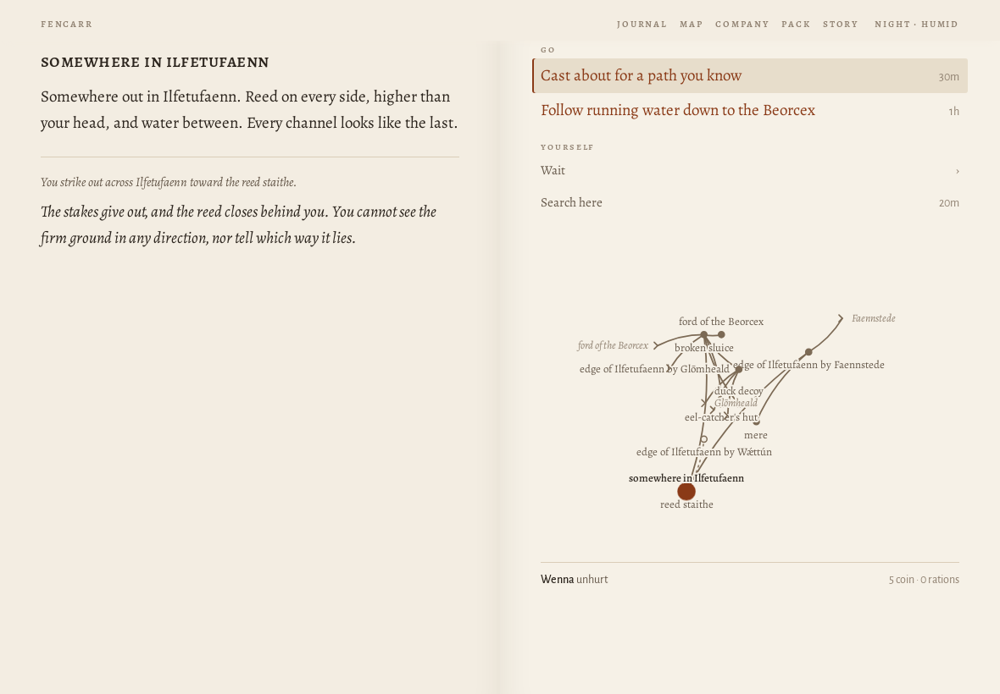

# Journey ?world=a1 at 1180×820

> origin: Over the hills

## The opening page

```
MERSCFAENN
Who comes to Merscfaenn?

Merscfaenn is fen country. You come into it alone, for a reason of your own; whoever goes with you, you will meet on the way.

name
people
Human
Elf
Dwarf
calling
Warrior
Mage
Thief
Cleric
Bard
Ranger
Monk

A human of the settled riverlands. Takes and deals the most harm and wears any armour. Brawn: lifts what has fallen and wrenches what is stuck.

why have you come?
Coming home
Your father, a drover of Murkstede, went out on the road with the cart and did not come home. You have come back to Murkstede for the first time in three years.
The brothers' errand
The brothers of your order have sent you to Murkstede with a letter for the priest, and an errand: to copy the old writing at Paliduslac, which no one has ever copied.
What is owed
You owe Mik, at Murkstede, thirty coin for a cart of salt that you lost on the road last spring. You have come back to pay it, somehow.
Over the hills
You have come over the hills into Merscfaenn with your trade and not much else, to see what there is for someone who will work.
Begin
Another country
```
## Begin

*the causeway into Murkstede · explore · 2841 ms · 55 nodes · 14 MB*

```
❧

Over the hills
the causeway into murkstede

The causeway runs on its piles across the last of the fen, and at the end of it is Murkstede: low roofs against the sky, salt-houses black with tar, boats drawn up on the landing, smoke going straight up from the inn.

You have come over the hills into Merscfaenn with your trade and not much else. There is work in any country for someone who will do what others will not, and the place to hear of it is the inn.
```
- **Go**: To Murkstede green
- **Yourself**: Wait (4) · Search here

## walk 0: To Murkstede green

*Murkstede green · explore · 177 ms · 87 nodes · 14 MB*

```
murkstede green

Murkstede has a market cross on its green and a wall round half of it, with salt-houses black with tar along the shore. Boats are drawn up where the shore gives a landing. The sign of the Lucky Phoenix creaks over its door, and across the green the shrine of Nodens stands open.

A grey dog lies by the inn door with its head on its paws, watching the road.

Someone is raking out a salt-pan at the end of the green, and the steam comes off it white.

Amrod, the drover’s son, who wants to go after his father, is here.

To Murkstede green
```
- **Speak**: Ask Amrod about his father
- **Go**: To Mik's salt-house · To the causeway into Murkstede · To the shrine of Nodens · Into the Lucky Phoenix
- **Set out**: To the edge of Eikwudu by Murkstede · To the road between Murkstede and Meóswaeter · To the western edge of Merscfaenn
- **Yourself**: Wait (4) · Search here

## walk 1: Into the Lucky Phoenix

*the taproom of the Lucky Phoenix · explore · 174 ms · 69 nodes · 14 MB*

```
the taproom of the lucky phoenix

A busy room in two parts with a counter between, and a stair going up to the rooms. Salt-boilers at the long table, still white to the elbow.

Here are Eamon, the innkeeper; Cyril, a pedlar; and Malachai, the drover’s wife, who cooks at the inn.

Into the Lucky Phoenix
```
- **Speak**: Speak with Eamon (5) · Speak with Cyril (3) · Ask Malachai about her husband
- **Go**: Out to Murkstede green
- **Yourself**: Wait (4) · Search here

## walk 2: Out to Murkstede green

*Murkstede green · explore · 109 ms · 87 nodes · 14 MB*

```
murkstede green

Murkstede has a market cross on its green and a wall round half of it, with salt-houses black with tar along the shore. Boats are drawn up where the shore gives a landing. The sign of the Lucky Phoenix creaks over its door, and across the green the shrine of Nodens stands open.

A grey dog lies by the inn door with its head on its paws, watching the road.

The air is close and wet, and the flies are bad. The hay stands in cocks in the meadows, and swallows hunt low over the grass.

Amrod, the drover’s son, who wants to go after his father, is here.

Out to Murkstede green
```
- **Speak**: Ask Amrod about his father
- **Go**: To Mik's salt-house · To the causeway into Murkstede · To the shrine of Nodens · Into the Lucky Phoenix
- **Set out**: To the edge of Eikwudu by Murkstede · To the road between Murkstede and Meóswaeter · To the western edge of Merscfaenn
- **Yourself**: Wait (4) · Search here

## walk 3: To the causeway into Murkstede

*the causeway into Murkstede · explore · 144 ms · 54 nodes · 14 MB*

```
the causeway into murkstede

The causeway runs on its piles across the last of the fen, and at the end of it is Murkstede: low roofs against the sky, salt-houses black with tar, boats drawn up on the landing, smoke going straight up from the inn.

You have come over the hills into Merscfaenn with your trade and not much else. There is work in any country for someone who will do what others will not, and the place to hear of it is the inn.

To the causeway into Murkstede
```
- **Go**: To Murkstede green
- **Yourself**: Wait (4) · Search here

## walk 4: To Murkstede green

*Murkstede green · explore · 136 ms · 86 nodes · 14 MB*

```
murkstede green

Murkstede has a market cross on its green and a wall round half of it, with salt-houses black with tar along the shore. Boats are drawn up where the shore gives a landing. The sign of the Lucky Phoenix creaks over its door, and across the green the shrine of Nodens stands open.

A grey dog lies by the inn door with its head on its paws, watching the road.

Amrod, the drover’s son, who wants to go after his father, is here.

To Murkstede green
```
- **Speak**: Ask Amrod about his father
- **Go**: To Mik's salt-house · To the causeway into Murkstede · To the shrine of Nodens · Into the Lucky Phoenix
- **Set out**: To the edge of Eikwudu by Murkstede · To the road between Murkstede and Meóswaeter · To the western edge of Merscfaenn
- **Yourself**: Wait (4) · Search here

## walk 5: Ask Amrod about his father

*Murkstede green · explore · 126 ms · 81 nodes · 14 MB*

```
murkstede green

Murkstede has a market cross on its green and a wall round half of it, with salt-houses black with tar along the shore. Boats are drawn up where the shore gives a landing. The sign of the Lucky Phoenix creaks over its door, and across the green the shrine of Nodens stands open.

A grey dog lies by the inn door with its head on its paws, watching the road.

Amrod, the drover’s son, who wants to go after his father, is here.

You ask Amrod about his father.

‘Three days,’ says Amrod. ‘Mother says wait. I have waited.’ He looks at the road. ‘If you are going that way, I will come.’
```
- **Go**: To Mik's salt-house · To the causeway into Murkstede · To the shrine of Nodens · Into the Lucky Phoenix
- **Set out**: To the edge of Eikwudu by Murkstede · To the road between Murkstede and Meóswaeter · To the western edge of Merscfaenn
- **Yourself**: Wait (4) · Search here

## walk 6: To the edge of Eikwudu by Murkstede

*the edge of Eikwudu by Murkstede · explore · 418 ms · 97 nodes · 14 MB*

```
the edge of eikwudu by murkstede

Here Eikwudu begins: hazel and thorn at first, then oak, and the light under them goes green. Murkstede is behind you, out in the open.

To the edge of Eikwudu by Murkstede
```
- **Go**: To the charcoal-burners' clearing · To the old bank · To Murkstede green · To the road between Murkstede and Meóswaeter
- **Yourself**: Wait (4) · Make camp for the night · Search here

## walk 7: To Murkstede green

*Murkstede green · explore · 403 ms · 80 nodes · 14 MB*

```
murkstede green

Murkstede has a market cross on its green and a wall round half of it, with salt-houses black with tar along the shore. Boats are drawn up where the shore gives a landing. The sign of the Lucky Phoenix creaks over its door, and across the green the shrine of Nodens stands open.

A grey dog lies by the inn door with its head on its paws, watching the road.

Amrod, the drover’s son, who wants to go after his father, is here.

To Murkstede green
```
- **Go**: To Mik's salt-house · To the causeway into Murkstede · To the shrine of Nodens · Into the Lucky Phoenix
- **Set out**: To the edge of Eikwudu by Murkstede · To the road between Murkstede and Meóswaeter · To the western edge of Merscfaenn
- **Yourself**: Wait (4) · Search here

## walk 8: To the causeway into Murkstede

*the causeway into Murkstede · explore · 89 ms · 54 nodes · 14 MB*

```
the causeway into murkstede

The causeway runs on its piles across the last of the fen, and at the end of it is Murkstede: low roofs against the sky, salt-houses black with tar, boats drawn up on the landing, smoke going straight up from the inn.

You have come over the hills into Merscfaenn with your trade and not much else. There is work in any country for someone who will do what others will not, and the place to hear of it is the inn.

To the causeway into Murkstede
```
- **Go**: To Murkstede green
- **Yourself**: Wait (4) · Search here

## walk 9: To Murkstede green

*Murkstede green · explore · 111 ms · 80 nodes · 14 MB*

```
murkstede green

Murkstede has a market cross on its green and a wall round half of it, with salt-houses black with tar along the shore. Boats are drawn up where the shore gives a landing. The sign of the Lucky Phoenix creaks over its door, and across the green the shrine of Nodens stands open.

A grey dog lies by the inn door with its head on its paws, watching the road.

Amrod, the drover’s son, who wants to go after his father, is here.

To Murkstede green
```
- **Go**: To Mik's salt-house · To the causeway into Murkstede · To the shrine of Nodens · Into the Lucky Phoenix
- **Set out**: To the edge of Eikwudu by Murkstede · To the road between Murkstede and Meóswaeter · To the western edge of Merscfaenn
- **Yourself**: Wait (4) · Search here

## walk 10: To the road between Murkstede and Meóswaeter

*the road between Murkstede and Meóswaeter · explore · 547 ms · 71 nodes · 14 MB*

```
the road between murkstede and meóswaeter

The road between Murkstede and Meóswaeter goes through scattered woods and the clearings of charcoal-burners. A snake swims across a channel with its head held up like a stick.

Fresh ruts run off the edge of the road here, where the bank drops away.

To the road between Murkstede and Meóswaeter
```
- **Go**: To a broken keep · To Meóswaeter green · To Murkstede green · To the edge of Eikwudu by Murkstede
- **Yourself**: Wait (4) · Make camp for the night · Search here

## walk 11: To Murkstede green

*Murkstede green · explore · 532 ms · 80 nodes · 14 MB*

```
murkstede green

Murkstede has a market cross on its green and a wall round half of it, with salt-houses black with tar along the shore. Boats are drawn up where the shore gives a landing. The sign of the Lucky Phoenix creaks over its door, and across the green the shrine of Nodens stands open.

A grey dog lies by the inn door with its head on its paws, watching the road.

Amrod, the drover’s son, who wants to go after his father, is here.

To Murkstede green
```
- **Go**: To Mik's salt-house · To the causeway into Murkstede · To the shrine of Nodens · Into the Lucky Phoenix
- **Set out**: To the edge of Eikwudu by Murkstede · To the road between Murkstede and Meóswaeter · To the western edge of Merscfaenn
- **Yourself**: Wait (4) · Search here

## walk 12: To the shrine of Nodens

*the shrine of Nodens · explore · 112 ms · 69 nodes · 14 MB*

```
the shrine of nodens

A humble fountain of Nodens, God of Nature: a well-head with a carved lip, the water close under it. Garlands of whatever is in flower hang on it, and are changed when they wilt. It is older than Murkstede: the first settlers found it standing in the fen and built around it. Offerings of salt lie before it.

Eogan, the priest of Nodens, is here.

To the shrine of Nodens
```
- **Speak**: Speak with Eogan (3)
- **Look**: Look at the fountain of Nodens (2)
- **Go**: To Murkstede green
- **Yourself**: Wait (4) · Search here

## walk 13: Speak with Eogan

*the shrine of Nodens · explore · 157 ms · 56 nodes · 14 MB*

```
the shrine of nodens

A humble fountain of Nodens, God of Nature: a well-head with a carved lip, the water close under it. Garlands of whatever is in flower hang on it, and are changed when they wilt. It is older than Murkstede: the first settlers found it standing in the fen and built around it. Offerings of salt lie before it.

Eogan, the priest of Nodens, is here.

You ask Eogan for the shrine’s care for the wounded.

Eogan cleans and dresses every wound in the company.

coin: 12 → 10
```
- *open*: Speak with Eogan → Ask for the shrine's care for the wounded · Ask about the quarrel over the stones at Meóswaeter · Ask about the drover who did not come home to Murkstede
- **Speak**: Speak with Eogan (3)
- **Look**: Look at the fountain of Nodens (2)
- **Go**: To Murkstede green
- **Yourself**: Wait (4) · Search here

## walk 14: To Murkstede green

*Murkstede green · explore · 133 ms · 80 nodes · 14 MB*

```
murkstede green

Murkstede has a market cross on its green and a wall round half of it, with salt-houses black with tar along the shore. Boats are drawn up where the shore gives a landing. The sign of the Lucky Phoenix creaks over its door, and across the green the shrine of Nodens stands open.

A grey dog lies by the inn door with its head on its paws, watching the road.

Amrod, the drover’s son, who wants to go after his father, is here.

To Murkstede green
```
- **Go**: To Mik's salt-house · To the causeway into Murkstede · To the shrine of Nodens · Into the Lucky Phoenix
- **Set out**: To the edge of Eikwudu by Murkstede · To the road between Murkstede and Meóswaeter · To the western edge of Merscfaenn
- **Yourself**: Wait (4) · Search here

## walk 15: To the causeway into Murkstede

*the causeway into Murkstede · explore · 122 ms · 54 nodes · 14 MB*

```
the causeway into murkstede

The causeway runs on its piles across the last of the fen, and at the end of it is Murkstede: low roofs against the sky, salt-houses black with tar, boats drawn up on the landing, smoke going straight up from the inn.

You have come over the hills into Merscfaenn with your trade and not much else. There is work in any country for someone who will do what others will not, and the place to hear of it is the inn.

To the causeway into Murkstede
```
- **Go**: To Murkstede green
- **Yourself**: Wait (4) · Search here

## walk 16: To Murkstede green

*Murkstede green · explore · 139 ms · 80 nodes · 14 MB*

```
murkstede green

Murkstede has a market cross on its green and a wall round half of it, with salt-houses black with tar along the shore. Boats are drawn up where the shore gives a landing. The sign of the Lucky Phoenix creaks over its door, and across the green the shrine of Nodens stands open.

A grey dog lies by the inn door with its head on its paws, watching the road.

Amrod, the drover’s son, who wants to go after his father, is here.

To Murkstede green
```
- **Go**: To Mik's salt-house · To the causeway into Murkstede · To the shrine of Nodens · Into the Lucky Phoenix
- **Set out**: To the edge of Eikwudu by Murkstede · To the road between Murkstede and Meóswaeter · To the western edge of Merscfaenn
- **Yourself**: Wait (4) · Search here

## walk 17: To the road between Murkstede and Meóswaeter

*the road between Murkstede and Meóswaeter · explore · 543 ms · 71 nodes · 14 MB*

```
the road between murkstede and meóswaeter

The road between Murkstede and Meóswaeter goes through scattered woods and the clearings of charcoal-burners. A snake swims across a channel with its head held up like a stick.

Fresh ruts run off the edge of the road here, where the bank drops away.

To the road between Murkstede and Meóswaeter
```
- **Go**: To a broken keep · To Meóswaeter green · To Murkstede green · To the edge of Eikwudu by Murkstede
- **Yourself**: Wait (4) · Make camp for the night · Search here

## walk 18: To the edge of Eikwudu by Murkstede

*the edge of Eikwudu by Murkstede · explore · 377 ms · 97 nodes · 14 MB*

```
the edge of eikwudu by murkstede

Here Eikwudu begins: hazel and thorn at first, then oak, and the light under them goes green. Murkstede is behind you, out in the open.

To the edge of Eikwudu by Murkstede
```
- **Go**: To the charcoal-burners' clearing · To the old bank · To Murkstede green · To the road between Murkstede and Meóswaeter
- **Yourself**: Wait (4) · Make camp for the night · Search here

## walk 19: To Murkstede green

*Murkstede green · explore · 394 ms · 80 nodes · 14 MB*

```
murkstede green

Murkstede has a market cross on its green and a wall round half of it, with salt-houses black with tar along the shore. Boats are drawn up where the shore gives a landing. The sign of the Lucky Phoenix creaks over its door, and across the green the shrine of Nodens stands open.

A grey dog lies by the inn door with its head on its paws, watching the road.

Amrod, the drover’s son, who wants to go after his father, is here.

To Murkstede green
```
- **Go**: To Mik's salt-house · To the causeway into Murkstede · To the shrine of Nodens · Into the Lucky Phoenix
- **Set out**: To the edge of Eikwudu by Murkstede · To the road between Murkstede and Meóswaeter · To the western edge of Merscfaenn
- **Yourself**: Wait (4) · Search here

## walk 20: To the edge of Eikwudu by Murkstede

*the edge of Eikwudu by Murkstede · explore · 410 ms · 97 nodes · 14 MB*

```
the edge of eikwudu by murkstede

Here Eikwudu begins: hazel and thorn at first, then oak, and the light under them goes green. Murkstede is behind you, out in the open.

To the edge of Eikwudu by Murkstede
```
- **Go**: To the charcoal-burners' clearing · To the old bank · To Murkstede green · To the road between Murkstede and Meóswaeter
- **Yourself**: Wait (4) · Make camp for the night · Search here

## walk 21: To the charcoal-burners' clearing

*the charcoal-burners' clearing · explore · 712 ms · 87 nodes · 14 MB*

```
the charcoal-burners’ clearing

A clearing where charcoal has been burned for years: rings of black earth, a turf hut with its door off, cordwood stacked under bark. The smell of old smoke hangs over all of it. A woodpecker is at work somewhere close.

To the charcoal-burners’ clearing

ration: 2 → 1
```
- **Go**: To the edge of Eikwudu by Murkstede
- **Yourself**: Wait (4) · Make camp for the night · Search here

## walk 22: To the edge of Eikwudu by Murkstede

*the edge of Eikwudu by Murkstede · explore · 725 ms · 97 nodes · 14 MB*

```
the edge of eikwudu by murkstede

Here Eikwudu begins: hazel and thorn at first, then oak, and the light under them goes green. Murkstede is behind you, out in the open.

To the edge of Eikwudu by Murkstede
```
- **Go**: To the charcoal-burners' clearing · To the old bank · To Murkstede green · To the road between Murkstede and Meóswaeter
- **Yourself**: Wait (4) · Make camp for the night · Search here

## walk 23: To Murkstede green

*Murkstede green · explore · 393 ms · 82 nodes · 14 MB*

```
murkstede green

A grey dog lies by the inn door with its head on its paws, watching the road.

Amrod, the drover’s son, who wants to go after his father, is here.

Since you were last here

Murkstede is shuttered for the night. A lamp burns over the door of the Lucky Phoenix.

To Murkstede green
```
- **Go**: To Mik's salt-house · To the causeway into Murkstede · To the shrine of Nodens · Into the Lucky Phoenix
- **Set out**: To the edge of Eikwudu by Murkstede · To the road between Murkstede and Meóswaeter · To the western edge of Merscfaenn
- **Yourself**: Wait (4) · Search here

## walk 24: To the road between Murkstede and Meóswaeter

*the road between Murkstede and Meóswaeter · explore · 528 ms · 71 nodes · 14 MB*

```
the road between murkstede and meóswaeter

The road between Murkstede and Meóswaeter goes through scattered woods and the clearings of charcoal-burners. A snake swims across a channel with its head held up like a stick.

Fresh ruts run off the edge of the road here, where the bank drops away.

To the road between Murkstede and Meóswaeter
```
- **Go**: To a broken keep · To Meóswaeter green · To Murkstede green · To the edge of Eikwudu by Murkstede
- **Yourself**: Wait (4) · Make camp for the night · Search here

## walk 25: To a broken keep

*Ísencepan · explore · 359 ms · 71 nodes · 14 MB*

```
ísencepan

A square keep of grey stone stands on the rise above the road, its corners rounded by weather and its top broken like a bad tooth. A curtain wall ran round it once; some of it still does. The gate faces the road. Over the gate a shield is cut in the stone, a tower with a star over it, and under the shield the keep’s name in the kingdom’s letters, which anyone who reads at all can read: ÍSENCEPAN.

This is Ísencepan.

A snake suns itself on a fallen stone.

To a broken keep

Ísencepan: a broken keep in the fen north-west of Meóswaeter.
```
- **Go**: Into the gate-passage · Into the bailey [You would need climbing.]
- **Set out**: To the road between Murkstede and Meóswaeter
- **Yourself**: Wait (4) · Make camp for the night · Search here

## walk 26: To the road between Murkstede and Meóswaeter

*the road between Murkstede and Meóswaeter · explore · 362 ms · 71 nodes · 14 MB*

```
the road between murkstede and meóswaeter

The road between Murkstede and Meóswaeter goes through scattered woods and the clearings of charcoal-burners. A snake swims across a channel with its head held up like a stick.

Fresh ruts run off the edge of the road here, where the bank drops away.

To the road between Murkstede and Meóswaeter
```
- **Go**: To Ísencepan · To Meóswaeter green · To Murkstede green · To the edge of Eikwudu by Murkstede
- **Yourself**: Wait (4) · Make camp for the night · Search here

## walk 27: To Murkstede green

*Murkstede green · explore · 524 ms · 80 nodes · 14 MB*

```
murkstede green

Murkstede is shuttered for the night. A lamp burns over the door of the Lucky Phoenix.

A grey dog lies by the inn door with its head on its paws, watching the road.

Amrod, the drover’s son, who wants to go after his father, is here.

To Murkstede green
```
- **Go**: To Mik's salt-house · To the causeway into Murkstede · To the shrine of Nodens · Into the Lucky Phoenix
- **Set out**: To the edge of Eikwudu by Murkstede · To the road between Murkstede and Meóswaeter · To the western edge of Merscfaenn
- **Yourself**: Wait (4) · Search here

## walk 28: To the western edge of Merscfaenn

*the western edge of Merscfaenn · explore · 2058 ms · 62 nodes · 14 MB*

```
the western edge of merscfaenn

A march-stone as tall as a man stands by the road. On this side it is cut with the sign of Merscfaenn; on the far side, with a sign you do not know. Beyond it the road goes on west into Fencarr, fen country, the folk say. Few of them have been.

To the western edge of Merscfaenn
```
- **Go**: To Murkstede green · To the eastern edge of Fencarr
- **Yourself**: Wait (4) · Make camp for the night · Search here

## walk 29: To Murkstede green

*Murkstede green · explore · 508 ms · 80 nodes · 14 MB*

```
murkstede green

Murkstede has a market cross on its green and a wall round half of it, with salt-houses black with tar along the shore. Boats are drawn up where the shore gives a landing. The sign of the Lucky Phoenix creaks over its door, and across the green the shrine of Nodens stands open.

A grey dog lies by the inn door with its head on its paws, watching the road.

Amrod, the drover’s son, who wants to go after his father, is here.

To Murkstede green
```
- **Go**: To Mik's salt-house · To the causeway into Murkstede · To the shrine of Nodens · Into the Lucky Phoenix
- **Set out**: To the edge of Eikwudu by Murkstede · To the road between Murkstede and Meóswaeter · To the western edge of Merscfaenn
- **Yourself**: Wait (4) · Search here

## walk 30: Into the Lucky Phoenix

*the taproom of the Lucky Phoenix · explore · 176 ms · 69 nodes · 14 MB*

```
the taproom of the lucky phoenix

A busy room in two parts with a counter between, and a stair going up to the rooms. Salt-boilers at the long table, still white to the elbow.

Here are Eamon, the innkeeper; Cyril, a pedlar; and Malachai, the drover’s wife, who cooks at the inn.

Into the Lucky Phoenix
```
- **Speak**: Speak with Eamon (5) · Speak with Cyril (3) · Ask Malachai about her husband
- **Go**: Out to Murkstede green
- **Yourself**: Wait (4) · Search here

## walk 31: Ask Malachai about her husband

*the taproom of the Lucky Phoenix · explore · 194 ms · 67 nodes · 14 MB*

```
the taproom of the lucky phoenix

A busy room in two parts with a counter between, and a stair going up to the rooms. Salt-boilers at the long table, still white to the elbow.

Here are Eamon, the innkeeper; Cyril, a pedlar; and Malachai, the drover’s wife, who cooks at the inn.

You ask Malachai about her husband.

‘He went out with the cart three days back,’ says Malachai, and keeps her eyes on the pot. ‘The dog came home. He didn’t.’
```
- **Speak**: Speak with Eamon (5) · Speak with Cyril (3)
- **Go**: Out to Murkstede green
- **Yourself**: Wait (4) · Search here

## walk 32: Out to Murkstede green

*Murkstede green · explore · 195 ms · 81 nodes · 14 MB*

```
murkstede green

Murkstede has a market cross on its green and a wall round half of it, with salt-houses black with tar along the shore. Boats are drawn up where the shore gives a landing. The sign of the Lucky Phoenix creaks over its door, and across the green the shrine of Nodens stands open.

A grey dog lies by the inn door with its head on its paws, watching the road.

The air is close and wet, and the flies are bad. The hay stands in cocks in the meadows, and swallows hunt low over the grass.

Amrod, the drover’s son, who wants to go after his father, is here.

Out to Murkstede green
```
- **Go**: To Mik's salt-house · To the causeway into Murkstede · To the shrine of Nodens · Into the Lucky Phoenix
- **Set out**: To the edge of Eikwudu by Murkstede · To the road between Murkstede and Meóswaeter · To the western edge of Merscfaenn
- **Yourself**: Wait (4) · Search here

## walk 33: To the shrine of Nodens

*the shrine of Nodens · explore · 242 ms · 69 nodes · 14 MB*

```
the shrine of nodens

A humble fountain of Nodens, God of Nature: a well-head with a carved lip, the water close under it. Garlands of whatever is in flower hang on it, and are changed when they wilt. It is older than Murkstede: the first settlers found it standing in the fen and built around it. Offerings of salt lie before it.

Eogan, the priest of Nodens, is here.

To the shrine of Nodens
```
- **Speak**: Speak with Eogan (3)
- **Look**: Look at the fountain of Nodens (2)
- **Go**: To Murkstede green
- **Yourself**: Wait (4) · Search here

## walk 34: To Murkstede green

*Murkstede green · explore · 223 ms · 80 nodes · 14 MB*

```
murkstede green

Murkstede has a market cross on its green and a wall round half of it, with salt-houses black with tar along the shore. Boats are drawn up where the shore gives a landing. The sign of the Lucky Phoenix creaks over its door, and across the green the shrine of Nodens stands open.

A grey dog lies by the inn door with its head on its paws, watching the road.

Amrod, the drover’s son, who wants to go after his father, is here.

To Murkstede green
```
- **Go**: To Mik's salt-house · To the causeway into Murkstede · To the shrine of Nodens · Into the Lucky Phoenix
- **Set out**: To the edge of Eikwudu by Murkstede · To the road between Murkstede and Meóswaeter · To the western edge of Merscfaenn
- **Yourself**: Wait (4) · Search here

## walk 35: To the western edge of Merscfaenn

*the western edge of Merscfaenn · explore · 545 ms · 62 nodes · 14 MB*

```
the western edge of merscfaenn

A march-stone as tall as a man stands by the road. On this side it is cut with the sign of Merscfaenn; on the far side, with a sign you do not know. Beyond it the road goes on west into Fencarr, fen country, the folk say. Few of them have been.

To the western edge of Merscfaenn
```
- **Go**: To Murkstede green · To the eastern edge of Fencarr
- **Yourself**: Wait (4) · Make camp for the night · Search here

## walk 36: To the eastern edge of Fencarr

*the eastern edge of Fencarr · explore · 639 ms · 65 nodes · 14 MB*

```
❧

Into Fencarr
the eastern edge of fencarr

Amarch-stone as tall as a man stands by the road. On this side it is cut with the sign of Fencarr; on the far side, with a sign you do not know. Beyond it the road goes on east into Merscfaenn, fen country, the folk say. Few of them have been.

To the eastern edge of Fencarr
```
- **Go**: To Faennstede green · To the western edge of Merscfaenn
- **Yourself**: Wait (4) · Make camp for the night · Search here

## walk 37: To Faennstede green

*Faennstede green · explore · 685 ms · 83 nodes · 14 MB*

```
faennstede green

Faennstede straggles along the track for a bowshot, house, garden, house, with reed drying in ricks behind the houses. The Glass Bear faces the shrine of Belenus across the green. The Beorcex is in spate: brown water runs fast and loud over the ford, thigh-deep and rising. A man goes by with a bundle of reed on his back as big as himself.

To Faennstede green
```
- **Go**: To Drask's herb-shop · To the shrine of Belenus · Into the Glass Bear
- **Set out**: To the bridge over the Beorcex · To the eastern edge of Fencarr · To the edge of Ilfetufaenn by Faennstede · To the fallen walls · To the ford of the Beorcex — risk the Beorcex — Wenna goes first
- **Yourself**: Wait (4) · Search here

## walk 38: To the ford of the Beorcex — risk the Beorcex — Wenna goes first

*Faennstede green · explore · 754 ms · 84 nodes · 14 MB*

```
faennstede green

Faennstede straggles along the track for a bowshot, house, garden, house, with reed drying in ricks behind the houses. The Glass Bear faces the shrine of Belenus across the green. The Beorcex is in spate: brown water runs fast and loud over the ford, thigh-deep and rising.

To the ford of the Beorcex — risk the Beorcex — Wenna goes first

The way is no longer open. You turn back to Faennstede green.
```
- **Go**: To Drask's herb-shop · To the shrine of Belenus · Into the Glass Bear
- **Set out**: To the bridge over the Beorcex · To the eastern edge of Fencarr · To the edge of Ilfetufaenn by Faennstede · To the fallen walls · To the ford of the Beorcex — risk the Beorcex — Wenna goes first
- **Yourself**: Wait (4) · Search here

## walk 39: To the fallen walls

*Nigercustodia · explore · 744 ms · 60 nodes · 14 MB*

```
nigercustodia

Fallen walls in rough grass; someone built here once. Crows nest in the broken top of the wall. On a fallen lintel, in the old script: NIGERCUSTODIA.

This is Nigercustodia.

To the fallen walls

Nigercustodia: the fallen walls in the fen south of Faennstede. The name is Aenean, the old tongue, for “black keep”.
```
- **Go**: To Faennstede green
- **Yourself**: Wait (4) · Make camp for the night · Search here

## walk 40: To Faennstede green

*Faennstede green · explore · 726 ms · 84 nodes · 14 MB*

```
faennstede green

Faennstede straggles along the track for a bowshot, house, garden, house, with reed drying in ricks behind the houses. The Glass Bear faces the shrine of Belenus across the green. The Beorcex is in spate: brown water runs fast and loud over the ford, thigh-deep and rising.

To Faennstede green

Amrod has taken his father’s old spear and gone out on the road alone. Nobody stopped him.
```
- **Go**: To Drask's herb-shop · To the shrine of Belenus · Into the Glass Bear
- **Set out**: To Nigercustodia · To the bridge over the Beorcex · To the eastern edge of Fencarr · To the edge of Ilfetufaenn by Faennstede · To the ford of the Beorcex — risk the Beorcex — Wenna goes first
- **Yourself**: Wait (4) · Search here

## walk 41: To the bridge over the Beorcex

*the bridge over the Beorcex · explore · 733 ms · 76 nodes · 14 MB*

```
the bridge over the beorcex

The bridge over the Beorcex is narrow and humped, with a cut stone at its crown too worn to read. Frogs fall silent along the bank as you come down to it.

To the bridge over the Beorcex

ration: 1 → 0
```
- **Go**: To a long mound north-west of Faennstede · To Faennstede green · To Glōmheald green · To the edge of Ilfetufaenn by Glōmheald · To the old bank
- **Yourself**: Wait (4) · Make camp for the night · Search here

## walk 42: To Faennstede green

*Faennstede green · explore · 721 ms · 86 nodes · 14 MB*

```
faennstede green

The Beorcex is in spate: brown water runs fast and loud over the ford, thigh-deep and rising.

Since you were last here

Faennstede is shuttered for the night. A lamp burns over the door of the Glass Bear.

To Faennstede green
```
- **Go**: To Drask's herb-shop · To the shrine of Belenus · Into the Glass Bear
- **Set out**: To Nigercustodia · To the bridge over the Beorcex · To the eastern edge of Fencarr · To the edge of Ilfetufaenn by Faennstede · To the ford of the Beorcex — risk the Beorcex — Wenna goes first
- **Yourself**: Wait (4) · Search here

## walk 43: Into the Glass Bear

*the taproom of the Glass Bear · explore · 193 ms · 70 nodes · 14 MB*

```
the taproom of the glass bear

One room, with the fire at one end, the barrels at the other and a long table between. Reed-cutters at the long table, their hands cut and bound.

At a table by the window Kellen turns a thin old coin over and over in their fingers, and looks up whenever the door opens.

Here are Granger, the innkeeper; Jaskil, a minstrel; and Kellen, a scholar of the old tongue, who pays in old coin.

Into the Glass Bear
```
- **Speak**: Speak with Granger (3) · Ask Jaskil what brings them to Faennstede · Speak with Kellen (3)
- **Go**: Out to Faennstede green
- **Yourself**: Wait (4) · Search here

## walk 44: Ask Jaskil what brings them to Faennstede

*the taproom of the Glass Bear · explore · 211 ms · 71 nodes · 14 MB*

```
the taproom of the glass bear

One room, with the fire at one end, the barrels at the other and a long table between. Reed-cutters at the long table, their hands cut and bound.

At a table by the window Kellen turns a thin old coin over and over in their fingers, and looks up whenever the door opens.

Here are Granger, the innkeeper; Jaskil, a minstrel; and Kellen, a scholar of the old tongue, who pays in old coin.

You ask Jaskil what brings them to Faennstede.

‘Playing for my supper. The suppers have been thin, this side of the hills.’ Jaskil looks you over. ‘If you are going anywhere, I would come along. 6 coin, and my keep.’
```
- **Speak**: Speak with Granger (3) · Ask Jaskil to join the company · Speak with Kellen (3)
- **Go**: Out to Faennstede green
- **Yourself**: Wait (4) · Search here

## walk 45: Speak with Granger

*the taproom of the Glass Bear · explore · 529 ms · 59 nodes · 14 MB*

```
the taproom of the glass bear

One room, with the fire at one end, the barrels at the other and a long table between. Reed-cutters at the long table, their hands cut and bound.

At a table by the window Kellen turns a thin old coin over and over in their fingers, and looks up whenever the door opens.

Here are Granger, the innkeeper; Jaskil, a minstrel; and Kellen, a scholar of the old tongue, who pays in old coin.

You take a bed and supper.

You eat a hot supper and sleep long in a dry bed.

Wenna recovers 2 HP (14 HP).

coin: 10 → 7
```
- *open*: Speak with Granger → Take a bed and supper · Buy a ration · Ask about the stranger who pays in old coin at Faennstede
- **Speak**: Speak with Granger (3) · Ask Jaskil to join the company · Speak with Kellen (3)
- **Go**: Out to Faennstede green
- **Yourself**: Wait (4) · Search here

## walk 46: Out to Faennstede green

*Faennstede green · explore · 226 ms · 83 nodes · 14 MB*

```
faennstede green

Faennstede straggles along the track for a bowshot, house, garden, house, with reed drying in ricks behind the houses. The Glass Bear faces the shrine of Belenus across the green. The Beorcex is in spate: brown water runs fast and loud over the ford, thigh-deep and rising. Rain is falling on the green, and people keep to their doorways. The hay stands in cocks in the meadows, and swallows hunt low over the grass.

Out to Faennstede green
```
- **Go**: To Drask's herb-shop · To the shrine of Belenus · Into the Glass Bear
- **Set out**: To Nigercustodia · To the bridge over the Beorcex · To the eastern edge of Fencarr · To the edge of Ilfetufaenn by Faennstede · To the ford of the Beorcex — risk the Beorcex — Wenna goes first
- **Yourself**: Wait (4) · Search here

## walk 47: To the edge of Ilfetufaenn by Faennstede

*the edge of Ilfetufaenn by Faennstede · explore · 752 ms · 97 nodes · 14 MB*

```
the edge of ilfetufaenn by faennstede

Where the fields end, Ilfetufaenn begins: black water between tussocks, reed higher than your head, and the smell of it. Faennstede is behind you, on the firm ground.

To the edge of Ilfetufaenn by Faennstede
```
- **Go**: To the mere · To the reed staithe · To Faennstede green
- **Yourself**: Wait (4) · Make camp for the night · Search here

## walk 48: To the reed staithe

*the reed staithe · explore · 727 ms · 108 nodes · 14 MB*

```
the reed staithe

A landing of piled faggots where the reed-cutters bring their bundles out. Cut reed is stacked here in ricks, waiting for a boat.

To the reed staithe

In the morning the shrine bell is rung once, slowly. The child on the green has died.
```
- **Go**: To the broken sluice · To the edge of Ilfetufaenn by Faennstede · To the edge of Ilfetufaenn by Wǽttún
- **Yourself**: Wait (4) · Make camp for the night · Search here

## walk 49: To the broken sluice

*the broken sluice · explore · 727 ms · 152 nodes · 14 MB*

```
the broken sluice

A sluice of squared timbers stands half in the water, its gate gone, a channel running straight as a rule away from it into the reed. Somebody drained this fen once, or meant to.

To the broken sluice
```
- **Go**: To the duck decoy · To the edge of Ilfetufaenn by Glōmheald · To the eel-catcher's hut · To the ford of the Beorcex · To the reed staithe · To the ford of the Beorcex · To the road between Merscburg and Glōmheald · Strike out across Ilfetufaenn toward the edge of Ilfetufaenn by Faennstede
- **Yourself**: Wait (4) · Make camp for the night · Search here

## walk 50: To the ford of the Beorcex

*the ford of the Beorcex · explore · 419 ms · 132 nodes · 14 MB*

```
the ford of the beorcex

The Beorcex spreads out slow and brown through the fen, and a line of stones lets you cross it, if you are careful where you put your feet. A hard wind pulls at your cloak and roars in everything that grows. Eels move under the stones.

To the ford of the Beorcex
```
- **Go**: To the broken sluice · Strike out across Ilfetufaenn toward the edge of Ilfetufaenn by Faennstede · Strike out across Ilfetufaenn toward the reed staithe
- **Yourself**: Wait (4) · Make camp for the night · Search here

## walk 51: Strike out across Ilfetufaenn toward the edge of Ilfetufaenn by Faennstede

*the edge of Ilfetufaenn by Faennstede · explore · 215 ms · 143 nodes · 14 MB*

```
the edge of ilfetufaenn by faennstede

Where the fields end, Ilfetufaenn begins: black water between tussocks, reed higher than your head, and the smell of it. Faennstede is behind you, on the firm ground.

Since you were last here

A hard wind pulls at your cloak and roars in everything that grows.

You strike out across Ilfetufaenn toward the edge of Ilfetufaenn by Faennstede.
```
- **Go**: To the mere · To the reed staithe · To Faennstede green · Strike out across Ilfetufaenn toward the broken sluice · Strike out across Ilfetufaenn toward the ford of the Beorcex
- **Yourself**: Wait (4) · Make camp for the night · Search here

## walk 52: To the reed staithe

*the reed staithe · explore · 728 ms · 140 nodes · 14 MB*

```
the reed staithe

A landing of piled faggots where the reed-cutters bring their bundles out. Cut reed is stacked here in ricks, waiting for a boat.

Since you were last here

Reed-buntings sit on the ricks.

A hard wind pulls at your cloak and roars in everything that grows.

To the reed staithe
```
- **Go**: To the broken sluice · To the edge of Ilfetufaenn by Faennstede · To the edge of Ilfetufaenn by Wǽttún · Strike out across Ilfetufaenn toward the ford of the Beorcex
- **Yourself**: Wait (4) · Make camp for the night · Search here

## walk 53: To the broken sluice

*the broken sluice · explore · 724 ms · 148 nodes · 14 MB*

```
the broken sluice

A sluice of squared timbers stands half in the water, its gate gone, a channel running straight as a rule away from it into the reed. Somebody drained this fen once, or meant to.

To the broken sluice
```
- **Go**: To the duck decoy · To the edge of Ilfetufaenn by Glōmheald · To the eel-catcher's hut · To the ford of the Beorcex · To the reed staithe · To the ford of the Beorcex · To the road between Merscburg and Glōmheald · Strike out across Ilfetufaenn toward the edge of Ilfetufaenn by Faennstede
- **Yourself**: Wait (4) · Search here

## walk 54: Strike out across Ilfetufaenn toward the edge of Ilfetufaenn by Faennstede

*the edge of Ilfetufaenn by Faennstede · explore · 260 ms · 136 nodes · 14 MB*

```
the edge of ilfetufaenn by faennstede

Where the fields end, Ilfetufaenn begins: black water between tussocks, reed higher than your head, and the smell of it. Faennstede is behind you, on the firm ground.

You strike out across Ilfetufaenn toward the edge of Ilfetufaenn by Faennstede.
```
- **Go**: To the mere · To the reed staithe · To Faennstede green · Strike out across Ilfetufaenn toward the broken sluice · Strike out across Ilfetufaenn toward the ford of the Beorcex
- **Yourself**: Wait (4) · Search here

## walk 55: Strike out across Ilfetufaenn toward the broken sluice

*somewhere in Ilfetufaenn · explore · 360 ms · 129 nodes · 14 MB*

```
somewhere in ilfetufaenn

Somewhere out in Ilfetufaenn. Reed on every side, higher than your head, and water between. Every channel looks like the last.

You strike out across Ilfetufaenn toward the broken sluice.

The stakes give out, and the reed closes behind you. You cannot see the firm ground in any direction, nor tell which way it lies.
```
- **Go**: Cast about for a path you know · Follow running water down to the Beorcex
- **Yourself**: Wait (4) · Search here

## walk 56: Follow running water down to the Beorcex

*the ford of the Beorcex · explore · 233 ms · 133 nodes · 14 MB*

```
the ford of the beorcex

The Beorcex spreads out slow and brown through the fen, and a line of stones lets you cross it, if you are careful where you put your feet.

You follow running water down to the Beorcex.

The ground falls toward the sound of water, and you follow it down until you come out at the ford of the Beorcex.
```
- **Go**: To the broken sluice · Strike out across Ilfetufaenn toward the edge of Ilfetufaenn by Faennstede · Strike out across Ilfetufaenn toward the reed staithe
- **Yourself**: Wait (4) · Search here

## walk 57: Strike out across Ilfetufaenn toward the edge of Ilfetufaenn by Faennstede

*somewhere in Ilfetufaenn · explore · 287 ms · 129 nodes · 14 MB*

```
somewhere in ilfetufaenn

Somewhere out in Ilfetufaenn. Reed on every side, higher than your head, and water between. Every channel looks like the last.

You strike out across Ilfetufaenn toward the edge of Ilfetufaenn by Faennstede.

The stakes give out, and the reed closes behind you. You cannot see the firm ground in any direction, nor tell which way it lies.
```
- **Go**: Cast about for a path you know · Follow running water down to the Beorcex
- **Yourself**: Wait (4) · Search here

## walk 58: Follow running water down to the Beorcex

*the ford of the Beorcex · explore · 237 ms · 133 nodes · 14 MB*

```
the ford of the beorcex

The Beorcex spreads out slow and brown through the fen, and a line of stones lets you cross it, if you are careful where you put your feet.

You follow running water down to the Beorcex.

The ground falls toward the sound of water, and you follow it down until you come out at the ford of the Beorcex.
```
- **Go**: To the broken sluice · Strike out across Ilfetufaenn toward the edge of Ilfetufaenn by Faennstede · Strike out across Ilfetufaenn toward the reed staithe
- **Yourself**: Wait (4) · Search here

## walk 59: Strike out across Ilfetufaenn toward the reed staithe

*somewhere in Ilfetufaenn · explore · 352 ms · 129 nodes · 14 MB*

```
somewhere in ilfetufaenn

Somewhere out in Ilfetufaenn. Reed on every side, higher than your head, and water between. Every channel looks like the last.

You strike out across Ilfetufaenn toward the reed staithe.

The stakes give out, and the reed closes behind you. You cannot see the firm ground in any direction, nor tell which way it lies.
```
- **Go**: Cast about for a path you know · Follow running water down to the Beorcex
- **Yourself**: Wait (4) · Search here

## walk 60: Follow running water down to the Beorcex

*the ford of the Beorcex · explore · 237 ms · 133 nodes · 14 MB*

```
the ford of the beorcex

The Beorcex spreads out slow and brown through the fen, and a line of stones lets you cross it, if you are careful where you put your feet.

You follow running water down to the Beorcex.

The ground falls toward the sound of water, and you follow it down until you come out at the ford of the Beorcex.
```
- **Go**: To the broken sluice · Strike out across Ilfetufaenn toward the edge of Ilfetufaenn by Faennstede · Strike out across Ilfetufaenn toward the reed staithe
- **Yourself**: Wait (4) · Search here

## walk 61: To the broken sluice

*the broken sluice · explore · 386 ms · 152 nodes · 14 MB*

```
the broken sluice

A sluice of squared timbers stands half in the water, its gate gone, a channel running straight as a rule away from it into the reed. Somebody drained this fen once, or meant to.

To the broken sluice
```
- **Go**: To the duck decoy · To the edge of Ilfetufaenn by Glōmheald · To the eel-catcher's hut · To the ford of the Beorcex · To the reed staithe · To the ford of the Beorcex · To the road between Merscburg and Glōmheald · Strike out across Ilfetufaenn toward the edge of Ilfetufaenn by Faennstede
- **Yourself**: Wait (4) · Search here

## walk 62: Strike out across Ilfetufaenn toward the edge of Ilfetufaenn by Faennstede

*the edge of Ilfetufaenn by Faennstede · explore · 264 ms · 140 nodes · 14 MB*

```
the edge of ilfetufaenn by faennstede

Where the fields end, Ilfetufaenn begins: black water between tussocks, reed higher than your head, and the smell of it. Faennstede is behind you, on the firm ground.

You strike out across Ilfetufaenn toward the edge of Ilfetufaenn by Faennstede.
```
- **Go**: To the mere · To the reed staithe · To Faennstede green · Strike out across Ilfetufaenn toward the broken sluice · Strike out across Ilfetufaenn toward the ford of the Beorcex
- **Yourself**: Wait (4) · Search here

## walk 63: To the mere

*the mere · explore · 712 ms · 136 nodes · 14 MB*

```
the mere

Open water: a mere ringed with reed, so still it holds the sky. Old stakes stand in a line out into it and stop, as if a path had once gone further.

To the mere
```
- **Go**: To the edge of Ilfetufaenn by Faennstede · Strike out across Ilfetufaenn toward the reed staithe · Strike out across Ilfetufaenn toward the broken sluice · Strike out across Ilfetufaenn toward the ford of the Beorcex
- **Yourself**: Wait (4) · Search here

## walk 64: Strike out across Ilfetufaenn toward the reed staithe

*the reed staithe · explore · 243 ms · 140 nodes · 14 MB*

```
the reed staithe

A landing of piled faggots where the reed-cutters bring their bundles out. Cut reed is stacked here in ricks, waiting for a boat.

You strike out across Ilfetufaenn toward the reed staithe.
```
- **Go**: To the broken sluice · To the edge of Ilfetufaenn by Faennstede · To the edge of Ilfetufaenn by Wǽttún · Strike out across Ilfetufaenn toward the mere · Strike out across Ilfetufaenn toward the ford of the Beorcex
- **Yourself**: Wait (4) · Search here

## walk 65: Strike out across Ilfetufaenn toward the mere

*the mere · explore · 278 ms · 140 nodes · 14 MB*

```
the mere

Open water: a mere ringed with reed, so still it holds the sky. Old stakes stand in a line out into it and stop, as if a path had once gone further.

Since you were last here

A grebe dives and comes up a long way off.

A hard wind pulls at your cloak and roars in everything that grows.

You strike out across Ilfetufaenn toward the mere.
```
- **Go**: To the edge of Ilfetufaenn by Faennstede · Strike out across Ilfetufaenn toward the reed staithe · Strike out across Ilfetufaenn toward the broken sluice · Strike out across Ilfetufaenn toward the ford of the Beorcex
- **Yourself**: Wait (4) · Search here

## walk 66: Strike out across Ilfetufaenn toward the ford of the Beorcex

*somewhere in Ilfetufaenn · explore · 346 ms · 129 nodes · 14 MB*

```
somewhere in ilfetufaenn

Somewhere out in Ilfetufaenn. Reed on every side, higher than your head, and water between. Every channel looks like the last.

You strike out across Ilfetufaenn toward the ford of the Beorcex.

The stakes give out, and the reed closes behind you. You cannot see the firm ground in any direction, nor tell which way it lies.
```
- **Go**: Cast about for a path you know · Follow running water down to the Beorcex
- **Yourself**: Wait (4) · Search here

## walk 67: Cast about for a path you know

*the edge of Ilfetufaenn by Faennstede · explore · 243 ms · 141 nodes · 14 MB*

```
the edge of ilfetufaenn by faennstede

Where the fields end, Ilfetufaenn begins: black water between tussocks, reed higher than your head, and the smell of it. Faennstede is behind you, on the firm ground.

You cast about for a path you know.

At last you come out on a path you know, and follow it to the edge of Ilfetufaenn by Faennstede.
```
- **Go**: To the mere · To the reed staithe · To Faennstede green · Strike out across Ilfetufaenn toward the broken sluice · Strike out across Ilfetufaenn toward the ford of the Beorcex
- **Yourself**: Wait (4) · Search here

## walk 68: To the mere

*the mere · explore · 726 ms · 136 nodes · 14 MB*

```
the mere

Open water: a mere ringed with reed, so still it holds the sky. Old stakes stand in a line out into it and stop, as if a path had once gone further.

To the mere
```
- **Go**: To the edge of Ilfetufaenn by Faennstede · Strike out across Ilfetufaenn toward the reed staithe · Strike out across Ilfetufaenn toward the broken sluice · Strike out across Ilfetufaenn toward the ford of the Beorcex
- **Yourself**: Wait (4) · Search here

## walk 69: To the edge of Ilfetufaenn by Faennstede

*the edge of Ilfetufaenn by Faennstede · explore · 712 ms · 140 nodes · 14 MB*

```
the edge of ilfetufaenn by faennstede

Where the fields end, Ilfetufaenn begins: black water between tussocks, reed higher than your head, and the smell of it. Faennstede is behind you, on the firm ground.

To the edge of Ilfetufaenn by Faennstede
```
- **Go**: To the mere · To the reed staithe · To Faennstede green · Strike out across Ilfetufaenn toward the broken sluice · Strike out across Ilfetufaenn toward the ford of the Beorcex
- **Yourself**: Wait (4) · Search here

## walk 70: Strike out across Ilfetufaenn toward the broken sluice

*the broken sluice · explore · 274 ms · 160 nodes · 14 MB*

```
the broken sluice

A sluice of squared timbers stands half in the water, its gate gone, a channel running straight as a rule away from it into the reed. Somebody drained this fen once, or meant to.

Since you were last here

Water talks in the broken gate.

Rain drives across in grey sheets, and the ground is running with it.

You strike out across Ilfetufaenn toward the broken sluice.
```
- **Go**: To the duck decoy · To the edge of Ilfetufaenn by Glōmheald · To the eel-catcher's hut · To the ford of the Beorcex · To the reed staithe · To the ford of the Beorcex · To the road between Merscburg and Glōmheald · Strike out across Ilfetufaenn toward the edge of Ilfetufaenn by Faennstede · Strike out across Ilfetufaenn toward the mere
- **Yourself**: Wait (4) · Search here

## walk 71: To the ford of the Beorcex

*the ford of the Beorcex · explore · 527 ms · 74 nodes · 14 MB*

```
the ford of the beorcex

The road goes into the Beorcex at a shelving beach and out the other side; carts have cut deep ruts on both banks. Frogs fall silent along the bank as you come down to it. The Beorcex runs knee-deep and clear over the ford stones.

To the ford of the Beorcex
```
- **Go**: To Merscburg green · To Murktun green · To the broken sluice · To the edge of Deopbearwas by Glōmheald · To the edge of Holenbearwas by Merscburg · To the edge of Natramersc by Merscburg
- **Yourself**: Wait (4) · Search here

## walk 72: To Murktun green

*Murktun green · explore · 609 ms · 78 nodes · 14 MB*

```
murktun green

Murktun is a green with a pond on it and houses round it, and the blue smoke of charcoal hearths beyond the houses. It grew up beside the Beorcex. The shrine of Belenus has the best of the green, and the Shadowy Lantern the second best, facing it. The Beorcex runs knee-deep and clear over the ford stones. A cart goes by loaded with charcoal sacks, and everything it passes goes a little grey.

To Murktun green
```
- **Go**: To Cadan's chandlery · To the shrine of Belenus · Into the Shadowy Lantern
- **Set out**: To the edge of Deopbearwas by Murktun · To the ford of the Beorcex · To the ford of the Beorcex · To the northern edge of Fencarr
- **Yourself**: Wait (4) · Search here

## walk 73: To the ford of the Beorcex

*the ford of the Beorcex · explore · 743 ms · 66 nodes · 14 MB*

```
the ford of the beorcex

At the ford the Beorcex spreads wide and shallow over gravel. A pole stands in the water, marked for the depth. An otter’s head breaks the water downstream and is gone. The Beorcex runs knee-deep and clear over the ford stones.

To the ford of the Beorcex
```
- **Go**: To Faennstede green · To Murktun green · To the edge of Deopbearwas by Murktun · To the edge of Ilfetufaenn by Glōmheald
- **Yourself**: Wait (4) · Search here

## walk 74: To the edge of Ilfetufaenn by Glōmheald

*the edge of Ilfetufaenn by Glōmheald · explore · 374 ms · 161 nodes · 14 MB*

```
the edge of ilfetufaenn by glōmheald

Where the fields end, Ilfetufaenn begins: black water between tussocks, reed higher than your head, and the smell of it. Glōmheald is behind you, on the firm ground.

To the edge of Ilfetufaenn by Glōmheald
```
- **Go**: To the broken sluice · To Glōmheald green · To the bridge over the Beorcex · To the ford of the Beorcex · Strike out across Ilfetufaenn toward the edge of Ilfetufaenn by Faennstede · Strike out across Ilfetufaenn toward the mere · Strike out across Ilfetufaenn toward the reed staithe · Strike out across Ilfetufaenn toward the ford of the Beorcex
- **Yourself**: Wait (4) · Search here

## walk 75: To the bridge over the Beorcex

*the bridge over the Beorcex · explore · 364 ms · 73 nodes · 14 MB*

```
the bridge over the beorcex

The bridge over the Beorcex is narrow and humped, with a cut stone at its crown too worn to read. Frogs fall silent along the bank as you come down to it.

Since you were last here

Rain drives across in grey sheets, and every rut is a stream.

To the bridge over the Beorcex
```
- **Go**: To a long mound north-west of Faennstede · To Faennstede green · To Glōmheald green · To the edge of Ilfetufaenn by Glōmheald · To the old bank
- **Yourself**: Wait (4) · Search here

## walk 76: To Glōmheald green

*Glōmheald green · explore · 727 ms · 78 nodes · 14 MB*

```
glōmheald green

Glōmheald is a handful of houses round a trodden green, with eel-traps stacked against every wall. It grew up beside the Beorcex. The fells rise behind it. The Glass Wolf stands at a corner of the green with its door propped open; the shrine of Coventina is along from it. Two women are skinning eels on a bench by the water, and the cats are watching.

To Glōmheald green
```
- **Go**: To Dax's salt-house · To the shrine of Coventina · Into the Glass Wolf
- **Set out**: To the bridge over the Beorcex · To the edge of Deopbearwas by Glōmheald · To the edge of Ilfetufaenn by Glōmheald · To the road between Merscburg and Glōmheald
- **Yourself**: Wait (4) · Search here

## walk 77: To the road between Merscburg and Glōmheald

*the road between Merscburg and Glōmheald · explore · 548 ms · 79 nodes · 14 MB*

```
the road between merscburg and glōmheald

The road between Merscburg and Glōmheald goes through scattered woods and the clearings of charcoal-burners. A lizard watches from a tussock, its throat pulsing.

Willows lean over the water below the road.

To the road between Merscburg and Glōmheald
```
- **Go**: To a broken keep · To Glōmheald green · To Merscburg green · To the broken sluice · To the edge of Deopbearwas by Glōmheald · To the edge of Holenbearwas by Merscburg · To the edge of Natramersc by Merscburg
- **Yourself**: Wait (4) · Search here

## walk 78: To Glōmheald green

*Glōmheald green · explore · 513 ms · 80 nodes · 14 MB*

```
glōmheald green

Since you were last here

Glōmheald is shuttered for the night. A lamp burns over the door of the Glass Wolf.

To Glōmheald green
```
- **Go**: To Dax's salt-house · To the shrine of Coventina · Into the Glass Wolf
- **Set out**: To the bridge over the Beorcex · To the edge of Deopbearwas by Glōmheald · To the edge of Ilfetufaenn by Glōmheald · To the road between Merscburg and Glōmheald
- **Yourself**: Wait (4) · Search here

## walk 79: To the bridge over the Beorcex

*the bridge over the Beorcex · explore · 739 ms · 70 nodes · 14 MB*

```
the bridge over the beorcex

The bridge over the Beorcex is narrow and humped, with a cut stone at its crown too worn to read. Frogs fall silent along the bank as you come down to it.

To the bridge over the Beorcex
```
- **Go**: To a long mound north-west of Faennstede · To Faennstede green · To Glōmheald green · To the edge of Ilfetufaenn by Glōmheald · To the old bank
- **Yourself**: Wait (4) · Search here

## walk 80: To the edge of Ilfetufaenn by Glōmheald

*the edge of Ilfetufaenn by Glōmheald · explore · 378 ms · 161 nodes · 14 MB*

```
the edge of ilfetufaenn by glōmheald

Where the fields end, Ilfetufaenn begins: black water between tussocks, reed higher than your head, and the smell of it. Glōmheald is behind you, on the firm ground.

To the edge of Ilfetufaenn by Glōmheald
```
- **Go**: To the broken sluice · To Glōmheald green · To the bridge over the Beorcex · To the ford of the Beorcex · Strike out across Ilfetufaenn toward the edge of Ilfetufaenn by Faennstede · Strike out across Ilfetufaenn toward the mere · Strike out across Ilfetufaenn toward the reed staithe · Strike out across Ilfetufaenn toward the ford of the Beorcex
- **Yourself**: Wait (4) · Search here

## walk 81: Strike out across Ilfetufaenn toward the edge of Ilfetufaenn by Faennstede

*somewhere in Ilfetufaenn · explore · 225 ms · 138 nodes · 14 MB*

```
somewhere in ilfetufaenn

Somewhere out in Ilfetufaenn. Reed on every side, higher than your head, and water between. Every channel looks like the last.

You strike out across Ilfetufaenn toward the edge of Ilfetufaenn by Faennstede.

The stakes give out, and the reed closes behind you. You cannot see the firm ground in any direction, nor tell which way it lies.
```
- **Go**: Cast about for a path you know · Follow running water down to the Beorcex
- **Yourself**: Wait (4) · Search here

## walk 82: Follow running water down to the Beorcex

*the ford of the Beorcex · explore · 194 ms · 150 nodes · 14 MB*

```
the ford of the beorcex

The Beorcex spreads out slow and brown through the fen, and a line of stones lets you cross it, if you are careful where you put your feet.

You follow running water down to the Beorcex.

The ground falls toward the sound of water, and you follow it down until you come out at the ford of the Beorcex.
```
- **Go**: To the broken sluice · Strike out across Ilfetufaenn toward the edge of Ilfetufaenn by Faennstede · Strike out across Ilfetufaenn toward the mere · Strike out across Ilfetufaenn toward the reed staithe · Strike out across Ilfetufaenn toward the edge of Ilfetufaenn by Glōmheald
- **Yourself**: Wait (4) · Search here

## walk 83: To the broken sluice

*the broken sluice · explore · 393 ms · 165 nodes · 14 MB*

```
the broken sluice

A sluice of squared timbers stands half in the water, its gate gone, a channel running straight as a rule away from it into the reed. Somebody drained this fen once, or meant to.

To the broken sluice
```
- **Go**: To the duck decoy · To the edge of Ilfetufaenn by Glōmheald · To the eel-catcher's hut · To the ford of the Beorcex · To the reed staithe · To the ford of the Beorcex · To the road between Merscburg and Glōmheald · Strike out across Ilfetufaenn toward the edge of Ilfetufaenn by Faennstede · Strike out across Ilfetufaenn toward the mere
- **Yourself**: Wait (4) · Search here

## walk 84: To the edge of Ilfetufaenn by Glōmheald

*the edge of Ilfetufaenn by Glōmheald · explore · 727 ms · 164 nodes · 14 MB*

```
the edge of ilfetufaenn by glōmheald

Where the fields end, Ilfetufaenn begins: black water between tussocks, reed higher than your head, and the smell of it. Glōmheald is behind you, on the firm ground.

Since you were last here

A hard wind pulls at your cloak and roars in everything that grows.

To the edge of Ilfetufaenn by Glōmheald
```
- **Go**: To the broken sluice · To Glōmheald green · To the bridge over the Beorcex · To the ford of the Beorcex · Strike out across Ilfetufaenn toward the edge of Ilfetufaenn by Faennstede · Strike out across Ilfetufaenn toward the mere · Strike out across Ilfetufaenn toward the reed staithe · Strike out across Ilfetufaenn toward the ford of the Beorcex
- **Yourself**: Wait (4) · Search here

## walk 85: To the broken sluice

*the broken sluice · explore · 714 ms · 168 nodes · 14 MB*

```
the broken sluice

A sluice of squared timbers stands half in the water, its gate gone, a channel running straight as a rule away from it into the reed. Somebody drained this fen once, or meant to.

Since you were last here

A hard wind pulls at your cloak and roars in everything that grows.

To the broken sluice
```
- **Go**: To the duck decoy · To the edge of Ilfetufaenn by Glōmheald · To the eel-catcher's hut · To the ford of the Beorcex · To the reed staithe · To the ford of the Beorcex · To the road between Merscburg and Glōmheald · Strike out across Ilfetufaenn toward the edge of Ilfetufaenn by Faennstede · Strike out across Ilfetufaenn toward the mere
- **Yourself**: Wait (4) · Search here

## walk 86: Strike out across Ilfetufaenn toward the mere

*somewhere in Ilfetufaenn · explore · 256 ms · 138 nodes · 14 MB*

```
somewhere in ilfetufaenn

Somewhere out in Ilfetufaenn. Reed on every side, higher than your head, and water between. Every channel looks like the last.

You strike out across Ilfetufaenn toward the mere.

The stakes give out, and the reed closes behind you. You cannot see the firm ground in any direction, nor tell which way it lies.
```
- **Go**: Cast about for a path you know · Follow running water down to the Beorcex
- **Yourself**: Wait (4) · Search here

## walk 87: Cast about for a path you know

*the edge of Ilfetufaenn by Faennstede · explore · 227 ms · 154 nodes · 14 MB*

```
the edge of ilfetufaenn by faennstede

Where the fields end, Ilfetufaenn begins: black water between tussocks, reed higher than your head, and the smell of it. Faennstede is behind you, on the firm ground.

You cast about for a path you know.

At last you come out on a path you know, and follow it to the edge of Ilfetufaenn by Faennstede.
```
- **Go**: To the mere · To the reed staithe · To Faennstede green · Strike out across Ilfetufaenn toward the broken sluice · Strike out across Ilfetufaenn toward the ford of the Beorcex · Strike out across Ilfetufaenn toward the edge of Ilfetufaenn by Glōmheald
- **Yourself**: Wait (4) · Search here

## walk 88: Strike out across Ilfetufaenn toward the broken sluice

*somewhere in Ilfetufaenn · explore · 296 ms · 138 nodes · 14 MB*

```
somewhere in ilfetufaenn

Somewhere out in Ilfetufaenn. Reed on every side, higher than your head, and water between. Every channel looks like the last.

You strike out across Ilfetufaenn toward the broken sluice.

The stakes give out, and the reed closes behind you. You cannot see the firm ground in any direction, nor tell which way it lies.
```
- **Go**: Cast about for a path you know · Follow running water down to the Beorcex
- **Yourself**: Wait (4) · Search here

## walk 89: Cast about for a path you know

*somewhere in Ilfetufaenn · explore · 250 ms · 138 nodes · 14 MB*

```
somewhere in ilfetufaenn

Somewhere out in Ilfetufaenn. Reed on every side, higher than your head, and water between. Every channel looks like the last.

You cast about for a path you know.

After an hour you come back to a place you are sure you have passed before.
```
- **Go**: Cast about for a path you know · Follow running water down to the Beorcex
- **Yourself**: Wait (4) · Search here

## walk 90: Follow running water down to the Beorcex

*the ford of the Beorcex · explore · 279 ms · 150 nodes · 14 MB*

```
the ford of the beorcex

The Beorcex spreads out slow and brown through the fen, and a line of stones lets you cross it, if you are careful where you put your feet.

You follow running water down to the Beorcex.

The ground falls toward the sound of water, and you follow it down until you come out at the ford of the Beorcex.
```
- **Go**: To the broken sluice · Strike out across Ilfetufaenn toward the edge of Ilfetufaenn by Faennstede · Strike out across Ilfetufaenn toward the mere · Strike out across Ilfetufaenn toward the reed staithe · Strike out across Ilfetufaenn toward the edge of Ilfetufaenn by Glōmheald
- **Yourself**: Wait (4) · Search here

## walk 91: Strike out across Ilfetufaenn toward the mere

*somewhere in Ilfetufaenn · explore · 327 ms · 138 nodes · 14 MB*

```
somewhere in ilfetufaenn

Somewhere out in Ilfetufaenn. Reed on every side, higher than your head, and water between. Every channel looks like the last.

You strike out across Ilfetufaenn toward the mere.

The stakes give out, and the reed closes behind you. You cannot see the firm ground in any direction, nor tell which way it lies.
```
- **Go**: Cast about for a path you know · Follow running water down to the Beorcex
- **Yourself**: Wait (4) · Search here

## walk 92: Follow running water down to the Beorcex

*the ford of the Beorcex · explore · 237 ms · 150 nodes · 14 MB*

```
the ford of the beorcex

The Beorcex spreads out slow and brown through the fen, and a line of stones lets you cross it, if you are careful where you put your feet.

You follow running water down to the Beorcex.

The ground falls toward the sound of water, and you follow it down until you come out at the ford of the Beorcex.
```
- **Go**: To the broken sluice · Strike out across Ilfetufaenn toward the edge of Ilfetufaenn by Faennstede · Strike out across Ilfetufaenn toward the mere · Strike out across Ilfetufaenn toward the reed staithe · Strike out across Ilfetufaenn toward the edge of Ilfetufaenn by Glōmheald
- **Yourself**: Wait (4) · Search here

## walk 93: To the broken sluice

*the broken sluice · explore · 395 ms · 165 nodes · 14 MB*

```
the broken sluice

A sluice of squared timbers stands half in the water, its gate gone, a channel running straight as a rule away from it into the reed. Somebody drained this fen once, or meant to.

To the broken sluice
```
- **Go**: To the duck decoy · To the edge of Ilfetufaenn by Glōmheald · To the eel-catcher's hut · To the ford of the Beorcex · To the reed staithe · To the ford of the Beorcex · To the road between Merscburg and Glōmheald · Strike out across Ilfetufaenn toward the edge of Ilfetufaenn by Faennstede · Strike out across Ilfetufaenn toward the mere
- **Yourself**: Wait (4) · Search here

## walk 94: To the duck decoy

*the duck decoy · explore · 727 ms · 153 nodes · 14 MB*

```
the duck decoy

A pool with curving arms of netting going off it into the reed: a decoy for ducks, the screens of reed still standing, the nets rotted in the water.

To the duck decoy
```
- **Go**: To the broken sluice · Strike out across Ilfetufaenn toward the edge of Ilfetufaenn by Faennstede · Strike out across Ilfetufaenn toward the mere · Strike out across Ilfetufaenn toward the reed staithe · Strike out across Ilfetufaenn toward the ford of the Beorcex · Strike out across Ilfetufaenn toward the edge of Ilfetufaenn by Glōmheald
- **Yourself**: Wait (4) · Search here

## walk 95: Strike out across Ilfetufaenn toward the mere

*somewhere in Ilfetufaenn · explore · 210 ms · 141 nodes · 14 MB*

```
somewhere in ilfetufaenn

Somewhere out in Ilfetufaenn. Reed on every side, higher than your head, and water between. Every channel looks like the last.

Since you were last here

Fog lies thick; ten paces off, everything is gone.

You strike out across Ilfetufaenn toward the mere.

The stakes give out, and the reed closes behind you. You cannot see the firm ground in any direction, nor tell which way it lies.
```
- **Go**: Cast about for a path you know · Follow running water down to the Beorcex
- **Yourself**: Wait (4) · Search here

## walk 96: Follow running water down to the Beorcex

*the ford of the Beorcex · explore · 211 ms · 157 nodes · 14 MB*

```
the ford of the beorcex

The Beorcex spreads out slow and brown through the fen, and a line of stones lets you cross it, if you are careful where you put your feet.

Since you were last here

Fog lies thick; ten paces off, everything is gone.

You follow running water down to the Beorcex.

The ground falls toward the sound of water, and you follow it down until you come out at the ford of the Beorcex.
```
- **Go**: To the broken sluice · Strike out across Ilfetufaenn toward the edge of Ilfetufaenn by Faennstede · Strike out across Ilfetufaenn toward the mere · Strike out across Ilfetufaenn toward the reed staithe · Strike out across Ilfetufaenn toward the duck decoy · Strike out across Ilfetufaenn toward the edge of Ilfetufaenn by Glōmheald
- **Yourself**: Wait (4) · Search here

## walk 97: To the broken sluice

*the broken sluice · explore · 395 ms · 168 nodes · 14 MB*

```
the broken sluice

A sluice of squared timbers stands half in the water, its gate gone, a channel running straight as a rule away from it into the reed. Somebody drained this fen once, or meant to.

Since you were last here

Fog lies thick; ten paces off, everything is gone.

To the broken sluice
```
- **Go**: To the duck decoy · To the edge of Ilfetufaenn by Glōmheald · To the eel-catcher's hut · To the ford of the Beorcex · To the reed staithe · To the ford of the Beorcex · To the road between Merscburg and Glōmheald · Strike out across Ilfetufaenn toward the edge of Ilfetufaenn by Faennstede · Strike out across Ilfetufaenn toward the mere
- **Yourself**: Wait (4) · Search here

## walk 98: To the ford of the Beorcex

*the ford of the Beorcex · explore · 544 ms · 77 nodes · 14 MB*

```
the ford of the beorcex

The road goes into the Beorcex at a shelving beach and out the other side; carts have cut deep ruts on both banks. Frogs fall silent along the bank as you come down to it. The Beorcex runs knee-deep and clear over the ford stones.

Since you were last here

Fog lies thick on the road; the far side of things is gone.

To the ford of the Beorcex
```
- **Go**: To Merscburg green · To Murktun green · To the broken sluice · To the edge of Deopbearwas by Glōmheald · To the edge of Holenbearwas by Merscburg · To the edge of Natramersc by Merscburg
- **Yourself**: Wait (4) · Search here

## walk 99: To the edge of Holenbearwas by Merscburg

*the edge of Holenbearwas by Merscburg · explore · 409 ms · 102 nodes · 14 MB*

```
the edge of holenbearwas by merscburg

Here Holenbearwas begins: hazel and thorn at first, then oak, and the light under them goes green. Merscburg is behind you, out in the open.

To the edge of Holenbearwas by Merscburg
```
- **Go**: To the holly hollow · To Merscburg green · To the ford of the Beorcex · To the road between Merscburg and Glōmheald · To the road between Merscburg and Wǽttún
- **Yourself**: Wait (4) · Search here

## walk 100: To the road between Merscburg and Glōmheald

*the road between Merscburg and Glōmheald · explore · 397 ms · 82 nodes · 14 MB*

```
the road between merscburg and glōmheald

The road between Merscburg and Glōmheald goes through scattered woods and the clearings of charcoal-burners. A lizard watches from a tussock, its throat pulsing.

Willows lean over the water below the road.

Since you were last here

Fog lies thick on the road; the far side of things is gone.

To the road between Merscburg and Glōmheald
```
- **Go**: To a broken keep · To Glōmheald green · To Merscburg green · To the broken sluice · To the edge of Deopbearwas by Glōmheald · To the edge of Holenbearwas by Merscburg · To the edge of Natramersc by Merscburg
- **Yourself**: Wait (4) · Search here

## walk 101: To the edge of Holenbearwas by Merscburg

*the edge of Holenbearwas by Merscburg · explore · 410 ms · 102 nodes · 14 MB*

```
the edge of holenbearwas by merscburg

Here Holenbearwas begins: hazel and thorn at first, then oak, and the light under them goes green. Merscburg is behind you, out in the open.

To the edge of Holenbearwas by Merscburg
```
- **Go**: To the holly hollow · To Merscburg green · To the ford of the Beorcex · To the road between Merscburg and Glōmheald · To the road between Merscburg and Wǽttún
- **Yourself**: Wait (4) · Search here

## walk 102: To Merscburg green

*Merscburg green · explore · 401 ms · 96 nodes · 14 MB*

```
merscburg green

Merscburg is a town of narrow lanes round a broad green, with eel-traps stacked against every wall. It grew up where the Sealtbrōc runs into the Beorcex. The fells rise behind it. The Shining Tankard faces the shrine of Belenus across the green.

The shutters of the house on the green stay drawn, and there are flowers on the step.

Two women are skinning eels on a bench by the water, and the cats are watching.

Here are Griffin, a mother with a sick child; and Cadmus, the sick child’s elder sister.

To Merscburg green
```
- **Speak**: Speak with Cadmus
- **Go**: To the shrine of Belenus · To Ulara's salt-house · Into the Shining Tankard
- **Set out**: To the edge of Holenbearwas by Merscburg · To the edge of Natramersc by Merscburg · To the ford of the Beorcex · To the road between Merscburg and Glōmheald · To the road between Merscburg and Wǽttún · To the western edge of Fencarr
- **Yourself**: Wait (4) · Search here

## walk 103: Speak with Cadmus

*Merscburg green · explore · 130 ms · 90 nodes · 14 MB*

```
merscburg green

Merscburg is a town of narrow lanes round a broad green, with eel-traps stacked against every wall. It grew up where the Sealtbrōc runs into the Beorcex. The fells rise behind it. The Shining Tankard faces the shrine of Belenus across the green.

The shutters of the house on the green stay drawn, and there are flowers on the step.

Here are Griffin, a mother with a sick child; and Cadmus, the sick child’s elder sister.

You speak with Cadmus.

Cadmus does not look up. ‘You came through here,’ she says. ‘Everybody comes through here.’
```
- **Go**: To the shrine of Belenus · To Ulara's salt-house · Into the Shining Tankard
- **Set out**: To the edge of Holenbearwas by Merscburg · To the edge of Natramersc by Merscburg · To the ford of the Beorcex · To the road between Merscburg and Glōmheald · To the road between Merscburg and Wǽttún · To the western edge of Fencarr
- **Yourself**: Wait (4) · Search here

## walk 104: To the western edge of Fencarr

*the western edge of Fencarr · explore · 2607 ms · 58 nodes · 14 MB*

```
the western edge of fencarr

A march-stone as tall as a man stands by the road. On this side it is cut with the sign of Fencarr; on the far side, with a sign you do not know. Beyond it the road goes on west into Ironfells, upland country, the folk say. Few of them have been.

To the western edge of Fencarr
```
- **Go**: To Merscburg green · To the eastern edge of Ironfells
- **Yourself**: Wait (4) · Search here

## walk 105: To Merscburg green

*Merscburg green · explore · 712 ms · 89 nodes · 14 MB*

```
merscburg green

Merscburg is a town of narrow lanes round a broad green, with eel-traps stacked against every wall. It grew up where the Sealtbrōc runs into the Beorcex. The fells rise behind it. The Shining Tankard faces the shrine of Belenus across the green.

The shutters of the house on the green stay drawn, and there are flowers on the step.

Here are Griffin, a mother with a sick child; and Cadmus, the sick child’s elder sister.

To Merscburg green
```
- **Go**: To the shrine of Belenus · To Ulara's salt-house · Into the Shining Tankard
- **Set out**: To the edge of Holenbearwas by Merscburg · To the edge of Natramersc by Merscburg · To the ford of the Beorcex · To the road between Merscburg and Glōmheald · To the road between Merscburg and Wǽttún · To the western edge of Fencarr
- **Yourself**: Wait (4) · Search here

## walk 106: To the road between Merscburg and Glōmheald

*the road between Merscburg and Glōmheald · explore · 598 ms · 79 nodes · 14 MB*

```
the road between merscburg and glōmheald

The road between Merscburg and Glōmheald goes through scattered woods and the clearings of charcoal-burners. A lizard watches from a tussock, its throat pulsing.

Willows lean over the water below the road.

To the road between Merscburg and Glōmheald
```
- **Go**: To a broken keep · To Glōmheald green · To Merscburg green · To the broken sluice · To the edge of Deopbearwas by Glōmheald · To the edge of Holenbearwas by Merscburg · To the edge of Natramersc by Merscburg
- **Yourself**: Wait (4) · Search here

## walk 107: To the broken sluice

*the broken sluice · explore · 522 ms · 165 nodes · 14 MB*

```
the broken sluice

A sluice of squared timbers stands half in the water, its gate gone, a channel running straight as a rule away from it into the reed. Somebody drained this fen once, or meant to.

To the broken sluice
```
- **Go**: To the duck decoy · To the edge of Ilfetufaenn by Glōmheald · To the eel-catcher's hut · To the ford of the Beorcex · To the reed staithe · To the ford of the Beorcex · To the road between Merscburg and Glōmheald · Strike out across Ilfetufaenn toward the edge of Ilfetufaenn by Faennstede · Strike out across Ilfetufaenn toward the mere
- **Yourself**: Wait (4) · Search here

## walk 108: To the reed staithe

*the reed staithe · explore · 761 ms · 157 nodes · 14 MB*

```
the reed staithe

A landing of piled faggots where the reed-cutters bring their bundles out. Cut reed is stacked here in ricks, waiting for a boat.

To the reed staithe
```
- **Go**: To the broken sluice · To the edge of Ilfetufaenn by Faennstede · To the edge of Ilfetufaenn by Wǽttún · Strike out across Ilfetufaenn toward the mere · Strike out across Ilfetufaenn toward the duck decoy · Strike out across Ilfetufaenn toward the ford of the Beorcex · Strike out across Ilfetufaenn toward the edge of Ilfetufaenn by Glōmheald
- **Yourself**: Wait (4) · Search here

## walk 109: To the broken sluice

*the broken sluice · explore · 717 ms · 168 nodes · 14 MB*

```
the broken sluice

A sluice of squared timbers stands half in the water, its gate gone, a channel running straight as a rule away from it into the reed. Somebody drained this fen once, or meant to.

Since you were last here

The sun is warm, and the shadows are short.

To the broken sluice
```
- **Go**: To the duck decoy · To the edge of Ilfetufaenn by Glōmheald · To the eel-catcher's hut · To the ford of the Beorcex · To the reed staithe · To the ford of the Beorcex · To the road between Merscburg and Glōmheald · Strike out across Ilfetufaenn toward the edge of Ilfetufaenn by Faennstede · Strike out across Ilfetufaenn toward the mere
- **Yourself**: Wait (4) · Search here

## walk 110: To the eel-catcher's hut

*the eel-catcher's hut · explore · 729 ms · 156 nodes · 14 MB*

```
the eel-catcher’s hut

A hut of reed and black timber stands on stilts over the water, with eel-traps of woven willow stacked on its platform. The ladder is pulled up. Something slides off the bank into the water.

To the eel-catcher’s hut
```
- **Go**: To the broken sluice · Strike out across Ilfetufaenn toward the edge of Ilfetufaenn by Faennstede · Strike out across Ilfetufaenn toward the mere · Strike out across Ilfetufaenn toward the reed staithe · Strike out across Ilfetufaenn toward the duck decoy · Strike out across Ilfetufaenn toward the ford of the Beorcex · Strike out across Ilfetufaenn toward the edge of Ilfetufaenn by Glōmheald
- **Yourself**: Wait (4) · Search here

## walk 111: Strike out across Ilfetufaenn toward the duck decoy

*the duck decoy · explore · 306 ms · 160 nodes · 14 MB*

```
the duck decoy

A pool with curving arms of netting going off it into the reed: a decoy for ducks, the screens of reed still standing, the nets rotted in the water.

Since you were last here

Duck get up off the pool all at once with a noise like applause.

The sun is warm, and the shadows are short.

You strike out across Ilfetufaenn toward the duck decoy.
```
- **Go**: To the broken sluice · Strike out across Ilfetufaenn toward the edge of Ilfetufaenn by Faennstede · Strike out across Ilfetufaenn toward the mere · Strike out across Ilfetufaenn toward the reed staithe · Strike out across Ilfetufaenn toward the eel-catcher's hut · Strike out across Ilfetufaenn toward the ford of the Beorcex · Strike out across Ilfetufaenn toward the edge of Ilfetufaenn by Glōmheald
- **Yourself**: Wait (4) · Search here

## walk 112: Strike out across Ilfetufaenn toward the edge of Ilfetufaenn by Glōmheald

*the edge of Ilfetufaenn by Glōmheald · explore · 443 ms · 171 nodes · 14 MB*

```
the edge of ilfetufaenn by glōmheald

Where the fields end, Ilfetufaenn begins: black water between tussocks, reed higher than your head, and the smell of it. Glōmheald is behind you, on the firm ground.

Since you were last here

The sun is warm, and the shadows are short.

You strike out across Ilfetufaenn toward the edge of Ilfetufaenn by Glōmheald.
```
- **Go**: To the broken sluice · To Glōmheald green · To the bridge over the Beorcex · To the ford of the Beorcex · Strike out across Ilfetufaenn toward the edge of Ilfetufaenn by Faennstede · Strike out across Ilfetufaenn toward the mere · Strike out across Ilfetufaenn toward the reed staithe · Strike out across Ilfetufaenn toward the eel-catcher's hut · Strike out across Ilfetufaenn toward the duck decoy · Strike out across Ilfetufaenn toward the ford of the Beorcex
- **Yourself**: Wait (4) · Search here

## walk 113: To the broken sluice

*the broken sluice · explore · 720 ms · 164 nodes · 14 MB*

```
the broken sluice

A sluice of squared timbers stands half in the water, its gate gone, a channel running straight as a rule away from it into the reed. Somebody drained this fen once, or meant to.

To the broken sluice
```
- **Go**: To the duck decoy · To the edge of Ilfetufaenn by Glōmheald · To the eel-catcher's hut · To the ford of the Beorcex · To the reed staithe · To the ford of the Beorcex · To the road between Merscburg and Glōmheald · Strike out across Ilfetufaenn toward the edge of Ilfetufaenn by Faennstede · Strike out across Ilfetufaenn toward the mere
- **Yourself**: Wait (4) · Search here

## walk 114: Strike out across Ilfetufaenn toward the edge of Ilfetufaenn by Faennstede

*somewhere in Ilfetufaenn · explore · 433 ms · 137 nodes · 14 MB*

```
somewhere in ilfetufaenn

Somewhere out in Ilfetufaenn. Reed on every side, higher than your head, and water between. Every channel looks like the last.

You strike out across Ilfetufaenn toward the edge of Ilfetufaenn by Faennstede.

The stakes give out, and the reed closes behind you. You cannot see the firm ground in any direction, nor tell which way it lies.
```
- **Go**: Cast about for a path you know · Follow running water down to the Beorcex
- **Yourself**: Wait (4) · Search here

## walk 115: Cast about for a path you know

*the edge of Ilfetufaenn by Faennstede · explore · 361 ms · 161 nodes · 14 MB*

```
the edge of ilfetufaenn by faennstede

Where the fields end, Ilfetufaenn begins: black water between tussocks, reed higher than your head, and the smell of it. Faennstede is behind you, on the firm ground.

You cast about for a path you know.

At last you come out on a path you know, and follow it to the edge of Ilfetufaenn by Faennstede.
```
- **Go**: To the mere · To the reed staithe · To Faennstede green · Strike out across Ilfetufaenn toward the eel-catcher's hut · Strike out across Ilfetufaenn toward the broken sluice · Strike out across Ilfetufaenn toward the duck decoy · Strike out across Ilfetufaenn toward the ford of the Beorcex · Strike out across Ilfetufaenn toward the edge of Ilfetufaenn by Glōmheald
- **Yourself**: Wait (4) · Search here

## walk 116: To the reed staithe

*the reed staithe · explore · 2678 ms · 163 nodes · 14 MB*

```
the reed staithe

A landing of piled faggots where the reed-cutters bring their bundles out. Cut reed is stacked here in ricks, waiting for a boat.

Since you were last here

The sun is warm, and the shadows are short.

To the reed staithe
```
- **Go**: To the broken sluice · To the edge of Ilfetufaenn by Faennstede · To the edge of Ilfetufaenn by Wǽttún · Strike out across Ilfetufaenn toward the mere · Strike out across Ilfetufaenn toward the eel-catcher's hut · Strike out across Ilfetufaenn toward the duck decoy · Strike out across Ilfetufaenn toward the ford of the Beorcex · Strike out across Ilfetufaenn toward the edge of Ilfetufaenn by Glōmheald
- **Yourself**: Wait (4) · Search here

## walk 117: To the broken sluice

*the broken sluice · explore · 723 ms · 164 nodes · 14 MB*

```
the broken sluice

A sluice of squared timbers stands half in the water, its gate gone, a channel running straight as a rule away from it into the reed. Somebody drained this fen once, or meant to.

To the broken sluice
```
- **Go**: To the duck decoy · To the edge of Ilfetufaenn by Glōmheald · To the eel-catcher's hut · To the ford of the Beorcex · To the reed staithe · To the ford of the Beorcex · To the road between Merscburg and Glōmheald · Strike out across Ilfetufaenn toward the edge of Ilfetufaenn by Faennstede · Strike out across Ilfetufaenn toward the mere
- **Yourself**: Wait (4) · Search here

## walk 118: To the ford of the Beorcex

*the ford of the Beorcex · explore · 406 ms · 159 nodes · 14 MB*

```
the ford of the beorcex

The Beorcex spreads out slow and brown through the fen, and a line of stones lets you cross it, if you are careful where you put your feet.

Since you were last here

The sun is warm, and the shadows are short.

To the ford of the Beorcex
```
- **Go**: To the broken sluice · Strike out across Ilfetufaenn toward the edge of Ilfetufaenn by Faennstede · Strike out across Ilfetufaenn toward the mere · Strike out across Ilfetufaenn toward the reed staithe · Strike out across Ilfetufaenn toward the eel-catcher's hut · Strike out across Ilfetufaenn toward the duck decoy · Strike out across Ilfetufaenn toward the edge of Ilfetufaenn by Glōmheald
- **Yourself**: Wait (4) · Search here

## walk 119: Strike out across Ilfetufaenn toward the edge of Ilfetufaenn by Glōmheald

*the edge of Ilfetufaenn by Glōmheald · explore · 428 ms · 168 nodes · 14 MB*

```
the edge of ilfetufaenn by glōmheald

Where the fields end, Ilfetufaenn begins: black water between tussocks, reed higher than your head, and the smell of it. Glōmheald is behind you, on the firm ground.

You strike out across Ilfetufaenn toward the edge of Ilfetufaenn by Glōmheald.
```
- **Go**: To the broken sluice · To Glōmheald green · To the bridge over the Beorcex · To the ford of the Beorcex · Strike out across Ilfetufaenn toward the edge of Ilfetufaenn by Faennstede · Strike out across Ilfetufaenn toward the mere · Strike out across Ilfetufaenn toward the reed staithe · Strike out across Ilfetufaenn toward the eel-catcher's hut · Strike out across Ilfetufaenn toward the duck decoy · Strike out across Ilfetufaenn toward the ford of the Beorcex
- **Yourself**: Wait (4) · Search here

## walk 120: To the ford of the Beorcex

*the ford of the Beorcex · explore · 418 ms · 69 nodes · 14 MB*

```
the ford of the beorcex

At the ford the Beorcex spreads wide and shallow over gravel. A pole stands in the water, marked for the depth. An otter’s head breaks the water downstream and is gone. The Beorcex runs knee-deep and clear over the ford stones.

Since you were last here

The sun is warm, and the shadows are short.

To the ford of the Beorcex
```
- **Go**: To Faennstede green · To Murktun green · To the edge of Deopbearwas by Murktun · To the edge of Ilfetufaenn by Glōmheald
- **Yourself**: Wait (4) · Search here

## walk 121: To Faennstede green

*Faennstede green · explore · 728 ms · 82 nodes · 14 MB*

```
faennstede green

Faennstede is shuttered for the night. A lamp burns over the door of the Glass Bear. The Beorcex runs knee-deep and clear over the ford stones.

To Faennstede green
```
- **Go**: To Drask's herb-shop · To the shrine of Belenus · Into the Glass Bear
- **Set out**: To Nigercustodia · To the bridge over the Beorcex · To the eastern edge of Fencarr · To the edge of Ilfetufaenn by Faennstede · To the ford of the Beorcex
- **Yourself**: Wait (4) · Search here

## walk 122: To Nigercustodia

*Nigercustodia · explore · 726 ms · 57 nodes · 14 MB*

```
nigercustodia

Fallen walls in rough grass; someone built here once. Crows nest in the broken top of the wall. On a fallen lintel, in the old script: NIGERCUSTODIA.

Since you were last here

This is Nigercustodia.

To Nigercustodia
```
- **Go**: To Faennstede green
- **Yourself**: Wait (4) · Search here

## walk 123: To Faennstede green

*Faennstede green · explore · 711 ms · 82 nodes · 14 MB*

```
faennstede green

Faennstede is shuttered for the night. A lamp burns over the door of the Glass Bear. The Beorcex runs knee-deep and clear over the ford stones.

To Faennstede green
```
- **Go**: To Drask's herb-shop · To the shrine of Belenus · Into the Glass Bear
- **Set out**: To Nigercustodia · To the bridge over the Beorcex · To the eastern edge of Fencarr · To the edge of Ilfetufaenn by Faennstede · To the ford of the Beorcex
- **Yourself**: Wait (4) · Search here

## walk 124: To the shrine of Belenus

*the shrine of Belenus · explore · 260 ms · 69 nodes · 14 MB*

```
the shrine of belenus

A hidden statue of Belenus, Lord of Light: a figure of black wood, rubbed bright at the knees. A lamp burns before it day and night; at dusk the priest relights it from the inn’s hearth. It was set up the year the Beorcex took the old bridge, by those who were left on this bank. Offerings of reed lie before it.

Chax, the priest of Belenus, is here.

To the shrine of Belenus
```
- **Speak**: Speak with Chax (2)
- **Look**: Look at the statue of Belenus (2)
- **Go**: To Faennstede green
- **Yourself**: Wait (4) · Search here

## walk 125: Speak with Chax

*the shrine of Belenus · explore · 591 ms · 53 nodes · 14 MB*

```
the shrine of belenus

A hidden statue of Belenus, Lord of Light: a figure of black wood, rubbed bright at the knees. A lamp burns before it day and night; at dusk the priest relights it from the inn’s hearth. It was set up the year the Beorcex took the old bridge, by those who were left on this bank. Offerings of reed lie before it.

Chax, the priest of Belenus, is here.

You ask Chax for the shrine’s care for the wounded.

Chax cleans and dresses every wound in the company.

coin: 7 → 5
```
- *open*: Speak with Chax → Ask for the shrine's care for the wounded · Ask Chax about the old dead
- **Speak**: Speak with Chax (2)
- **Look**: Look at the statue of Belenus (2)
- **Go**: To Faennstede green
- **Yourself**: Wait (4) · Search here

## walk 126: To Faennstede green

*Faennstede green · explore · 330 ms · 82 nodes · 14 MB*

```
faennstede green

Faennstede is shuttered for the night. A lamp burns over the door of the Glass Bear. The Beorcex runs knee-deep and clear over the ford stones.

To Faennstede green
```
- **Go**: To Drask's herb-shop · To the shrine of Belenus · Into the Glass Bear
- **Set out**: To Nigercustodia · To the bridge over the Beorcex · To the eastern edge of Fencarr · To the edge of Ilfetufaenn by Faennstede · To the ford of the Beorcex
- **Yourself**: Wait (4) · Search here

## walk 127: To the edge of Ilfetufaenn by Faennstede

*the edge of Ilfetufaenn by Faennstede · explore · 745 ms · 163 nodes · 14 MB*

```
the edge of ilfetufaenn by faennstede

Where the fields end, Ilfetufaenn begins: black water between tussocks, reed higher than your head, and the smell of it. Faennstede is behind you, on the firm ground.

Since you were last here

The sun is warm, and the shadows are short.

To the edge of Ilfetufaenn by Faennstede
```
- **Go**: To the mere · To the reed staithe · To Faennstede green · Strike out across Ilfetufaenn toward the eel-catcher's hut · Strike out across Ilfetufaenn toward the broken sluice · Strike out across Ilfetufaenn toward the duck decoy · Strike out across Ilfetufaenn toward the ford of the Beorcex · Strike out across Ilfetufaenn toward the edge of Ilfetufaenn by Glōmheald
- **Yourself**: Wait (4) · Search here

## walk 128: Strike out across Ilfetufaenn toward the duck decoy

*the duck decoy · explore · 383 ms · 156 nodes · 14 MB*

```
the duck decoy

A pool with curving arms of netting going off it into the reed: a decoy for ducks, the screens of reed still standing, the nets rotted in the water.

You strike out across Ilfetufaenn toward the duck decoy.
```
- **Go**: To the broken sluice · Strike out across Ilfetufaenn toward the edge of Ilfetufaenn by Faennstede · Strike out across Ilfetufaenn toward the mere · Strike out across Ilfetufaenn toward the reed staithe · Strike out across Ilfetufaenn toward the eel-catcher's hut · Strike out across Ilfetufaenn toward the ford of the Beorcex · Strike out across Ilfetufaenn toward the edge of Ilfetufaenn by Glōmheald
- **Yourself**: Wait (4) · Search here

## walk 129: Strike out across Ilfetufaenn toward the ford of the Beorcex

*the ford of the Beorcex · explore · 428 ms · 156 nodes · 14 MB*

```
the ford of the beorcex

The Beorcex spreads out slow and brown through the fen, and a line of stones lets you cross it, if you are careful where you put your feet.

You strike out across Ilfetufaenn toward the ford of the Beorcex.
```
- **Go**: To the broken sluice · Strike out across Ilfetufaenn toward the edge of Ilfetufaenn by Faennstede · Strike out across Ilfetufaenn toward the mere · Strike out across Ilfetufaenn toward the reed staithe · Strike out across Ilfetufaenn toward the eel-catcher's hut · Strike out across Ilfetufaenn toward the duck decoy · Strike out across Ilfetufaenn toward the edge of Ilfetufaenn by Glōmheald
- **Yourself**: Wait (4) · Search here

## walk 130: To the broken sluice

*the broken sluice · explore · 393 ms · 164 nodes · 14 MB*

```
the broken sluice

A sluice of squared timbers stands half in the water, its gate gone, a channel running straight as a rule away from it into the reed. Somebody drained this fen once, or meant to.

To the broken sluice
```
- **Go**: To the duck decoy · To the edge of Ilfetufaenn by Glōmheald · To the eel-catcher's hut · To the ford of the Beorcex · To the reed staithe · To the ford of the Beorcex · To the road between Merscburg and Glōmheald · Strike out across Ilfetufaenn toward the edge of Ilfetufaenn by Faennstede · Strike out across Ilfetufaenn toward the mere
- **Yourself**: Wait (4) · Search here

## walk 131: Strike out across Ilfetufaenn toward the mere

*somewhere in Ilfetufaenn · explore · 478 ms · 140 nodes · 14 MB*

```
somewhere in ilfetufaenn

Somewhere out in Ilfetufaenn. Reed on every side, higher than your head, and water between. Every channel looks like the last.

Since you were last here

The sun is warm, and the shadows are short.

You strike out across Ilfetufaenn toward the mere.

The stakes give out, and the reed closes behind you. You cannot see the firm ground in any direction, nor tell which way it lies.
```
- **Go**: Cast about for a path you know · Follow running water down to the Beorcex
- **Yourself**: Wait (4) · Search here

## walk 132: Follow running water down to the Beorcex

*the ford of the Beorcex · explore · 376 ms · 157 nodes · 14 MB*

```
the ford of the beorcex

The Beorcex spreads out slow and brown through the fen, and a line of stones lets you cross it, if you are careful where you put your feet.

You follow running water down to the Beorcex.

The ground falls toward the sound of water, and you follow it down until you come out at the ford of the Beorcex.
```
- **Go**: To the broken sluice · Strike out across Ilfetufaenn toward the edge of Ilfetufaenn by Faennstede · Strike out across Ilfetufaenn toward the mere · Strike out across Ilfetufaenn toward the reed staithe · Strike out across Ilfetufaenn toward the eel-catcher's hut · Strike out across Ilfetufaenn toward the duck decoy · Strike out across Ilfetufaenn toward the edge of Ilfetufaenn by Glōmheald
- **Yourself**: Wait (4) · Search here

## walk 133: Strike out across Ilfetufaenn toward the edge of Ilfetufaenn by Glōmheald

*somewhere in Ilfetufaenn · explore · 462 ms · 137 nodes · 14 MB*

```
somewhere in ilfetufaenn

Somewhere out in Ilfetufaenn. Reed on every side, higher than your head, and water between. Every channel looks like the last.

You strike out across Ilfetufaenn toward the edge of Ilfetufaenn by Glōmheald.

The stakes give out, and the reed closes behind you. You cannot see the firm ground in any direction, nor tell which way it lies.
```
- **Go**: Cast about for a path you know · Follow running water down to the Beorcex
- **Yourself**: Wait (4) · Search here

## walk 134: Follow running water down to the Beorcex

*the ford of the Beorcex · explore · 364 ms · 157 nodes · 14 MB*

```
the ford of the beorcex

The Beorcex spreads out slow and brown through the fen, and a line of stones lets you cross it, if you are careful where you put your feet.

You follow running water down to the Beorcex.

The ground falls toward the sound of water, and you follow it down until you come out at the ford of the Beorcex.
```
- **Go**: To the broken sluice · Strike out across Ilfetufaenn toward the edge of Ilfetufaenn by Faennstede · Strike out across Ilfetufaenn toward the mere · Strike out across Ilfetufaenn toward the reed staithe · Strike out across Ilfetufaenn toward the eel-catcher's hut · Strike out across Ilfetufaenn toward the duck decoy · Strike out across Ilfetufaenn toward the edge of Ilfetufaenn by Glōmheald
- **Yourself**: Wait (4) · Search here

## walk 135: Strike out across Ilfetufaenn toward the reed staithe

*the reed staithe · explore · 550 ms · 160 nodes · 14 MB*

```
the reed staithe

A landing of piled faggots where the reed-cutters bring their bundles out. Cut reed is stacked here in ricks, waiting for a boat.

You strike out across Ilfetufaenn toward the reed staithe.
```
- **Go**: To the broken sluice · To the edge of Ilfetufaenn by Faennstede · To the edge of Ilfetufaenn by Wǽttún · Strike out across Ilfetufaenn toward the mere · Strike out across Ilfetufaenn toward the eel-catcher's hut · Strike out across Ilfetufaenn toward the duck decoy · Strike out across Ilfetufaenn toward the ford of the Beorcex · Strike out across Ilfetufaenn toward the edge of Ilfetufaenn by Glōmheald
- **Yourself**: Wait (4) · Search here

## walk 136: Strike out across Ilfetufaenn toward the duck decoy

*somewhere in Ilfetufaenn · explore · 607 ms · 137 nodes · 14 MB*

```
somewhere in ilfetufaenn

Somewhere out in Ilfetufaenn. Reed on every side, higher than your head, and water between. Every channel looks like the last. A hard wind pulls at your cloak and roars in everything that grows.

You strike out across Ilfetufaenn toward the duck decoy.

The stakes give out, and the reed closes behind you. You cannot see the firm ground in any direction, nor tell which way it lies.
```
- **Go**: Cast about for a path you know · Follow running water down to the Beorcex
- **Yourself**: Wait (4) · Search here

## walk 137: Cast about for a path you know

*somewhere in Ilfetufaenn · explore · 396 ms · 137 nodes · 14 MB*

```
somewhere in ilfetufaenn

Somewhere out in Ilfetufaenn. Reed on every side, higher than your head, and water between. Every channel looks like the last.

You cast about for a path you know.

After an hour you come back to a place you are sure you have passed before.
```
- **Go**: Cast about for a path you know · Follow running water down to the Beorcex
- **Yourself**: Wait (4) · Search here

## walk 138: Follow running water down to the Beorcex

*the ford of the Beorcex · explore · 379 ms · 157 nodes · 14 MB*

```
the ford of the beorcex

The Beorcex spreads out slow and brown through the fen, and a line of stones lets you cross it, if you are careful where you put your feet.

You follow running water down to the Beorcex.

The ground falls toward the sound of water, and you follow it down until you come out at the ford of the Beorcex.
```
- **Go**: To the broken sluice · Strike out across Ilfetufaenn toward the edge of Ilfetufaenn by Faennstede · Strike out across Ilfetufaenn toward the mere · Strike out across Ilfetufaenn toward the reed staithe · Strike out across Ilfetufaenn toward the eel-catcher's hut · Strike out across Ilfetufaenn toward the duck decoy · Strike out across Ilfetufaenn toward the edge of Ilfetufaenn by Glōmheald
- **Yourself**: Wait (4) · Search here

## walk 139: Strike out across Ilfetufaenn toward the eel-catcher's hut

*the eel-catcher's hut · explore · 592 ms · 159 nodes · 14 MB*

```
the eel-catcher’s hut

A hut of reed and black timber stands on stilts over the water, with eel-traps of woven willow stacked on its platform. The ladder is pulled up.

Since you were last here

A hard wind pulls at your cloak and roars in everything that grows.

You strike out across Ilfetufaenn toward the eel-catcher’s hut.
```
- **Go**: To the broken sluice · Strike out across Ilfetufaenn toward the edge of Ilfetufaenn by Faennstede · Strike out across Ilfetufaenn toward the mere · Strike out across Ilfetufaenn toward the reed staithe · Strike out across Ilfetufaenn toward the duck decoy · Strike out across Ilfetufaenn toward the ford of the Beorcex · Strike out across Ilfetufaenn toward the edge of Ilfetufaenn by Glōmheald
- **Yourself**: Wait (4) · Search here

## walk 140: Strike out across Ilfetufaenn toward the edge of Ilfetufaenn by Glōmheald

*somewhere in Ilfetufaenn · explore · 422 ms · 137 nodes · 14 MB*

```
somewhere in ilfetufaenn

Somewhere out in Ilfetufaenn. Reed on every side, higher than your head, and water between. Every channel looks like the last.

You strike out across Ilfetufaenn toward the edge of Ilfetufaenn by Glōmheald.

The stakes give out, and the reed closes behind you. You cannot see the firm ground in any direction, nor tell which way it lies.
```
- **Go**: Cast about for a path you know · Follow running water down to the Beorcex
- **Yourself**: Wait (4) · Search here

## walk 141: Cast about for a path you know

*the edge of Ilfetufaenn by Faennstede · explore · 393 ms · 161 nodes · 14 MB*

```
the edge of ilfetufaenn by faennstede

Where the fields end, Ilfetufaenn begins: black water between tussocks, reed higher than your head, and the smell of it. Faennstede is behind you, on the firm ground.

You cast about for a path you know.

At last you come out on a path you know, and follow it to the edge of Ilfetufaenn by Faennstede.
```
- **Go**: To the mere · To the reed staithe · To Faennstede green · Strike out across Ilfetufaenn toward the eel-catcher's hut · Strike out across Ilfetufaenn toward the broken sluice · Strike out across Ilfetufaenn toward the duck decoy · Strike out across Ilfetufaenn toward the ford of the Beorcex · Strike out across Ilfetufaenn toward the edge of Ilfetufaenn by Glōmheald
- **Yourself**: Wait (4) · Search here

## walk 142: Strike out across Ilfetufaenn toward the edge of Ilfetufaenn by Glōmheald

*somewhere in Ilfetufaenn · explore · 512 ms · 137 nodes · 14 MB*

```
somewhere in ilfetufaenn

Somewhere out in Ilfetufaenn. Reed on every side, higher than your head, and water between. Every channel looks like the last.

You strike out across Ilfetufaenn toward the edge of Ilfetufaenn by Glōmheald.

The stakes give out, and the reed closes behind you. You cannot see the firm ground in any direction, nor tell which way it lies.
```
- **Go**: Cast about for a path you know · Follow running water down to the Beorcex
- **Yourself**: Wait (4) · Search here

## walk 143: Cast about for a path you know

*the edge of Ilfetufaenn by Faennstede · explore · 379 ms · 161 nodes · 14 MB*

```
the edge of ilfetufaenn by faennstede

Where the fields end, Ilfetufaenn begins: black water between tussocks, reed higher than your head, and the smell of it. Faennstede is behind you, on the firm ground.

You cast about for a path you know.

At last you come out on a path you know, and follow it to the edge of Ilfetufaenn by Faennstede.
```
- **Go**: To the mere · To the reed staithe · To Faennstede green · Strike out across Ilfetufaenn toward the eel-catcher's hut · Strike out across Ilfetufaenn toward the broken sluice · Strike out across Ilfetufaenn toward the duck decoy · Strike out across Ilfetufaenn toward the ford of the Beorcex · Strike out across Ilfetufaenn toward the edge of Ilfetufaenn by Glōmheald
- **Yourself**: Wait (4) · Search here

## walk 144: Strike out across Ilfetufaenn toward the duck decoy

*the duck decoy · explore · 524 ms · 159 nodes · 14 MB*

```
the duck decoy

A pool with curving arms of netting going off it into the reed: a decoy for ducks, the screens of reed still standing, the nets rotted in the water.

Since you were last here

A hard wind pulls at your cloak and roars in everything that grows.

You strike out across Ilfetufaenn toward the duck decoy.
```
- **Go**: To the broken sluice · Strike out across Ilfetufaenn toward the edge of Ilfetufaenn by Faennstede · Strike out across Ilfetufaenn toward the mere · Strike out across Ilfetufaenn toward the reed staithe · Strike out across Ilfetufaenn toward the eel-catcher's hut · Strike out across Ilfetufaenn toward the ford of the Beorcex · Strike out across Ilfetufaenn toward the edge of Ilfetufaenn by Glōmheald
- **Yourself**: Wait (4) · Search here

## walk 145: Strike out across Ilfetufaenn toward the mere

*the mere · explore · 399 ms · 156 nodes · 14 MB*

```
the mere

Open water: a mere ringed with reed, so still it holds the sky. Old stakes stand in a line out into it and stop, as if a path had once gone further.

You strike out across Ilfetufaenn toward the mere.
```
- **Go**: To the edge of Ilfetufaenn by Faennstede · Strike out across Ilfetufaenn toward the reed staithe · Strike out across Ilfetufaenn toward the eel-catcher's hut · Strike out across Ilfetufaenn toward the broken sluice · Strike out across Ilfetufaenn toward the duck decoy · Strike out across Ilfetufaenn toward the ford of the Beorcex · Strike out across Ilfetufaenn toward the edge of Ilfetufaenn by Glōmheald
- **Yourself**: Wait (4) · Search here

## walk 146: Strike out across Ilfetufaenn toward the duck decoy

*somewhere in Ilfetufaenn · explore · 455 ms · 137 nodes · 14 MB*

```
somewhere in ilfetufaenn

Somewhere out in Ilfetufaenn. Reed on every side, higher than your head, and water between. Every channel looks like the last.

You strike out across Ilfetufaenn toward the duck decoy.

The stakes give out, and the reed closes behind you. You cannot see the firm ground in any direction, nor tell which way it lies.
```
- **Go**: Cast about for a path you know · Follow running water down to the Beorcex
- **Yourself**: Wait (4) · Search here

## walk 147: Cast about for a path you know

*somewhere in Ilfetufaenn · explore · 427 ms · 137 nodes · 14 MB*

```
somewhere in ilfetufaenn

Somewhere out in Ilfetufaenn. Reed on every side, higher than your head, and water between. Every channel looks like the last.

You cast about for a path you know.

After an hour you come back to a place you are sure you have passed before.
```
- **Go**: Cast about for a path you know · Follow running water down to the Beorcex
- **Yourself**: Wait (4) · Search here

## walk 148: Follow running water down to the Beorcex

*the ford of the Beorcex · explore · 364 ms · 157 nodes · 14 MB*

```
the ford of the beorcex

The Beorcex spreads out slow and brown through the fen, and a line of stones lets you cross it, if you are careful where you put your feet.

You follow running water down to the Beorcex.

The ground falls toward the sound of water, and you follow it down until you come out at the ford of the Beorcex.
```
- **Go**: To the broken sluice · Strike out across Ilfetufaenn toward the edge of Ilfetufaenn by Faennstede · Strike out across Ilfetufaenn toward the mere · Strike out across Ilfetufaenn toward the reed staithe · Strike out across Ilfetufaenn toward the eel-catcher's hut · Strike out across Ilfetufaenn toward the duck decoy · Strike out across Ilfetufaenn toward the edge of Ilfetufaenn by Glōmheald
- **Yourself**: Wait (4) · Search here

## walk 149: Strike out across Ilfetufaenn toward the reed staithe

*somewhere in Ilfetufaenn · explore · 560 ms · 137 nodes · 14 MB*

```
somewhere in ilfetufaenn

Somewhere out in Ilfetufaenn. Reed on every side, higher than your head, and water between. Every channel looks like the last.

You strike out across Ilfetufaenn toward the reed staithe.

The stakes give out, and the reed closes behind you. You cannot see the firm ground in any direction, nor tell which way it lies.
```
- **Go**: Cast about for a path you know · Follow running water down to the Beorcex
- **Yourself**: Wait (4) · Search here




Errors: none