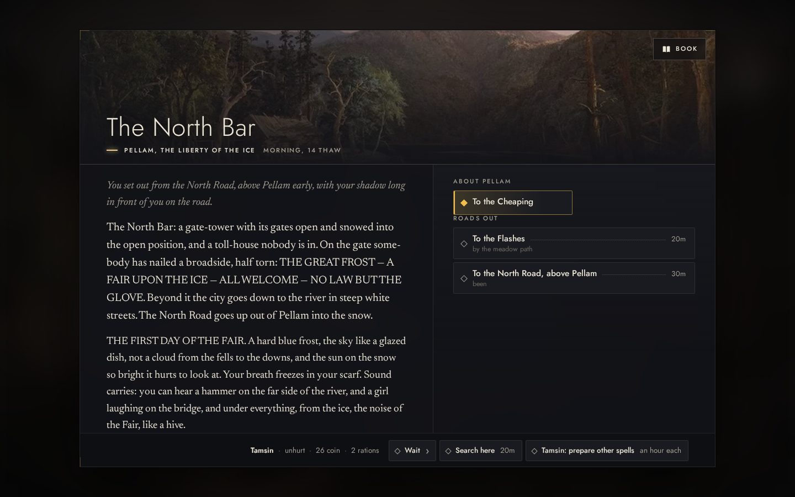
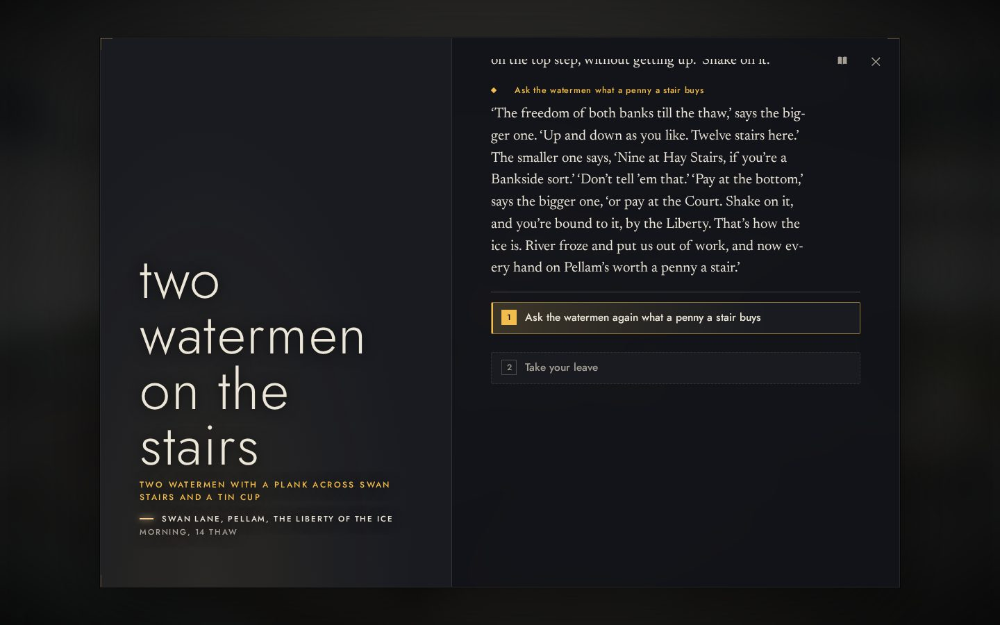
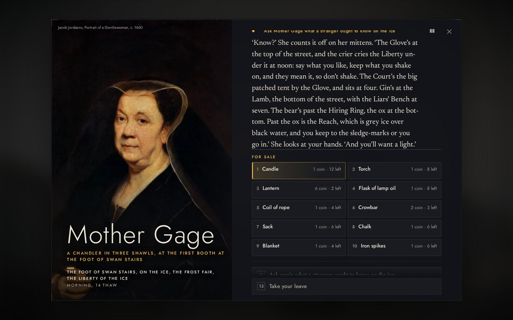
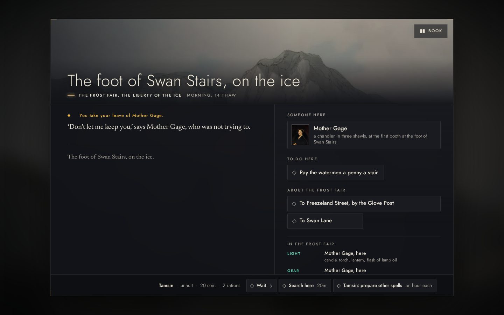
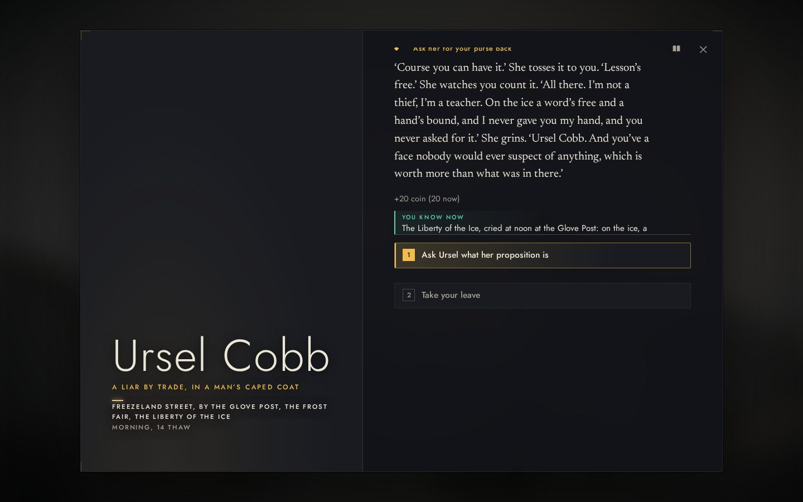
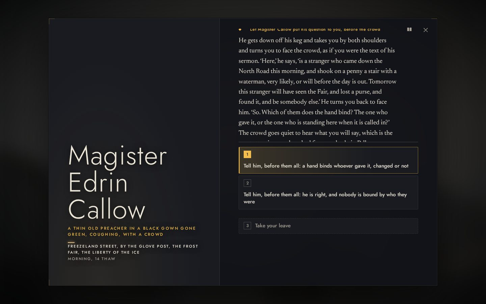
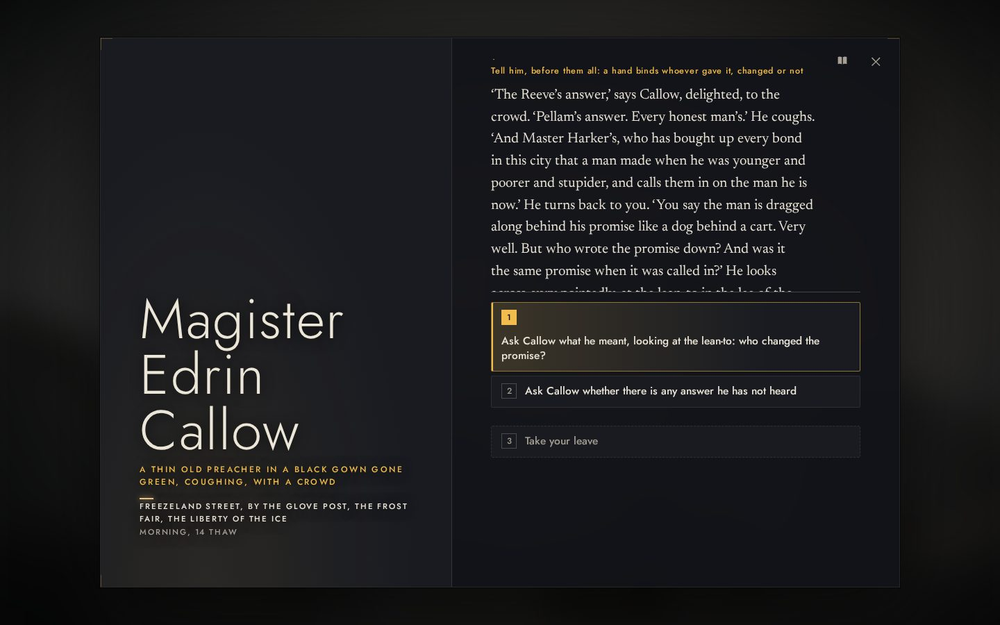
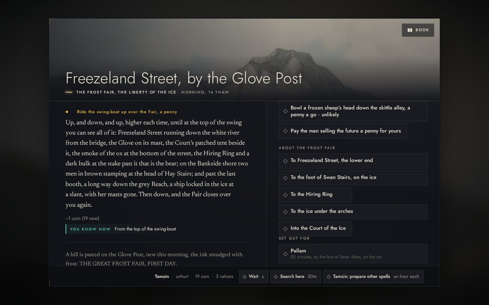

# Pellam's Frost Fair, through the reader (OWN-07)

*Mission 18, 2026-10-29. The owner's acceptance demonstration: a solo protagonist enters Pellam during the Frost Fair
through the real interface, sees where the people and the activity are, finds useful commerce, speaks substantially
with someone important, keeps their bearings, and finds a reason to go on. No scene was injected and no fixture was
set up: every step below is a choice on the page, found by its label, in the built site (`site/mono.html`), with The
Liberty of the Ice begun from the title as a new protagonist (Tamsin, alone) would begin it.*

| | |
|---|---|
|  | **Coming in.** From the North Road above Pellam the city is told whole: the bowl of hills, the cathedral's gilded scales, the bridge, and under it a street of tents on the river. At the North Bar, a broadside on the gate: THE GREAT FROST — A FAIR UPON THE ICE — NO LAW BUT THE GLOVE. |
|  | **The first people.** At the top of Swan Stairs two watermen with a plank across the stairs and a tin cup: a penny a stair, shake on it, and you are bound by the Liberty. What the Fair's one law is, from the people it binds. |
|  | **Useful commerce.** At the foot of the stairs, the first booth on the ice: Mother Gage, a chandler in three shawls, with candles, a torch, a lantern, lamp oil, rope, a crowbar, a sack, chalk, a blanket, iron spikes. Asked what a stranger ought to know, she gives the Fair's geography in one breath: the Glove and the noon cry, the Court at four, the Lamb and the Liars' Bench, the bear, the ox, the Reach and its black water. |
|  | **Bought, and the place's services in view.** A lantern bought (26 coin to 20). The place now says who sells what and where: light and gear from Mother Gage here, food from Long Meg at the Glove Post and Bel Ashby at the Frozen Lamb. |
|  | **Where the people are.** Freezeland Street by the Glove Post: the crowd, Long Meg the gingerbread-wife, Ursel Cobb a liar by trade, Sir Lionel Gant, Magister Callow; the Fair's pastimes beside its ways. |
|  | **Someone important, at length.** Magister Edrin Callow teaches the Flow: nothing stays, and the one who shook hands this morning is gone. He is to be charged with unswearing at four. He turns the stranger to face the crowd and puts the Fair's question: is a hand bound once the one who gave it has changed? |
|  | **An answer given, and pressed.** Answered before them all ("a hand binds whoever gave it, changed or not"), he takes it up, and the conversation goes on to what he meant and whether there is any answer he has not heard. |
|  | **Bearings, and reasons to go on.** A penny for the swing-boat, and from the top of it the whole Fair is learned at once: the Glove on its mast, the Court's tent, the ox, the Hiring Ring, the bear at its stake, two men in brown at the head of Hay Stairs, and far down the grey Reach a ship locked in the ice with her masts gone. The notes keep what was heard and where the company could go. |

## What it showed

- **People and activity:** watermen, a chandler, a gingerbread-wife, a liar, a gentleman living on the ice, a preacher
  with a crowd, the crowd itself; pastimes priced in pennies (the skittle alley, the swing-boat, the man selling the
  future).
- **Commerce:** the ordinary kit at the first booth on the ice, bought without searching; where else food and light are
  sold, said on the page.
- **Conversation:** Callow's teaching, his public question, two answers to choose between, and his reply pressed
  further: the debate Mission 18's OWN-06 asks for begins here. The philosophers' longer exchanges and debate among
  several remain open under OWN-06.
- **Bearings and a reason to go on:** the swing-boat's view, the notes' places and rumours, the Court at four, Callow's
  trial, the ship in the Reach.

## How it was played

Through the reader with a scripted driver that chooses by label (`MonoDriver`), the same as a person choosing on the
page; the driver's log of every page and choice was kept with the frames. Two steps were retried when the driver
looked for a choice before the page had settled (Mother Gage's counter, the lantern): the choices were the same.
