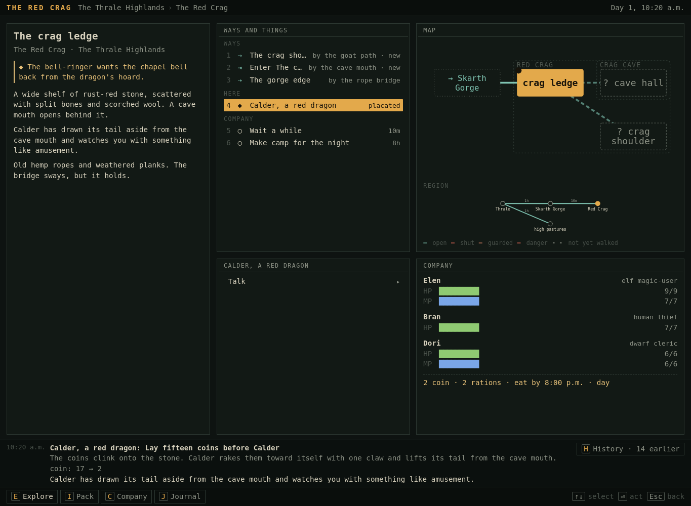
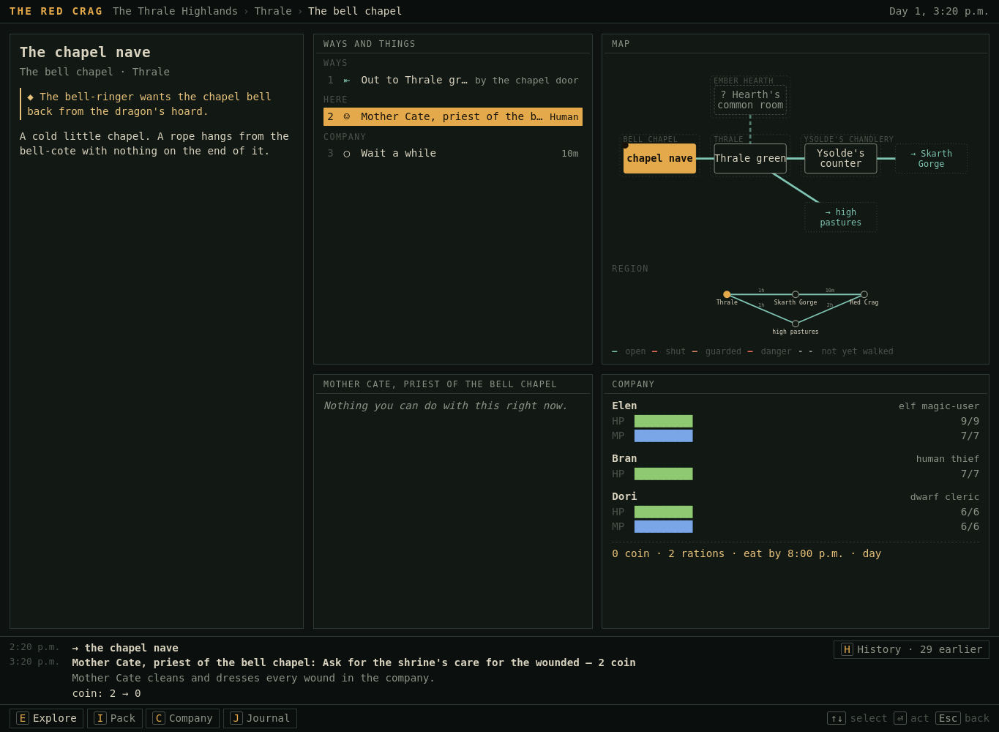
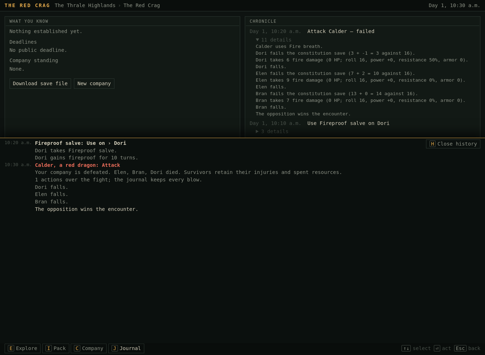
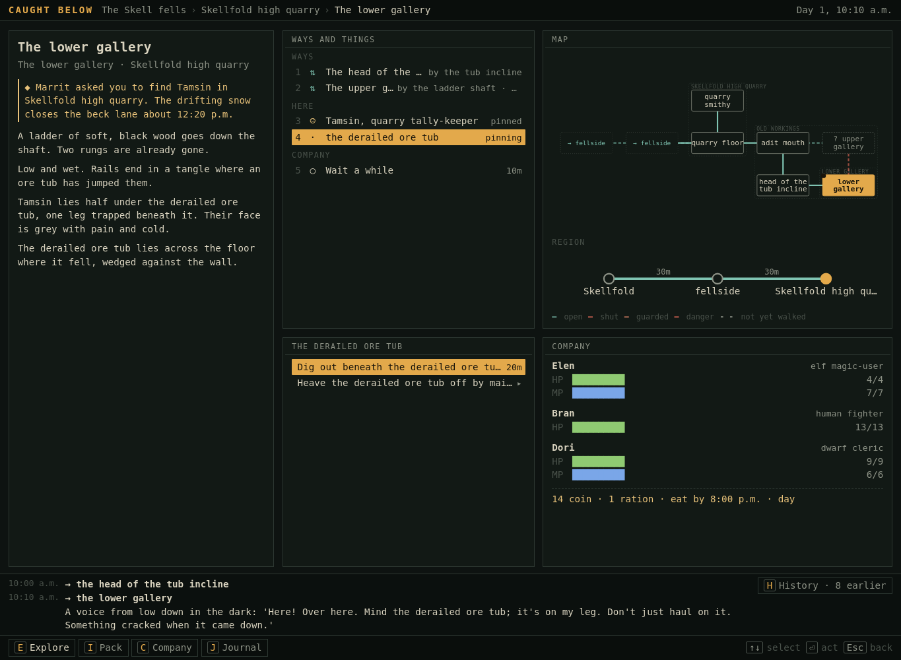
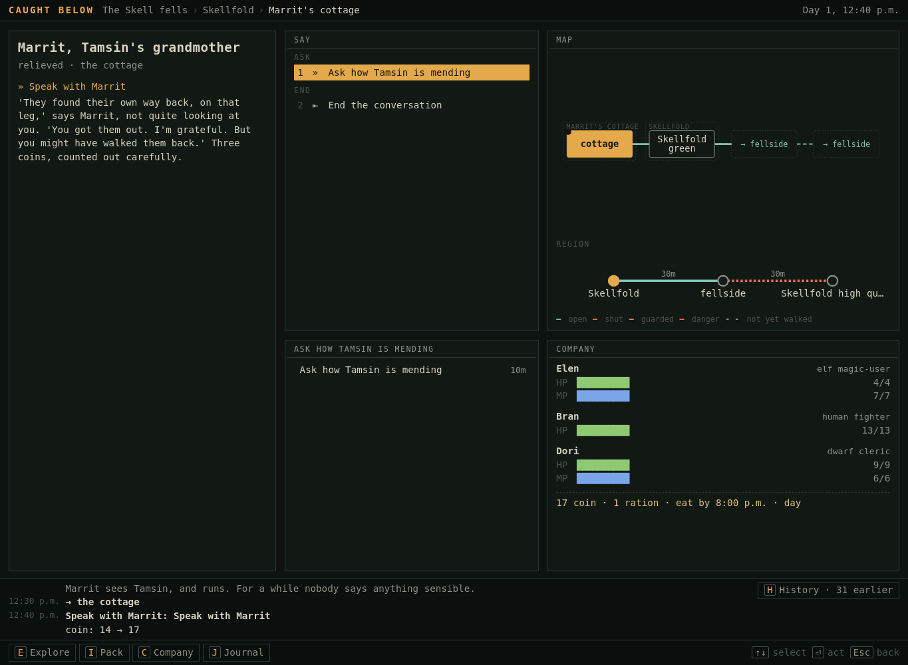
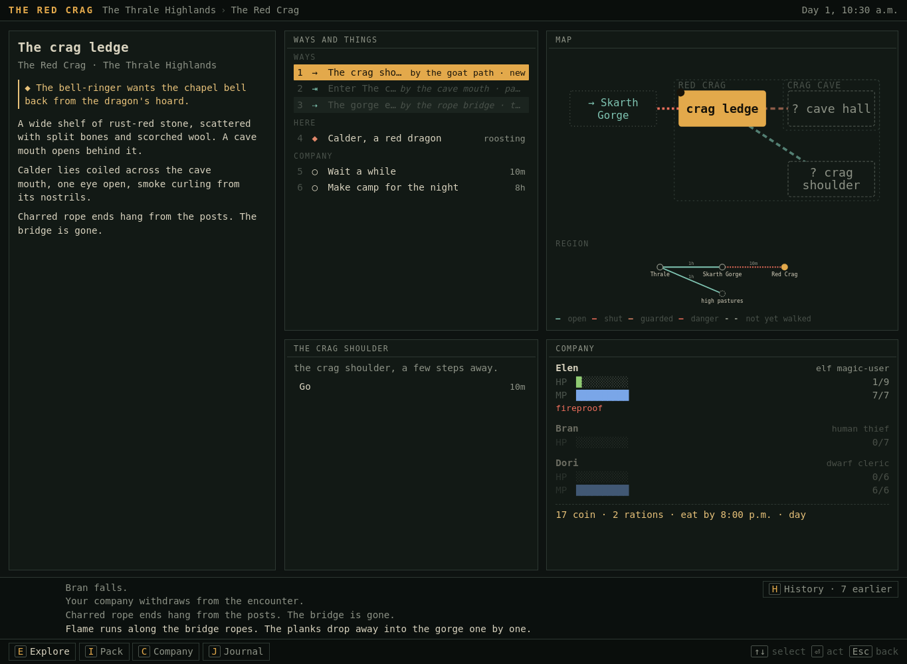
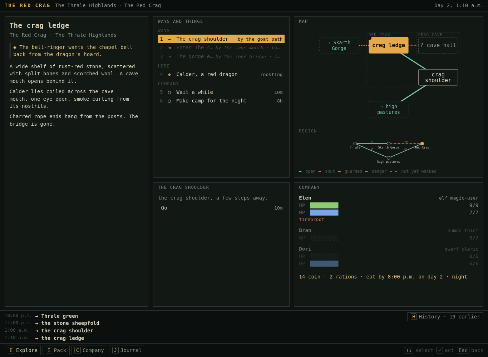

# G. Additional exploratory play — product commission

19 October 2026. This extends the [earlier cold record](../cold-2026-10-19/cold-playtest.md); it does not replace it or claim another blind participant. The assessor already knew earlier findings. Red Crag and Skellfold were initially approached through their UI, without reading their authored source or test journeys. After those branches, source inspection informed the explicit bell-completion check. Informed hostile branches are labelled below.

- [97 screenshots and exact visible text](evidence-index.md)
- [Evidence hashes](evidence-manifest.json)
- [Browser action record](browser-actions.jsonl) — individual UI operations, including technical retries; not a scripted journey.
- [Product specification](../../design/kyr-player-experience/README.md)

## Method

Built current source to `/tmp/kyr-product-site`, played local Mono using Chromium through a small Playwright connection helper. Unfamiliar actions were chosen after observing the previous screen. No planner, engine test hook, altered save, injected command, walkthrough or prewritten action sequence substituted for exploratory decisions. Familiar navigation, repeated save/load and already-understood preparation steps were sometimes batched. Screenshots at 1365×1000 except 76 at 390×844. A single narrow snapshot is not a mobile usability study.

There are three currently bundled campaigns: Reedwake, Skellfold, Red Crag. The current working tree already contains extensive modifications/deletions; this is not a released-build certification. Additional play began before inspecting Red Crag/Skellfold source. Later inspection of the current sources explains behavior but is not recast as player discovery. The documentation-only product commission does not change client, game rules or authored scenarios.

## Coverage matrix

| Requested experience | Evidence and status |
|---|---|
| Another campaign/site | **Played Red Crag and Skellfold.** Both are bounded scenarios, not substantial long campaigns. |
| Larger branching site | Skellfold has an adit/upper gallery/incline/lower gallery loop and a hazardous ladder (57–67). Red Crag has a regional route loop. **No large dungeon played.** Advertised Serewater launch fails with missing bundled file (49). |
| Multi-enemy encounter | **Unavailable in the three current campaigns inspected.** Red Crag has one dragon; Reedwake individual hound/construct; Skellfold no hostile encounter encountered or authored in its site. Battle can represent multiple enemies, but this is code capability, not played content. The unbundled wolf-yard fixture contains two separate wolf persons, not evidence that both join one player encounter. |
| Genuine defeat | Dragon breath reduces all companions to zero before the first player turn (44–46). Reload preserves defeat (47). Second branch: mage survives breath, casts sleep, is killed by bite (79–81). |
| Retreat/recovery/re-entry | Mage survives with salve, retreats; bridge burned; returns by alternate route; inn restores living mage only; re-entry next day still has destroyed bridge and roosting dragon (82–94). No second battle entered on that return. Earlier Ash re-entry remains separate evidence. |
| Party composition/capabilities | Magic-user/thief/cleric at Thrale; magic-user/miner-fighter/medic-cleric at Skellfold. Invalid explorer/mage combination rejected after selection (03). Miner unlocks faster digging (60–61); rope enables route/hazard work (27, 64–65). |
| Spells/equipment/consumables | Salve bought and used; 50% resistance observed; Binding sleep paid for and resisted (81). Rope used as passage requirement, line used on ladder. **No successful offensive damage spell, multi-target spell encounter, equipped-weapon attack or advancement played in this extension.** |
| Noncombat solution | Fifteen-coin dragon tribute grants passage; bell retrieved without combat (21–25). No generalized negotiation or stealth demonstrated. |
| Situation developing with time | Dragon departs for hunt as player speaks to shepherd (30–31); Tamsin returns independently (63, 68–71); snow closes lane on later revisit (75). Theft-triggered village raid inspected in source only, not played. |
| Return to changed people/place | Marrit reproaches lack of escort and gives three coins (73); ladder stays secured; snow blocks old route; bridge remains destroyed; directed bell handover produces changed bell-ringer (95–97). |
| Save/load longer play | Branch checkpoint, negotiated return, total defeat, partial defeat/rest/re-entry and quarry saves exported. Defeat and negotiated journey reloaded through UI (41,47,48); world/inventory/time retained, immediate history blank. No claim of multi-session campaign progression. |

## Journey 1: Red Crag, paid passage and unsignposted handover

| Captures | Decisions and observations |
|---|---|
| 01–04 | Launch Red Crag. Creation still advertises Censer Hill. Choose Elen magic-user, Bran thief, Dori cleric, seed `thrale`. Explorer background says rangers only; still selectable on mage; Begin rejects `world__party_1: the explorer overlay requires the ranger class`. Change to locksmith; launch succeeds. Party HP 9/7/6, mage mana 7, cleric mana 6, shared purse 22. |
| 05–08 | Bell-ringer explains dragon stole bell; asks return without burning village. Mage sheet exposes fire bolt, sleep, ward, drain, summon. Primary descriptions still contain expression language. |
| 09–14 | Buy salve for Dori (4 coin) and rope for Bran (1 coin), leaving 17. No useful merchant conversation. Buying has three nested selections; inspecting an item for sale does not show its effects. |
| 15–20 | One-hour gorge road, ten-minute bridge. Dragon blocks cave. Speak: “Petitioners come with gold.” Fifteen-coin option visible, alongside attack. Save before choice. Notes says nothing established despite two useful conversations. |
| 21–25 | Pay tribute: purse 17→2; dragon moves tail; enter cave, take bell for Bran, exit without hostility. Strong concrete approach/state change. Cave is one room. Bell describes a small signal bell in Pack despite being a stolen chapel bell. |
| 26–31 | Explore shoulder; rope-dependent scree route takes two hours to sheepfold. Tobin says dragon hunts about 1:10 and returns near 5:40. During this conversation, Calder departs and appears hunting at sheepfold. This is observed time-dependent agency/routine, not a claimed general predator simulation. |
| 32–40 | Return to bell-ringer carrying bell: same original topic. Enter chapel seeking handover. Clicking Mother Cate automatically buys unnecessary healing, costs last two coins and one hour with party fully healthy (36). Bell offers transfers to companions and Set down, no return action. Put it in chapel; no completion. Save this branch. |
| 41,48 | Resume earlier approach and later negotiated-return saves. Correct location, stock/gear/purse/clock retained; “Nothing has happened yet” in immediate history. |
| 95–97 | **After source inspection:** completion condition requires bell at village green. Reload negotiated-return save, take bell from chapel, carry to green (still no handover), then Set down. Bell-ringer takes it and becomes glad. Thanks: “Listen to it! A bit flat, but it's ours.” This is a successful code-guided diagnostic, **not successful unaided discovery of the handover**. |

The handover is not missing simulation. It is a mismatch between player intention, physical item-location conditions and available verbs. Bringing the bell to its owner or chapel is reasonable; requiring a dropped item on the green should not be a hidden puzzle. Even after completion, static town/chapel prose can still say bell-cote empty: current source observations are unconditional. Treat that as incoherent authored state, not an excuse to make the frontend guess.

## Journey 2: hostile branches, total defeat and an attempted control spell

These deliberately test alternatives from the same saved approach. Prior knowledge informs salve allocation; they are not independent cold runs.

| Captures | Decisions and outcomes |
|---|---|
| 42–47 | Apply salve to Dori; it says fireproof for ten turns. Attack Calder. One opening Fire breath rolls 16. All three fail Constitution saves; Dori's 50% resistance applies but actual HP loss is capped at remaining 6. Elen loses 9, Bran 7. **No player action turn occurs; all fall.** Save and reload preserves the no-survivors screen. |
| 77–81 | Reload pre-approach; apply salve to Elen instead. Open history overlay intercepts attack click; close it before acting (78). This time Elen takes 8 and survives at 1, others fall. Cast Binding sleep: Calder passes Wisdom save 13 against 13, then bites Elen. Spell paid and resisted; total defeat. Save preserves full events. |

The detailed save display contains arithmetic that looks inconsistent (`3 + -1 = 3`, `7 + 2 = 10`), because its formatting omits the category save's level/other components. This is a code-inspected presentation defect, not evidence that the underlying save rolled incorrectly. Damage reports use actual HP lost (capped at remaining HP) as damage, so the breath can appear to do only 6/9/7 despite a 16 roll; it needs to distinguish resolved damage from HP loss/overkill before writing “weak breath” fiction.

## Journey 3: Skellfold, physical capabilities and independent return

Seed `quarry-expedition`; Elen magic-user/locksmith (4 HP, 7 mana), Bran fighter/miner (13 HP), Dori cleric/medic (9 HP, 6 mana). This shares Caught Below's rescue structure, but explores a new layout and different approach.

| Captures | Decisions and outcomes |
|---|---|
| 50–57 | Marrit asks for Tamsin; snow closes beck lane about 12:20. Short valley approach. Smithy has free line and crowbar. Take line for Bran; deliberately leave crowbar to test miner option. Enter adit, inspect route branch. |
| 58–61 | Follow side drift/incline to lower gallery. Tamsin pinned by ore tub; rotten ladder to upper level. Miner approach available: dig carefully for twenty minutes. Tamsin freed; tub remains, hollow beneath. No bar required. This is a meaningful changed physical state from a character capability. |
| 62–66 | Let Tamsin make own way. They depart up incline while party stays. Inspect ladder: risk versus lash with line. Choose lashing, costs ten minutes, ladder state changes; next crossing ten minutes, no damage. Complete upper-gallery loop. |
| 67–74 | On return, Tamsin appears making for cottage at quarry floor, then beck lane. By green, Tamsin/Marrit have gone inside; at cottage Tamsin settled with bad leg up. Marrit gives **three coins** and says party should have escorted. Specific consequence of letting person walk alone. Journal still “Nothing established yet,” concealing this coherent story in a long chronicle. |
| 75–76 | Revisit beck lane after 12:20: snow blocks quarry route, no traverse command. Capture narrow layout; HP strip precedes place, choices truncate, separate action preview absent, map and history consume remaining space. |

## Journey 4: retreat, persistent damage, recovery and re-entry

| Captures | Decisions and outcomes |
|---|---|
| 82–84 | Replay already-understood salve-on-Elen preparation from checkpoint. After opening breath leaves her at 1 HP, choose Retreat. Still at ledge; two companions zero; dragon roosts. **Bridge now burned** by fire exposure. Inspect old exit: no traverse command, charred rope ends. |
| 85–90 | Use goat path, rope-dependent scree, pasture track to return. Party display retains fallen companions; no account of carrying bodies or abandoned gear. Buy inn bed/supper: eight hours, three coins, Elen 1→9 HP, others remain zero. Fireproof remains despite travel/rest; source confirms ten wearer combat turns rather than world-time expiry. Display never explained that clock. |
| 91–94 | Travel back via pasture route at night. Day 2, 1:10: bridge still destroyed, dragon roosting, Elen full, Bran/Dori zero. No second combat entered. Save re-entry state. NPC/world persistence is real; humane and physically understandable handling of fallen companions is underspecified. |

## Conclusions this evidence permits

Kyr's best product evidence is **a capability changing an approach, an inhabitant pursuing a goal, and an encounter changing the route home**. Those connections already work in bounded cases. Paid passage and timed absence offer distinct approaches to a dangerous creature; combat need not be the mandatory solution. There is no need to fictionalize these as a generic quest checklist.

Current gaps are equally concrete: no player-facing large campaign available, no authored multi-enemy encounter found in the shipped three, no played advancement/recruitment, little ongoing institutional or economic conflict, obscure completion affordances, and poor handling/explanation of catastrophic losses. Do not use engine extensibility, an unbundled fixture, registry coverage or source comments as proof that those experiences are already playable.

The product specification consequently includes new authoring/rules work, not just a better scene renderer. It does not claim the proposed tactical zones, surrender, body recovery, institutions or advancement paths were demonstrated in current play.
