# The Varrow, by keys (October 21, 2026)

A browser session with the campaign's own company (the delvers: Nell, human thief; Hulda, dwarf warrior; Ivo,
human mage), played through the built client at 1280×900. Screenshots were taken as it happened. The same route,
as far as Crake's Ford, is played by `test/varrow-browser.test.ts` (`KYRIE_BROWSER=1`).

## Hollin

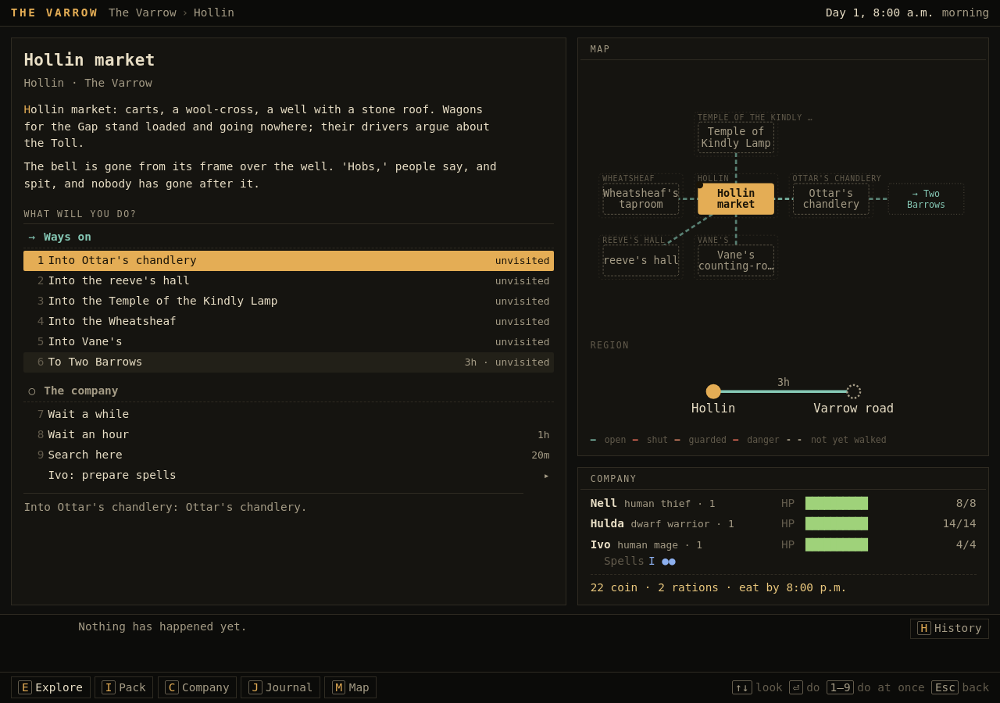

The opening is a market square, five doors and a road. The pitch on the company screen is five sentences: the Gap
is shut, Ninefingers tolls it, the reeve will pay, and the Lanthorn is the least of it.

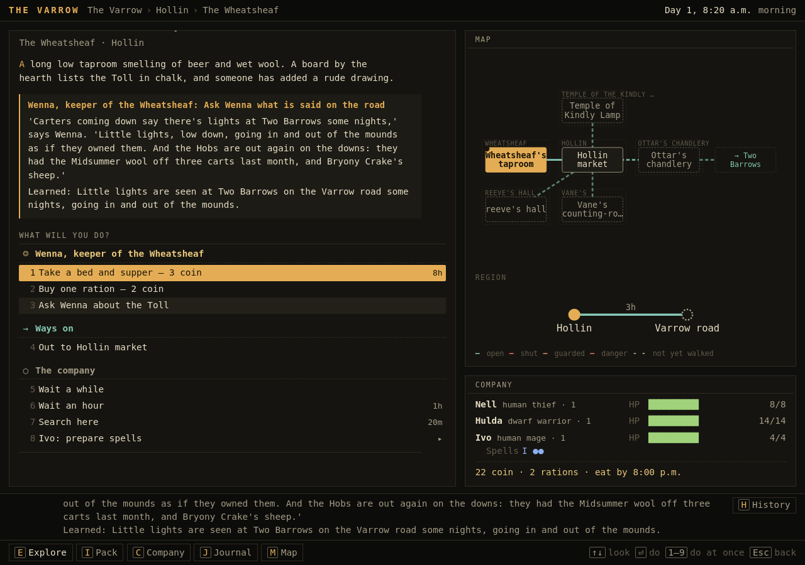

Wenna has two things to say. One is about the Toll. The other is the road's news: lights at Two Barrows, hobs on the
downs. What she says is what the company learns, and it goes into the journal with who said it. The map draws
Hollin's doors and the road east, which has not been walked yet.

## Two Barrows and the Candle Tombs

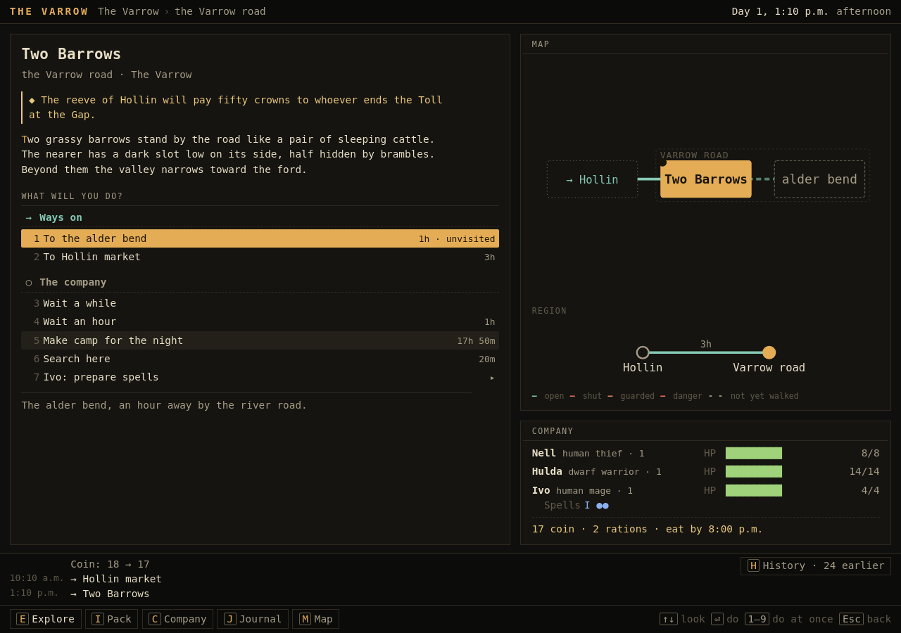

Three hours east. The nearer barrow's slot is mentioned in the scene, half hidden. A search (twenty minutes) finds
it, and a crawl leads in.

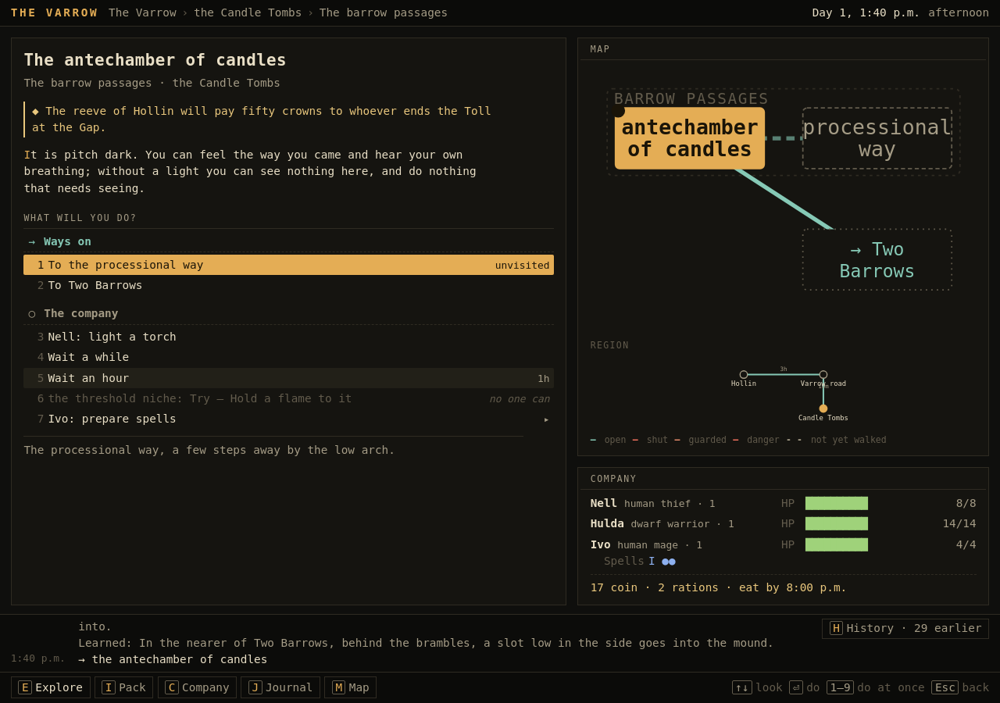

Inside, nothing can be seen. The only things offered are the way back, the arch ahead, and "Nell: light a torch".

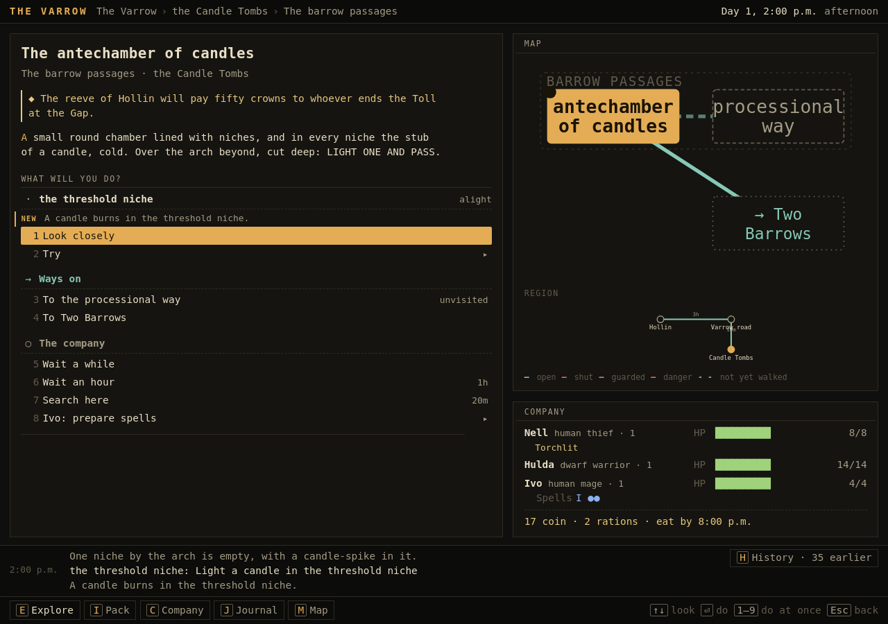

By torchlight: LIGHT ONE AND PASS over the arch, and an empty niche with a candle-spike. Lighting a candle there is
one choice. Torchlit shows under Nell's name, because torches last an hour, and this company bought three.

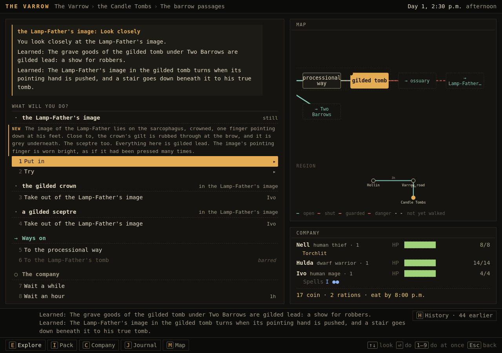

Gilded walls, a crowned image pointing at its feet, a crown and a sceptre to take. A close look shows that the gilt
is rubbed through to grey, and that the pointing finger is worn bright. Both go into the journal. Pushing the image
turns it on a pivot, and a stair goes down.

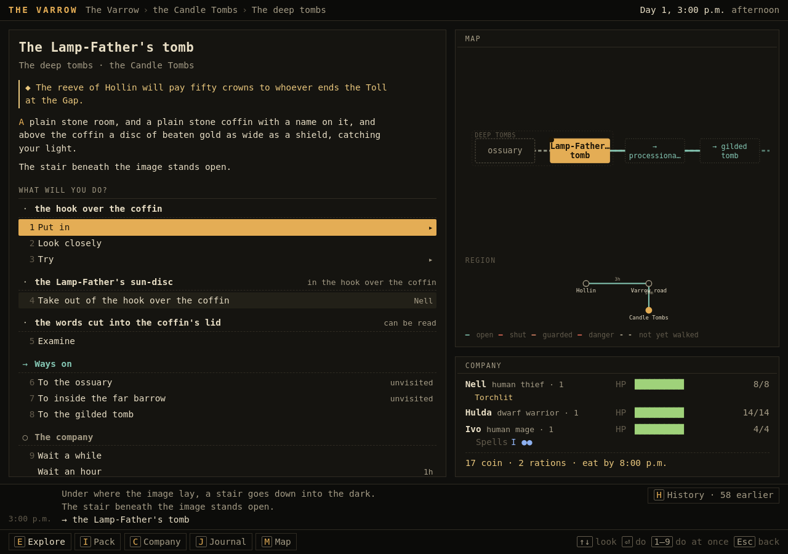

A plain room: the sun-disc on its hook, and words on the coffin lid to examine (the Lamplighters' Rule, the key to
the whole campaign). Taking the disc stirs the dead, but the candle at the threshold still burns, and they do not
wake. The way out is the rising passage and the dead door in the far barrow, which opens only from inside.

## Crake's Ford and the Gap

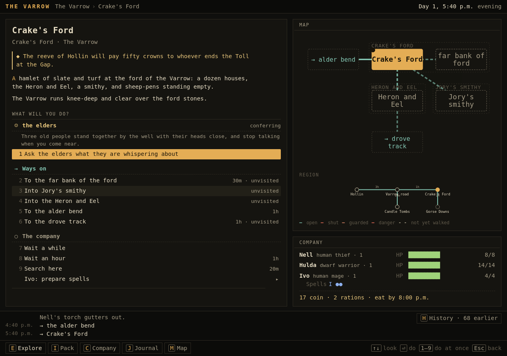

The ford is knee-deep and clear today. When it rains it is in spate, and the Gap road beyond cannot be reached.

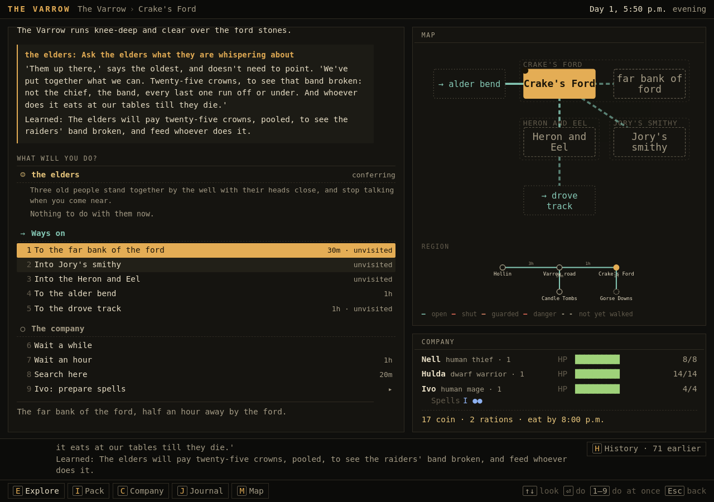

Three elders by the well. They were not written into the Varrow: the bounty kit put them there, against the
Hob-Knot's band, which raids this ford's farms. Deem chose elders rather than a widow. Their price is for the band
broken, not the chief, and afterwards free board.

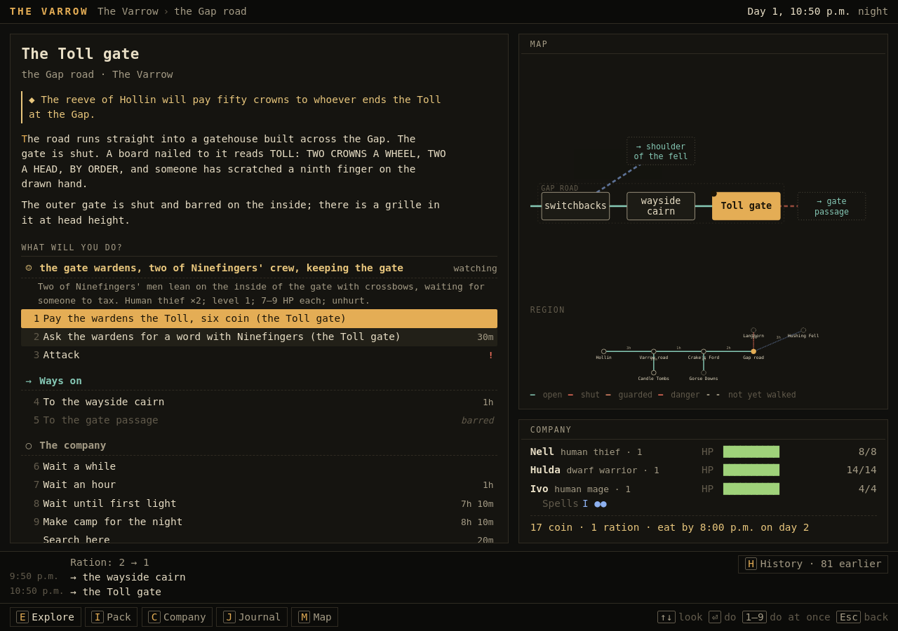

The gate is barred and the wardens watch it from inside. The choices are to pay six coin, ask for a word with
Ninefingers (not after dark: she sleeps), or attack across the grille.

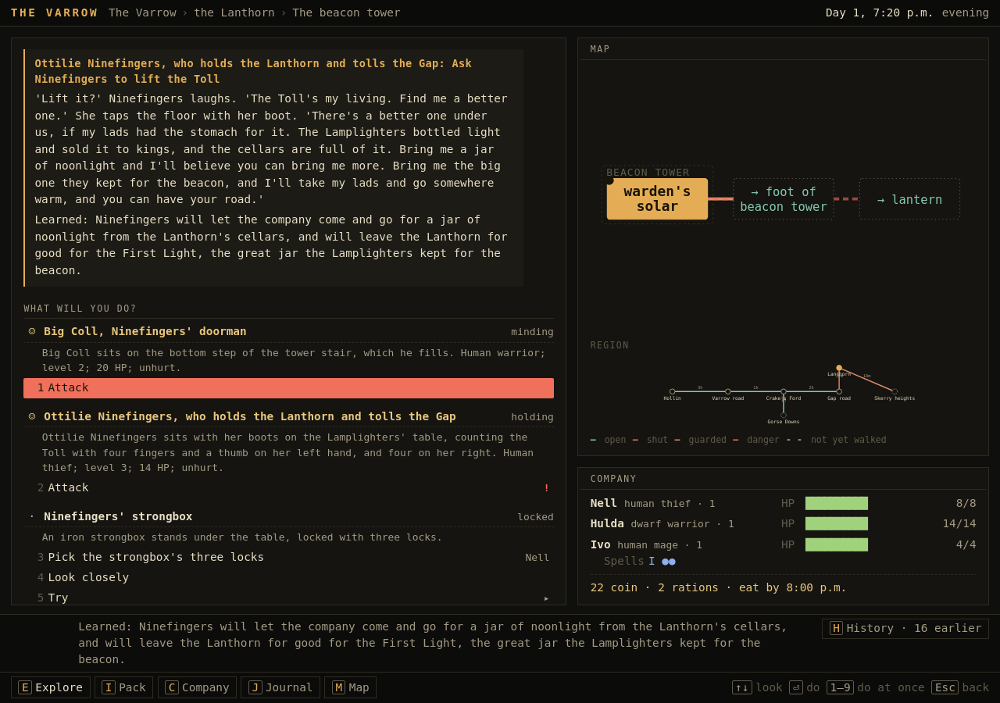

Taken up through the guardroom, the winch room, the wall walk and the court, past Big Coll on the tower stair.
Ninefingers names her price: a jar of noonlight for free passage, or the First Light and she leaves the Gap. The
strongbox is in reach, and so is the lantern stair, with its newer step.

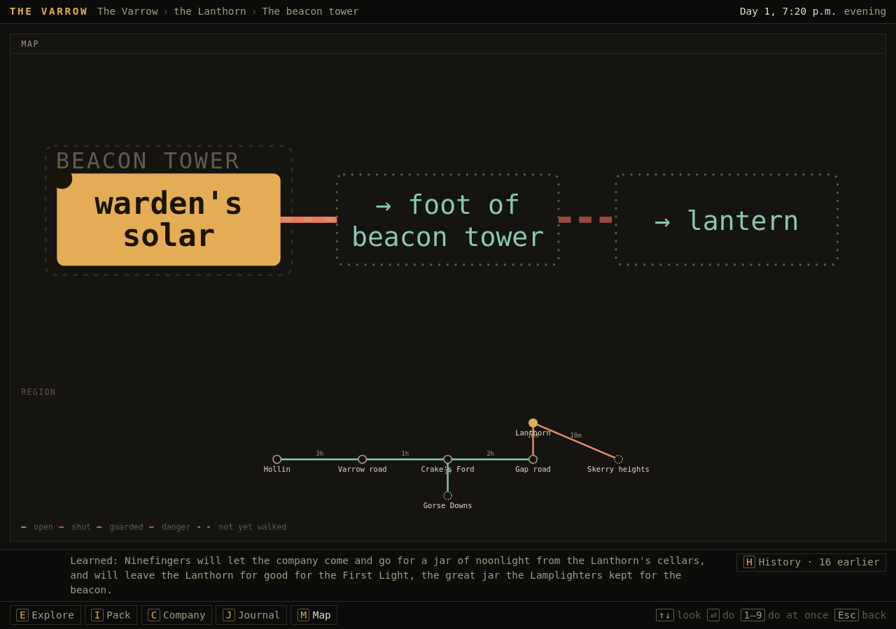

The tower floor, with the guarded stair down and the dangerous one up. On the region map, the valley road, the
downs, the Candle Tombs, the Gap road and the Lanthorn, and the heights toward Skerry, not yet walked.

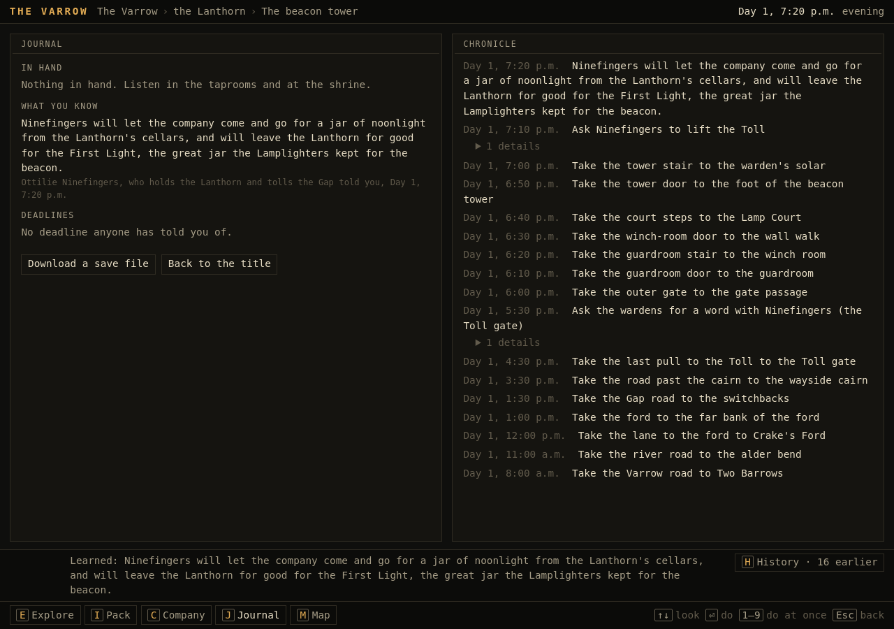

What the company knows, and who told it when; the chronicle of what was done.

## What this session showed

- Fixed during it: an audience could be asked for at night, and Ninefingers would bargain from her bed. Audiences
  are now daytime only, and she must be awake to talk.
- Fixed during it: Ninefingers' bargain and the bounties went into the journal as knowledge but not as aims. They
  are now listed under "In hand" until they are done.
- Torch time matters. The company panel showed who was torchlit but not for how long, so light management was
  learned by running out. It now shows the time left ("Torchlit · 50 min left").
- The objective line repeats at the top of every scene. It keeps the purpose in view, at some cost in space.
